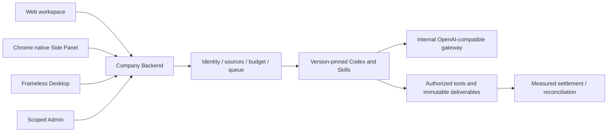

# Workmate · CopyPaste Chrome Extension

[English](README.en.md) · [主文档](https://github.com/copypasteltd/workmate/blob/docs/docs/README.md)

[Backend](https://github.com/copypasteltd/workmate/tree/backend) · [Web](https://github.com/copypasteltd/workmate/tree/web) · [Admin Dashboard](https://github.com/copypasteltd/workmate/tree/admin) · [Desktop](https://github.com/copypasteltd/workmate/tree/desktop) · [Chrome Extension](https://github.com/copypasteltd/workmate/tree/extension) · [Delivery](https://github.com/copypasteltd/workmate/tree/delivery)

面向香港企业的云端 Agent 产品。当前仓库负责 **Chrome Extension**；当前远程分支为 `extension`.

## 架构与约束

仅使用 Codex，全部 AI 请求经公司内部 OpenAI 兼容服务器。Web、Desktop、扩展和 Admin 共用服务端身份、权限、来源与计费控制。设计沿用 CopyPaste 的品牌素材、色系、字体和中英界面。



## 原生侧栏形态

Chrome Manifest V3 使用 `side_panel.default_path` 和 `chrome.sidePanel.setPanelBehavior({openPanelOnActionClick:true})`。点击工具栏打开真正的浏览器 Side Panel，再次点击可收起；没有 action popup 或模拟侧栏标签页。默认右侧，并遵循 Chrome 用户设置的侧栏位置。

`src/background.ts` 处理生命周期、公司授权和侧栏行为；`src/panel.ts` 管理企业/项目、任务、资料与结果；`public/sidepanel.html`、`public/panel.css` 提供本地界面，`scripts/build.mjs` 生成固定服务地址、CSP 和稳定扩展 ID。

## 使用流程

1. 构建并加载扩展，固定到浏览器工具栏。
2. 点击图标，浏览器右侧打开工作区。通过固定公司网页完成邮箱验证和 PKCE 授权。
3. 选择企业、项目和助手，提交工作或打开已有任务。可通过固定入口进入完整的创作、连接和网站工作台。
4. 需要资料时选择当前获准文件版本或连接。轮询保留选择；确认后继续原任务，查看结果和累计结算。
5. 切换范围或任务读取失败时清空旧内容。页面导航不销毁已有侧栏；关闭不用的页面释放内存。

浏览器扩展不能任意读取电脑所有路径。上传依赖用户选择；持续目录与设备任务需要明确授权及 Native Messaging companion。`nativeMessaging` 是可选权限；模型不能授予本地权限。

## 构建与加载

```powershell
npm ci
npm run build
```

在 `chrome://extensions` 开启开发者模式，选择“加载已解压的扩展程序”，选择当前仓库 `dist/`，然后固定并点击图标。需要 Chrome 120+；当前原生 Side Panel 旅程使用保留记录中的实际 Chromium。

`COPYPASTE_API_ORIGIN` 和 `COPYPASTE_WEB_ORIGIN` 在构建时设置，默认本地 4310/4317，生产要求公司 HTTPS Origin。保留 `manifest-key.txt` 以维持扩展 ID；其内容是公开公钥，不是签名私钥。`extension-id.txt` 用于服务端与 companion 注册。

源代码分支提供可复现构建；本地预览 ZIP 位于忽略的 `release/paid-input-66-03/`。商店提交、签名、跨浏览器/系统以及真实供应商接入另行验收。

## 初次检出与环境

新工作副本可单独检出本分支；已有本地仓库直接更新，不重新初始化。

```powershell
git clone --single-branch --branch extension git@github.com:copypasteltd/workmate.git copypaste-extension
cd copypaste-extension
```

Node.js ≥22.14、npm 和 Git；锁文件固定依赖。当前验收环境为 Windows x64。后端/完整交付还需要原生 PostgreSQL 启动资源、固定 Codex `0.163.0-alpha.10.2` 与 FFmpeg/FFprobe。禁止本地 Docker、WSL 和虚拟化。跨端运行使用多个独立工作目录；布局见 [workspace](https://github.com/copypasteltd/workmate/blob/docs/docs/governance/04-git-branches-and-publication.md).

## 检查与验证范围

```powershell
npm run typecheck
npm test
npm run build
```

平台完整 **782/782**、专项 **34/34**，六仓库 **13 项**类型/构建/现有客户端测试检查通过；真实打包程序和原生侧栏旅程 **32 项**。保留所有原 765 项命名测试。实际 Codex 子进程的工具/线程/用量通过模拟内部 API 验证；本次 UI 回合和业务数据按授权模拟。原 102 项需求仍为 81 项局部验证、21 项未证明完成、0 项完整验收，不能把本次截图或测试数量认作完整产品验收。

完整规范 TaskDTO/任务创建、任意执行中暂停、未知外部结果恢复、全角色独立业务、GEO、真实供应商和生产/签名/商店验收仍继续跟踪。

## 实际页面与交互

实际录制，保留原捕获时间；AI 回合与业务数据为明确模拟。Admin 演示表单不代表财务提交。


[MP4](assets/screenshots/workmate-06-interaction.mp4) · [录制与源码回执](https://github.com/copypasteltd/workmate/blob/docs/docs/quality/workmate-media-06.json)

## 方案细则与更新

- [Product](https://github.com/copypasteltd/workmate/blob/docs/docs/product/01-prd.md)
- [Architecture](https://github.com/copypasteltd/workmate/blob/docs/docs/technical/01-architecture-and-stack.md)
- [Identity and permissions](https://github.com/copypasteltd/workmate/blob/docs/docs/technical/07-security-and-permissions.md)
- [Task continuation](https://github.com/copypasteltd/workmate/blob/docs/docs/technical/66-paid-native-input-checkpoints.md)
- [Admin](https://github.com/copypasteltd/workmate/blob/docs/docs/product/08-admin-dashboard.md)
- [Native clients](https://github.com/copypasteltd/workmate/blob/docs/docs/technical/30-native-window-and-browser-sidepanel.md)
- [Release notes](https://github.com/copypasteltd/workmate/blob/docs/docs/changes/2026-10-22-workmate-publication.md)

后续修改需要同步中英 README、受影响的实际截图/GIF、更新说明和对应分支。提交后通过 Delivery 发布流程核对远程 SHA；不强推覆盖协作者。`.env`、数据库、会话、依赖和安装产物不进入 Git。历史 README 原字节见 [archive](https://github.com/copypasteltd/workmate/blob/docs/docs/quality/history/stage66-before-workmate-readmes/manifest.json).
