# Workmate · backend

## 当前完整冻结交付 · v0.1.2

全部端、六仓源码与本次费用入账期间报表统一纳入完整下载包。Desktop在本机运行Codex且支持客户主动授予完整本机权限；Extension使用原生右侧Side Panel，获准读取/上传文件后由云端Codex执行。数据库156；外部AI/媒体/广告/支付采用已授权假数据，Windows未签名。

[完整下载 / Complete release](https://github.com/copypasteltd/workmate/releases/tag/v0.1.2) · [安装、登录和使用 / Setup and flows](https://github.com/copypasteltd/workmate/blob/v0.1.2/docs/releases/v0.1.2.md)

本轮重新构建Backend/Admin；其余运行产物及Windows分发核对后复用。继承源码一致的阶段172定向验证，阶段173不重跑功能测试。Backend/Admin rebuilt; unchanged runtimes/Windows distributions verified and reused. Exact-source stage172 focused checks inherited; no functional tests rerun at173. Older entries below retain their historical scope.


## 当前源码增量 · 阶段172

Admin新增工作建立／费用入账两种期间。旧任务本期扣费、跨期香港日期、区间外原扣费的退款及负净消耗可查询；分组、明细和CSV共用一份固定快照。预留额度与累积操作用量另行说明。当前源码需配套Backend/Admin，数据库仍为156。此增量不在已冻结v0.1.1 ZIP内；原包与标签保持。

本轮新增8项原生SQL/API＋1项精确投影检查；6项原报表检查在源码一致时继承其实际通过结果；7组实际Admin操作通过。首次历史测试资料缺少资金来源而被约束拒绝，已以新版本补齐来源与资金变动；失败原记录保留，未关闭保护。全部原完整验收范围继续跟踪。

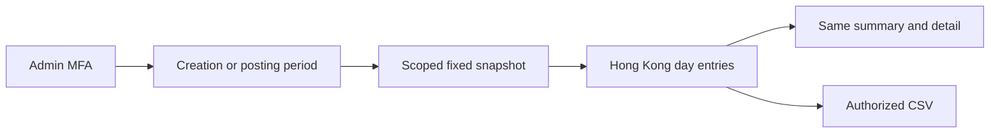


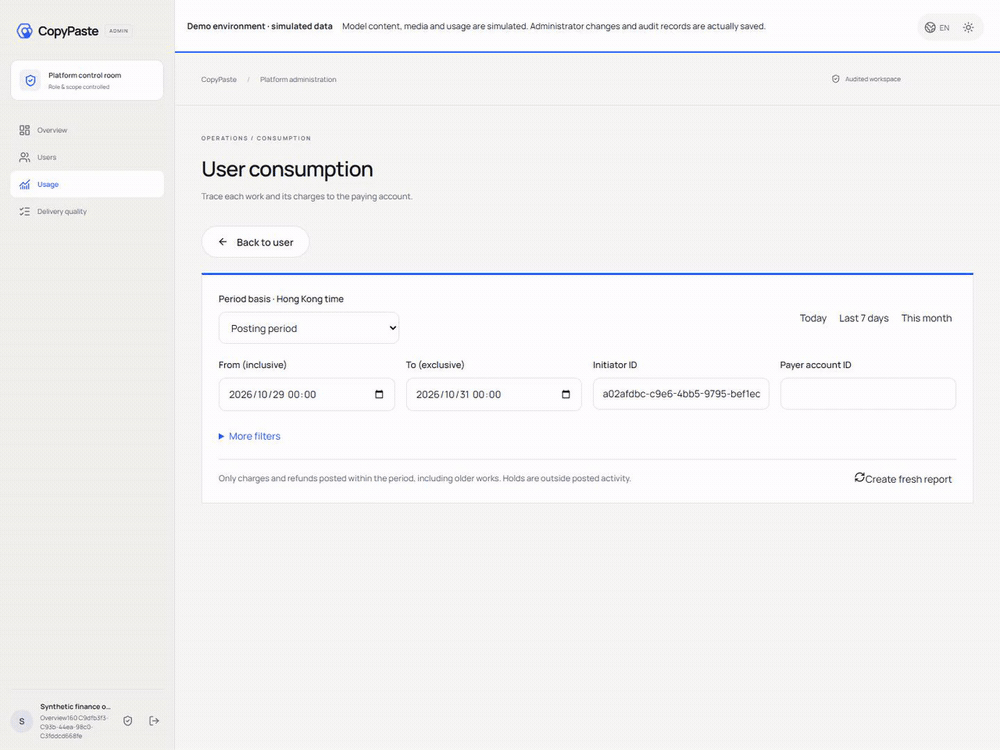

[MP4](assets/screenshots/workmate-admin-posting-period-172-01-posting-period-workflow.mp4) · [方案 / Behavior](https://github.com/copypasteltd/workmate/blob/docs/docs/development/172-admin-posting-period.md)

## 冻结交付 v0.1.1

完整包统一包含Windows Desktop（本机Codex、无边框）、Web、独立Admin、Chrome右侧Side Panel、Backend、六仓源码和固定runtime。假数据模式，Windows未签名；当前数据库156。

[完整发行包 / Complete release](https://github.com/copypasteltd/workmate/releases/tag/v0.1.1) · [安装及流程 / Setup and flows](https://github.com/copypasteltd/workmate/blob/v0.1.1/docs/releases/v0.1.1.md)

## 当前源码增量 · 阶段169

用户消耗报表支持付款方／项目／时间等筛选、八类分组、任务账务明细和同快照CSV。金额、预留、退款、待对账和未知内部成本分开；当前范围、MFA、导出权限逐次复查。当前库版本156。旧v0.1.0包未改；本增量纳入下一完整冻结包。

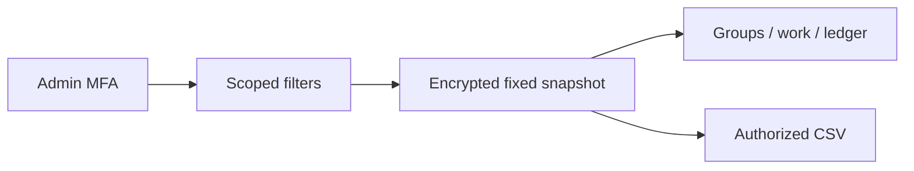

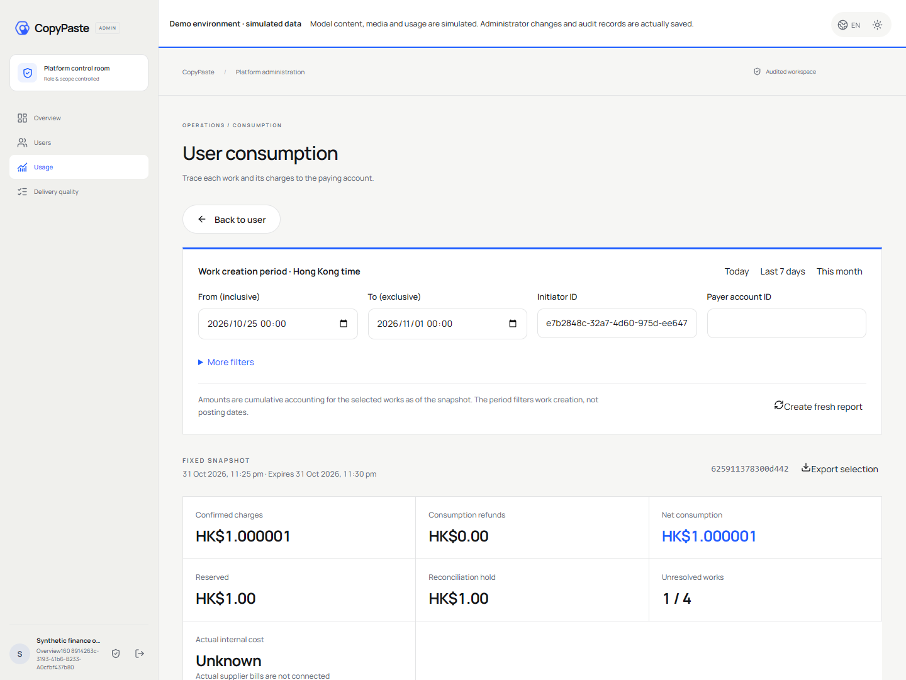

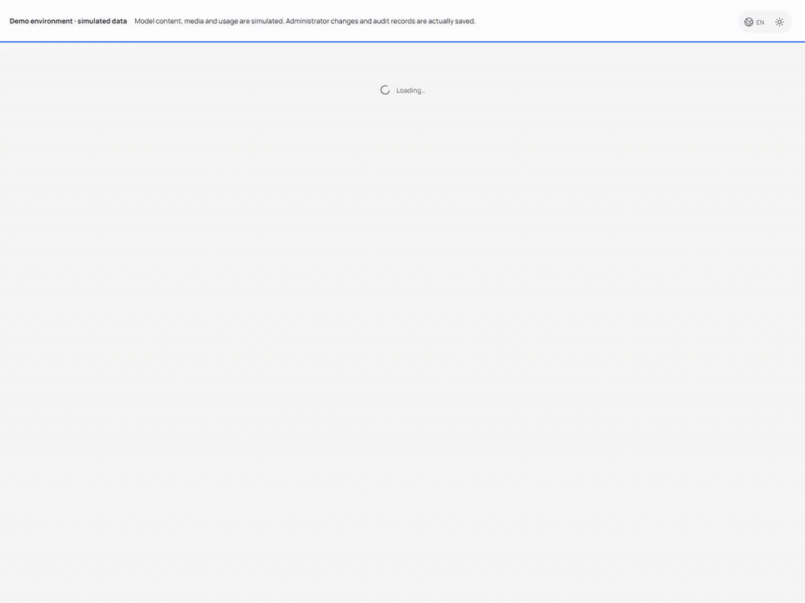

[MP4](assets/screenshots/workmate-admin-usage-report-169-02-consumption-report-workflow.mp4) · [方案 / Behavior](https://github.com/copypasteltd/workmate/blob/docs/docs/development/169-admin-usage-reports.md)


[English](README.en.md) · [完整Release](https://github.com/copypasteltd/workmate/releases/tag/v0.1.0) · [中英安装使用](https://github.com/copypasteltd/workmate/blob/v0.1.0/docs/releases/v0.1.0.md)

面向香港企业的 Codex Agent 平台，首批服务既有 marketing 团队，覆盖设计/媒体、广告与网站/SEO/GEO分析、重复流程和软件开发。本仓库为独立 **backend** 端，使用 **Fastify / PostgreSQL / cloud Codex**。视觉遵循 CopyPaste 的暖白底、深色文字、品牌色和编辑式排版。

## 当前源码增量 · 阶段168

用户列表可组合注册/最近账户访问、来源、VIP方案/状态/到期、确认扣费、角色建立/开始、待对账和独立账户额度条件。刷新、详情及返回保留URL条件。最近访问包含合法设备后台轮询，不等于真人在线；历史来源和访问保持未知。金额以精确微港币保存，只统计确认扣费；个人/企业资金不合并，未知或不一致账务不当作零。

当前增量需数据库001–156及匹配API/Worker：停止旧服务，备份后迁移，再启动新服务。默认目录DTO兼容；显式view=operations增加来源及访问字段。费用、VIP、账务各需独立当前范围权限及近期MFA，目录读取不写账。

此项是v0.1.0之后的源码更新，**不在原冻结ZIP内**。原发行标签及资产保持不变。当前Backend/Admin构建、8项原生SQL/API和6组实际Admin页面检查通过；保留测试数据与页面定位的原始失败尝试。业务仍使用已授权假数据，完整验收范围继续跟踪。

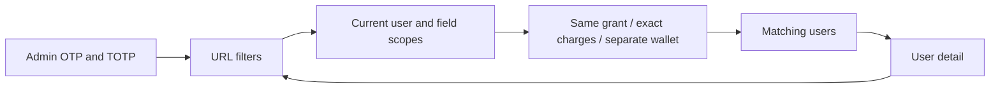

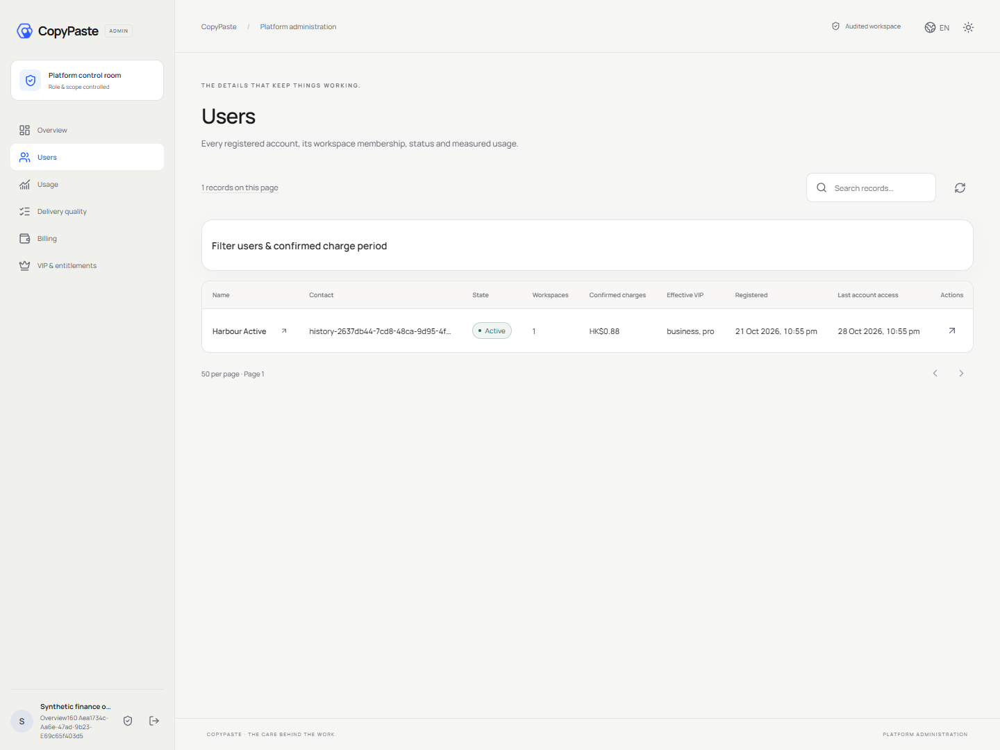

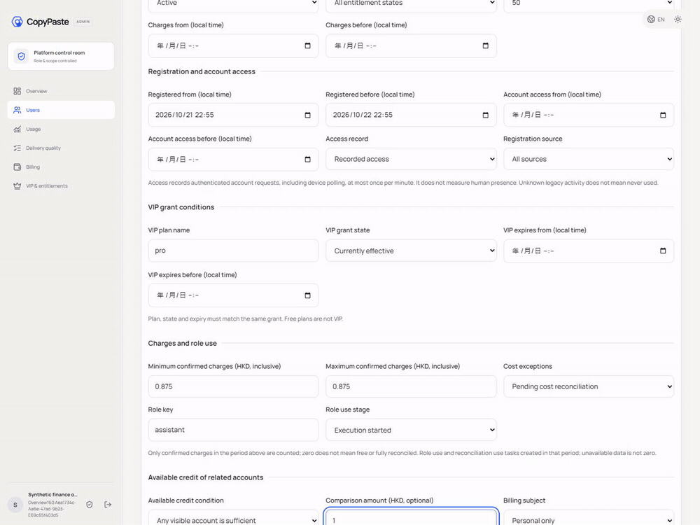

[MP4](assets/screenshots/workmate-admin-directory-filters-168-03-directory-filter-workflow.mp4) · [Logic / 逻辑](https://github.com/copypasteltd/workmate/blob/docs/docs/development/168-admin-directory-operational-filters.md) · [Evidence / 回执](https://github.com/copypasteltd/workmate/blob/docs/docs/quality/admin-directory-filters-168.json)

## 本版用户任务与内容 · 阶段166

用户详情直接进入该用户的任务与内容。搜索、分页和刷新保留目标，返回恢复原目录条件；换用户清空旧正文和操作。当前用户范围与资源范围同时鉴权，正文/下载保持独立权限与近期MFA。二十类内容按实际创建者归属，品牌保留首版作者；未知作者旧资料在全站目录查看。记录按资源类型计算，同名文件资产及目录项具有独立身份。

该功能已纳入v0.1.0源码与分发包；旧rc.5包和标签保持原样。本轮后端/Admin构建、八项原生SQL/API及八组实际页面检查通过，原始定位失败和录制均保留。外部服务仍用已授权假数据，原完整验收范围继续跟踪。

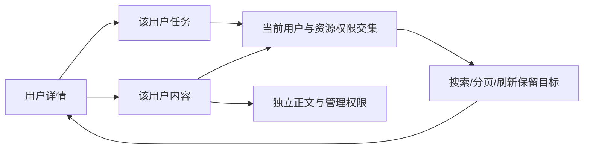

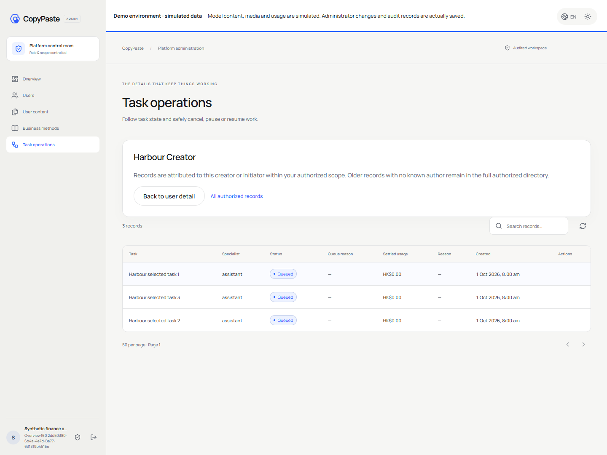

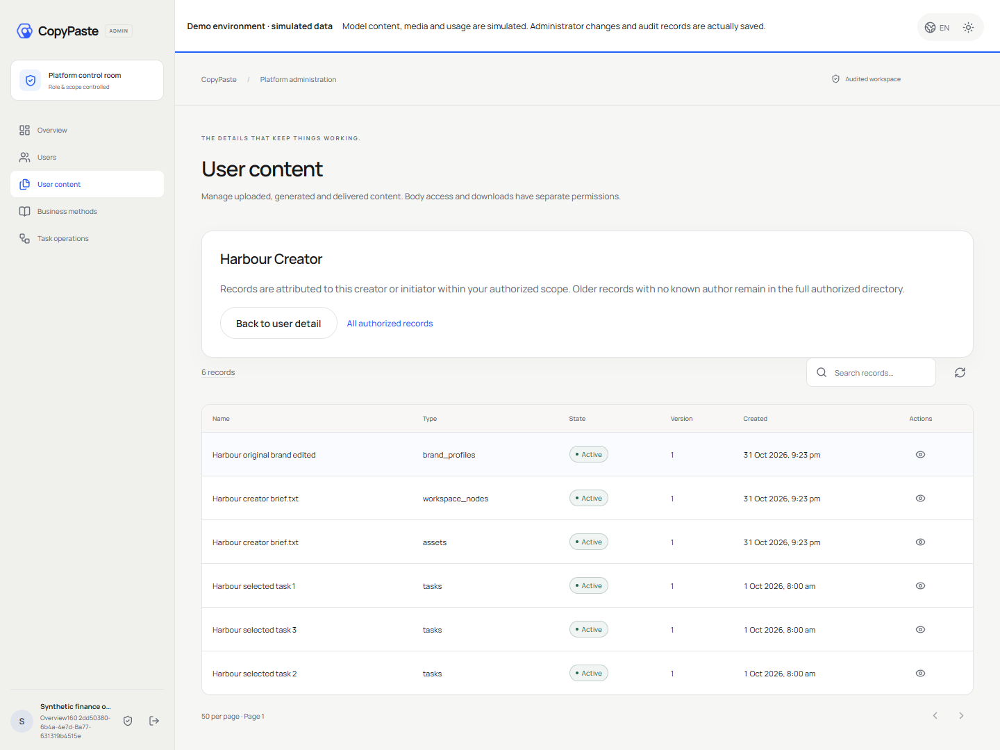

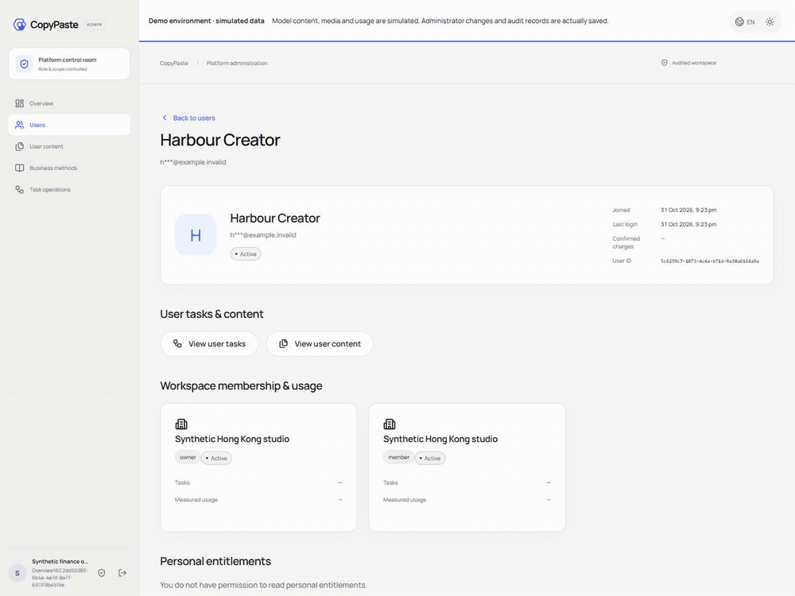

[MP4](assets/screenshots/workmate-admin-user-resources-166-02-user-task-content-scope.mp4) · [Logic / 逻辑](https://github.com/copypasteltd/workmate/blob/docs/docs/development/166-admin-user-resource-context.md) · [Evidence / 回执](https://github.com/copypasteltd/workmate/blob/docs/docs/quality/admin-user-resources-166.json)

## 当前冻结版 · v0.1.0

本版统一交付所有端、后端和六仓源码，包含最新用户任务/内容入口。六仓重新构建；当前Desktop输出与已验收Windows完整目录/Portable/Setup逐文件一致，核对后复用。近期阶段166八项SQL/API与八组实际页面检查保留其源码及原始证据；本轮不重跑全部历史用例。

分支`backend`，本版固定标签`v0.1.0-backend`。[完整源码与安装包](https://github.com/copypasteltd/workmate/releases/tag/v0.1.0) · [冻结记录](https://github.com/copypasteltd/workmate/blob/v0.1.0/docs/quality/release-freeze-checkpoint-167.json) · [待办](https://github.com/copypasteltd/workmate/blob/v0.1.0/docs/quality/remaining-work-stage167.md)。AI/媒体/广告/支付为已授权假数据；Windows未签名。截图/GIF/MP4保留其原实际采集范围，不宣称新增全端安装或专业质量验收。

## 方案与结构

主要入口：`src/server.ts, src/workspaces.ts, catalog/, skills/, migrations/`。Codex 是唯一 Agent 内核，全部模型请求经公司内部 OpenAI 兼容 API，供应商密钥仅留在后端。专业模板固定 Skill、工具和配置版本；设计师组合为 Codex＋设计 Skill＋公司 Image 2。

Web 访问云端 Agent。Extension 使用 Chrome MV3 原生右侧 Side Panel，提供对话/附件界面，只读取客户选择的文件并经同意上传，由云端执行。Desktop 无边框、无 Electron 默认菜单，在客户本机运行 Codex，客户可主动授予完整本机权限，支持停止/撤权及账户、目录隔离。

Admin 独立邮箱验证码＋TOTP，按权限管理用户/企业、消耗与费用、VIP、角色/Skill和内容。用户详情传递真实用户ID；费用账户按主体筛选，VIP锁定目标，换用户销毁旧弹窗及预览。港币金额按微单位保存；预算、余额、实收、赠额、授信和VIP分开记录。人工变更先预览、再确认，保留当前权限/MFA/策略/审批、幂等和审计。

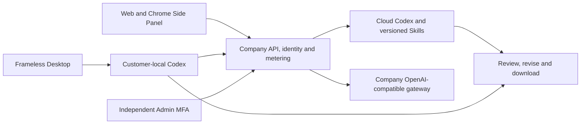

## 安装与运行

六个独立仓库并列置于 `dev/`：`copypaste-platform`、`copypaste-web`、`copypaste-admin`、`copypaste-desktop`、`copypaste-extension`、`copypaste-delivery`。使用 Windows x64、Node.js 22.14+、Git及原生PostgreSQL；媒体工作需FFmpeg/FFprobe，固定Codex随runtime分发。禁止Docker/WSL及虚拟化。

完整启动以Release指南为准。首次写配置前选空闲数据库端口，从Delivery依次运行 `demo:preflight` → `bootstrap:demo` → `demo:check` → `demo`。保留已有配置和数据；结束执行Delivery的 `npm run stop`。

本仓库单独开发，先准备对应依赖及配套后端：

```powershell
npm ci
npm run build
npm start
```

API为localhost4310，Web4317，Admin4318。开发验证码位于platform `.data/mailbox/`。管理员需在platform执行 `npm run admin:create -- admin@example.com super_admin` 并按一次性资料绑定TOTP。Desktop通过浏览器PKCE登录后选择本机目录和权限；Chrome使用“加载已解压的扩展程序”，点击图标打开侧栏。

## 使用逻辑

1. 邮箱登录，接受邀请或创建企业及首项目。创建结果未确认时保留原请求；断线/刷新后点“确认并继续”恢复原结果。失效/删除回执不会悄悄新建企业。
2. 选择项目和角色，填写brief、文件/品牌/账户、预算和授权。必要资料在原任务补齐；执行固定当时接受的配置与Skill版本。
3. 查看持久进度、审批、成果版本、费用和用量，审阅后下载原文件或继续修改。未知费用保持待核对，不按免费处理或盲目重跑。
4. Admin从用户详情开费用/VIP，核对主体和预览后按策略确认。目录筛选支持刷新/返回恢复。当前分支已接通按实际创建者筛选的任务和内容入口，返回保留原目录条件。

## 配置与权限

Web/Admin使用 `VITE_API_BASE` 或同源代理；原生端构建时固定允许来源及扩展ID，回环开发外使用HTTPS。当前SQL增量历史001–156（冻结v0.1.0为155），API/Worker检查版本及环境身份。源码不带密钥、`.env`、用户数据库、依赖或Git元数据。

会话失效清除旧工作台，迟到结果不能覆盖新登录。文件默认私有；请求、任务领取、工具和下载重新核验当前权限。历史回执不保留已撤销访问权。显式退出清除工作区创建草稿中的名称，仅保留原账户可核对的无正文请求标识。

## 角色预设与Skill

目录定义18个专业预设；数量不代表十二个角色已全部通过专业验收。

| ID | Role | Required Skill bindings |
| --- | --- | --- |
| R01 | 全栈开发工程师 | `fullstack-engineering@1.0.0`, `frontend-implementation@1.0.0`, `backend-api@1.0.0`, `qa-testing@1.0.0`, `delivery-core@1.0.0` |
| R02 | 前端开发工程师 | `frontend-implementation@1.0.0`, `ui-system@1.0.0`, `qa-testing@1.0.0`, `delivery-core@1.0.0` |
| R03 | 后端与 API 工程师 | `backend-api@1.0.0`, `qa-testing@1.0.0`, `delivery-core@1.0.0` |
| R04 | 软件测试工程师 | `qa-testing@1.0.0`, `frontend-implementation@1.0.0`, `delivery-core@1.0.0` |
| R05 | UI/UX 设计师 | `ux-research@1.0.0`, `ui-system@1.0.0`, `frontend-implementation@1.0.0`, `delivery-core@1.0.0` |
| R06 | 设计师 | `creative-direction@1.0.0`, `image-art-direction@1.0.0`, `image2-production@1.0.0`, `typography-layout@1.0.0`, `delivery-core@1.0.0` |
| R07 | 品牌视觉设计师 | `brand-system@1.1.0`, `image-art-direction@1.0.0`, `image2-production@1.0.0`, `typography-layout@1.0.0`, `delivery-core@1.0.0` |
| R08 | 广告创意设计师 | `ad-creative@1.0.0`, `image-art-direction@1.0.0`, `image2-production@1.0.0`, `typography-layout@1.0.0`, `delivery-core@1.0.0` |
| R09 | 电商商品设计师 | `ecommerce-visual@1.0.0`, `image-art-direction@1.0.0`, `image2-production@1.0.0`, `typography-layout@1.0.0`, `delivery-core@1.0.0` |
| R10 | 社媒内容设计师 | `social-content@1.0.0`, `image2-production@1.0.0`, `typography-layout@1.0.0`, `delivery-core@1.0.0` |
| R11 | 插画与 IP 设计师 | `illustration-ip@1.0.0`, `image-art-direction@1.0.0`, `image2-production@1.0.0`, `delivery-core@1.0.0` |
| R12 | 字体与版式设计师 | `typography-layout@1.0.0`, `image-art-direction@1.0.0`, `image2-production@1.0.0`, `delivery-core@1.0.0` |
| R13 | 演示文稿设计师 | `presentation-production@1.1.0`, `typography-layout@1.0.0`, `dataviz@1.1.0`, `delivery-core@1.0.0`, `deterministic-metrics@1.1.0` |
| R14 | 网页与落地页设计师 | `landing-page@1.0.0`, `ui-system@1.0.0`, `frontend-implementation@1.0.0`, `image2-production@1.0.0`, `delivery-core@1.0.0` |
| R15 | 信息图与数据可视化设计师 | `dataviz@1.1.0`, `deterministic-metrics@1.1.0`, `typography-layout@1.0.0`, `delivery-core@1.0.0` |
| R16 | 视频与动效设计师 | `video-storyboard@1.0.0`, `template-video-composition@1.0.0`, `video-generation@1.1.0`, `speech-production@1.2.0`, `delivery-core@1.0.0` |
| R17 | 营销数据分析师 | `ads-analysis@1.1.0`, `deterministic-metrics@1.1.0`, `dataviz@1.1.0`, `delivery-core@1.0.0` |
| R18 | 企业流程自动化顾问 | `workflow-design@1.1.0`, `workflow-execution@1.1.0`, `delivery-core@1.0.0` |


## 实际截图与交互

以下为本次真实Web/SQL恢复和Admin MFA/目标验证的共享媒体，使用合成客户与业务数据；不表示其他原生端重新完成安装验收。


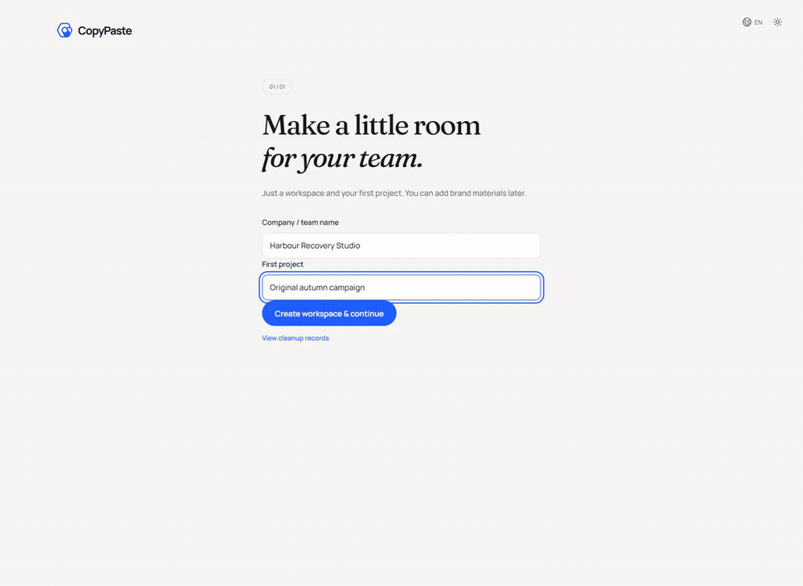

[实际MP4](assets/screenshots/workmate-functional-closure-165-01-recover-original-workspace.mp4)

## rc.5 冻结基线的验证与发布

以下为历史rc.5记录：当时运行七项定向SQL、四项创建草稿检查和实际Web/Admin操作，重建六仓与Windows unpacked/Portable/Setup，核对ASAR和固定Codex。按要求跳过完整重复回归，实际结果以冻结检查点为准。

分支 `backend`，固定标签 `v0.1.0-rc.5-backend`。后续更新同步分支和更新说明，冻结包及标签保持。外部AI/媒体/广告/支付使用已授权假数据，Windows未签名。102个原编号及88项必选完整验收范围保留，88不是未实现模块数。真实服务、签名更新、多平台与完整专业验收继续跟踪。

[检查点](https://github.com/copypasteltd/workmate/blob/v0.1.0-rc.5/docs/quality/release-freeze-checkpoint-165.json) · [完整编号台账](https://github.com/copypasteltd/workmate/blob/v0.1.0-rc.5/docs/quality/remaining-work-stage165.md) · [旧README快照](https://github.com/copypasteltd/workmate/blob/v0.1.0-rc.5/docs/history/readme-before-rc5/platform-zh.md)
