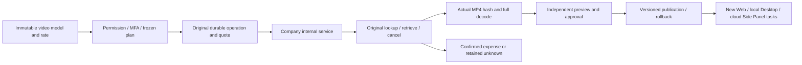
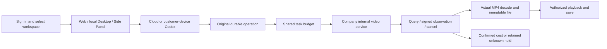
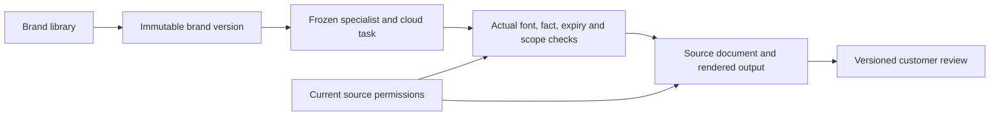
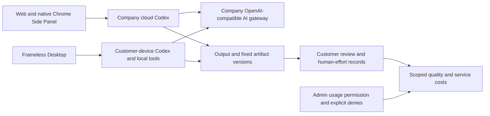
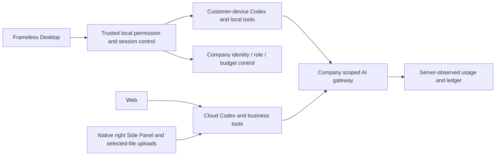
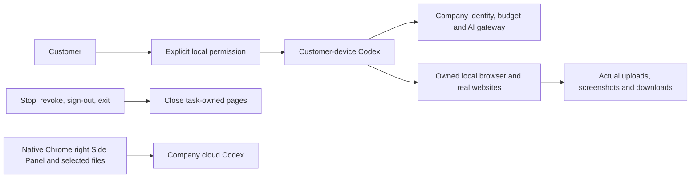
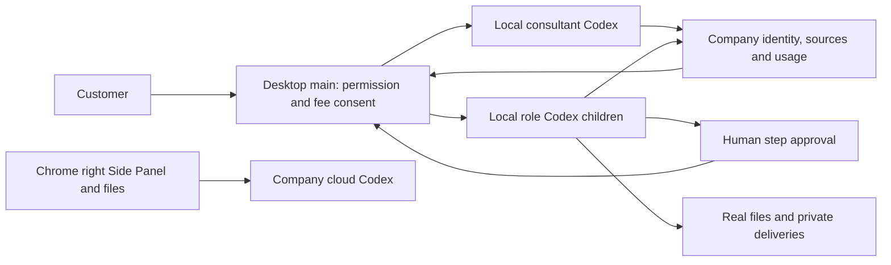

# Workmate · CopyPaste Backend

<!-- managed-video-stage81 -->
## 后台视频能力与当前交付

本仓库是 Workmate 的一个独立版本组件。后台已补齐视频模型的不可变草稿、实际验证、独立审批、发布与回滚，沿用文字和图片的管理流程。Web、本机 Desktop 和原生 Chrome 侧栏使用已发布版本，已有任务保留原模型和费率快照。

### 本地启动

以下命令在已检出的对应仓库内执行。完整工作区将六个独立仓库并列放在 `dev/`，见[分支与检出布局](https://github.com/copypasteltd/workmate/blob/docs/docs/governance/04-git-branches-and-publication.md)。使用 Windows x64、Node.js >=22.14、npm/Git，以及文档约束的原生 PostgreSQL、FFmpeg/FFprobe 与固定 Codex 资源；保留已有本地配置和数据，不使用 Docker/WSL/虚拟机。

```powershell
Set-Location 'D:/dev/copypasted/自有agent/dev/copypaste-platform'
npm ci
npm run setup:local
npm run db:local
```

保持数据库终端开启，在同一仓库的第二个终端运行 `npm run db:migrate`，再运行 `npm run dev`。API 为 `http://localhost:4310`。升级客户端前应用 SQL098。后台管理员按现有 `admin:create` 流程创建并登记 MFA，不提供共用默认后台账号。

### 当前使用流程

1. 使用独立邮箱／TOTP 后台身份登录，进入「目录 → 模型能力 → 建立配置」，选择「影片生成」，填写公司模型别名、正数每秒港币费率和操作原因。Codex 与公司内部网关固定，草稿不能增加地址、密钥或其他内核。
2. 在「配置与验证」填写原因后执行验证，接口立即保存持久回执。全套 16 案例最多报价 184 秒，使用**平台验证预算**；关闭对话框不结束后台执行。进度只计实际验证的案例，可查看尺寸、时长、完整 MP4/H264 解码与取消后的实际观察，不用虚构百分比表示真实进度。
3. 「重新核对原作业」只查现有 operation；「停止此套验证」停止新调用，已发出作业仍须核对费用。结果未知时保留预算／容量占用，页面阻止再次验证；费用确认后，明确重新验证才会建立新回执和新的付费调用。当前费用与资格决定时的不可变回执分别显示。
4. 全部通过后「发布预览」比较模型与费率，再复核当前权限、近期 MFA、精确版本和原因，并由另一位管理员审批；申请人不能自审。回滚追加新发布事实，不重写历史。范围授权及显式拒绝保持，只有读取权限的管理员不能操作配置。
5. 服务退出后复用原作业和已确认内容，不重复生视频。SQL098 保留旧预算函数入口及全部原共享核账行为。部署前在后端执行 `npm run db:migrate` 应用 SQL098；SQL001–097 和两份原 OpenAPI 各自字节保持。公司网关凭据只留在服务器。版本化发布可在旧环境核验开关为 false 时提供已验证能力，真实供应商仍须独立验收。

Desktop 保持无边框，在客户本机运行 Codex，并支持客户主动授予、可撤销的完整本机权限。产品不出现可见纵向／横向滚动条，保留滚轮、键盘、焦点及真实任务／视频进度。Extension 使用 Chrome 原生右侧栏、ChatGPT 式对话和附件，获取／读取／上传获准文件，Agent 在云端运行，不依赖 Desktop。

当前平台 **929/929** 项，保留原 912 项，71 文件／18 批；另有旧能力发布／网关／客户视频兼容 **106/106**、契约 **7**、真实后台页面 **7** 项。下方图片和录像明确为 **Admin**，复制到客户端仓库用于共享配置使用说明；阶段 80 客户端源码和画面保留原验证范围，不冒充新全栈页面测试。本次后台使用真实身份、PostgreSQL、固定原生 Codex 版本检查及实际 MP4 解码，内部模型服务和视频内容为明确假数据。

原 **102 REQ/102 TC 保持 83 部分验证、19 未证明、0 完整验收**，G01–G10 保留。真实公司供应商、全部专业角色、完整视频业务、签名安装及完整 Codex Desktop 操作对标仍未证明。自建浏览器上下文／实例、页面服务和原生数据库均关闭，未使用 Docker／WSL／虚拟机。

首次组合回归因假服务被分配到本机 Node Fetch 在 HTTP 前拒绝的 2049 端口而失败，原失败 TAP、实际端口观察和自建进程／夹具清理记录全部保留。假服务已复用现有安全端口工具，测试到达信号等待加上时限；这项修复未修改产品源码、测试断言或测试名称。完整平台与 17 项专项使用修复后的夹具重新执行。此前兼容／页面录制的产品和验证器字节保持，两处后续测试夹具差异单独核对，不冒充重新录制页面。

[方案与权限](https://github.com/copypasteltd/workmate/blob/docs/docs/technical/81-managed-video-capability-releases.md) · [精确证据](https://github.com/copypasteltd/workmate/blob/docs/docs/quality/managed-video-checkpoint.json) · [增量接口](https://github.com/copypasteltd/workmate/blob/docs/docs/contracts/capability-releases.openapi.json)




[后台交互 GIF](assets/screenshots/stage81-admin-workmate-managed-video-02-video-cancellation-and-cost-recovery.gif) · [实际录制 MP4](assets/screenshots/stage81-admin-workmate-managed-video-02-video-cancellation-and-cost-recovery.mp4)

<details>
<summary>阶段 80 历史使用与完整安装参考；旧计数保留原范围</summary>

<!-- generated-video-stage80 -->
## 生成式影片、费用控制与紧凑桌面布局

后端新增持久生成式影片作业、统一任务预算、原 operation 查询/取消、认证回调及真实 MP4 校验。

### 本地启动

以下命令在已检出的对应仓库内执行。完整工作区将六个独立仓库并列放在 `dev/`，见[分支与检出布局](https://github.com/copypasteltd/workmate/blob/docs/docs/governance/04-git-branches-and-publication.md)。使用 Windows x64、Node.js >=22.14、npm/Git，以及文档约束的原生 PostgreSQL、FFmpeg/FFprobe 与固定 Codex 资源；保留已有本地配置和数据，不使用 Docker/WSL/虚拟机。

```powershell
Set-Location 'D:/dev/copypasted/自有agent/dev/copypaste-platform'
npm ci
npm run setup:local
npm run db:local
```

保持数据库终端开启，在同一仓库的第二个终端运行 `npm run db:migrate`，再运行 `npm run dev`。API 为 `http://localhost:4310`。升级客户端前应用 SQL097。后台管理员按现有 `admin:create` 流程创建并登记 MFA，不提供共用默认后台账号。

### 当前使用流程

1. 使用现有邮箱/验证码流程登录，选择企业/项目，创建「影片与动效」专家任务。新任务固定 R16 1.2.0 与 `video-generation` Skill；旧任务保留原角色和 Skill，使用生成式能力时需新建任务。
2. 在 Web 或 Desktop 选择「生成式影片」、时长（4/8/12/16/20 秒）及横向/纵向/正方形，填写需求并确认任务预算。模板/FFmpeg 合成是独立选项。Desktop 设置默认收起，展开后采用紧凑面板，留出会话和输入空间。Extension 在同一企业/项目的任务历史中打开已有云端影片任务，使用状态、播放和保存操作。
3. Codex 经公司内部服务调用。提交 HTTP 前持久保存原 operation 和报价，与推理/图片共用同一任务预算。输入计数、推理、图片与视频也共用准入限制；已完成调用释放并发后仍计入分钟速率，独立审核确认的终止事实参与并发计数，原请求记录保留。只显示服务回报的真实进度。用量未确认或结果不明时保留原预留，缺失 usage 不计为免费。
4. 「停止这次生成」只取消同一原作业，之后确认的用量仍可能产生费用。重试/恢复查原 operation，不重提生成。真实状态变化拒绝旧控制版本；后台续租和无变化的轮询不会使用户操作过期。
5. 完成状态须通过真实摘要、大小、格式、尺寸、时长及原生完整解码后才交付。可播放、保存真实 MP4；源文件隔离、成果撤回或授权失效后移除当前预览及下载，不用虚构文件冒充成功。内嵌预览限制 20 MB。
6. Admin 进入「调用管理 → 生成式影片作业」。元数据、费用和原作业重查按独立权限及企业/项目范围控制；重查需要近期 MFA、原因和审计，不发起新生成，也不获得提示词、参考图或视频正文。原任务费用结算保留独立审批与不可变用量事实。

升级前在后端执行 `npm run db:migrate` 应用新增 **SQL097**。已发布 SQL001–096 与两份原 OpenAPI 各自字节保持。配置公司 `AI_BASE_URL`、允许域名/密钥、精确 `AI_VIDEO_MODEL`、显式 `AI_VIDEO_VERIFIED`、正数秒费率 `AI_VIDEO_HKD_MICROS_PER_SECOND` 及可选回调签名密钥。公司能力未显式配置/核验时仅生成步骤不可用，凭据不进入渲染器或 Extension。公开 Sora 2/Videos API 已于 2026-09-24 停用，`company-video-jobs-v1` 是公司内部契约，不静默切换公开供应商。完整的管理后台视频能力验证/发布流程仍需补齐。

Desktop 无原生边框和 Electron 菜单，产品界面不出现可见纵向或横向滚动条。内容保持滚轮、Home/End、键盘聚焦、换行及最后操作可达；实际检查 800×600、1280×800、1440×980，英文/繁中及浅深主题。真实任务与视频进度保留。Codex 在客户本机执行，完整本机权限由客户主动授予并可撤销。Extension 保留原生右侧 Side Panel 和云端 Codex，不依赖 Desktop 或本地 Agent。

验证：平台 **912/912** 项，保留原 874 项；影片/网关专项 **60/60**；客户端单元 **69**；打包 Desktop **32**、Web/Admin **5**、原生侧栏 **9**；本机监督进程 **17/17**。各计数范围独立，不相加为产品验收。原生 Codex、身份、数据库、文件、媒体解码与账本是真实执行，模型推理/视频内容、客户数据与部分原生同意决定为明确夹具。自建浏览器/数据库均关闭，未使用 Docker/WSL/虚拟机。原 **102 REQ/102 TC 为 83 部分验证、19 未证明、0 完整验收**；真实公司媒体、完整 TC-019/TC-056、全部专业角色及 G01–G10 仍保留。

平台完整 70 文件、18 批采用已审查的同源码复核：一批遇到 Windows 1455 资源错误后，四个文件在新的自建数据库全部重跑通过；其余十七个完整通过批次的源码、测试、工具及内核字节完全相同。原失败尝试继续标记失败，不计入通过；每份选用回执保留原计划摘要，原始 TAP 不拼接、不改标。

[方案与协议](https://github.com/copypasteltd/workmate/blob/docs/docs/technical/80-generated-video-jobs.md) · [精确证据](https://github.com/copypasteltd/workmate/blob/docs/docs/quality/generated-video-checkpoint.json) · [增量接口](contracts/generated-video-openapi.json)




[交互 GIF](assets/screenshots/stage80-web-workmate-generated-08-generated-video.gif) · [实际录制 MP4](assets/screenshots/stage80-web-workmate-generated-08-generated-video.mp4)

<details>
<summary>阶段 79 历史文档与完整安装参考；旧计数保留原验证范围</summary>

[English](README.en.md) · [主文档](https://github.com/copypasteltd/workmate/blob/docs/docs/README.md)

<!-- brand-production-stage79 -->

## 固定品牌版本与生产检查

后端提供真实不可变品牌版本、生产检查、任务绑定与来源治理。

1. 登录并选企业/项目，在 Web 或 Desktop 打开「品牌资料」。设置名称、色彩、字体及使用声明、核准产品事实/价格、促销期限、渠道/语言和可选固定 Logo 文件。上传字体须共享至当前项目。
2. 发布不可变版本。以后编辑会产生新版；并发旧版编辑报冲突。已有专家和任务继续使用绑定版本，需要升级时显式采用新的专家版本。
3. 选历史版本检查文字或固定事实。缺字定位到 Unicode 码点，过期促销或字体声明阻止新生产；价格事实使用存储文字和金额，不静默换字体或价格。
4. 绑定品牌的云端设计任务必须携带匹配的品牌/版本和渠道/语言。文字使用固定声明字体配置，显式引用事实键时使用存储文字和价格。产物保留来源依赖和可编辑 JSON；SVG 文字转路径，PNG 和有限的单页 PDF 审阅稿是真实渲染。字体登记只记录客户声明，不证明版权。

启动依赖客户端前，在已配置后端使用 `npm run db:migrate` 应用 **SQL096**。已发布 SQL001–095 与两份原有 OpenAPI 各自的字节保留。新增品牌契约包含四项操作；配置服务共 438 项，`DEMO_MODE=true` 时另有一项演示额度操作。旧品牌在当前权限下保留可读，不补造历史版本或许可；固定字体生产前需明确发布 v2 资料并采用新的专家版本，旧任务不自动改绑。

Desktop 在客户本机运行 Codex，提供明确可撤销的完整本机权限，无原生边框/菜单；纵横滚动条外观隐藏，同时保留滚轮、键盘、焦点定位及 800×600、1280×800、1440×980 实际窗口访问。保留真实进度。Extension 是云端 Codex 的原生右侧栏。全部 AI 请求经公司网关；测试后关闭自建浏览器，禁止 Docker/WSL/虚拟机。

当前分别通过：**平台 874/874 项**（68 文件/17 批，保留此前 861 项并新增 13 项）、客户端 68 项、打包 Desktop 30 项、品牌 Web 四项、Web/Admin 品质四项及原生侧栏八项。保留原生内核 17 项的 57 份绑定源码均未变化。数据库、身份、文件、账本和本机 Codex 真实运行，模型/客户/业务数据为明确夹具。原 102 REQ/102 TC 为 82 部分验证、20 未证明、0 完整验收；G01–G10、TC-056 真实客户盲审继续未证明。Desktop 品牌表单证据不等于全部本机专业角色的品牌约束已验收。

Desktop33、品牌 Web02 和 Web/Admin08 保留实际收据；其后只有一个未被这些旅程执行的扩展测试文件补充加载等待和登录诊断，前后字节及无关范围已单独核对。它们的应用/界面和执行旅程/验证器未变；新扩展运行及平台23使用更新后的测试文件，精确边界见检查点。




[MP4](assets/screenshots/stage79-web-workmate-brand-02-brand-library.mp4) · [Design / 方案](https://github.com/copypasteltd/workmate/blob/docs/docs/technical/79-versioned-brand-production.md) · [Contract / 契约](https://github.com/copypasteltd/workmate/blob/docs/docs/contracts/brand-production-openapi.json) · [Evidence / 证据](https://github.com/copypasteltd/workmate/blob/docs/docs/quality/brand-production-checkpoint.json) · [Changes / 更新](https://github.com/copypasteltd/workmate/blob/docs/docs/changes/2026-10-24-versioned-brand-production.md)

<details>
<summary>阶段 78 交付及完整安装参考：旧计数保留原验证范围</summary>

<!-- business-quality-stage78 -->

## 当前交付审阅与使用流程

公司 API、Codex 控制、身份权限、持久业务及计量账本。 新增接受、需修改、弃用的版本化交付审阅；人工基线、累计投入和修改次数独立填报。项目用量与后台交付品质面板分别显示技术成功、客户接受、实际读取复用及公司服务成本。

Desktop 保持客户本机 Codex、明确可撤销的完整本机权限及无边框/无 Electron 菜单。隐藏纵横滚动条外观，保留真实滚轮/键盘访问；内容重排，800×600 下聚焦输入框、聊天输入区和费用回执可见。此前进度条约束已撤销，保留真实进度。Extension 仍为独立原生右侧栏，聊天及获准文件上传至云端 Codex；所有 AI 请求走公司网关。

1. 登录并选择企业/项目，在正确执行位置创建任务。Desktop 另选本机目录并明确授权；Extension 不要求安装 Desktop。
2. 查看真实结果，打开 Desktop「审阅本次交付」或任务评价表单，保存接受、需修改或弃用及可选意见。任务或交付换版时需重新载入后审阅。
3. 按需填写累计人工数字。空值为未知，0 为明确没有投入；保存后保留展开的表单与输入访问。
4. 在项目用量或 Admin「交付品质」查看当前有权范围；未确认费用不冒充完整成本。服务成本不含退款抵减、外部服务及人工，不推断 ROI 或续费。

上线依赖接口/界面前先应用增量 SQL095；SQL001–094 与原任务 OpenAPI 保持原样。未固定交付版本的旧接受状态需客户重新审阅。保留原评价接口，当前表单强制任务版本、交付摘要及幂等键。写评价需要项目 approve 权限；Admin 的 `admin.usage.read` 仅查看授权范围汇总，不能代客户接受、从汇总读取意见正文或授予 OS 权限。

backend 可独立类型检查和编译。完整集成验收还会比较仓库内契约与权威的同级 `docs/contracts`，执行整套测试前需按指南检出完整工作区。仅使用原生 PostgreSQL，不接管占用中的测试数据库，不使用 Docker/WSL。



当前源码验证：平台 861/861 项（67 文件/17 批）、客户端 68 项、实际打包 Desktop 26 项、Web/Admin 四项及原生侧栏 8 项分别通过，不相加。保留的 17 项原生内核证据中 57 份绑定源码均未变化。身份、数据库、文件、费用和本机 Codex 真实运行；模型/业务/客户输入与系统对话框决定明确为夹具。TC-056 真实任务基线/盲审、18 角色/29 Skill 的全专业交付、完整 OS/Codex Desktop 对齐及生产门槛继续未证明；原 102 REQ/102 TC 和 81 部分/21 未证明/0 完整验收保持。

Desktop31 与 Web/Admin07 保留原始执行记录；其后仅一份迁移测试中的两个版本期望值从 94 更新为 95，前后字节已归档并逐字核对，运行代码、界面和旅程脚本均未变化。平台21重新执行更新后的全套测试；该保留证据边界见检查点。


[MP4](https://github.com/copypasteltd/workmate/blob/desktop/assets/screenshots/workmate-local-31-local-agent.mp4)

[Design](https://github.com/copypasteltd/workmate/blob/docs/docs/technical/78-business-delivery-quality.md) · [Contract](https://github.com/copypasteltd/workmate/blob/docs/docs/contracts/business-quality-openapi.json) · [Exact source and media evidence](https://github.com/copypasteltd/workmate/blob/docs/docs/quality/business-quality-checkpoint.json) · [Changes](https://github.com/copypasteltd/workmate/blob/docs/docs/changes/2026-10-23-business-delivery-quality.md)

<details>
<summary>完整安装、架构与历史验证记录（较早计数和截图保留原时点范围）</summary>

[Backend](https://github.com/copypasteltd/workmate/tree/backend) · [Web](https://github.com/copypasteltd/workmate/tree/web) · [Admin Dashboard](https://github.com/copypasteltd/workmate/tree/admin) · [Desktop](https://github.com/copypasteltd/workmate/tree/desktop) · [Chrome Extension](https://github.com/copypasteltd/workmate/tree/extension) · [Delivery](https://github.com/copypasteltd/workmate/tree/delivery)

面向香港企业的云端 Agent 产品。当前仓库负责 **Backend**；当前远程分支为 `backend`.

<!-- client01-direction -->
## 当前客户端方向与实现差异

CLIENT01（2026-10-22）要求 **Desktop 在客户本机运行 Codex Agent**，提供客户可主动授予的 **完整本机权限**，操作能力对标 Codex Desktop。**Extension 在 Chrome 原生右侧栏采用 ChatGPT 式对话/附件结构**，获取、读取用户获选文件并上传，由云端 Codex 执行。全部产品 AI 请求仍走公司内部网关。

**阶段 77 历史实现：** Desktop 在客户本机运行 Codex，提供客户明确完整授权、本机文件/终端、同线程继续、原生追问、公司设计/视频工具与本机父子流程。新增十二项本机浏览器工具，可真实导航、操作、上传、截图和下载；停止/撤权回收任务页面。Desktop 隐藏可见滚动条，成果、代码和表格自动换行，保留纵向滚动与键盘访问；已撤销此前进度条约束，保留真实进度反馈。当前分别验证平台 851 项、客户端 68 项、原生内核 17 项、独立 Electron 浏览器 10 项和实际打包旅程 25 项，不相加。18 角色/29 Skill 的完整专业交付、全部 OS 应用与 Codex Desktop 全面能力对齐、真实模型及生产验收仍待证明。Extension 继续独立的 ChatGPT 式原生右侧栏、获准文件上传与云端 Codex，本轮未重跑其 UI。见 [方案](https://github.com/copypasteltd/workmate/blob/docs/docs/technical/77-desktop-native-browser.md)、[界面约束](https://github.com/copypasteltd/workmate/blob/docs/docs/requirements/04-desktop-layout-and-scroll.md)及 [源码/媒体检查点](https://github.com/copypasteltd/workmate/blob/docs/docs/quality/desktop-browser-checkpoint.json)。

Desktop 在客户本机运行 Codex；Web 和 Extension 由公司云端执行。下方架构图按这一执行边界呈现。

本机 supervisor 的实现及历史原生权限测试见 [技术说明](https://github.com/copypasteltd/workmate/blob/docs/docs/technical/70-desktop-native-codex-supervisor.md)。

<!-- /client01-direction -->

## 架构与约束

仅使用 Codex，全部 AI 请求经公司内部 OpenAI 兼容服务器。Web、Desktop、扩展和 Admin 共用服务端身份、权限、来源与计费控制。设计沿用 CopyPaste 的品牌素材、色系、字体和中英界面。



## 服务结构与执行逻辑

| 模块 | 代码位置 | 实际职责 |
| --- | --- | --- |
| 身份和企业 | `src/` 身份、成员、会话模块 | 邮箱验证码、Admin MFA、PKCE、企业/项目范围和私有所有者 |
| Agent 执行 | `src/worker.ts`、Codex runtime、`catalog/`、`skills/` | 固定 Codex/技能/模型版本、受控工具、租约、fencing、事件 |
| 任务续接 | `src/paid-task-inputs.ts`、`src/task-tool-reuse.ts` | 完成且明确计量的回合等待资料，恢复原任务/线程，重查来源后复用完成结果 |
| 费用和权益 | billing、wallet、VIP、plan、approval 模块 | HKD 整数微单位、预留、累计结算、人工入账、礼赠、退款、VIP 与额度分离 |
| 创作和分析 | design、video、marketing、SEO 模块 | 图片接口、布局交付、FFmpeg 模板视频、CSV/XLSX、广告指标、连接同步、网站证据 |
| 内容和管理 | Admin、source、erasure 模块 | 分范围元数据/正文权限、隔离、保留期、审计、独立复核和受控擦除 |
| 持久化 | `migrations/`、PostgreSQL、pg-boss、storage | 强制 RLS、幂等事务、不可改写事实、队列、不可变文件版本 |

Web 会话使用 HttpOnly Cookie、Origin 和 CSRF；原生端经浏览器登录、PKCE 与轮换刷新令牌接入。Admin 身份与客户身份分开。所有后台读取和工具使用均重查当前企业、项目、私有范围与来源状态。

模型缺资料时只能描述需求，不能自选资源 ID。已完成且用量明确的回合保留原预算预留；用户明确选择当前获准版本后，新的执行尝试恢复原 Codex 线程。上限为八轮、三十二项依赖；取消结算已知用量，未知结果进入核对。

## 初始化和启动

```powershell
npm ci
npm run setup:local
npm run db:local
```

保留数据库终端，在另一个终端执行：

```powershell
npm run db:migrate
npm run dev
```

完整集成测试需按主文档检出同级 docs/合同及完整工作区；仅检出 backend 时先执行类型检查和编译。

API 为 `http://localhost:4310`，原生 PostgreSQL 为 `127.0.0.1:55432`。`setup:local` 只在缺少配置时生成本地密码和持久 MASTER_KEY；保留原配置和数据库，不用示例文件覆盖。`db:migrate` 准备开发与测试库。迁移使用 owner，应用/控制/队列使用分离身份。

管理员首次登记：`npm run admin:create -- admin@your-company.example super_admin`。将本地 enrolment 文件中的 TOTP 配置导入验证器，按运行说明清理该敏感文件；没有共享默认管理员密码。

## 公司 AI 网关

只在服务器配置 `AI_BASE_URL`、`AI_ALLOWED_HOSTS`、`AI_API_KEY`、`AI_MODEL`、实际 HKD 费率及验证开关。Codex 使用公司 OpenAI 兼容 Responses 接口；Image 2 使用内部 Images 生成/编辑接口。先执行 `npm run codex:probe`，再按文档验收真实工具回合、用量和错误。模拟响应不证明真实模型或费率已验收。

`.env.example` 是无密钥参考。生产还需 HTTPS、SMTP、持久加密密钥、受限出网、存储与备份恢复；本地原生数据库启动器拒绝生产模式。

## 接口与数据

`contracts/implemented-routes.json` 记录实现路由；`contracts/`、`catalog/` 与主文档中的规范 API 各自保留范围。原规范 TaskDTO/任务创建接口仍有未完成内容，路由数量不能代替规范验收。SQL001–091 保持已应用字节；修复追加迁移。

代码工具可读取、按摘要编辑和打包获准代码；不会执行不受信任的客户代码，也不把未执行的测试显示为通过。设计交付包括编辑数据、SVG/PNG 和模板 MP4；AI 视频/语音、全角色独立业务验收另行跟踪。

## 统一任务 API 使用顺序

1. 登录并选择企业和项目，安装一个实际专家，取得 agent_id；Web 写请求使用当前 Cookie 和 CSRF，原生请求使用当前 PKCE 凭证。
2. 发送 POST /v1/tasks，携带 X-Tenant-ID 和独立 Idempotency-Key。budget 为 `{"currency":"HKD","amount_micros":"1000000"}`，表示 HKD 1；请求另含 project_id、agent_id、`type:"delegation"` 和 `input:{"prompt":"具体工作要求"}`。
3. 202 返回 task_id、status、version 和 Location。轮询 Location 得到白名单 Task，或订阅原持久 SSE；交付物从原资产接口读取。
4. 控制请求使用最新 expected_version 和独立请求键，action 为 cancel 或当前可用检查点的 pause / resume。请求重放返回当前资源，不复活旧状态。
5. needs_input 时读取 pending_input_fields，按任务依赖的候选资源选择版本；POST inputs 的 answers 为 `{"input-1":{"resource_ids":["实际版本 UUID"]}}`。整批验证通过后才修改状态，继续保留原任务、原线程及原预算。

专用创作/分析/SEO/流程/设备参数与 retry 尚未在此统一创建/控制入口全面接入，明确报错；使用已有专用业务入口。未保留专家身份的历史任务使用原项目接口，不补造执行身份。运行中的暂停和未知动作核对恢复仍待实现。

## 初次检出与环境

新工作副本可单独检出本分支；已有本地仓库直接更新，不重新初始化。

```powershell
git clone --single-branch --branch backend git@github.com:copypasteltd/workmate.git copypaste-platform
cd copypaste-platform
```

Node.js ≥22.14、npm 和 Git；锁文件固定依赖。当前验收环境为 Windows x64。后端/完整交付还需要原生 PostgreSQL 启动资源、云端锁定 Codex `0.163.0-alpha.10.2` 与 FFmpeg/FFprobe；Desktop 独立锁定 `0.163.0-alpha.11`，以其运行时清单为准。禁止本地 Docker、WSL 和虚拟化。跨端运行使用多个独立工作目录；布局见 [workspace](https://github.com/copypasteltd/workmate/blob/docs/docs/governance/04-git-branches-and-publication.md).

## 检查与验证范围

```powershell
npm run typecheck
npm run build
npm test
```

历史源码的平台完整 **802/802**、任务专项 **52/52**，六仓库 **13 项**类型/构建/既有客户端测试检查、真实打包程序和原生侧栏旅程 **32 项**通过。保留原 782 项命名回归测试。任务专项调用实际 PostgreSQL、身份、账本与 Worker；另有实际 Codex 子进程连接模拟内部网关的续接验证。UI 回合及业务数据按授权模拟。原 102 项需求仍为 81 项局部验证、21 项未证明完成、0 项完整验收。

完整规范 TaskDTO/任务创建、任意执行中暂停、未知外部结果恢复、全角色独立业务、GEO、真实供应商和生产/签名/商店验收仍继续跟踪。

本次同步补充统一任务接口和原任务输入事务。当前用户界面继续通过既有项目/会话接口使用同一执行域；下方重新录制的实际交互验证该流程的兼容性，并非声称界面已经切换到全部规范任务接口。接口边界、精确金额、幂等回执、来源撤销和未接入业务参数见 [方案细则](https://github.com/copypasteltd/workmate/blob/docs/docs/technical/68-canonical-task-contracts-and-input-transactions.md)。

## 实际页面与交互

本服务没有独立用户页面；以下为连接本服务的实际 Web 界面，来源明确保留。

实际录制，保留原捕获时间；AI 回合与业务数据为明确模拟。Admin 演示表单不代表财务提交。


[MP4](assets/screenshots/workmate-10-interaction.mp4) · [录制与源码回执](https://github.com/copypasteltd/workmate/blob/docs/docs/quality/workmate-media-10.json)

## 方案细则与更新

- [Product](https://github.com/copypasteltd/workmate/blob/docs/docs/product/01-prd.md)
- [Architecture](https://github.com/copypasteltd/workmate/blob/docs/docs/technical/01-architecture-and-stack.md)
- [Identity and permissions](https://github.com/copypasteltd/workmate/blob/docs/docs/technical/07-security-and-permissions.md)
- [Task continuation](https://github.com/copypasteltd/workmate/blob/docs/docs/technical/66-paid-native-input-checkpoints.md)
- [Admin](https://github.com/copypasteltd/workmate/blob/docs/docs/product/08-admin-dashboard.md)
- [Native clients](https://github.com/copypasteltd/workmate/blob/docs/docs/technical/30-native-window-and-browser-sidepanel.md)
- [Canonical task update](https://github.com/copypasteltd/workmate/blob/docs/docs/changes/2026-10-22-canonical-task-repair.md)
- [Local Codex update](https://github.com/copypasteltd/workmate/blob/docs/docs/changes/2026-10-22-native-codex-supervisor.md)

后续修改需要同步中英 README、受影响的实际截图/GIF、更新说明和对应分支。提交后通过 Delivery 发布流程核对远程 SHA；不强推覆盖协作者。`.env`、数据库、会话、依赖和安装产物不进入 Git。历史 README 原字节见 [archive](https://github.com/copypasteltd/workmate/blob/docs/docs/quality/history/stage66-before-workmate-readmes/manifest.json).

阶段 73 Desktop 本机执行：[具体方案](https://github.com/copypasteltd/workmate/blob/docs/docs/technical/73-desktop-native-company-tools.md) · [源码与真实旅程证据](https://github.com/copypasteltd/workmate/blob/docs/docs/quality/desktop-company-tools-checkpoint.json)；既有媒体保持原始源码范围。

## Desktop 本机执行准入

迁移 092 固定 cloud/desktop 执行归属；只有 Desktop 原生登录 family 可创建/开始/续租/上报本机执行，Web/Extension/Admin 不能代授 OS 权限。创建仍复用角色/Skill、原价和费用预留；本机任务不入云队列。原生 scoped Responses 在准入/派发重验身份、归属、租约、能力及服务端预算，拒绝未知/托管工具。完成先封锁推理，再关闭上游，仅按公司观测结算；未知本机/供应商结果保留待核对预留。严格路由、RLS、幂等和恢复见上方方案。

## 本机公司工具契约

Agent 循环保持在客户电脑。主进程为锁定的原生运行时注册可信 `copypaste` 动态工具，绑定任务、调用、线程及回合，在效果前及返回前重验公司权限。本机唯读拒绝公司写入；原生 schema 投影不替代原始业务参数验证。同一调用重试复用持久结果，已接受而未知的图片操作阻断后续调用并保留费用核对。私有产物按明确版本下载，保存目标由系统窗口选择。

阶段 73 公司工具历史更新：[更新说明](https://github.com/copypasteltd/workmate/blob/docs/docs/changes/2026-10-23-desktop-company-tools.md) · [源码检查点](https://github.com/copypasteltd/workmate/blob/docs/docs/quality/desktop-company-tools-checkpoint.json)；较早回执和媒体保持原始源码范围。

阶段 74 本机追问更新：[更新说明](https://github.com/copypasteltd/workmate/blob/docs/docs/changes/2026-10-23-desktop-native-input.md) · [当前源码检查点](https://github.com/copypasteltd/workmate/blob/docs/docs/quality/desktop-native-input-checkpoint.json)。较早报告及媒体保留原始源码范围。

阶段 75 私有视频更新：[更新说明](https://github.com/copypasteltd/workmate/blob/docs/docs/changes/2026-10-23-desktop-private-video.md) · [当前检查点](https://github.com/copypasteltd/workmate/blob/docs/docs/quality/desktop-video-checkpoint.json)。旧报告保留原始源码范围，平台/本机主进程验证与后续界面验证明确记录。

<!-- desktop-native-browser-stage77 -->

## 本机浏览器与 Desktop 界面

新建本机会话，选择工作目录并明确授予「完整本机权限」，再描述浏览器工作。本机 Codex 使用版本化 `copypaste_browser` 命名空间的十二项工具：页面列表、打开、导航、历史、快照、截图、交互、隔离脚本、等待、对话框、下载及关闭。交互包含真实点击、填写/输入/选择、按键、滚动/拖动及明确本机文件上传。可信无边框地址栏与远程网页使用独立渲染器。完成的下载保留在所选目录的 browser-downloads；模型截图直接捕获真实网页，README 浏览器录制使用真实 OS 窗口捕获，不拼接页面。

当前本机授权、公司身份、项目权限、调用归属和预算逐次核验；网页不能授予 OS 权限或取得公司推理凭据。调用 ID 绑定具体操作，结果未知不自动重放。Stop、撤权、登出和退出关闭任务页面及未完成下载，保留已完成文件和客户原有窗口。旧线程保留原工具绑定；使用浏览器工具须新建会话。

此前进度条约束已撤销；真实上传、任务、流程和视频反馈继续显示。隐藏滚动条外观不禁用原生滚动。成果换行、代码与表格重排，重点滚动区可聚焦；800×600、1280×800、1440×980 实际窗口保留输入与费用操作。检查包含真实滚轮、Home/End、最后一个下载按钮焦点，及紧凑费用/设备/账户页面和英文/繁中浅深主题；自动化未宣称实测物理触控板或每种系统缩放。

当前完整清单为 66 个测试文件 / 17 批 / 851 项通过，保留此前全部 848 项。SQL001–094 和 428 条 HTTP 接口均未变。仅 UI 自有夹具的用户/平台/企业容量配置为 32，并新增不可变网关策略版本 2（32 槽位、每分钟 10,000 请求），以保留多次取消后的未知结果和费用预留；初始策略、生产默认及容量控制不变。模型响应、业务页面与系统对话框决定明确模拟。原 102 REQ/102 TC、NFR 和 G01–G10 仍为 81 部分 / 21 未证明 / 0 完整验收。Extension 产品和验证器字节未变，本轮没有新增其 UI 结论。




[Design](https://github.com/copypasteltd/workmate/blob/docs/docs/technical/77-desktop-native-browser.md) · [Requirements](https://github.com/copypasteltd/workmate/blob/docs/docs/requirements/04-desktop-layout-and-scroll.md) · [Evidence](https://github.com/copypasteltd/workmate/blob/docs/docs/quality/desktop-browser-checkpoint.json) · [Changes](https://github.com/copypasteltd/workmate/blob/docs/docs/changes/2026-10-23-desktop-native-browser.md)

<details>
<summary>阶段 76 历史实现与截图（旧滚动条布局）</summary>

<!-- desktop-native-workflow-stage76 -->

## 本机流程与核查

选择「流程顾问」、本机目录并明确授予所需本机权限。描述要求并确认冻结的流程步骤；执行前另行查看每个子角色的预算和合计，批准具体版本后才预留费用、启动本机子 Codex。遇到人工审批步骤须再次明确批准，之后才运行下一角色。查看真实本机文件、私有 SOP/流程 JSON/恢复说明下载与公司用量记录；顾问对话及未完成步骤分别计费。Stop 或撤权会终止本机父子进程；已受理但结果未知的操作保留待对账状态，不会自动重放。

首个子集支持最多八步的顺序本机 Codex、人工审批及广告汇总。每个子角色使用独立的 Skills、公司工具和推理凭据，沿用客户当前明确授予的目录及本机权限。完整本机权限不扩大公司的客户数据、项目权限或预算；云端 Worker 与定时任务不能接管本机流程。每个流程版本从真实读取账本冻结外部来源，复用到新会话及派生 SOP 时仍保留；旧创建任务删除不会替代外部来源的有效性判断。来源停用同时约束首次读取、缓存、子任务启动和私有或明确发布的衍生成果；管理员继续遵守权限、MFA、原因及审计控制。关闭应用也会阻止仍等待日志落盘的请求稍后启动。

阶段 76 当时的平台清单为 65 个实际测试文件、17 个完整批次、848 项通过，保留阶段 75 全部 830 项回归。SQL001–093 未改写；SQL094 增加本机流程来源与不可变版本。实际 428 条接口清单保留此前全部 415 条。原 102 REQ/102 TC、NFR 和 G01–G10 维持 81 项部分验证 / 21 项未证明 / 0 项完整验收；旧证据及媒体仅证明其原始源码。




[设计与生命周期](https://github.com/copypasteltd/workmate/blob/docs/docs/technical/76-desktop-native-workflows.md) · [绑定证据](https://github.com/copypasteltd/workmate/blob/docs/docs/quality/desktop-workflow-checkpoint.json) · [更新说明](https://github.com/copypasteltd/workmate/blob/docs/docs/changes/2026-10-23-desktop-native-workflows.md)

</details>

</details>


</details>

</details>

</details>
