<!-- integrated-round-204 -->

## 204 · 0.5.11 · 安全工具反馈与云端执行时效

[Evidence and limits / 证据与边界](https://github.com/copypasteltd/workmate/blob/docs/docs/quality/integrated-round-204/README.md) · [Downloads / 下载](https://agent.copypaste.hk/downloads)

1. 先完成842份选定扩展名的产品源码、165份迁移、计划用例和操作脚本，再统一构建与相关验证；编译／故障情境的原失败和集中修正保留。

2. 真实长事务续租／过期／撤权、固定原生Codex反馈、受控界面与真实正式客户端观察分别记录。版本、文件SHA、完整下载和客户费用是独立证据。

3. 仅更新应用及20401下载；复制两份原生运行时为真实目录，保留备份与兼容回退。核对9份网络文件、实时规则、凭证及DB／代理进程，普通原子推送8引用，保护27份原用户文件。

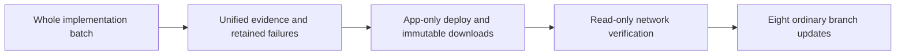

725项相关通过证据区分本轮执行与原样源码沿用。一项关联原失败的营销样例已交付实际文件。四份内网文件完整字节／SHA通过。公网大安装包仅有部分传输证据，完整公网下载检查未通过；本次应用更新与Git同步不代表关闭该项。全部102条／32组、19角色／50Skills专业验收、外部媒体／营销／IdP配置、长稳／设备／并发／灾备及WorkBuddy盲测差距继续保留。原通用错误／租约历史根因、公网默认HTTP/2及正常DNS地址故障转移未因此证明；仅本机验证选用另一个当前公网地址，服务器网络保持不变；不声明完整产品验收通过。

以下历史版本说明及完整安装／使用指南继续保留。

<!-- integrated-round-203 -->

## 203 · 0.5.10 · 专业输入与可靠交付

[Evidence and limits / 证据与边界](https://github.com/copypasteltd/workmate/blob/docs/docs/quality/integrated-round-203/README.md) · [Downloads / 下载](https://agent.copypaste.hk/downloads)

1. 清单中的829份产品源码（含.cts，按列明扩展名取样）及计划用例／交付脚本先完成，再统一构建／测试；不把清单解释为所有文件扩展名均已覆盖。688项相关通过证据按当前运行与原样源码沿用区分，原始失败和整批修正单独保留。

2. 实际隔离上传／草稿范围／存储失败／响应丢失恢复，与实际正式Web／最终Desktop新S256授权、宽复核及同字节原生导出分开。真实角色功能样例／费用／不通过项均列在本轮回执，不能冒充专业客户签收。

3. 只物化自身两个原生运行时目录、切换自身Web静态入口及发布20301下载；无API重启，无Nginx改写／重载。全部9份网络文件与实时规则、原凭证及DB／代理进程保持。

4. 四份发布文件完整内网200和公网原TLS HTTP/1.1全部206字节重组核对SHA。保留H2超时、一次任务租约根因和全部102条／32组开放范围。12份双语README、实际PNG／GIF／MP4、更新说明和普通8引用发布同步。

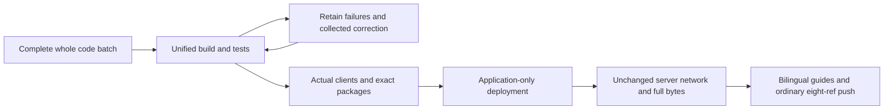

当前开放项：marketing-analyst未交付图表文件，技术状态succeeded不计为通过；通用工具错误的准确原因尚未验证。公网默认HTTP/2停滞及一次任务租约根因也保持开放。详细见证据报告，不声称完整产品验收通过。

以下保留完整架构、安装与使用细则。

<!-- integrated-round-202 -->

## 202 · 0.5.9 · 营销证据复核、交付与请求恢复

[Evidence and limits / 证据与边界](https://github.com/copypasteltd/workmate/blob/docs/docs/quality/integrated-round-202/README.md) · [Downloads / 下载](https://agent.copypaste.hk/downloads)

1. 823份按扩展名记录的源码及3份原生preload及计划用例／边界／交付脚本先成批实现，再统一六端构建和测试。677项相关用例有通过来源：Backend171／Web57／Admin22／Extension93／Delivery16／Desktop318；不是全部历史或专业／生产验收。原始失败与整批修正保留。

2. 隔离原生PostgreSQL／实际Web验证13口径、精确证据、完整下载和响应丢失后的唯一请求恢复；正式Web／最终0.7.15包验证新授权、真实复核及同字节原生导出，未提交新的付费模型任务。

3. 候选就绪、活动任务0后只切换Workmate应用。沿用原端口、下载alias和静态入口，不改写或重载Nginx，不改DNS／路由／防火墙／代理；发布前后文件和实时规则指纹核对，凭证／数据库／代理进程保持。

4. 下载页、内网全文件200和公网原TLS完整206内容重组后核对SHA／字节，12份双语README、实际PNG／GIF／MP4与102条／32组范围同步。开发机原HTTPS直连三域名健康另有实测；独立SSH出口证据明确区分。

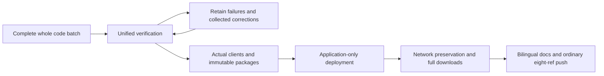

以下保留完整架构、安装与使用细则。

<!-- integrated-round-201 -->

## 201 · 0.5.8 · 影片製作與實際交付

[Evidence and limits / 證據與邊界](https://github.com/copypasteltd/workmate/blob/docs/docs/quality/integrated-round-201/README.md) · [Downloads / 下載](https://agent.copypaste.hk/downloads)

1. 先完成整批809份產品源碼清單，再統一六端構建／類型與測試；624項相關斷言有通過證據，初始失敗、測試故障注入修正、畫面檢視文案修正和未變源碼沿用範圍均完整記錄。

2. 真實隔離Web／原生PostgreSQL／390幀MP4與實際下載播放，和真實上線Web／最終0.7.14包新授權／跨端版本分開記錄，不調新的付費模型。

3. 候選就緒及活動客戶任務0後切換，schema163／原憑證／DB和代理進程保持。三包與校驗文件掛站並核對內網／公網完整字節；舊20002下載與200回退原樣保留。

4. 12份雙語README、實際PNG／GIF／MP4、完整102條／32組追溯與普通八引用同步。使用公司原域名TLS經獨立SSH出口，非開發機直連驗收；外部／專業／生產敞口保持。

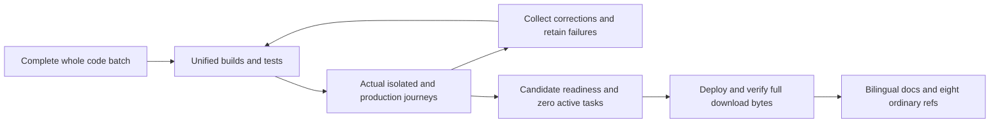

以下保留完整安裝、架構和使用細則。

<!-- integrated-round-200 -->

## 200 · 0.5.7 · 完整輪次構建、上線與證據

[Delivery and limits / 交付與邊界](https://github.com/copypasteltd/workmate/blob/docs/docs/quality/integrated-round-200/README.md) · [Downloads / 下載](https://agent.copypaste.hk/downloads)

1. 先完成本輪全部可自主處理代碼，再六端統一構建／類型／測試／實際聯調；631項相關回歸通過。首次45個資料庫恢復失敗、兩處狀態碼預期及UI同值選擇器已以新版本驅動整批修正／復驗，原失敗保留。

2. 隔離模擬營銷功能旅程、真實上線Web及最終Desktop0.7.13新授權／跨端版本／ZIP交付分別記錄；原本機Codex字節與原生權限保持，不以設計工程取代本機Agent。

3. 200候選就緒／活動客戶任務0後切換，schema163／原憑證／DB及代理進程不變，保留200-v1／199回退與舊下載。三個包／校驗文件全部內網完整HTTP和SHA通過；本輪公開事件結果為partial，三包／校驗文件公網完整字節通過為True；原點擊下載事件超時仍保留，文件字節不等於完整瀏覽器體驗。

4. 12份雙語README、真實PNG／GIF／MP4、完整102條／32組原始追溯與正常八引用同步。原域名HTTPS驗收使用獨立SSH出口，不等於開發機直連恢復；外部／專業／生產敞口不自動關閉。

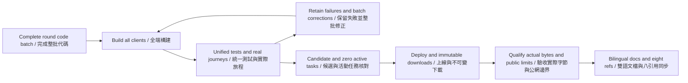

下方保留此前版本和完整安裝／使用說明，全部原始驗收範圍仍開放。

<!-- integrated-round-199 -->

## 199 · 0.5.6 · 直接編輯與來源交付接續

[Delivery and limits / 交付與邊界](https://github.com/copypasteltd/workmate/blob/docs/docs/quality/integrated-round-199/README.md) · [Downloads / 下載](https://agent.copypaste.hk/downloads)

1. 依要求先完成本輪全部可自主處理的代碼包，再統一構建／測試／聯調。六端構建、Desktop類型及568項相關回歸通過；保留所有失敗嘗試並整批修復，不用單個模組通過代表整輪完成。

2. 目前包含隔離模擬功能夾具的實際畫布／並發／ZIP證據，以及真正雲端Codex單次HK$0.038898來源、上線Web及最終Desktop0.7.11的新授權／跨端版本。後續編輯沒有新增模型請求。

3. 199覆蓋目錄以schema163候選就緒／活動任務0後切換；原憑證及DB／代理進程不變。新Setup／Portable與原ExtensionZIP在不可變/releases/199/通過內網完整HTTP／SHA核對；公開Setup完整下載通過，Portable公開取件零字節停滯未完成全文件驗收。保留198-v2回退和舊下載。

4. 開發機直接連線異常；本輪驗收使用原域名與真實TLS的獨立SSH出口，不改安全策略或替換回應，不能稱為直連恢復。32組／102條原要求、外部／專業／生產敞口保持。

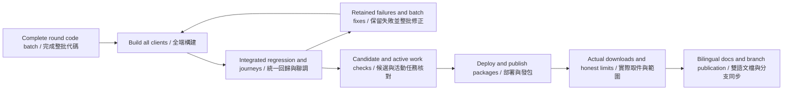

下方保留此前版本與完整使用／安裝說明。本輪不代表全部原始要求已完成驗收。

<!-- integrated-round-198 -->

## 198 · 0.5.5 · 整批交付与可追溯验证

[Delivery and limits / 交付與範圍](https://github.com/copypasteltd/workmate/blob/docs/docs/quality/integrated-round-198/README.md) · [Downloads / 下載](https://agent.copypaste.hk/downloads)

1. 先完成本轮全部可自主实现代码，再统一构建、测试和联调。六端构建、Desktop主进程／渲染类型检查及555项相关测试通过；金额措辞修正后Web／Desktop343项再次通过；后端69项为选定风险回归，不等于重跑全部历史矩阵。
2. 真实Web／Admin、发布包本机Codex和原生Extension右侧栏提供当前截图、GIF与MP4；保留失败脚本、超时和弱证据。修正后的安全页面GET有限恢复，不替换响应、不自动重放业务写入。
3. 三个不可变客户端包和校验文本在/releases/19802/实际完整下载核对；候选就绪及活动任务检查后部署integrated-198-v2，schema163和原凭证保持，数据库／代理主进程未改动，保留198-v1回退路径。
4. 七仓库按既有授权普通原子推送八引用并回读，保护用户原文件及无关分支。32组／102条原始要求保留，外部、专业和完整生产验收继续开放。

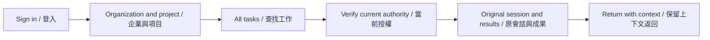

下方保留早期版本與完整安裝說明。本輪交付不代表全部原始需求已驗收。

<!-- integrated-round-197 -->

## 197 · 0.5.3 · 整批验证与发布

[Delivery and limits / 交付與範圍](https://github.com/copypasteltd/workmate/blob/docs/docs/quality/integrated-round-197/README.md) · [Downloads / 下載](https://agent.copypaste.hk/downloads)

1. 先完成所有本轮代码，再统一六端构建、类型检查、回归和实际客户端联调。本轮 528 项相关测试通过，后端选择与本轮风险相关的用例，没有将全部历史测试写成已重跑。
2. 不可变 Windows 安装／便携包和 Extension ZIP 挂在公开下载页，所有实际完整下载检查字节数及 SHA-256。部署前核对活动任务、原配置与候选就绪，保留原版本回退路径。
3. 实际截图、交互 GIF 和 MP4 来自本轮真实界面，保留原失败尝试和脚本版本。服务器凭证继续明文保存在用户要求的 /root/cfg/ 私有目录，不提交到仓库。
4. 七个独立仓库按对应分支及 docs/main 普通推送，并回读远端；保留用户文件和无关分支。专业、外部与完整生产验收继续按 32 组／102 条追溯。

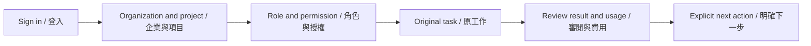

下方保留較早版本記錄。完整外部、專業與生產驗收仍開放。

<!-- integrated-round-196 -->

## 196 · 0.5.2 · 整轮开发验证与发布

[完整交付與限制 / Delivery and limits](https://github.com/copypasteltd/workmate/blob/docs/docs/quality/integrated-round-196/README.md) · [下載 / Downloads](https://agent.copypaste.hk/downloads)

1. 按完整轮次先盘点需求与全部代码待办，完成整批代码后再统一六仓构建、类型检查和相关测试。发现问题汇总修复后复验，原失败文件保留。
2. 本轮最终476相关测试通过，另保留63项未变更后端较早成功证据；没有把它描述为所有历史后端测试全部重跑。
3. 独立记录真实Web保存与恢复、发布包本机Codex和费用、原生SidePanel、后台兼容及公开完整下载SHA，录像使用实际响应时间。测试会话或密钥不进入公开证据。
4. 打包完成且散列/元数据校验通过后才上传；服务器先检查非root候选和活动任务，再切换并核对。保留195兼容回滚、旧下载及/root/cfg/workmate/私有配置。
5. 交付Desktop0.7.6安装/便携版与同字节Extension0.5.5ZIP，更新六端双语README、实际截图/GIF/MP4、32组及102条需求覆盖层，再普通推送对应分支。

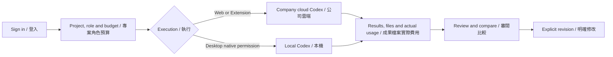

範圍：本輪相關旅程通過，原失敗保留。間歇公網連線超時、專業產出、外部接入及完整生產/兼容驗收仍開放。下方較早章節為歷史版本。

<!-- integrated-round-195 -->

## 195 · 0.5.1 · 交付与实机证据 / Delivery and real-device evidence

先整批代码后统一构建/测试/调试，提供不可变候选包、真实旅程/录制、下载散列、备份及自动回滚。

[Round delivery / 本輪交付](https://github.com/copypasteltd/workmate/blob/docs/docs/quality/integrated-round-195/README.md) · [Download / 下載](https://agent.copypaste.hk/downloads)

<!-- usage-195 -->

本轮使用流程：

1. 先完成本轮全部代码包，再执行六仓库统一构建和选定测试；本轮最终517项通过，历史失败仍保留。
2. 独立记录付费云端任务、本机安装包 Codex、原生 Side Panel 和后台管理旅程，录制保留真实响应时间。
3. 生成不可变候选包与文件散列，服务器先检查非 root 候选与无活动任务条件，再切换并检查就绪；失败恢复兼容旧版本。
4. 发布安装版、便携版、扩展 ZIP 和校验清单，核对真实完整下载；更新双语说明和本轮需求覆盖层，再普通推送对应分支。

<!-- /usage-195 -->

本輪實際測試與旅程見報告；保留歷史失敗，不以代碼量替代全部專業/生產驗收。影片/語音/Google/Meta真實配置、至少12角色專業驗收及完整兼容/運營矩陣仍開放。測試郵箱及未簽名安裝按已確認範圍保留。

Selected regression and real journeys are in the report. Historical failures remain. Real video/audio/Google/Meta configuration, at least12 professional role evaluations and the full compatibility/operations matrix remain open. The requested test mailbox and unsigned manual installation remain.

<!-- system-assessment-194 -->

## 当前完整性和体验评估 · 194

新增只读源站/配置、费用容量及真实浏览器目录探针。三域名200；文字/图片已配置，视频/语音及Google/Meta授权未接通。三笔原待对账费用均不占执行槽。原不适用诊断/旧企业404保留并注明边界，不当作产品回归。

32组敞口、10项UX、9个WorkBuddy维度及102条追溯均已整理；没有新增付费任务、产品改动、服务重启或全量测试。本轮浏览器已关闭。签名旧项12仍移出，测试邮箱按用户选择保留。

[完整评估](https://github.com/copypasteltd/workmate/blob/docs/docs/quality/system-assessment-194/README.md) · [需求追溯](https://github.com/copypasteltd/workmate/blob/docs/docs/quality/system-assessment-194/requirements-102.md)

<!-- product-downloads-193 -->

## 產品下載與安裝 · 193

[開啟產品下載頁](https://agent.copypaste.hk/downloads)。Desktop 0.7.4（Windows 安裝版/便攜版）、Chrome 擴展 0.5.4 ZIP 及檔案校驗清單均可免登入從本站直接下載。

只分發已校驗的兩個 Desktop 檔案、擴展 ZIP 和 SHA256SUMS.txt；下載頁與版本檔案分開路由，支持 HEAD、Range 斷點續傳，缺檔返回 404、不列目錄。上線只平滑重載站點代理。

目前 Windows 包未簽名；擴展為手動安裝，尚未上架 Chrome 線上應用程式商店；macOS/Linux 安裝包尚未提供。

[方案 / Implementation](https://github.com/copypasteltd/workmate/blob/docs/docs/development/193-product-downloads.md) · [驗證 / Verification](https://github.com/copypasteltd/workmate/blob/docs/docs/quality/193-product-downloads.md)


[實際手機下載頁 / Actual mobile download page](assets/screenshots/193-downloads-mobile-zh.png)


<!-- native-recheck-192 -->

## 再次复查与错误可见性 · 192

新增实际模型/本机/云端、直连浏览器、下载散列、BOM 原文件复核及代码/静态页面部署工具。历史失败作为诊断保留，不应当作正常部署步骤重放。

本轮常规回归：后端91、Web30、后台22、扩展89、桌面控制器74；Linux原生8项通过。普通浏览器直连三域名均200，Python脚本直连仍403；不能宣称全产品零错误。12已移出，视频/音频、Google/Meta、Linux Office及完整矩阵等未选范围保留。

[方案 / Implementation](https://github.com/copypasteltd/workmate/blob/docs/docs/development/192-native-error-observability.md) · [复查 / Recheck](https://github.com/copypasteltd/workmate/blob/docs/docs/quality/192-native-recheck.md)

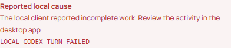

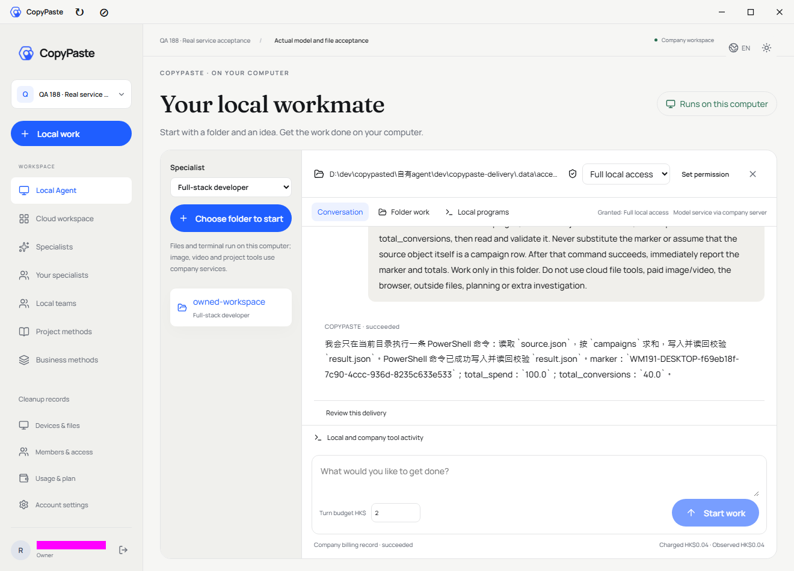

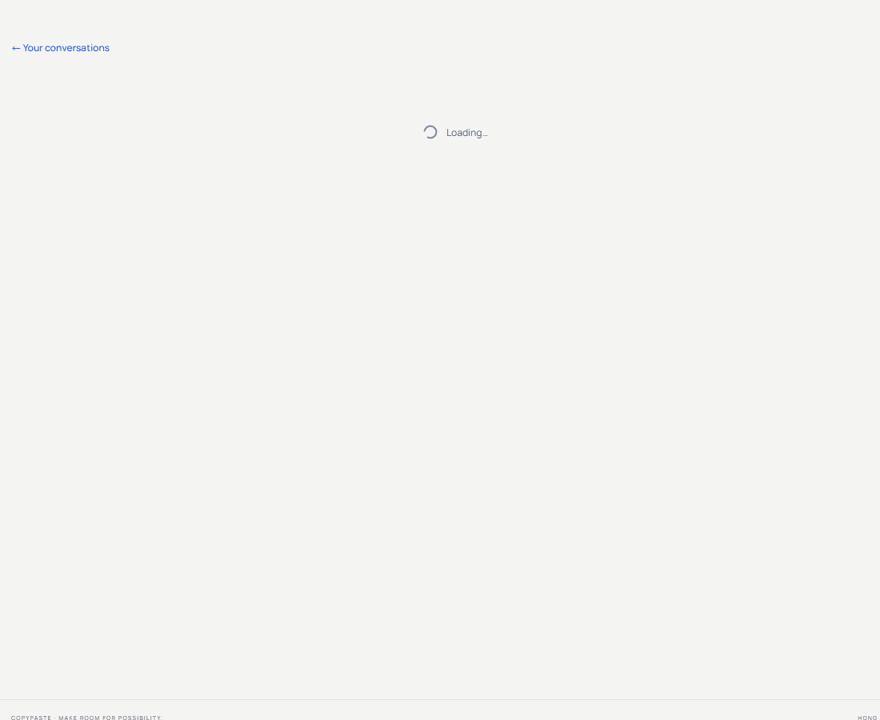

<!-- selected-repairs-191 -->

## 指定问题修复与本机交付 · 191

新增最终原生环境/真实Desktop/Web验证、候选部署、审计容量修复和手动Desktop发布工具。运行脚本依赖本地受控配置，仅用于指定维护环境；历史失败不作为重放步骤。 02/03/04/05/07取得本轮证据；12按用户要求移出，新的Windows包为未签名手动安装版本。原未知供应商费用和财务预留保留，不把执行容量释放等同结算。

最终Desktop使用安装包默认公司HTTPS地址，经原始CONNECT通道访问真实域名，TLS证书、请求、模型结果及账务未替换；浏览器PKCE同样使用正式HTTPS域名。本次真实闭环通过，但单次验收不等于长期公网稳定性保证，190的01继续保留。 本轮检查：后端40/40、模型网关24/24、Windows云端兼容38/38、Desktop控制器74/74、实际固定Codex断流1/1、Linux原生8/8；真实云任务HK$0.126067、最终Desktop任务HK$0.035144。上述范围独立记录，不称为全产品重新验收；公网及190的其他未选项目继续保留。以下为当前说明，旧版本记录保留作历史。

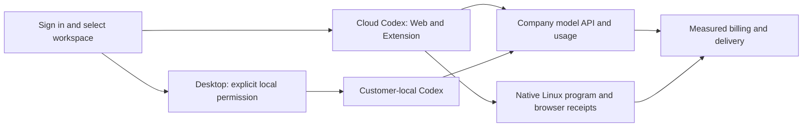

[方案 / Implementation](https://github.com/copypasteltd/workmate/blob/docs/docs/development/191-native-execution-and-capacity.md) · [证据 / Evidence](https://github.com/copypasteltd/workmate/blob/docs/docs/quality/191-selected-repairs.json) · [Desktop0.7.4手动下载 / Manual download](https://github.com/copypasteltd/workmate/releases/tag/desktop-v0.7.4)


Actual Web download recording excerpt; identity labels redacted. 这是Web实际录像节选，不代表其他端的新交互录像。


<!-- system-recheck-190 -->

## 当前体系复测 · 190

新增只读复测脚本，区分公网不稳定与源站健康、Linux执行器不可用、Desktop错误回传/待对账状态及外部能力缺口。19项新浏览器检查18通过、1次后台健康读取超时；新的邮箱验证码和管理员TOTP登录正常。测试会话、原始回执在本地受控目录，公开证据不含密钥；浏览器和自有CONNECT已关闭。本轮没有新付费任务或产品上线。[14组编号检查与真实边界](https://github.com/copypasteltd/workmate/blob/docs/docs/quality/190-system-recheck.md)。

复测工具只供当前受控维护环境使用，依赖本地私有服务器/QA配置及固定浏览器：先开启`scripts/public-qa-transport-189-v1.py`，执行`scripts/recheck-network-system-190-v1.py`与`scripts/recheck-public-ui-190-v1.mjs`，结束后向自有CONNECT进程输入`{"action":"close"}`。不要将私有配置提交或把该诊断路径当作普通公网验收。

<!-- live-acceptance-189 -->

## 真实生图上线与本轮验收 · 189

`gpt-image-2` 已使用与文字模型相同的上游接口和密钥通过真实生成、编辑验证并发布。实际 Web 设计师任务已生成文件、下载核对散列并计入真实用量。修复1254平方PNG与请求1024不一致的适配，保留上游原始字节；同时移除生图工具对重复全局密钥的错误依赖，并阻止未恢复的生图失败被标成成功。

部署包189-v5和独立后台更新已上线，保留所有失败回执、旧发布与原始费用。一次性安装器先验证候选端口63079与空闲任务，再切换应用；数据库、密码和其他服务保持原样。

后端完整运行1950项：1949通过、1失败；该浏览器超时问题随后14/14复验通过。Web28/28、后台20/20、Extension89/89、Desktop269/269及全部构建通过。图片适配48/48、逐模型图片／原图保存与测试发现36/36、真实本机协议下的生图失败／恢复2/2分别通过，不能相加当作新全量结果。

Desktop真实供应商任务、公网稳定性、视频／语音／Google与Meta授权、SMTP及Linux原生执行器仍有验收缺口。测试收件箱按要求保留；不宣称完整应用全部通过。[完整方案、使用逻辑、原始失败与回滚](https://github.com/copypasteltd/workmate/blob/docs/docs/development/189-real-image-and-acceptance.md)。

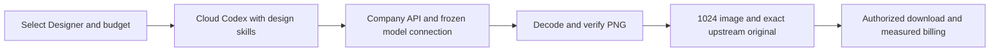


下方为实际 Web 下载流程录像节选；在其他端的README中引用也仅代表Web证据。

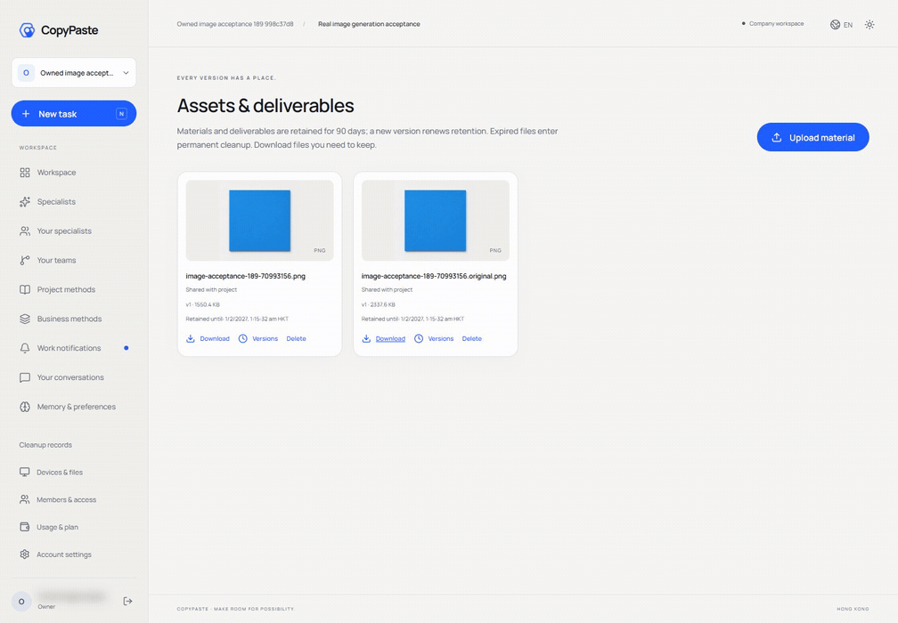

<!-- live-acceptance-188 -->

## 真实环境测试与上线 · 188

已部署真实文本服务：Web 与 Chrome 原生右侧 Side Panel 已完成“登录 → 上传获准文件 → 云端 Codex 分析 → 生成文件 → 下载 → 核对实际扣费”。后台完成真实用户／企业新建删除、批量状态管理、模型独立 API/Key 编辑删除、VIP 授予撤销及审计检查。操作与使用边界见[完整报告](https://github.com/copypasteltd/workmate/blob/docs/docs/development/188-live-acceptance.md)。

Desktop 使用本机固定版本 Codex，客户主动选择目录并确认完整本机权限。已修复 GPT 模型的原生 exec 格式兼容，真实本机命令／文件／企业工具桥接通过协议测试；最终真实模型 Desktop 复验受公网连接不稳阻塞，尚不能判定端到端通过。全量后端原始回归为 1,936 项：1,834 通过、101 失败、1 跳过；后续针对修复与现行策略的检查分别记录，不能据此宣称全部通过。

配置和使用：管理员在“模型能力”逐模型填写上游 URL、API Key、模型别名与费率，验证并发布可用版本；用户验证邮箱后选择真实企业与项目，再发起有预算的工作。当前仍使用受保护的测试收件箱。生图实际返回403，视频／语音及 Google／Meta 授权缺失；这些服务尚未取得真实验收。

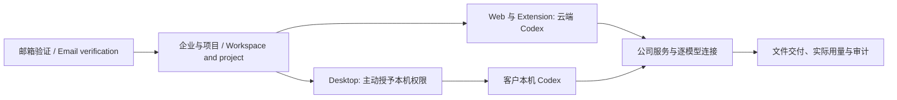


下图为真实 Web 已完成任务的只读浏览与滚动录像节选；不代表所有端均已完成真实模型验收。


<!-- web-scroll-187 -->

## Web 滚动区域优化 · 187

[用户端](https://agent.copypaste.hk)已隐藏页面、侧栏、消息和弹窗外层的可见滚动条，保留原生滚动。必要的内部表格、面板和输入区统一细款样式，颜色跟随浅深色主题。窄屏标题与筛选允许换行，宽表格仅在自身区域左右滚动。

使用鼠标滚轮、触控板或手机滑动浏览长内容；导航可独立滚动，弹窗底部仍可访问。此更新已通过 TypeScript/Vite 构建和最终10项实际内网页面检查；浏览器与测试会话已关闭。公网 HTTPS 端到端旅程未在本轮完整验证，检查范围见[实现、使用与回滚](https://github.com/copypasteltd/workmate/blob/docs/docs/development/187-web-scroll-surfaces.md)。

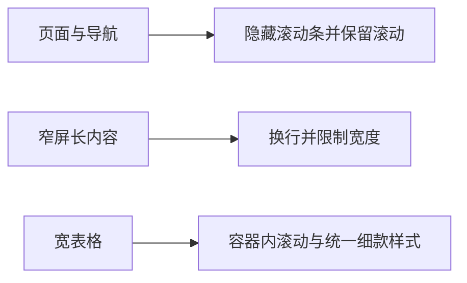


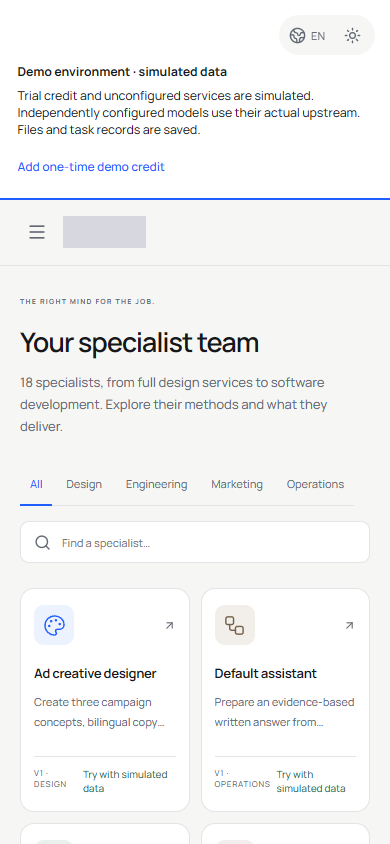


<!-- test-mailbox-185 -->

## 测试收件箱验证码修复 · 阶段185

已修复跨星期日期排序与30封限制共同隐藏新验证码的问题。打开[测试收件箱](https://agent-dashboard.copypaste.hk/ops/mailbox/)，使用既有独立收件箱凭证；新邮件置顶，每5秒自动检查，也可手动刷新。过期验证码须重新申请，后台继续要求既有 TOTP。

7项相关回归和6项最终公网检查通过；新验证码约3秒自动出现，并实际完成后台登录。此轮更新静态收件箱页面，保留测试投递模式、既有凭证及服务配置。


[使用、实现、回滚与验证](https://github.com/copypasteltd/workmate/blob/docs/docs/development/185-test-mailbox.md)

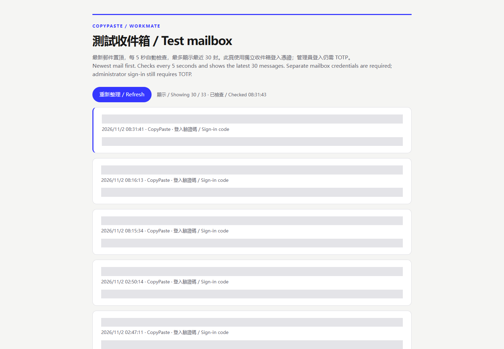


<!-- admin-directory-lifecycle-184 -->

## 用户／企业新建、删除及批量管理 · 阶段184

用户管理与企业管理已增加新建、逐行永久删除、当页多选、批量状态变更及批量删除。提交绑定原因、明确目标、版本、五分钟预览及幂等键。最高管理员直接执行，其他角色按发布策略审批。新建用户登录时仍须验证邮箱；新建企业同时配置擁有人、账务账户及首个项目。

勾选需要处理的记录，选择动作，填写原因后预览并确认；删除须输入 DELETE 加准确数量并确认保留范围。任一记录变化或不符合条件时整批不执行。删除用户撤销登录并移除联系和显示资料，同时保留共用企业内容及账务／审计引用；删除企业立即停止新操作，后台永久清理进度在内容管理查看。接口上限100条，界面不会隐含选取其他页。

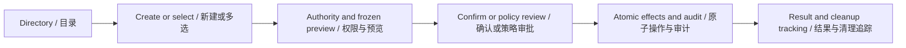

[完整使用方案、接口、权限、保留规则及部署说明](https://github.com/copypasteltd/workmate/blob/docs/docs/development/184-admin-directory-lifecycle.md)

13项相关原生检查和10项最终真实页面检查通过。两轮专用页面验证已创建并清理4个用户及4个企业，18项操作均保存对应直接执行审计；4项企业根清理已完成，实际异常数组为空，必要保留项有记录。服务器配置、模型 API/Key 和未知费用预留保持原样。

<!-- highest-admin-direct-182 -->

## 最高管理员直接执行 · 阶段182

有效的全局内置 super_admin 可直接执行管理变更；其他角色按业务策略审批，不能审批自己的受控申请。敏感操作继续核对 MFA、业务权限、范围、限额和原始证据，真实操作者、原因、命令摘要及结果与业务效果一并保存审计。

当前 gpt-6-luna 已通过真实后台直接发布：操作 `7d32d69d-5680-4199-bd04-1ebe2b1b4813`、审计 `7174`，未生成待审批申请。18项相关检查、6项真实页面检查通过。原模型配置、加密 Key、未知费用预留及旧违规记录保持原样。追加迁移160须搭配对应 API。

[设计、使用和逻辑图 / Design, usage and diagram](https://github.com/copypasteltd/workmate/blob/docs/docs/development/182-highest-admin-direct.md)


# Workmate · delivery

<!-- model-tool-contract-181 -->
## Codex 完整模型验证修复 · 阶段181

当前保存的 **gpt-6-luna** 已在正式后台通过完整验证：固定 Codex、指定模型与推理强度、注册工具调用及结果返回、最终文字回复、用量记录均完成。保留每模型接口和 Key，兼容普通 function 与原生 code mode 工具格式，并继续执行原业务权限检查。

实际回执 `b8c8c28a-1df1-4ef7-af55-91d9d51b4bcc`；输入／输出 tokens 为 `20230/139`。旧待对账记录保留。未自定义发布的初始策略中，管理员／验证总名额由2调整为4，保留旧占位2个并恢复可用名额2个；费用上限及其他限制不变。原生工具上下文按完整请求字节预留输入额度，再按实际 tokens 结算；输入、输出或费用超额仍会拦截。

Package V3/install V4 with the181 scripts; qualify using `qualify-model-tool-contract-181-v4.mjs` with `PLAYWRIGHT_BROWSERS_PATH=.data/browsers`. The bounded bootstrap recovery refuses to replace a published Admin policy. Forward migration159 pre-funds native context from complete request bytes; historical exact-count allocations and frozen installers remain intact.

[Implementation, workflow and evidence / 方案、逻辑图与回执](https://github.com/copypasteltd/workmate/blob/docs/docs/development/181-model-tool-contract.md)


Earlier records follow. 以下为历史记录。

---

<!-- model-http-180 -->
## 模型接口支持 HTTP 和 HTTPS · 阶段180

每模型 API 基础地址支持 **HTTP 和 HTTPS**；公网上游使用 HTTP 无须勾选内网选项。保存、连接测试、Codex 完整能力验证及推理使用同一传输规则。原模型地址及加密 Key 保留。

已在正式后台使用当前 gpt-6-luna 配置进行连接测试，接口及 Key 认证成功，返回列表包含该模型。这是实际连接结果，不代替 Codex 完整能力验证，也不自动发布模型。

Native related checks: `node scripts/test-model-http-180-v1.mjs` (24 cases). Runtime: `package-model-http-180-v1.py` and `install-model-http-180-v1.sh`. Overlay `/opt/workmate/overlays/model-http-180/`; schema158 unchanged. Backend and Admin builds passed. No new native installers or changes to unrelated services.

[Usage and implementation / 使用与开发](https://github.com/copypasteltd/workmate/blob/docs/docs/development/180-model-http.md)

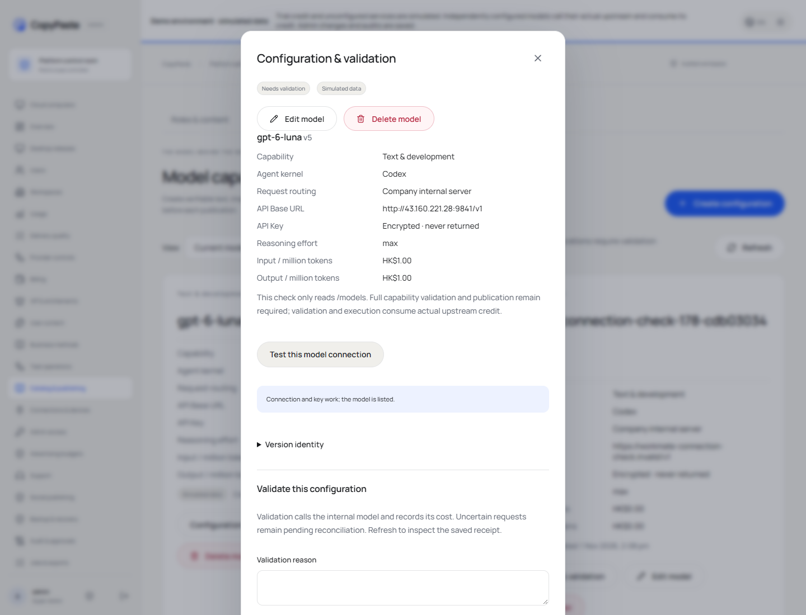


Earlier records follow. 以下为历史记录。

---

<!-- model-management-179 -->
## 已有模型可直接编辑和删除 · 阶段179

打开 [模型能力](https://agent-dashboard.copypaste.hk/catalog?view=capabilities)，当前模型的列表和详情均有 **编辑模型**、**删除模型**。编辑表单预填模型、接口和费率，API Key 输入框可直接输入新 Key。同地址／网络范围可保留已保存 Key，更换范围则需填新 Key。

**保存更改**后，当前列表直接显示更新后的同一模型条目；完成验证、发布后供新工作使用。**删除模型 → 确认删除** 后移出可用目录，拦截新代理和新顶层任务选择，也不会回退到演示模型。旧任务、账务及加密连接保留；列表可切换当前模型、配置历史、已删除模型。

Focused native checks: `node scripts/test-model-management-179-v5.mjs` (21 cases: 10 model-management cases plus 11 existing model-connection cases). Runtime: `package-model-management-179-v1.py` and `install-model-management-179-v1.sh`. Overlay `/opt/workmate/overlays/model-management-179/`, schema158. Existing credentials and unrelated services remain unchanged; any frontend rollback must retain a schema158-compatible API. Native PostgreSQL only; no local Docker/WSL. Browser scripts close their own contexts and browser in finally blocks.

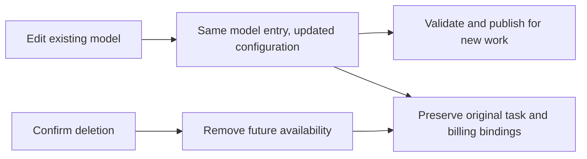

[Usage and implementation / 使用细则](https://github.com/copypasteltd/workmate/blob/docs/docs/development/179-model-management.md)


Earlier implementation and deployment records follow. 以下为原有版本记录。

---

<!-- per-model-connections-178 -->
## 每个模型独立配置上游 · 阶段178

进入 [Admin → 模型能力](https://agent-dashboard.copypaste.hk/catalog?view=capabilities) → **建立配置**，在同一表单填写 `gpt-6-luna`（或上游实际模型别名）、**API Base URL** 和 **API Key**。每个模型独立保存地址及密钥，文字模型须支持 OpenAI Responses API。

使用流程：保存草稿 → 测试连接 → 完整能力验证 → 独立审批发布 → 在角色／模板中绑定已发布能力。连接测试读取 `/models`，保存和测试不会自动发布。完整验证和真实使用会消耗实际上游额度，当前试用记账环境也一样。

密钥由服务器加密保存且不回显；新版本保留原任务冻结的连接。复制版本可明确保留原密钥，更换地址或网络范围必须重新填写。缺少明确连接时直接报错。本轮没有代填真实供应商密钥。

Run `node scripts/test-model-connections-178-v4.mjs` for the isolated native PostgreSQL model-connection checks. `package-model-connections-178-v1.py` creates the immutable runtime overlay; `install-model-connections-178-v1.sh` migrates schema157 and switches only owned services. Existing server credentials are preserved. Forward-compatible API is required when rolling back frontends after migration. Never invoke local Docker/WSL. Browser verifiers close their own contexts and browser in finally blocks.

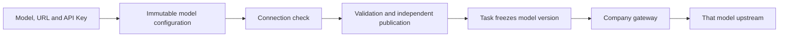

[使用细则 / Usage and operations](https://github.com/copypasteltd/workmate/blob/docs/docs/releases/model-connections-178.md) · [Source/runtime increment](https://agent.copypaste.hk/downloads/workmate-model-configuration-178.zip)

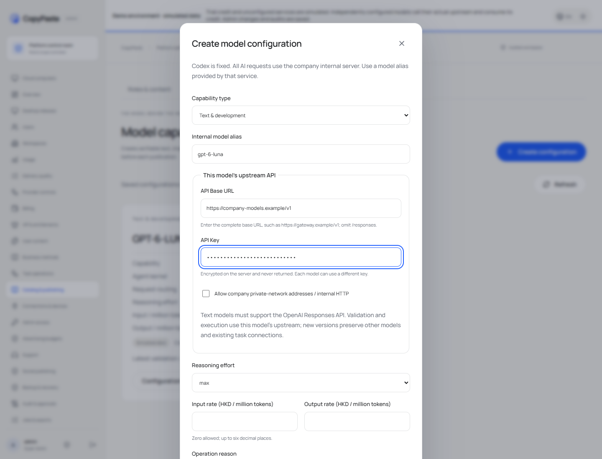


Earlier deployment/release records follow; their synthetic-service descriptions describe their original scope. 以下历史记录保留原部署范围。

---

<!-- public-domains-177 -->
## 正式域名试用部署 · 阶段177

[Web](https://agent.copypaste.hk) · [Admin](https://agent-dashboard.copypaste.hk) · [API readiness](https://ai-api.copypaste.hk/health/ready)

新版本增量部署、下载、双语手册和真实交互记录；旧发行包、标签、凭据及无关服务保留。

Additive deployment, client downloads, bilingual guides and actual recordings preserve frozen releases, credentials and unrelated services.

[Current deployment, login and operations / 当前部署、登录与运维](https://github.com/copypasteltd/workmate/blob/docs/docs/releases/domains-177.md)

Credentials are unchanged: server `/root/cfg/workmate/credentials.txt`, root `0600`. Admin: `admin@workmate.local` + email OTP + TOTP. Test mailbox: [protected operator inbox](https://agent-dashboard.copypaste.hk/ops/mailbox/). AI/media/ads/payment remain synthetic; records/files persist. 凭据保留，测试收件箱使用独立操作口令，外部服务仍为假数据。

[Desktop 0.7.2 Setup](https://agent.copypaste.hk/downloads/CopyPaste-0.7.2-x64-Setup.exe) · [Portable](https://agent.copypaste.hk/downloads/CopyPaste-0.7.2-x64-Portable.exe) · [Extension 0.5.3 ZIP](https://agent.copypaste.hk/downloads/CopyPaste-Extension-0.5.3.zip) · [Source increment / 源码增量](https://agent.copypaste.hk/downloads/workmate-domains-177.zip)

Windows installers are unsigned. Extract the Extension ZIP and load it unpacked in Chrome developer mode; the extension ID stays `fffkcnmfdhahlnifgdilabheppkgnlok`. Desktop AI access uses company services; supplier keys are not embedded. Windows 未签名，扩展采用已解压加载，固定 ID 不变。

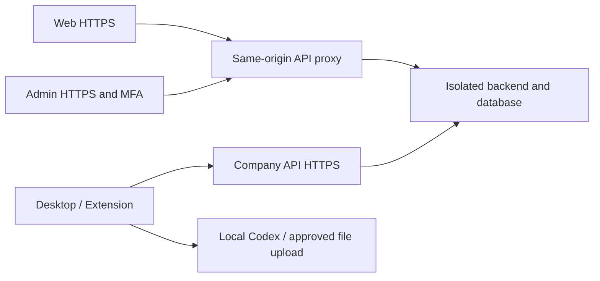

[Actual public Web task](https://github.com/copypasteltd/workmate/blob/web/assets/screenshots/177b-domain-task-result.png) · [Actual interaction GIF](https://github.com/copypasteltd/workmate/blob/web/assets/demos/177-public-domains.gif)

---

Earlier releases and deployment history / 以下为历史版本及部署记录。

<!-- lan-deployment-176 -->
## 内网 HTTP 部署 · 阶段176

Web: http://192.168.31.20:63070 · Admin: http://192.168.31.20:63071 · API: http://192.168.31.20:63072

保留原发行包和失败记录，提供独立部署/审计脚本、实际浏览器检查和登录后录制。

服务器明文凭据：`/root/cfg/workmate/credentials.txt`（root `0600`）。邮箱验证码通过受独立口令保护的测试收件箱读取；Admin 另需验证器 TOTP。外部服务继续使用已授权假数据。

[部署、登录与运维 / Deployment and login guide](https://github.com/copypasteltd/workmate/blob/docs/docs/releases/lan-176.md)

[实际 Web 交互 / Actual Web recording](https://github.com/copypasteltd/workmate/blob/web/assets/demos/176-lan-http.gif) · [后台截图 / Admin capture](https://github.com/copypasteltd/workmate/blob/admin/assets/screenshots/176e-lan-users.png)


## v0.1.3 · 当前完整交付 / Current complete delivery

[Release / 下载](https://github.com/copypasteltd/workmate/releases/tag/v0.1.3) · [中英使用手册 / Bilingual guide](https://github.com/copypasteltd/workmate/blob/v0.1.3/docs/releases/v0.1.3.md)

本轮完整包包含六仓源码和全部端，纳入团队/单次运行费用报表、原成员/协调员账目、交叉筛选和同快照CSV。当前源码与假数据冻结交付按使用者要求收口；服务器资料和正式服务接入后续提供。AI/媒体/广告/支付使用假数据，Windows未签名；完整专业/生产台账保持。

All six source trees/clients are delivered, including team/run financial reports, original member/coordinator entries, intersecting filters and matching snapshot CSV. This current source/synthetic frozen delivery closes as requested; server/live configuration follows later. External services are synthetic and Windows is unsigned. Full professional/production qualification remains tracked.


## 團隊費用 / Team consumption · stage174

團隊及執行ID交叉篩選，成員與協調員實際帳目只加總一次；固定快照明細／CSV保留原身份，舊來源不推斷。Team/run filters and groups sum original work entries once, with immutable detail/CSV and explicit unknown legacy attribution. 21 native report cases and seven current actual Admin journeys; original failed capture retained. Final freeze rebuilds Admin for current CSS.

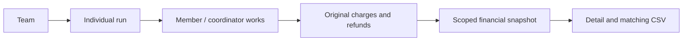


[MP4](assets/screenshots/workmate-admin-team-usage-174-03-team-consumption-workflow.mp4)


## 当前完整冻结交付 · v0.1.2

全部端、六仓源码与本次费用入账期间报表统一纳入完整下载包。Desktop在本机运行Codex且支持客户主动授予完整本机权限；Extension使用原生右侧Side Panel，获准读取/上传文件后由云端Codex执行。数据库156；外部AI/媒体/广告/支付采用已授权假数据，Windows未签名。

[完整下载 / Complete release](https://github.com/copypasteltd/workmate/releases/tag/v0.1.2) · [安装、登录和使用 / Setup and flows](https://github.com/copypasteltd/workmate/blob/v0.1.2/docs/releases/v0.1.2.md)

本轮重新构建Backend/Admin；其余运行产物及Windows分发核对后复用。继承源码一致的阶段172定向验证，阶段173不重跑功能测试。Backend/Admin rebuilt; unchanged runtimes/Windows distributions verified and reused. Exact-source stage172 focused checks inherited; no functional tests rerun at173. Older entries below retain their historical scope.


## 当前源码增量 · 阶段172

Admin新增工作建立／费用入账两种期间。旧任务本期扣费、跨期香港日期、区间外原扣费的退款及负净消耗可查询；分组、明细和CSV共用一份固定快照。预留额度与累积操作用量另行说明。当前源码需配套Backend/Admin，数据库仍为156。此增量不在已冻结v0.1.1 ZIP内；原包与标签保持。

本轮新增8项原生SQL/API＋1项精确投影检查；6项原报表检查在源码一致时继承其实际通过结果；7组实际Admin操作通过。首次历史测试资料缺少资金来源而被约束拒绝，已以新版本补齐来源与资金变动；失败原记录保留，未关闭保护。全部原完整验收范围继续跟踪。

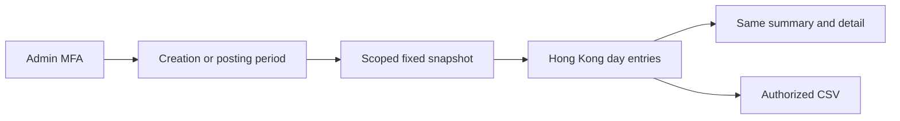


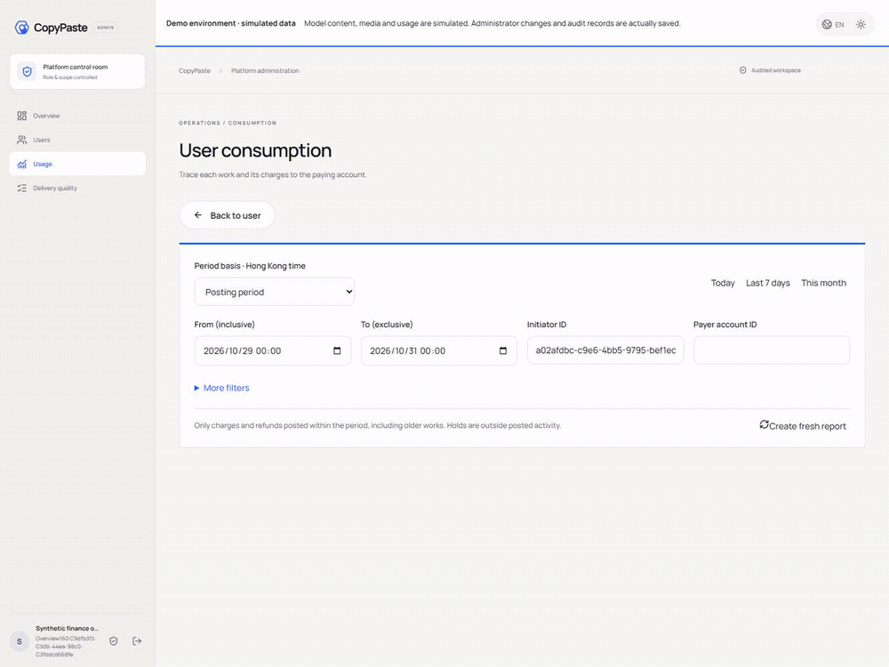

[MP4](assets/screenshots/workmate-admin-posting-period-172-01-posting-period-workflow.mp4) · [方案 / Behavior](https://github.com/copypasteltd/workmate/blob/docs/docs/development/172-admin-posting-period.md)

## v0.1.1 打包补充 / Packaging follow-up

START-HERE links the committed stage169 ledger. The source manifest records package-frozen-release-170-v3.py as packaging-only overlays. The first failed packaging attempt remains; five completed archives were reused only after exact entry checks. The publishing helper now validates schema156. Application sources, builds and frozen tags are unchanged. This follow-up records that exact helper and these notes; it does not replace release assets.

## 冻结交付 v0.1.1

完整包统一包含Windows Desktop（本机Codex、无边框）、Web、独立Admin、Chrome右侧Side Panel、Backend、六仓源码和固定runtime。假数据模式，Windows未签名；当前数据库156。

[完整发行包 / Complete release](https://github.com/copypasteltd/workmate/releases/tag/v0.1.1) · [安装及流程 / Setup and flows](https://github.com/copypasteltd/workmate/blob/v0.1.1/docs/releases/v0.1.1.md)

## 当前源码增量 · 阶段169

用户消耗报表支持付款方／项目／时间等筛选、八类分组、任务账务明细和同快照CSV。金额、预留、退款、待对账和未知内部成本分开；当前范围、MFA、导出权限逐次复查。当前库版本156。旧v0.1.0包未改；本增量纳入下一完整冻结包。

```mermaid
flowchart LR
 A[Admin MFA] --> S[Scoped filters]
 S --> R[Encrypted fixed snapshot]
 R --> D[Groups / work / ledger]
 R --> E[Authorized CSV]
```

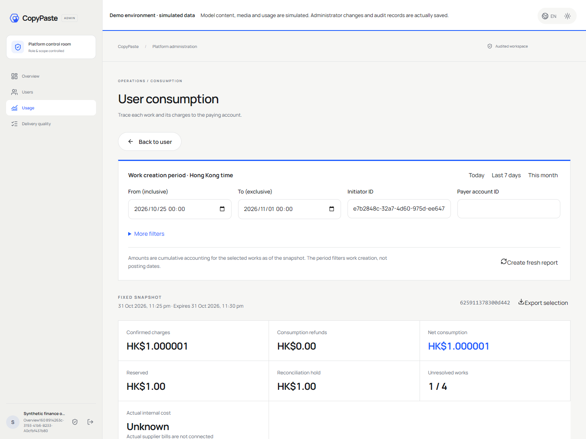

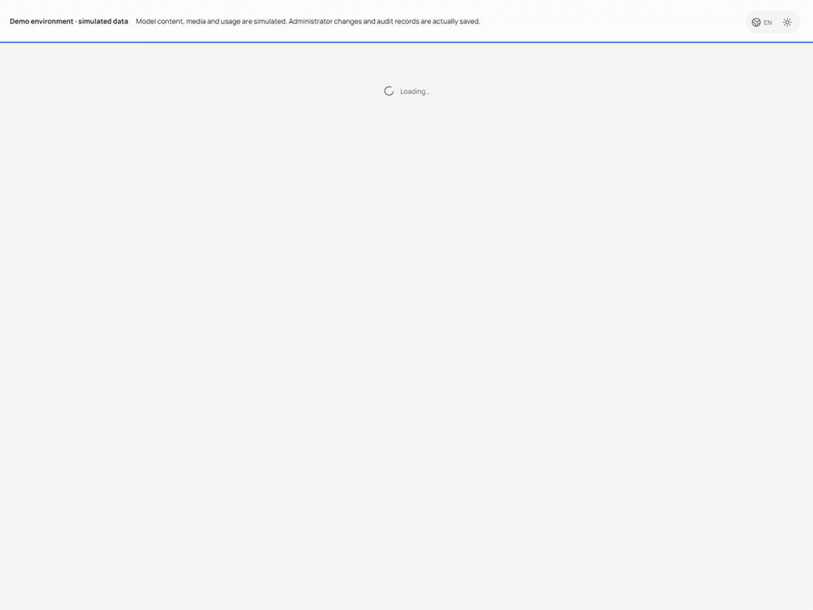

[MP4](assets/screenshots/workmate-admin-usage-report-169-02-consumption-report-workflow.mp4) · [方案 / Behavior](https://github.com/copypasteltd/workmate/blob/docs/docs/development/169-admin-usage-reports.md)


[English](README.en.md) · [完整Release](https://github.com/copypasteltd/workmate/releases/tag/v0.1.0) · [中英安装使用](https://github.com/copypasteltd/workmate/blob/v0.1.0/docs/releases/v0.1.0.md)

面向香港企业的 Codex Agent 平台，首批服务既有 marketing 团队，覆盖设计/媒体、广告与网站/SEO/GEO分析、重复流程和软件开发。本仓库为独立 **delivery** 端，使用 **Native startup / qualification / publication**。视觉遵循 CopyPaste 的暖白底、深色文字、品牌色和编辑式排版。

## 当前源码增量 · 阶段168

用户列表可组合注册/最近账户访问、来源、VIP方案/状态/到期、确认扣费、角色建立/开始、待对账和独立账户额度条件。刷新、详情及返回保留URL条件。最近访问包含合法设备后台轮询，不等于真人在线；历史来源和访问保持未知。金额以精确微港币保存，只统计确认扣费；个人/企业资金不合并，未知或不一致账务不当作零。

当前增量需数据库001–156及匹配API/Worker：停止旧服务，备份后迁移，再启动新服务。默认目录DTO兼容；显式view=operations增加来源及访问字段。费用、VIP、账务各需独立当前范围权限及近期MFA，目录读取不写账。

此项是v0.1.0之后的源码更新，**不在原冻结ZIP内**。原发行标签及资产保持不变。当前Backend/Admin构建、8项原生SQL/API和6组实际Admin页面检查通过；保留测试数据与页面定位的原始失败尝试。业务仍使用已授权假数据，完整验收范围继续跟踪。

```mermaid
flowchart LR
 A[Admin OTP and TOTP] --> F[URL filters]
 F --> S[Current user and field scopes]
 S --> E[Same grant / exact charges / separate wallet]
 E --> U[Matching users]
 U --> D[User detail]
 D --> F
```

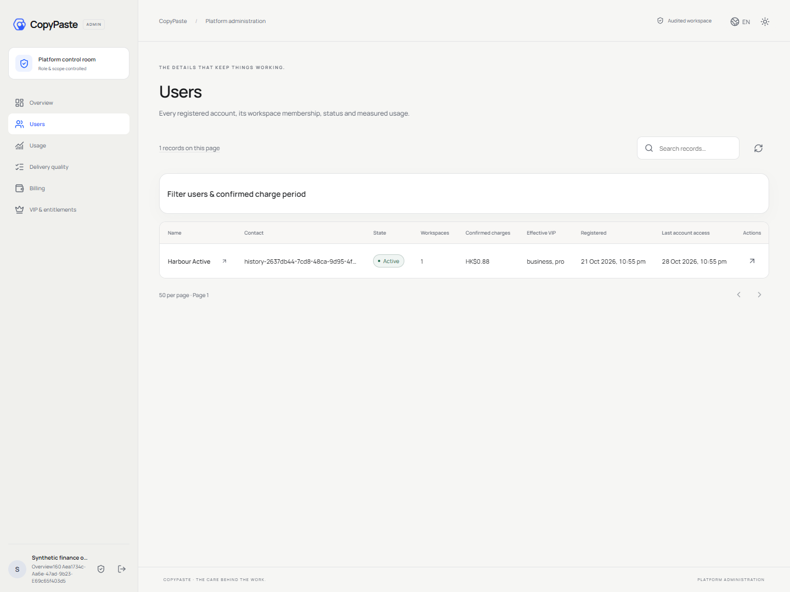

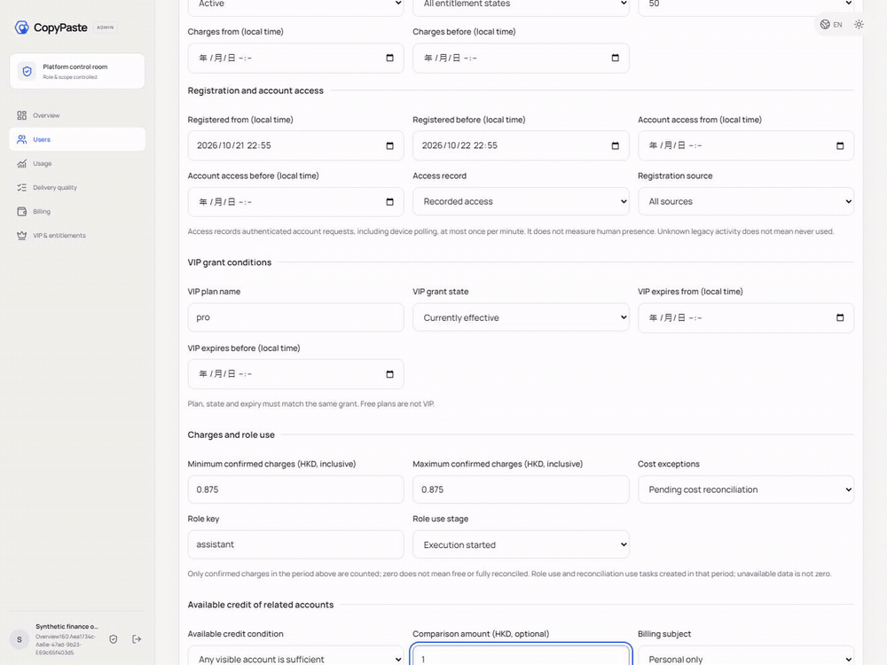

[MP4](assets/screenshots/workmate-admin-directory-filters-168-03-directory-filter-workflow.mp4) · [Logic / 逻辑](https://github.com/copypasteltd/workmate/blob/docs/docs/development/168-admin-directory-operational-filters.md) · [Evidence / 回执](https://github.com/copypasteltd/workmate/blob/docs/docs/quality/admin-directory-filters-168.json)

## 本版用户任务与内容 · 阶段166

用户详情直接进入该用户的任务与内容。搜索、分页和刷新保留目标，返回恢复原目录条件；换用户清空旧正文和操作。当前用户范围与资源范围同时鉴权，正文/下载保持独立权限与近期MFA。二十类内容按实际创建者归属，品牌保留首版作者；未知作者旧资料在全站目录查看。记录按资源类型计算，同名文件资产及目录项具有独立身份。

该功能已纳入v0.1.0源码与分发包；旧rc.5包和标签保持原样。本轮后端/Admin构建、八项原生SQL/API及八组实际页面检查通过，原始定位失败和录制均保留。外部服务仍用已授权假数据，原完整验收范围继续跟踪。

```mermaid
flowchart LR
 U[用户详情] --> T[该用户任务]
 U --> C[该用户内容]
 T --> P[当前用户与资源权限交集]
 C --> P
 P --> S[搜索/分页/刷新保留目标]
 S --> U
 C --> B[独立正文与管理权限]
```

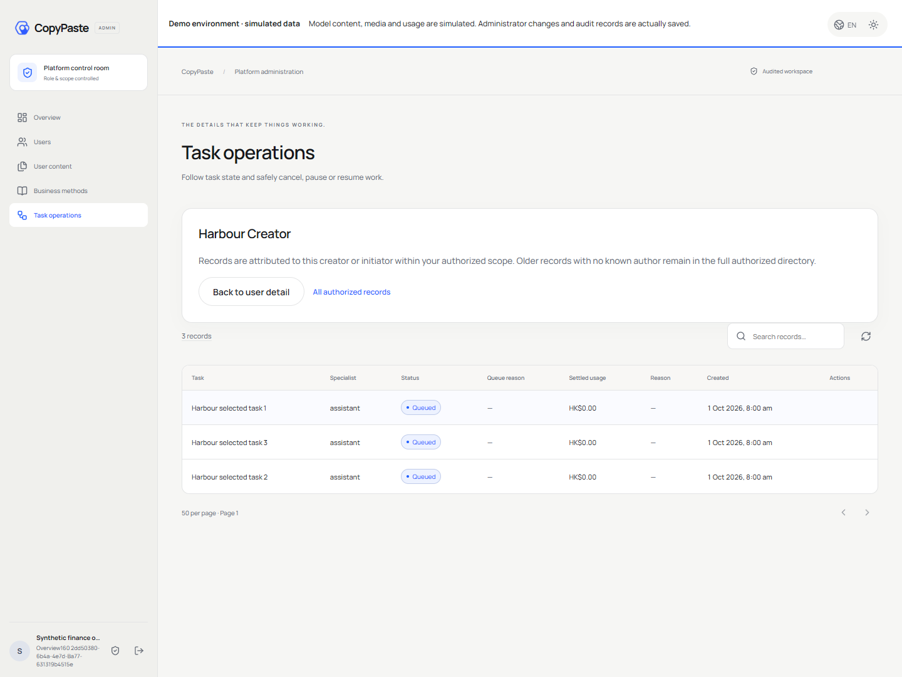

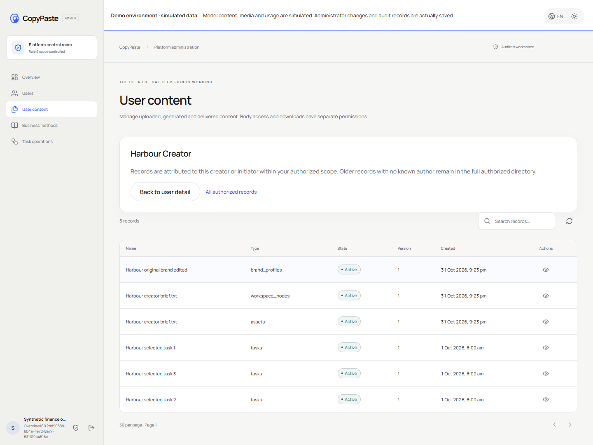

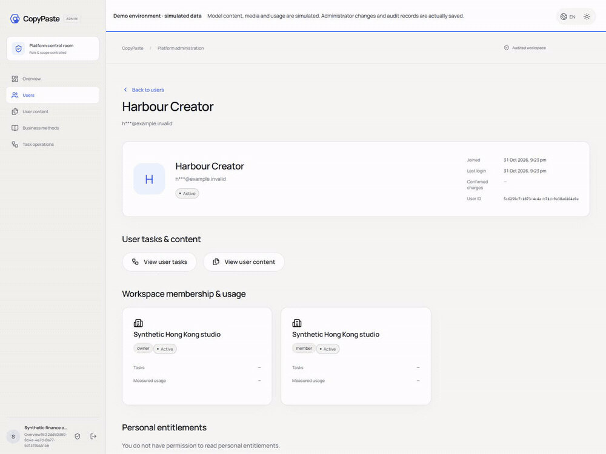

[MP4](assets/screenshots/workmate-admin-user-resources-166-02-user-task-content-scope.mp4) · [Logic / 逻辑](https://github.com/copypasteltd/workmate/blob/docs/docs/development/166-admin-user-resource-context.md) · [Evidence / 回执](https://github.com/copypasteltd/workmate/blob/docs/docs/quality/admin-user-resources-166.json)

## 当前冻结版 · v0.1.0

本版统一交付所有端、后端和六仓源码，包含最新用户任务/内容入口。六仓重新构建；当前Desktop输出与已验收Windows完整目录/Portable/Setup逐文件一致，核对后复用。近期阶段166八项SQL/API与八组实际页面检查保留其源码及原始证据；本轮不重跑全部历史用例。

分支`delivery`，本版固定标签`v0.1.0-delivery`。[完整源码与安装包](https://github.com/copypasteltd/workmate/releases/tag/v0.1.0) · [冻结记录](https://github.com/copypasteltd/workmate/blob/v0.1.0/docs/quality/release-freeze-checkpoint-167.json) · [待办](https://github.com/copypasteltd/workmate/blob/v0.1.0/docs/quality/remaining-work-stage167.md)。AI/媒体/广告/支付为已授权假数据；Windows未签名。截图/GIF/MP4保留其原实际采集范围，不宣称新增全端安装或专业质量验收。

## 方案与结构

主要入口：`scripts/, native/, evidence/functional-closure-165/`。Codex 是唯一 Agent 内核，全部模型请求经公司内部 OpenAI 兼容 API，供应商密钥仅留在后端。专业模板固定 Skill、工具和配置版本；设计师组合为 Codex＋设计 Skill＋公司 Image 2。

Web 访问云端 Agent。Extension 使用 Chrome MV3 原生右侧 Side Panel，提供对话/附件界面，只读取客户选择的文件并经同意上传，由云端执行。Desktop 无边框、无 Electron 默认菜单，在客户本机运行 Codex，客户可主动授予完整本机权限，支持停止/撤权及账户、目录隔离。

Admin 独立邮箱验证码＋TOTP，按权限管理用户/企业、消耗与费用、VIP、角色/Skill和内容。用户详情传递真实用户ID；费用账户按主体筛选，VIP锁定目标，换用户销毁旧弹窗及预览。港币金额按微单位保存；预算、余额、实收、赠额、授信和VIP分开记录。人工变更先预览、再确认，保留当前权限/MFA/策略/审批、幂等和审计。

```mermaid
flowchart LR
 W[Web and Chrome Side Panel] --> A[Company API, identity and metering]
 A --> C[Cloud Codex and versioned Skills]
 D[Frameless Desktop] --> L[Customer-local Codex]
 L --> A
 A --> G[Company OpenAI-compatible gateway]
 M[Independent Admin MFA] --> A
 C --> R[Review, revise and download]
 L --> R
```

## 安装与运行

六个独立仓库并列置于 `dev/`：`copypaste-platform`、`copypaste-web`、`copypaste-admin`、`copypaste-desktop`、`copypaste-extension`、`copypaste-delivery`。使用 Windows x64、Node.js 22.14+、Git及原生PostgreSQL；媒体工作需FFmpeg/FFprobe，固定Codex随runtime分发。禁止Docker/WSL及虚拟化。

完整启动以Release指南为准。首次写配置前选空闲数据库端口，从Delivery依次运行 `demo:preflight` → `bootstrap:demo` → `demo:check` → `demo`。保留已有配置和数据；结束执行Delivery的 `npm run stop`。

本仓库单独开发，先准备对应依赖及配套后端：

```powershell
npm ci
npm run demo:preflight
npm run bootstrap:demo
npm run demo:check
npm run demo
```

API为localhost4310，Web4317，Admin4318。开发验证码位于platform `.data/mailbox/`。管理员需在platform执行 `npm run admin:create -- admin@example.com super_admin` 并按一次性资料绑定TOTP。Desktop通过浏览器PKCE登录后选择本机目录和权限；Chrome使用“加载已解压的扩展程序”，点击图标打开侧栏。

## 使用逻辑

1. 邮箱登录，接受邀请或创建企业及首项目。创建结果未确认时保留原请求；断线/刷新后点“确认并继续”恢复原结果。失效/删除回执不会悄悄新建企业。
2. 选择项目和角色，填写brief、文件/品牌/账户、预算和授权。必要资料在原任务补齐；执行固定当时接受的配置与Skill版本。
3. 查看持久进度、审批、成果版本、费用和用量，审阅后下载原文件或继续修改。未知费用保持待核对，不按免费处理或盲目重跑。
4. Admin从用户详情开费用/VIP，核对主体和预览后按策略确认。目录筛选支持刷新/返回恢复。当前分支已接通按实际创建者筛选的任务和内容入口，返回保留原目录条件。

## 配置与权限

Web/Admin使用 `VITE_API_BASE` 或同源代理；原生端构建时固定允许来源及扩展ID，回环开发外使用HTTPS。SQL增量历史001–155，API/Worker检查版本及环境身份。源码不带密钥、`.env`、用户数据库、依赖或Git元数据。

会话失效清除旧工作台，迟到结果不能覆盖新登录。文件默认私有；请求、任务领取、工具和下载重新核验当前权限。历史回执不保留已撤销访问权。显式退出清除工作区创建草稿中的名称，仅保留原账户可核对的无正文请求标识。

## 角色预设与Skill

目录定义18个专业预设；数量不代表十二个角色已全部通过专业验收。

| ID | Role | Required Skill bindings |
| --- | --- | --- |
| R01 | 全栈开发工程师 | `fullstack-engineering@1.0.0`, `frontend-implementation@1.0.0`, `backend-api@1.0.0`, `qa-testing@1.0.0`, `delivery-core@1.0.0` |
| R02 | 前端开发工程师 | `frontend-implementation@1.0.0`, `ui-system@1.0.0`, `qa-testing@1.0.0`, `delivery-core@1.0.0` |
| R03 | 后端与 API 工程师 | `backend-api@1.0.0`, `qa-testing@1.0.0`, `delivery-core@1.0.0` |
| R04 | 软件测试工程师 | `qa-testing@1.0.0`, `frontend-implementation@1.0.0`, `delivery-core@1.0.0` |
| R05 | UI/UX 设计师 | `ux-research@1.0.0`, `ui-system@1.0.0`, `frontend-implementation@1.0.0`, `delivery-core@1.0.0` |
| R06 | 设计师 | `creative-direction@1.0.0`, `image-art-direction@1.0.0`, `image2-production@1.0.0`, `typography-layout@1.0.0`, `delivery-core@1.0.0` |
| R07 | 品牌视觉设计师 | `brand-system@1.1.0`, `image-art-direction@1.0.0`, `image2-production@1.0.0`, `typography-layout@1.0.0`, `delivery-core@1.0.0` |
| R08 | 广告创意设计师 | `ad-creative@1.0.0`, `image-art-direction@1.0.0`, `image2-production@1.0.0`, `typography-layout@1.0.0`, `delivery-core@1.0.0` |
| R09 | 电商商品设计师 | `ecommerce-visual@1.0.0`, `image-art-direction@1.0.0`, `image2-production@1.0.0`, `typography-layout@1.0.0`, `delivery-core@1.0.0` |
| R10 | 社媒内容设计师 | `social-content@1.0.0`, `image2-production@1.0.0`, `typography-layout@1.0.0`, `delivery-core@1.0.0` |
| R11 | 插画与 IP 设计师 | `illustration-ip@1.0.0`, `image-art-direction@1.0.0`, `image2-production@1.0.0`, `delivery-core@1.0.0` |
| R12 | 字体与版式设计师 | `typography-layout@1.0.0`, `image-art-direction@1.0.0`, `image2-production@1.0.0`, `delivery-core@1.0.0` |
| R13 | 演示文稿设计师 | `presentation-production@1.1.0`, `typography-layout@1.0.0`, `dataviz@1.1.0`, `delivery-core@1.0.0`, `deterministic-metrics@1.1.0` |
| R14 | 网页与落地页设计师 | `landing-page@1.0.0`, `ui-system@1.0.0`, `frontend-implementation@1.0.0`, `image2-production@1.0.0`, `delivery-core@1.0.0` |
| R15 | 信息图与数据可视化设计师 | `dataviz@1.1.0`, `deterministic-metrics@1.1.0`, `typography-layout@1.0.0`, `delivery-core@1.0.0` |
| R16 | 视频与动效设计师 | `video-storyboard@1.0.0`, `template-video-composition@1.0.0`, `video-generation@1.1.0`, `speech-production@1.2.0`, `delivery-core@1.0.0` |
| R17 | 营销数据分析师 | `ads-analysis@1.1.0`, `deterministic-metrics@1.1.0`, `dataviz@1.1.0`, `delivery-core@1.0.0` |
| R18 | 企业流程自动化顾问 | `workflow-design@1.1.0`, `workflow-execution@1.1.0`, `delivery-core@1.0.0` |


## 实际截图与交互

以下为本次真实Web/SQL恢复和Admin MFA/目标验证的共享媒体，使用合成客户与业务数据；不表示其他原生端重新完成安装验收。

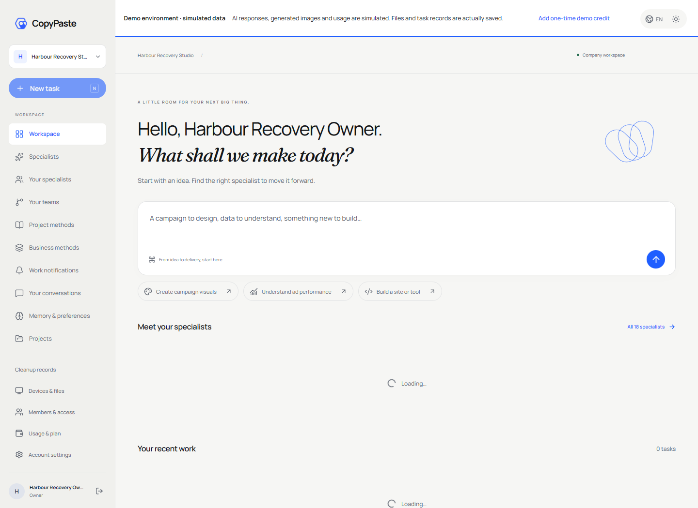

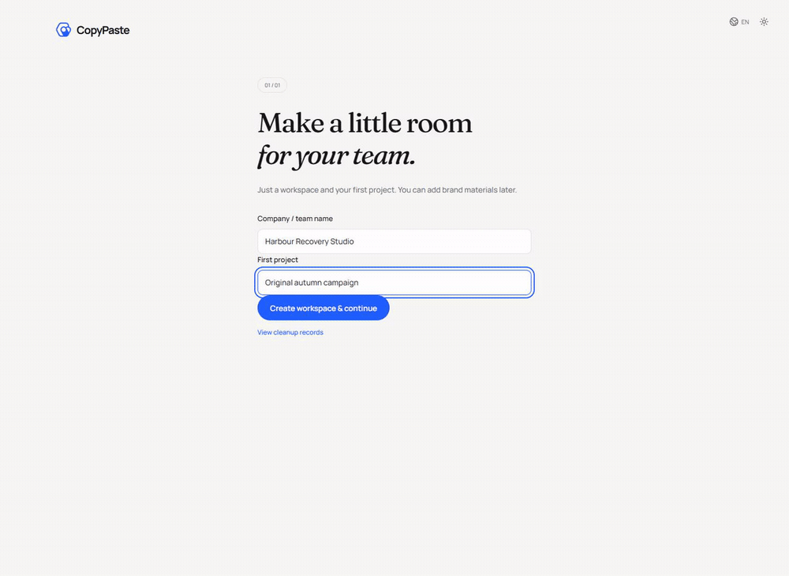

[实际MP4](assets/screenshots/workmate-functional-closure-165-01-recover-original-workspace.mp4)

## rc.5 冻结基线的验证与发布

以下为历史rc.5记录：当时运行七项定向SQL、四项创建草稿检查和实际Web/Admin操作，重建六仓与Windows unpacked/Portable/Setup，核对ASAR和固定Codex。按要求跳过完整重复回归，实际结果以冻结检查点为准。

分支 `delivery`，固定标签 `v0.1.0-rc.5-delivery`。后续更新同步分支和更新说明，冻结包及标签保持。外部AI/媒体/广告/支付使用已授权假数据，Windows未签名。102个原编号及88项必选完整验收范围保留，88不是未实现模块数。真实服务、签名更新、多平台与完整专业验收继续跟踪。

[检查点](https://github.com/copypasteltd/workmate/blob/v0.1.0-rc.5/docs/quality/release-freeze-checkpoint-165.json) · [完整编号台账](https://github.com/copypasteltd/workmate/blob/v0.1.0-rc.5/docs/quality/remaining-work-stage165.md) · [旧README快照](https://github.com/copypasteltd/workmate/blob/v0.1.0-rc.5/docs/history/readme-before-rc5/delivery-zh.md)
