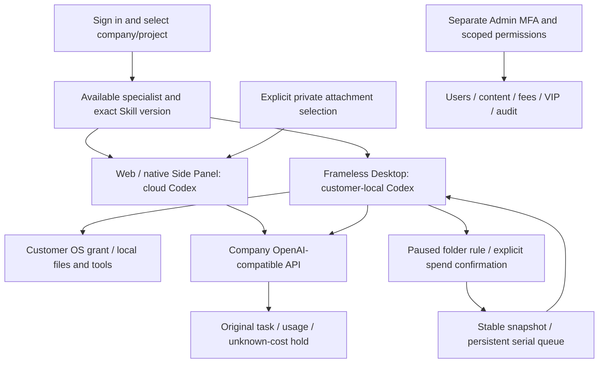
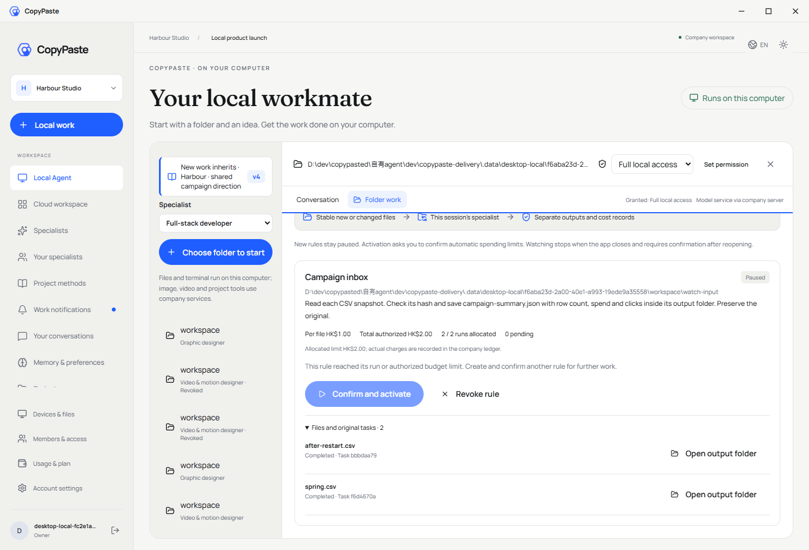
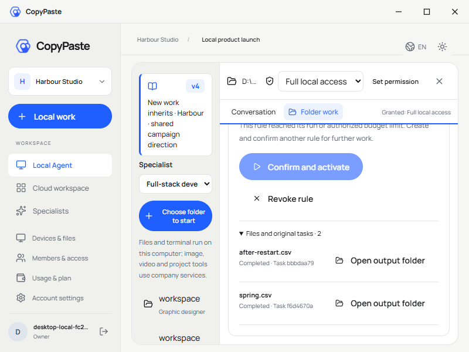
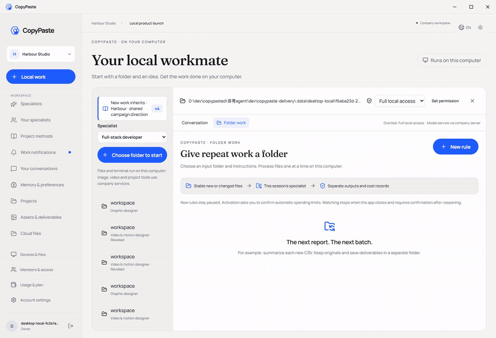
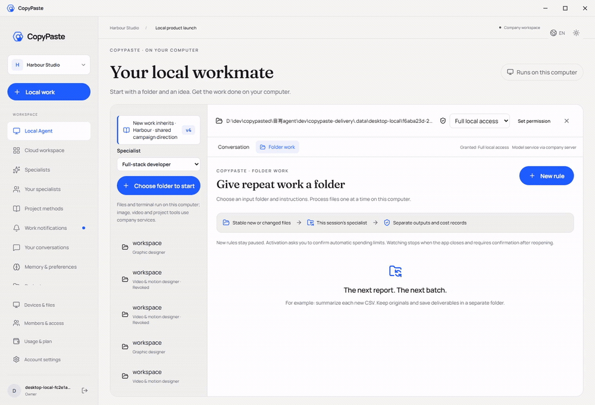

# Workmate · CopyPaste Enterprise Agent · desktop

<!-- folder-work-stage87 -->

无边框 Windows 客户端，在客户本机运行固定 Codex；完整本机权限由客户主动授予并可随时撤销。

## 产品与边界

首批面向现有客户的 marketing 团队，完整范围包含生图、设计/字体、视频/特效、广告和网站分析、SEO/GEO、企业重复流程及软件开发。目录已有 18 个精确 Skill 绑定的候选角色；至少十二个逐一完成专业任务、修改及异常处理的角色仍是验收要求。设计师由 Codex、设计 Skill 与公司 Image 2 组合。Agent 内核唯一使用 Codex；全部 AI 请求走公司 OpenAI 兼容后端。当前开发使用已授权假数据，不代表真实模型专业质量已经验收。

Electron 主进程管理 OS 授权、加密本机会话、固定 Codex 子进程、文件/终端、浏览器及 IPC；React 渲染器不持有通用 Node/任意进程调用。选择角色和工作目录后设置唯读、目录内读写或完整本机权限，原生确认默认取消。Codex 在客户电脑运行，推理/图片/视频/音频仍经公司服务器。真实待答问题默认不选择，客户回答继续原任务/线程/轮次；停止和撤权清除待答并结束拥有的子进程。

## 启动与使用

### 本地启动

以下命令在已检出的对应仓库内执行。完整工作区将六个独立仓库并列放在 `dev/`，见[分支与检出布局](https://github.com/copypasteltd/workmate/blob/docs/docs/governance/04-git-branches-and-publication.md)。使用 Windows x64、Node.js >=22.14、npm/Git，以及文档约束的原生 PostgreSQL、FFmpeg/FFprobe 与固定 Codex 资源；保留已有本地配置和数据，不使用 Docker/WSL/虚拟机。

```powershell
Set-Location 'D:/dev/copypasted/自有agent/dev/copypaste-desktop'
npm ci
$env:COPYPASTE_LOCAL_CODEX_BIN = 'D:/approved-runtime/codex.exe'
npm run runtime:prepare
npm run build
npm start
```

先启动后端。上述内核路径是示例，需提供符合 `contracts/local-codex-runtime.json` 的固定二进制及相邻辅助资源；公司地址配置在 `deployment.json`。`npm run package:dir` 构建解包候选，`npm run package` 构建安装包。当前证据覆盖未签名解包候选，签名及人工安装/升级/卸载验收仍保留。渲染器可独立构建，须保留本机覆盖层。

### 当前使用流程

1. 完成登录、企业成员/邀请和项目选择。原生端通过浏览器 PKCE 登录；Admin 使用独立 MFA 身份。过期、撤销、换企业不应静默切换身份和资料范围。
2. 选择专业角色，提供工作说明及明确获准的资料/账号。缺少必要输入时请求客户补齐。项目负责人可以保存草稿、核对依赖、预览并明确发布不可变共享指引；发布不启动 AI、不增加权限。
3. 新任务固定当时接受的角色、Skill、品牌、资料和指引版本。既有工作保留原版，包括原先没有共享配置的状态。来源被隔离、删除或撤权后隐藏失效正文并阻断后续使用；历史内容不是越权入口。
4. 确认预算和必要的操作/媒体授权，查看真实状态、进度、文件与原费用回执。修改沿原工作谱系继续。未知用量保持原预留供对账，不能当作免费或盲目重新执行。
5. Admin 可按独立权限管理用户/企业状态、查看获准消耗，预览并确认人工费用/赠额和 VIP 权益/到期。余额、实收记录、授信、预算和 VIP 分别保存；同一确认幂等，操作保留审计，不能因重放重复赠额。

## Desktop 本机目录工作

选择具备读写授权的本机会话，打开「目录工作」，选择工作目录内真实输入目录，配置扩展名、处理说明、稳定等待时间、每档/总授权上限和最多次数。已有文件默认不处理；客户明确勾选后才纳入。保存只建立**暂停**规则；「确认并启用」另行打开默认取消的原生自动收费确认。

本机文件事件与有界核对发现稳定输入，按持久队列逐档处理。每档保存精确快照、独立输出目录、原任务编号和公司费用回执。专家需要客户回答时，目录页显示待答入口；「回答问题」返回对话，客户明确选择后继续原任务/线程/轮次。同一规则中已处理的相同路径/内容不会再次收费，产品输出不成为输入；尚未开始的旧内容合并为最新稳定版本。

暂停停止新派发，已开始的一档可以完成；撤销只停止该规则拥有的工作，保留交付和费用。应用关闭后停止监听，真实重开保留加密账本及已分配上限，但必须再次确认。丢失回包复用原派发/创建/开始/结算键；未知本机动作阻断供核对。完整 OS 权限仍是客户主动授予的本机权限，目录规则没有额外创造一个 OS 沙箱。Web/Extension 保持云端执行，本机目录工作是 Desktop 能力。

明确上限：20 条规则；每规则 1,000 项历史/200 项排队，每会话 1,000 项派发回执；每次扫描 2,000 个匹配文件/10,000 项条目/12 层深度；每档 20 MiB、单次新读取 64 MiB；最多授权 100 次，目录调度同一时间执行一档。暂停或重启不重置上限。输出位于 `.copypaste-local-jobs/<rule>/<job>/output/`。越界、路径遍历、symlink/junction、源文件替换和冲突阻断自动执行。批准程序/结构化 argv 和完整崩溃/休眠/离线矩阵仍待补齐。

## 配置、界面和验证

升级客户端前应用 SQL103。本增量不新增 HTTP 路由或迁移，SQL001–103 与 532 个已记录契约保持原字节。公司网关、精确模型别名、已核验媒体能力和费率只配置在后端，详见后端 `.env.example` 和部署说明；不向渲染器/扩展写入公司供应商密钥。未配置的能力保持不可用，不静默改走其他提供方。普通示范不会自动启用全部专项媒体夹具。

保持 CopyPaste 蓝/奶白、Manrope/Fraunces、中英双语和浅深主题。Desktop 无 Electron 自带边框/菜单，不显示纵横滚动条轨道，仍保留真实滚轮、焦点、末项访问和进度。紧凑会话摘要将图标/版本和名称分行，保持可读；聚焦页面的 Home/End、Ctrl+Home/End 到达页面首末项，聚焦文本框时保留光标导航。

本阶段新验证：**Desktop 单元 91、客户端单元 161、实际打包 Desktop 57 项**，保留原 50 项实际检查及 69 个 Desktop 单元用例。目录工作由客户本机真实 Codex 执行，核对显式回答原轮次、CSV 原字节及输出、实际新 PID 重启、90/60 港币微额分别结算、原线程/版本延续和零云端替代任务。全部 14 个运行资产/许可证与源码原字节相符；截图/录屏留在仓库、不进入运行 ASAR。归档由 837,577,925 降为 41,487,145 字节。

保留阶段 86 的**平台 1023、核心 25、兼容 36、实际 Web/Admin/原生侧栏 14 项**历史范围；Backend/Web/Admin/Extension 产品源仍精确一致，本阶段没有宣称重新执行这些完整套件。原生进程、文件、数据库及账本是真实运行；模型回复、广告/客户事实及部分原生对话框决定为明确夹具。自建浏览器、API、预览和测试数据库均关闭；没有使用 Docker/WSL/虚拟化。

原 102 项需求登记为 **86 部分／16 未证明完整／0 完整验收**。REQ-040/042 获得限定证据，不关闭原完整条件。至少十二个专业角色、完整后台、团队/方案包、全部 marketing 流程、真实质量、签名安装/升级/卸载、负载/恢复演练和 G01–G10 继续开放，测试数不能换算产品完成率。详见完整编号差异表。


[方案与边界](https://github.com/copypasteltd/workmate/blob/docs/docs/technical/87-desktop-folder-work.md) · [当前源码检查点](https://github.com/copypasteltd/workmate/blob/docs/docs/quality/folder-work-checkpoint.json) · [完整编号差异](https://github.com/copypasteltd/workmate/blob/docs/docs/quality/2026-10-25-goal-gap-assessment.md) · [分支/检出与发布](https://github.com/copypasteltd/workmate/blob/docs/docs/governance/04-git-branches-and-publication.md)

[角色目录](https://github.com/copypasteltd/workmate/blob/backend/catalog/role-preset-catalog.json) · [Skill 包](https://github.com/copypasteltd/workmate/blob/backend/catalog/skill-packages.json)

## 架构逻辑



本阶段实际本机目录截图和按观察时间录制的交互，原像素保留；模型/原生对话框决定为明确夹具。





[原始 MP4](assets/screenshots/workmate-folders-69-native-folder-watch.mp4)



[原始 MP4](assets/screenshots/workmate-folders-69-native-folder-restart.mp4)


