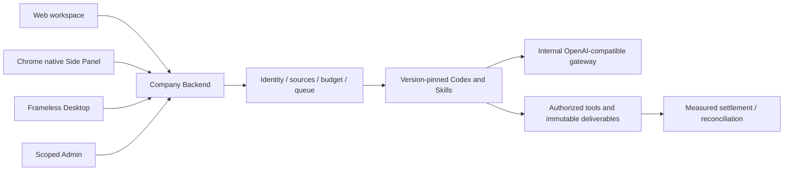

# Workmate · CopyPaste Delivery

[English](README.en.md) · [主文档](https://github.com/copypasteltd/workmate/blob/docs/docs/README.md)

[Backend](https://github.com/copypasteltd/workmate/tree/backend) · [Web](https://github.com/copypasteltd/workmate/tree/web) · [Admin Dashboard](https://github.com/copypasteltd/workmate/tree/admin) · [Desktop](https://github.com/copypasteltd/workmate/tree/desktop) · [Chrome Extension](https://github.com/copypasteltd/workmate/tree/extension) · [Delivery](https://github.com/copypasteltd/workmate/tree/delivery)

面向香港企业的云端 Agent 产品。当前仓库负责 **Delivery**；当前远程分支为 `delivery`.

## 架构与约束

仅使用 Codex，全部 AI 请求经公司内部 OpenAI 兼容服务器。Web、Desktop、扩展和 Admin 共用服务端身份、权限、来源与计费控制。设计沿用 CopyPaste 的品牌素材、色系、字体和中英界面。



## 职责与目录

本仓库统一启动原生开发服务、执行跨端验证、保留原始结果、检查安装包字节、录制实际交互，并按分支映射同步发布。它通过同级独立仓库运行产品，不包含另一套业务内核。

| 目录 | 用途 |
| --- | --- |
| `scripts/` | bootstrap、原生进程控制、数据库核对、客户端/API/权限/媒体验证、录制、发布 |
| `tests/` | 原生包与 Side Panel 验证器本身的完整性检查 |
| `evidence/` | 分次执行的原始 TAP、日志、源码绑定、清理和实际截图摘要 |
| `assets/screenshots/` | README 展示用实际截图、MP4、GIF |
| `.data/` | 忽略的自有进程状态、浏览器配置、原始录制和临时文件 |

## 工作区布局

将 docs 分支放在项目根目录，其余分支分别放在 `dev/copypaste-platform`、`copypaste-web`、`copypaste-admin`、`copypaste-desktop`、`copypaste-extension` 和本仓库 `copypaste-delivery`。不要把不同分支依次 checkout 到同一个工作目录来同时启动各端。

## 安装、启动与停止

```powershell
npm ci
npm run bootstrap
npm run demo
```

Web `4317`、Admin `4318`、API `4310`、控制器 `4319`、原生 PostgreSQL `55432`。`npm run stop` 仅关闭控制器启动的进程并请求数据库正常 checkpoint；端口被占用时保留原进程并报错。

`demo` 使用明确的本地模拟模式；生产和非 loopback 主机拒绝启用。AI/业务数据模拟授权不代表模型质量、真实费率或生产服务验收。原始错误和失败记录保留，不覆盖或改写为通过。

## 实际交互录制

```powershell
node scripts/run-paid-input-native.mjs NN --media
```

复录须选择新的两位编号，避免覆盖原始证据。该命令建立自有原生数据库、隔离夹具、Web/Admin 预览、真实 unpacked Desktop 和原生 Chrome Side Panel；结束后关闭全部自有浏览器/预览并回收隔离夹具。先按打包文档重建脚本指定的本地 Desktop/Extension 预览；源码分支不随附安装包或 dist。

将 `NN` 换成尚未使用的两位编号。`qa-workmate-media.ts` 使用真实 UI 操作钩子；`record-workmate-media.ts` 按真实捕获时间编码 MP4/GIF。侧栏从已确认的原生 SIDE_PANEL 文档直接捕获视口，不含浏览器工具栏；同次旅程独立验证右侧位置、主页面缩窄及没有 popup/额外标签页。保留模拟模型回合说明、源码/媒体摘要和退出回执。

## 分支发布

提交六个组件后，更新 docs 分支的 `docs/quality/workmate-publication.json` 组件 SHA、媒体编号和更新说明，再提交主文档。所有仓库干净后运行：

```powershell
node scripts/publish-workmate.mjs --check
node scripts/publish-workmate.mjs --push
```

发布器只推送映射的八个分支，使用原子提交、远端祖先检查和推送后 SHA 核对；不强推、不删除其他分支。预检调用主文档中的历史对象、凭据、README 链接和媒体校验器。运行回执位于忽略的 `.data/publication/`，失败保留并报错。

## 验证边界

`npm run typecheck`、`npm test` 检查本仓库。平台完整验证在 backend；跨端和原生脚本依据各自前置条件运行。已应用迁移原字节不可修改；升级前摘要、首次失败和后续只读修正分别保留。所有测试及录制禁止 Docker/WSL/虚拟化。

## 初次检出与环境

新工作副本可单独检出本分支；已有本地仓库直接更新，不重新初始化。

```powershell
git clone --single-branch --branch delivery git@github.com:copypasteltd/workmate.git copypaste-delivery
cd copypaste-delivery
```

Node.js ≥22.14、npm 和 Git；锁文件固定依赖。当前验收环境为 Windows x64。后端/完整交付还需要原生 PostgreSQL 启动资源、固定 Codex `0.163.0-alpha.10.2` 与 FFmpeg/FFprobe。禁止本地 Docker、WSL 和虚拟化。跨端运行使用多个独立工作目录；布局见 [workspace](https://github.com/copypasteltd/workmate/blob/docs/docs/governance/04-git-branches-and-publication.md).

## 检查与验证范围

```powershell
npm run typecheck
npm test
```

平台完整 **782/782**、专项 **34/34**，六仓库 **13 项**类型/构建/现有客户端测试检查通过；真实打包程序和原生侧栏旅程 **32 项**。保留所有原 765 项命名测试。实际 Codex 子进程的工具/线程/用量通过模拟内部 API 验证；本次 UI 回合和业务数据按授权模拟。原 102 项需求仍为 81 项局部验证、21 项未证明完成、0 项完整验收，不能把本次截图或测试数量认作完整产品验收。

完整规范 TaskDTO/任务创建、任意执行中暂停、未知外部结果恢复、全角色独立业务、GEO、真实供应商和生产/签名/商店验收仍继续跟踪。

## 实际页面与交互

本服务没有独立用户页面；以下为连接本服务的实际 Desktop 界面，来源明确保留。

实际录制，保留原捕获时间；AI 回合与业务数据为明确模拟。Admin 演示表单不代表财务提交。


[MP4](assets/screenshots/workmate-06-interaction.mp4) · [录制与源码回执](https://github.com/copypasteltd/workmate/blob/docs/docs/quality/workmate-media-06.json)

## 方案细则与更新

- [Product](https://github.com/copypasteltd/workmate/blob/docs/docs/product/01-prd.md)
- [Architecture](https://github.com/copypasteltd/workmate/blob/docs/docs/technical/01-architecture-and-stack.md)
- [Identity and permissions](https://github.com/copypasteltd/workmate/blob/docs/docs/technical/07-security-and-permissions.md)
- [Task continuation](https://github.com/copypasteltd/workmate/blob/docs/docs/technical/66-paid-native-input-checkpoints.md)
- [Admin](https://github.com/copypasteltd/workmate/blob/docs/docs/product/08-admin-dashboard.md)
- [Native clients](https://github.com/copypasteltd/workmate/blob/docs/docs/technical/30-native-window-and-browser-sidepanel.md)
- [Release notes](https://github.com/copypasteltd/workmate/blob/docs/docs/changes/2026-10-22-workmate-publication.md)

后续修改需要同步中英 README、受影响的实际截图/GIF、更新说明和对应分支。提交后通过 Delivery 发布流程核对远程 SHA；不强推覆盖协作者。`.env`、数据库、会话、依赖和安装产物不进入 Git。历史 README 原字节见 [archive](https://github.com/copypasteltd/workmate/blob/docs/docs/quality/history/stage66-before-workmate-readmes/manifest.json).
