# Workmate · CopyPaste Enterprise Agent · extension

<!-- integrated-recovery-stage120 -->
本轮完成附件恢复及当前完整后端回归验证。

Extension 0.5.2 在明确确认前继续只核对浏览器资料夹元数据。弹窗内显示已有附件待上传／失败的具体原因与恢复步骤；19 档已满时仅禁用未选项，取消一个勾选即可替换；小文件显示准确字节。先等已有附件完成或移除失败项，再确认上传，失败重试沿用精确私人回执，最后另按发送。

验证：1363 backend checks in 111 files + 229 Web/Admin/Desktop/Delivery unit checks + 63 Extension checks + 7 adversarial proof-reader cases; 13 builds; 7 actual UI flows; 6 layouts; 9 PNGs and 2 GIF/MP4 pairs.

Chrome 原生右侧栏、OTP／PKCE、原生 PostgreSQL 和固定版本云端 Codex 为真实运行；客户／文件／模型决策为假数据。原始完整产品及真实供应商验收继续保留；下方为 Extension 界面，不代表其他端新增页面。

[Runbook / 方案](https://github.com/copypasteltd/workmate/blob/docs/docs/technical/120-integrated-regression-and-attachment-recovery.md) · [Evidence / 证据](https://github.com/copypasteltd/workmate/blob/docs/docs/quality/integrated-recovery-checkpoint.json)

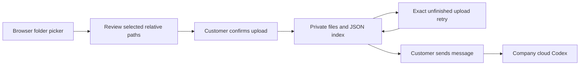

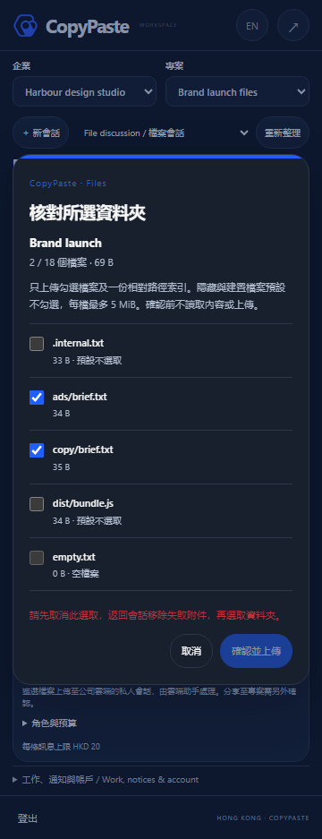

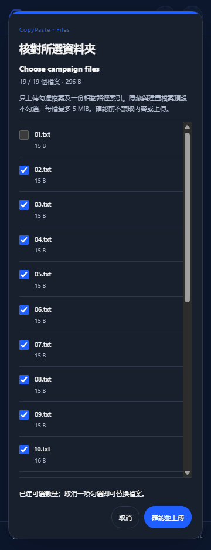

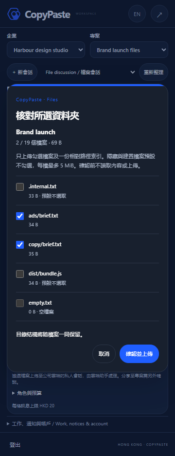

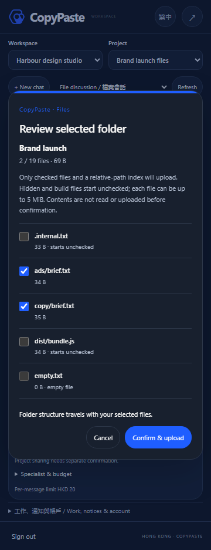

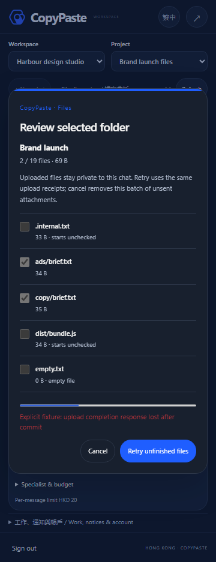

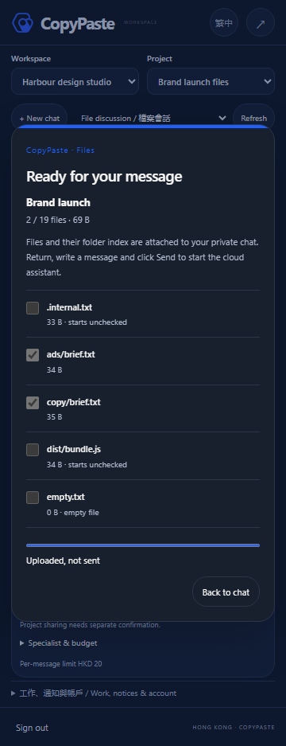

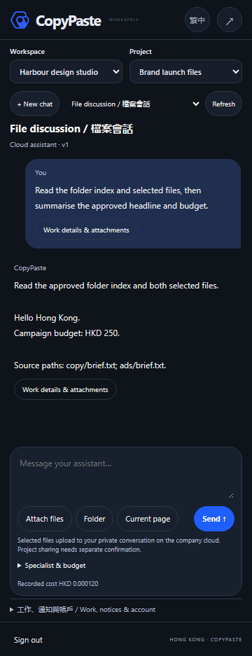


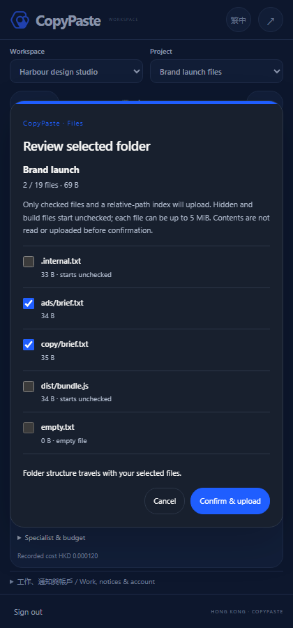

[Actual interaction video / 实际交互录屏](media/integrated-recovery-workmate-recovery-05-folder-retry.mp4)

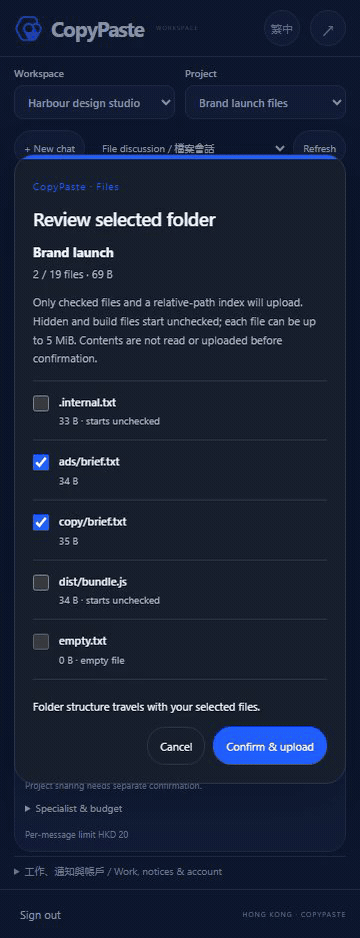

[Actual interaction video / 实际交互录屏](media/integrated-recovery-workmate-recovery-05-folder-response.mp4)


<!-- extension-folder-stage119 -->
Extension 0.5.1 已加入浏览器资料夹选择与核对上传。

Extension 0.5.1 在附件旁新增「资料夹」：浏览器选择、核对路径和勾选、确认上传，返回后输入讯息并发送。无需 Desktop／nativeMessaging。空白输入框最多 19 个非空文件（每档 ≤5 MiB）及一个 JSON 索引；隐藏／建置路径预设不选，空档和过大档不可选。失败沿用精确回执重试，取消移除本批待发送附件，已提交私人上传依正常生命周期保留；换范围清除旧核对及结果。

验证：59 backend + 59 Extension checks + 7 adversarial proof-reader cases; 13 builds; 6 actual UI flows; 4 layouts; 7 PNGs and 2 GIF/MP4 pairs.

Chrome 原生右侧栏、OTP／PKCE、原生 PostgreSQL 和固定版本云端 Codex 为真实运行；客户／文件／模型决策为假数据。原始完整产品及真实供应商验收继续保留；下方为 Extension 界面，不代表其他端新增页面。

[Runbook / 方案](https://github.com/copypasteltd/workmate/blob/docs/docs/technical/119-extension-selected-folders.md) · [Evidence / 证据](https://github.com/copypasteltd/workmate/blob/docs/docs/quality/extension-folder-checkpoint.json)


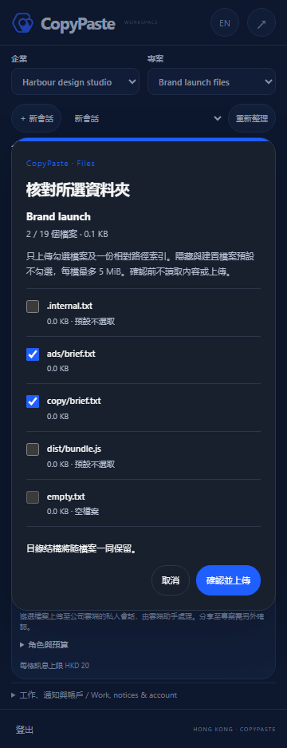

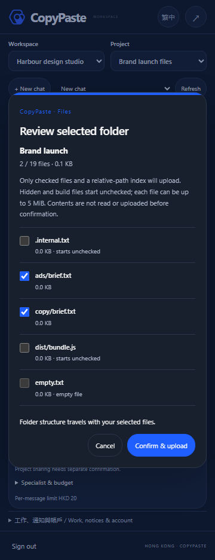


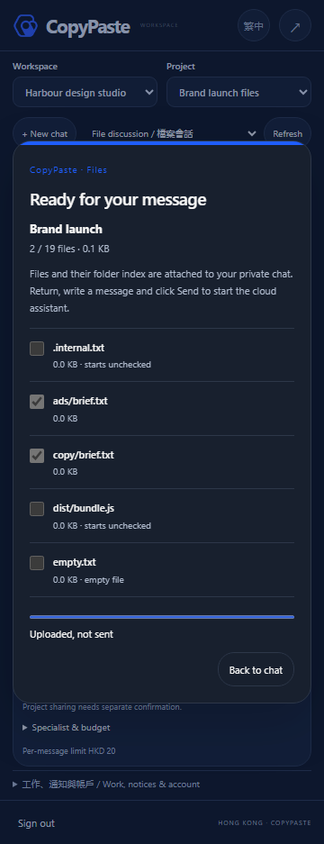


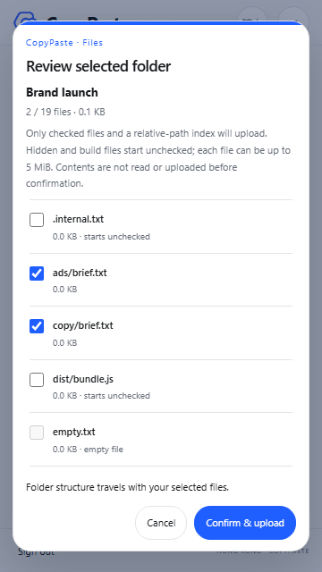


[Actual interaction video / 实际交互录屏](media/extension-folder-workmate-folder-02-folder-retry.mp4)

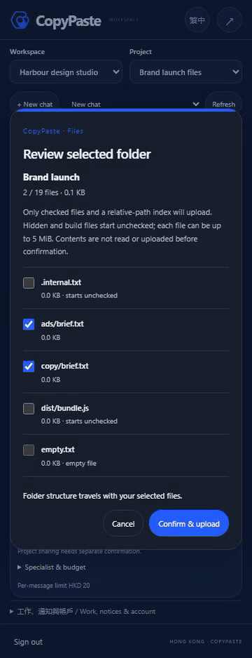

[Actual interaction video / 实际交互录屏](media/extension-folder-workmate-folder-02-folder-response.mp4)

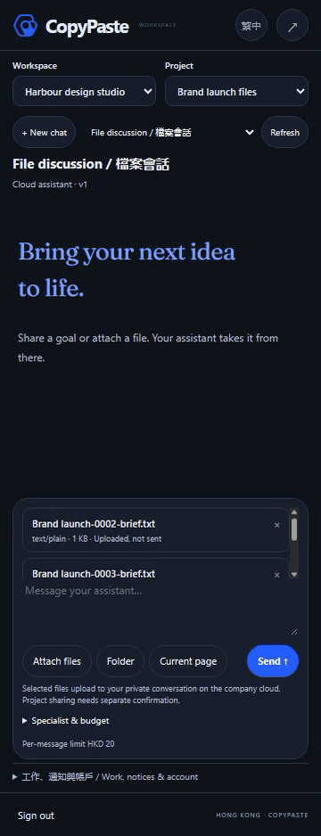


<!-- native-pairing-stage118 -->
Desktop 0.7.1 已加入持久本机配对、精确重试及不可逆意图退休。

Chrome 原生右侧 Side Panel 保留云端 Codex 与客户选择附件上传。可选 Desktop 目录桥接在本机撤权后停止；重新登录 Desktop 并明确授权目录后再连接，直接选档上传维持自身流程。

验证：42 backend + 141 Desktop + 22 native Codex checks; 13 builds; 7 real UI flows; 5 layouts; 2 GIF/MP4 pairs.

Windows DPAPI、自建 Native Host、Electron IPC、Web PKCE 和原生 PostgreSQL 为实际运行；客户／模型为假数据。原生确认答案和 shell 调度在隔离核查进程内控制。公司签名安装版本的卸载／升级、macOS、完整产品与真实模型验收仍未证明。

[Runbook / 方案](https://github.com/copypasteltd/workmate/blob/docs/docs/technical/118-recoverable-native-pairings.md) · [Evidence / 证据](https://github.com/copypasteltd/workmate/blob/docs/docs/quality/native-pairing-checkpoint.json)

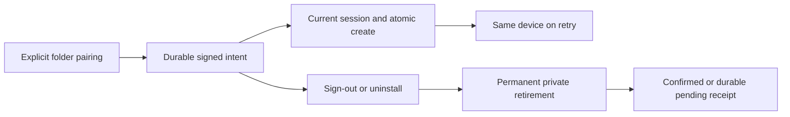


[Actual interaction video / 实际交互视频](media/native-pairing-copypaste-desktop__workmate-native-pairing-04-recover-pairing.mp4)

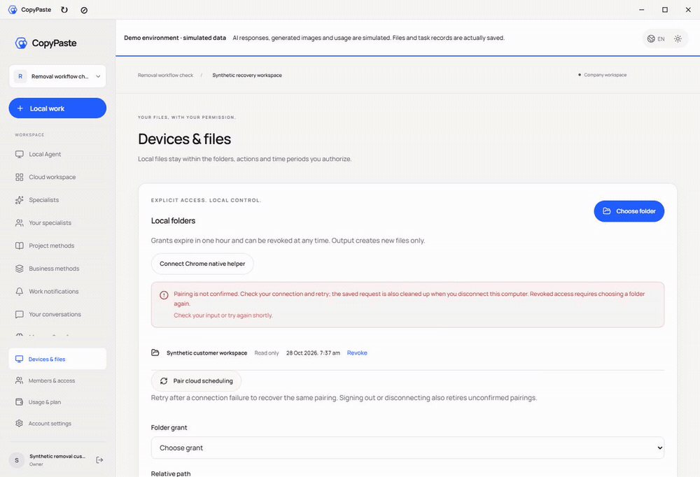


<!-- desktop-removal-stage117 -->
Desktop 0.7.0 已加入本机确认撤权、设备签名断开、Chrome Host 清理及可选缓存清理。

原生 Chrome 右侧 Side Panel 继续对话并把客户选取文件上传给云端 Codex。断开 Desktop 会停止其运行中的文件 Host，并撤销目录、来源和本安装注册。再次使用该本机目录桥接须重新登入 Desktop、明确连接 Chrome 并再次授权目录；客户直接选择附件上传仍走自身的授权流程。

验证：79 backend + 127 Desktop + 22 native Codex checks; 13 builds; 5 real UI flows; 4 layouts; 1 GIF/MP4 pair.

Windows DPAPI、自建 Native Host、Electron IPC、Web PKCE 和原生 PostgreSQL 为实际运行；客户／模型为假数据。原生确认答案和 shell 调度在隔离核查进程内控制。公司签名安装版本的卸载／升级、macOS、完整产品与真实模型验收仍未证明。

[Runbook / 方案](https://github.com/copypasteltd/workmate/blob/docs/docs/technical/117-desktop-removal.md) · [Evidence / 证据](https://github.com/copypasteltd/workmate/blob/docs/docs/quality/desktop-removal-checkpoint.json)

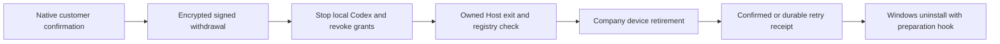

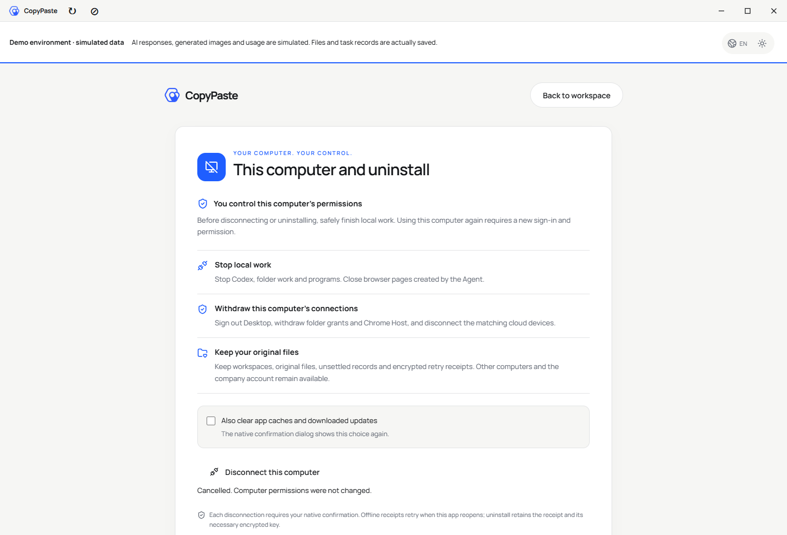

[Actual interaction video / 实际交互视频](media/desktop-removal-copypaste-desktop__workmate-desktop-removal-02-disconnect-and-retry.mp4)

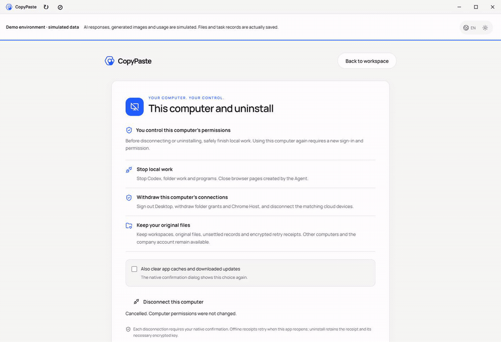


<!-- desktop-updates-stage116-final -->
已修正静默安装后的应用重启交接，并重新验证 Desktop 更新、后台发布及本机安装准入。

原生 Chrome 右侧 Side Panel 保留对话、客户选取文件及云端 Codex 执行。Desktop 更新由 Desktop 主进程和后台管理，扩展桥接不能下载或启动安装程序。下方跨产品截图展示对应发布界面。

验证：64 backend + 96 Desktop + 22 native Codex checks; 13 builds; 4 real UI flows; 5 layouts; 2 GIF/MP4 pairs.

Windows 信任检查与 Electron 为实际运行；账户／模型及惰性签名文件为测试夹具。公司签名安装版本的完整升级、macOS、完整产品与真实模型验收仍未证明。

[Runbook / 方案](https://github.com/copypasteltd/workmate/blob/docs/docs/technical/116-desktop-updates.md) · [Evidence / 证据](https://github.com/copypasteltd/workmate/blob/docs/docs/quality/desktop-updates-final-checkpoint.json)

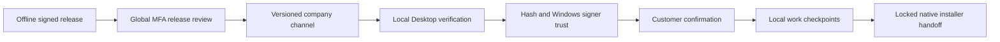


[Actual interaction video / 实际交互视频](media/desktop-updates-copypaste-desktop__workmate-desktop-updates-03-signed-update-download.mp4)

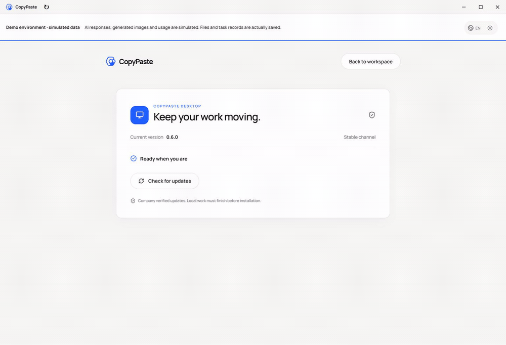


<!-- desktop-updates-stage116 -->
已接通 Desktop 受控更新：后台发布、签名下载及本机安装准入。

原生 Chrome 右侧 Side Panel 保留对话、客户选取文件及云端 Codex 执行。Desktop 更新由 Desktop 主进程和后台管理，扩展桥接不能下载或启动安装程序。下方跨产品截图展示对应发布界面。

验证：64 backend + 96 Desktop + 22 native Codex checks; 13 builds; 4 real UI flows; 5 layouts; 2 GIF/MP4 pairs.

Windows 信任检查与 Electron 为实际运行；账户／模型及惰性签名文件为测试夹具。公司签名安装版本的完整升级、macOS、完整产品与真实模型验收仍未证明。

[Runbook / 方案](https://github.com/copypasteltd/workmate/blob/docs/docs/technical/116-desktop-updates.md) · [Evidence / 证据](https://github.com/copypasteltd/workmate/blob/docs/docs/quality/desktop-updates-checkpoint.json)


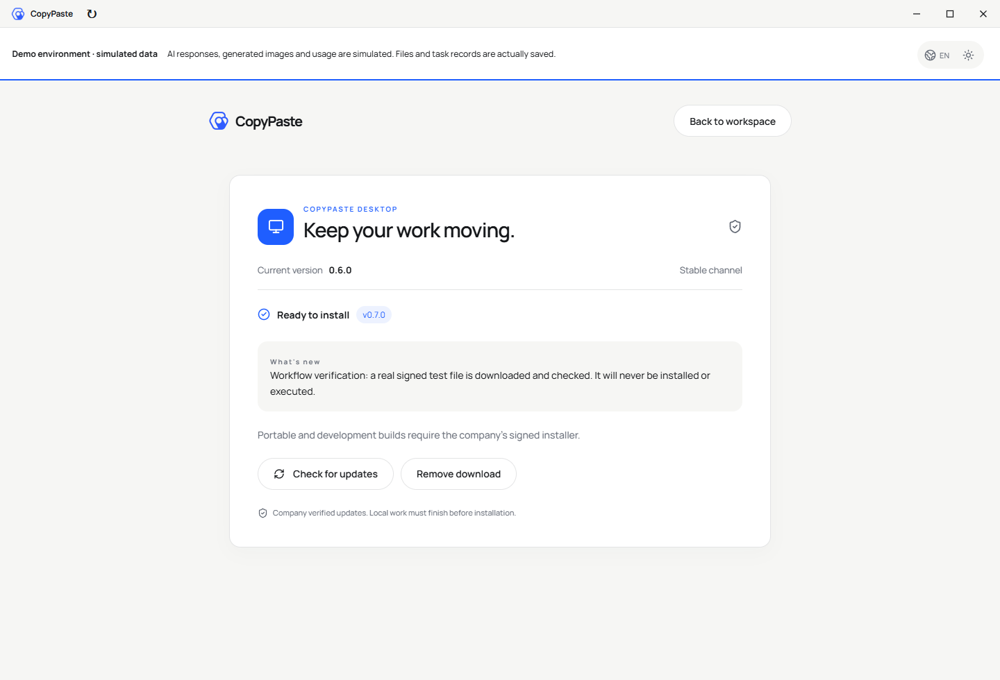

[Actual interaction video / 实际交互视频](media/desktop-updates-copypaste-desktop__workmate-desktop-updates-02-signed-update-download.mp4)

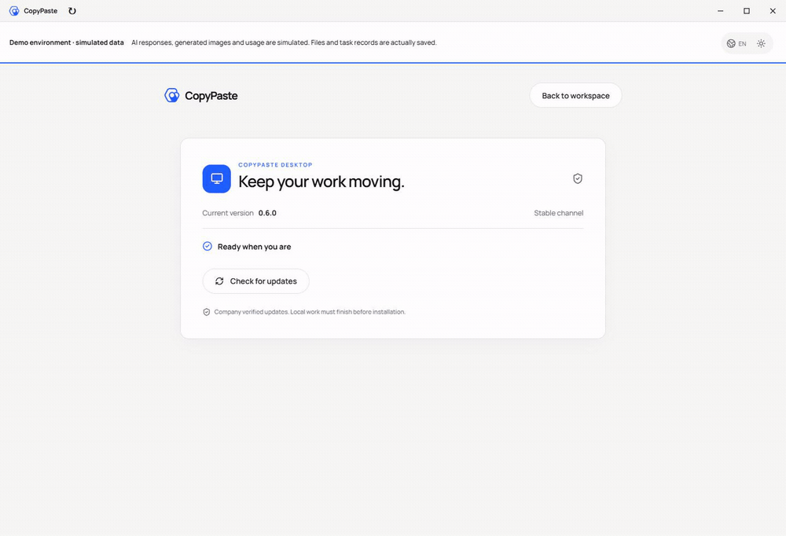


<!-- cloud-events-stage115 -->
已接通私有签名事件工作：客户明确确认、持久去重回执、独立云端运行与范围化后台管理。

点击 Chrome 按钮打开原生右侧 Side Panel，选择顾问任务并核对事件提案，明确授权每次和每日上限。默认遮住的密钥只返回一次。侧栏可查看分页回执、暂停和停止，完整方法编辑与恢复进入 Web 工作区。文件仍由客户选择和上传；Codex 在公司云端执行。

验证：85 项相关后端测试、13 项构建／类型检查、7 条真实 Web／Admin／原生侧栏流程、5 种布局与 2 次锁定版本原生 Codex 执行。模型、账户及发端使用假数据；第三方原生事件接入与完整产品验收仍未证明。

[Runbook / 方案](https://github.com/copypasteltd/workmate/blob/docs/docs/technical/115-signed-cloud-events.md) · [Evidence / 证据](https://github.com/copypasteltd/workmate/blob/docs/docs/quality/cloud-events-checkpoint.json)

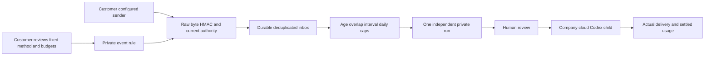

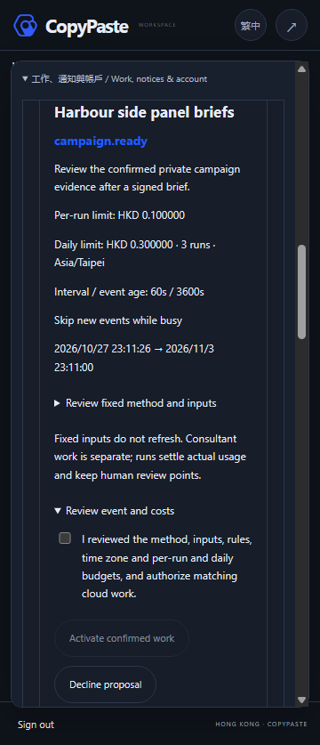

[Actual interaction video / 实际交互视频](media/cloud-events-copypaste-extension__workmate-04-cloud-events-sidepanel.mp4)

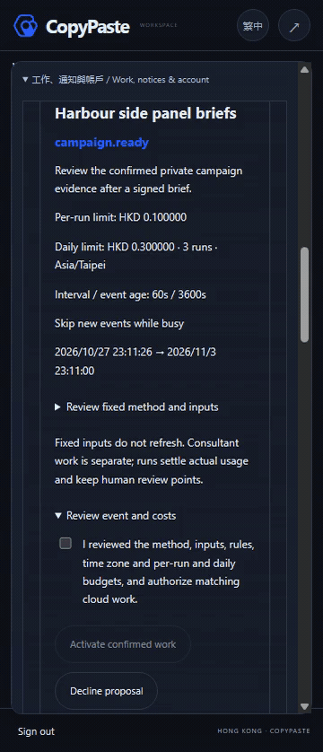


<!-- native-recovery-stage114 -->
已实现原生加密备份与隔离恢复：同一快照的数据库及不可变文件经完整认证，恢复后先应用较新的独立删除日志，再提供核验凭证。

Chrome 原生右侧栏保留云端 Codex 对话及明确授权的文件上传。服务器备份包含符合条件的已提交上传，不包含未提交上传及浏览器本地文件；插件不接收归档密钥或恢复执行权限。

验证：64 项相关后端测试（含 10 项原生恢复测试）、13 项构建／类型检查、6 条真实后台流程及 3 种布局。备份及恢复使用真实原生工具；客户与模型数据为假数据。生产切换、异地耐久性、PITR 与完整生产 RPO／RTO 仍未通过验收。

[Runbook / 方案](https://github.com/copypasteltd/workmate/blob/docs/docs/technical/114-native-backup-recovery.md) · [Evidence / 证据](https://github.com/copypasteltd/workmate/blob/docs/docs/quality/native-recovery-checkpoint.json)

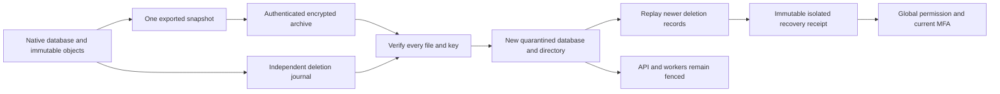


<!-- controlled-budget-stage113 -->
Google Ads 预算修改已接通有期限的明确策略、不可改写的确切预览、客户确认、一次持久入场及原始回执。未知结果经观察及人工核对关闭，不重发修改。

Chrome 原生右侧栏维持云端 Codex 对话及获准文件上传。新实例可用 marketing-analyst 1.3.0 的策略内预算预览、提案和状态工具；完整策略与确认面板在公司 Web 打开。本轮未宣称新增侧栏界面验收。

154 backend · 53 Desktop unit · 22 actual native Codex · 12 actual client flows · 3 measured layouts. 模型及账户为假数据，安装候选未签名；真实广告费、正式签名与全产品验收尚未证明。平均每日预算不是每日最高扣款，Google 广告费与公司 AI 账单独立。

[Design / 方案](https://github.com/copypasteltd/workmate/blob/docs/docs/technical/113-controlled-advertising-budgets.md) · [Evidence / 证据](https://github.com/copypasteltd/workmate/blob/docs/docs/quality/external-budget-checkpoint.json)

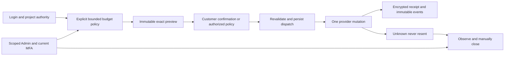


<!-- responsive-report-stage112 -->
網站報告採用專用寬版對話框及隨容器排版的指標卡片。實測 375px Web 與 800px Desktop 的 CTR、排名及退款數值完整單行顯示；Desktop 可捲動並維持隱藏滾動條。

16 條實際界面流程、5 個量測排版狀態及 11 項構建／打包通過。保留上一輪 195 項後端／本機檢查，本次 CSS 修復不宣稱重跑；使用假帳戶／模型與未簽名打包版。

[Evidence / 證據](https://github.com/copypasteltd/workmate/blob/docs/docs/quality/report-layout-checkpoint.json)


<!-- website-analytics-stage111 -->
網站報告已接通 GA4 流量／事件及 Search Console：可核對指標、完整 HTML／CSV／JSON。跨行用戶不相加、退款可為負收入、缺少日期保留未知；報告計算不新增 AI 呼叫或費用。

原生 Chrome 右側欄維持雲端對話與獲准檔案上傳。新版營銷角色可讀允許的網站依據，完整報告經既有公司 Web 入口查看。

122 backend checks · 53 Desktop unit checks · 20 actual native Codex checks · 11 actual client flows. 使用假帳戶／模型；真實供應商效果、正式簽名與全產品驗收尚未證明。

[方案 / Design](https://github.com/copypasteltd/workmate/blob/docs/docs/technical/111-web-analytics.md) · [證據 / Evidence](https://github.com/copypasteltd/workmate/blob/docs/docs/quality/web-analytics-checkpoint.json)

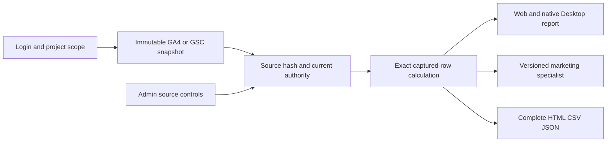


<!-- desktop-native-geo-stage110 -->
Desktop GEO 已接通本机 Codex：独立空白会话、整批费用确认、逐题运行／停止、原回执恢复、原始回答留存与不可改写的重复观测比较。全部 AI 经公司接口，费用依据公司凭证。

135 backend checks · 46 Desktop unit checks · 20 actual native Codex checks · 9 actual Electron flows · 11 build/type checks. 明确使用假账号与假模型；本机回答标记为客户端报告。真实模型效果、生产签名与全产品验收尚未证明。

[方案 / Design](https://github.com/copypasteltd/workmate/blob/docs/docs/technical/110-desktop-native-geo.md) · [证据 / Evidence](https://github.com/copypasteltd/workmate/blob/docs/docs/quality/desktop-geo-checkpoint.json)

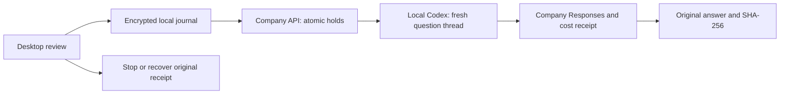


<!-- audio-accounting-stage109 -->

客户音讯及平台验证的未知费用已接通不可改写的原请求证据、分开的费用与终止独立审批、权限范围及冻结费率核对。费用确认不直接扣款或释放容量；任务仍经独立审批、在原预留内结算一次，并保留原业务失败。

两项确认完成后可明确发起新平台验证，旧 POST、媒体结论和验证回执均保留。Web、无边框 Desktop 及 Chrome 原生右侧侧栏展示人工证据来源；Desktop 本地 Codex／完整权限与 Extension 云端执行约束继续执行。

本轮先通过 253 项相关后端检查，并在并发修复后通过 65 项音讯／授权回归；另通过 9 项后台表单／金额检查、7 项三端编译／构建检查及 8 项实际后台页面流程，原始失败记录保留。下方截图及 GIF／MP4 为实际后台交互，账号、模型和证据明确使用假数据；原生解码不代表真实音质验收。阶段 106 整批未归因超时及原文件重放通过记录保留，本轮不改写为整体产品验收。

[Design / 方案](https://github.com/copypasteltd/workmate/blob/docs/docs/technical/109-audio-evidence-accounting.md) · [MP4](assets/verification/audio-accounting-109/workmate-audio-accounting-08-audio-evidence-and-cost-preview.mp4)

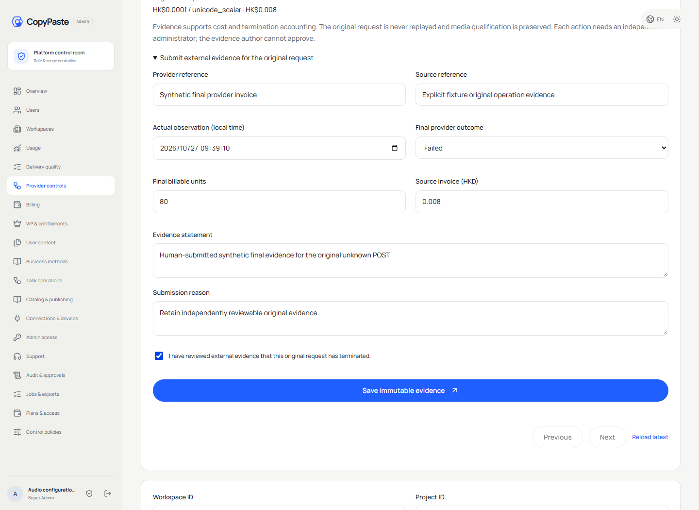

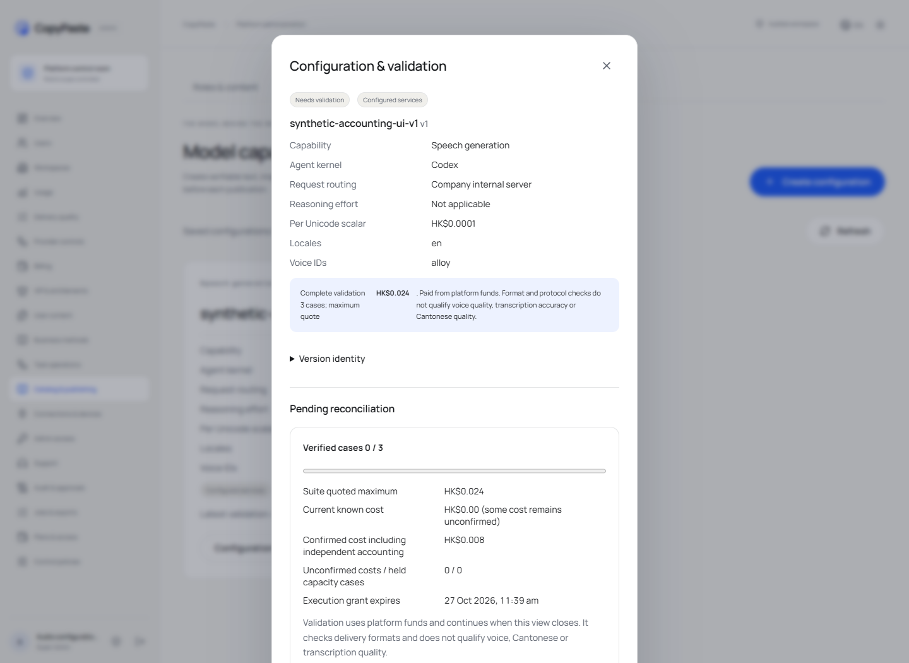

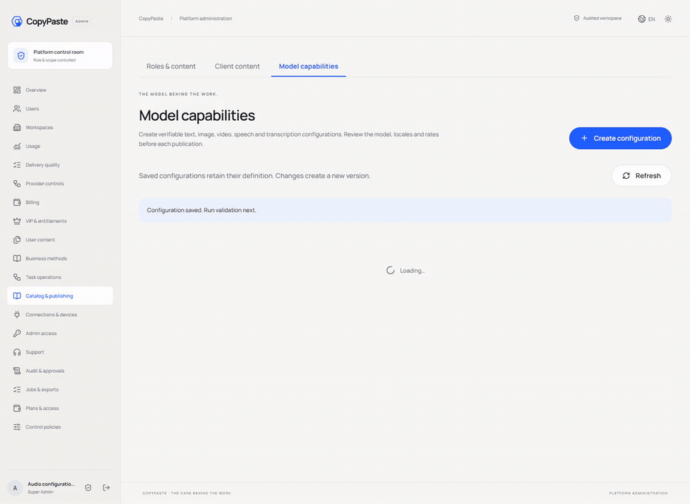


<!-- managed-audio-stage108 -->

后台已接通语音与转录模型发版：固定声音、语言与精确费率，平台预算支付的持久验证，实际后台进度、停止、独立审批和历史回滚。已有客户工作保留原模型及费率，音讯使用仍需客户独立授权。

本轮通过 229 项相关后端检查、6 项后台表单／金额检查和 8 项实际浏览器流程。真实子进程在 POST 后崩溃的用例确认原操作保留为不明且不会重发。下方为实际后台公共控制流程截图及 GIF／MP4，各端此前截图保留原范围。模型、账号和音讯回应明确使用假数据。

编译流程已补齐原创音讯验证素材及许可证；已从另一工作目录调用编译后的执行器，读取并完整解码两种格式，原始素材缺失记录予以保留。

原生解码与时间段结构不代表真实音质、转录准确度或粤语品质验收；不明音讯费用仍需外部证据。阶段 106 的整批一项未归因超时及原文件独立两项通过均保留，本轮按改动范围回归，不改写成完整产品验收。

[Design / 方案](https://github.com/copypasteltd/workmate/blob/docs/docs/technical/108-managed-audio-capabilities.md) · [MP4](assets/verification/managed-audio-108/workmate-managed-audio-01-audio-configuration-and-background-resume.mp4)


<!-- capability-inventory-stage107 -->

用户能力目录现按视频、配音、转写各自的已实现协议和核验标志显示状态；状态变化使旧签名分页失效。撤销版本、协议匹配、租户范围与任务执行授权继续逐项校验。

相关能力回归通过 68 项实际检查，保留修复前的失败复现。保留阶段 106 的完整后端批次及原文件恢复复查，包括整批中的一项未归因超时；本轮重跑受影响的能力相关检查。模型和账号仍是假数据，不据此宣称真实模型业务质量。

在 Delivery 重现：`node scripts/run-capability-inventory.mjs <新的两位编号> core`。本轮 API 修复不新增页面；下方截图及 GIF／MP4 保留阶段 106 实际录制及其源码范围。

[Design / 方案](https://github.com/copypasteltd/workmate/blob/docs/docs/technical/107-profile-specific-capability-inventory.md)


<!-- platform-integration-stage106 -->

明确选中的私有文件版本现可用于后续私有任务，未选中的文件继续隔离；版本被替换或来源撤回仍会停止执行。云端 HTTP 检查等待应用实际就绪后再开始请求计时。Web 在读取被拒绝或来源撤回后关闭私有流程确认，恢复后要求重新确认。

Desktop 严格工具校验已兼容固定原生版本的结构压缩和数组约束，篡改及重复声明继续拒绝；实际本机请求验证了全部 23 个媒体工具和浏览器／本机程序工具。

完整执行 97 个后端文件共 1230 项：1,229 项通过，一项原有会话恢复检查超时取消；未修改该文件或期限的独立复查两项通过，首次超时原因尚未确定。另通过 11 项实际客户端流程，保留 15 张截图、五组 GIF／MP4。模型和账号为假数据，Codex、原生执行与数据库操作均实际运行。保留首轮失败及确切源码。Desktop 保持客户本机 Codex，Extension 保持原生右侧栏与获准上传。

完整核查在 Delivery 仓库运行：`node scripts/run-platform-integration.mjs <新的两位编号> full`，再运行 `node scripts/run-workflow-view-ui.mjs <新的两位编号>`。首次在 Desktop 运行 `npm run runtime:prepare` 准备固定运行时；完整启动器核对二进制摘要和实际版本，配置四项测试变量并管理其原生 PostgreSQL。每个编号保留原始证据。

[Design / 方案](https://github.com/copypasteltd/workmate/blob/docs/docs/technical/106-selected-inputs-and-runtime-readiness.md)


[Actual interaction MP4](assets/screenshots/integration-workmate-workflow-view-03-workflow-view-withdrawal.mp4)


<!-- live-private-views-stage105 -->

Web 现已在读取失败或来源撤回时，清除已打开的私有计划确认、编辑、操作和历史弹窗。正常轮询保留仍可读取的草稿及精确版本确认；访问恢复后不会重新打开旧内容。待确认的不可变提案同步更新就绪与过期状态。

九项实际跨端流程通过，包含真实来源隔离后无需刷新清空弹窗，以及明确模拟的 HTTP403 拒绝读取。保留 11 张截图、4 组 GIF／MP4；后端源码未变，沿用既有 78 项检查基线，本轮未重复运行。模型与账号为假数据；不新增 Desktop 验收结论。Desktop 继续本机 Codex，Extension 保持原生右侧云端对话及获准文件上传。

[Design / 方案](https://github.com/copypasteltd/workmate/blob/docs/docs/technical/105-live-private-schedule-views.md)


[Actual Web interaction MP4](assets/screenshots/live-views-workmate-private-view-03-private-view-withdrawal.mp4)


<!-- cloud-schedules-stage104 -->

私有云端定时工作流已接通顾问对话及已有私有成果。核对固定方法、输入、时区、交付与每次 Agent 预算 → 主动勾选确认 → 启用每日／每周计划 → 查看逐次执行、人工审批、私有交付和实际费用。Web 与真实 Chrome 右侧栏可确认和暂停；Admin 按权限范围查看元数据，并在近期 MFA 与记录理由后暂停未来触发。

暂停保留当前工作，取消某次执行需单独操作；恢复由客户重新确认并略过暂停期间。修改先生成独立提案，再追加不可变版本。失败或费用未知会阻止未来触发，待核对后再处理。固定输入不自动刷新外部账号数据，启用不预扣全部未来费用。Desktop 继续运行客户本机 Codex，原生凭证不能启用云端替代执行。

已核查：六个相关后端测试文件共 78 项、八项真实跨端流程、八张未修改 PNG、三组实际 GIF／MP4；使用原生 PostgreSQL、固定原生 Codex、真实电邮／MFA／PKCE 和明确的假模型／账号数据。本增量不代表真实模型质量或完整产品验收。

[Design / 方案](https://github.com/copypasteltd/workmate/blob/docs/docs/technical/104-private-cloud-schedules.md) · [Exact evidence / 确切证据](https://github.com/copypasteltd/workmate/blob/docs/docs/quality/private-cloud-schedules-checkpoint.json)

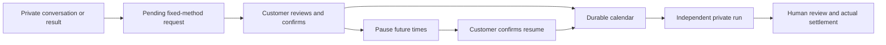

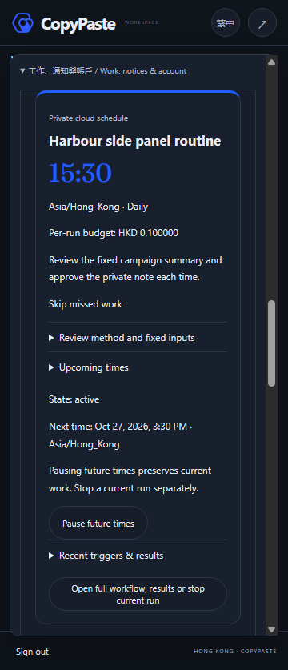

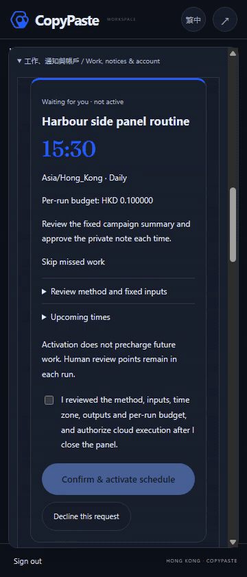

[Actual interaction MP4](assets/screenshots/schedule-copypaste-extension-workmate-cloud-schedule-06-cloud-schedule-sidepanel.mp4)


<!-- admin-data-stage103 -->

后台已接入持久批量任务，以及用户目录、用量、费用流水和审计资料快照导出。操作流程：选择对象／条件 → 核对精确记录、版本与字段 → 明确确认 → 查看逐项结果 → 对失败对象预览并建立重试子任务，或下载已授权的 CSV／清单。取消保留已完成操作；原费用与 VIP 审批历史仍可查询。

限制：每批最多 100 位用户，导出最多 10,000 笔，超限明确拒绝。逐项执行和下载重新验证当前权限、显式限制、近期 MFA、版本与字段可见性。预览五分钟、任务密文十五分钟过期；只有数据库暂时性错误自动退避，最多三次。

已核查：六个后端测试文件共 94 项，七项真实 Admin 浏览器流程，六张未修改 PNG 及两组真实 GIF／MP4。采用原生 PostgreSQL、实际电邮／TOTP 会话、假用户和零模型调用。Desktop 本机 Codex 与 Chrome 原生右侧栏的执行模型继续保留；本增量不扩大为三端或完整产品验收结论。

[Design / 方案](https://github.com/copypasteltd/workmate/blob/docs/docs/technical/103-persistent-admin-data-jobs.md) · [Exact evidence / 确切证据](https://github.com/copypasteltd/workmate/blob/docs/docs/quality/admin-data-jobs-checkpoint.json)

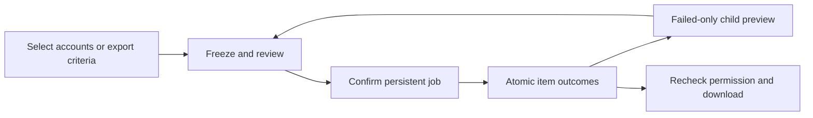


[Actual interaction MP4](assets/screenshots/admin-workmate-03-admin-data-batch.mp4)


<!-- client-content-stage102 -->

Extension 在真实 Chrome 原生右侧栏展示公告与帮助；聊天、授权上传和账户操作继续可用。

使用：登入 Admin → 目录与发布 → 用户端内容，编辑双语正文、显示时间和现有可选菜单；选择客户端、目录接收人和固定比例分组；保存草稿，核对指定身份的前后内容后确认发布。其余用户保留完整旧版。回滚也先预览，引用已发布版本并新增记录。账户、VIP、费用、角色和 Skill 权限继续约束实际执行。

核查：五个后端测试文件共 79 项、七项实际客户端流程、八张未修改截图及四组真实 GIF/MP4。使用原生 PostgreSQL、实际邮箱/MFA/PKCE 会话和未签名的打包 Desktop。账户与正文为假数据；本增量不发起模型调用，不代表真实专业质量或完整产品验收。

[Design / 方案](https://github.com/copypasteltd/workmate/blob/docs/docs/technical/102-client-content-releases.md) · [Exact evidence / 确切证据](https://github.com/copypasteltd/workmate/blob/docs/docs/quality/client-content-checkpoint.json).

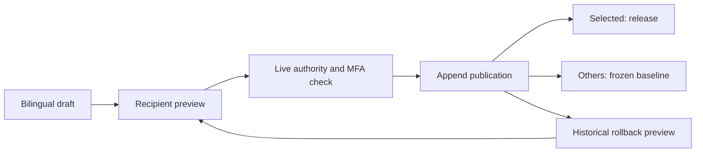

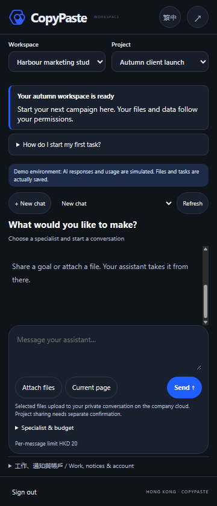

[Actual extension MP4](assets/screenshots/extension-workmate-06-client-content-sidepanel.mp4)

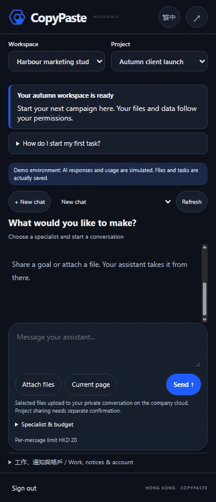


<!-- cloud-browser-stage101 -->

云端 Codex 现可使用固定的原生 Chromium 执行真实页面交互和 DOM 检查，保留实际截图及确切源码。Extension 保持原生右侧面板和授权文件上传；下图来自对应的 Web 云端执行。

使用：登录并选择具有工具授权的软件角色，批准云端任务及预算。Codex 写入 HTML 和本地资源、执行具名检查，修复失败后重新执行。在「软件检查记录」展开实际 PNG 与预期/实际断言，下载执行文件或匹配源码包。新增四份 Skill 和六个角色版本，保留已批准任务的历史绑定，不扩大角色权限。

验证：十四个相关测试文件的 113 项检查及 4 项登录 Web 流程；Codex、浏览器和下载真实运行，模型响应和额度使用假数据。静态任务预览及独立 API/SQLite 检查不代表已连通部署应用、任意 npm/框架、真实模型专业质量或全产品验收。浏览器策略限制不等于操作系统级无网络保证。下方旧说明保留历史验证范围。

[Evidence / 证据](https://github.com/copypasteltd/workmate/blob/docs/docs/quality/cloud-browser-checkpoint.json) · [Design, setup and limits / 方案、安装与边界](https://github.com/copypasteltd/workmate/blob/docs/docs/technical/101-cloud-browser-preview.md).

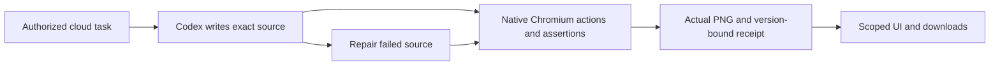


[Actual interaction MP4 / 实际交互录像](assets/screenshots/workmate-01-cloud-browser.mp4)

<!-- cloud-development-stage100 -->

云端 Codex 现可实际运行真实 HTTP 应用请求及原生 SQLite 数据和约束检查。检查回执绑定确切源码、保留每项断言的预期与实际结果、标记代码变更，并随匹配源码打包交付。Extension 保持原生右侧面板及文件上传到云端的职责；下图为相应的实际 Web 云端任务。

使用：批准具有工具授权的云端任务及预算，由 Codex 写入和检查源码，在「软件检查记录」查看结果、展开输出并下载执行文件或完整记录。当前为 Windows 原生执行边界，禁止网络和子进程；外部 TCP/TLS、PostgreSQL/MySQL 兼容性、任意 npm 依赖及云端浏览器预览不在本次范围。

下方保留各历史阶段的实现与验证范围；本节描述当前更新。

验证：十一个相关测试文件的 96 项检查及 4 项实际登录 Web 流程通过。模型响应和额度为假数据；Codex、原生执行和下载均真实。[Evidence / 证据](https://github.com/copypasteltd/workmate/blob/docs/docs/quality/cloud-development-checkpoint.json) · [Design and limits / 方案与边界](https://github.com/copypasteltd/workmate/blob/docs/docs/technical/100-cloud-development-checks.md).

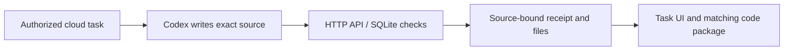


[Actual interaction MP4 / 实际交互录像](assets/screenshots/workmate-06-cloud-development.mp4)

<!-- cloud-program-stage99 -->

云端 Codex 现可实际运行固定 Node 程序、内置测试及语法检查。检查回执绑定确切源码、保留失败、标记代码变更，并随匹配源码打包交付。Extension 保持原生右侧面板及文件上传到云端的职责；下图为相应的实际 Web 云端任务。

使用：批准具有工具授权的云端任务及预算，由 Codex 写入和检查源码，在「软件检查记录」查看结果、展开输出并下载执行文件或完整记录。当前为 Windows 原生执行边界，禁止网络和子进程；任意 npm 依赖及另外三个云端开发工具仍未开放。

验证：十个相关测试文件的 83 项检查及 4 项实际登录 Web 流程通过。模型响应和额度为假数据；Codex、原生执行和下载均真实。[Evidence / 证据](https://github.com/copypasteltd/workmate/blob/docs/docs/quality/cloud-program-checkpoint.json) · [Design and limits / 方案与边界](https://github.com/copypasteltd/workmate/blob/docs/docs/technical/99-cloud-program-execution.md).

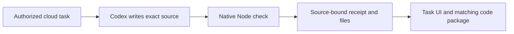


[Actual interaction MP4 / 实际交互录像](assets/screenshots/workmate-03-cloud-program.mp4)

<!-- preset-specialists-stage98 -->

Desktop 的「我的专家」现已直接启动本机 Codex。选择角色、长期工作要求和项目内固定品牌版本，免费预检保存后，选择本机目录、主动授权并确认每次预算。Web 与 Extension 保持云端执行。后续品牌发布或专家编辑不会悄悄替换既有本机会话的版本。

验证：212 项相关集成检查、51 项 Desktop 单元检查、2 项真实本机 Codex 协议检查及 7 项打包 Desktop / 登录 Web 流程检查通过。[Current evidence / 当前证据](https://github.com/copypasteltd/workmate/blob/docs/docs/quality/preset-specialists-checkpoint.json).

<!-- native-methods-stage97 -->

## Desktop 方案本机试运行

Desktop 可将整套固定方法准备为本机任务，再通过客户电脑上的 Codex 执行、停止、核对、验收和发布。为每位固定角色选取新的会话、实际目录与原生权限，免费预览获准资料，再明确确认本次私有简报和总预算。准备只进行一次整批预留；每项均由客户主动启动。服务端会拒绝 Desktop 改用云端方案试运行。

网络结果未知时，刷新界面或重新打开应用仍核对原加密日志中的正文及幂等键，已执行任务不能静默重跑。发布前须验收每项当前成功交付，并具备必需来源的实际读取事实。新项目安装仍仅复制方法引用；升级前原生会话保留原有公司工具版本。

隔离验收使用假模型、假账号及测试额度，实际运行本机 Codex、文件操作和公司用量结算；不据此声称真实付款、真人原生弹窗操作、线上模型质量、签名安装包或整个产品已验收。详见[执行、权限、恢复和数据约束](https://github.com/copypasteltd/workmate/blob/docs/docs/technical/97-native-method-trials.md).

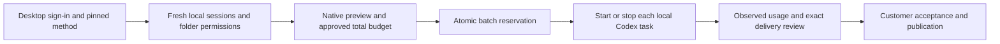


验证：124 项相关集成检查、49 项 Desktop 单元检查、2 项真实本机 Codex 协议检查及 6 项打包界面检查通过。以下旧阶段条目保留其当时的验证范围。[当前证据](https://github.com/copypasteltd/workmate/blob/docs/docs/quality/native-methods-checkpoint.json).

<!-- solution-packages-stage96 -->

## 可试运行和复制的业务方案

阶段 96 补齐业务方案的不可变版本、免费依赖预览、私有付费试运行、逐项验收、发布和跨项目安装重绑定。122 项相关集成检查、45 项 Desktop 单元检查、2 项真实本机 Codex 检查及 8 项实际浏览器检查通过。模型与账号数据按当前要求使用假数据；文件、进程、授权、费用和审计走实际流程。

1. 登录并选择项目，打开业务方案。创建可分享的方法说明，选择预设角色、资料标签和报表连接。保存会固定模板、角色、Codex profile 和 Skill 版本，新版本须重新试运行及验收。
2. 选择当前项目获准的固定文件和报表账号，免费预览资料缺口、快照、来源摘要与工作额度。明确确认本次私有简报和总预算后，整批建立各角色独立任务；并发额度不足会整批拒绝。
3. 检查每项实际交付再验收和发布。浏览文件或快照目录不能充当内容读取；必需版本及摘要须有独立的实际读取凭证。未完成任务、旧交付摘要、无关试运行或失效账号不能发布。结果未知时刷新并重试原提交，保留同一正文和幂等键。
4. 安装仅复制已发布方法参照；原客户文件、私人简报、结果、记忆、连接账号和密钥都不自动复制。为目标项目上传自己的资料并按修订保存绑定，再单独确认付费使用。
5. Admin 的元数据、正文读取和停用分别检查范围与权限；正文访问记审计，停用需要近期 MFA 及原因。停用方法、撤回原资料或撤销账号会阻断依赖内容。

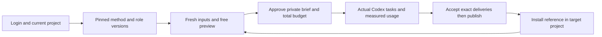

Desktop 保持本机 Codex，仍需客户确认本机目录、权限和预算；通用桥接拒绝创建云端方案试运行。已安装方法通过只读公司工具提供给相容的固定本机角色，默认云端助手不是本机角色。Extension 保持云端 Agent、获准附件上传与原生右侧栏。本次新截图来自实际 Web/Admin；尚未以安装包验收新的 Desktop 方案库视觉，旧 Desktop 截图保留历史范围。

[方案与使用 / Implementation](https://github.com/copypasteltd/workmate/blob/docs/docs/technical/96-versioned-business-solutions.md) · [Exact-source evidence](https://github.com/copypasteltd/workmate/blob/docs/docs/quality/solution-packages-checkpoint.json)


[375px](assets/screenshots/workmate-solution-packages-07-responsive-375.png) · [Published method](assets/screenshots/workmate-solution-packages-07-published-en.png) · [Fresh target requirements](assets/screenshots/workmate-solution-packages-07-installed-missing.png) · [Audited body read](assets/screenshots/workmate-solution-packages-07-admin-body-audited.png) · [Review MP4](assets/screenshots/workmate-solution-packages-07-method-review-and-publish.mp4) · [Copy & rebind GIF](assets/screenshots/workmate-solution-packages-07-copy-rebind-and-trial.gif) · [Copy & rebind MP4](assets/screenshots/workmate-solution-packages-07-copy-rebind-and-trial.mp4)

<!-- media-effects-stage95 -->

## 历史实现：原生媒体特效（阶段 95）

阶段 95 接通十种版本化媒体特效：转场、中文动效字、抠像与画面清理。客户审阅固定素材版本、参数和费用上限后，Codex 调用原生 FFmpeg，交付真实无声 MP4、PNG、源 JSON 和 ZIP。106 项相关回归与 8 项实际浏览器检查通过；两次原生 Codex、八个私有文件及真实结算完成。模型和账户容量按要求为假数据。

1. 登录并选择项目，进入 Motion studio；浏览十种实际示例，在文件中心上传获准的 PNG/H.264 MP4，选择固定素材版本及摘要。
2. 审阅尺寸、时长、文字或滤镜参数与预算后主动确认。免费预检查会在预留费用前核验实际媒体、授权字体排版和编码器。网络回执未知时，刷新后按原请求与幂等键重放。
3. 预览并下载真实无声 MP4、PNG、不可变源 JSON 和 ZIP。修改需要重新审阅，已完成的重复调用复用原文件；撤回素材或隔离输出会阻断访问和自动重新生成。Codex 按实际记录用量收费，原生特效没有额外 AI 调用和费用。
4. video-motion@1.5.0 加载 media-effects@1.0.0，正式审批仅开放目录和渲染工具。SQL110 固定输入与来源，SQL111 扩展回执；旧迁移、契约和 Skill 保留原字节。Admin 可发布特效菜单；角色或 Skill 停用会在素材探测和费用预留前拒绝新任务，既有资产权限适用。

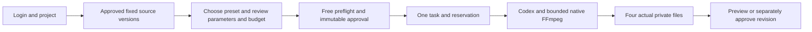

Desktop 保持本机 Codex 及客户主动权限，Extension 保持云端 Agent 与原生右侧栏。此处素材展示 Web 特效；原生 Desktop 禁用这张云端专用审批表，版本化公司特效工具仍可使用。旧阶段的整套源码核查保留历史范围，本次专项回归不代表完整产品或真实专业质量验收。

[具体方案与使用](https://github.com/copypasteltd/workmate/blob/docs/docs/technical/95-reviewed-media-effects.md) · [精确源码证据](https://github.com/copypasteltd/workmate/blob/docs/docs/quality/media-effects-checkpoint.json)


[375px](https://github.com/copypasteltd/workmate/blob/web/assets/screenshots/workmate-media-effects-05-responsive-375.png) · [Reviewed input](https://github.com/copypasteltd/workmate/blob/web/assets/screenshots/workmate-media-effects-05-reviewed-en.png) · [Review MP4](https://github.com/copypasteltd/workmate/blob/web/assets/screenshots/workmate-media-effects-05-effect-review-retry.mp4) · [Actual revision GIF](https://github.com/copypasteltd/workmate/blob/web/assets/screenshots/workmate-media-effects-05-effect-delivery-revision.gif) · [Revision MP4](https://github.com/copypasteltd/workmate/blob/web/assets/screenshots/workmate-media-effects-05-effect-delivery-revision.mp4)

<!-- team-history-stage94 -->

## 历史实现：团队历史与翻页（阶段 94）

阶段 94 补齐团队、版本与本人运行的独立翻页，并修正随机 UUID 导致的“最近运行”顺序。浏览历史保留工作草稿，从旧页批准后回到最新运行，页外保存的团队保持选中；撤回游标和切换项目会阻断旧正文。18 项团队回归及 11 项实际浏览器检查通过。三次原生 Codex、三个私有文件和费用结算实际运行；模型和账户容量按要求为明确假数据。

1. 登录并选择项目与团队，通过前后按钮访问完整目录；保存及刷新会保留当前团队，即使其不在当前目录页。
2. 分别翻阅固定版本和本人私有运行。每页最多 20 个版本或 8 次运行，运行按实际创建时间及数据库精确边界排序；草稿不受历史翻页或轮询影响。
3. 审阅并主动批准新工作。从旧页开始会回到最新运行；明确停止会释放已知未用费用。浏览历史不会创建任务、重试或收费。
4. 撤回、过期或不属于本人的游标返回 404 并清空旧运行正文；切换用户、企业、项目会丢弃迟到响应。SQL109 仅增加历史索引，已发布迁移、契约和 Skill 保持原字节。

```mermaid
flowchart LR
  A[Current project] --> B[Team directory pages]
  B --> C[Fresh selected team]
  C --> D[Independent version and private run pages]
  D --> E[Preserved customer draft]
  E --> F[Review and explicit approval]
  F --> G[Newest actual run and original accounting]
```

Desktop 保持本机 Codex 及客户主动权限，Extension 保持云端 Agent 与原生右侧栏。此处素材展示 Web 云端团队。旧阶段的整套源码核查保留历史范围，本次专项回归不代表完整产品或真实专业质量验收。

[具体方案与使用](https://github.com/copypasteltd/workmate/blob/docs/docs/technical/94-agent-group-history.md) · [精确源码证据](https://github.com/copypasteltd/workmate/blob/docs/docs/quality/agent-group-history-checkpoint.json)


[375px](https://github.com/copypasteltd/workmate/blob/web/assets/screenshots/workmate-agent-group-history-02-history-responsive-375.png) · [Newest run](https://github.com/copypasteltd/workmate/blob/web/assets/screenshots/workmate-agent-group-history-02-history-newest.png) · [History MP4](https://github.com/copypasteltd/workmate/blob/web/assets/screenshots/workmate-agent-group-history-02-team-history.mp4) · [Actual Codex delivery GIF](https://github.com/copypasteltd/workmate/blob/web/assets/screenshots/workmate-agent-group-history-02-team-delivery.gif) · [Delivery MP4](https://github.com/copypasteltd/workmate/blob/web/assets/screenshots/workmate-agent-group-history-02-team-delivery.mp4)

<!-- agent-groups-stage93 -->

## 历史实现：持久专业团队（阶段 93）

阶段 93 已实现 Web 持久专业团队：保存协调员及不同专业成员，固定版本，审阅完整 Brief、依赖与预算后由客户批准，真实 Codex 按受控并行执行，最后统一交付。115 项相关后端回归与 7 项实际浏览器检查通过。模型及账户容量为明确假数据；登录、原生 Codex 进程、公司工具、私有文件、预算和账本实际运行。

1. 登录并选择项目，在「我的专家」建立实际助手，再在「我的团队」保存协调员和不同成员。设置在项目内共享，运行及文件对发起客户私有。
2. 填写 Brief、各步要求、依赖、独立预算及并行上限；先免费核对完整计划与固定成员版本，再由当前客户主动批准预算并开始。
3. 通过原任务链接查看成员状态、批准上限、当前预留和实际消耗。协调员等待全部成员真实成功后读取获准成果。停止阻断后续派发，未知费用继续对账。
4. 编辑建立不可变新版本，相同请求复用原运行，新执行需要重新审阅。来源撤回阻断私有衍生文件；后台正文、隔离、恢复和删除保留独立范围权限与审计。

```mermaid
flowchart LR
  A[Saved team and fixed versions] --> B[Brief, steps and dependencies]
  B --> C[Free review and customer budget approval]
  C --> D[Bounded actual member tasks]
  D --> E[Coordinator reads completed results]
  E --> F[Private delivery and per-task accounting]
```

在 SQL001–107 后应用 **SQL108**。一个团队含一名协调员及最多七个不同成员，每次 1–16 个无环步骤、1–3 个受套餐实际容量限制的并行成员。至少需要两个活跃任务槽。审阅 15 分钟有效，运行最多两小时。仅预留实际任务自己的额度，显示的总上限不是额外收费；普通对话仍限制单一活跃任务。

Desktop 保持客户本机 Codex、客户主动授予的全权限、无边框和无 Electron 自带菜单。本次团队界面属于云端 Web，原生 Desktop 隐藏该入口。Extension 保持 ChatGPT 式原生右侧栏，负责获准文件上传与云端对话。下方录制不证明新增原生团队界面、角色专业质量、真实外部平台或完整产品验收。

[方案与 API](https://github.com/copypasteltd/workmate/blob/docs/docs/technical/93-persistent-agent-groups.md) · [源码绑定证据](https://github.com/copypasteltd/workmate/blob/docs/docs/quality/agent-groups-checkpoint.json)


[375px](https://github.com/copypasteltd/workmate/blob/web/assets/screenshots/workmate-agent-groups-04-responsive-375.png) · [Delivery GIF](https://github.com/copypasteltd/workmate/blob/web/assets/screenshots/workmate-agent-groups-04-team-delivery.gif) · [Authoring MP4](https://github.com/copypasteltd/workmate/blob/web/assets/screenshots/workmate-agent-groups-04-team-authoring.mp4) · [Delivery MP4](https://github.com/copypasteltd/workmate/blob/web/assets/screenshots/workmate-agent-groups-04-team-delivery.mp4)

<!-- local-programs-stage88 -->

Chrome 原生右侧栏内的 ChatGPT 式聊天和附件，向云端 Codex 提供用户明确选择的私有文件。

## 产品与边界

首批面向现有客户的 marketing 团队，完整范围包含生图、设计/字体、视频/特效、广告和网站分析、SEO/GEO、企业重复流程及软件开发。目录已有 18 个精确 Skill 绑定的候选角色；至少十二个逐一完成专业任务、修改及异常处理的角色仍是验收要求。设计师由 Codex、设计 Skill 与公司 Image 2 组合。Agent 内核唯一使用 Codex；全部 AI 请求走公司 OpenAI 兼容后端。当前开发使用已授权假数据，不代表真实模型专业质量已经验收。

Chrome MV3 扩展使用原生右侧 Side Panel，点击扩展图标打开；不是网页内注入浮层。用户独立登录并选择企业/项目，不依赖 Desktop。附件先创建本人私有会话，再进行精确原字节/SHA-256 分片上传和恢复；不会因失败回退到项目共享。同项目另一位编辑者不能列出、读版本、下载或打开该私有会话。项目共享需要独立明确操作；只在客户选择/授权后读取文件或当前页。

## 启动与使用

### 本地启动

以下命令在已检出的对应仓库内执行。完整工作区将六个独立仓库并列放在 `dev/`，见[分支与检出布局](https://github.com/copypasteltd/workmate/blob/docs/docs/governance/04-git-branches-and-publication.md)。使用 Windows x64、Node.js >=22.14、npm/Git，以及文档约束的原生 PostgreSQL、FFmpeg/FFprobe 与固定 Codex 资源；保留已有本地配置和数据，不使用 Docker/WSL/虚拟机。

```powershell
Set-Location 'D:/dev/copypasted/自有agent/dev/copypaste-extension'
npm ci
npm run build
```

先启动后端和 Web。在 Chrome 120+ 打开 `chrome://extensions`，启用开发者模式并加载本仓库 `dist/`，固定并点击图标后打开原生右侧栏。构建的 Extension ID 须与后端授权登记一致；生产构建前通过 `COPYPASTE_API_ORIGIN`/`COPYPASTE_WEB_ORIGIN` 配置公司 HTTPS 地址。登录后选择企业/项目并附加获准文件，无需安装 Desktop。

### 当前使用流程

1. 完成登录、企业成员/邀请和项目选择。原生端通过浏览器 PKCE 登录；Admin 使用独立 MFA 身份。过期、撤销、换企业不应静默切换身份和资料范围。
2. 选择专业角色，提供工作说明及明确获准的资料/账号。缺少必要输入时请求客户补齐。项目负责人可以保存草稿、核对依赖、预览并明确发布不可变共享指引；发布不启动 AI、不增加权限。
3. 新任务固定当时接受的角色、Skill、品牌、资料和指引版本。既有工作保留原版，包括原先没有共享配置的状态。来源被隔离、删除或撤权后隐藏失效正文并阻断后续使用；历史内容不是越权入口。
4. 确认预算和必要的操作/媒体授权，查看真实状态、进度、文件与原费用回执。修改沿原工作谱系继续。未知用量保持原预留供对账，不能当作免费或盲目重新执行。
5. Admin 可按独立权限管理用户/企业状态、查看获准消耗，预览并确认人工费用/赠额和 VIP 权益/到期。余额、实收记录、授信、预算和 VIP 分别保存；同一确认幂等，操作保留审计，不能因重放重复赠额。

## Desktop 本机程序与浏览器

登录并选择企业/项目→建立本机会话→主动授予完整本机权限→打开「本机程式」→选择实际程序并在默认取消的原生窗口确认→返回对话提出工作→查看参数、真实输出、PID/退出码和原任务费用。取消选择或拒绝确认不会批准程序。程序清单固定文件身份和 SHA-256；Agent 只传程序 ID 与参数数组，不临时指定 shell 或环境变量。

停止原任务或撤销程序会结束该任务拥有的原生进程树；撤销某个程序不撤销客户另行授予的完整本机权限。成功、失败、停止及未知结果分别保留，原调用 ID 不重跑。重启后未确认结果保持未知，客户核对后只能允许后续新调用，不能把旧记录改为成功。完整 OS 权限允许客户程序以本机用户权限操作，不宣称额外受目录 OS 沙箱保护；Admin/云端不能代客户批准。

当前 Windows x64 原生 Job Object 监督程序不继承公司推理凭据。每执行器最多两个活动程序，保留最多 100 个批准记录/200 个运行记录，每次至多 64 个参数、120 秒，stdout/stderr 各保留最多 32 KiB 并标记截断。新会话固定程序工具版本，旧会话工具集合保持原样。浏览器普通页面与弹窗共同计入每任务三页、每执行器两个活动上下文；第三个上下文拒绝，不挤掉他人任务，复用前清除 cookie/localStorage。

## Desktop 本机目录工作

选择具备读写授权的本机会话，打开「目录工作」，选择工作目录内真实输入目录，配置扩展名、处理说明、稳定等待时间、每档/总授权上限和最多次数。已有文件默认不处理；客户明确勾选后才纳入。保存只建立**暂停**规则；「确认并启用」另行打开默认取消的原生自动收费确认。

本机文件事件与有界核对发现稳定输入，按持久队列逐档处理。每档保存精确快照、独立输出目录、原任务编号和公司费用回执。专家需要客户回答时，目录页显示待答入口；「回答问题」返回对话，客户明确选择后继续原任务/线程/轮次。同一规则中已处理的相同路径/内容不会再次收费，产品输出不成为输入；尚未开始的旧内容合并为最新稳定版本。

暂停停止新派发，已开始的一档可以完成；撤销只停止该规则拥有的工作，保留交付和费用。应用关闭后停止监听，真实重开保留加密账本及已分配上限，但必须再次确认。丢失回包复用原派发/创建/开始/结算键；未知本机动作阻断供核对。完整 OS 权限仍是客户主动授予的本机权限，目录规则没有额外创造一个 OS 沙箱。Web/Extension 保持云端执行，本机目录工作是 Desktop 能力。

明确上限：20 条规则；每规则 1,000 项历史/200 项排队，每会话 1,000 项派发回执；每次扫描 2,000 个匹配文件/10,000 项条目/12 层深度；每档 20 MiB、单次新读取 64 MiB；最多授权 100 次，目录调度同一时间执行一档。暂停或重启不重置上限。输出位于 `.copypaste-local-jobs/<rule>/<job>/output/`。越界、路径遍历、symlink/junction、源文件替换和冲突阻断自动执行。本机程序见上节；完整应用操作及崩溃/休眠/离线矩阵仍待补齐。

## 配置、界面和验证

升级客户端前应用 SQL103。本增量不新增 HTTP 路由或迁移，SQL001–103 与 532 个已记录契约保持原字节。公司网关、精确模型别名、已核验媒体能力和费率只配置在后端，详见后端 `.env.example` 和部署说明；不向渲染器/扩展写入公司供应商密钥。未配置的能力保持不可用，不静默改走其他提供方。普通示范不会自动启用全部专项媒体夹具。

保持 CopyPaste 蓝/奶白、Manrope/Fraunces、中英双语和浅深主题。Desktop 无 Electron 自带边框/菜单，不显示纵横滚动条轨道，仍保留真实滚轮、焦点、末项访问和进度。紧凑会话摘要将图标/版本和名称分行，保持可读；聚焦页面的 Home/End、Ctrl+Home/End 到达页面首末项，聚焦文本框时保留光标导航。

阶段 88 当前增量：客户本机批准的固定程序、结构化参数、原生进程树及停止/撤销、父进程退出清理、原费用回执；浏览器普通打开与弹窗统一每任务三页/每执行器两个活动上下文，实际销毁后释放、复用前清除存储；会话等待不锁住其他会话的新建和操作。68 项打包 Desktop、114 项 Desktop 单元、18 项原生 Codex、184 项客户端、91 项相关后端及 6 项严格声明检查通过。模型和部分原生对话框决定为明确假数据；完整产品、至少十二个合格角色及 G01–G10 仍未验收。 原 57 项实际 Desktop、91 项单元及 17 项原生用例均保留。目录工作仍核对真实新 PID 重启、原线程/固定版本及 90/60 港币微额结算。全部 14 个运行素材/许可证原字节保留，仓库截图/录屏不进入运行 ASAR。

保留阶段 86 的平台 1023、核心 25、兼容 36、实际 Web/Admin/原生侧栏 14 项历史结果；本阶段没有重跑完整平台/跨端套件。Web/Admin/Extension 产品源未变化，后端工具声明改动另有当前相关检查。本机进程、文件、账本与数据库实际运行；假模型和对话框决定不证明真实专业质量。自建浏览器、API、预览及测试数据库均关闭，无 Docker/WSL/虚拟化。

原 102 项需求登记为 **86 部分／16 未证明完整／0 完整验收**。REQ-040/042 获得限定证据，不关闭原完整条件。至少十二个专业角色、完整后台、团队/方案包、全部 marketing 流程、真实质量、签名安装/升级/卸载、负载/恢复演练和 G01–G10 继续开放，测试数不能换算产品完成率。详见完整编号差异表。


[方案与边界](https://github.com/copypasteltd/workmate/blob/docs/docs/technical/87-desktop-folder-work.md) · [当前源码检查点](https://github.com/copypasteltd/workmate/blob/docs/docs/quality/folder-work-checkpoint.json) · [完整编号差异](https://github.com/copypasteltd/workmate/blob/docs/docs/quality/2026-10-25-goal-gap-assessment.md) · [分支/检出与发布](https://github.com/copypasteltd/workmate/blob/docs/docs/governance/04-git-branches-and-publication.md)

[角色目录](https://github.com/copypasteltd/workmate/blob/backend/catalog/role-preset-catalog.json) · [Skill 包](https://github.com/copypasteltd/workmate/blob/backend/catalog/skill-packages.json)

## 架构逻辑

```mermaid
flowchart TD
  Login[Sign in and select company/project] --> Role[Available specialist and exact Skill version]
  Role --> Cloud[Web / native Side Panel: cloud Codex]
  Role --> Local[Frameless Desktop: customer-local Codex]
  Files[Explicit private attachment selection] --> Cloud
  Local --> Grant[Customer OS grant / local files and tools]
  Local --> Programs[Customer-pinned program and structured argv]
  Programs --> Process[Owned native Job Object and exact receipt]
  Local --> Rules[Paused folder rule / explicit spend confirmation]
  Rules --> Queue[Stable snapshot / persistent serial queue]
  Queue --> Local
  Cloud --> Company[Company OpenAI-compatible API]
  Local --> Company
  Company --> Ledger[Original task / usage / unknown-cost hold]
  Admin[Separate Admin MFA and scoped permissions] --> Governance[Users / content / fees / VIP / audit]
```

以下为阶段 86 未变化产品源的历史界面证据，本阶段未新增 Web/Admin/侧栏整体验收。

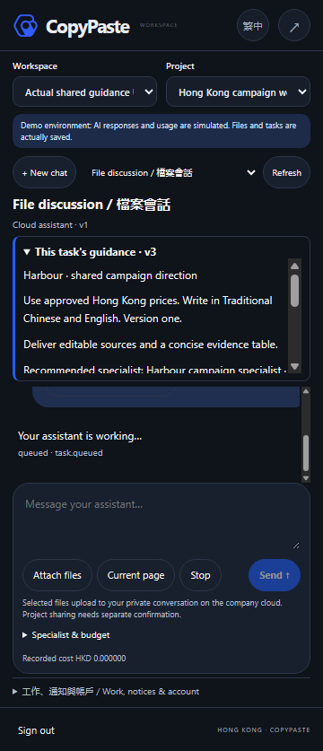


[原始 MP4](assets/screenshots/workmate-guidance-14-project-guidance-sidepanel.mp4)

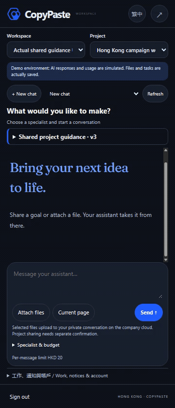

[本机程序方案](https://github.com/copypasteltd/workmate/blob/docs/docs/technical/88-approved-local-programs.md) · [Stage 88 checkpoint](https://github.com/copypasteltd/workmate/blob/docs/docs/quality/local-programs-checkpoint.json)
