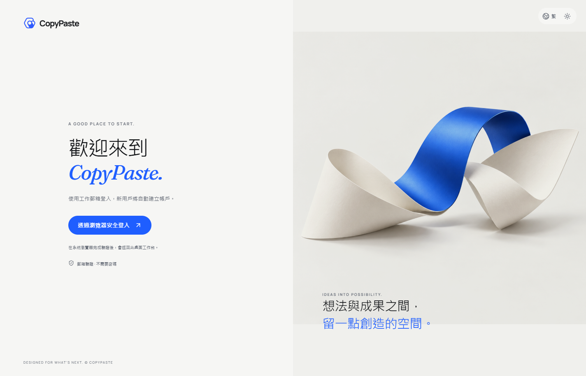
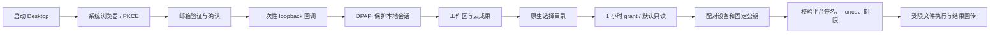
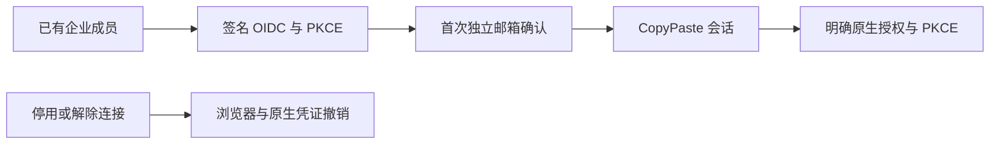

# CopyPaste Desktop

[English](README.en.md) · Windows 企业 Agent 客户端 · 0.5.0

独立 Electron 仓库，内置完整 Web 工作区快照与窄权限本地桥接。支持系统浏览器登录、Windows 用户级凭证保护、明确的本地目录授权、平台签名文件排程，以及 Chrome Native Messaging。实际 Agent 内核仍由公司平台的 Codex 执行，客户端不直连模型供应商。




## 运行与构建

Windows x64、Node.js 22.14+、npm。当前只验收 Windows；没有生成 macOS/Linux 安装包。先启动 platform 与 Web，再执行：

```powershell
npm ci
npm run typecheck
npm test
npm run build
npm start
```

公开 `deployment.json` 指定 API、Web origin 与官方扩展 ID；构建时可用 `COPYPASTE_API_ORIGIN` / `COPYPASTE_WEB_ORIGIN` 覆盖，运行时同名环境变量也可覆盖。只接受 HTTPS 或 localhost。当前交付二进制面向本机演示，默认 `localhost:4310/4317`；部署到公司云端须先修改此配置重新打包。

```powershell
npm run package
```

生成 `release/CopyPaste-0.5.0-x64-Setup.exe`、`release/CopyPaste-0.5.0-x64-Portable.exe` 和 `release/win-unpacked/CopyPaste.exe`。`package:dir` 只产生解包应用用于验收。安装包尚未代码签名；不会声称已有签名证书或商店发布。原生开发，禁止 Docker、WSL 和虚拟化环境。

## 登录与本地访问



每次授权校验 state、PKCE、精确 loopback 回调和单次 code；access token 短期，refresh family 轮换。退出撤销平台会话并撤销本地目录权限。Windows DPAPI CurrentUser 保护本地 profile key；数据使用 AES-256-GCM 认证加密，明文凭证不落盘。密钥不依赖并发 Chromium profile，主客户端与 Native Host 可跨进程读取同一授权。DPAPI 通过固定原生 Windows PowerShell/.NET helper 调用，秘密只经 stdin；不执行客户命令或动态脚本。

本地状态在 `%APPDATA%/CopyPaste/`，QA 可通过 `COPYPASTE_USER_DATA` 使用隔离目录。已安装产品的正常用户数据不属于源码工作区；开发源码、依赖和打包产物都在本仓库。

目录根路径只留在本机。默认 read/list，写入需要额外同意且只创建新文件；最长 1 小时、最多 20 个 grant。读取最大 5 MB，创建文本最大 2 MB，目录最多 500 项。路径禁止越界、符号链接/junction、ADS、设备名、尾点/尾空格；现有文件不被覆盖。命令 journal 有数量及字节上限，撤销/过期先于重放检查。并行 Host 通过跨进程锁串行修改 journal。

下载必须经过公司 API 与原生保存对话框，保存采用 create-only；上传必须来自明确选择的文件或授权目录。云命令验证 Ed25519 签名、固定公钥、nonce 与过期时间；结果使用原生 bearer+nonce 回传，尚未实现客户端结果签名。

## 专家与会话

0.2.0 内置最新 Web 工作区：专属专家、私密会话、五种范围的记忆，以及问答/计划/执行模式。笔记经有限原生 API 桥接保存到平台，重新加载后恢复；原生端和 Web 共用同一用户身份与权限规则。私密任务产物须明确发布才成为项目共享副本。


## Chrome 桥接

使用 Setup 安装到稳定路径，在设备页点击连接 Chrome helper 并确认，注册 `HKCU/Software/Google/Chrome/NativeMessagingHosts/hk.copypaste.agent`。只允许 `deployment.json` 中官方 ID；扩展自身还需可选 nativeMessaging 权限和逐目录授权。便携版路径可能变化，正式桥接使用 Setup 安装版。

受信部署人员也可在已构建仓库执行：

```powershell
npm run native:register -- fffkcnmfdhahlnifgdilabheppkgnlok 'C:\YourStableInstall\CopyPaste.exe'
```

注册操作改变当前用户的 Chrome native-host 配置，应只指向稳定、可信的本产品可执行文件；QA 不覆盖用户原有注册。Native Host 采用 Chrome 长度前缀 JSON 协议，响应最多 900 KB。

## 独立渲染器快照

`renderer/` 是随仓库提交的 Web 源快照，构建不需要相邻 Web 仓库。显式更新时执行：

```powershell
npm run renderer:sync -- 'D:\path\to\copypaste-web'
npm run build
```

`renderer-source.json` 记录来源和哈希。主进程 contextIsolation、sandbox 开启，nodeIntegration/webview 关闭；页面 CSP 禁止直接网络，所有请求走有限 IPC。拒绝额外权限、任意外链和窗口导航。Native Host 独立运行时不创建浏览器页面。

## 验证与边界

`npm test` 包括路径/撤销/重放/create-only、固定 API origin，以及真实 Windows DPAPI 跨进程解密与篡改拒绝。delivery 的 `qa:desktop` 使用实际打包应用，执行邮箱/PKCE、专家创建/私密会话笔记持久化、加密凭证、本地目录、云签名命令、Chrome 帧协议；测试对话框选择预设 fixture 路径，未自动批准用户真实目录。`qa:packaged` 另核查 isPackaged、版本与启动。

公司 AI 网关与外部广告平台仍需真实联调。当前没有任意桌面 UI 控制、客户 shell 执行、完整 AI 视频/语音；这不是已验收的所有长期规划功能。所有 QA 创建的浏览器与应用均在 finally 关闭。见 [第三方说明](THIRD_PARTY_NOTICES.md)；主文档位于交付根目录 `docs/`。

Chrome Host 使用 `resources/native-host.cmd` 启动受限 Node 模式脚本，避免 GUI 标准输入丢失；源码为 `src/native-host.ts`，与主窗口的输入输出分开处理。

## 云端定时流程

0.4.0 内置同版 Web 日历界面，支持每日/每周、IANA 时区、预算预览、明确授权、版本与历史以及暂停/恢复/退役。请求经原生 bearer 桥接，权限与浏览器端一致；客户端关闭后云端仍运行。该日历不授予未经确认的本地目录权限。Delivery `qa:desktop` 在实际打包应用中创建并显示计划，再退役测试计划。


## 0.5.0 企业身份与统一登录

OIDC 使用 code + PKCE S256、签章、state/nonce 与固定回调。先有注册账号及有效企业成员资格，再绑定企业身份；首次绑定需要独立的 CopyPaste 工作邮箱确认码，不按网域自动开户。配置改变、停用或本人解除连接会撤销关联用户的全部 CopyPaste Web/native/refresh 会话和旧执行授权。管理员登录仍独立使用邮箱与 TOTP。

用户在系统浏览器选择企业身份，完成后点击授权，真实 loopback PKCE 回调将独立原生凭证保存至本机 DPAPI 保护的存储。工作区账号设置显示企业连接。后台停用连接后，既有原生 access/refresh 与待交换码失效，不保留本地独立登录后门。




## 当前修复中的文件通道

工作台同步 Web 的分片续传、模拟标识、删除进度和保留期限。原生请求桥转发稳定 Idempotency-Key，重连不会分配重复上传会话。下载先由用户选择目标，以流写临时文件并验证字节数与 SHA-256，拒绝覆盖已有文件；异常清理临时文件，上限 1 GiB。JSON IPC 的任务事件按游标逐页读取。

目前源码增量尚未重打 Windows 安装包，需继续执行原生界面与打包回归；历史 0.5.0 安装包不包含本节更改。

## 本轮源码验收

原生源码验收已通过：系统浏览器 PKCE 登录、稳定上传幂等键、29 MiB 实际分片上传、摘要一致的流式下载、拒绝覆盖既有文件，以及原生桥上的同一云目录浏览。验收结束关闭独立浏览器与客户端。


以上针对当前源码运行；旧 0.5.0 安装包尚未重打包，不含本轮新增功能。

## 专案技能管理（当前源码快照）

项目方法新增精确安装及专家/任务版本绑定。普通停用影响新工作；卸载和永久安全撤销阻止包括旧任务在内的后续调用。重装产生新身份，专家须保存新版本后采用。工具调用及结果落库前复查当前方案，实际消耗按原预留结算。

平台全套回归 **129/129**；delivery 的 `npm run qa:skills` 通过三组浏览器验收，十五份实际 HTTP 响应通过严格设计 schema。自定义包审核/发布、完整真实角色资格仍待完成，历史 0.5.0 安装包未替换。

## 默认助手与通知（当前源码）

同步快照支持直接使用默认文字助手、私人会话和站内通知。源码 Electron 八组旅程验证原生 PKCE、29 MiB 传输及拒绝覆盖、云目录、真实 Codex 的模拟文字文件和通知定位。首次启动可读取两个公开配置/内容接口以展示演示提示；未登录私人请求仍拒绝，写入仍要求原生凭证。

模拟提示在登录前后持续显示。`npm test` 四组原生测试通过。所有浏览器和 Electron 测试实例已关闭；历史安装包仍不包含此增量。


## 运行前资料 / Pre-execution inputs

源码快照支持与 Web 相同的等待、搜索、明确选择和私人补传流程。原生验收使用实际上传的 29 MiB 文件版本，确认首次模型调用前等待，再由同任务生成真实文件；模型依赖为明确假数据。计划来源变化与当前权限由服务端重新核验。当前共八组 Electron 旅程通过，历史安装包仍待重新发布。

The renderer snapshot includes the same initial input checkpoint as Web. Native QA selects the version of the actual 29 MiB upload and resumes the original task through the authenticated bridge. Eight source Electron journeys passed using real Codex with synthetic model dependencies. These source changes are not included in the historical installer.


