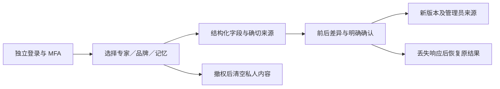
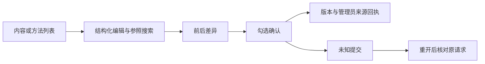
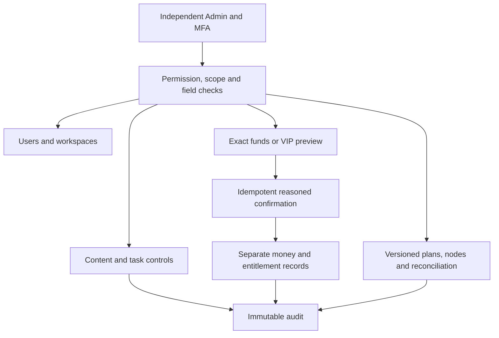

# Workmate · CopyPaste Enterprise Agent · admin

[简体中文](README.md) · [English](README.en.md)

<!-- controlled-publications-stage125 -->


## 发布管理与独立权限 · 阶段125

列表默认仅取元数据。管理员主动打开正文和媒体时，独立检查正文读取权限、当前来源及近期MFA；可修改获准项目／账户策略、取消未发送操作、核对未知结果及人工结案，不能代客户确认发布。

| 动作 | 所需权限（均须当前范围） |
| --- | --- |
| 元数据 | `admin.publication.read` |
| 私有正文／媒体 | 上述权限及`admin.content.body.read` |
| 发布策略 | `admin.publication.policy.write` |
| 取消／未知处置 | `admin.publication.resolve` |

修改绑定预期版本和原请求键。丢失响应后核对原管理员、原对象及原请求，不能另发变更。新增显式授权原子撤销旧会话；重复／并发不重复授权。当前deny、来源失效和会话撤销会撤回内容。

实际Web/Admin旅程14/14通过：独立邮箱/TOTP、正文主动读取、四档宽度、键盘关闭、策略、丢失响应恢复及撤权。完整后台权限矩阵仍开放。


[实际交互MP4](assets/screenshots/workmate-publications-12-private-review-and-request-recovery.mp4)


<!-- admin-profile-revisions-124 -->
## 专家、品牌与私人记忆的完整修订 · 阶段 124

用独立管理员身份及 MFA 登录，从内容列表选择客户专家、品牌或记忆的“修订”。专家表单允许名称、工作说明及固定角色的工具子集；品牌表单提供字型来源、使用依据、共享 Logo、产品价格和促销的明确输入；记忆保留原拥有者及范围，仅修改内容和到期时间。旧版品牌须主动补齐字型及使用依据，不会自动编造授权。

填写原因 → 预览前后差异及固定来源 → 勾选确认 → 保存新版本。价格按货币小数位精确处理，差异显示 `HK$128.90`；日期显示香港时间和 `HKT`，输入选择器使用本机时区。原模型、Skill、品牌绑定及旧会话输入保留；修订不自动执行客户工作。

当前对象范围必须同时具备三项内容权限，显式拒绝优先。私人正文、预览和历史在实时撤权后清空。响应丢失时刷新后核对原请求，不保存正文、原因或重复修改。已有团队、项目说明和方法编辑继续沿用各自发布流程。



本轮 **68/68** 相关后端、**11/11** 后台单元、**8/8** 实际页面流程及四档宽度的 **14次**边界观察通过。最初两批录制/视口竞争失败原件保留；第三批是当时源码的通过记录，以下使用进一步完善金额和日期显示后的第04批。全部所属浏览器、服务及原生数据库关闭。真实模型专业质量、完整产品与生产部署另行验收。

| 实际画面 | 截图 |
| --- | --- |
| 专家工作说明与工具选择 | [专家表单](assets/screenshots/workmate-admin-profiles-04-specialist-form-en.png) |
| 专家新版本及管理员来源 | [保存结果](assets/screenshots/workmate-admin-profiles-04-specialist-receipt-en.png) |
| 精确价格和共享文件来源 | [品牌字段](assets/screenshots/workmate-admin-profiles-04-brand-price-and-sources-en.png) |
| 品牌差异和可读金额 | [品牌预览](assets/screenshots/workmate-admin-profiles-04-brand-review-en.png) |
| 品牌新版本回执 | [品牌结果](assets/screenshots/workmate-admin-profiles-04-brand-receipt-en.png) |
| 繁中375px、私人记忆及香港时间 | [窄屏预览](assets/screenshots/workmate-admin-profiles-04-memory-review-zh-375.png) |
| 真正已提交但响应丢失 | [原请求恢复](assets/screenshots/workmate-admin-profiles-04-memory-lost-response.png) |
| 当前权限撤回后的内容清空 | [撤权结果](assets/screenshots/workmate-admin-profiles-04-memory-authority-withdrawn.png) |


[专家MP4](assets/screenshots/workmate-admin-profiles-04-specialist-revision.mp4) · [品牌MP4](assets/screenshots/workmate-admin-profiles-04-brand-revision.mp4) · [记忆MP4](assets/screenshots/workmate-admin-profiles-04-private-memory-revision.mp4) · [完整设计及证据](https://github.com/copypasteltd/workmate/blob/docs/docs/technical/124-admin-profile-revisions.md)

<!-- admin-content-revisions-123 -->
## 正文编辑、差异确认与恢复 · 阶段 123

使用独立管理员账号及 MFA 登录，在内容列表选择团队或共享项目说明的“修订”，或在业务方法列表选择“建立修订草稿”。编辑名称、说明、成员职责、准确版本参照或方法资料要求；可按名称搜索获准参照，搜索不会移除已经选中的绑定。

填写修订原因后预览前后差异和固定依赖版本，勾选明确确认，再创建新版本。共享项目说明会替换当前草稿并发布；业务方法仅创建草稿，仍需客户自己的试运行与发布。港币预算按十进制精确转换，避免浮点金额变化。

如果提交结果未知，页面保留原请求键及签名摘要，重新打开页面后核对原请求；浏览器存储不保存正文或原因。权限撤回会清空已打开的正文、预览和历史，迟到响应不能恢复已清空的编辑内容。页面沿用 CopyPaste 字体、蓝色系和浅色工作区，窄屏按编辑、预览、历史顺序排列。



代码见 [结构化编辑器](src/content-revisions.tsx) 和 [响应式样式](src/content-revisions.css)。相关后端五个完整文件 **75/75**、实际页面流程 **7/7** 通过；375/768/1024/1440px 下弹窗及输入控件边界通过检查。断线后的成功回执会保留到管理员主动关闭；原请求不会重复修改。首次失败和旧截图保留为历史，以下使用第 03 批材料。所属浏览器、服务和数据库已关闭；整体验收仍单独跟踪。

| 实际画面 | 截图 |
| --- | --- |
| 英文团队差异与未勾选确认 | [团队预览](assets/screenshots/workmate-admin-content-03-team-preview-en.png) |
| 新版本成功回执 | [保存结果](assets/screenshots/workmate-admin-content-03-team-saved-en.png) |
| 繁中 375px 精确港币预算差异 | [窄屏确认](assets/screenshots/workmate-admin-content-03-brief-preview-zh-375.png) |
| 方法资料清单与草稿预览 | [方法修订](assets/screenshots/workmate-admin-content-03-method-preview-zh.png) |
| 真实提交已完成但响应丢失 | [核对原请求](assets/screenshots/workmate-admin-content-03-unknown-response-recovery.png) |
| 当前权限撤回后清空正文 | [撤权结果](assets/screenshots/workmate-admin-content-03-authority-withdrawn.png) |


[团队 MP4](assets/screenshots/workmate-admin-content-03-team-revision.mp4) · [项目说明及方法 MP4](assets/screenshots/workmate-admin-content-03-brief-method-revisions.mp4) · [完整方案与证据](https://github.com/copypasteltd/workmate/blob/docs/docs/technical/123-admin-content-revisions.md)

## 产品与边界

首批面向现有客户的 marketing 团队，完整范围包含生图、设计/字体、视频/特效、广告和网站分析、SEO/GEO、企业重复流程及软件开发。目录已有 18 个精确 Skill 绑定的候选角色；至少十二个逐一完成专业任务、修改及异常处理的角色仍是验收要求。设计师由 Codex、设计 Skill 与公司 Image 2 组合。Agent 内核唯一使用 Codex；全部 AI 请求走公司 OpenAI 兼容后端。当前开发使用已授权假数据，不代表真实模型专业质量已经验收。

使用独立后台账号及 MFA，用户端登录不自动获得管理权。元数据、敏感正文、消耗/费用、赠额/扣回、授信、退款、收款登记、VIP、隔离/恢复/永久擦除分别授权。人工开通先预览精确用户/企业、金额或权益、到期和原因，再以相同幂等键确认；预览不改余额，重放不重复赠额。支持访问不自动获得正文；关键动作保留独立审核、当前 MFA 和审计。Admin 不能替客户授予本机完整权限或签署媒体使用声明。

## 仓库与执行位置

| Branch | Directory | Runtime |
| --- | --- | --- |
| [backend](https://github.com/copypasteltd/workmate/tree/backend) | `dev/copypaste-platform` | Fastify / PostgreSQL / cloud Codex |
| [web](https://github.com/copypasteltd/workmate/tree/web) | `dev/copypaste-web` | React / Vite / cloud workspace |
| [admin](https://github.com/copypasteltd/workmate/tree/admin) | `dev/copypaste-admin` | React / separate Admin identity |
| [desktop](https://github.com/copypasteltd/workmate/tree/desktop) | `dev/copypaste-desktop` | Electron / customer-local Codex |
| [extension](https://github.com/copypasteltd/workmate/tree/extension) | `dev/copypaste-extension` | Chrome MV3 / native Side Panel / cloud Codex |
| [delivery](https://github.com/copypasteltd/workmate/tree/delivery) | `dev/copypaste-delivery` | Native development, QA and publication tools |

各组件为独立 Git 仓库，保留上述并列布局。项目仅使用原生工具；禁止 Docker、WSL 和虚拟机。

## 使用逻辑

1. 使用独立管理员账号与 MFA 登录；普通用户身份不自动获得后台权限。
2. 按用户、企业和权限范围搜索列表，核对关联项目、任务、内容与消耗；敏感正文需要单独权限。
3. 人工费用先预览精确主体、金额、资金来源和原因，再沿用同一幂等键确认；余额、实收、授信与 VIP 分开记录。
4. 开通、延期、暂停或撤销指定主体的 VIP，确认有效期及权益；不得借 VIP 静默赠额。
5. 对内容、任务、批量、能力发布及专属节点执行获准动作；敏感操作检查近期 MFA、原因、版本和必要的独立审批。



## 启动与使用

### 本地启动

以下命令在已检出的对应仓库内执行。完整工作区将六个独立仓库并列放在 `dev/`，见[分支与检出布局](https://github.com/copypasteltd/workmate/blob/docs/docs/governance/04-git-branches-and-publication.md)。使用 Windows x64、Node.js >=22.14、npm/Git，以及文档约束的原生 PostgreSQL、FFmpeg/FFprobe 与固定 Codex 资源；保留已有本地配置和数据，不使用 Docker/WSL/虚拟机。

```powershell
Set-Location 'D:/dev/copypasted/自有agent/dev/copypaste-admin'
npm ci
npm run dev
```

先启动后端，再打开 `http://localhost:4318`；静态构建使用 `npm run build`。使用独立登记、具备 MFA 及对应权限的 Admin 账号。

### 当前使用流程

1. 完成登录、企业成员/邀请和项目选择。原生端通过浏览器 PKCE 登录；Admin 使用独立 MFA 身份。过期、撤销、换企业不应静默切换身份和资料范围。
2. 选择专业角色，提供工作说明及明确获准的资料/账号。缺少必要输入时请求客户补齐。项目负责人可以保存草稿、核对依赖、预览并明确发布不可变共享指引；发布不启动 AI、不增加权限。
3. 新任务固定当时接受的角色、Skill、品牌、资料和指引版本。既有工作保留原版，包括原先没有共享配置的状态。来源被隔离、删除或撤权后隐藏失效正文并阻断后续使用；历史内容不是越权入口。
4. 确认预算和必要的操作/媒体授权，查看真实状态、进度、文件与原费用回执。修改沿原工作谱系继续。未知用量保持原预留供对账，不能当作免费或盲目重新执行。
5. Admin 可按独立权限管理用户/企业状态、查看获准消耗，预览并确认人工费用/赠额和 VIP 权益/到期。余额、实收记录、授信、预算和 VIP 分别保存；同一确认幂等，操作保留审计，不能因重放重复赠额。

## 配置、权限与费用

本候选要求完整 SQL001–132 增量历史。API/Worker 准入拒绝缺失、变更或不支持的版本，并独立检查恢复环境身份。公司模型别名、已验证媒体能力、精确费率及供应商密钥只在后端配置；未配置能力保持不可用。当前开发继续使用已授权假数据。

Web/Admin 使用 `VITE_API_BASE` 或同源代理，开发端口为 4317/4318。Desktop/Extension 构建时固定 `COPYPASTE_API_ORIGIN`、`COPYPASTE_WEB_ORIGIN`，Desktop 另固定 `COPYPASTE_EXTENSION_ID`。除获准回环开发场景外使用 HTTPS；渲染器与扩展不持有公司供应商密钥。

文件默认私有，项目共享需要客户明确操作。新请求、Worker 领取、工具及下载重新核验权限；旧历史不能绕过撤权或正文治理。金额使用精确港币微单位；预算、余额、授信、实收与 VIP 分开记录。稳定请求身份防止重复赠额、建任务和预留；未知费用或物理清理保留待核对。

### 后台控制矩阵

| Scope | Controls |
| --- | --- | --- |
| Identity | Separate session, MFA, revocation, CSRF, scoped roles and explicit deny |
| Users / workspaces | Search, membership, freeze/restore and permitted task/content links |
| Funds / consumption | Exact usage, grants, credits, recorded payments, compensation, refund and reconciliation |
| VIP / entitlements | Subject, plan version, start/expiry, extension, suspension and revocation |
| Content / tasks | Separate metadata/body access, revisions, quarantine, erasure, pause/cancel and batch outcomes |
| Platform | Versioned models/skills/content releases; distinct infrastructure/read/stop/reconcile permissions |
| Sensitive changes | Reason, current MFA, compare-and-swap, idempotency, audit and independent approval when required |

节点凭证仅显示一次，关闭或离开页面后清除；资源元数据权限不授予客户画面或私有正文访问。

## 预设角色与 Skill

目录定义 18 个专业预设及默认助手，每次执行固定 Skill 版本和注册工具。模板数量不等于至少十二个角色已通过完整专业资格验收。

| ID | Role | Required Skill bindings |
| --- | --- | --- |
| R01 | 全栈开发工程师 | `fullstack-engineering@1.0.0`, `frontend-implementation@1.0.0`, `backend-api@1.0.0`, `qa-testing@1.0.0`, `delivery-core@1.0.0` |
| R02 | 前端开发工程师 | `frontend-implementation@1.0.0`, `ui-system@1.0.0`, `qa-testing@1.0.0`, `delivery-core@1.0.0` |
| R03 | 后端与 API 工程师 | `backend-api@1.0.0`, `qa-testing@1.0.0`, `delivery-core@1.0.0` |
| R04 | 软件测试工程师 | `qa-testing@1.0.0`, `frontend-implementation@1.0.0`, `delivery-core@1.0.0` |
| R05 | UI/UX 设计师 | `ux-research@1.0.0`, `ui-system@1.0.0`, `frontend-implementation@1.0.0`, `delivery-core@1.0.0` |
| R06 | 设计师 | `creative-direction@1.0.0`, `image-art-direction@1.0.0`, `image2-production@1.0.0`, `typography-layout@1.0.0`, `delivery-core@1.0.0` |
| R07 | 品牌视觉设计师 | `brand-system@1.1.0`, `image-art-direction@1.0.0`, `image2-production@1.0.0`, `typography-layout@1.0.0`, `delivery-core@1.0.0` |
| R08 | 广告创意设计师 | `ad-creative@1.0.0`, `image-art-direction@1.0.0`, `image2-production@1.0.0`, `typography-layout@1.0.0`, `delivery-core@1.0.0` |
| R09 | 电商商品设计师 | `ecommerce-visual@1.0.0`, `image-art-direction@1.0.0`, `image2-production@1.0.0`, `typography-layout@1.0.0`, `delivery-core@1.0.0` |
| R10 | 社媒内容设计师 | `social-content@1.0.0`, `image2-production@1.0.0`, `typography-layout@1.0.0`, `delivery-core@1.0.0` |
| R11 | 插画与 IP 设计师 | `illustration-ip@1.0.0`, `image-art-direction@1.0.0`, `image2-production@1.0.0`, `delivery-core@1.0.0` |
| R12 | 字体与版式设计师 | `typography-layout@1.0.0`, `image-art-direction@1.0.0`, `image2-production@1.0.0`, `delivery-core@1.0.0` |
| R13 | 演示文稿设计师 | `presentation-production@1.1.0`, `typography-layout@1.0.0`, `dataviz@1.1.0`, `delivery-core@1.0.0`, `deterministic-metrics@1.1.0` |
| R14 | 网页与落地页设计师 | `landing-page@1.0.0`, `ui-system@1.0.0`, `frontend-implementation@1.0.0`, `image2-production@1.0.0`, `delivery-core@1.0.0` |
| R15 | 信息图与数据可视化设计师 | `dataviz@1.1.0`, `deterministic-metrics@1.1.0`, `typography-layout@1.0.0`, `delivery-core@1.0.0` |
| R16 | 视频与动效设计师 | `video-storyboard@1.0.0`, `template-video-composition@1.0.0`, `video-generation@1.1.0`, `speech-production@1.2.0`, `delivery-core@1.0.0` |
| R17 | 营销数据分析师 | `ads-analysis@1.1.0`, `deterministic-metrics@1.1.0`, `dataviz@1.1.0`, `delivery-core@1.0.0` |
| R18 | 企业流程自动化顾问 | `workflow-design@1.1.0`, `workflow-execution@1.1.0`, `delivery-core@1.0.0` |

设计师组合为 Codex＋设计 Skill＋公司 Image 2。可选 R19 云端电脑操作员必须绑定另行确认的租约与 AI 预算；本机 Desktop 不提供该创建入口，继续由客户本机执行。

[Role contract](https://github.com/copypasteltd/workmate/blob/backend/catalog/role-preset-catalog.json) · [Skill packages](https://github.com/copypasteltd/workmate/blob/backend/catalog/skill-packages.json)

## 可选专属云电脑

先核对不可变方案/报价、付款方、固定时长、确切私有文件及终端/可视/Agent 独立范围，Agent 默认未授权。明确同意后预留资源费，后续 Codex 指令另有精确 AI 上限。无自动续期。停止、到期或撤权阻断后续操作；实际用量和清理证据齐全才结算，未知进入核对。

Linux 物理节点源码使用原生 Node22/systemd、cgroup、XFS project quota 和有界桌面工具。本地 Windows 核查未启动 Linux 主机。Delivery 中以新编号运行 `node native/build-package.mjs NN` 构建源码包；安装前核对外部固定摘要，默认不启动服务，恢复要求确切安装 UUID。

## 实际界面与交互录制

下列为真实产品界面截图和按墙上时间录制的交互。客户、模型、媒体响应明确使用假数据；所注明的原生 Codex、文件、数据库和账务路径实际运行。假节点画面不代表真实 Linux 远端桌面已验收。


[Original MP4](assets/screenshots/workmate-12-dedicated-cloud-plan.mp4)

## 验证与交付状态

整合后的客户端/工具共 338 项通过：Web 20、Admin 9、Extension 63、Desktop 180、实际本机 Codex 22、Delivery 44，对应类型/构建通过。Desktop、Web/Admin、原生侧栏各有 8 项限定实际 UI 检查，共 29 张截图与 5 组 GIF/MP4。后端完整成功须有最终完整清单回执，检查点记录实际结果并保留失败。

安装原生前置依赖后执行本仓库 `npm run typecheck`、`npm run build` 及测试脚本。Delivery 默认 `npm test` 仅覆盖原生界面完整性，完整单元清单使用 `node --test --test-concurrency=1 tests/*.test.mjs`。`node scripts/qualify-delivered-clients-v1.mjs NN` 在 Delivery 使用新两位编号及并列布局检查完整客户端清单；历史候选专项执行器保留原目录要求。

完整产品验收仍开放：至少十二个专业角色资格、全权限/业务/兼容矩阵、真实服务质量、签名安装更新、生产负载恢复及客户业务接受。以编号清单管理完成条件，不以测试数量推算完成率；使用后清理自建浏览器/进程，保留用户资源。

[Implementation / 方案](https://github.com/copypasteltd/workmate/blob/docs/docs/technical/121-dedicated-cloud-and-client-execution.md) · [Checkpoint / 证据](https://github.com/copypasteltd/workmate/blob/docs/docs/quality/dedicated-cloud-checkpoint.json) · [Open requirements / 未完成项](https://github.com/copypasteltd/workmate/blob/docs/docs/quality/remaining-work-2026-10-29.md) · [Branch layout / 检出布局](https://github.com/copypasteltd/workmate/blob/docs/docs/governance/04-git-branches-and-publication.md)
