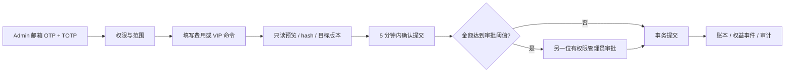
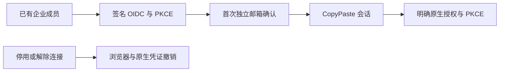
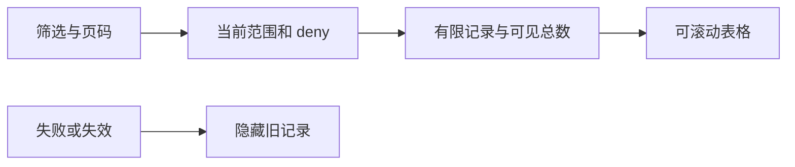
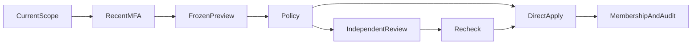

# CopyPaste Admin Dashboard

[English](README.en.md) · 独立运营控制台 · 0.5.0

本仓库是独立 Git 管理后台，与用户 Web 使用独立身份、Cookie 和入口。它管理用户、企业、消耗、费用、VIP、内容、任务、权限和产品配置；采用 CopyPaste 同源品牌样式及繁体中文/英文、浅深主题。所有实际授权、审计和事务在 platform 执行。


## 启动

Node.js 22.14+。先启动 platform API 与数据库，并通过 platform CLI 创建管理员、导入 TOTP：

```powershell
# 在 platform 仓库执行
npm run admin:create -- admin@your-company.example super_admin
```

然后在本仓库：

```powershell
npm ci
npm run dev
npm run typecheck
npm run build
```

访问 `http://localhost:4318`。生产部署 `dist/`，HTTPS 与精确 Admin origin，将 `/v1` 反向代理到平台；SPA 路由回退与 API 分开。可用 `.env.example` 中的公开 `VITE_API_BASE`。禁止将模型 key 或数据库凭证放入前端。禁止 Docker、WSL 和虚拟化环境。

管理员每次登录需邮箱验证码及 TOTP；敏感提交要求最近 10 分钟 MFA，过期后重新登录。开发 OTP 来自 platform 本机 mailbox；没有共享默认管理员。

## 16 个运营页面

| 页面        | 实现                                                                       |
| ----------- | -------------------------------------------------------------------------- |
| Overview    | 按各自权限范围汇总企业、用户、消耗、预留和对账                             |
| Users       | 数据库分页/检索、联系信息单独权限、用户详情、成员关系、消耗、状态/会话操作 |
| Workspaces  | 企业状态、成员数、按账务权限显示余额                                       |
| Usage       | 按用户/企业/项目范围汇总任务和实际 token/费用                              |
| Billing     | 不可变账本、确认入账、赠送、来源退款/扣款、对账                            |
| VIP         | 个人或企业授权、开始/到期时间、暂停/恢复/延长/撤销                         |
| Content     | 全域内容元数据、正文/下载独立权限、隔离/恢复与版本检查                     |
| Execution   | 任务状态、取消、对账、满足条件的新子任务重试                               |
| Catalog     | 已安装角色/Skill 启停和展示、帮助/公告/导航版本发布                        |
| Connections | 已连接服务、范围、撤销                                                     |
| Access      | 邀请开户/真实 MFA、停用/恢复、会话、八类角色/68 权限、受限委派                  |
| Support     | 限时支持会话元数据与撤销；不具备静默代登录                                 |
| Audit       | 可追溯操作、结果与时间                                                     |
| Jobs        | 有预览/提交的用户状态批量操作、受控 CSV 导出                               |
| Plans       | 版本化套餐、能力/角色/并发和任务预算约束                                   |
| Policy      | 审批金额阈值与 VIP 最长期限的版本配置                                      |


## 管理员邀请与账号生命周期

0.3.0 在 Access 页面提供邀请开户及可选初始角色、范围、金额/期限/批次上限。账号和初始授权原子创建，逐项检查权限及委派来源。操作者只看到投递结果，邀请链接仅寄给受邀邮箱。未分配业务权限的已开通账号显示等待授权。


链接进入页面后立即移除 fragment，不保存在浏览器存储。验证码和 MFA 设置限时、限次、单消费；密钥只显示给已验证的本人。账号详情展示安全的会话元数据、角色/范围、MFA 及邮件状态。重发邀请会废弃旧链接和未完成设置；投递失败明确显示，支持重试。停用和恢复都不恢复旧会话。

本人通过侧栏「验证器设置」更换 MFA，需要近期登录及新的邮箱验证；新 TOTP 确认前保留旧密钥，成功后撤销旧会话并签发当前新会话。他人重设、状态及会话操作要求独立权限、记录版本与原因；不能自己重设或停用自己，最后一位已开通、有效的永久超管受到并发保护。邀请中账号不计入此保护。权限调整会撤销旧会话；未开通身份保留收件邀请，但须重新验证邮箱和设置 MFA。

解除 deny 会恢复权限，服务端同时检查委派权限、实际范围交集、限额和有效期；不能删除自己的 deny，也不能用全局授权绕过操作者在较小范围内的明确限制。绑定删除支持同键重试，避免重复撤销会话。


`src/admin-identities.tsx` 承载实际开通、本人 MFA 和账号详情。Delivery `npm run qa:admin-identities` 验证 6 组真实浏览器流程，平台另有 14 组 PostgreSQL/API 逻辑测试；截图隐藏密钥与验证码。生产 SMTP 与企业 SSO 尚需分别接入验证。

## 敏感操作流程



金额用 HKD 整数 micros；UI 输入换算不改变后端记账口径。付款必须填写已确认的唯一引用，后台不会自动向客户收款。VIP 不改变余额；余额不代表 VIP。月费默认值尚未商业定价。

权限包含 global/tenant/project 范围，显式拒绝优先，金额/期限/批次数及授权到期限制。权限委派不能超过自己的来源授权，不允许自授权，不允许破坏最后一位永久超级管理员的恢复权限。用户联系信息、消耗、余额、内容正文和下载分别控制；不能凭普通用户列表权限获得其他数据。

后台发布角色只能调整已安装定义的启用和展示；Skill 只能启停。可执行工具/内核/模型不能通过 JSON 绕过发布资格。内容隔离立即影响用户可见性、分享和后续执行。所有集合按 SQL 授权范围分页，不先全量拉取再前端过滤。

## 私密内容治理

内容列表包含专家、私密会话、记忆及原有业务资源。列表元数据与正文读取分别授权；正文检查记录审计。平台 Admin 须具备明确的范围及正文权限，普通客户管理员不因此获得其他用户的私密内容。

隔离立即影响用户 API、RLS 读取和运行任务的后续工具。会话删除先检查在途任务，再清空可读消息、任务正文、记忆版本及缓存重放；已删除会话/记忆不提供恢复按钮。专家职责变更通过专用版本接口，内容治理不能覆盖固定执行版本。重试保留私有归属与上下文，重新检查当前授权与权益。


## 验证与已知边界

`npm test` 是类型检查，真实 16 页、邮箱/TOTP、费用/VIP 提交、用户详情的浏览器旅程见 delivery `npm run qa:web`；私密正文、隔离/恢复由 `npm run qa:persistent` 验证；平台测试覆盖越权、并发、金额重放、VIP、委派和最后超级管理员保护。

CSV 导出最多 500 行、15 分钟有效并在下载时重查源权限。首次恢复超管由受信 CLI 引导；后续邀请开户、本人 MFA 开通、更换、停用/恢复、重发和会话撤销由 UI 完成。支持会话只提供元数据，不实现客户内容委托或代登录。在线支付、SAML/SCIM 和大规模导出仍未完成。

`src/main.tsx` 实现页面/运营命令，`api.ts` 处理 Cookie/CSRF，UI 为本仓库独立快照，来源记录在 `shared-source.json`。截图为真实开发数据，包含虚构 fixture 企业；主文档在交付根目录 `docs/`。素材许可见 [说明](THIRD_PARTY_NOTICES.md)。

## 云端定时执行控制

0.4.0 在 Execution 页增加授权范围内的计划检索和分页，仅显示元数据。暂停和恢复分别要求 `execution.pause` / `execution.resume`、近期 MFA、当前版本与原因。暂停只停止未来触发；恢复从现在开始，不补跑暂停区间。恢复保留原用户授权，已撤销时拒绝，要求项目管理员重新确认；Admin 不能借此替用户建立新授权。

内容治理可隔离或删除定时计划；删除清空全部配置版本及可重放正文，保留审计。隔离父工作流会停止后续触发并取消当前流程。`src/schedules.tsx` 提供界面，范围过滤与校验由平台执行。


## 0.5.0 企业身份与统一登录

OIDC 使用 code + PKCE S256、签章、state/nonce 与固定回调。先有注册账号及有效企业成员资格，再绑定企业身份；首次绑定需要独立的 CopyPaste 工作邮箱确认码，不按网域自动开户。配置改变、停用或本人解除连接会撤销关联用户的全部 CopyPaste Web/native/refresh 会话和旧执行授权。管理员登录仍独立使用邮箱与 TOTP。

企业列表的身份按钮提供 OIDC 配置、回调 URI、允许邮箱网域、client ID、只写 secret、签章与邮箱政策；可保存、检查、启用与停用。新增全域 `admin.tenants.sso.write`，普通用户运营员不能修改。界面说明检查只验证中继资料及公钥，停用及修改提示关联账号全部装置登出。




## 当前修复中的生命周期管理

内容管理增加持久的永久删除进度、清理失败子项和受作用域、近期 MFA、原因及幂等约束的重试。已永久删除的资产不能再恢复或修改正文/名称；对象下载在打开流后重新鉴权。模拟环境在后台持续标识，模拟额度与真实收款区分，金额很小时显示至六位小数。

本节是未发布的源码增量，0.5.0 归档保持原版本。完整治理范围和未完成条件见主文档 docs/quality/09-implementation-alignment-audit.md。


## 云目录内容控制（当前源码）

用户端新增的工作区节点进入统一内容资源目录。管理员按原有数据范围、正文权限、版本、原因与审计规则查看元数据、隔离、恢复和删除；隔离文件夹后，其后代不会继续出现在用户搜索或模型读取中。目录条目移除不等于删除独立源资产，永久源文件删除仍通过素材生命周期执行。

## 待补资料任务治理（当前源码）

有独立正文权限与数据范围的管理员可检查任务要求的资料说明、provider、scope、状态、已选资源 ID 和版本；检查记录审计，不返回凭证。支持角色的元数据权限不能读取私人要求。Execution 取消未启动的待补资料任务后释放原预留，不产生模型费用；重试保留私人归属和要求，再检查当前资源。

Delivery `qa:admin-task-inputs` 三组真实浏览器检查通过，平台负向测试另验证支持角色不能越权读正文。截图使用模拟业务数据，验收后关闭自建浏览器。


## 执行排队原因（当前源码）

Execution 列表新增可读的排队原因，区分企业共享、用户方案、平台与媒体/服务容量。原有执行读取权限、企业/项目数据范围、取消/重试和审计约束继续生效；不返回其他企业计数或凭证。独立 MFA 的实际页面流程记录在 delivery `qa:execution-capacity`。


## 清理记录分页与授权刷新

内容页的清理面板支持状态、类别和记录/目标 ID 搜索，URL 保留筛选及页码。默认每页 50 条，可选 25/50/100；长记录在有界区域滚动。通用后台集合、管理员身份及云端定时列表默认 50 条。轮询在前一请求结束后再安排，错误会隐藏旧记录，切换查询也不展示上一页。重试仍需独立删除权限、当前范围、最近 MFA、原因和幂等键。

Delivery `npm run qa:admin-records` 的五组浏览器检查覆盖 58 条可见记录、六条按范围排除的记录、翻页/组合筛选、授权到期、慢请求拒绝清空、四宽度与两主题/语言；模型与清理目标均是明确的测试数据，登录和授权查询真实执行。




## 模板运行约束的管理边界

用户端新增的持久模板在预检与创建时复查当前角色/技能停用、项目权限和方案。运行配置与能力版本由服务端固定为 Codex/内部网关，撤销后阻止后续执行；不向客户暴露配置覆盖入口。当前 Admin 既有角色/技能管理继续生效，但模板草稿、完整版本编辑/发布和企业品牌覆盖面板仍待完成，不能把服务端注册表当作完整后台模板管理已交付。

排队任务的暂停/恢复现与用户端复用平台领域守卫：仅首次调用前、未领取且原预留有效时可操作；恢复会重新核对原受益用户、角色/技能、权益和输入来源。Admin 的范围权限不能替代用户被撤销的执行权，原因、版本、真人审计继续保留。详见主文档 `docs/technical/31-task-controls-and-native-continuation.md`。

## 企业成员管理

用户详情新增企业成员入口：选择角色、启用/后台暂停/移除、项目范围和原因，先预览前后差异，再执行或交由独立审批。审批人读取冻结业务参数与期限。未知响应重试复用原操作身份；原始原因和凭证不写入该浏览器回执。页面已构建；本轮页面交互和截图尚未验证，已有图库保留其历史来源。


