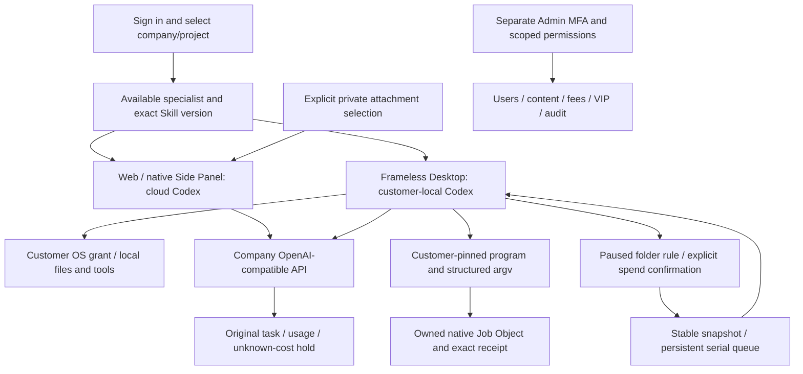

# Workmate · CopyPaste Enterprise Agent · admin

<!-- agent-groups-stage93 -->

## 持久专业团队协作

阶段 93 已实现 Web 持久专业团队：保存协调员及不同专业成员，固定版本，审阅完整 Brief、依赖与预算后由客户批准，真实 Codex 按受控并行执行，最后统一交付。115 项相关后端回归与 7 项实际浏览器检查通过。模型及账户容量为明确假数据；登录、原生 Codex 进程、公司工具、私有文件、预算和账本实际运行。

1. 登录并选择项目，在「我的专家」建立实际助手，再在「我的团队」保存协调员和不同成员。设置在项目内共享，运行及文件对发起客户私有。
2. 填写 Brief、各步要求、依赖、独立预算及并行上限；先免费核对完整计划与固定成员版本，再由当前客户主动批准预算并开始。
3. 通过原任务链接查看成员状态、批准上限、当前预留和实际消耗。协调员等待全部成员真实成功后读取获准成果。停止阻断后续派发，未知费用继续对账。
4. 编辑建立不可变新版本，相同请求复用原运行，新执行需要重新审阅。来源撤回阻断私有衍生文件；后台正文、隔离、恢复和删除保留独立范围权限与审计。


在 SQL001–107 后应用 **SQL108**。一个团队含一名协调员及最多七个不同成员，每次 1–16 个无环步骤、1–3 个受套餐实际容量限制的并行成员。至少需要两个活跃任务槽。审阅 15 分钟有效，运行最多两小时。仅预留实际任务自己的额度，显示的总上限不是额外收费；普通对话仍限制单一活跃任务。

Desktop 保持客户本机 Codex、客户主动授予的全权限、无边框和无 Electron 自带菜单。本次团队界面属于云端 Web，原生 Desktop 隐藏该入口。Extension 保持 ChatGPT 式原生右侧栏，负责获准文件上传与云端对话。下方录制不证明新增原生团队界面、角色专业质量、真实外部平台或完整产品验收。

在 Content 查找 agent_groups / agent_group_runs。列表权限不包含正文权限；隔离取消已准入工作并释放确定未使用的预留，恢复设置不重启已取消运行或偷偷恢复私有正文；永久删除清除在线内容并保留财务和审计记录。

[方案与 API](https://github.com/copypasteltd/workmate/blob/docs/docs/technical/93-persistent-agent-groups.md) · [源码绑定证据](https://github.com/copypasteltd/workmate/blob/docs/docs/quality/agent-groups-checkpoint.json)


[375px](assets/screenshots/workmate-agent-groups-04-responsive-375.png) · [Delivery GIF](assets/screenshots/workmate-agent-groups-04-team-delivery.gif) · [Authoring MP4](assets/screenshots/workmate-agent-groups-04-team-authoring.mp4) · [Delivery MP4](assets/screenshots/workmate-agent-groups-04-team-delivery.mp4)

<!-- local-programs-stage88 -->

独立 MFA 后台，按角色、企业、项目、字段和操作授权管理用户、内容、消耗、费用与 VIP。

## 产品与边界

首批面向现有客户的 marketing 团队，完整范围包含生图、设计/字体、视频/特效、广告和网站分析、SEO/GEO、企业重复流程及软件开发。目录已有 18 个精确 Skill 绑定的候选角色；至少十二个逐一完成专业任务、修改及异常处理的角色仍是验收要求。设计师由 Codex、设计 Skill 与公司 Image 2 组合。Agent 内核唯一使用 Codex；全部 AI 请求走公司 OpenAI 兼容后端。当前开发使用已授权假数据，不代表真实模型专业质量已经验收。

使用独立后台账号及 MFA，用户端登录不自动获得管理权。元数据、敏感正文、消耗/费用、赠额/扣回、授信、退款、收款登记、VIP、隔离/恢复/永久擦除分别授权。人工开通先预览精确用户/企业、金额或权益、到期和原因，再以相同幂等键确认；预览不改余额，重放不重复赠额。支持访问不自动获得正文；关键动作保留独立审核、当前 MFA 和审计。Admin 不能替客户授予本机完整权限或签署媒体使用声明。

## 启动与使用

### 本地启动

以下命令在已检出的对应仓库内执行。完整工作区将六个独立仓库并列放在 `dev/`，见[分支与检出布局](https://github.com/copypasteltd/workmate/blob/docs/docs/governance/04-git-branches-and-publication.md)。使用 Windows x64、Node.js >=22.14、npm/Git，以及文档约束的原生 PostgreSQL、FFmpeg/FFprobe 与固定 Codex 资源；保留已有本地配置和数据，不使用 Docker/WSL/虚拟机。

```powershell
Set-Location 'D:/dev/copypasted/自有agent/dev/copypaste-admin'
npm ci
npm run dev
```

先启动后端，再打开 `http://localhost:4318`；静态构建使用 `npm run build`。使用独立登记、具备 MFA 及对应权限的 Admin 账号。

### 当前使用流程

1. 完成登录、企业成员/邀请和项目选择。原生端通过浏览器 PKCE 登录；Admin 使用独立 MFA 身份。过期、撤销、换企业不应静默切换身份和资料范围。
2. 选择专业角色，提供工作说明及明确获准的资料/账号。缺少必要输入时请求客户补齐。项目负责人可以保存草稿、核对依赖、预览并明确发布不可变共享指引；发布不启动 AI、不增加权限。
3. 新任务固定当时接受的角色、Skill、品牌、资料和指引版本。既有工作保留原版，包括原先没有共享配置的状态。来源被隔离、删除或撤权后隐藏失效正文并阻断后续使用；历史内容不是越权入口。
4. 确认预算和必要的操作/媒体授权，查看真实状态、进度、文件与原费用回执。修改沿原工作谱系继续。未知用量保持原预留供对账，不能当作免费或盲目重新执行。
5. Admin 可按独立权限管理用户/企业状态、查看获准消耗，预览并确认人工费用/赠额和 VIP 权益/到期。余额、实收记录、授信、预算和 VIP 分别保存；同一确认幂等，操作保留审计，不能因重放重复赠额。

## Desktop 本机程序与浏览器

登录并选择企业/项目→建立本机会话→主动授予完整本机权限→打开「本机程式」→选择实际程序并在默认取消的原生窗口确认→返回对话提出工作→查看参数、真实输出、PID/退出码和原任务费用。取消选择或拒绝确认不会批准程序。程序清单固定文件身份和 SHA-256；Agent 只传程序 ID 与参数数组，不临时指定 shell 或环境变量。

停止原任务或撤销程序会结束该任务拥有的原生进程树；撤销某个程序不撤销客户另行授予的完整本机权限。成功、失败、停止及未知结果分别保留，原调用 ID 不重跑。重启后未确认结果保持未知，客户核对后只能允许后续新调用，不能把旧记录改为成功。完整 OS 权限允许客户程序以本机用户权限操作，不宣称额外受目录 OS 沙箱保护；Admin/云端不能代客户批准。

当前 Windows x64 原生 Job Object 监督程序不继承公司推理凭据。每执行器最多两个活动程序，保留最多 100 个批准记录/200 个运行记录，每次至多 64 个参数、120 秒，stdout/stderr 各保留最多 32 KiB 并标记截断。新会话固定程序工具版本，旧会话工具集合保持原样。浏览器普通页面与弹窗共同计入每任务三页、每执行器两个活动上下文；第三个上下文拒绝，不挤掉他人任务，复用前清除 cookie/localStorage。

## Desktop 本机目录工作

选择具备读写授权的本机会话，打开「目录工作」，选择工作目录内真实输入目录，配置扩展名、处理说明、稳定等待时间、每档/总授权上限和最多次数。已有文件默认不处理；客户明确勾选后才纳入。保存只建立**暂停**规则；「确认并启用」另行打开默认取消的原生自动收费确认。

本机文件事件与有界核对发现稳定输入，按持久队列逐档处理。每档保存精确快照、独立输出目录、原任务编号和公司费用回执。专家需要客户回答时，目录页显示待答入口；「回答问题」返回对话，客户明确选择后继续原任务/线程/轮次。同一规则中已处理的相同路径/内容不会再次收费，产品输出不成为输入；尚未开始的旧内容合并为最新稳定版本。

暂停停止新派发，已开始的一档可以完成；撤销只停止该规则拥有的工作，保留交付和费用。应用关闭后停止监听，真实重开保留加密账本及已分配上限，但必须再次确认。丢失回包复用原派发/创建/开始/结算键；未知本机动作阻断供核对。完整 OS 权限仍是客户主动授予的本机权限，目录规则没有额外创造一个 OS 沙箱。Web/Extension 保持云端执行，本机目录工作是 Desktop 能力。

明确上限：20 条规则；每规则 1,000 项历史/200 项排队，每会话 1,000 项派发回执；每次扫描 2,000 个匹配文件/10,000 项条目/12 层深度；每档 20 MiB、单次新读取 64 MiB；最多授权 100 次，目录调度同一时间执行一档。暂停或重启不重置上限。输出位于 `.copypaste-local-jobs/<rule>/<job>/output/`。越界、路径遍历、symlink/junction、源文件替换和冲突阻断自动执行。本机程序见上节；完整应用操作及崩溃/休眠/离线矩阵仍待补齐。

## 配置、界面和验证

升级客户端前应用 SQL103。本增量不新增 HTTP 路由或迁移，SQL001–103 与 532 个已记录契约保持原字节。公司网关、精确模型别名、已核验媒体能力和费率只配置在后端，详见后端 `.env.example` 和部署说明；不向渲染器/扩展写入公司供应商密钥。未配置的能力保持不可用，不静默改走其他提供方。普通示范不会自动启用全部专项媒体夹具。

保持 CopyPaste 蓝/奶白、Manrope/Fraunces、中英双语和浅深主题。Desktop 无 Electron 自带边框/菜单，不显示纵横滚动条轨道，仍保留真实滚轮、焦点、末项访问和进度。紧凑会话摘要将图标/版本和名称分行，保持可读；聚焦页面的 Home/End、Ctrl+Home/End 到达页面首末项，聚焦文本框时保留光标导航。

阶段 88 当前增量：客户本机批准的固定程序、结构化参数、原生进程树及停止/撤销、父进程退出清理、原费用回执；浏览器普通打开与弹窗统一每任务三页/每执行器两个活动上下文，实际销毁后释放、复用前清除存储；会话等待不锁住其他会话的新建和操作。68 项打包 Desktop、114 项 Desktop 单元、18 项原生 Codex、184 项客户端、91 项相关后端及 6 项严格声明检查通过。模型和部分原生对话框决定为明确假数据；完整产品、至少十二个合格角色及 G01–G10 仍未验收。 原 57 项实际 Desktop、91 项单元及 17 项原生用例均保留。目录工作仍核对真实新 PID 重启、原线程/固定版本及 90/60 港币微额结算。全部 14 个运行素材/许可证原字节保留，仓库截图/录屏不进入运行 ASAR。

保留阶段 86 的平台 1023、核心 25、兼容 36、实际 Web/Admin/原生侧栏 14 项历史结果；本阶段没有重跑完整平台/跨端套件。Web/Admin/Extension 产品源未变化，后端工具声明改动另有当前相关检查。本机进程、文件、账本与数据库实际运行；假模型和对话框决定不证明真实专业质量。自建浏览器、API、预览及测试数据库均关闭，无 Docker/WSL/虚拟化。

原 102 项需求登记为 **86 部分／16 未证明完整／0 完整验收**。REQ-040/042 获得限定证据，不关闭原完整条件。至少十二个专业角色、完整后台、团队/方案包、全部 marketing 流程、真实质量、签名安装/升级/卸载、负载/恢复演练和 G01–G10 继续开放，测试数不能换算产品完成率。详见完整编号差异表。


[方案与边界](https://github.com/copypasteltd/workmate/blob/docs/docs/technical/87-desktop-folder-work.md) · [当前源码检查点](https://github.com/copypasteltd/workmate/blob/docs/docs/quality/folder-work-checkpoint.json) · [完整编号差异](https://github.com/copypasteltd/workmate/blob/docs/docs/quality/2026-10-25-goal-gap-assessment.md) · [分支/检出与发布](https://github.com/copypasteltd/workmate/blob/docs/docs/governance/04-git-branches-and-publication.md)

[角色目录](https://github.com/copypasteltd/workmate/blob/backend/catalog/role-preset-catalog.json) · [Skill 包](https://github.com/copypasteltd/workmate/blob/backend/catalog/skill-packages.json)

## 架构逻辑



以下为阶段 86 未变化产品源的历史界面证据，本阶段未新增 Web/Admin/侧栏整体验收。


[原始 MP4](assets/screenshots/workmate-guidance-14-project-guidance-governance.mp4)


[本机程序方案](https://github.com/copypasteltd/workmate/blob/docs/docs/technical/88-approved-local-programs.md) · [Stage 88 checkpoint](https://github.com/copypasteltd/workmate/blob/docs/docs/quality/local-programs-checkpoint.json)
