<!-- integrated-round-196 -->

## 196 · 0.5.3 · Codex服务与审阅接口

[完整交付與限制 / Delivery and limits](https://github.com/copypasteltd/workmate/blob/docs/docs/quality/integrated-round-196/README.md) · [下載 / Downloads](https://agent.copypaste.hk/downloads)

1. 管理员为每个模型设置其API地址、密钥、上游别名和费率；客户选择企业与项目后提交任务，云端由公司服务器运行Codex，Desktop仍在客户本机执行。
2. 任务工作区新增版本、比较、编辑读取及保存接口。仅成功云端执行任务的受权项目写入者可修改当前UTF-8文字；上限256KiB，二进制、混合换行及大文件保持只读/下载。
3. 保存同时验证任务版本、交付散列、资产版本和原文件散列；事务锁定任务与资产头，新建不可变版本并使旧审阅失效，原字节保留。人工编辑不运行模型或增加模型费用。
4. 未确定保存只能明确复用原请求键和正文；服务端先重新授权再返回原结果。比较候选限定同一资产早期版本及获准原交付，读取后复核来源权限，响应private/no-store。
5. 程序记录的view=all/terminal/browser在SQL分页前过滤。新增路由契约记录11个195/196工作区接口，最终751个常规路由另含1个条件路由；没有静默重写旧契约。

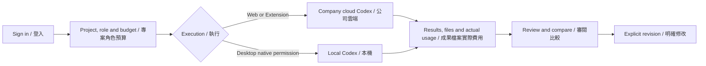

`GET .../workspace/versions` · `GET .../workspace/compare` · `GET .../workspace/editor` · `POST .../workspace/edit`

範圍：本輪相關旅程通過，原失敗保留。間歇公網連線超時、專業產出、外部接入及完整生產/兼容驗收仍開放。下方較早章節為歷史版本。

<!-- integrated-round-195 -->

## 195 · 0.5.2 · 后台与运行内核 / Backend and runtime

任务成果与受权预览、真实运行就绪、不可重写角色验收、Linux Office和私人附件协议。

[Round delivery / 本輪交付](https://github.com/copypasteltd/workmate/blob/docs/docs/quality/integrated-round-195/README.md) · [Download / 下載](https://agent.copypaste.hk/downloads)

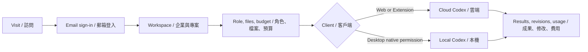

`GET .../tasks/:task/workspace` · `GET .../workspace/preview?asset_version_id=...` · `GET /v1/admin/operational-readiness` · `GET/POST /v1/admin/role-acceptance` · `POST /v1/admin/role-acceptance/revoke`. Schema163 is additive; owner migrations and non-root runtime remain separate.

<!-- usage-195 -->

本轮使用流程：

1. 管理员先在每个模型能力中保存其 API 地址、密钥、模型别名与费率，运行就绪视图只显示状态，不泄露配置值。
2. 客户附件通过原有分片接口完成并固定版本；会话交办同时验证私人归属、项目、版本与预算，消息/任务/预留款原子提交。
3. 任务工作区按当前授权返回成果、最多200个交付文件、预览入口及实际费用；原始下载与分页 Office 预览使用独立受权接口。
4. 角色人工验收保留任务、模板、技能和交付快照。schema163仅新增不可改写记录和受限统计，不清除旧账务或审计。

<!-- /usage-195 -->

本輪實際測試與旅程見報告；保留歷史失敗，不以代碼量替代全部專業/生產驗收。影片/語音/Google/Meta真實配置、至少12角色專業驗收及完整兼容/運營矩陣仍開放。測試郵箱及未簽名安裝按已確認範圍保留。

Selected regression and real journeys are in the report. Historical failures remain. Real video/audio/Google/Meta configuration, at least12 professional role evaluations and the full compatibility/operations matrix remain open. The requested test mailbox and unsigned manual installation remain.

<!-- product-downloads-193 -->

## 產品下載與安裝 · 193

[開啟產品下載頁](https://agent.copypaste.hk/downloads)。Desktop 0.7.4（Windows 安裝版/便攜版）、Chrome 擴展 0.5.4 ZIP 及檔案校驗清單均可免登入從本站直接下載。

用戶端安裝包由站點靜態分發，不暴露後台、API 金鑰或部署配置；登入後仍按原企業及專案權限使用公司 API。

目前 Windows 包未簽名；擴展為手動安裝，尚未上架 Chrome 線上應用程式商店；macOS/Linux 安裝包尚未提供。

[方案 / Implementation](https://github.com/copypasteltd/workmate/blob/docs/docs/development/193-product-downloads.md) · [驗證 / Verification](https://github.com/copypasteltd/workmate/blob/docs/docs/quality/193-product-downloads.md)


[實際手機下載頁 / Actual mobile download page](assets/screenshots/193-downloads-mobile-zh.png)


<!-- native-recheck-192 -->

## 再次复查与错误可见性 · 192

新增独立的 client_error_code 诊断投影，覆盖 Desktop 执行回执、任务详情/列表、后台执行列表及获准支援视图。严格限制错误码长度和空白，不返回原始报告正文；费用状态、预留与租户权限保持独立。

本轮常规回归：后端91、Web30、后台22、扩展89、桌面控制器74；Linux原生8项通过。普通浏览器直连三域名均200，Python脚本直连仍403；不能宣称全产品零错误。12已移出，视频/音频、Google/Meta、Linux Office及完整矩阵等未选范围保留。

[方案 / Implementation](https://github.com/copypasteltd/workmate/blob/docs/docs/development/192-native-error-observability.md) · [复查 / Recheck](https://github.com/copypasteltd/workmate/blob/docs/docs/quality/192-native-recheck.md)


<!-- selected-repairs-191 -->

## 指定问题修复与本机交付 · 191

Linux原生程序/浏览器执行器、schema162容量判定、原始本机错误回传、活跃推理续租和长SSE流性能修复已上线。 02/03/04/05/07取得本轮证据；12按用户要求移出，新的Windows包为未签名手动安装版本。原未知供应商费用和财务预留保留，不把执行容量释放等同结算。

最终Desktop使用安装包默认公司HTTPS地址，经原始CONNECT通道访问真实域名，TLS证书、请求、模型结果及账务未替换；浏览器PKCE同样使用正式HTTPS域名。本次真实闭环通过，但单次验收不等于长期公网稳定性保证，190的01继续保留。 本轮检查：后端40/40、模型网关24/24、Windows云端兼容38/38、Desktop控制器74/74、实际固定Codex断流1/1、Linux原生8/8；真实云任务HK$0.126067、最终Desktop任务HK$0.035144。上述范围独立记录，不称为全产品重新验收；公网及190的其他未选项目继续保留。以下为当前说明，旧版本记录保留作历史。

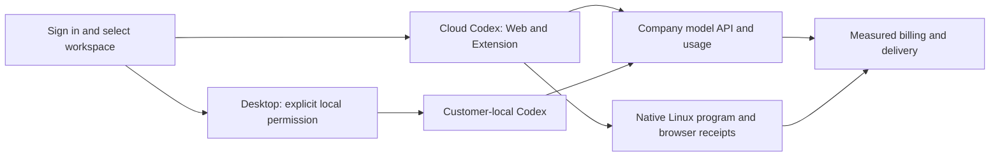

[方案 / Implementation](https://github.com/copypasteltd/workmate/blob/docs/docs/development/191-native-execution-and-capacity.md) · [证据 / Evidence](https://github.com/copypasteltd/workmate/blob/docs/docs/quality/191-selected-repairs.json) · [Desktop0.7.4手动下载 / Manual download](https://github.com/copypasteltd/workmate/releases/tag/desktop-v0.7.4)


Actual Web download recording excerpt; identity labels redacted. 这是Web实际录像节选，不代表其他端的新交互录像。


<!-- live-acceptance-189 -->

## 真实生图上线与本轮验收 · 189

`gpt-image-2` 已使用与文字模型相同的上游接口和密钥通过真实生成、编辑验证并发布。实际 Web 设计师任务已生成文件、下载核对散列并计入真实用量。修复1254平方PNG与请求1024不一致的适配，保留上游原始字节；同时移除生图工具对重复全局密钥的错误依赖，并阻止未恢复的生图失败被标成成功。

本仓库实现云端 Codex、逐模型接口解析、权限、文件存储与账务。数据库保持161；生图和编辑共享已发布图片版本。

后端完整运行1950项：1949通过、1失败；该浏览器超时问题随后14/14复验通过。Web28/28、后台20/20、Extension89/89、Desktop269/269及全部构建通过。图片适配48/48、逐模型图片／原图保存与测试发现36/36、真实本机协议下的生图失败／恢复2/2分别通过，不能相加当作新全量结果。

Desktop真实供应商任务、公网稳定性、视频／语音／Google与Meta授权、SMTP及Linux原生执行器仍有验收缺口。测试收件箱按要求保留；不宣称完整应用全部通过。[完整方案、使用逻辑、原始失败与回滚](https://github.com/copypasteltd/workmate/blob/docs/docs/development/189-real-image-and-acceptance.md)。

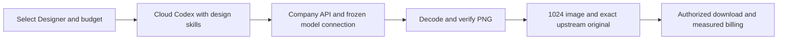


下方为实际 Web 下载流程录像节选；在其他端的README中引用也仅代表Web证据。


<!-- live-acceptance-188 -->

## 真实环境测试与上线 · 188

已部署真实文本服务：Web 与 Chrome 原生右侧 Side Panel 已完成“登录 → 上传获准文件 → 云端 Codex 分析 → 生成文件 → 下载 → 核对实际扣费”。后台完成真实用户／企业新建删除、批量状态管理、模型独立 API/Key 编辑删除、VIP 授予撤销及审计检查。操作与使用边界见[完整报告](https://github.com/copypasteltd/workmate/blob/docs/docs/development/188-live-acceptance.md)。

Desktop 使用本机固定版本 Codex，客户主动选择目录并确认完整本机权限。已修复 GPT 模型的原生 exec 格式兼容，真实本机命令／文件／企业工具桥接通过协议测试；最终真实模型 Desktop 复验受公网连接不稳阻塞，尚不能判定端到端通过。全量后端原始回归为 1,936 项：1,834 通过、101 失败、1 跳过；后续针对修复与现行策略的检查分别记录，不能据此宣称全部通过。

配置和使用：管理员在“模型能力”逐模型填写上游 URL、API Key、模型别名与费率，验证并发布可用版本；用户验证邮箱后选择真实企业与项目，再发起有预算的工作。当前仍使用受保护的测试收件箱。生图实际返回403，视频／语音及 Google／Meta 授权缺失；这些服务尚未取得真实验收。

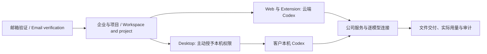


下图为真实 Web 已完成任务的只读浏览与滚动录像节选；不代表所有端均已完成真实模型验收。


<!-- admin-directory-lifecycle-184 -->

## 用户／企业新建、删除及批量管理 · 阶段184

用户管理与企业管理已增加新建、逐行永久删除、当页多选、批量状态变更及批量删除。提交绑定原因、明确目标、版本、五分钟预览及幂等键。最高管理员直接执行，其他角色按发布策略审批。新建用户登录时仍须验证邮箱；新建企业同时配置擁有人、账务账户及首个项目。

勾选需要处理的记录，选择动作，填写原因后预览并确认；删除须输入 DELETE 加准确数量并确认保留范围。任一记录变化或不符合条件时整批不执行。删除用户撤销登录并移除联系和显示资料，同时保留共用企业内容及账务／审计引用；删除企业立即停止新操作，后台永久清理进度在内容管理查看。接口上限100条，界面不会隐含选取其他页。

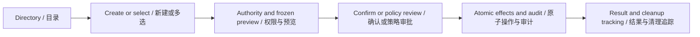

[完整使用方案、接口、权限、保留规则及部署说明](https://github.com/copypasteltd/workmate/blob/docs/docs/development/184-admin-directory-lifecycle.md)

13项相关原生检查和10项最终真实页面检查通过。两轮专用页面验证已创建并清理4个用户及4个企业，18项操作均保存对应直接执行审计；4项企业根清理已完成，实际异常数组为空，必要保留项有记录。服务器配置、模型 API/Key 和未知费用预留保持原样。

<!-- highest-admin-direct-182 -->

## 最高管理员直接执行 · 阶段182

有效的全局内置 super_admin 可直接执行管理变更；其他角色按业务策略审批，不能审批自己的受控申请。敏感操作继续核对 MFA、业务权限、范围、限额和原始证据，真实操作者、原因、命令摘要及结果与业务效果一并保存审计。

当前 gpt-6-luna 已通过真实后台直接发布：操作 `7d32d69d-5680-4199-bd04-1ebe2b1b4813`、审计 `7174`，未生成待审批申请。18项相关检查、6项真实页面检查通过。原模型配置、加密 Key、未知费用预留及旧违规记录保持原样。追加迁移160须搭配对应 API。

[设计、使用和逻辑图 / Design, usage and diagram](https://github.com/copypasteltd/workmate/blob/docs/docs/development/182-highest-admin-direct.md)


# Workmate · backend

<!-- model-tool-contract-181 -->
## Codex 完整模型验证修复 · 阶段181

当前保存的 **gpt-6-luna** 已在正式后台通过完整验证：固定 Codex、指定模型与推理强度、注册工具调用及结果返回、最终文字回复、用量记录均完成。保留每模型接口和 Key，兼容普通 function 与原生 code mode 工具格式，并继续执行原业务权限检查。

实际回执 `b8c8c28a-1df1-4ef7-af55-91d9d51b4bcc`；输入／输出 tokens 为 `20230/139`。旧待对账记录保留。未自定义发布的初始策略中，管理员／验证总名额由2调整为4，保留旧占位2个并恢复可用名额2个；费用上限及其他限制不变。原生工具上下文按完整请求字节预留输入额度，再按实际 tokens 结算；输入、输出或费用超额仍会拦截。

Run `npm run build`. Focused checks use `scripts/run-tests-owned.mjs` with the current181 test versions and `tests/internal-ai-gateway.test.ts`. Failed historical attempts remain available and excluded from current automatic selection.

[Implementation, workflow and evidence / 方案、逻辑图与回执](https://github.com/copypasteltd/workmate/blob/docs/docs/development/181-model-tool-contract.md)


Earlier records follow. 以下为历史记录。

---

<!-- model-http-180 -->
## 模型接口支持 HTTP 和 HTTPS · 阶段180

每模型 API 基础地址支持 **HTTP 和 HTTPS**；公网上游使用 HTTP 无须勾选内网选项。保存、连接测试、Codex 完整能力验证及推理使用同一传输规则。原模型地址及加密 Key 保留。

已在正式后台使用当前 gpt-6-luna 配置进行连接测试，接口及 Key 认证成功，返回列表包含该模型。这是实际连接结果，不代替 Codex 完整能力验证，也不自动发布模型。

Build: `npm run build`. The per-model normalizer and shared transport support both schemes. Private address access still uses its explicit setting; the Admin label reflects this meaning.

[Usage and implementation / 使用与开发](https://github.com/copypasteltd/workmate/blob/docs/docs/development/180-model-http.md)


Earlier records follow. 以下为历史记录。

---

<!-- model-management-179 -->
## 已有模型可直接编辑和删除 · 阶段179

打开 [模型能力](https://agent-dashboard.copypaste.hk/catalog?view=capabilities)，当前模型的列表和详情均有 **编辑模型**、**删除模型**。编辑表单预填模型、接口和费率，API Key 输入框可直接输入新 Key。同地址／网络范围可保留已保存 Key，更换范围则需填新 Key。

**保存更改**后，当前列表直接显示更新后的同一模型条目；完成验证、发布后供新工作使用。**删除模型 → 确认删除** 后移出可用目录，拦截新代理和新顶层任务选择，也不会回退到演示模型。旧任务、账务及加密连接保留；列表可切换当前模型、配置历史、已删除模型。

Migration158 adds stable `capability_model_entries` and immutable `capability_model_revisions`. `POST /v1/admin/capability-releases/:id/edits` requires `admin.catalog.draft`; `/:id/deletions` requires `admin.catalog.publish`. Both require expected document/management revisions, idempotency and audited reasons. Deletion takes the exclusive capability-head lock; new selection takes its shared counterpart. `current_internal_capabilities` filters deleted heads and Catalog removes their bootstrap fallback. Original published/task bindings remain usable. Build: `npm run build`.

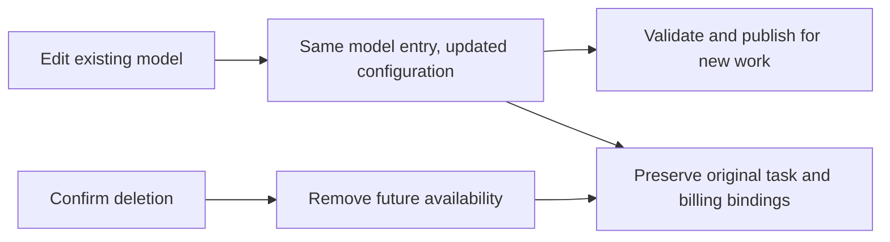

[Usage and implementation / 使用细则](https://github.com/copypasteltd/workmate/blob/docs/docs/development/179-model-management.md)


Earlier implementation and deployment records follow. 以下为原有版本记录。

---

<!-- per-model-connections-178 -->
## 每个模型独立配置上游 · 阶段178

进入 [Admin → 模型能力](https://agent-dashboard.copypaste.hk/catalog?view=capabilities) → **建立配置**，在同一表单填写 `gpt-6-luna`（或上游实际模型别名）、**API Base URL** 和 **API Key**。每个模型独立保存地址及密钥，文字模型须支持 OpenAI Responses API。

使用流程：保存草稿 → 测试连接 → 完整能力验证 → 独立审批发布 → 在角色／模板中绑定已发布能力。连接测试读取 `/models`，保存和测试不会自动发布。完整验证和真实使用会消耗实际上游额度，当前试用记账环境也一样。

密钥由服务器加密保存且不回显；新版本保留原任务冻结的连接。复制版本可明确保留原密钥，更换地址或网络范围必须重新填写。缺少明确连接时直接报错。本轮没有代填真实供应商密钥。

Storage: `capability_model_connections`, migration157, cp_control-only encrypted credentials. Draft: `POST /v1/admin/capability-releases/drafts` with `connection: {base_url, api_key, allow_private_network}`. Probe: `POST /v1/admin/capability-releases/:id/connection-test`. Both use existing `admin.catalog.publish` authorization. Task execution resolves credentials by the frozen capability version and verifies model/operation; clients cannot override that identity. Build: `npm run build`. Related native PostgreSQL checks: `../copypaste-delivery/scripts/test-model-connections-178-v4.mjs`.

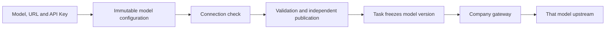

[使用细则 / Usage and operations](https://github.com/copypasteltd/workmate/blob/docs/docs/releases/model-connections-178.md) · [Source/runtime increment](https://agent.copypaste.hk/downloads/workmate-model-configuration-178.zip)


Earlier deployment/release records follow; their synthetic-service descriptions describe their original scope. 以下历史记录保留原部署范围。

---

<!-- public-domains-177 -->
## 正式域名试用部署 · 阶段177

[Web](https://agent.copypaste.hk) · [Admin](https://agent-dashboard.copypaste.hk) · [API readiness](https://ai-api.copypaste.hk/health/ready)

后端使用独立域名配置和 Secure Cookie；保留权限、CSRF、MFA、用量及审计。

Backend origins and Secure cookies are updated; scoped authorization, CSRF, MFA, usage and audits remain enforced.

[Current deployment, login and operations / 当前部署、登录与运维](https://github.com/copypasteltd/workmate/blob/docs/docs/releases/domains-177.md)

Credentials are unchanged: server `/root/cfg/workmate/credentials.txt`, root `0600`. Admin: `admin@workmate.local` + email OTP + TOTP. Test mailbox: [protected operator inbox](https://agent-dashboard.copypaste.hk/ops/mailbox/). AI/media/ads/payment remain synthetic; records/files persist. 凭据保留，测试收件箱使用独立操作口令，外部服务仍为假数据。

[Desktop 0.7.2 Setup](https://agent.copypaste.hk/downloads/CopyPaste-0.7.2-x64-Setup.exe) · [Portable](https://agent.copypaste.hk/downloads/CopyPaste-0.7.2-x64-Portable.exe) · [Extension 0.5.3 ZIP](https://agent.copypaste.hk/downloads/CopyPaste-Extension-0.5.3.zip) · [Source increment / 源码增量](https://agent.copypaste.hk/downloads/workmate-domains-177.zip)

Windows installers are unsigned. Extract the Extension ZIP and load it unpacked in Chrome developer mode; the extension ID stays `fffkcnmfdhahlnifgdilabheppkgnlok`. Desktop AI access uses company services; supplier keys are not embedded. Windows 未签名，扩展采用已解压加载，固定 ID 不变。

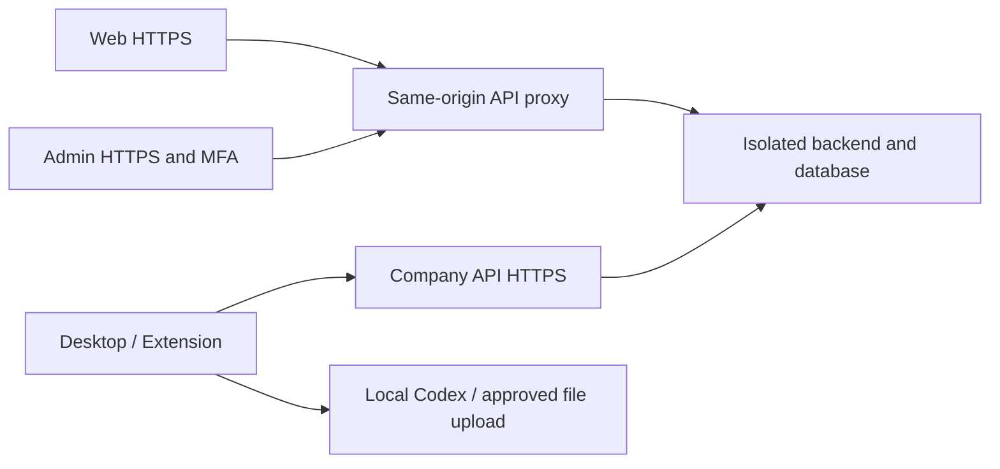

[Actual public Web task](https://github.com/copypasteltd/workmate/blob/web/assets/screenshots/177b-domain-task-result.png) · [Actual interaction GIF](https://github.com/copypasteltd/workmate/blob/web/assets/demos/177-public-domains.gif)

---

Earlier releases and deployment history / 以下为历史版本及部署记录。

<!-- lan-deployment-176 -->
## 内网 HTTP 部署 · 阶段176

Web: http://192.168.31.20:63070 · Admin: http://192.168.31.20:63071 · API: http://192.168.31.20:63072

原生 Linux Codex、独立 PostgreSQL 18 和 API/worker 已部署。

服务器明文凭据：`/root/cfg/workmate/credentials.txt`（root `0600`）。邮箱验证码通过受独立口令保护的测试收件箱读取；Admin 另需验证器 TOTP。外部服务继续使用已授权假数据。

[部署、登录与运维 / Deployment and login guide](https://github.com/copypasteltd/workmate/blob/docs/docs/releases/lan-176.md)

[实际 Web 交互 / Actual Web recording](https://github.com/copypasteltd/workmate/blob/web/assets/demos/176-lan-http.gif) · [后台截图 / Admin capture](https://github.com/copypasteltd/workmate/blob/admin/assets/screenshots/176e-lan-users.png)


## v0.1.3 · 当前完整交付 / Current complete delivery

[Release / 下载](https://github.com/copypasteltd/workmate/releases/tag/v0.1.3) · [中英使用手册 / Bilingual guide](https://github.com/copypasteltd/workmate/blob/v0.1.3/docs/releases/v0.1.3.md)

本轮完整包包含六仓源码和全部端，纳入团队/单次运行费用报表、原成员/协调员账目、交叉筛选和同快照CSV。当前源码与假数据冻结交付按使用者要求收口；服务器资料和正式服务接入后续提供。AI/媒体/广告/支付使用假数据，Windows未签名；完整专业/生产台账保持。

All six source trees/clients are delivered, including team/run financial reports, original member/coordinator entries, intersecting filters and matching snapshot CSV. This current source/synthetic frozen delivery closes as requested; server/live configuration follows later. External services are synthetic and Windows is unsigned. Full professional/production qualification remains tracked.


## 團隊費用 / Team consumption · stage174

團隊及執行ID交叉篩選，成員與協調員實際帳目只加總一次；固定快照明細／CSV保留原身份，舊來源不推斷。Team/run filters and groups sum original work entries once, with immutable detail/CSV and explicit unknown legacy attribution. 21 native report cases and seven current actual Admin journeys; original failed capture retained. Final freeze rebuilds Admin for current CSS.

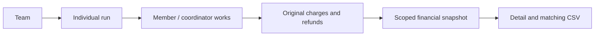


[MP4](assets/screenshots/workmate-admin-team-usage-174-03-team-consumption-workflow.mp4)


## 当前完整冻结交付 · v0.1.2

全部端、六仓源码与本次费用入账期间报表统一纳入完整下载包。Desktop在本机运行Codex且支持客户主动授予完整本机权限；Extension使用原生右侧Side Panel，获准读取/上传文件后由云端Codex执行。数据库156；外部AI/媒体/广告/支付采用已授权假数据，Windows未签名。

[完整下载 / Complete release](https://github.com/copypasteltd/workmate/releases/tag/v0.1.2) · [安装、登录和使用 / Setup and flows](https://github.com/copypasteltd/workmate/blob/v0.1.2/docs/releases/v0.1.2.md)

本轮重新构建Backend/Admin；其余运行产物及Windows分发核对后复用。继承源码一致的阶段172定向验证，阶段173不重跑功能测试。Backend/Admin rebuilt; unchanged runtimes/Windows distributions verified and reused. Exact-source stage172 focused checks inherited; no functional tests rerun at173. Older entries below retain their historical scope.


## 当前源码增量 · 阶段172

Admin新增工作建立／费用入账两种期间。旧任务本期扣费、跨期香港日期、区间外原扣费的退款及负净消耗可查询；分组、明细和CSV共用一份固定快照。预留额度与累积操作用量另行说明。当前源码需配套Backend/Admin，数据库仍为156。此增量不在已冻结v0.1.1 ZIP内；原包与标签保持。

本轮新增8项原生SQL/API＋1项精确投影检查；6项原报表检查在源码一致时继承其实际通过结果；7组实际Admin操作通过。首次历史测试资料缺少资金来源而被约束拒绝，已以新版本补齐来源与资金变动；失败原记录保留，未关闭保护。全部原完整验收范围继续跟踪。

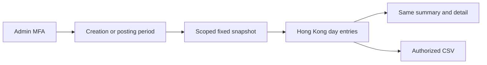


[MP4](assets/screenshots/workmate-admin-posting-period-172-01-posting-period-workflow.mp4) · [方案 / Behavior](https://github.com/copypasteltd/workmate/blob/docs/docs/development/172-admin-posting-period.md)

## 冻结交付 v0.1.1

完整包统一包含Windows Desktop（本机Codex、无边框）、Web、独立Admin、Chrome右侧Side Panel、Backend、六仓源码和固定runtime。假数据模式，Windows未签名；当前数据库156。

[完整发行包 / Complete release](https://github.com/copypasteltd/workmate/releases/tag/v0.1.1) · [安装及流程 / Setup and flows](https://github.com/copypasteltd/workmate/blob/v0.1.1/docs/releases/v0.1.1.md)

## 当前源码增量 · 阶段169

用户消耗报表支持付款方／项目／时间等筛选、八类分组、任务账务明细和同快照CSV。金额、预留、退款、待对账和未知内部成本分开；当前范围、MFA、导出权限逐次复查。当前库版本156。旧v0.1.0包未改；本增量纳入下一完整冻结包。

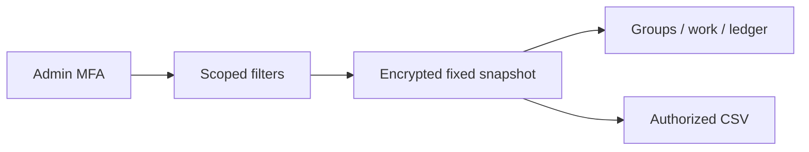


[MP4](assets/screenshots/workmate-admin-usage-report-169-02-consumption-report-workflow.mp4) · [方案 / Behavior](https://github.com/copypasteltd/workmate/blob/docs/docs/development/169-admin-usage-reports.md)


[English](README.en.md) · [完整Release](https://github.com/copypasteltd/workmate/releases/tag/v0.1.0) · [中英安装使用](https://github.com/copypasteltd/workmate/blob/v0.1.0/docs/releases/v0.1.0.md)

面向香港企业的 Codex Agent 平台，首批服务既有 marketing 团队，覆盖设计/媒体、广告与网站/SEO/GEO分析、重复流程和软件开发。本仓库为独立 **backend** 端，使用 **Fastify / PostgreSQL / cloud Codex**。视觉遵循 CopyPaste 的暖白底、深色文字、品牌色和编辑式排版。

## 当前源码增量 · 阶段168

用户列表可组合注册/最近账户访问、来源、VIP方案/状态/到期、确认扣费、角色建立/开始、待对账和独立账户额度条件。刷新、详情及返回保留URL条件。最近访问包含合法设备后台轮询，不等于真人在线；历史来源和访问保持未知。金额以精确微港币保存，只统计确认扣费；个人/企业资金不合并，未知或不一致账务不当作零。

当前增量需数据库001–156及匹配API/Worker：停止旧服务，备份后迁移，再启动新服务。默认目录DTO兼容；显式view=operations增加来源及访问字段。费用、VIP、账务各需独立当前范围权限及近期MFA，目录读取不写账。

此项是v0.1.0之后的源码更新，**不在原冻结ZIP内**。原发行标签及资产保持不变。当前Backend/Admin构建、8项原生SQL/API和6组实际Admin页面检查通过；保留测试数据与页面定位的原始失败尝试。业务仍使用已授权假数据，完整验收范围继续跟踪。

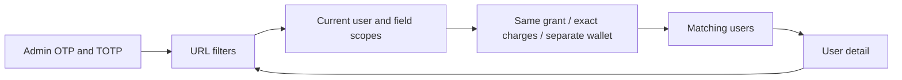


[MP4](assets/screenshots/workmate-admin-directory-filters-168-03-directory-filter-workflow.mp4) · [Logic / 逻辑](https://github.com/copypasteltd/workmate/blob/docs/docs/development/168-admin-directory-operational-filters.md) · [Evidence / 回执](https://github.com/copypasteltd/workmate/blob/docs/docs/quality/admin-directory-filters-168.json)

## 本版用户任务与内容 · 阶段166

用户详情直接进入该用户的任务与内容。搜索、分页和刷新保留目标，返回恢复原目录条件；换用户清空旧正文和操作。当前用户范围与资源范围同时鉴权，正文/下载保持独立权限与近期MFA。二十类内容按实际创建者归属，品牌保留首版作者；未知作者旧资料在全站目录查看。记录按资源类型计算，同名文件资产及目录项具有独立身份。

该功能已纳入v0.1.0源码与分发包；旧rc.5包和标签保持原样。本轮后端/Admin构建、八项原生SQL/API及八组实际页面检查通过，原始定位失败和录制均保留。外部服务仍用已授权假数据，原完整验收范围继续跟踪。

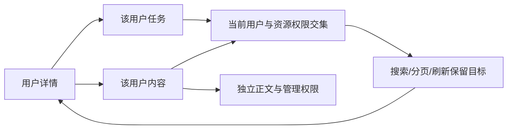


[MP4](assets/screenshots/workmate-admin-user-resources-166-02-user-task-content-scope.mp4) · [Logic / 逻辑](https://github.com/copypasteltd/workmate/blob/docs/docs/development/166-admin-user-resource-context.md) · [Evidence / 回执](https://github.com/copypasteltd/workmate/blob/docs/docs/quality/admin-user-resources-166.json)

## 当前冻结版 · v0.1.0

本版统一交付所有端、后端和六仓源码，包含最新用户任务/内容入口。六仓重新构建；当前Desktop输出与已验收Windows完整目录/Portable/Setup逐文件一致，核对后复用。近期阶段166八项SQL/API与八组实际页面检查保留其源码及原始证据；本轮不重跑全部历史用例。

分支`backend`，本版固定标签`v0.1.0-backend`。[完整源码与安装包](https://github.com/copypasteltd/workmate/releases/tag/v0.1.0) · [冻结记录](https://github.com/copypasteltd/workmate/blob/v0.1.0/docs/quality/release-freeze-checkpoint-167.json) · [待办](https://github.com/copypasteltd/workmate/blob/v0.1.0/docs/quality/remaining-work-stage167.md)。AI/媒体/广告/支付为已授权假数据；Windows未签名。截图/GIF/MP4保留其原实际采集范围，不宣称新增全端安装或专业质量验收。

## 方案与结构

主要入口：`src/server.ts, src/workspaces.ts, catalog/, skills/, migrations/`。Codex 是唯一 Agent 内核，全部模型请求经公司内部 OpenAI 兼容 API，供应商密钥仅留在后端。专业模板固定 Skill、工具和配置版本；设计师组合为 Codex＋设计 Skill＋公司 Image 2。

Web 访问云端 Agent。Extension 使用 Chrome MV3 原生右侧 Side Panel，提供对话/附件界面，只读取客户选择的文件并经同意上传，由云端执行。Desktop 无边框、无 Electron 默认菜单，在客户本机运行 Codex，客户可主动授予完整本机权限，支持停止/撤权及账户、目录隔离。

Admin 独立邮箱验证码＋TOTP，按权限管理用户/企业、消耗与费用、VIP、角色/Skill和内容。用户详情传递真实用户ID；费用账户按主体筛选，VIP锁定目标，换用户销毁旧弹窗及预览。港币金额按微单位保存；预算、余额、实收、赠额、授信和VIP分开记录。人工变更先预览、再确认，保留当前权限/MFA/策略/审批、幂等和审计。

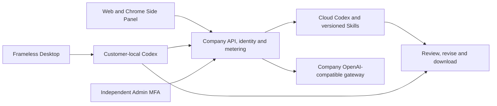

## 安装与运行

六个独立仓库并列置于 `dev/`：`copypaste-platform`、`copypaste-web`、`copypaste-admin`、`copypaste-desktop`、`copypaste-extension`、`copypaste-delivery`。使用 Windows x64、Node.js 22.14+、Git及原生PostgreSQL；媒体工作需FFmpeg/FFprobe，固定Codex随runtime分发。禁止Docker/WSL及虚拟化。

完整启动以Release指南为准。首次写配置前选空闲数据库端口，从Delivery依次运行 `demo:preflight` → `bootstrap:demo` → `demo:check` → `demo`。保留已有配置和数据；结束执行Delivery的 `npm run stop`。

本仓库单独开发，先准备对应依赖及配套后端：

```powershell
npm ci
npm run build
npm start
```

API为localhost4310，Web4317，Admin4318。开发验证码位于platform `.data/mailbox/`。管理员需在platform执行 `npm run admin:create -- admin@example.com super_admin` 并按一次性资料绑定TOTP。Desktop通过浏览器PKCE登录后选择本机目录和权限；Chrome使用“加载已解压的扩展程序”，点击图标打开侧栏。

## 使用逻辑

1. 邮箱登录，接受邀请或创建企业及首项目。创建结果未确认时保留原请求；断线/刷新后点“确认并继续”恢复原结果。失效/删除回执不会悄悄新建企业。
2. 选择项目和角色，填写brief、文件/品牌/账户、预算和授权。必要资料在原任务补齐；执行固定当时接受的配置与Skill版本。
3. 查看持久进度、审批、成果版本、费用和用量，审阅后下载原文件或继续修改。未知费用保持待核对，不按免费处理或盲目重跑。
4. Admin从用户详情开费用/VIP，核对主体和预览后按策略确认。目录筛选支持刷新/返回恢复。当前分支已接通按实际创建者筛选的任务和内容入口，返回保留原目录条件。

## 配置与权限

Web/Admin使用 `VITE_API_BASE` 或同源代理；原生端构建时固定允许来源及扩展ID，回环开发外使用HTTPS。当前SQL增量历史001–156（冻结v0.1.0为155），API/Worker检查版本及环境身份。源码不带密钥、`.env`、用户数据库、依赖或Git元数据。

会话失效清除旧工作台，迟到结果不能覆盖新登录。文件默认私有；请求、任务领取、工具和下载重新核验当前权限。历史回执不保留已撤销访问权。显式退出清除工作区创建草稿中的名称，仅保留原账户可核对的无正文请求标识。

## 角色预设与Skill

目录定义18个专业预设；数量不代表十二个角色已全部通过专业验收。

| ID | Role | Required Skill bindings |
| --- | --- | --- |
| R01 | 全栈开发工程师 | `fullstack-engineering@1.0.0`, `frontend-implementation@1.0.0`, `backend-api@1.0.0`, `qa-testing@1.0.0`, `delivery-core@1.0.0` |
| R02 | 前端开发工程师 | `frontend-implementation@1.0.0`, `ui-system@1.0.0`, `qa-testing@1.0.0`, `delivery-core@1.0.0` |
| R03 | 后端与 API 工程师 | `backend-api@1.0.0`, `qa-testing@1.0.0`, `delivery-core@1.0.0` |
| R04 | 软件测试工程师 | `qa-testing@1.0.0`, `frontend-implementation@1.0.0`, `delivery-core@1.0.0` |
| R05 | UI/UX 设计师 | `ux-research@1.0.0`, `ui-system@1.0.0`, `frontend-implementation@1.0.0`, `delivery-core@1.0.0` |
| R06 | 设计师 | `creative-direction@1.0.0`, `image-art-direction@1.0.0`, `image2-production@1.0.0`, `typography-layout@1.0.0`, `delivery-core@1.0.0` |
| R07 | 品牌视觉设计师 | `brand-system@1.1.0`, `image-art-direction@1.0.0`, `image2-production@1.0.0`, `typography-layout@1.0.0`, `delivery-core@1.0.0` |
| R08 | 广告创意设计师 | `ad-creative@1.0.0`, `image-art-direction@1.0.0`, `image2-production@1.0.0`, `typography-layout@1.0.0`, `delivery-core@1.0.0` |
| R09 | 电商商品设计师 | `ecommerce-visual@1.0.0`, `image-art-direction@1.0.0`, `image2-production@1.0.0`, `typography-layout@1.0.0`, `delivery-core@1.0.0` |
| R10 | 社媒内容设计师 | `social-content@1.0.0`, `image2-production@1.0.0`, `typography-layout@1.0.0`, `delivery-core@1.0.0` |
| R11 | 插画与 IP 设计师 | `illustration-ip@1.0.0`, `image-art-direction@1.0.0`, `image2-production@1.0.0`, `delivery-core@1.0.0` |
| R12 | 字体与版式设计师 | `typography-layout@1.0.0`, `image-art-direction@1.0.0`, `image2-production@1.0.0`, `delivery-core@1.0.0` |
| R13 | 演示文稿设计师 | `presentation-production@1.1.0`, `typography-layout@1.0.0`, `dataviz@1.1.0`, `delivery-core@1.0.0`, `deterministic-metrics@1.1.0` |
| R14 | 网页与落地页设计师 | `landing-page@1.0.0`, `ui-system@1.0.0`, `frontend-implementation@1.0.0`, `image2-production@1.0.0`, `delivery-core@1.0.0` |
| R15 | 信息图与数据可视化设计师 | `dataviz@1.1.0`, `deterministic-metrics@1.1.0`, `typography-layout@1.0.0`, `delivery-core@1.0.0` |
| R16 | 视频与动效设计师 | `video-storyboard@1.0.0`, `template-video-composition@1.0.0`, `video-generation@1.1.0`, `speech-production@1.2.0`, `delivery-core@1.0.0` |
| R17 | 营销数据分析师 | `ads-analysis@1.1.0`, `deterministic-metrics@1.1.0`, `dataviz@1.1.0`, `delivery-core@1.0.0` |
| R18 | 企业流程自动化顾问 | `workflow-design@1.1.0`, `workflow-execution@1.1.0`, `delivery-core@1.0.0` |


## 实际截图与交互

以下为本次真实Web/SQL恢复和Admin MFA/目标验证的共享媒体，使用合成客户与业务数据；不表示其他原生端重新完成安装验收。


[实际MP4](assets/screenshots/workmate-functional-closure-165-01-recover-original-workspace.mp4)

## rc.5 冻结基线的验证与发布

以下为历史rc.5记录：当时运行七项定向SQL、四项创建草稿检查和实际Web/Admin操作，重建六仓与Windows unpacked/Portable/Setup，核对ASAR和固定Codex。按要求跳过完整重复回归，实际结果以冻结检查点为准。

分支 `backend`，固定标签 `v0.1.0-rc.5-backend`。后续更新同步分支和更新说明，冻结包及标签保持。外部AI/媒体/广告/支付使用已授权假数据，Windows未签名。102个原编号及88项必选完整验收范围保留，88不是未实现模块数。真实服务、签名更新、多平台与完整专业验收继续跟踪。

[检查点](https://github.com/copypasteltd/workmate/blob/v0.1.0-rc.5/docs/quality/release-freeze-checkpoint-165.json) · [完整编号台账](https://github.com/copypasteltd/workmate/blob/v0.1.0-rc.5/docs/quality/remaining-work-stage165.md) · [旧README快照](https://github.com/copypasteltd/workmate/blob/v0.1.0-rc.5/docs/history/readme-before-rc5/platform-zh.md)
