# Workmate · CopyPaste Enterprise Agent · web

<!-- cloud-program-stage99 -->

云端 Codex 现可实际运行固定 Node 程序、内置测试及语法检查。检查回执绑定确切源码、保留失败、标记代码变更，并随匹配源码打包交付。Web 任务页展示通过、失败和过期检查，可展开输出并下载确切版本。

使用：批准具有工具授权的云端任务及预算，由 Codex 写入和检查源码，在「软件检查记录」查看结果、展开输出并下载执行文件或完整记录。当前为 Windows 原生执行边界，禁止网络和子进程；任意 npm 依赖及另外三个云端开发工具仍未开放。

验证：十个相关测试文件的 83 项检查及 4 项实际登录 Web 流程通过。模型响应和额度为假数据；Codex、原生执行和下载均真实。[Evidence / 证据](https://github.com/copypasteltd/workmate/blob/docs/docs/quality/cloud-program-checkpoint.json) · [Design and limits / 方案与边界](https://github.com/copypasteltd/workmate/blob/docs/docs/technical/99-cloud-program-execution.md).

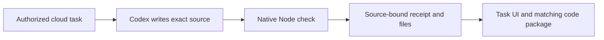


[Actual interaction MP4 / 实际交互录像](assets/screenshots/workmate-03-cloud-program.mp4)

<!-- preset-specialists-stage98 -->

Desktop 的「我的专家」现已直接启动本机 Codex。选择角色、长期工作要求和项目内固定品牌版本，免费预检保存后，选择本机目录、主动授权并确认每次预算。Web 与 Extension 保持云端执行。后续品牌发布或专家编辑不会悄悄替换既有本机会话的版本。

验证：212 项相关集成检查、51 项 Desktop 单元检查、2 项真实本机 Codex 协议检查及 7 项打包 Desktop / 登录 Web 流程检查通过。[Current evidence / 当前证据](https://github.com/copypasteltd/workmate/blob/docs/docs/quality/preset-specialists-checkpoint.json).

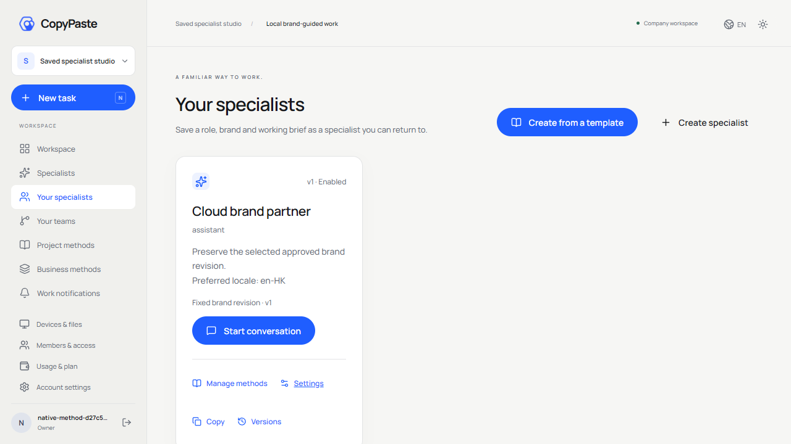

<!-- native-methods-stage97 -->

## Desktop 方案本机试运行

Desktop 可将整套固定方法准备为本机任务，再通过客户电脑上的 Codex 执行、停止、核对、验收和发布。为每位固定角色选取新的会话、实际目录与原生权限，免费预览获准资料，再明确确认本次私有简报和总预算。准备只进行一次整批预留；每项均由客户主动启动。服务端会拒绝 Desktop 改用云端方案试运行。

网络结果未知时，刷新界面或重新打开应用仍核对原加密日志中的正文及幂等键，已执行任务不能静默重跑。发布前须验收每项当前成功交付，并具备必需来源的实际读取事实。新项目安装仍仅复制方法引用；升级前原生会话保留原有公司工具版本。

隔离验收使用假模型、假账号及测试额度，实际运行本机 Codex、文件操作和公司用量结算；不据此声称真实付款、真人原生弹窗操作、线上模型质量、签名安装包或整个产品已验收。详见[执行、权限、恢复和数据约束](https://github.com/copypasteltd/workmate/blob/docs/docs/technical/97-native-method-trials.md).

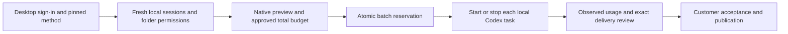


验证：124 项相关集成检查、49 项 Desktop 单元检查、2 项真实本机 Codex 协议检查及 6 项打包界面检查通过。以下旧阶段条目保留其当时的验证范围。[当前证据](https://github.com/copypasteltd/workmate/blob/docs/docs/quality/native-methods-checkpoint.json).

<!-- solution-packages-stage96 -->

## 可试运行和复制的业务方案

阶段 96 补齐业务方案的不可变版本、免费依赖预览、私有付费试运行、逐项验收、发布和跨项目安装重绑定。122 项相关集成检查、45 项 Desktop 单元检查、2 项真实本机 Codex 检查及 8 项实际浏览器检查通过。模型与账号数据按当前要求使用假数据；文件、进程、授权、费用和审计走实际流程。

1. 登录并选择项目，打开业务方案。创建可分享的方法说明，选择预设角色、资料标签和报表连接。保存会固定模板、角色、Codex profile 和 Skill 版本，新版本须重新试运行及验收。
2. 选择当前项目获准的固定文件和报表账号，免费预览资料缺口、快照、来源摘要与工作额度。明确确认本次私有简报和总预算后，整批建立各角色独立任务；并发额度不足会整批拒绝。
3. 检查每项实际交付再验收和发布。浏览文件或快照目录不能充当内容读取；必需版本及摘要须有独立的实际读取凭证。未完成任务、旧交付摘要、无关试运行或失效账号不能发布。结果未知时刷新并重试原提交，保留同一正文和幂等键。
4. 安装仅复制已发布方法参照；原客户文件、私人简报、结果、记忆、连接账号和密钥都不自动复制。为目标项目上传自己的资料并按修订保存绑定，再单独确认付费使用。
5. Admin 的元数据、正文读取和停用分别检查范围与权限；正文访问记审计，停用需要近期 MFA 及原因。停用方法、撤回原资料或撤销账号会阻断依赖内容。

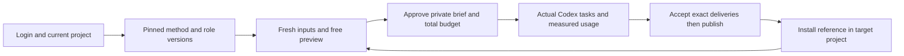

Desktop 保持本机 Codex，仍需客户确认本机目录、权限和预算；通用桥接拒绝创建云端方案试运行。已安装方法通过只读公司工具提供给相容的固定本机角色，默认云端助手不是本机角色。Extension 保持云端 Agent、获准附件上传与原生右侧栏。本次新截图来自实际 Web/Admin；尚未以安装包验收新的 Desktop 方案库视觉，旧 Desktop 截图保留历史范围。

[方案与使用 / Implementation](https://github.com/copypasteltd/workmate/blob/docs/docs/technical/96-versioned-business-solutions.md) · [Exact-source evidence](https://github.com/copypasteltd/workmate/blob/docs/docs/quality/solution-packages-checkpoint.json)


[375px](assets/screenshots/workmate-solution-packages-07-responsive-375.png) · [Published method](assets/screenshots/workmate-solution-packages-07-published-en.png) · [Fresh target requirements](assets/screenshots/workmate-solution-packages-07-installed-missing.png) · [Audited body read](assets/screenshots/workmate-solution-packages-07-admin-body-audited.png) · [Review MP4](assets/screenshots/workmate-solution-packages-07-method-review-and-publish.mp4) · [Copy & rebind GIF](assets/screenshots/workmate-solution-packages-07-copy-rebind-and-trial.gif) · [Copy & rebind MP4](assets/screenshots/workmate-solution-packages-07-copy-rebind-and-trial.mp4)

<!-- media-effects-stage95 -->

## 历史实现：原生媒体特效（阶段 95）

阶段 95 接通十种版本化媒体特效：转场、中文动效字、抠像与画面清理。客户审阅固定素材版本、参数和费用上限后，Codex 调用原生 FFmpeg，交付真实无声 MP4、PNG、源 JSON 和 ZIP。106 项相关回归与 8 项实际浏览器检查通过；两次原生 Codex、八个私有文件及真实结算完成。模型和账户容量按要求为假数据。

1. 登录并选择项目，进入 Motion studio；浏览十种实际示例，在文件中心上传获准的 PNG/H.264 MP4，选择固定素材版本及摘要。
2. 审阅尺寸、时长、文字或滤镜参数与预算后主动确认。免费预检查会在预留费用前核验实际媒体、授权字体排版和编码器。网络回执未知时，刷新后按原请求与幂等键重放。
3. 预览并下载真实无声 MP4、PNG、不可变源 JSON 和 ZIP。修改需要重新审阅，已完成的重复调用复用原文件；撤回素材或隔离输出会阻断访问和自动重新生成。Codex 按实际记录用量收费，原生特效没有额外 AI 调用和费用。
4. video-motion@1.5.0 加载 media-effects@1.0.0，正式审批仅开放目录和渲染工具。SQL110 固定输入与来源，SQL111 扩展回执；旧迁移、契约和 Skill 保留原字节。Admin 可发布特效菜单；角色或 Skill 停用会在素材探测和费用预留前拒绝新任务，既有资产权限适用。

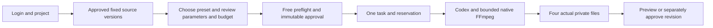

Desktop 保持本机 Codex 及客户主动权限，Extension 保持云端 Agent 与原生右侧栏。此处素材展示 Web 特效；原生 Desktop 禁用这张云端专用审批表，版本化公司特效工具仍可使用。旧阶段的整套源码核查保留历史范围，本次专项回归不代表完整产品或真实专业质量验收。

[具体方案与使用](https://github.com/copypasteltd/workmate/blob/docs/docs/technical/95-reviewed-media-effects.md) · [精确源码证据](https://github.com/copypasteltd/workmate/blob/docs/docs/quality/media-effects-checkpoint.json)


[375px](assets/screenshots/workmate-media-effects-05-responsive-375.png) · [Reviewed input](assets/screenshots/workmate-media-effects-05-reviewed-en.png) · [Review MP4](assets/screenshots/workmate-media-effects-05-effect-review-retry.mp4) · [Actual revision GIF](assets/screenshots/workmate-media-effects-05-effect-delivery-revision.gif) · [Revision MP4](assets/screenshots/workmate-media-effects-05-effect-delivery-revision.mp4)

<!-- team-history-stage94 -->

## 历史实现：团队历史与翻页（阶段 94）

阶段 94 补齐团队、版本与本人运行的独立翻页，并修正随机 UUID 导致的“最近运行”顺序。浏览历史保留工作草稿，从旧页批准后回到最新运行，页外保存的团队保持选中；撤回游标和切换项目会阻断旧正文。18 项团队回归及 11 项实际浏览器检查通过。三次原生 Codex、三个私有文件和费用结算实际运行；模型和账户容量按要求为明确假数据。

1. 登录并选择项目与团队，通过前后按钮访问完整目录；保存及刷新会保留当前团队，即使其不在当前目录页。
2. 分别翻阅固定版本和本人私有运行。每页最多 20 个版本或 8 次运行，运行按实际创建时间及数据库精确边界排序；草稿不受历史翻页或轮询影响。
3. 审阅并主动批准新工作。从旧页开始会回到最新运行；明确停止会释放已知未用费用。浏览历史不会创建任务、重试或收费。
4. 撤回、过期或不属于本人的游标返回 404 并清空旧运行正文；切换用户、企业、项目会丢弃迟到响应。SQL109 仅增加历史索引，已发布迁移、契约和 Skill 保持原字节。


Desktop 保持本机 Codex 及客户主动权限，Extension 保持云端 Agent 与原生右侧栏。此处素材展示 Web 云端团队。旧阶段的整套源码核查保留历史范围，本次专项回归不代表完整产品或真实专业质量验收。

[具体方案与使用](https://github.com/copypasteltd/workmate/blob/docs/docs/technical/94-agent-group-history.md) · [精确源码证据](https://github.com/copypasteltd/workmate/blob/docs/docs/quality/agent-group-history-checkpoint.json)


[375px](assets/screenshots/workmate-agent-group-history-02-history-responsive-375.png) · [Newest run](assets/screenshots/workmate-agent-group-history-02-history-newest.png) · [History MP4](assets/screenshots/workmate-agent-group-history-02-team-history.mp4) · [Actual Codex delivery GIF](assets/screenshots/workmate-agent-group-history-02-team-delivery.gif) · [Delivery MP4](assets/screenshots/workmate-agent-group-history-02-team-delivery.mp4)

<!-- agent-groups-stage93 -->

## 历史实现：持久专业团队（阶段 93）

阶段 93 已实现 Web 持久专业团队：保存协调员及不同专业成员，固定版本，审阅完整 Brief、依赖与预算后由客户批准，真实 Codex 按受控并行执行，最后统一交付。115 项相关后端回归与 7 项实际浏览器检查通过。模型及账户容量为明确假数据；登录、原生 Codex 进程、公司工具、私有文件、预算和账本实际运行。

1. 登录并选择项目，在「我的专家」建立实际助手，再在「我的团队」保存协调员和不同成员。设置在项目内共享，运行及文件对发起客户私有。
2. 填写 Brief、各步要求、依赖、独立预算及并行上限；先免费核对完整计划与固定成员版本，再由当前客户主动批准预算并开始。
3. 通过原任务链接查看成员状态、批准上限、当前预留和实际消耗。协调员等待全部成员真实成功后读取获准成果。停止阻断后续派发，未知费用继续对账。
4. 编辑建立不可变新版本，相同请求复用原运行，新执行需要重新审阅。来源撤回阻断私有衍生文件；后台正文、隔离、恢复和删除保留独立范围权限与审计。


在 SQL001–107 后应用 **SQL108**。一个团队含一名协调员及最多七个不同成员，每次 1–16 个无环步骤、1–3 个受套餐实际容量限制的并行成员。至少需要两个活跃任务槽。审阅 15 分钟有效，运行最多两小时。仅预留实际任务自己的额度，显示的总上限不是额外收费；普通对话仍限制单一活跃任务。

Desktop 保持客户本机 Codex、客户主动授予的全权限、无边框和无 Electron 自带菜单。本次团队界面属于云端 Web，原生 Desktop 隐藏该入口。Extension 保持 ChatGPT 式原生右侧栏，负责获准文件上传与云端对话。下方录制不证明新增原生团队界面、角色专业质量、真实外部平台或完整产品验收。

[方案与 API](https://github.com/copypasteltd/workmate/blob/docs/docs/technical/93-persistent-agent-groups.md) · [源码绑定证据](https://github.com/copypasteltd/workmate/blob/docs/docs/quality/agent-groups-checkpoint.json)


[375px](assets/screenshots/workmate-agent-groups-04-responsive-375.png) · [Delivery GIF](assets/screenshots/workmate-agent-groups-04-team-delivery.gif) · [Authoring MP4](assets/screenshots/workmate-agent-groups-04-team-authoring.mp4) · [Delivery MP4](assets/screenshots/workmate-agent-groups-04-team-delivery.mp4)

<!-- editable-design-stage92 -->

## 历史验证：可编辑设计交付（阶段 92）

阶段 92 已接通品牌视觉与演示文稿的真实交付工具。品牌稿提供可编辑及转曲 SVG；演示文稿提供原生可编辑文字、形状、路径及图表条形的 PPTX，并提供逐页 SVG/PNG、PDF/HTML 核对、证据 CSV、固定源稿、清单和含授权字体的 ZIP。93 项相关后端测试与 8 项真实浏览器检查通过；Codex 进程、权限、实际文件和账本均真实运行，模型及示例内容为明确假数据。

1. 在角色目录建立品牌或演示文稿专业助手，明确受众、原文、素材和品牌，主动选择 Execute 并确认预算。Ask/Plan 不生成文件。
2. 从 Assets & deliverables 下载实际可编辑文件和 ZIP。演示文稿必须先 slides_build，再以返回的实际源版本和散列 slides_render；保存源稿不等于完成交付。
3. 在实际离线 HTML 或 PDF 逐页核对，针对原源稿请求修改。新版本保留旧文件，重复工具请求复用回执，原生渲染不额外调用 AI 或收取 AI 费用。
4. 图表只能选择确定性分析的真实证据 ID，币种、账户、指标、归因和日期分别保留；已绑定品牌的角色必须使用固定版本及获准渠道和语言，遗漏或替换会被拒绝。私有权限与来源隔离约束所有衍生文件。

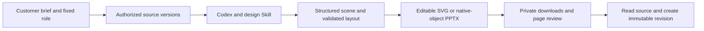

Desktop 的 Codex 继续在客户本机运行。1.1.0 专员通过真实原生登录桥接使用这些公司文件工具；读取旧稿还要求同一设备、原生登录授权、会话及工作目录，其他本机会话不能读取该私有源稿。后台核查执行真实原生授权、协议准入、工具交付和源稿修改；下方新增录制展示 Web 流程及下载后的源稿核对，不作为新的 Desktop 界面录制。

SQL001–105 后依次应用 **SQL106**、**SQL107** 并安装固定依赖。后者将私有设计稿绑定至精确来源，保留明确发布操作的原有权限。两类角色及各自制作 Skill 为 1.1.0，保留原有 37 个 Skill 包字节。ZIP 附由 Noto Sans TC 固定来源派生的 CopyPaste Sans TC 常规/粗体静态字体及 OFL 许可，并保留原可变字体字节作为来源，PPTX 不嵌入字体。**PDF/PNG/HTML 是固定源稿核对，不是 PowerPoint 渲染**；发布前在目标编辑器核对实际字体排版。图表是可编辑原生条形和标签，附精确 CSV，不是内嵌 Excel 图表。当前品牌绑定的可编辑导出使用 Noto Sans TC；其他授权自定义字体使用既有品牌排版渲染器。角色专业质量及客户验收仍未证明完成。

[方案与使用逻辑](https://github.com/copypasteltd/workmate/blob/docs/docs/technical/92-editable-brand-and-presentation.md) · [源码绑定检查](https://github.com/copypasteltd/workmate/blob/docs/docs/quality/editable-design-checkpoint.json)

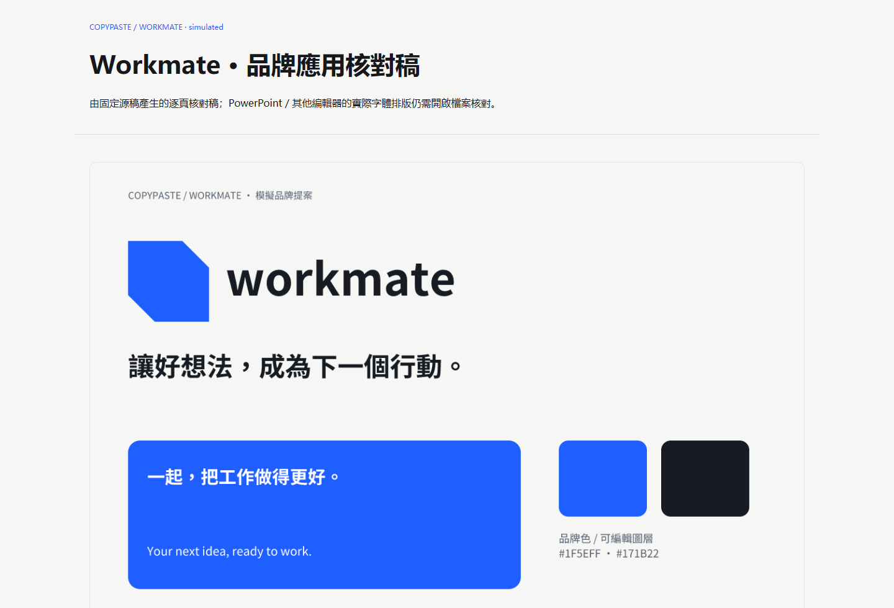

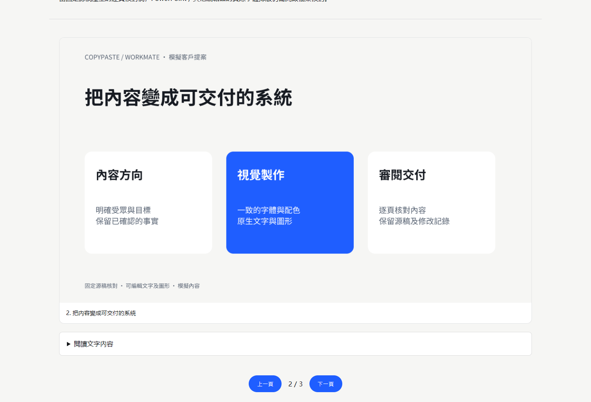

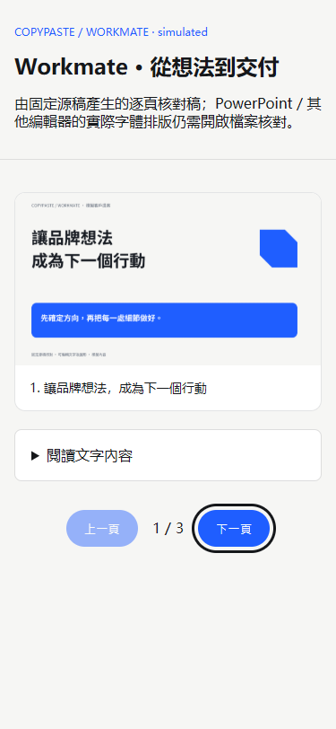

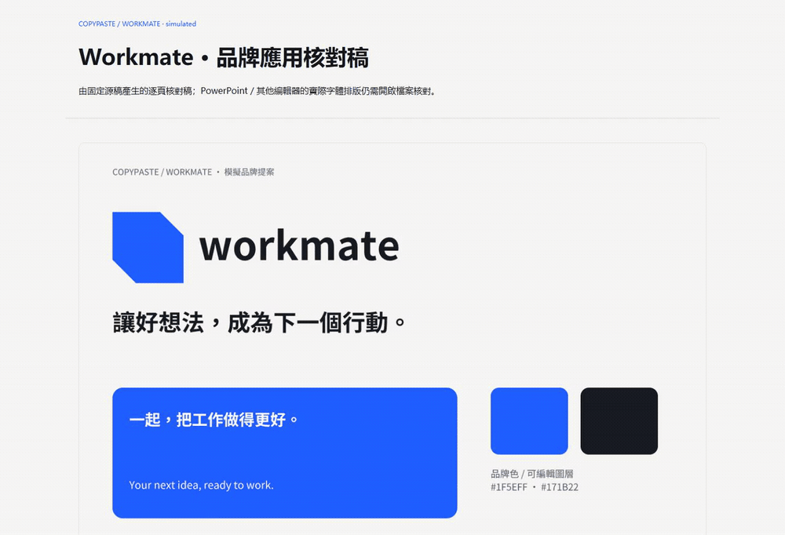

[Work GIF](assets/screenshots/workmate-editable-design-06-editable-design-work.gif) · [Work MP4](assets/screenshots/workmate-editable-design-06-editable-design-work.mp4) · [Review MP4](assets/screenshots/workmate-editable-design-06-editable-design-review.mp4)

<!-- cloud-workflows-stage91 -->

## 历史验证：私有云端流程（阶段 91）

阶段 91 已接通流程顾问的私有云端执行：真实固定版 Codex 准备不可变流程，客户核对步骤、预算并主动确认后执行，遇人工审批再次暂停。55 项相关后端回归与 8 项真实浏览器检查通过，包含私有文件下载、子任务单次预留/结算、修改版本、取消、来源隔离和重复请求。模型回复与账户数据按要求使用假数据；工具、数据库、原生 Codex、文件及页面交互实际运行。

1. 选用流程顾问，以 Execute 准备获准的私有流程；准备任务按其自身实际用量计费。
2. 在 Workflows 核对固定版本、全部步骤及独立的子任务总预算，勾选同意并确认；此前不创建子任务或子任务预留。
3. 下载实际私有数据摘要，明确批准下一人工审批点，跟踪子任务、交付文件和实际费用。未知费用会阻断替代执行。
4. 向同一顾问提出修改，创建新版本和请求；旧版本及执行保留。取消仅影响该流程，来源撤权会阻断历史与下载。


SQL001–104 后应用 **SQL105**。顾问及两个流程 Skill 固定为 1.1.0；支持最多八个顺序的获准云端角色、数据摘要或人工审批步骤。这条链路尚未开放嵌套流程、任意云端 shell、外部账号写入及视频子任务。Desktop 继续使用独立的本机 Codex。

[方案与使用逻辑](https://github.com/copypasteltd/workmate/blob/docs/docs/technical/91-private-cloud-workflows.md) · [源码绑定检查](https://github.com/copypasteltd/workmate/blob/docs/docs/quality/cloud-workflows-checkpoint.json)

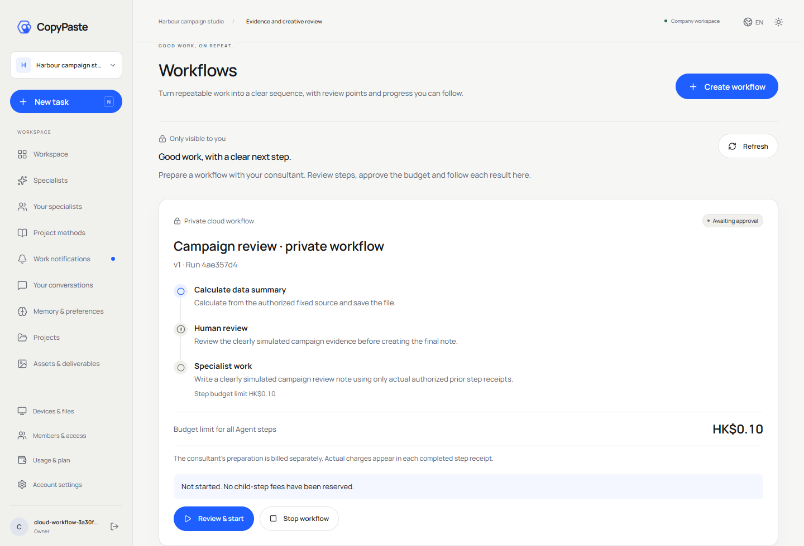

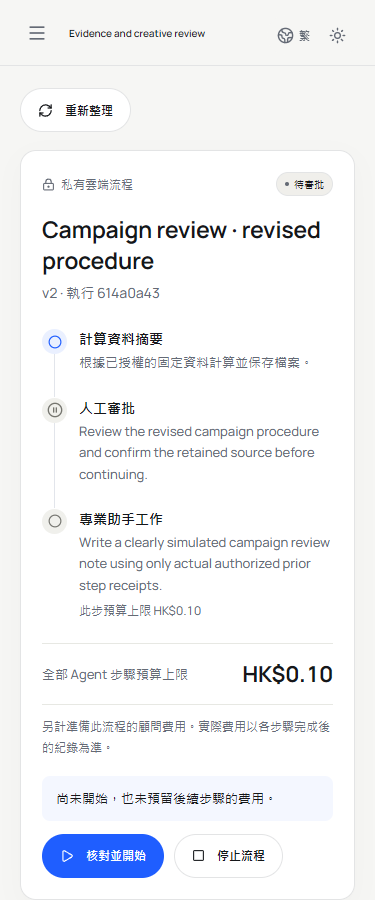

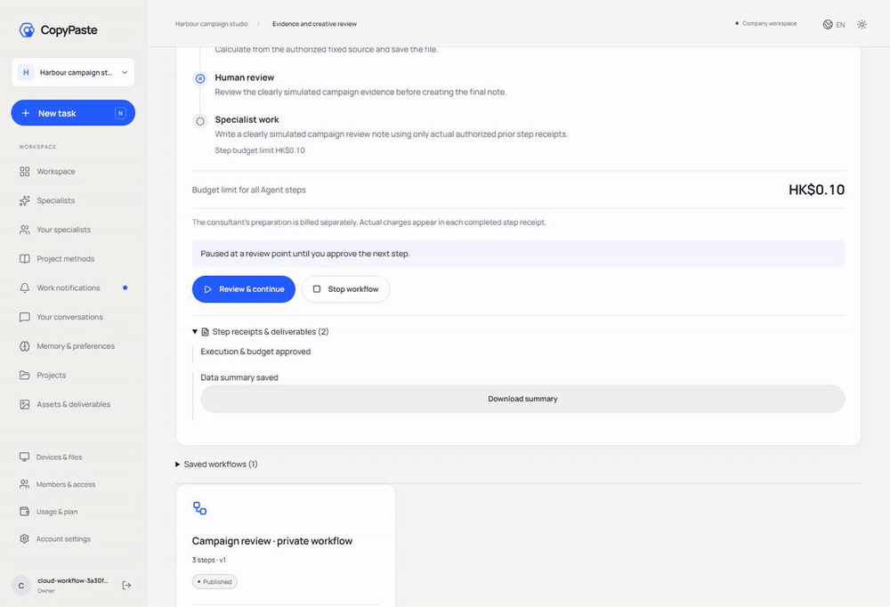

[Preparation GIF](assets/screenshots/workmate-cloud-workflow-04-cloud-workflow-prepare.gif) · [Preparation MP4](assets/screenshots/workmate-cloud-workflow-04-cloud-workflow-prepare.mp4) · [Review MP4](assets/screenshots/workmate-cloud-workflow-04-cloud-workflow-review.mp4)

<!-- analysis-roles-stage90 -->

## 历史验证：分析与信息图交付（阶段 90）

阶段 90 已接通营销分析师与信息图设计师的确定性计算和九种实际交付文件，角色及相关 Skill 使用 1.1.0 固定版本。68 项相关后端回归、11 项真实浏览器检查通过；两个角色均通过真实固定版 Codex 进程调用获准工具。模型回复与账号数据为已授权假数据，程序、数据库、PNG/ZIP、下载、私有隔离、来源阻断及账本流程实际运行。这不替代至少十二个专业角色及全产品的完整验收。

1. 从专业角色目录建立营销分析师或信息图设计师。既有专员保留原角色及 Skill 版本。
2. 明确日期、币种、账号、归因及转化定义，选择实际导入的数据，或在当前私有会话上传 CSV/XLSX 并核对真实工作表与表头。
3. 选择 **执行（Execute）**、确认预算并交付工作；Ask/Plan 不写文件。下载 SVG、PNG、交互 HTML、指标及源事实 CSV、创意简报、源 JSON、清单和 ZIP。
4. 修改时读取原源文件，再计算并生成新版本；来源仍获准时旧文件可继续下载。相同绘图请求重试复用原文件。绘图不额外调用 AI，文本推理消耗按原任务账本记录。

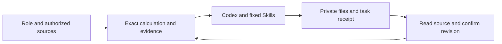

升级后端前应用 **SQL104**；SQL001–103 和原 Skill 字节保持不变。

[方案与实现](https://github.com/copypasteltd/workmate/blob/docs/docs/technical/90-analysis-role-delivery.md) · [精确检查记录](https://github.com/copypasteltd/workmate/blob/docs/docs/quality/analysis-roles-checkpoint.json)

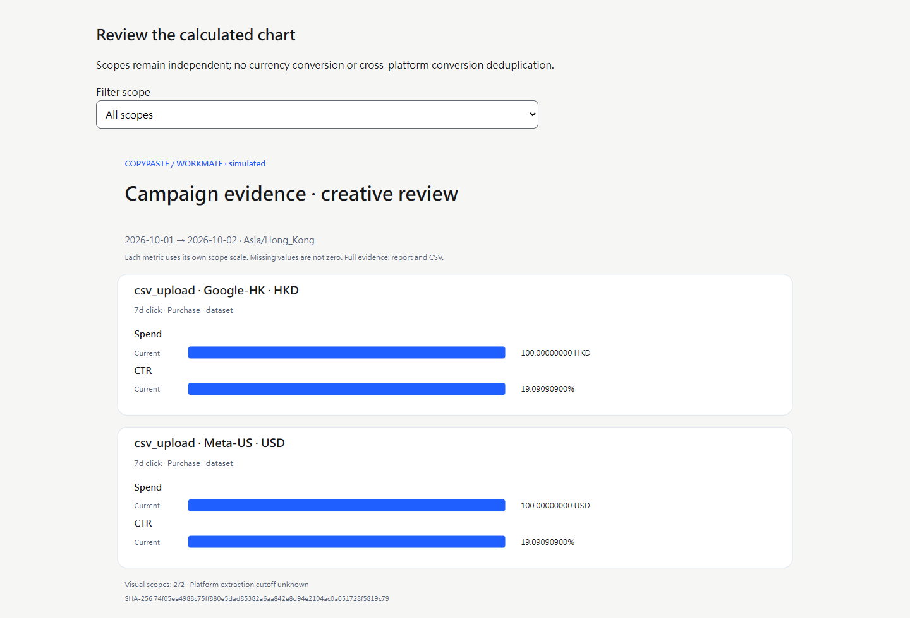

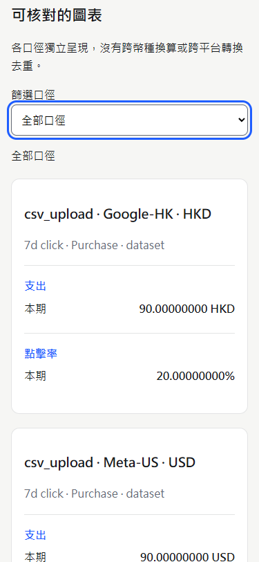

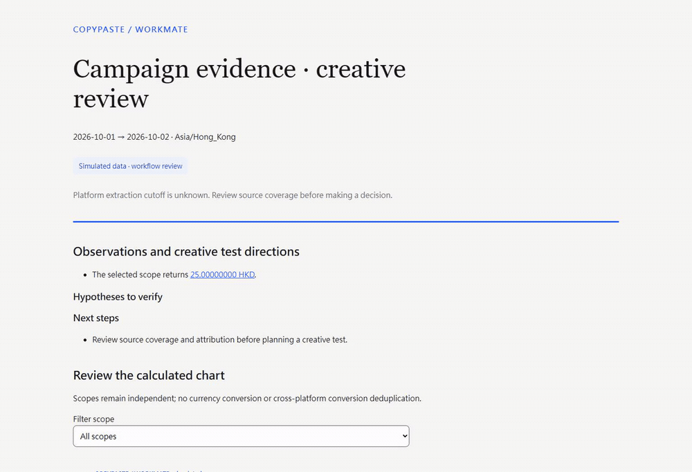

[建立与下载 GIF](assets/screenshots/workmate-analysis-04-analysis-role-work.gif) · [MP4](assets/screenshots/workmate-analysis-04-analysis-role-work.mp4) · [报告 MP4](assets/screenshots/workmate-analysis-04-analysis-report-review.mp4)

<!-- work-intake-stage89 -->

在浏览器内选择专业角色，使用云端 Codex，管理项目、资料、工作及交付。

## 历史验证：首次工作（阶段 89）

阶段 89：Web 首次建项目、设计/分析/开发角色入口及按账户/企业/项目隔离的草稿；离线、过期重登、已提交后回包丢失、精确重试、原工作回执、晚到响应与记录移除均有实际浏览器检查。14 项浏览器检查和 195 项客户端单元通过；实际 Worker 交付与下载文件字节一致，同一请求只有一项任务、一份预留，结算 30 港币微额。回复内容为明确假数据，本 UI 测试未启动原生 Codex。完整登录/跨端矩阵、至少十二个合格角色、全部 102 项条件和 G01–G10 继续开放。

选择角色→填写目标和预算→明确提交→审阅及下载成果。当前分页中的草稿可在关闭表单、刷新和同账户重新验证后恢复；明确登出清除正文。未知提交只能重试原请求；确认后可查看原工作，明确“开始另一项工作”才创建新的任务。项目权限加载期间不能派发。关闭分页后的恢复及持续会话的完整恢复仍待验收。

## 产品与边界

首批面向现有客户的 marketing 团队，完整范围包含生图、设计/字体、视频/特效、广告和网站分析、SEO/GEO、企业重复流程及软件开发。目录已有 18 个精确 Skill 绑定的候选角色；至少十二个逐一完成专业任务、修改及异常处理的角色仍是验收要求。设计师由 Codex、设计 Skill 与公司 Image 2 组合。Agent 内核唯一使用 Codex；全部 AI 请求走公司 OpenAI 兼容后端。当前开发使用已授权假数据，不代表真实模型专业质量已经验收。

React、TypeScript、Vite 和 React Router 提供云端工作台。新用户创建企业或接受邀请，再选择项目、可用角色和明确输入；缺少必要资料时提示补齐，同号工作继续。项目管理页可保存/预览/发布共享指引、固定品牌和资料版本。工作历史保留版本、来源与费用，继续修改不静默换用后来的配置。

## 启动与使用

### 本地启动

以下命令在已检出的对应仓库内执行。完整工作区将六个独立仓库并列放在 `dev/`，见[分支与检出布局](https://github.com/copypasteltd/workmate/blob/docs/docs/governance/04-git-branches-and-publication.md)。使用 Windows x64、Node.js >=22.14、npm/Git，以及文档约束的原生 PostgreSQL、FFmpeg/FFprobe 与固定 Codex 资源；保留已有本地配置和数据，不使用 Docker/WSL/虚拟机。

```powershell
Set-Location 'D:/dev/copypasted/自有agent/dev/copypaste-web'
npm ci
npm run dev
```

先启动后端，再打开 `http://localhost:4317`；静态构建使用 `npm run build`。通过邮箱/验证码登录并选择企业/项目。

### 当前使用流程

1. 完成登录、企业成员/邀请和项目选择。原生端通过浏览器 PKCE 登录；Admin 使用独立 MFA 身份。过期、撤销、换企业不应静默切换身份和资料范围。
2. 选择专业角色，提供工作说明及明确获准的资料/账号。缺少必要输入时请求客户补齐。项目负责人可以保存草稿、核对依赖、预览并明确发布不可变共享指引；发布不启动 AI、不增加权限。
3. 新任务固定当时接受的角色、Skill、品牌、资料和指引版本。既有工作保留原版，包括原先没有共享配置的状态。来源被隔离、删除或撤权后隐藏失效正文并阻断后续使用；历史内容不是越权入口。
4. 确认预算和必要的操作/媒体授权，查看真实状态、进度、文件与原费用回执。修改沿原工作谱系继续。未知用量保持原预留供对账，不能当作免费或盲目重新执行。
5. Admin 可按独立权限管理用户/企业状态、查看获准消耗，预览并确认人工费用/赠额和 VIP 权益/到期。余额、实收记录、授信、预算和 VIP 分别保存；同一确认幂等，操作保留审计，不能因重放重复赠额。

## Desktop 本机程序与浏览器

登录并选择企业/项目→建立本机会话→主动授予完整本机权限→打开「本机程式」→选择实际程序并在默认取消的原生窗口确认→返回对话提出工作→查看参数、真实输出、PID/退出码和原任务费用。取消选择或拒绝确认不会批准程序。程序清单固定文件身份和 SHA-256；Agent 只传程序 ID 与参数数组，不临时指定 shell 或环境变量。

停止原任务或撤销程序会结束该任务拥有的原生进程树；撤销某个程序不撤销客户另行授予的完整本机权限。成功、失败、停止及未知结果分别保留，原调用 ID 不重跑。重启后未确认结果保持未知，客户核对后只能允许后续新调用，不能把旧记录改为成功。完整 OS 权限允许客户程序以本机用户权限操作，不宣称额外受目录 OS 沙箱保护；Admin/云端不能代客户批准。

当前 Windows x64 原生 Job Object 监督程序不继承公司推理凭据。每执行器最多两个活动程序，保留最多 100 个批准记录/200 个运行记录，每次至多 64 个参数、120 秒，stdout/stderr 各保留最多 32 KiB 并标记截断。新会话固定程序工具版本，旧会话工具集合保持原样。浏览器普通页面与弹窗共同计入每任务三页、每执行器两个活动上下文；第三个上下文拒绝，不挤掉他人任务，复用前清除 cookie/localStorage。

## Desktop 本机目录工作

选择具备读写授权的本机会话，打开「目录工作」，选择工作目录内真实输入目录，配置扩展名、处理说明、稳定等待时间、每档/总授权上限和最多次数。已有文件默认不处理；客户明确勾选后才纳入。保存只建立**暂停**规则；「确认并启用」另行打开默认取消的原生自动收费确认。

本机文件事件与有界核对发现稳定输入，按持久队列逐档处理。每档保存精确快照、独立输出目录、原任务编号和公司费用回执。专家需要客户回答时，目录页显示待答入口；「回答问题」返回对话，客户明确选择后继续原任务/线程/轮次。同一规则中已处理的相同路径/内容不会再次收费，产品输出不成为输入；尚未开始的旧内容合并为最新稳定版本。

暂停停止新派发，已开始的一档可以完成；撤销只停止该规则拥有的工作，保留交付和费用。应用关闭后停止监听，真实重开保留加密账本及已分配上限，但必须再次确认。丢失回包复用原派发/创建/开始/结算键；未知本机动作阻断供核对。完整 OS 权限仍是客户主动授予的本机权限，目录规则没有额外创造一个 OS 沙箱。Web/Extension 保持云端执行，本机目录工作是 Desktop 能力。

明确上限：20 条规则；每规则 1,000 项历史/200 项排队，每会话 1,000 项派发回执；每次扫描 2,000 个匹配文件/10,000 项条目/12 层深度；每档 20 MiB、单次新读取 64 MiB；最多授权 100 次，目录调度同一时间执行一档。暂停或重启不重置上限。输出位于 `.copypaste-local-jobs/<rule>/<job>/output/`。越界、路径遍历、symlink/junction、源文件替换和冲突阻断自动执行。本机程序见上节；完整应用操作及崩溃/休眠/离线矩阵仍待补齐。

## 配置、界面和验证

升级后端前应用 SQL105；新增私有流程读取和客户确认路由。SQL001–104 与 532 个已记录历史契约保持原字节。公司网关、精确模型别名、已核验媒体能力和费率只配置在后端，详见后端 `.env.example` 和部署说明；不向渲染器/扩展写入公司供应商密钥。未配置的能力保持不可用，不静默改走其他提供方。普通示范不会自动启用全部专项媒体夹具。

保持 CopyPaste 蓝/奶白、Manrope/Fraunces、中英双语和浅深主题。Desktop 无 Electron 自带边框/菜单，不显示纵横滚动条轨道，仍保留真实滚轮、焦点、末项访问和进度。紧凑会话摘要将图标/版本和名称分行，保持可读；聚焦页面的 Home/End、Ctrl+Home/End 到达页面首末项，聚焦文本框时保留光标导航。

阶段 88 历史范围：客户本机批准的固定程序、结构化参数、原生进程树及停止/撤销、父进程退出清理、原费用回执；浏览器普通打开与弹窗统一每任务三页/每执行器两个活动上下文，实际销毁后释放、复用前清除存储；会话等待不锁住其他会话的新建和操作。68 项打包 Desktop、114 项 Desktop 单元、18 项原生 Codex、184 项客户端、91 项相关后端及 6 项严格声明检查通过。模型和部分原生对话框决定为明确假数据；完整产品、至少十二个合格角色及 G01–G10 仍未验收。 原 57 项实际 Desktop、91 项单元及 17 项原生用例均保留。目录工作仍核对真实新 PID 重启、原线程/固定版本及 90/60 港币微额结算。全部 14 个运行素材/许可证原字节保留，仓库截图/录屏不进入运行 ASAR。

阶段 86 平台/核心/兼容套件本次未重跑，阶段 88 打包 Desktop 和原生 Codex 保留历史范围。Desktop/Admin/Extension/后端产品源码未变化；Web 与交付工具使用独立阶段 89 检查。假内容不证明专业质量。自建浏览器、API、预览和测试数据库关闭，不使用虚拟化。

原 102 项需求登记为 **86 部分／16 未证明完整／0 完整验收**。REQ-040/042 获得限定证据，不关闭原完整条件。至少十二个专业角色、完整后台、团队/方案包、全部 marketing 流程、真实质量、签名安装/升级/卸载、负载/恢复演练和 G01–G10 继续开放，测试数不能换算产品完成率。详见完整编号差异表。


[方案与边界](https://github.com/copypasteltd/workmate/blob/docs/docs/technical/87-desktop-folder-work.md) · [当前 Web 检查点](https://github.com/copypasteltd/workmate/blob/docs/docs/quality/work-intake-checkpoint.json) · [完整编号差异](https://github.com/copypasteltd/workmate/blob/docs/docs/quality/2026-10-25-goal-gap-assessment.md) · [分支/检出与发布](https://github.com/copypasteltd/workmate/blob/docs/docs/governance/04-git-branches-and-publication.md)

[角色目录](https://github.com/copypasteltd/workmate/blob/backend/catalog/role-preset-catalog.json) · [Skill 包](https://github.com/copypasteltd/workmate/blob/backend/catalog/skill-packages.json)

## 架构逻辑

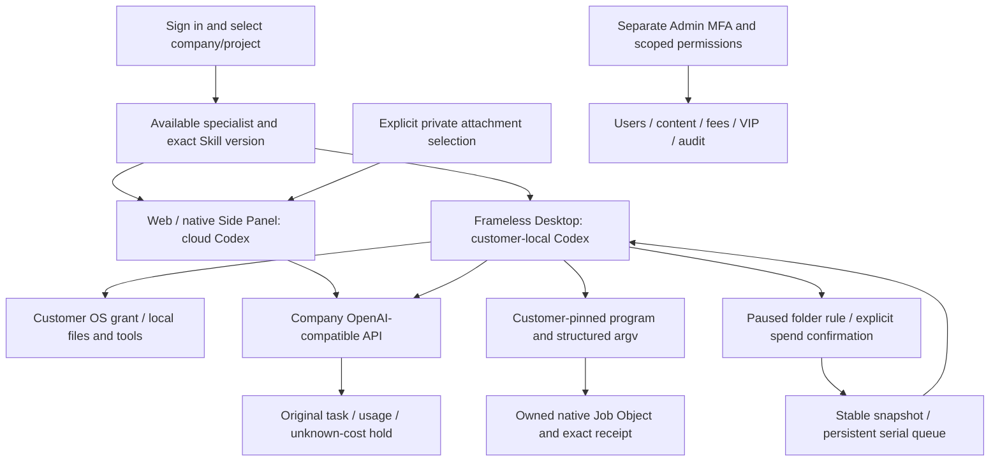

以下为阶段 86 未变化产品源的历史界面证据，本阶段未新增 Web/Admin/侧栏整体验收。


[原始 MP4](assets/screenshots/workmate-guidance-14-project-guidance.mp4)


[本机程序方案](https://github.com/copypasteltd/workmate/blob/docs/docs/technical/88-approved-local-programs.md) · [Stage 88 checkpoint](https://github.com/copypasteltd/workmate/blob/docs/docs/quality/local-programs-checkpoint.json)


## 阶段 89 实际交互

[实现与边界](https://github.com/copypasteltd/workmate/blob/docs/docs/technical/89-first-work-and-submission-recovery.md) · [Stage 89 checkpoint](https://github.com/copypasteltd/workmate/blob/docs/docs/quality/work-intake-checkpoint.json)

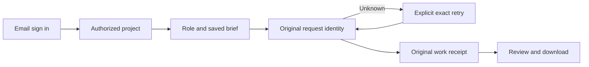

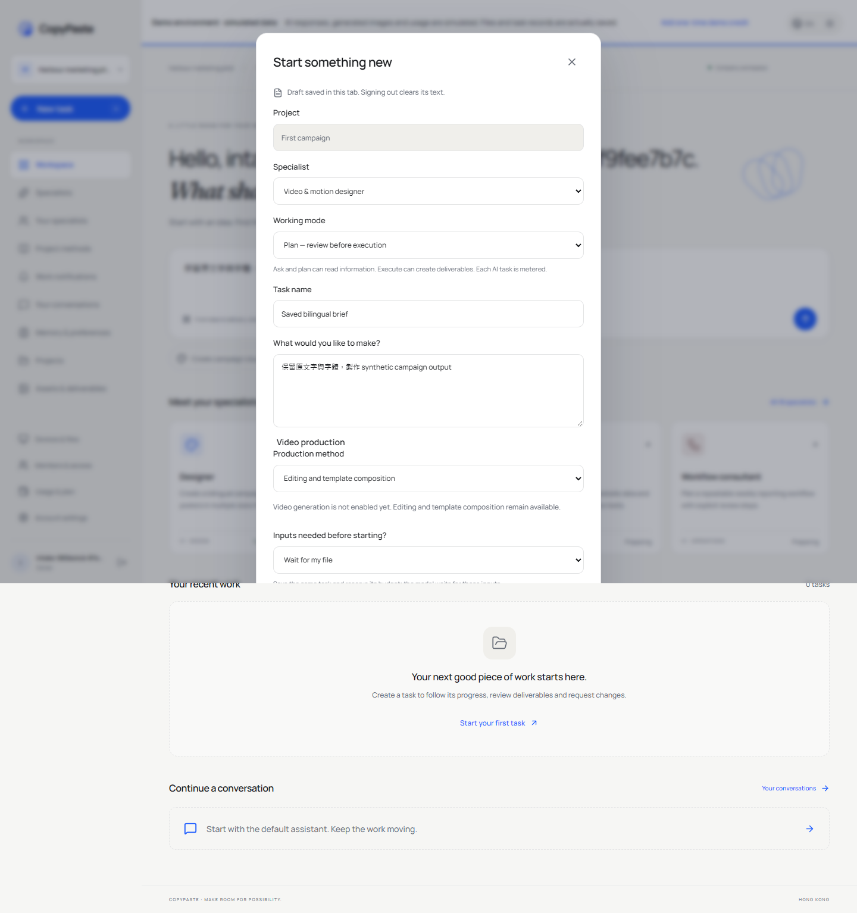

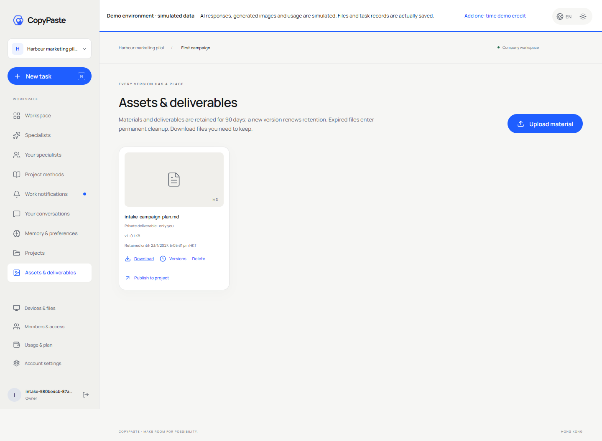

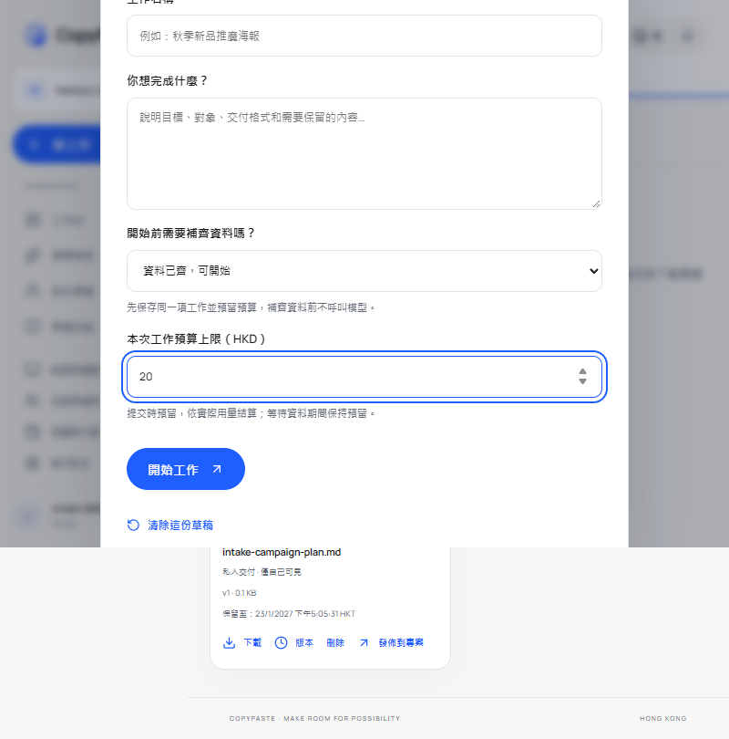

[MP4: first-work](assets/screenshots/workmate-intake-05-first-work.mp4)

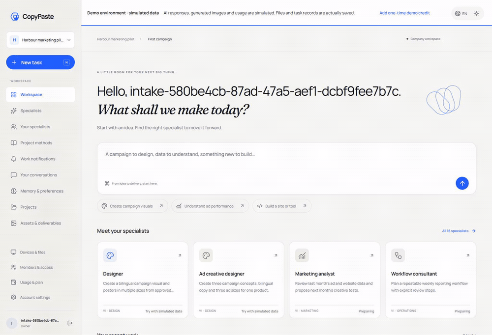

[MP4: submission-recovery](assets/screenshots/workmate-intake-05-submission-recovery.mp4)

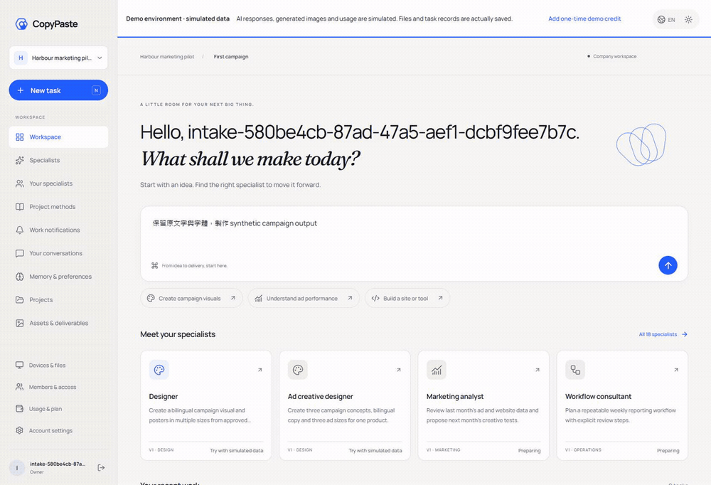
