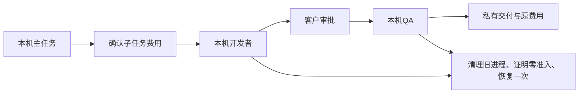
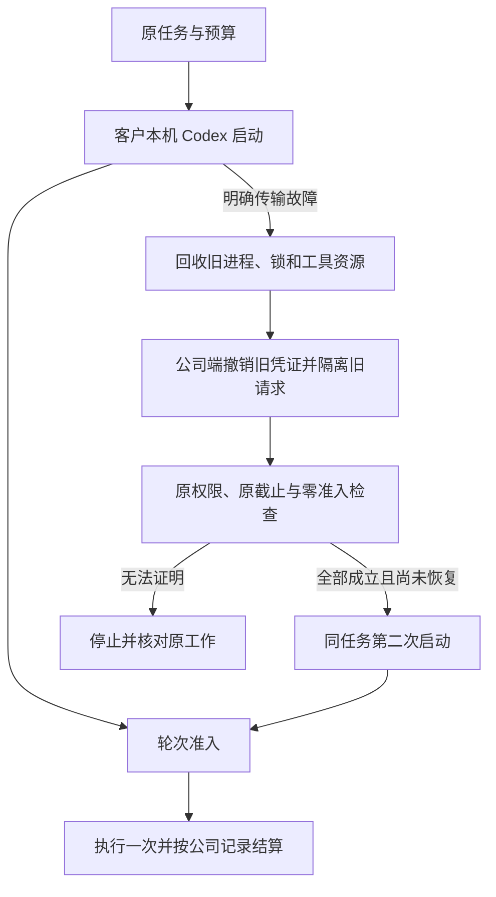
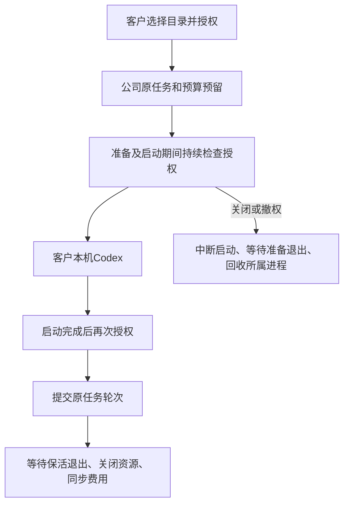
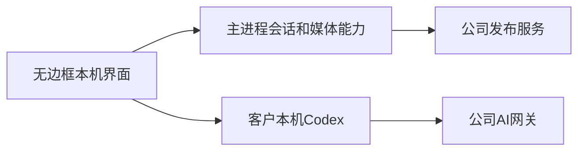
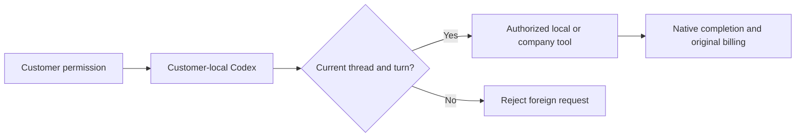
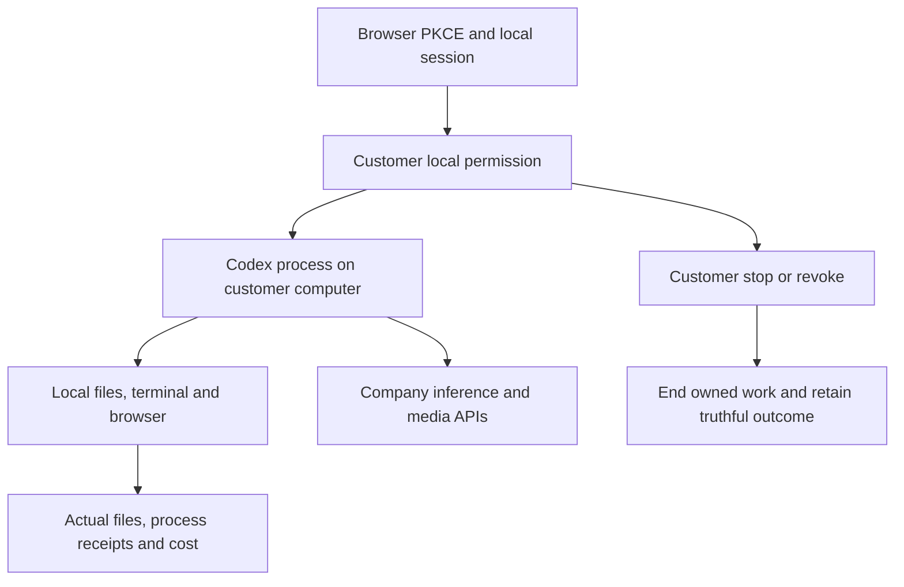

# Workmate · CopyPaste Enterprise Agent · desktop

<!-- workflow-recovery-stage130 -->
## 本机父子流程恢复与取消 · 阶段130

本轮修复停止或正常完成任务时，后台授权保活响应卡住导致收尾等待的问题。主任务和每个子任务分别取消并等待自己的保活观察器；即使底层请求忽略取消，其迟到响应也不能继续启动任务。正常完成不会因此取消父任务；提交本机轮次前仍必须重新检查当前权限。

客户流程为：浏览器登录与企业工作区 → 选择本机目录并主动授权 → 确认额外子任务费用 → 本机开发者执行 → 客户审核实际文件 → 本机QA执行 → 下载SOP、固定版本JSON和恢复说明。两个子任务分别发生真实初始化/建会话故障后，在公司持久证明零准入的前提下各恢复一次；原任务、原预算、截止与worker attempt保持一致。



限定验证通过：109项控制层、43项真实固定Codex、3个完整原生父子流程、2项当前编译和8项实际未签名打包界面检查。打包旅程使用真实Electron、原生PostgreSQL、本机命令与文件；模型回答、对话框选择及注入的传输故障为测试输入。三个原生窗口宽度保持无边框、无默认菜单、无可见滚动条及无横向溢出，全部所属资源已关闭。原始失败及其源码快照保持不变。

[实现方案](https://github.com/copypasteltd/workmate/blob/docs/docs/technical/130-desktop-workflow-recovery.md) · [当前检查点](https://github.com/copypasteltd/workmate/blob/docs/docs/quality/workflow-recovery-checkpoint-130.json) · [完整编号待办](https://github.com/copypasteltd/workmate/blob/docs/docs/quality/remaining-work-stage130.md)


[费用确认](assets/screenshots/workmate-workflow-recovery-130-01-child-fee-confirmation-en.png) · [英文完成画面](assets/screenshots/workmate-workflow-recovery-130-01-two-recovered-children-completed-en.png) · [中文完成画面](assets/screenshots/workmate-workflow-recovery-130-01-two-recovered-children-completed-zh.png) · [完整实时MP4](assets/screenshots/workmate-workflow-recovery-130-01-parent-child-startup-recovery.mp4)

完整验收仍有89条必需、12条未确认建议和1条可选记录开放；它们是完整验收记录，不等于102个功能尚未编码。任意崩溃/多节点、所有本机工具、全部专业角色、丢失子任务完成回执的持久补交、正式模型及签名安装等继续推进。当前发布由阶段130独立清单和发布器约束；旧V11入口及阶段128清单保留历史源码范围，不用于发布本轮变更。

[简体中文](README.md) · [English](README.en.md)

<!-- startup-recovery-stage128 -->
## 本机启动安全恢复 · 阶段128

Desktop 在客户电脑运行固定版本 Codex。客户选择目录并主动授权后，初始化或打开会话若发生明确的传输故障，主进程先回收旧进程和锁，再请求公司服务检查原任务。只有轮次尚未准入、没有任何模型/输入计数/公司工具准入，且身份、权限与原截止仍有效，才允许恢复一次。最多两次启动，沿用原任务、原预算预留和 worker attempt，不延长原截止。

界面显示「正在重连」。连接结果未确认时，「重试连线」仅取回原请求结果；可能已执行的工作需先核对本机文件及费用。撤权、协议拒绝、清理失败、已提交轮次和结果未知均禁止自动重做。推理凭证仅传给可信本机运行器，不写入本机恢复日志或渲染页面。



服务端通过 SQL133 升级；应先使用所有者执行完整迁移，再启动相应 API。新客户端声明 `desktop-startup-recovery-v1`；`/startup-recovery` 使用原绑定、固定契约摘要和原恢复请求键，`/turn-admission` 在 `turn/start` 前登记。旧客户端保持原执行流程，不能取得新的恢复许可。

本轮检查点记录控制层、实际固定 Codex、原生 SQL 与实际未签名打包客户端的限定验证。模型回答和对话框选择按用户要求使用假数据；尚不代表正式模型、签名安装、全部崩溃组合或专业角色整体验收。各旧阶段的包和画面仍对应其原源码。

本轮限定检查通过：91项相关控制层、43项真实固定版本Codex、30项原生数据库/API、3项当前编译和6项实际未签名打包界面检查。实际旅程验证了登录、授权、一次启动恢复、原任务的一次收费、单次回答、待响应时撤权，以及1000/1240/1440三个原生窗口宽度。当前截图、GIF和MP4来自成功的04次运行；失败的01—03次运行及原始记录均完整保留。发布入口为V11，远端状态以最终推送回执和SHA回读为准。

[方案与接口](https://github.com/copypasteltd/workmate/blob/docs/docs/technical/128-desktop-startup-recovery.md) · [匹配源码与验证](https://github.com/copypasteltd/workmate/blob/docs/docs/quality/startup-recovery-checkpoint-128.json) · [编号待办](https://github.com/copypasteltd/workmate/blob/docs/docs/quality/remaining-work-stage128.md)


[Original receipt](assets/screenshots/workmate-startup-recovery-128-04-original-local-receipt.png) · [Withdrawal screenshot](assets/screenshots/workmate-startup-recovery-128-04-permission-revoked-before-turn.png) · [Withdrawal GIF](assets/screenshots/workmate-startup-recovery-128-04-revoke-pending-startup.gif) · [Recovery MP4](assets/screenshots/workmate-startup-recovery-128-04-startup-and-original-receipt.mp4) · [Withdrawal MP4](assets/screenshots/workmate-startup-recovery-128-04-revoke-pending-startup.mp4)

<!-- local-startup-stage127 -->
## 本机启动、保活与撤权 · 阶段127

客户选择目录并主动授权后，Codex始终在客户电脑运行；公司服务负责身份、模型网关与原任务费用。主任务和工作流子任务现在在准备/启动期间即续租，启动后再次检查授权，才提交轮次。关闭或撤权会中断待响应的初始化/建会话请求，等待准备退出并回收所属进程与锁，不会在清理后迟到启动。

启动等待超过初始45秒不另建任务、不重复预留。正常完成先停止并等待保活，再关闭资源及同步原费用回执。撤权提示说明本机工作停止、检查授权及原费用；已接受或结果不明的工作不自动重做。Desktop自动启动恢复仍待实现，不能仅凭零费用就重试。



本轮限定验收为73项完整相关控制层、38项真实固定Codex及5项实际未签名打包窗口检查；最终结果见下方检查点。实际窗口旅程覆盖浏览器OTP/PKCE与工作区创建、默认取消不授权、超过45秒启动、一次真实公司账务、待响应启动撤权及1000/1240/1440宽度无边框、无菜单和无可见滚动条。模型回答和原生对话框选择为明确测试数据，不代表正式模型、签名安装或全部角色验收。此前阶段的包与画面保留原源码范围。

当前未签名目录包：`release/local-startup-127-03/win-unpacked/`。正常安装/启动按本README后续说明；`scripts/qualify-local-startup-v2.mjs`及Delivery的`run-desktop-startup-v4.mjs`是绑定当次候选目录、固定二进制和隔离数据库的验收工具，不是其他检出的通用启动器。

[方案与执行顺序](https://github.com/copypasteltd/workmate/blob/docs/docs/technical/127-desktop-startup-lifecycle.md) · [确切源码与最终结果](https://github.com/copypasteltd/workmate/blob/docs/docs/quality/local-startup-checkpoint-127.json) · [编号待办](https://github.com/copypasteltd/workmate/blob/docs/docs/quality/remaining-work-stage127.md)


[原费用截图](assets/screenshots/workmate-local-startup-127-04-original-local-receipt.png) · [撤权GIF](assets/screenshots/workmate-local-startup-127-04-revoke-pending-startup.gif) · [完成MP4](assets/screenshots/workmate-local-startup-127-04-startup-and-original-receipt.mp4) · [撤权MP4](assets/screenshots/workmate-local-startup-127-04-revoke-pending-startup.mp4)

<!-- controlled-publications-stage125 -->
## 本机发布预览与权限 · 阶段125

Desktop保留客户本机Codex、可撤销完整本机权限及无边框窗口。主进程访问公司服务，渲染层不接收Bearer。`workmate-media`能力绑定窗口、会话及范围，支持有界流、HEAD／Range、完整性校验、并发和有效期限制；登出、换会话及窗口销毁撤销能力。

安全浏览器登录并创建工作区后，在Web连接社交账户、明确范围；回到Desktop选择文案和确切素材版本，核对实际媒体，主动勾选发布并读取回执。未知结果只能核对或人工结案，不能自动重发。来源失效或撤权会撤回内容。



类型检查及媒体／会话21/21通过。最新未签名目录包为`release/publications-125-02/win-unpacked/`。实际打包Electron／Chrome原生侧栏发布旅程10/10通过，含原生媒体、三档OS窗口尺寸、无边框／菜单／可见滚动条、明确确认和撤权。签名安装、完整本机工具及专业角色资格另验。


[实际交互MP4](assets/screenshots/workmate-native-publications-02-native-preview-and-confirm.mp4)


<!-- runtime-startup-122 -->

## Codex 启动与轮次隔离 · 阶段 122

本机 Codex 的工具、输入请求、审批、消息、用量和完成通知绑定当前线程及轮次，排队的旧消息不能转入后续任务。丢失 turn/start 响应时，真实完成通知可结束原轮次，避免重复执行。原生错误日志只保留受限字段。客户本机完整权限、撤销、无边框及自绘窗口控制保持生效。

180 项单元与 25 项真实原生 Codex 检查通过。npm test 的预构建现包含 Native Host，支持新检出目录。当前源码打包后另有 8 项实际 UI 检查通过，覆盖 OTP/PKCE、本机明确授权、真实本机文件与公司工具费用、撤销，以及 1440/1280/800 窗口无可见滚动条和横向溢出。提供方回复与原生对话框选择为明确测试数据。



[完整方案 / Behavior and verification](https://github.com/copypasteltd/workmate/blob/docs/docs/technical/122-codex-startup-and-turn-isolation.md)


[800px](assets/screenshots/workmate-runtime-startup-desktop-02-layout-800-en.png) · [繁體中文](assets/screenshots/workmate-runtime-startup-desktop-02-workspace-zh.png) · [MP4](assets/screenshots/workmate-runtime-startup-desktop-02-local-cloud-boundary.mp4)

## 产品与边界

首批面向现有客户的 marketing 团队，完整范围包含生图、设计/字体、视频/特效、广告和网站分析、SEO/GEO、企业重复流程及软件开发。目录已有 18 个精确 Skill 绑定的候选角色；至少十二个逐一完成专业任务、修改及异常处理的角色仍是验收要求。设计师由 Codex、设计 Skill 与公司 Image 2 组合。Agent 内核唯一使用 Codex；全部 AI 请求走公司 OpenAI 兼容后端。当前开发使用已授权假数据，不代表真实模型专业质量已经验收。

Electron 主进程管理 OS 授权、加密本机会话、固定 Codex 子进程、文件/终端、浏览器及 IPC；React 渲染器不持有通用 Node/任意进程调用。选择角色和工作目录后设置唯读、目录内读写或完整本机权限，原生确认默认取消。Codex 在客户电脑运行，推理/图片/视频/音频仍经公司服务器。真实待答问题默认不选择，客户回答继续原任务/线程/轮次；停止和撤权清除待答并结束拥有的子进程。

## 仓库与执行位置

| Branch | Directory | Runtime |
| --- | --- | --- |
| [backend](https://github.com/copypasteltd/workmate/tree/backend) | `dev/copypaste-platform` | Fastify / PostgreSQL / cloud Codex |
| [web](https://github.com/copypasteltd/workmate/tree/web) | `dev/copypaste-web` | React / Vite / cloud workspace |
| [admin](https://github.com/copypasteltd/workmate/tree/admin) | `dev/copypaste-admin` | React / separate Admin identity |
| [desktop](https://github.com/copypasteltd/workmate/tree/desktop) | `dev/copypaste-desktop` | Electron / customer-local Codex |
| [extension](https://github.com/copypasteltd/workmate/tree/extension) | `dev/copypaste-extension` | Chrome MV3 / native Side Panel / cloud Codex |
| [delivery](https://github.com/copypasteltd/workmate/tree/delivery) | `dev/copypaste-delivery` | Native development, QA and publication tools |

各组件为独立 Git 仓库，保留上述并列布局。项目仅使用原生工具；禁止 Docker、WSL 和虚拟机。

## 使用逻辑

1. 安装或启动无边框客户端，以浏览器 PKCE 登录后选择企业、项目和本机工作目录。
2. 选择只读、目录内读写或完整本机权限；完整权限由客户主动确认，默认取消，可随时撤销。
3. 本机 Codex 操作客户本机文件、终端和浏览器；需要固定外部程序时，由客户选择实际程序并确认。
4. 查看原线程问题、真实进程输出、文件变更、成果和费用；停止或撤权结束所属执行，不把不确定结果改写为成功。
5. 目录自动工作先保存为暂停，再独立确认自动费用；重新打开应用保留队列和限额，重新确认后继续。



## 启动与使用

### 本地启动

以下命令在已检出的对应仓库内执行。完整工作区将六个独立仓库并列放在 `dev/`，见[分支与检出布局](https://github.com/copypasteltd/workmate/blob/docs/docs/governance/04-git-branches-and-publication.md)。使用 Windows x64、Node.js >=22.14、npm/Git，以及文档约束的原生 PostgreSQL、FFmpeg/FFprobe 与固定 Codex 资源；保留已有本地配置和数据，不使用 Docker/WSL/虚拟机。

```powershell
Set-Location 'D:/dev/copypasted/自有agent/dev/copypaste-desktop'
npm ci
$env:COPYPASTE_LOCAL_CODEX_BIN = 'D:/approved-runtime/codex.exe'
npm run runtime:prepare
npm run build
npm start
```

先启动后端。上述内核路径是示例，需提供符合 `contracts/local-codex-runtime.json` 的固定二进制及相邻辅助资源；公司地址配置在 `deployment.json`。`npm run package:dir` 构建解包候选，`npm run package` 构建安装包。当前证据覆盖未签名解包候选，签名及人工安装/升级/卸载验收仍保留。渲染器可独立构建，须保留本机覆盖层。

### 当前使用流程

1. 完成登录、企业成员/邀请和项目选择。原生端通过浏览器 PKCE 登录；Admin 使用独立 MFA 身份。过期、撤销、换企业不应静默切换身份和资料范围。
2. 选择专业角色，提供工作说明及明确获准的资料/账号。缺少必要输入时请求客户补齐。项目负责人可以保存草稿、核对依赖、预览并明确发布不可变共享指引；发布不启动 AI、不增加权限。
3. 新任务固定当时接受的角色、Skill、品牌、资料和指引版本。既有工作保留原版，包括原先没有共享配置的状态。来源被隔离、删除或撤权后隐藏失效正文并阻断后续使用；历史内容不是越权入口。
4. 确认预算和必要的操作/媒体授权，查看真实状态、进度、文件与原费用回执。修改沿原工作谱系继续。未知用量保持原预留供对账，不能当作免费或盲目重新执行。
5. Admin 可按独立权限管理用户/企业状态、查看获准消耗，预览并确认人工费用/赠额和 VIP 权益/到期。余额、实收记录、授信、预算和 VIP 分别保存；同一确认幂等，操作保留审计，不能因重放重复赠额。

## Desktop 本机程序与浏览器

登录并选择企业/项目→建立本机会话→主动授予完整本机权限→打开「本机程式」→选择实际程序并在默认取消的原生窗口确认→返回对话提出工作→查看参数、真实输出、PID/退出码和原任务费用。取消选择或拒绝确认不会批准程序。程序清单固定文件身份和 SHA-256；Agent 只传程序 ID 与参数数组，不临时指定 shell 或环境变量。

停止原任务或撤销程序会结束该任务拥有的原生进程树；撤销某个程序不撤销客户另行授予的完整本机权限。成功、失败、停止及未知结果分别保留，原调用 ID 不重跑。重启后未确认结果保持未知，客户核对后只能允许后续新调用，不能把旧记录改为成功。完整 OS 权限允许客户程序以本机用户权限操作，不宣称额外受目录 OS 沙箱保护；Admin/云端不能代客户批准。

当前 Windows x64 原生 Job Object 监督程序不继承公司推理凭据。每执行器最多两个活动程序，保留最多 100 个批准记录/200 个运行记录，每次至多 64 个参数、120 秒，stdout/stderr 各保留最多 32 KiB 并标记截断。新会话固定程序工具版本，旧会话工具集合保持原样。浏览器普通页面与弹窗共同计入每任务三页、每执行器两个活动上下文；第三个上下文拒绝，不挤掉他人任务，复用前清除 cookie/localStorage。

## Desktop 本机目录工作

选择具备读写授权的本机会话，打开「目录工作」，选择工作目录内真实输入目录，配置扩展名、处理说明、稳定等待时间、每档/总授权上限和最多次数。已有文件默认不处理；客户明确勾选后才纳入。保存只建立**暂停**规则；「确认并启用」另行打开默认取消的原生自动收费确认。

本机文件事件与有界核对发现稳定输入，按持久队列逐档处理。每档保存精确快照、独立输出目录、原任务编号和公司费用回执。专家需要客户回答时，目录页显示待答入口；「回答问题」返回对话，客户明确选择后继续原任务/线程/轮次。同一规则中已处理的相同路径/内容不会再次收费，产品输出不成为输入；尚未开始的旧内容合并为最新稳定版本。

暂停停止新派发，已开始的一档可以完成；撤销只停止该规则拥有的工作，保留交付和费用。应用关闭后停止监听，真实重开保留加密账本及已分配上限，但必须再次确认。丢失回包复用原派发/创建/开始/结算键；未知本机动作阻断供核对。完整 OS 权限仍是客户主动授予的本机权限，目录规则没有额外创造一个 OS 沙箱。Web/Extension 保持云端执行，本机目录工作是 Desktop 能力。

明确上限：20 条规则；每规则 1,000 项历史/200 项排队，每会话 1,000 项派发回执；每次扫描 2,000 个匹配文件/10,000 项条目/12 层深度；每档 20 MiB、单次新读取 64 MiB；最多授权 100 次，目录调度同一时间执行一档。暂停或重启不重置上限。输出位于 `.copypaste-local-jobs/<rule>/<job>/output/`。越界、路径遍历、symlink/junction、源文件替换和冲突阻断自动执行。本机程序见上节；完整应用操作及崩溃/休眠/离线矩阵仍待补齐。

## 配置、权限与费用

本候选要求完整 SQL001–133 增量历史。API/Worker 准入拒绝缺失、变更或不支持的版本，并独立检查恢复环境身份。公司模型别名、已验证媒体能力、精确费率及供应商密钥只在后端配置；未配置能力保持不可用。当前开发继续使用已授权假数据。

Web/Admin 使用 `VITE_API_BASE` 或同源代理，开发端口为 4317/4318。Desktop/Extension 构建时固定 `COPYPASTE_API_ORIGIN`、`COPYPASTE_WEB_ORIGIN`，Desktop 另固定 `COPYPASTE_EXTENSION_ID`。除获准回环开发场景外使用 HTTPS；渲染器与扩展不持有公司供应商密钥。

文件默认私有，项目共享需要客户明确操作。新请求、Worker 领取、工具及下载重新核验权限；旧历史不能绕过撤权或正文治理。金额使用精确港币微单位；预算、余额、授信、实收与 VIP 分开记录。稳定请求身份防止重复赠额、建任务和预留；未知费用或物理清理保留待核对。

## 预设角色与 Skill

目录定义 18 个专业预设及默认助手，每次执行固定 Skill 版本和注册工具。模板数量不等于至少十二个角色已通过完整专业资格验收。

| ID | Role | Required Skill bindings |
| --- | --- | --- |
| R01 | 全栈开发工程师 | `fullstack-engineering@1.0.0`, `frontend-implementation@1.0.0`, `backend-api@1.0.0`, `qa-testing@1.0.0`, `delivery-core@1.0.0` |
| R02 | 前端开发工程师 | `frontend-implementation@1.0.0`, `ui-system@1.0.0`, `qa-testing@1.0.0`, `delivery-core@1.0.0` |
| R03 | 后端与 API 工程师 | `backend-api@1.0.0`, `qa-testing@1.0.0`, `delivery-core@1.0.0` |
| R04 | 软件测试工程师 | `qa-testing@1.0.0`, `frontend-implementation@1.0.0`, `delivery-core@1.0.0` |
| R05 | UI/UX 设计师 | `ux-research@1.0.0`, `ui-system@1.0.0`, `frontend-implementation@1.0.0`, `delivery-core@1.0.0` |
| R06 | 设计师 | `creative-direction@1.0.0`, `image-art-direction@1.0.0`, `image2-production@1.0.0`, `typography-layout@1.0.0`, `delivery-core@1.0.0` |
| R07 | 品牌视觉设计师 | `brand-system@1.1.0`, `image-art-direction@1.0.0`, `image2-production@1.0.0`, `typography-layout@1.0.0`, `delivery-core@1.0.0` |
| R08 | 广告创意设计师 | `ad-creative@1.0.0`, `image-art-direction@1.0.0`, `image2-production@1.0.0`, `typography-layout@1.0.0`, `delivery-core@1.0.0` |
| R09 | 电商商品设计师 | `ecommerce-visual@1.0.0`, `image-art-direction@1.0.0`, `image2-production@1.0.0`, `typography-layout@1.0.0`, `delivery-core@1.0.0` |
| R10 | 社媒内容设计师 | `social-content@1.0.0`, `image2-production@1.0.0`, `typography-layout@1.0.0`, `delivery-core@1.0.0` |
| R11 | 插画与 IP 设计师 | `illustration-ip@1.0.0`, `image-art-direction@1.0.0`, `image2-production@1.0.0`, `delivery-core@1.0.0` |
| R12 | 字体与版式设计师 | `typography-layout@1.0.0`, `image-art-direction@1.0.0`, `image2-production@1.0.0`, `delivery-core@1.0.0` |
| R13 | 演示文稿设计师 | `presentation-production@1.1.0`, `typography-layout@1.0.0`, `dataviz@1.1.0`, `delivery-core@1.0.0`, `deterministic-metrics@1.1.0` |
| R14 | 网页与落地页设计师 | `landing-page@1.0.0`, `ui-system@1.0.0`, `frontend-implementation@1.0.0`, `image2-production@1.0.0`, `delivery-core@1.0.0` |
| R15 | 信息图与数据可视化设计师 | `dataviz@1.1.0`, `deterministic-metrics@1.1.0`, `typography-layout@1.0.0`, `delivery-core@1.0.0` |
| R16 | 视频与动效设计师 | `video-storyboard@1.0.0`, `template-video-composition@1.0.0`, `video-generation@1.1.0`, `speech-production@1.2.0`, `delivery-core@1.0.0` |
| R17 | 营销数据分析师 | `ads-analysis@1.1.0`, `deterministic-metrics@1.1.0`, `dataviz@1.1.0`, `delivery-core@1.0.0` |
| R18 | 企业流程自动化顾问 | `workflow-design@1.1.0`, `workflow-execution@1.1.0`, `delivery-core@1.0.0` |

设计师组合为 Codex＋设计 Skill＋公司 Image 2。可选 R19 云端电脑操作员必须绑定另行确认的租约与 AI 预算；本机 Desktop 不提供该创建入口，继续由客户本机执行。

[Role contract](https://github.com/copypasteltd/workmate/blob/backend/catalog/role-preset-catalog.json) · [Skill packages](https://github.com/copypasteltd/workmate/blob/backend/catalog/skill-packages.json)

## 实际界面与交互录制

下列为真实产品界面截图和按墙上时间录制的交互。客户、模型、媒体响应明确使用假数据；所注明的原生 Codex、文件、数据库和账务路径实际运行。假节点画面不代表真实 Linux 远端桌面已验收。


[Original MP4](assets/screenshots/workmate-dedicated-desktop-06-local-cloud-boundary.mp4)

## 验证与交付状态

整合后的客户端/工具共 338 项通过：Web 20、Admin 9、Extension 63、Desktop 180、实际本机 Codex 22、Delivery 44，对应类型/构建通过。Desktop、Web/Admin、原生侧栏各有 8 项限定实际 UI 检查，共 29 张截图与 5 组 GIF/MP4。后端完整成功须有最终完整清单回执，检查点记录实际结果并保留失败。

安装原生前置依赖后执行本仓库 `npm run typecheck`、`npm run build` 及测试脚本。Delivery 默认 `npm test` 仅覆盖原生界面完整性，完整单元清单使用 `node --test --test-concurrency=1 tests/*.test.mjs`。`node scripts/qualify-delivered-clients-v1.mjs NN` 在 Delivery 使用新两位编号及并列布局检查完整客户端清单；历史候选专项执行器保留原目录要求。

完整产品验收仍开放：至少十二个专业角色资格、全权限/业务/兼容矩阵、真实服务质量、签名安装更新、生产负载恢复及客户业务接受。以编号清单管理完成条件，不以测试数量推算完成率；使用后清理自建浏览器/进程，保留用户资源。

[Implementation / 方案](https://github.com/copypasteltd/workmate/blob/docs/docs/technical/121-dedicated-cloud-and-client-execution.md) · [Checkpoint / 证据](https://github.com/copypasteltd/workmate/blob/docs/docs/quality/dedicated-cloud-checkpoint.json) · [Open requirements / 未完成项](https://github.com/copypasteltd/workmate/blob/docs/docs/quality/remaining-work-2026-10-29.md) · [Branch layout / 检出布局](https://github.com/copypasteltd/workmate/blob/docs/docs/governance/04-git-branches-and-publication.md)
