# CopyPaste 交付与集成

## 持久供应商请求（阶段 56）

专项 03 通过 **116/116**，完整回归 01 通过 **546/546**；专项包含于全量，738 份来源前后一致，保留全部原 531 项命名测试。类型检查与实际构建通过。原生 065→066 升级在两库各保留 132 张原公共表的全部行摘要、SQL001–065 和旧校验值；新增四表强制 RLS，未补造历史请求或用量。

[Focused run](evidence/provider-control-candidate-03.json) · [Full regression](evidence/provider-control-regression-01.json) · [Build and types](evidence/provider-control-static-01.json) · [Local upgrade](evidence/provider-control-upgrade.json) · [Original-row preservation](evidence/provider-control-migrations.json)

真实多 Node 进程、Worker、后台验证和 Codex 路径覆盖共享限额、撤权零请求、未知占槽、孤立执行恢复、精确费用及终止帧落盘交接。模型和媒体使用假数据。首次 SQL 语法错误、首次交接回归失败、编译辅助写法失败及各次源码前像均保留，较早通过报告不代表当前源码。实际夹具回收和自建数据库关闭均通过，本轮没有打开浏览器或客户端。

```powershell
node scripts/run-provider-control-checks.mjs NEXT_ID --core
node scripts/run-provider-control-checks.mjs NEXT_ID
node scripts/run-provider-control-checks.mjs NEXT_ID --full
```

编号须为未使用的两位数字，不能覆盖报告。本机升级已有一次性前态守卫，升级后不再执行；SQL066 不再编辑。原始 TAP 和数据库日志保留工具输出的空白，其他源码/文档/脚本仍执行空白检查。逐调用预算、完整后台策略控制及原始综合验收继续跟踪。

## 内部推理请求（阶段 55）

[当前专项 03](evidence/inference-request-candidate-03.json)通过 **112/112**，[完整回归 02](evidence/inference-request-regression-02.json)通过 **531/531**；733 份来源前后一致，全部原 484 项命名测试保留，专项包含于全量。[取消诊断 02](evidence/inference-request-cancel-probe-02.json)使用实际 Codex，确认首次请求前取消为未接收、已知零用量。记录绑定前后相同的源码、原始 TAP、验证脚本、不可改写的 SQL001–065 及实际夹具回收；自建数据库已关闭。首轮失败和此前源码的通过报告分别保留；模型/媒体使用获准假数据，Codex 和原生 PostgreSQL 实际执行。本轮没有打开浏览器或客户端，不将旧页面回执当作当前后端的界面证明。

The inference runner preserves raw output and exact source hashes, owns its native PostgreSQL process, and verifies actual post-worker fixture reclamation. Use a fresh two-digit ID for each mode; never overwrite an earlier report. Current authorization, scoped credentials, frozen media specifications, uncertain spend and natural process exit are checked independently of full product acceptance. No Docker or WSL is used.

The current focused run passed **112/112**, included in **531/531 full tests**. All 733 source files remained unchanged and all 484 earlier named tests are retained. Actual fixture reclamation and owned database shutdown passed. The cancellation probe uses real Codex; model/media responses remain simulated. Earlier failures and exact verifier/source preimages are preserved.

原始 TAP 与数据库日志保留工具输出的尾空格和结尾空行。Git 空白检查覆盖源码、文档、脚本与源码前像，排除原始 `.tap` 和 `*-database.log`；原始证据仍逐文件校验摘要并扫描配置密钥。

Raw TAP and database logs retain tool-emitted trailing whitespace and final blank lines. Git whitespace checks cover code, documentation, scripts and source preimages, excluding raw `.tap` and `*-database.log` files. Evidence digests and configured-credential scans still cover those original bytes.

```powershell
node scripts/run-inference-request-checks.mjs NEXT_ID
node scripts/run-inference-request-checks.mjs NEXT_ID --full
```

跨 Worker 的供应商限额和逐调用预算仍待实现。以下各阶段保留其原始源码、页面及产物范围。

## 明确采用版本（阶段 54）

默认助手更新、专家设置与会话采用先比较明确模型、推理强度、单价及 Skill 版本，再由用户确认。五分钟比较绑定实际登录会话与配置状态，过期或变化拒绝确认；重试使用持久幂等键。已接收任务继续原模型和原费率。

当前平台完整回归 **484/484**，保留原 462 项测试；专项 **93/93** 与全量重叠，不相加。实际构建版 Web **12/12**，新版无边框打包 Desktop 与真实 Chrome 原生侧栏 **11/11**。AI/媒体使用已授权假数据，身份、PostgreSQL、权限与版本事务实际执行。原始 102 项综合验收继续跟踪；以下旧章节保留其时源码与产物范围。

[Focused regression](evidence/agent-adoption-candidate-06.json) · [Full regression](evidence/agent-adoption-regression-02.json) · [Built Web](evidence/agent-adoption-ui-06.json) · [Native Desktop / Side Panel](evidence/agent-adoption-native-05.json) · [Artifact hashes](evidence/agent-adoption-artifacts-02.json) · [Original-row preservation](evidence/agent-adoption-migrations.json)

复查须使用新编号，不覆盖报告。原生验证使用独立 profile、实际工具栏动作与 PKCE，结束后关闭自己的窗口和进程。Setup/Portable 核对字节来源，不代表安装验收；全程不使用 Docker/WSL。

```powershell
node scripts/run-agent-adoption-candidate.mjs NEXT_ID
node scripts/run-agent-adoption-regression.mjs NEXT_ID
node scripts/run-agent-adoption-ui.mjs NEXT_ID
node scripts/run-agent-adoption-native.mjs NEXT_ID
```

`NEXT_ID` 替换为未使用的两位编号。原生侧栏 QA 默认使用本机 `.data/browsers/chromium-1248/chrome-win64/chrome.exe` 测试运行时，也可设置 `CHROME_BIN` 为支持未打包扩展测试的 Chromium。本机升级已完成，一次性升级前态守卫会拒绝重复执行。

## 受控能力配置与后台发布（阶段 53）

新增专项、完整回归、构建版 Admin 浏览器流程及带前后行摘要的原生 064 升级工具。当前[完整回归 04](evidence/capability-release-regression-04.json) 通过 **462/462**，726 份来源前后一致，失败、取消、跳过均为零；[原始 TAP](evidence/capability-release-regression-04.tap) 保留全部旧 435 项测试。[候选 11](evidence/capability-release-candidate-11.json) 通过 71/71，与全量重叠；[实际后台浏览器 06](evidence/capability-release-ui-06.json) 通过 11/11、保留 14 张未编辑截图；[补充合同 02](evidence/capability-release-contract-02.json) 通过六项跨消费者检查。

[本机 063→064 升级](evidence/capability-release-upgrade.json)及[前后比较](evidence/capability-release-migrations.json)通过：两库各保留 125 张原公共表的完整行摘要、旧 SQL 和校验值。六张新控制表强制 RLS、普通应用账号无直接权限，未补造历史验证或发布；064 不再修改。[全量夹具收尾](evidence/capability-release-regression-04-fixture-cleanup.json)确认两个延期目录在工作进程退出后实际删除，全部本轮自建浏览器与服务均已关闭。

图片验证补齐完整解码与有界解压，本地 HTTP 夹具使用 Fetch 允许的端口。[实际禁止端口反例](evidence/fetch-port-counterexample-01.json) 证明内核监听成功仍可被 Fetch 拒绝；第三次全量失败未记录旧端口，不推定其具体值。完整回归 01 的 456/458、02 的 458/458、03 的 460/461、所有候选及浏览器 01–05 的原始记录分别保留，不能互相替代。

验证后的暂存清理是独立持久任务，不修改模型回执或费用。测试夹具的父级收尾要求实际文件检查，失败会使整轮失败。升级工具同时验证专项、完整 TAP、实际回收回执、SQL 和完整源码集合。浏览器脚本启动自有原生 PostgreSQL、构建版 Admin 与隔离 API，执行真实邮箱/MFA、独立审批、回滚、只读与撤权，以及实际截图后关闭全部自建浏览器和服务。模型与媒体使用获准假数据；用户可见版本确认、三端新业务复查、网关逐请求限制及完整综合验收仍待完成。

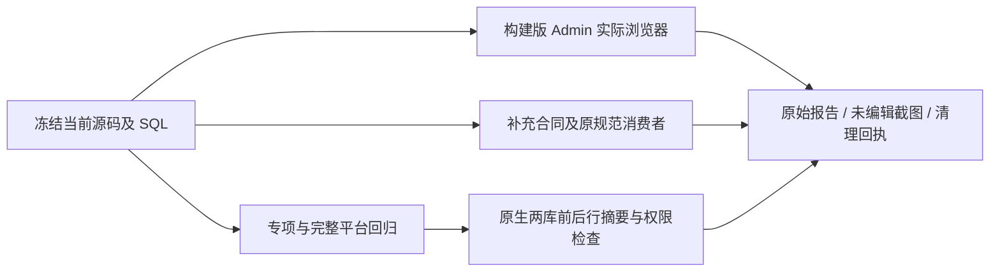

复查时使用新的执行编号，既有证据不可覆盖；本机两库已升级，升级命令有一次性前态守卫，不重复执行。新一轮可分别执行 `node scripts/run-capability-release-candidate.mjs 12`、`node scripts/run-capability-release-regression.mjs 05`、`node --import tsx scripts/check-capability-release-contract.ts 03`。浏览器执行 `node scripts/run-capability-release-ui.mjs 07`；默认 Playwright 浏览器未安装时，将 `CHROME_BIN` 明确设置为实际 Chrome 程序路径，脚本使用独立 profile 并负责关闭自建实例。

## 任务能力与费率冻结的持续核查（阶段 52）

当前基础修复固定任务的 Codex、模型、推理强度和原费率，包含实际图片生成/编辑、管理员重试、撤销后结算、未知费用、私人隔离和有界数据库锁。当前专项及既有模板/私人流程 [35/35](evidence/capability-candidate-05.json)；[第四次 28/28](evidence/capability-candidate-04.json) 保留当时来源。前三次候选失败及[首次全量 434/435](evidence/capability-regression-01.json)的原始 TAP、SQL 和来源摘要分别保留。全量唯一失败是默认配置改变应取消旧任务的过时断言；修正后仍保持新委派和运行撤销守卫。第二次全量回归独立执行，不以专项替代。

[两库 062→063 升级](evidence/capability-migrations.json)各保留 124 张原公共表、旧 SQL 字节及历史校验值。阶段 52 当时后台配置发布/回滚与用户版本确认仍在开发，后续后台子流程见上方阶段 53。

[第二次全量 435/435](evidence/capability-regression-02.json)，714 份源码前后一致，失败、取消、跳过均为 0；[原始 TAP](evidence/capability-regression-02.tap) 和本次使用的 SQL 独立保存。原 424 项测试全部保留，其中一项明确改名并修正冻结版本语义；35 项专项与全量重叠，不累计为 470 项。自建 PostgreSQL 已关闭，原生窗口/侧栏预览字节继续独立跟踪。

```powershell
npm run qa:capabilities -- 06
npm run qa:capability-regression -- 03
```

上述命令预留新的候选编号，不能覆盖已有回执。本机两库升级已完成，`upgrade:capabilities-local` 的升级前状态和重复执行守卫会拒绝再次升级；原命令 `npm run upgrade:capabilities-local -- 04` 随当时证据保留，不要求重新执行。以下阶段 51 及更早数据属于其时基线，不能充当阶段 52 全部当前源码证据。

## 限时只读客服协助 / Controlled support

交付核查新增限时支持专项、两库 061→062 的完整旧行比较、真实 Web/Admin 授权/撤销/到期流程和原始截图；全量回归与原生窗口/右侧栏继续独立验收。所有原始需求、完整验收和生产门槛保留。

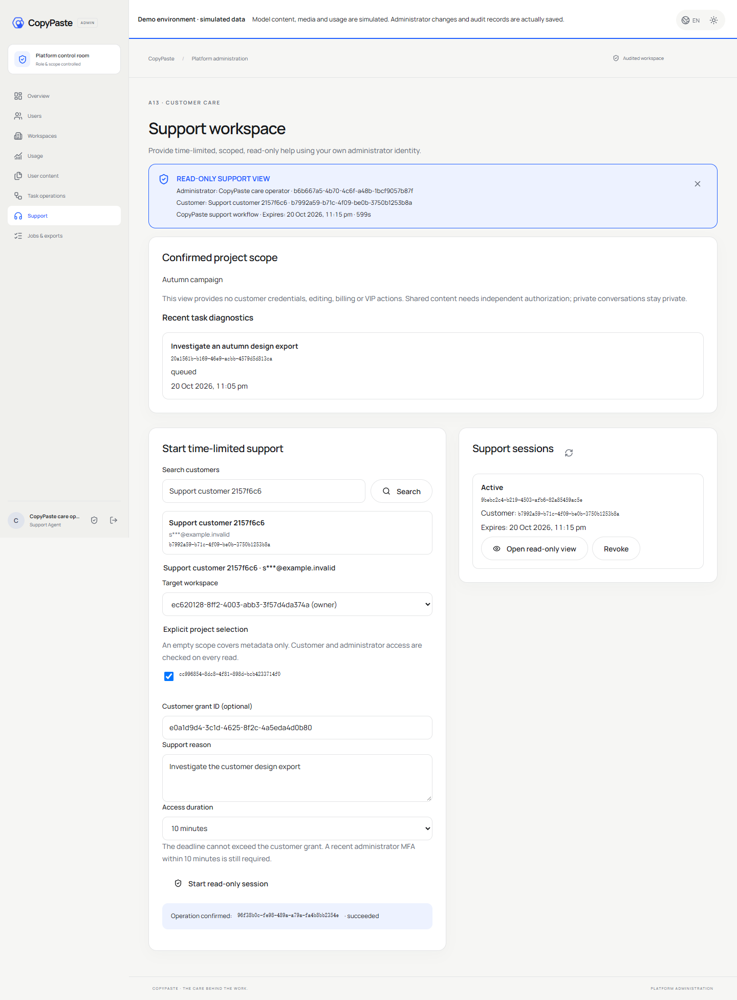

阶段 51 当前平台回归 424/424（711 份来源），受控支持页面 8/8（816 份来源、9 张未编辑截图）。14 组支持专项、原规范检查、迁移保留及独立原生检查是有界证据，完整 102 项验收继续跟踪；当前包已重建，阶段 50 包原字节另存。

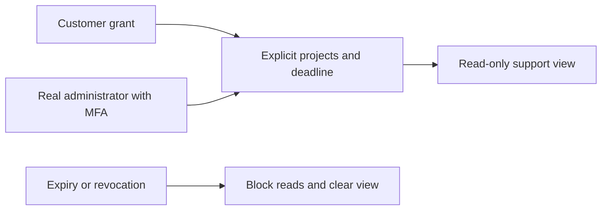

```powershell
npm run qa:support-ui
npm run qa:platform
```


[English](README.en.md) · 原生开发控制器、验收与交付入口 · 0.5.0

本仓库与五个产品仓库分别使用独立 Git，不把它们合并成单一仓库。项目位于 `D:\dev\copypasted\自有agent\`；源码、依赖、产物位于 `dev/`，主需求/设计/质量文档位于 `docs/`。各仓库的 README、图与截图随仓库交付。

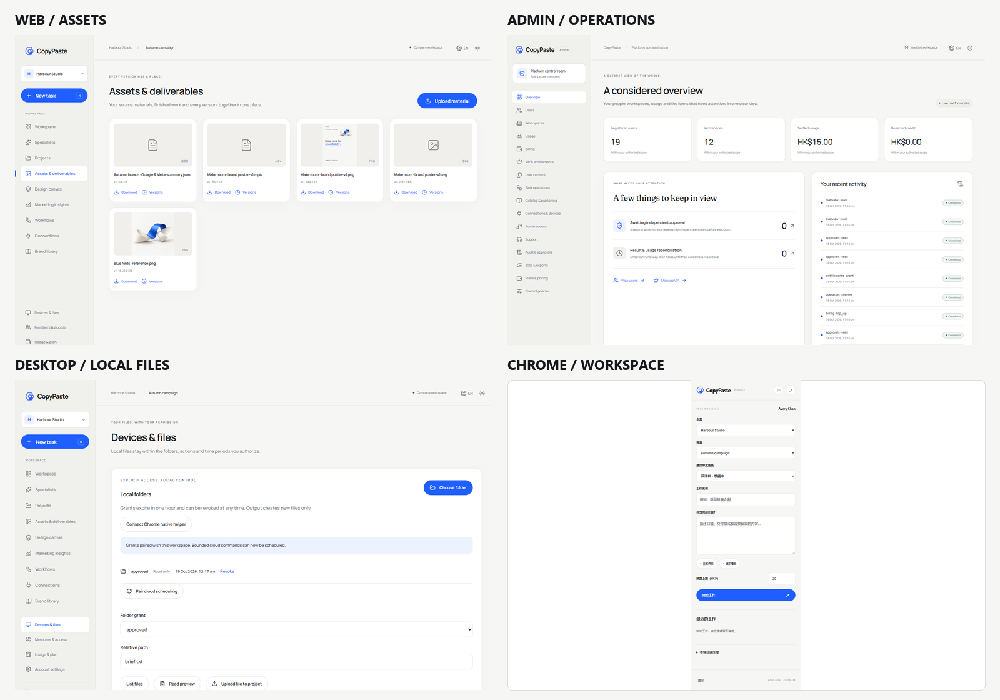

## 事务费用通知与三端账户（阶段 50）

新增候选、停栈升级和三端费用专项脚本。第四次候选 38/38；平台全量 410/410，707 份来源一致；实际 Web、打包无边框 Desktop 和原生 SIDE_PANEL 费用 8/8，808 份来源及运行字节一致，另存四份补充严格响应和八张未编辑截图。十项既有后台/成员/原生/会话上下文执行均通过。失败尝试和阶段 49 原始证据逐字节归档，旧包与当前重建预览分开保存。

阶段 50 当时平台回归 410/410，真实三端费用流程 8/8。AI/媒体和付款证据使用获准本机模拟；身份、数据库、权限、账本及通知实际执行。原始 102 项综合验收、生产银行及完整安装/系统矩阵继续单独跟踪。

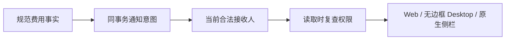


## VIP 与明确赠额的组合开通（阶段 49）

现有 VIP 表单可明确勾选配套赠额，分别填写精确 HKD 金额、独立到期日及原因。一次冻结预览及一次确认生成父操作；服务端在同一事务内提交规范 VIP 与赠额两个子操作。任何一步失败均回滚，任一风险策略触发时整体等待另一位同时具备双方权限的管理员审批，待审期间不产生权益或额度。

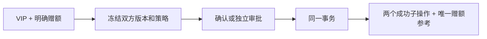

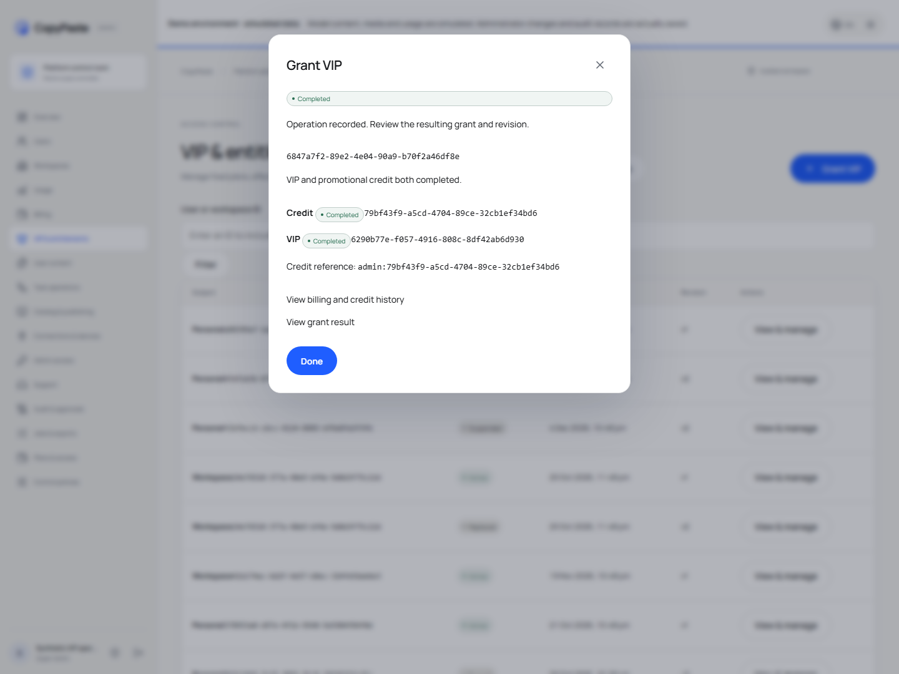

平台当前全量为 394/394（703 份来源前后一致）；新增 19 组专项已包含其中。实际 Admin 与用户读取有 9 组浏览器检查、12 张原始截图；125 份原规范响应与 1 份补充严格组合请求分别校验。060 为前向追加；两套原生数据库每库 119 张原公共表的完整行摘要前后一致，001–059 和历史空校验值保持原样。失败夹具与两次验证脚本错误均保留原回执。原始全部 REQ/TC/NFR/G01–G10、专业角色质量、真实外部服务和生产/安装验收继续跟踪。完整事实以主文档 `docs/technical/49-atomic-vip-and-explicit-credit.md` 与 Delivery 当前回执为准。

独立克隆检查全部五组通过；首次漏提交截图和其后的 Windows 长路径失败均保留原始证据，新增归档改为短路径平铺。仅重跑原生外观验证而未改变客户端时，可运行 `node scripts/refresh-native-surface-validation.mjs`：它先核对完整运行目录、三个包和 31 项 ASAR 内嵌文件，归档旧清单后更新回执引用，保留原构建时间与来源提交。README 图片全部随本仓库保存。

## 当前方案版本增量

后台方案定义、冻结比较和独立审批已接上真实 API，历史授权保留固定执行定义；两库前向升级 056 并核对旧行及旧迁移摘要。新增 `npm run qa:admin-plans`：真实邮箱/TOTP、当前方案表单、精确金额、失败输入与焦点、幂等回执、独立审批、版本保留及繁中深色移动端，六组检查通过。自建 Chromium 全部关闭，测试会话撤销、管理员停用；没有模型/支付调用。示例截图随独立 Admin 仓库交付。

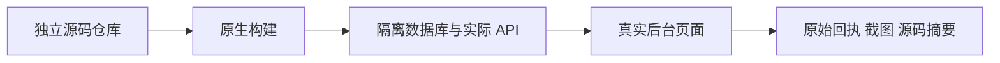

使用 `CHROME_BIN` 指定已安装的原生 Chrome/Chromium。`evidence/plan-ui-browser-path-failure/` 与 `plan-ui-layout-before-fix/` 保留首次错误和原截图；不覆盖旧成功记录。方案聚焦 24/24，完整平台回归以当前 `alignment-platform.json` 和原字节 TAP 为准。完整 VIP/配额/正式服务/原生综合验收仍保留；本轮不改变原生安装预览字节。

## 无边框 Desktop 与原生侧栏预览

Desktop 使用无原生边框、无 Electron 默认菜单的自绘品牌标题栏；扩展按钮打开 Chrome 原生全局 Side Panel，默认位于右侧。2026-10-20 当前源码版和重新打包版各 **10/10** 组通过，检查真实 EXE 的按钮、Alt、指针/键盘缩放的 800×600 下限、跨窗口 IPC 拒绝、PKCE、弹窗位置及主题语言；两次记录分开保留。浏览器 action 使用 `Extensions.triggerAction` 和实际 `SIDE_PANEL` 上下文，左右位置由 Chrome 用户偏好控制。扩展先前 **8/8** 是历史业务增量，完整原生认证及系统矩阵继续独立验收。

当前预览产物在同级 Desktop `release/frameless/`（Setup、Portable、win-unpacked）和扩展 `release/sidepanel/CopyPaste-0.5.0-sidepanel.zip`。使用 localhost，Desktop 未签名。先前预览原字节保留于 `frameless-stage30/` 和 `sidepanel-stage30/`；旧清单、报告、截图和摘要映射位于 `evidence/stage30-native-surfaces/`。`evidence/native-surfaces-artifacts.json` 记录当前 SHA-256、源码提交、实际测试的文件绑定及 ASAR 与当前构建的字节一致性。此检查运行 win-unpacked，Setup/Portable 尚未通过安装/卸载验收。

2026-10-20 实际复核发现并修复 Desktop 的会话上下文 API 白名单遗漏；三个登录后停留在登录页的失败记录、诊断截图与修复后源码 10 项通过回执保留在 `evidence/native-preview-refresh-initial/`。新工具会在 QA 前后计算完整客户端运行目录、安装器、扩展 dist 和运行源码摘要；打包准入再次比较，拒绝旧报告、改包、增删文件或未完成清理。`npm run test:surfaces` 的 12 项检查覆盖这些拒绝条件。

```powershell
# 原生开发栈已启动；先分别构建 Desktop 与 extension
$env:CHROME_BIN='你的原生 Chromium 路径'
$env:COPYPASTE_DESKTOP_EXECUTABLE='同级 Desktop/release/frameless/win-unpacked/CopyPaste.exe 的绝对路径'
npm run qa:native-surfaces
npm run test:surfaces
# 各源码仓库提交、干净后，校验二进制并生成扩展 ZIP/产物清单
npm run package:surfaces
```

报告为 `evidence/native-surfaces.json`，自建窗口在 finally 关闭；QA 进程使用软件渲染，产品启动参数不变。截图位于 Desktop 的 18–20 和扩展的 09，工作区等待角色卡片及字体载入后采集。首轮原生侧栏布局失败、当前桥接遗漏失败和历史完整包独立保留。签名更新、安装/卸载、系统/DPI 和全部 102 条综合验收继续保留。

## 仓库清单

| 同级目录              | 职责                                                                      | 默认入口         |
| --------------------- | ------------------------------------------------------------------------- | ---------------- |
| `copypaste-platform`  | 身份、企业权限、API/Worker、Codex、费用/VIP、素材/数据/流程、Admin 控制面 | `localhost:4310` |
| `copypaste-web`       | 用户 Web 完整访问/登录/初始化/工作区                                      | `localhost:4317` |
| `copypaste-admin`     | 独立 MFA 后台与 16 个运营页面                                             | `localhost:4318` |
| `copypaste-extension` | Chrome MV3 侧栏、PKCE、主动文件/网页、原生桥接                            | 加载 `dist/`     |
| `copypaste-desktop`   | Windows 客户端、目录授权、签名命令、Chrome Host                           | Setup / Portable |
| `copypaste-delivery`  | 本仓库，启动、停止、验收、版本与证据                                      | 命令行           |

每个仓库有自己的 package.json、锁文件、main 分支、中英 README 和素材来源说明。Web/Admin/Desktop 构建不要求相邻源码。只有本集成仓库的启动/QA 需要明确放在上述同级布局；也可用 `COPYPASTE_DEV_ROOT` 指定启动/构建根目录。浏览器 QA 脚本当前依赖上述同级布局和默认本机端口。

## 已安装环境直接查看

```powershell
# 本仓库执行；控制器占用 4319 仅供本机关闭
npm start
```

打开 `http://localhost:4317` 或 `http://localhost:4318`。保留终端。关闭时在本仓库另一终端：

```powershell
npm run stop
```

控制器依次启动真实 PostgreSQL、平台、Web、Admin；等待真实就绪；关闭时通过仅本机随机令牌控制口，先停 API、再停界面与数据库。端口已有进程时直接失败并保留它，不杀用户已有程序。原生 pg_ctl 关闭会完成 checkpoint；已验证无崩溃恢复的持久重启及原有 5173/5174 服务进程保持。控制器令牌、进程状态及日志只在忽略的 `.data/`。

## 干净环境复现

原生 Windows x64、Node.js 22.14+、npm、Git、FFmpeg/FFprobe、固定 Codex `0.163.0-alpha.10.2`。不得调度 Docker、WSL 或虚拟化环境。锁文件含原生 PostgreSQL/Electron 依赖，首次安装可能下载对应平台二进制。保持六个仓库同级，先停止旧开发服务：

```powershell
npm ci
npm run bootstrap
npm start
```

控制器就绪后，在 platform 仓库的另一个终端准备隔离测试库和管理员：

```powershell
npm run db:migrate
npm run admin:create -- admin@your-company.example super_admin
```

把 platform `.data/enrolment/<id>.json` 的 TOTP URI 导入认证器并删除 enrolment 文件。用户可自己用工作邮箱注册，无默认账号；开发验证码在 platform `.data/mailbox/`，生产必须配置真实 SMTP。

Bootstrap 不安装个人全局工具，也不覆盖现有 `.env`。数据库/API 保留本机已有试点数据，不能用 QA 数据替代真实企业资料。MASTER_KEY 丢失会影响加密凭证、签名及会话验证，应与数据库/对象文件一并备份。

## 四端和平台关系

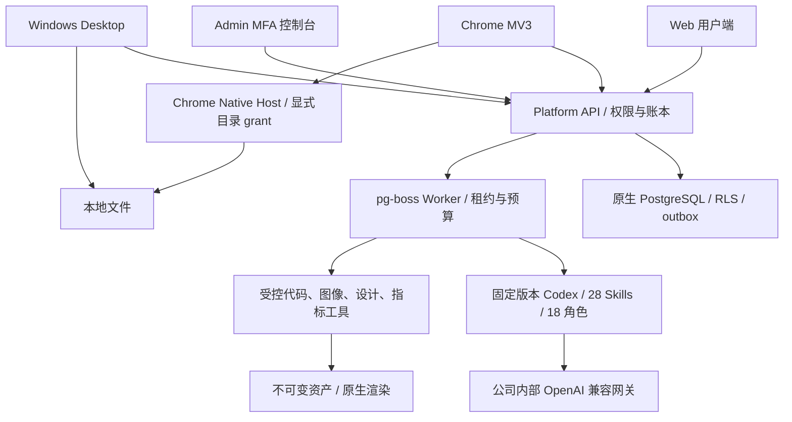

AI key 只在服务端 `.env`，所有 AI 经内部网关。没有公司 Base URL、精确模型别名、密钥和实际费率时，界面正常访问、非 AI 业务可用，AI 任务明确不可用。

## 验证命令与证据

```powershell
npm run verify
npm run qa:web
npm run qa:persistent
npm run qa:admin-identities
npm run qa:schedules
npm run qa:extension
# 先在 Desktop 仓库执行 npm run package:dir 或 npm run package
npm run qa:desktop
npm run qa:packaged
python -X utf8 scripts/review-repositories.py
```

浏览器 QA 需要 Chromium。可通过 `CHROME_BIN` 指定现有原生可执行文件，或 `npx playwright install chromium` 安装 Playwright 自带版本；本次机器已安装。所有测试只创建并关闭自己的页面/上下文/进程，不关闭用户原有浏览器。

| 证据文件                          | 含义                                                                                   |
| --------------------------------- | -------------------------------------------------------------------------------------- |
| `evidence/verification.json`      | 六仓库类型检查/构建、平台 84 项测试、Desktop 3 项测试、实际路由导出                    |
| `evidence/web-admin.json`         | 真实邮件登录、初始化、PNG 素材/图层与媒体、数据/流程、16 页 Admin、费用/VIP            |
| `evidence/persistent-work.json`   | 专家/私密会话/记忆、移动/深色主题、Admin 正文隔离与删除的 8 项浏览器检查               |
| `evidence/admin-identities.json`  | 管理员邀请、邮箱与真实 MFA、更换验证器、受限权限、停用/恢复与重发邀请的 6 组浏览器检查 |
| `evidence/schedules.json`         | 真实时钟、关闭用户页后生成报告、暂停/恢复、时区编辑、Admin 和移动布局的 5 组检查       |
| `evidence/federation.json`        | 签名 OIDC、首次邮箱证明、真实打包 Desktop 与后台跨端撤销的 6 组检查                    |
| `evidence/extension.json`         | 实际 MV3、Chrome identity PKCE、上传、token 隔离、退出                                 |
| `evidence/desktop.json`           | 实际打包应用、PKCE、私密会话、云端计划、目录、签名命令及 Native Host 的 7 项检查       |
| `evidence/packaged-windows.json`  | 实际 Windows 包启动、isPackaged、版本和截图                                            |
| `evidence/native-controller.json` | 启动/关闭控制器与原有服务保留核查                                                      |
| `evidence/repository-review.json` | 仓库边界、双语 README/图/截图、真实本机密钥排除及来源哈希                              |
| `evidence/release-manifest.json`  | 最终 Git 提交、构建产物 SHA-256 与范围                                                 |

报告只代表实际运行过的检查。受控 Responses fixture 启动真实 Codex 并执行工具回合，但不等于公司真实模型业务准入。主文档的 102 项长期验收没有被批量标为通过。静态文档核查另外在根目录运行 `python -X utf8 docs/tools/validate_docs.py`。

## 数据库生命周期复核

`npm run qa:lifecycle` 要求先停止现有 CopyPaste 控制器。它自行启动、关闭、重启原生服务，核对 PostgreSQL checkpoint、当前版本就绪、专家/会话/记忆记录保留及既有服务 PID，最后停止自己的栈。之后用 `npm start` 恢复查看。此检查不启动虚拟化或浏览器。

0.1.0、0.2.0、0.3.0 与 0.4.0 原始验收副本保存在 `evidence/versions/`；当前 evidence 对应 0.5.0。长期需求继续由各仓库及主文档跟踪。

## 二进制与演示流程

所有检查通过且六仓库已提交、工作区干净后，在本仓库执行 `npm run release`。它验证证据，生成 `release/`：六个可离线克隆的 Git bundle、Web/Admin/Chrome 成品 ZIP、Windows Setup/Portable，以及包含精确提交和 SHA-256 的清单。`git clone <文件.bundle> <目录>` 可恢复独立仓库。发布产物和 `evidence/release-manifest.json` 均忽略入 Git，避免提交自引用；源码内保留生成脚本及已执行的验收报告。

执行 `python -X utf8 scripts/verify-release.py` 可再次核查全部文件摘要、ZIP CRC/入口，实际离线克隆六仓库并比对提交、分支、tree、源码索引及干净状态。它只在本仓库 `.data/release-restore/` 建立临时 checkout，核查后删除自己创建的目录；结果写入忽略的 `evidence/release-restore.json`。

Desktop `npm run package` 输出 Windows x64 Setup、Portable 和 win-unpacked；当前为未签名、本机 origin 构建。Chrome 加载扩展 `dist/`；生产发布需改公开部署 origin、匹配扩展 ID，安装版经用户确认注册 Native Host。未自动安装应用、发布商店、创建线上收款或部署生产。

建议演示顺序：邮箱注册 → 创建企业/项目 → 专属专家/私密会话/记忆 → 品牌/素材 → 创意工程 SVG/PNG/MP4 → CSV 指标 → 工作流审批 → Admin 用户详情、确认入账、VIP → 扩展登录上传 → Desktop 登录、目录授权与云文件指令。实际 Agent 生成环节须公司网关联调后启用。

## 尚未完成的发布工作

公司 AI/SMTP/广告 OAuth/S3 需真实凭证及联调；Windows 签名证书、生产原生服务账号/ACL/网络隔离、备份恢复/SLO 需部署核查。SAML/SCIM、强制 SSO、事件触发、并行团队 Agent、协同编辑、完整 AI 视频/语音、在线收单、客户代码强隔离不在本次已实现范围。已安装 18 个角色/28 个 Skills 仍待真实角色任务验收，不能按可用资格数量宣传。

主需求和设计优先级未被删除；本仓库交付实际实现和证据，不用页面存在冒充全部产品验收。各端完整操作说明见各自中英 README；[第三方说明](THIRD_PARTY_NOTICES.md)记录工具和截图来源。

## 云端日历验收

`npm run qa:schedules` 通过真实邮箱登录、新企业、CSV 和已发布流程，在 UI 预览并确认每日计划；关闭用户页面后等待真实时钟，由原生 Worker 生成报告并校验 HKD/ROAS。随后验证用户暂停/恢复、每周/香港时区编辑、后台独立 MFA 控制和 390px 布局，共五组，报告为 `evidence/schedules.json`。测试不调用 AI，在 finally 关闭自建浏览器、退役计划并取消测试运行。

打包 Desktop 另外检查原生 bearer 日历创建、实际显示与退役；`qa:lifecycle` 核对日历配置/历史数据库侧摘要及重启持久性。当前 0.5.0 包含 84 项平台测试和 3 项 Desktop 单元测试；浏览器与打包旅程单独报告。

## 0.5.0 企业身份与统一登录

OIDC 使用 code + PKCE S256、签章、state/nonce 与固定回调。先有注册账号及有效企业成员资格，再绑定企业身份；首次绑定需要独立的 CopyPaste 工作邮箱确认码，不按网域自动开户。配置改变、停用或本人解除连接会撤销关联用户的全部 CopyPaste Web/native/refresh 会话和旧执行授权。管理员登录仍独立使用邮箱与 TOTP。

`npm run qa:federation` 使用原生签名 OIDC IdP，验证邮箱开户、后台配置/检查/启用、首次独立邮箱确认、真实打包 Desktop 的系统浏览器 SSO + loopback PKCE、390px 布局及后台跨端撤销。fixture、浏览器和 Electron 全在 finally 关闭；报告为 `evidence/federation.json`。它不是公司 IdP 或内部 AI 的生产准入。

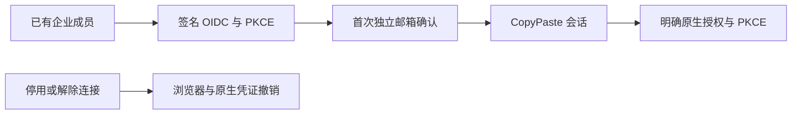

部署配置 `SSO_ALLOWED_ORIGINS` 为所需的精确 HTTPS origin。默认回调为 `WEB_ORIGIN/v1/auth/sso/callback` 经 Web API 代理；跨域 `VITE_API_BASE` 可配 `SSO_CALLBACK_ORIGIN=API_ORIGIN`。生产拒绝 `SSO_ALLOW_LOCALHOST=true`。只有原生 fixture 验收时，用此环境开关启动开发控制器，执行 `qa:federation` 后停止并不带该开关重启。

## 明确假数据的开发环境

`npm run demo` 原生启动数据库、真实 Codex Worker、模拟 AI 网关、Web 和 Admin；不会改现有平台 .env。模拟网关仅回环可用、不可在生产启用，页面和持久业务数据均有模式标记；企业 Owner 可一次性领取演示 gift。`npm run stop` 仅关闭控制器创建的进程，需等待原生数据库完成 checkpoint 后再启动。

`npm run qa:alignment` 验证邮箱初始化、删除清理、9 MiB 上传在断网和刷新后续传、真实 Codex 的模拟软件交付、SSE、四种屏宽/深色及独立 Admin MFA。报告在 evidence/alignment.json，脚本 finally 关闭创建的浏览器上下文和实例。新源码未重打包时，release/ 的 0.5.0 仍是历史交付。

## 本轮新增源码验证

- `npm run qa:cloud-files`：四组 Web 云目录流程、两次真实 Codex 模拟任务的持久源码与实际 ZIP；生成 evidence/cloud-files.json 和实际 HTTP 契约样本。
- `npm run qa:desktop-transfer`：八组源码 Electron 登录、幂等上传、29 MiB 传输、覆盖保护与原生桥云目录；生成 evidence/alignment-desktop.json。
- 平台当前全套回归 185/185，完整 TAP 与摘要在 evidence/alignment-platform.\*。

根目录运行 `python -X utf8 docs/tools/validate_runtime_contract_samples.py` 核对实际响应字段。所有上述运行使用明确标识的假数据依赖，内核仍是真实 Codex，不等于真实模型质量或全部 102 项综合验收完成。

## 技能生命周期核查

项目方法新增精确安装及专家/任务版本绑定。普通停用影响新工作；卸载和永久安全撤销阻止包括旧任务在内的后续调用。重装产生新身份，专家须保存新版本后采用。工具调用及结果落库前复查当前方案，实际消耗按原预留结算。

平台全套回归 **185/185**；delivery 的 `npm run qa:skills` 通过三组浏览器验收，31 份实际 HTTP 请求／响应样本通过严格设计 schema。自定义包审核/发布、完整真实角色资格仍待完成，历史 0.5.0 安装包未替换。

## 默认助手、通知与源码完整性

`npm run qa:default-assistant` 与 `npm run qa:notifications` 各验证四组 Web 流程；`qa:extension` 验证八组真实 MV3 流程；`qa:desktop-transfer` 现有八组，加入默认文字助手、通知定位、登录前后模拟提示和运行前资料选择。所有模型依赖为获准假数据，业务持久化和 Codex 真实执行，浏览器/应用在 finally 关闭。

`npm run qa:byte-integrity` 在自己创建的临时目录实际克隆 platform/Desktop/delivery，检查 SQL 原始摘要、两个现有数据库迁移账本、28 个 Skill、渲染快照和原始 TAP。它检验独立 Git 克隆的字节完整性，不代替灾难恢复演练；运行前须提交当前源码和 TAP。脚本只删除本次创建且已检查归属的目录。

当前源码平台 185/185、Desktop 四组单元测试通过；实际 HTTP 请求／响应样本 31 份。全 102 条综合验收和生产发布仍按主文档维护。

## 运行前资料验收 / Initial input-checkpoint QA

`npm run qa:task-dependencies` 五组 Web 检查验证无模型等待/原预算、私人分片上传、明确版本选择、同任务执行结算、权限错误、通知及四种宽度。Desktop 和 MV3 各八组旅程纳入对应检查；报告为 evidence/task-dependencies.json、alignment-desktop.json 和 extension.json。`python scripts/capture-platform-regression.py` 原样保存后端 TAP 字节和 SHA-256。

Five Web checks cover the initial input checkpoint, actual private upload, explicit version selection, same-task execution and settlement, authorization errors, notifications, widths, themes and languages. Native Desktop and MV3 each have eight verified journeys. Real Codex executes synthetic model responses; these checks do not establish live model quality, paid-step continuation or all 102 acceptance cases.

## 执行容量验收（当前源码）

`npm run qa:execution-capacity` 以明确模拟的私人占槽记录验证 Web 原任务排队、零模型调用、单预留、独立 MFA 的 Admin 可读原因、两主题/繁英/四宽度及槽位释放后的真实 Codex/模拟模型交付与一次结算。占槽数据仅限脚本自己创建的模拟企业，并在 finally 释放；不代表完整 NFR 压测。平台另有七组使用独立随机原生数据库的并发与真实 pg-boss 测试，测试后清理本次数据库和专用目录。

## Admin 大量记录与测试隔离验证

`npm run qa:admin-records` 使用独立企业、58 条可见及六条排除的清理账本测试记录，验证真实邮箱/MFA、范围总数、50 条默认分页、组合筛选/URL 保留、只读重试拒绝、四宽度、两主题/语言、慢轮询拒绝清空与实际授权到期。仅在本机模拟模式执行，不创建真实对象或删除真实文件；最终停用测试管理员、撤销会话并关闭自建浏览器。报告与实际响应样本位于 `evidence/admin-records*.json`。

平台完整回归现在按测试组隔离原生数据库和数据目录，保留生产执行容量约束。原始首次失败证据为 `evidence/admin-records-first-regression-failure.*`，当前通过结果仍由 `capture-platform-regression.py` 原样捕获。新增迁移 030 也应参与离线字节校验。历史安装包未因此自动重打。

## 模板与原生端验收

`npm run qa:agent-templates` 运行八组真实 Web/源码 Electron 流程：独立邮箱与工作区、目录筛选、缺失工具、无费用预检、编辑失效、接受响应丢失后幂等重试、技能恢复后新回执、四宽度/主题/语言、权限拒绝隐藏及原生 PKCE/企业头校验。模型与媒体保持模拟，业务持久化真实，所有自建浏览器和应用在 finally 关闭。

模板增量的六组专项检查使当时完整回归达到 145/145；后续 PDF 增量后为 147/147。四份模板实际响应加入后严格 schema 样本共 21 份。迁移 031 与新的 Desktop 渲染快照均须纳入字节验证。历史安装包和离线 bundle 保留原版本，全部 102 条需求及至少 12 个角色资格门槛继续保留。

## PDF 交付验收

`npm run qa:design-pdf` 的七组流程验证真实登录、画布、接受后响应丢失、幂等重试、源版本冲突、四宽度/主题/语言、设计师模板和原生 Electron 保存。PDF 由 pypdf 独立解析、Poppler 原生渲染并与同源 PNG 比较；报告 `evidence/design-pdf.json` 登记尺寸、摘要与清理结果。

需要原生 Chromium、`PDF_QA_PYTHON`（含 pypdf/Pillow）及 `PDFTOPPM_BIN`。这些仅用于 QA，不是产品运行依赖。当前全套平台回归 **185/185**；本轮源码未重打历史安装包，不等同完整 102 条验收。


## 营销 CSV、精确指标与来源（当前源码）

导入先预览并确认账户、币种、时区、实体层级、归因和转化定义；支持通用 CSV 及 Google/Meta 风格候选表头与手动映射。原始 UTF-8/BOM、SHA-256、映射和计算结果真实保存。相同项目内重复请求或成功回执丢失后的重试只返回原快照；被隔离的数据不能绕过限制重新上传。未知转化不计零，CTR/CPC/CPM/CVR/CPA/ROAS 用精确小数先加总再计算，历史结果冻结。

原始 CSV、标准化 CSV、带 11 项证据的 JSON 计算报告及实际 SVG 可下载。页面显示实际数据日期；上传时间不冒充平台取数截止时间。没有正式广告账户同步、跨平台转化去重、FX 或完整 AI 叙述验收；营销分析角色仍未合格。模型依赖继续使用获准假数据，数据库与文件逻辑真实执行。历史安装包未重打。

`npm run qa:marketing-analytics` 验证六组 Web/原生 Electron 流程：真实登录、映射预览、成功回执丢失后重试、实际 CSV/JSON/SVG 下载、行错误/未知值、两主题/繁英/四宽度、选中快照拒绝清空与原生保存。设置 `CHROME_BIN` 为本地原生 Chromium；报告为 evidence/marketing-analytics.json。新建浏览器、上下文及 Electron 均在 finally 关闭。平台当前全套回归 **185/185**，原始 TAP 保持字节及摘要一致。

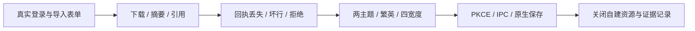


## AnalysisSpec 私人报告（当前源码）

在行销分析选择已有快照、业务问题、日期/比较区间、指标、维度和 HKD 最高预算。预览不调用模型或预留费用；明确确认后原子建立私人 Codex 任务、冻结计算/证据及单笔预留。来源、账户、币种、时区及归因独立；重复事实去重，冲突拒绝，比较零值/无数据保留原因。接受后丢失回执重试返回原报告。

真实 Codex 通过分页事实工具读取固定值，服务端检查证据占位符及数字字面量后发布固定 HTML 资产，JSON 保留完整计算。自然语言语义和专业业务质量仍待验收；当前模型为明确标识的假数据。来源隔离/删除和项目撤权阻止读取及下载。完整 102 条综合验收、正式连接、专业角色资格和生产发布仍未完成，历史安装包未更新。

先运行 `npm run demo`，再设 `CHROME_BIN` 为本地原生 Chromium 并执行 `npm run qa:analysis-reports`。六组实际 Web/源码 Electron 旅程覆盖真实开户、无费用预览、丢失回执重试、规范查询/真实下载、16 个尺寸/主题/语言组合、拒绝清空及原生相同字节保存。原始报告 `evidence/analysis-reports.json`；两个首次失败报告保留上下文限制和手机布局问题，最终报告独立记录修复后结果。

当前平台完整回归 **185/185**，严格实际 HTTP 样本 **31/31**。`capture-platform-regression.py` 原样保存 TAP 与摘要；不要格式化 TAP。事实索引的只读核对见 `evidence/analysis-index-backfill.json`，使用已保存指标，没有重算历史。所有自建浏览器、页面、上下文和 Electron 在 finally 关闭。

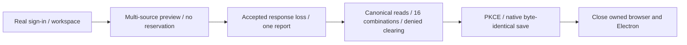


## CSV／XLSX 文件导入与更正历史（当前源码）

营销输入现在先保存为项目共享文件的固定版本，再预览工作表、标题列、映射和账户口径。Google/Meta 经规范 `POST /v1/dataset-imports`，通用表格沿用兼容入口；预览不调用模型或预留费用。重复上传、接受回执丢失与重试不重复建立相同快照。原始 CSV/XLSX 下载校验实际字节及 SHA-256。

XLSX 限 5,000,000 字节、50 张工作表、100 列和 10,000 数据行；多表须明确选择，标题列为 1–100。只读解析共享/内联字符串、XML 中文字符引用、精确数字及 1900/1904 日期；金额输入最多六位小数，冻结指标保留八位。拒绝公式（含缓存结果）、宏、外链、加密文件和数据区合并单元格。错误定位实际工作表单元格。预览失败仍保留已明确上传的项目原始文件，界面提前说明。

更正新建不可变快照并记录完整祖先链，保留旧指标和历史报告；AnalysisSpec 在建立任务/预算前拒绝同时汇总祖先及更正版。来源隔离或删除阻止依赖数据、报告和文件读取；删除恢复流程关闭尚未领取的任务并释放未用预留，已运行或费用不明的任务保留原对账规则。私人文件须先明确发布为共享副本。

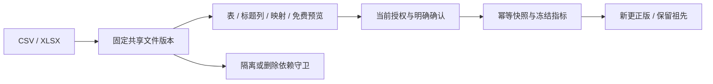

平台完整回归 **185/185**，严格实际 HTTP 样本 **31/31**，文件导入四组及原有 CSV 六组 Web/源码 Electron 流程通过；原生类型检查和四项单元通过。模型/媒体依赖为获准假数据，数据库、Codex、文件与授权逻辑真实执行。完整 102 条综合验收、全部官方导出格式、正式连接器、专业业务资格和生产发布仍待完成，历史 0.5.0 安装包未重打。详细规则见主文档 `docs/technical/29-file-imports-and-correction-lineage.md`。

原生开发栈启动后执行 `npm run qa:file-imports`（设置 `CHROME_BIN`）。四组覆盖接受回执丢失、唯一上传资产、更正链、公式错误、16 种界面组合及真实 PKCE/原生保存；报告及五份请求／响应样本保存在 `evidence/file-imports*.json`。原生桥首次失败报告独立保留；修复后四组通过，所有自建浏览器和 Electron 在 finally 关闭。


独立兼容核查：设置 `WORKBOOK_QA_PYTHON` 为含 openpyxl 的原生 Python，再执行 `npm run qa:workbook-interop`。openpyxl 3.1.5 生成的双日期系统、带样式/稀疏/隐藏行/中文的 XLSX、公式及七位金额拒绝四组通过；报告为 `evidence/workbook-interop.json`。首次中文字符引用缺陷及初始超精度 fixture 的记录单独保留；临时工作簿在 finally 清理。Python/openpyxl 仅为核查工具，不是产品运行依赖。

原生开发栈启动后执行 `npm run qa:task-controls`（设置 `CHROME_BIN`）。五组验证 Web、源码无边框 Desktop、真实 MV3/PKCE 的排队暂停/恢复/取消，以及释放本次测试占位后由真实 Codex/模拟模型生成文件并结算一次。原任务和预留不重建，自建浏览器、Electron 和扩展在 finally 关闭。报告为 `evidence/task-controls.json`；当前完整平台回归 185/185。此项是源码验证，先前无边框预览与历史完整离线包保持原清单；运行中/已付费步骤恢复及完整 102 条验收仍未完成。

## 跨端会话专项

`npm run qa:sessions` 启动自有隔离浏览器、源码无边框 Electron 与真实 MV3，使用新建合成账号、实际邮箱验证码/PKCE，验证会话目录、Web 远端撤销、原生过期访问退出、离线提示、跨标签退出与迟到响应。模型调用为零。仅调整本次用户的凭证过期时间；离线 revoke 与后台 GET gate 为显式故障注入。所有自建页面、上下文和应用在 finally 关闭，报告写入 `evidence/sessions.json`。本专项不重新生成历史安装包，也不关闭完整身份、102 条需求或生产门槛。

上一阶段会话专项七组通过，平台回归 191/191，Desktop 原生单元 15/15，扩展单元 10/10；当前认证增量和证据见下节。Windows 默认 GPU 路径的四次早期超时与对照报告已保留；本专项对自建 Chromium/Electron 使用 `--disable-gpu` 软件渲染，产品启动配置未变。正常计时/帧与点击对照见 `evidence/sessions-gpu-diagnostic.json`，最终模式写入会话报告；不据此声明硬件渲染兼容性通过。

## 规范认证交付检查 / Canonical authentication verification

`npm run qa:platform` 原样保存完整平台 TAP 字节及摘要，不再依靠 shell 文本重编码。`npm run qa:sessions` 使用真实 Web、源码无边框 Electron 与两个 MV3 面板，额外注入“首次交换/刷新已提交而响应丢失”以及“旧账号 401 延迟到新账号登录后”故障；只操作本次合成账号与自有本地存储，退出时撤销测试凭证并关闭全部自建实例。

The platform runner records unmodified TAP bytes and SHA-256. The sessions journey exercises canonical Web/PKCE consumers, bounded first-exchange recovery, persisted same-key refresh recovery, two-panel account replacement, revocation and late-response isolation. Controlled expiry, encrypted-vault/session-storage, response-loss and delayed-message fixtures are explicit; model calls remain zero. The initial Electron evaluation harness failure is retained as `evidence/auth-recovery-harness-import-failure.json` and is not counted as passing evidence.

These source checks do not rebuild historical installers/ZIPs or close all 102 acceptance cases. Existing package manifests and their original verification receipts remain unchanged.

历史启动限制：此前十二组原生复核未完成，失败与诊断仍见 `evidence/auth-recovery-open-issue.json`，原七组 `sessions.json` 保持原字节。2026-10-20 当前源码十二组已通过，使用新的 `evidence/auth-recovery-current.json`；具体范围和截图见下文，完整安装包／SSO／系统矩阵仍待验收。

Historical startup limitation: the earlier twelve-flow run did not complete; its failures and diagnostic comparison remain unchanged. The current-source rerun now passes **12/12** in `evidence/auth-recovery-current.json`, with scope and screenshots below. The original seven-flow session receipt remains historical. Complete packaged authentication, SSO and system matrices are still unaccepted.

浏览器检查使用锁定 Playwright 对应的引擎；可在本仓库中设置以下原生 Windows 路径。Headless Shell 用于 Web 检查，完整 Chromium 供 MV3 使用。 / Use the locked Playwright engines: Headless Shell for Web and full Chromium for MV3.

```powershell
$env:PLAYWRIGHT_BROWSERS_PATH='D:\dev\copypasted\自有agent\dev\copypaste-delivery\.data\browsers'
node node_modules/playwright/cli.js install chromium --no-progress --no-remove
$env:CHROME_BIN='D:\dev\copypasted\自有agent\dev\copypaste-delivery\.data\browsers\chromium-1248\chrome-win64\chrome.exe'
$env:WEB_CHROME_BIN='D:\dev\copypasted\自有agent\dev\copypaste-delivery\.data\browsers\chromium_headless_shell-1248\chrome-headless-shell-win64\chrome-headless-shell.exe'
npm run qa:auth-navigation
```

`qa:byte-integrity` 当前独立检出四组通过：36 SQL、28 固定摘要方法包、43 渲染来源摘要和 203 项原始 TAP。 / Fresh checkout integrity: four groups passed, covering 36 SQL files, 28 trusted packages, 43 renderer digests and the raw 203-test TAP.

## 用户资料契约与启动诊断 / Profile contract and startup diagnosis

用户端 QA 的工作区/CSRF 初始化改用 `GET /v1/session/context`；规范导航专项另外通过实际 HTTP 分别检查 Cookie 与 Bearer 的 `GET /v1/me` 原始 `User`，只保存合成账号的公开资料字段作为 schema 样本。后台 `/v1/admin/me` 及用户 `PATCH /v1/me` 不变。

当前 `npm run qa:sessions` 将十二组结果写入 `evidence/auth-recovery-current.json`，旧 `auth-recovery.json`、原七组 `sessions.json` 和不加载产品模块的 `qa:electron-readiness` 诊断保持原字节。当前使用显式 Electron 路径与直接源码启动，和已通过的原生窗口 QA 一致；这不证明旧失败的唯一根因。拥有的 BrowserServer／Electron／MV3 关闭有界，超时仅回收已核对的自建进程树。当前十二组及实际资源释放结果见下文。

Client QA bootstrap uses `GET /v1/session/context`. Real HTTP profile checks validate canonical browser and native `User` responses and export only synthetic profile fields. Admin profile and user profile mutations keep their own routes. Current twelve-flow session QA writes `auth-recovery.json`, preserving the historical seven-flow receipt. The pinned Playwright ready-event bridge is explicit; bounded shutdown can kill only its owned process tree and still fails acceptance. Minimal Electron readiness is diagnostic evidence, not product acceptance. Expanded native journeys remain unproven.

本轮平台 **207/207**、Web 实际流程 **4/4**、严格实际 HTTP 样本 **33/33**；旧 203 项回归保存在 `evidence/stage33-platform/`，首次 204/205 失败保存在 `evidence/profile-platform-first-failure/`，初始化夹具失败单独保留。 / This increment passes **207/207** platform tests, **4/4** real Web journeys and **33/33** captured HTTP schemas, while preserving the original 203-test receipt and the first failed 205-test run. Expanded native journeys remain unproven.

本次提交后的独立 Git 检出四组通过：36 份不可改写 SQL 及两库摘要账本、28 个固定摘要 Skill、43 份 renderer 来源摘要、207 项原始 TAP 字节和记录 SHA-256；临时检出已移除。 / Four fresh-checkout integrity groups passed for 36 immutable SQL files and both migration ledgers, 28 exact-hash Skills, 43 renderer files and the original 207-test TAP bytes. Owned temporary checkouts were removed. This does not replace native application acceptance.

## 邀请与成员验收 / Invitation and member checks

`npm run qa:membership` 验证实际 Web 创建与投递、轮换重发、邮箱登录/加入、移除、撤销，以及真实退出后迟到响应拒绝：模型调用 0；早期成功报告被重跑覆盖，不作为可审计证据。此前页面复核超时的原记录仍在 `evidence/membership-current-issue.json`；当前新回执 `membership-ui-recovery.json` 六组通过，拥有的会话与浏览器均关闭。当前 `npm run qa:membership-wire` 真实 HTTP 五组通过并退出拥有的会话。四份实际响应加入原始 schema 校验，累计 37/37。首次 Vite 代理响应匹配失败保留在 `evidence/membership-first-navigation-failure/`。

The earlier successful `qa:membership` receipt was overwritten and is excluded from auditable acceptance evidence. Earlier page timeout receipts remain historical. The new current-source `membership-ui-recovery.json` passes six groups and closes owned sessions/browsers. `qa:membership-wire` separately passes five current-source HTTP groups and closes both owned sessions. Four canonical HTTP response samples bring strict schema checks to 37/37. The first origin-matching fixture failure is preserved. Original 207-test evidence is archived byte-for-byte in `evidence/stage34-platform/`; the 218-test stage before exhausted-lease coverage is in `evidence/stage35-initial-platform/`. Latest platform and fresh-checkout results are separate raw evidence. Production SMTP, the complete Admin/native matrix and rebuilt release artifacts remain pending.

最新平台全套 **220/220**；严格实际 HTTP 样本 **37/37**；当前 HTTP 五组通过；当前页面复核失败独立保存，早期成功字节缺失不作通过证明。 / Latest platform **220/220**, strict captured HTTP schemas **37/37**, and five current-source HTTP groups passed; current page failures are retained and the overwritten earlier success is not accepted.

本轮独立检出四组通过：37 份不可改写 SQL 和两库摘要账本、28 个固定摘要 Skill、45 份 renderer 来源摘要、220 项原始 TAP 字节及记录摘要；临时检出已移除。检出基于实现提交，后续提交仅纠正证据说明和保存回执。 / Four fresh-checkout groups pass for 37 immutable SQL files and both migration ledgers, 28 trusted Skills, 45 renderer digests and raw 220-test TAP bytes. Owned temporary clones were removed. Subsequent commits only clarify evidence metadata and save the receipt.

## Admin 成员真实 HTTP 验证

运行 npm run qa:admin-membership-wire，使用独立合成用户和仅指定测试企业的临时管理员，验证成员授予、暂停/恢复、规范操作恢复、独立审批及撤权；模型调用为零。结束时退出自己的会话并停用自己的临时管理员。原始回执和实际响应样本保存到 evidence；这些检查不证明页面验收。

本轮最终稳定源码平台回归 **233/233**，新增 Admin 成员专项 **13/13**；当前真实后台成员 HTTP **5/5**，原规范捕获样本 **43/43**。完整原始回执位于 Delivery `evidence/`；页面验收与生产/完整原生门槛另行保留。


## 账户控制增量复核

`npm run qa:admin-account-wire` 使用当前本机原生服务、真实邮件与 TOTP 合成身份，验证六组规范资料、全局会话撤销、用户冻结、企业隔离、独立关闭及 MFA 重放守卫，捕获八个严格操作样本。`npm run qa:admin-account-ui` 单独复核新账户表单，使用自有软件渲染 Chromium 并在 finally 关闭，不操作用户浏览器。以对应 evidence JSON 的实际 checks/errors/closed 为准，不能将尝试或旧截图计为通过。

本阶段全套平台回归 245/245，原始 TAP 不经格式化；上一阶段 233 项 JSON/TAP 和检出回执归档 `evidence/stage36-platform/`。模型仍为获准模拟，完整原生、其余后台规范及历史包更新仍待完成。


本次新账户页面实测 **5/5**，完整平台 **245/245**，当前规范样本 **51/51**。页面实际修复待审批导航，截图随 Admin 中英 README；不取代原生/旧成员页面未完成项。若默认 Playwright 浏览器未安装，QA 使用环境变量 `CHROME_BIN` 指向已安装的 Chromium；本次为本机 `chromium-1243/chrome-win64/chrome.exe`。测试不下载浏览器，前次缺失路径与导航失败独立归档。


## 规范目录增量验证

`npm run qa:admin-directory-ui` 在本机 API/Vite Admin 与独立 Chromium 中运行七组检查：真实邮箱/TOTP、23 个合成用户的 20/3 游标分页、严格详情与现有账户/VIP目标入口、VIP/企业/状态筛选、规范企业账务 ID、响应式中英样式，以及 MFA/匿名拒绝。`CHROME_BIN` 可指向已有浏览器，本次使用缓存 chromium-1243；不下载浏览器。仅本次合成记录的实际响应写入 `evidence/admin-directory-contract-samples.json`，检查及关闭结果写入 `evidence/admin-directory-ui.json`。

十组服务端专项见 `evidence/admin-directory-final.tap`。旧 245 项平台回归及字节回执归档 `evidence/stage37-platform/`；失败夹具、拒绝项目零值投影和初次过早截图保留于 `evidence/stage38-initial/`。完整平台与独立检出以当前回执的真实计数和摘要为准，未经格式化的原始 TAP 保留。

当前页面验证使用源码 Vite 服务，生产构建另行检查；它不替代安装包或完整跨端验收。全部自建浏览器和上下文关闭、自有测试管理员/会话/用户停用，不操作用户浏览器。模型调用为零。资金/VIP写规范、完整消费钻取、旧成员页面和原生/发布仍有独立缺口。

本轮最终完整平台 **256/256**、七组目录实际页面/HTTP **7/7**、严格规范响应 **63/63**；新增目录/导出十一组包含在完整 TAP 中，独立旧调用专项为 **7/7**。原始 TAP SHA-256 为 `e0741c2315252c644229cfd51198c911c8272c66b365924f4a3e92fa396f5079`。首次 252/255 的旧调用回归失败及当时原文已归档 stage38-initial；没有降低原始规范或删除原安全断言。

## 授信与来源增量 / Credit-source verification

账务内核新增后充值结算、其他任务冻结保护、资金/授信混合来源、按实际债务还款、赠送到期、精确累计金额和数据库不可变来源校验。`tests/billing-sources.test.ts` 的十二组专项包含在完整平台回归中。当前完整结果与原始摘要以 `evidence/alignment-platform.json` / `.tap` 为准；此前 256 项和独立检出回执原字节保留于 `evidence/pre-billing-sources/`。

首轮专项 11/12 的错误码断言观察保存在 `evidence/billing-sources-initial.json`，该初次工具输出没有独立原始 TAP。跨企业来源新增实际已被拒绝，修正测试为来源校验在调用者 RLS 下返回的 23514，未更改权限。后续完整回归使用原始输出文件，不以观察摘要替代。

The financial core now verifies later funding against credit-backed holds, other tasks' allocations, mixed funding sources, actual debt repayment, gift expiry, exact accumulated amounts and immutable database source totals. Twelve focused groups are included in the full platform regression. The current JSON/TAP receipt is authoritative; the previous 256-test receipt and checkout proof retain their original bytes under `evidence/pre-billing-sources/`.

The initial focused run passed 11/12: a cross-tenant insert was correctly rejected, but its expected database error code was wrong. The observation receipt explicitly states that no standalone raw TAP was captured for that first attempt. Permissions were preserved. Synthetic funding does not qualify real payments, and these core tests do not complete canonical financial/VIP routes or their Admin pages.

最终本阶段完整平台 **268/268**、新增账务专项 **12/12**；原始 TAP SHA-256 为 `b84f9f9d594615f3ffc92d8926ed6f3d221ca221e3daeb5dda3667034be6d340`，严格规范样本仍为 **63/63**。迁移前两库只读聚合见 `evidence/billing-existing-state-before-migration.json`，历史测试债务没有清零。

Final full platform regression: **268/268**, including **12/12** new billing groups. The untouched TAP digest is above; existing strict contract captures remain **63/63**. The pre-migration aggregate receipt covers both native databases and preserves historical test debt.

后续首次独立检出因运行中 PostgreSQL 的临时 ASCII junction 消失而失败，原始失败回执保存在 `evidence/billing-initial-checkout-failure.json`；诊断和受控恢复记录在 `evidence/billing-runtime-alias-recovery.json`，未将内存或端口耗尽当作已证实原因。启动器随后改用稳定的用户缓存别名，真实重启、两库新连接和 API 检查见 `evidence/billing-runtime-stable-alias.json`。不停止其他项目的 PostgreSQL，也不复制数据库到缓存目录；最终检出结果继续以当前 byte-integrity.json 为准。

The first subsequent checkout check failed because the running PostgreSQL executable's temporary junction had disappeared. Its original failure and bounded diagnosis are preserved in the named receipts; memory or port exhaustion was not established. The launcher now uses a stable per-user cache junction, verified by a real restart, fresh connections to both databases and the API. Other projects' PostgreSQL instances were preserved. The current byte-integrity receipt remains authoritative for the final checkout result.


## 个人/企业资金账户增量 / Billing account increment

Platform 的 042–044 和原生迁移执行器支持带既有任务、资金批次及账项的升级，保持原企业资金字段不变；个人正式/模拟账户分别建立且不自动赠送额度。迁移 55006 初次失败、修正前 276 项回归及此前 268 项回归均保留原始输出，最终当前完整结果以 `evidence/alignment-platform.json` / `.tap` 为准。

`npm run qa:admin-billing-wire` 对重启后的真实 API 执行五组读取、隔离、游标、CORS 和当前 MFA 检查，捕获八份原始规范账户/账本响应。合成领域 fixture 没有调用模型或外部收款，也不代表规范费用命令已实现。`evidence/billing-accounts-before-migration.json` 和 `billing-accounts-live-migration.json` 对比两库旧资金事实；历史未登记的 001–015 校验和继续保持未知。

The real HTTP billing check uses owned email/TOTP sessions and synthetic internal fixtures. It validates canonical personal/enterprise account reads and persisted financial identities, then revokes its credentials. The populated native upgrade preserves original enterprise financial fields. Three later canonical fee commands and their actual Admin forms are described below; full payment/refund/VIP flows, remaining payer-selection consumers and full native/system acceptance remain unfinished. Earlier failed migration logs and raw TAP are retained. This read-only increment creates no browser tabs and uses no Docker/WSL.

## 规范费用表单与审批增量

最终全量平台回归 **291/291**，664 份参与源码及 verifier 前后摘要一致；原始 TAP 摘要为 `3384f423b23b9d764af55daeffbe7bcf14669791defbddfc9ba0358cd7bcb6c7`。费用增量没有修改已验证的无边框 Desktop 或 Chrome 原生右侧 Side Panel 字节。

`npm run qa:admin-fees` 在真实邮箱/TOTP 会话下验证规范三项费用表单、纯预览、同键回执恢复、独立请求审批、原始流水及英文浅色／繁中深色窄屏。当前 4/4 组、10 份实际 HTTP 规范响应通过；源码与 verifier 前后摘要一致，自建浏览器关闭，用户页面不触碰。五张截图位于 Admin 独立仓库。没有外部付款或模型调用。

`admin-fees-focused.tap` 为费用／迁移 16/16；最初三次不全通过与拆分真实请求前的 14/14 原输出均保留。两次最初浏览器脚本定位／初始化失败与诊断在 `admin-fees-ui-initial/`、`admin-fees-ui-second/`。此前 277 项输出在 `pre-admin-fees/`；中间 289 项因运行期间继续修改源码，明确存为非最终证明。路由清单更新前的稳定 291 项结果单独保留在 `admin-fees-pre-route-inventory/`。最终全量与字节证据仍以当前 JSON/TAP 为准。

完整付款凭证／记录、现金退款对账、消费退款分桶、不可变方案/VIP、金融 outbox、完整原始审批目录和全端／NFR／发布门仍保留。前述历史阶段的通过数字不等于当前全部验收完成。

## 阶段 42 留存：成员页面及原生认证恢复（2026-10-20）

| 命令 | 当前回执 | 结果 | 源码／运行文件 |
| --- | --- | --- | --- |
| `npm run qa:membership` | `evidence/membership-ui-recovery.json` | Web 6/6，严格响应 4 份 | 155，前后一致 |
| `npm run qa:admin-membership-ui` | `evidence/admin-membership-ui.json` | Admin 6/6，严格响应 4 份 | 179，前后一致 |
| `npm run qa:sessions` | `evidence/auth-recovery-current.json` | Web／源码 Electron／MV3 12/12 | 758，含实际 dist／renderer-dist，前后一致 |

所有测试使用真实登录／授权／数据库和自建会话，模型调用 0；拥有的 BrowserServer、Electron、MV3 实例均关闭，凭证撤销，临时管理员经数据库确认已暂停，用户原有页面未触碰。14 张实际截图在各端独立仓库和中英 README，同时同步中央文档。三份旧未完成回执保持原 SHA-256，由中央进度快照关联当前局部成功证据。

首次 Web 恢复因退出请求缺少幂等头仍记失败；首次 Admin 页面因 schema 注册和清理枚举错误仍记失败。原 JSON／样本／截图和后续实际凭证清理分别保存在 `membership-ui-first-recovery/`、`admin-membership-ui-initial/`。不以新结果覆盖旧失败，也不声称查明旧启动超时的唯一根因。

新增八份实际规范样本加入中央原始 schema 核查，总计 89/89。原全量平台 291/291、源码 664 份及原始 TAP 未变化。源码十二组认证与原生预览十组窗口／侧栏外观证据独立；完整安装包认证、系统／DPI、SSO、原生成员、生产邮件与全部 TC/NFR/G01–G10 仍在范围内。详见主文档 `docs/technical/42-current-membership-ui-and-native-auth-recovery.md`。

## 统一后台审批复核（2026-10-20）

Platform 与 Admin 现有待审批业务共用真实独立请求、原始规范游标目录及四字段决定。`npm run qa:admin-membership-ui` 验证实际邮箱/TOTP 双人登录、暂停/恢复、准确请求定位、自批 UI 防护及服务器拒绝、另一人以原始版本/摘要批准，并捕获规范列表和操作响应。`npm run qa:admin-fees` 复查三项费用表单及独立审批；`npm run qa:admin-account-ui` 复查账户表单及自批防护。原生认证与 Web 成员另按既有脚本复跑。

此前通过的源码快照与截图保存在 `evidence/stage42-before-unified-approvals/`；所有本轮原始失败 TAP 保留。完整付款、退款、VIP、财务通知及全体系验收仍待完成，Desktop/扩展已绑定预览字节未因后台改动重打包。

阶段 43 平台 303/303（669 份源码一致），共享审批及旧库升级专项 53/53；Web 成员 6/6、Admin 成员 6/6、费用 4/4、账户 5/5、Web/源码 Electron/MV3 认证 12/12。原规范响应校验 91/91。相互重叠的验证不重复加入平台测试总数。完整 102 项综合验收继续按 docs 逐项跟踪。

## 付款证据与准确充值复查（2026-10-20）

`qa:admin-fees` 现覆盖四项规范费用命令及付款证据登记/独立核实，5/5 组、15 份原规范响应，39 份源码与 verifier 前后一致，拥有的浏览器全部关闭。21/21 平台费用专项涵盖超安全整数精度、双人核实、历史付款防重、并发唯一入账、授信还款、当前权限/撤权和审计回滚。完整回归仍以 `evidence/alignment-platform.json/.tap` 为准。

阶段 43 原字节归档在 `evidence/stage43-before-payment-records/`；`payment-records-*` 保留新失败、成功、迁移日志和复制清单。不能将 050/049 的原始触发器错误或初次脚本失败计为通过；051/052 已追加修复。仅模拟实收凭据，不宣称支付网关/完整退款/VIP验收。外观预览包保持原清单，后台变化不要求重写 Desktop/扩展安装包。

本阶段最终平台 **310/310**（676 份来源一致），原始 TAP SHA-256：`5b499c16a50ec57427ed7ff7cf4681ba2e0cef0330e97159dde7e9d25e291119`。Web 成员 6/6（164 份）、Admin 成员 6/6（190 份）、费用 5/5（39 份）、账户 5/5、三端源码认证 12/12（769 份）另按各自范围记录；规范样本 **96/96**。180 份本阶段原字节归档副本附清单，首次 306/310 全量失败未覆盖。完整 102 项及所有发布门仍未据局部测试关闭。

## 原交易退款与资金核实（2026-10-20，后续增量）

消费补偿严格返还原赠额、付费和实际偿还来源，保留赠额到期时间；未偿授信只注销对应消费债务。现金退款绑定已核实原付款，先冻结未用金额，再由另一管理员逐次核实实付、剩余未付或未知/差额；部分付款不会误报全部成功。历史缺失偿还来源要求对账，不补造历史。

当前平台全量 324/324、683 份参与源码前后一致；费用及退款实际页面 8/8、47 份来源一致；原规范实际响应 100/100，补充退款合同 14/14 单独校验。50 项专项与全量重叠。SQL 053–055 已实际应用于两个原生数据库；001–052 不改写。AI、媒体和外部支付仍按明确模拟范围验收；历史授信人工对账、正式支付/VIP/outbox、完整系统及全部综合验收继续保留。较早章节的数字记录各阶段历史。

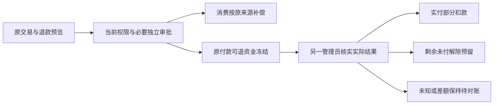

2026-10-20 退款增量后当前源码复核：Web 成员 6/6（169 份来源）、Admin 成员 6/6（196 份）和 Web/源码 Electron/MV3 认证 12/12（775 份）通过，前后摘要一致，拥有的会话、浏览器、Electron 和扩展进程均已清理。首轮 Electron 调试连接超时原回执保留，随后相同源码重跑通过。Desktop 无边框和原生 Side Panel 预览包保持原字节；完整安装包认证及系统矩阵仍须独立验收。

2026-10-20 方案版本增量後的當前源碼復核：Web 成員 6/6（172 份來源）、Admin 成員 6/6（200 份），Web／源碼 Electron／MV3 認證 12/12（779 份）；測試前後摘要一致，自建瀏覽器／Electron／擴展均關閉，測試憑證清理。新增不可變方案定義與固定歷史授權綁定不改寫原生預覽包。完整 VIP／配額、安裝包認證及系統驗收仍按主文檔繼續追蹤。

獨立 Git 檢出同時比較全部已追蹤的 canonical schema 夾具原字節，防止換行轉換造成來源回執漂移。完整平台最終回歸 340/340（688 份來源前後一致）；原始 TAP 與摘要保持在當前 evidence。

## 规范 VIP 与当前原生预览交付

阶段 47 原回执：平台全量回归 **354/354**，694 份源码前后一致；`alignment-platform.tap` 原始字节保留。Admin VIP 六组／九份原规范响应、原生 VIP 六组／五份原规范响应、原生表面十组及源码跨端认证十二组分别记录，重叠子流程不累计为全产品通过。全部 122 份运行态响应按原 OpenAPI 严格校验。原需求 102 条、同号综合用例、NFR 和 G01–G10 仍完整保留。

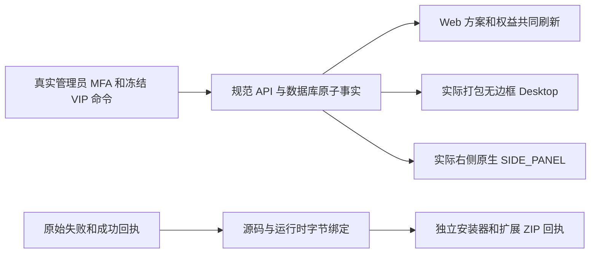

新增可运行入口：`npm run qa:admin-vip`、`npm run qa:native-vip`。`qa:native-surfaces` 须将 `COPYPASTE_DESKTOP_EXECUTABLE` 指向实际 `release/frameless/win-unpacked/CopyPaste.exe`；MV3 验收使用支持扩展加载的 Chromium。脚本只清理自己创建的浏览器、窗口、会话与测试管理员，保留用户原有标签页；不使用 Docker／WSL。

`evidence/vip-migrations.json` 保留 057 的真实限制：测试库有 056→057 完整旧行比较，主库首次启动已先迁移，只有后续基线，缺少主库迁移前行证明；15 条历史空摘要仍为空。001–057 已应用的字节不可改写。`upgrade:vip-local` 是已执行升级的受控工具，不能对现有前态快照重复执行或补造前态。

本轮原始候选 SQL/TAP、页面结果丢失／窄屏溢出、旧方案标题、错误免费功能假设、原生文档与缩放时序失败均有独立 archive-map 和摘要。只有新回执实际通过才进入当前进度；这些证据不关闭席位／储存、VIP 加赠额原子组合、完整安装／系统／SSO或真实模型角色资格。

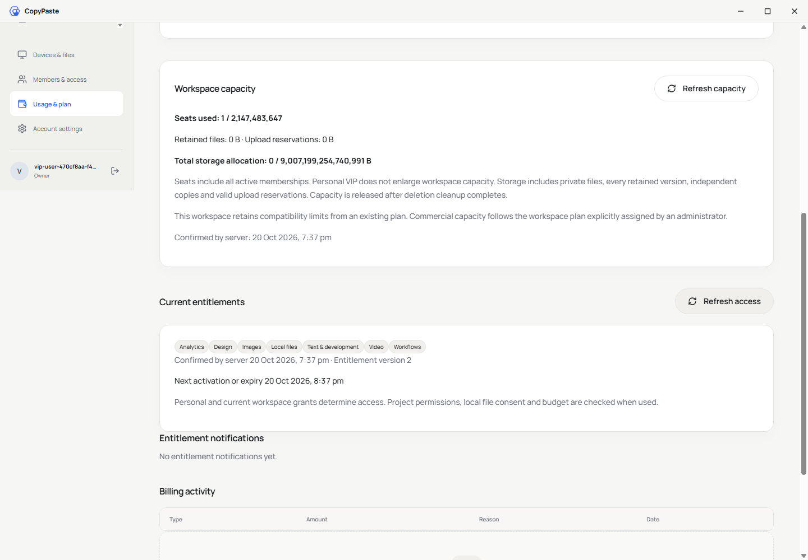
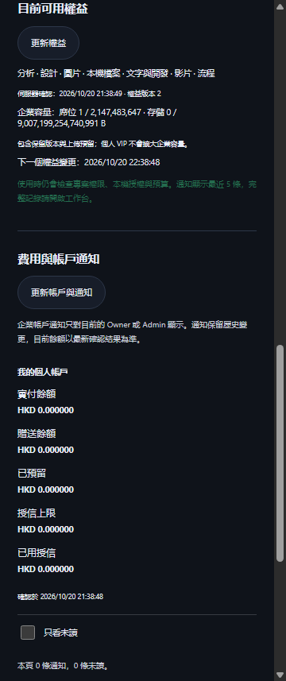

## 企业席位与存储执行（阶段 48）

新增 `npm run qa:resources`：真实邮箱/TOTP、独立审批授予企业方案、实际上传、用户用量/成员、后台容量、降级超额和撤权清空八组。058、059 分别有升级前/后两库 23 类原行比较，`upgrade:resources-local` 与 `upgrade:resource-erasure-local` 保留真实快照，禁止重复覆盖前态。原始 374 项中 1 项删除冲突、定位歧义和前后各阶段回执均保留。

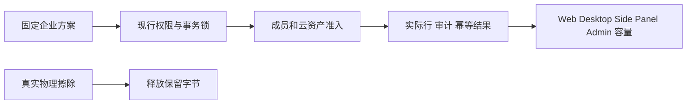

当前原生预览重新构建并绑定源码、运行目录和安装器字节；不使用 Docker/WSL。完整当前数字见 `evidence/alignment-platform.json`、`resource-ui.json` 和 `native-surfaces-artifacts.json`。原始 102 条综合验收仍单独保留。
