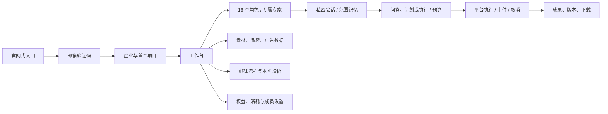
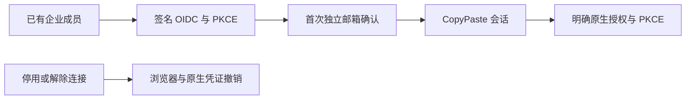

# CopyPaste Web

[English](README.en.md) · 企业云端工作台 · 0.5.0

面向在港企业 marketing 团队的 Web 客户端，采用 CopyPaste 暖灰白、深墨、亮蓝与衬线标题。繁体中文/英文、浅色/深色/系统主题。客户创意继续使用客户品牌。本仓库可单独安装和构建，服务数据来自独立 platform API。


## 启动与构建

Node.js 22.14+。先按 platform 仓库说明启动数据库/API，再执行：

```powershell
npm ci
npm run dev
```

打开 `http://localhost:4317`。开发服务器将 `/v1` 与 `/health` 代理到 `127.0.0.1:4310`。所有命令原生执行，禁止 Docker、WSL 和虚拟化环境。

```powershell
npm run typecheck
npm run build
npm run preview
```

`dist/` 是静态部署产物。推荐在客户 Web 域名上反向代理 `/v1` 至平台，使用 HTTPS；SPA 路由回退到 `index.html`，API 请求不回退 HTML。`.env.example` 的 `VITE_API_BASE` 可在构建时设置 API origin，默认留空使用同源。跨域时精确配置平台 `WEB_ORIGIN` 与 Cookie/CORS，不用通配 Origin。`VITE_*` 会公开到浏览器，绝不能放 AI key。

## 完整用户主线



首次用户输入工作邮箱并验证，创建企业与首个项目后进入工作台。返回用户直接选择已有工作区/项目。邀请链接绑定邮箱与项目；没有所属企业时回到初始化。验证码无效、过期、限流、会话失效、资源不可见及模型未配置均显示服务端错误，不生成占位结果。

开发模式验证码只写在 platform 的 `.data/mailbox/`，需本机读取；正式环境经真实 SMTP。没有默认用户账号。Desktop/扩展授权页面同样复用邮箱身份，但通过独立 PKCE 授权，不把浏览器 Cookie 转成 bearer token。

## 页面与功能

| 页面      | 实际能力                                                            |
| --------- | ------------------------------------------------------------------- |
| 工作台    | 项目切换、角色入口、近期任务、发布的帮助/公告、服务状态             |
| 角色      | 18 个预设及其 Skill、输入/交付说明、真实可用性                      |
| 项目/任务 | 创建项目、提交任务预算、状态/事件/成果、取消                        |
| 创意      | 文本/色块/固定版本 PNG 的图层 JSON、修改版本、SVG/PNG/模板 MP4 导出 |
| 资产      | 主动文件上传、缩略图、不可变历史版本、下载、重命名、限时分享/撤销   |
| 营销分析  | CSV 导入、精确聚合指标、数据详情、提交 HTML 做 SEO 审核             |
| 工作流    | 数据汇总、Codex、人工审批的有界流程，发布/运行/审批                 |
| 品牌      | 项目品牌色、语气、字体与批准文案                                    |
| 成员      | 邀请、企业角色、项目范围、编辑/移除、最后 owner 保护                |
| 连接器    | Google Ads / GA4 / Search Console / Meta 授权和明确账户报表同步     |
| 设备      | 已配对设备、限时目录 grant、明确本地操作排程和结果                  |
| 用量/设置 | 独立钱包、真实生效套餐与限额、任务消耗、个人语言/主题/名称          |


## 专属专家与私密工作

从预设角色创建专属专家，设置职责、品牌和工具范围，再开始私密会话。专家修改产生新版本，已有会话可明确采纳更新。笔记不调用 AI；问答和计划只使用读取工具，执行模式才生成交付物。计划转执行须明确批准，并重新验证上下文和预算。

会话支持检索、置顶、改名、归档/恢复及带版本的删除。私密消息、任务、成果仅所属用户可见；发布成果会建立明确的项目共享副本。记忆支持企业、品牌、项目、会话和个人五种范围、内容版本及到期时间。个人/会话记忆保持私密；删除需要确认，有在途任务时须先完成或取消并结算。

390px 移动布局和深色主题经过真实浏览器检查；移动侧栏收起后退出键盘焦点顺序。所有权限与费用由平台在请求时验证。


## 产品规则

后端是权限与费用的权威来源；隐藏按钮不是授权边界。钱包和 VIP 分别显示；个人/企业 VIP 按实际时间生效。没有配置公司 AI 网关时，角色明确不可执行；18 个已安装角色不等于 18 个已通过真实业务验收的角色。

AI 请求全部由平台转发公司内部服务器，本端没有模型 key。浏览器不能无授权扫描本地磁盘：小文件使用明确选择器，持续目录工作需安装 Desktop 原生桥接并逐目录授权。

`src/api.ts` 在 Web 使用带凭证请求和 CSRF，在 Desktop 快照中使用窄 IPC；不在 localStorage 存会话/AI key，仅保存语言与主题。React 文本渲染展示帮助/公告，不执行后台注入 HTML。

## 验证与维护

`npm test` 执行类型检查；真实身份与页面旅程由 delivery 的 `npm run qa:web` 与 `npm run qa:persistent` 执行，截图来自实际 UI 和 PostgreSQL 开发数据，不是设计稿。覆盖首次登录/初始化、13 个工作区模块、16 个 Admin 页面、浅深主题和移动视口。截图 fixture 使用虚构企业和 `.invalid` 邮箱。

`src/main.tsx` 管理路由与页面，`context.tsx` 管理登录/企业/语言/主题上下文，`api.ts` 封装网络和 Desktop 桥接，`native-files.tsx` 提供原生文件面板，`ui.tsx` 与 `style.css` 提供本仓库独立 UI 基础。Desktop 使用显式快照同步，不在构建时偷偷读取相邻源码。

## 本次边界

公司网关、SMTP、广告 OAuth 和 S3 的真实配置与联调仍需部署环境提供。SAML/SCIM、强制 SSO、事件触发、多人并行 Agent、协同编辑及完整 AI 视频/语音尚未实现。数据轮询不等于规划中的完整 SSE。浏览器只提供有限 HTML SEO 检查，不承诺 GEO 排名提升。

界面自托管 Manrope/Fraunces 字体，图标为 Lucide，首页蓝色纸带素材通过用户指定的 sub2-image-gen 生成，品牌来自 copypaste.hk。参见 [素材与依赖说明](THIRD_PARTY_NOTICES.md)。主设计/需求文档在交付根目录 `docs/`。

## 云端定时工作

0.4.0 在工作流页增加每日/每周计划：选择已发布流程、IANA 时区、星期和漏跑规则，预览本地/UTC 时刻及每次预算后明确授权。关闭页面后由服务端执行，保留配置版本与触发结果。每计划只允许一个未完成运行；审批或费用待对账时不会叠加收费任务。

支持修改、暂停、重新授权恢复和退役；暂停保留当前工作，运行历史另有取消按钮。修改只影响未来，暂停区间不补跑。结束时间排他，夏令时跳空略过、重复时刻只执行第一次。规则由平台校验，界面见 `src/schedules.tsx`；Delivery `qa:schedules` 验证真实时钟、页面关闭后的执行及移动操作。


## 0.5.0 企业身份与统一登录

OIDC 使用 code + PKCE S256、签章、state/nonce 与固定回调。先有注册账号及有效企业成员资格，再绑定企业身份；首次绑定需要独立的 CopyPaste 工作邮箱确认码，不按网域自动开户。配置改变、停用或本人解除连接会撤销关联用户的全部 CopyPaste Web/native/refresh 会话和旧执行授权。管理员登录仍独立使用邮箱与 TOTP。

`/login` 增加企业身份入口，`/sso` 输入企业登入代号与工作邮箱，`/sso/confirm` 完成首次邮箱确认。账号设置显示本人连接并明确确认解除后登出全部装置。原生端 `/authorize` 的回调及 PKCE 参数跨企业身份流程保留，最后仍需用户点击授权。




