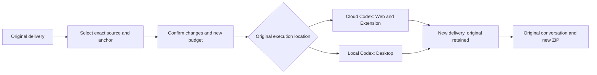
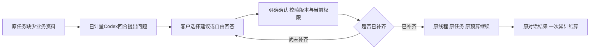
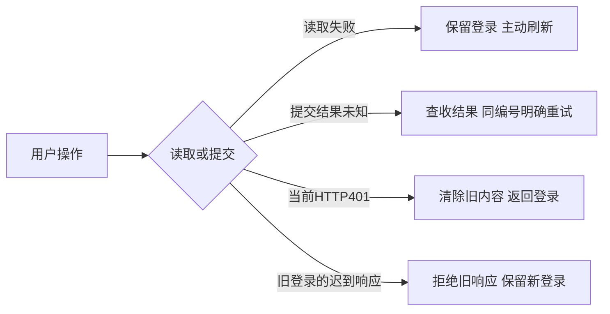
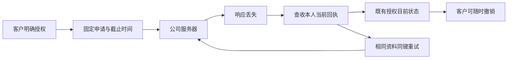
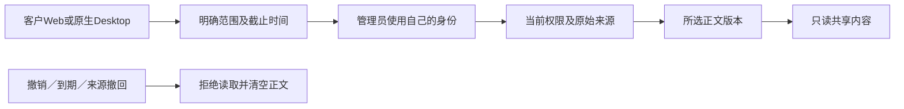
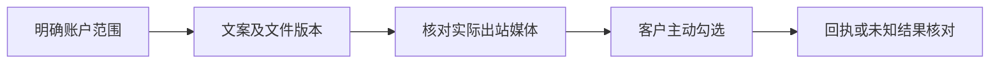
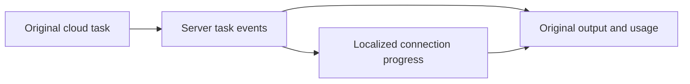
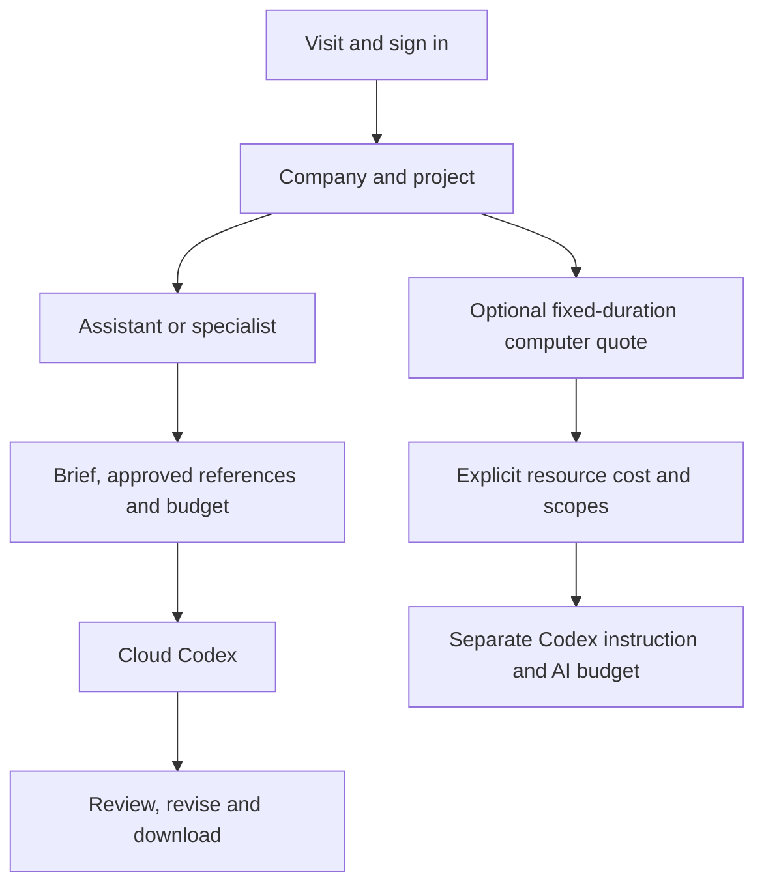

# Workmate · CopyPaste Enterprise Agent · web

<!-- delivery-revision-stage138 -->
## 原成果修改与新版本交付 · 阶段138

从原聊天或任务审阅点击“以这份成果继续修改”，选择原成果及位置，填写要求和预算并确认。新成果回到原会话，可下载新的完整交付包。结果未知时重试原要求，先核对已有工作再重新选择。

可选择整份交付、答复、单文件、Unicode文字选段、图片区域或有效视频时段。预览不调用AI或预留费用；确认后建立单独预算的新任务，沿用原角色与来源，保留原成果及费用。源文件换版或撤回将阻断后续读取与完成交付。获准项目编辑可修改共享工作，私有会话保留原归属。结果未知时继续核对原请求。

文字预览上限1 MiB，图片／MP4内嵌预览4 MiB；更大或不支持预览的文件可下载后按完整文件提出修改。整份修改最多引用20个文件，视频时段须有保留的有效时长。图片／视频位置是修改意见，不能视为编辑操作审批或专业质量通过；专门工作流保留原确认步骤。

34项当前后端检查（含13项新增修改测试）、36项扩展状态检查、73项桌面控制／下载回归及9项三端实际旅程通过。11张实际截图、3组GIF／MP4、7档布局和3个独立解压的下载包绑定1732份确切源码。

业务／模型答复及原生文件／授权窗口选择为明确受控的假数据；登录、数据库权限、确切文件、实际打包本机Codex、Windows原生窗口、Chrome右侧栏和新成果下载实际运行。Windows包未签名。真实公司模型／账户、完整专业角色输出、安装矩阵和工程恢复继续独立验收。



[需求](https://github.com/copypasteltd/workmate/blob/main/docs/requirements/15-delivery-revisions.md) · [方案与使用逻辑](https://github.com/copypasteltd/workmate/blob/main/docs/technical/138-source-bound-delivery-revisions.md) · [源码与原始证据](https://github.com/copypasteltd/workmate/blob/main/docs/quality/delivery-revision-checkpoint-138.json) · [全部编号](https://github.com/copypasteltd/workmate/blob/main/docs/quality/remaining-work-stage138.md)

实际产品操作，业务内容为假数据：


其他实际页面截图及MP4录屏：

- [workmate-delivery-revision-138-06-lost-response-retained.png](https://github.com/copypasteltd/workmate/blob/web/assets/screenshots/workmate-delivery-revision-138-06-lost-response-retained.png)
- [workmate-delivery-revision-138-06-image-anchor-en.png](https://github.com/copypasteltd/workmate/blob/web/assets/screenshots/workmate-delivery-revision-138-06-image-anchor-en.png)
- [workmate-delivery-revision-138-06-video-anchor-en.png](https://github.com/copypasteltd/workmate/blob/web/assets/screenshots/workmate-delivery-revision-138-06-video-anchor-en.png)
- [workmate-delivery-revision-138-06-revised-delivery-zh.png](https://github.com/copypasteltd/workmate/blob/web/assets/screenshots/workmate-delivery-revision-138-06-revised-delivery-zh.png)
- [workmate-delivery-revision-138-06-delivery-revision.mp4](https://github.com/copypasteltd/workmate/blob/web/assets/screenshots/workmate-delivery-revision-138-06-delivery-revision.mp4)

<!-- delivery-package-stage137 -->
## 完整交付与原对话下载 · 阶段137

主要业务按“提交目标 → 补充资料 → 执行 → 审阅 → 下载成果 → 原对话修改”继续收口。现在 Web 和 Chrome 原生右侧栏可直接在原聊天下载完整当前交付包，任务审阅区也提供入口；Desktop 使用公司授权接口和原生保存窗口。取消保存不发请求、不显示成功，侧栏提示跨刷新及繁英切换保留。

ZIP 包含实际成果、文字答复（如有）、任务及素材固定版本、SHA-256清单及中英编辑说明。同名文件分别保留，失败／停止工作的现有成果明确标示为部分交付。源代码ZIP、SVG／PPTX、工程JSON及只读成片分别按实际编辑能力说明，不虚构源工程。没有提交为交付物的本机文件仍留在本机；Desktop Agent仍是本机Codex，云端包不会扫描本机工作区。

用户看到的任务版本和交付摘要必须一致。后端顺序读取真实文件、流式校验大小与摘要，在受控磁盘生成ZIP，完成后再次检查当前权限、来源、保留期限及精确版本；文件损坏、素材撤回或版本变化会拒绝整个包。只读项目成员可下载获准共享成果，审阅仍需批准权限；管理员身份不自动获取私有会话。导出不调用AI、不创建新任务、不增加AI费用。容量为16 GiB／10,000个成果／文字条目，超限明确拒绝，不悄悄遗漏文件。

本轮不新增数据库迁移：Backend沿用SQL135并重新构建，Web／Desktop／Extension重新构建。扩展新增Chrome `downloads` 权限，使用浏览器默认下载位置及冲突改名；授权只在公司请求头中传递。新增契约为Backend `contracts/delivery-package-v1.json`。从Delivery执行 `npm run qa:delivery-package-backend -- <新两位编号>` 或 `npm run qa:delivery-package -- <新两位编号>`；后者默认完整构建、创建未签名Windows包并操作实际右侧栏与原生下载。

21项当前后端检查（含11项新打包测试）、37项扩展状态检查、1项桌面下载回归、12项边界绑定及10项三端实际旅程通过。9张实际截图、3组GIF／MP4、7档布局和3个独立解压的下载包绑定1713份确切源码。 使用受控Codex适配器和假业务内容；真实OTP／PKCE、文件读取、权限、原生窗口和Chrome下载管理器实际运行。Desktop保存窗口的选择结果由夹具指定到本轮自有目录。本轮未重新证明全部本机Codex工具、真实公司模型、专业素材质量或完整跨环境工程恢复。既有52项后端／来源回归另有阶段内原始记录，按其自身源码范围保留，不混称本轮全平台回归。


[需求](https://github.com/copypasteltd/workmate/blob/main/docs/requirements/14-complete-delivery-package.md) · [方案与使用逻辑](https://github.com/copypasteltd/workmate/blob/main/docs/technical/137-complete-delivery-package.md) · [确切源码与证据](https://github.com/copypasteltd/workmate/blob/main/docs/quality/delivery-package-checkpoint-137.json) · [全部编号](https://github.com/copypasteltd/workmate/blob/main/docs/quality/remaining-work-stage137.md)

实际客户流程截图与交互（业务内容为假数据）：


<!-- business-inputs-stage136 -->
## 业务问题与原任务续跑 · 阶段136

Agent遇到确实缺少的尺寸、目标受众或业务口径，可在原对话提出问题。客户可点击建议再修改，也可直接自由回答，最后明确确认；没有预选或自动提交。多项问题逐项保存，全部补齐后继续同一任务、同一会话和原预算预留，已计量用量统一结算。确认的问题和答案保留为原对话备注，相同请求重试不重复写入。

Web和Chrome原生右侧栏直接在原聊天展示问题，Desktop既有云任务详情也支持补答。繁中／英文切换保留未提交的回答，失败保留文字；扩展切换身份或会话清除草稿，来源不可读时清除受保护问题。建议仅供选择，答案不授予文件、广告账户、工具、本机或额外费用权限。

服务端严格区分`question`／`file`／`connection`，最多8项建议、4,000字符回答，校验版本、当前权限、来源及整批合法性后才写入。已确认答案不可改写。付费提问必须处于已完成且计量明确的Codex回合边界，继续原线程；取消只结算已知用量。删除私有会话清除问题、答案、检查点及正文，保留必要费用事实。

SQL135须在启动API／Worker前迁移：Backend执行`npm run db:migrate`。原SQL001–134、原二十项任务定义及主OpenAPI保持原字节；新增结构在`contracts/business-inputs-v1.schema.json`，扩展原创建／补交接口。原依赖文件与连接结构继续有效，问题使用`answer`而非`resource_ids`。

122项后端集成检查（含11项新增问题测试）、61项扩展状态检查、12项交付绑定及14项实际三端流程通过；9张实际截图、3组GIF／MP4及7个尺寸检查绑定确切来源。 原生Codex检查使用实际固定二进制和合成Responses服务，页面旅程使用受控工具和假业务回复。客户端初次完整构建成功；修正页面夹具后复用逐字节一致的源码和Windows包，原失败记录保留。可在Delivery执行`npm run qa:business-inputs-backend -- <新两位编号>`或`npm run qa:business-inputs -- <新两位编号>`；后者默认完整构建并创建独立原生测试数据库。

Desktop本机Codex及客户主动授予的本机完整权限沿用独立流程，本轮新增的是其云端任务视图问答。实际Windows窗口保持无边框、无Electron菜单、无可见纵向滚动轨和横向溢出；扩展保持实际Chrome原生右侧SIDE_PANEL。使用假数据，Windows包未签名；真实生产模型及全部角色专业交付仍待验收。完整编号仍开放88条必需、12条未确认建议、1条可选，REQ-095原始验收维持。



[需求](https://github.com/copypasteltd/workmate/blob/main/docs/requirements/13-business-brief-inputs.md) · [实现与使用逻辑](https://github.com/copypasteltd/workmate/blob/main/docs/technical/136-business-brief-clarification.md) · [全部102条编号](https://github.com/copypasteltd/workmate/blob/main/docs/quality/remaining-work-stage136.md) · [源码与原始验收](https://github.com/copypasteltd/workmate/blob/main/docs/quality/business-inputs-checkpoint-136.json)


<!-- client-errors-stage135 -->
## 四端连接与登录恢复 · 阶段135

Web、Admin、Desktop及Extension对读取失败显示当前语言的连接说明，保留有效登录。提交后响应丢失或无法解析时，提示先查收结果；应用层不会自动重发；浏览器可能在底层重传，服务端按原消息编号去重。客服授权继续使用原编号和期限，扩展委派继续使用原消息编号，显式重试不生成第二个任务。后台轮询不清除提交结果未确认的提醒，切换繁中／英文会更新同一错误提示，已知连接异常不显示Electron内部文字、地址或响应正文。

受保护请求收到401时，先核对所属登录并清除当前身份；HTML或空正文不能绕过清除。旧请求不能注销新登录或覆盖新防伪标记。Admin即时隐藏独立管理外壳，支持会话列表的连接错误与表单／撤销提醒分开，列表恢复后只清除本次连接提示。

15项连接／身份检查（含实际HTTP故障）、12项交付文件绑定、1项原生桥检查及30项实际四端流程通过。20张截图、7组实际GIF／MP4绑定源码；包含真实右侧SIDE_PANEL、客户OTP／PKCE及独立管理员TOTP、真实提交后响应丢失与同消息重试。09重新编译／构建Extension及Delivery，复用与02逐字节相同的后台、Web、Admin、Desktop源码及Windows包；没有伪称再次完整打包。旧失败与执行原件保留。Delivery当前`npm test`包含严格编译、文件绑定及连接检查；`npm run qa:client-errors -- <新的两位编号>`默认完整构建。

Desktop仍在客户本机运行Codex，完整本机权限单独授予，保持无边框、无Electron菜单及可见滚动条。Extension通过Chrome工具栏打开原生右侧栏，负责获准文件上传和云端执行。业务使用假数据，模型未运行，Windows包未签名。完整验收仍有88条必需、12条未确认建议、1条可选开放；REQ-095原始验收维持。



[使用与实现](https://github.com/copypasteltd/workmate/blob/main/docs/technical/135-client-connection-and-session-recovery.md) · [全部102条编号](https://github.com/copypasteltd/workmate/blob/main/docs/quality/remaining-work-stage135.md) · [源码与验收绑定](https://github.com/copypasteltd/workmate/blob/main/docs/quality/client-errors-checkpoint-135.json)


<!-- support-recovery-stage134 -->
## 客户授权恢复与客服原始验收 · 阶段134

客户从 **Web／Desktop → 账户设置 → 客服限时协助** 选择项目、原因及期限，空项目选择只表示元资料。首次提交固定申请编号和截止时间。响应丢失后可点击**查收先前申请**，或使用相同资料重试；刷新先查询既有结果，不自动再次提交。不同资料不能替换尚未确认的申请。查收展示目前有效／撤销／到期状态，不会续期；客户随时可在列表撤销。

恢复记录只在当前浏览器会话保存随机编号、申请摘要和固定截止时间，不保存原因、项目ID、正文或凭证。禁用存储时仅当前renderer内可恢复；服务器已经提交的授权仍显示在列表中。切换账户或企业后，迟到的结果不能回填新表单。原生Desktop桥仅新增客户查收GET，不开放管理员支持接口。

**原始REQ-095／TC-095已通过验收**，十二条条件逐项对应当前源码与真实执行证据：真实管理员和只读提示、明确范围、独立正文权限、写入／付款／VIP／凭证拒绝、无隐身登录、真实到期、撤销及审计失败回滚。本轮关闭这一条原始需求；全平台无障碍REQ-055、完整权限与竞争矩阵REQ-094继续各自跟踪。

65项相关后端检查、1项原生桥边界检查、18项实际Admin／Web／打包Desktop旅程及10条构建命令通过。覆盖提交前／后真实HTTP响应丢失、刷新、实际切换企业、同内容重试、当前回执查收、真实到期和原生客户撤销；客服操作期间user／native会话、刷新令牌和本机授权码行数不增加。确切源码绑定9截图和5组实时GIF／MP4。支持页面验证键盘及文字放大，Web／Admin采用CSS 200%，Desktop采用实际原生webContents 200%缩放；不据此关闭全平台浏览器／读屏验收。

Desktop继续在客户本机运行Codex，客户独立主动授予完整本机权限；保持无边框、无Electron默认菜单和无可见滚动条。Extension继续使用Chrome原生Side Panel承载获准文件上传与云端执行。本轮模型没有运行，业务及保留结果为合成夹具，Windows包未签名。自建浏览器、原生客户端与数据库均已关闭。



[方案 / Behavior](https://github.com/copypasteltd/workmate/blob/main/docs/technical/134-support-grant-recovery-and-acceptance.md) · [TC-095 acceptance](https://github.com/copypasteltd/workmate/blob/main/docs/quality/tc095-acceptance-134.json) · [Checkpoint](https://github.com/copypasteltd/workmate/blob/main/docs/quality/support-recovery-checkpoint-134.json) · [完整编号清单 / Remaining work](https://github.com/copypasteltd/workmate/blob/main/docs/quality/remaining-work-stage134.md)


[Recovery recording](assets/screenshots/workmate-support-recovery-134-04-grant-result-recovery.mp4) · [Retry recording](assets/screenshots/workmate-support-recovery-134-04-fixed-intent-retry.mp4) · [Native grant](https://github.com/copypasteltd/workmate/blob/desktop/assets/screenshots/workmate-support-recovery-134-04-customer-grant.mp4) · [Native revocation](https://github.com/copypasteltd/workmate/blob/desktop/assets/screenshots/workmate-support-recovery-134-04-customer-revocation.gif) · [200% Admin](https://github.com/copypasteltd/workmate/blob/admin/assets/screenshots/workmate-support-recovery-134-04-support-en-200.png) · [Chinese dark Admin](https://github.com/copypasteltd/workmate/blob/admin/assets/screenshots/workmate-support-recovery-134-04-support-zh-dark.png)

本轮1条需求验收完成；仍有88条必需、12条未确认建议和1条可选记录开放。这是完整验收记录数量，不代表101个未编码模块。完整源码交付复现、签名安装、生产接入及其余业务验收继续按编号推进；下方历史章节保留原运行范围。

---

<!-- support-access-stage133 -->
## 受控客服与原生客户授权 · 阶段133

客户从 **Web／Desktop → 账户设置 → 客服限时协助** 选择实际项目、原因及15／30／60分钟期限；空选择只包含企业／用户元资料。把授权ID提供给客服，并可随时在同一客户表单撤销。

管理员以自己的邮箱与TOTP登录 **Admin → 支援工作台**，明确选择客户、企业、项目、期限及可选客户授权。只读横幅持续显示真实身份和截止时间。共享正文还需要当前独立正文权限，私人会话保持私有；该视图不提供写入、费用、VIP或客户登录权限。

客服接口现会核对任务原始来源。来源隔离／到期或版本擦除后，保留正文不可继续返回，诊断标题也会隐藏。所选正文绑定当前版本，审计期间变化会被拒绝。页面取消旧请求，拒绝迟到任务／会话响应；版本变化、来源撤回、隐藏、失败、撤销或到期后清空正文。服务端逐次判断权限；可见Admin约每两秒复查。

59项后台相关测试及13项实际Admin／Web／打包原生Desktop旅程通过，确切源码绑定6截图和3组实时GIF／MP4。实际验证OTP／PKCE、邮箱／TOTP、客户授权／撤销、迟到响应、来源撤回、真实到期、繁中深色、四档Admin宽度和三档原生无边框窗口。所属浏览器、客户端与测试数据库均已关闭。模型没有运行，业务数据、保留结果和夹具文件读取明确为合成数据；Windows包仍未签名。

Desktop继续在本机运行Codex，本机权限由客户独立主动授权；客服表单只调用客户接口，管理员视图留在Admin。Extension继续使用Chrome原生Side Panel，承载获准文件上传及云端执行；本轮没有修改Extension执行代码。



[实现方案](https://github.com/copypasteltd/workmate/blob/main/docs/technical/133-controlled-support-source-and-native-access.md) · [Checkpoint](https://github.com/copypasteltd/workmate/blob/main/docs/quality/support-access-checkpoint-133.json) · [完整编号待办](https://github.com/copypasteltd/workmate/blob/main/docs/quality/remaining-work-stage133.md)


[Native grant recording](https://github.com/copypasteltd/workmate/blob/desktop/assets/screenshots/workmate-support-access-133-02-customer-grant.mp4) · [Selection recording](https://github.com/copypasteltd/workmate/blob/admin/assets/screenshots/workmate-support-access-133-02-task-selection.mp4) · [Revocation recording](https://github.com/copypasteltd/workmate/blob/desktop/assets/screenshots/workmate-support-access-133-02-customer-revocation.mp4) · [Web metadata-only grant](assets/screenshots/workmate-support-access-133-02-metadata-grant-en.png) · [Chinese dark Admin](https://github.com/copypasteltd/workmate/blob/admin/assets/screenshots/workmate-support-access-133-02-support-zh-dark.png) · [Source withdrawn](https://github.com/copypasteltd/workmate/blob/admin/assets/screenshots/workmate-support-access-133-02-source-withdrawn-en.png)

仍有89条必需完整验收、12条未确认建议及1条可选记录开放，不代表102个未编码模块。完整权限竞争矩阵、各页面无障碍、签名安装和生产接入继续按编号推进；下方历史章节保留原范围。

---

[简体中文](README.md) · [English](README.en.md)

<!-- controlled-publications-stage125 -->


## 核对实际素材后发布 · 阶段125

顺序为：账户与项目范围 → 发布策略 → 文案和确切素材版本 → 实际输出预览 → 客户主动确认 → 回执。账户初始未启用，Agent只能准备；保存范围后等待当前授权快照。每次确认绑定当前账户、版本和内容摘要。

预览显示实际图片／视频、版本及SHA-256；Instagram图片显示转换后的JPEG。来源失效或撤权会撤回媒体。未知结果允许只读核对和附理由的人工结案，不自动重发、不声明发布失败。响应丢失时读取原请求结果。



实际Web/Admin旅程14/14通过，原始布局包含375/768/1024/1440px。此为模拟账户验收，原生客户端和完整专业业务另验。


[实际交互MP4](assets/screenshots/workmate-publications-12-customer-preview-and-confirm.mp4)


<!-- runtime-startup-122 -->

## Codex 启动与轮次隔离 · 阶段 122

工作详情现在将 runtime.startup.retry 显示为“正在重新連接助手”，并为连接故障提供繁英说明。恢复事件沿用服务器任务身份；页面不会自行重新提交付费任务或重建预算。

20 项现有客户端检查、类型检查及当前构建通过。当前 Web 的 OTP/PKCE 页面也参与本轮打包 Desktop 的实际浏览器登录流程。完整跨端和生产验收仍按需求台账跟踪。



[完整方案 / Behavior and verification](https://github.com/copypasteltd/workmate/blob/docs/docs/technical/122-codex-startup-and-turn-isolation.md)

## 产品与边界

首批面向现有客户的 marketing 团队，完整范围包含生图、设计/字体、视频/特效、广告和网站分析、SEO/GEO、企业重复流程及软件开发。目录已有 18 个精确 Skill 绑定的候选角色；至少十二个逐一完成专业任务、修改及异常处理的角色仍是验收要求。设计师由 Codex、设计 Skill 与公司 Image 2 组合。Agent 内核唯一使用 Codex；全部 AI 请求走公司 OpenAI 兼容后端。当前开发使用已授权假数据，不代表真实模型专业质量已经验收。

React、TypeScript、Vite 和 React Router 提供云端工作台。新用户创建企业或接受邀请，再选择项目、可用角色和明确输入；缺少必要资料时提示补齐，同号工作继续。项目管理页可保存/预览/发布共享指引、固定品牌和资料版本。工作历史保留版本、来源与费用，继续修改不静默换用后来的配置。

## 仓库与执行位置

| Branch | Directory | Runtime |
| --- | --- | --- |
| [backend](https://github.com/copypasteltd/workmate/tree/backend) | `dev/copypaste-platform` | Fastify / PostgreSQL / cloud Codex |
| [web](https://github.com/copypasteltd/workmate/tree/web) | `dev/copypaste-web` | React / Vite / cloud workspace |
| [admin](https://github.com/copypasteltd/workmate/tree/admin) | `dev/copypaste-admin` | React / separate Admin identity |
| [desktop](https://github.com/copypasteltd/workmate/tree/desktop) | `dev/copypaste-desktop` | Electron / customer-local Codex |
| [extension](https://github.com/copypasteltd/workmate/tree/extension) | `dev/copypaste-extension` | Chrome MV3 / native Side Panel / cloud Codex |
| [delivery](https://github.com/copypasteltd/workmate/tree/delivery) | `dev/copypaste-delivery` | Native development, QA and publication tools |

各组件为独立 Git 仓库，保留上述并列布局。项目仅使用原生工具；禁止 Docker、WSL 和虚拟机。

## 使用逻辑

1. 访问工作台，完成注册/登录，创建企业或接受邀请，再选择所属项目。
2. 选择默认助手或专业模板，填写 brief，明确选择文件、品牌、数据账户和预算；补充输入继续原会话。
3. 确认后提交云端 Codex 工作，查看持久状态、待答问题、实际文件和费用；审阅后下载或继续修改。
4. 需要专属电脑时进入独立资源页，先核对方案、付款方、时长、确切文件和终端/可视/Agent 范围。
5. 接受限时报价才预留资源费用；可选 Codex 工作另行确认指令和 AI 预算，入口点击本身不会购买资源。



## 启动与使用

### 本地启动

以下命令在已检出的对应仓库内执行。完整工作区将六个独立仓库并列放在 `dev/`，见[分支与检出布局](https://github.com/copypasteltd/workmate/blob/docs/docs/governance/04-git-branches-and-publication.md)。使用 Windows x64、Node.js >=22.14、npm/Git，以及文档约束的原生 PostgreSQL、FFmpeg/FFprobe 与固定 Codex 资源；保留已有本地配置和数据，不使用 Docker/WSL/虚拟机。

```powershell
Set-Location 'D:/dev/copypasted/自有agent/dev/copypaste-web'
npm ci
npm run dev
```

先启动后端，再打开 `http://localhost:4317`；静态构建使用 `npm run build`。通过邮箱/验证码登录并选择企业/项目。

### 当前使用流程

1. 完成登录、企业成员/邀请和项目选择。原生端通过浏览器 PKCE 登录；Admin 使用独立 MFA 身份。过期、撤销、换企业不应静默切换身份和资料范围。
2. 选择专业角色，提供工作说明及明确获准的资料/账号。缺少必要输入时请求客户补齐。项目负责人可以保存草稿、核对依赖、预览并明确发布不可变共享指引；发布不启动 AI、不增加权限。
3. 新任务固定当时接受的角色、Skill、品牌、资料和指引版本。既有工作保留原版，包括原先没有共享配置的状态。来源被隔离、删除或撤权后隐藏失效正文并阻断后续使用；历史内容不是越权入口。
4. 确认预算和必要的操作/媒体授权，查看真实状态、进度、文件与原费用回执。修改沿原工作谱系继续。未知用量保持原预留供对账，不能当作免费或盲目重新执行。
5. Admin 可按独立权限管理用户/企业状态、查看获准消耗，预览并确认人工费用/赠额和 VIP 权益/到期。余额、实收记录、授信、预算和 VIP 分别保存；同一确认幂等，操作保留审计，不能因重放重复赠额。

## 配置、权限与费用

本候选要求完整 SQL001–133 增量历史。API/Worker 准入拒绝缺失、变更或不支持的版本，并独立检查恢复环境身份。公司模型别名、已验证媒体能力、精确费率及供应商密钥只在后端配置；未配置能力保持不可用。当前开发继续使用已授权假数据。

Web/Admin 使用 `VITE_API_BASE` 或同源代理，开发端口为 4317/4318。Desktop/Extension 构建时固定 `COPYPASTE_API_ORIGIN`、`COPYPASTE_WEB_ORIGIN`，Desktop 另固定 `COPYPASTE_EXTENSION_ID`。除获准回环开发场景外使用 HTTPS；渲染器与扩展不持有公司供应商密钥。

文件默认私有，项目共享需要客户明确操作。新请求、Worker 领取、工具及下载重新核验权限；旧历史不能绕过撤权或正文治理。金额使用精确港币微单位；预算、余额、授信、实收与 VIP 分开记录。稳定请求身份防止重复赠额、建任务和预留；未知费用或物理清理保留待核对。

## 预设角色与 Skill

目录定义 18 个专业预设及默认助手，每次执行固定 Skill 版本和注册工具。模板数量不等于至少十二个角色已通过完整专业资格验收。

| ID | Role | Required Skill bindings |
| --- | --- | --- |
| R01 | 全栈开发工程师 | `fullstack-engineering@1.0.0`, `frontend-implementation@1.0.0`, `backend-api@1.0.0`, `qa-testing@1.0.0`, `delivery-core@1.0.0` |
| R02 | 前端开发工程师 | `frontend-implementation@1.0.0`, `ui-system@1.0.0`, `qa-testing@1.0.0`, `delivery-core@1.0.0` |
| R03 | 后端与 API 工程师 | `backend-api@1.0.0`, `qa-testing@1.0.0`, `delivery-core@1.0.0` |
| R04 | 软件测试工程师 | `qa-testing@1.0.0`, `frontend-implementation@1.0.0`, `delivery-core@1.0.0` |
| R05 | UI/UX 设计师 | `ux-research@1.0.0`, `ui-system@1.0.0`, `frontend-implementation@1.0.0`, `delivery-core@1.0.0` |
| R06 | 设计师 | `creative-direction@1.0.0`, `image-art-direction@1.0.0`, `image2-production@1.0.0`, `typography-layout@1.0.0`, `delivery-core@1.0.0` |
| R07 | 品牌视觉设计师 | `brand-system@1.1.0`, `image-art-direction@1.0.0`, `image2-production@1.0.0`, `typography-layout@1.0.0`, `delivery-core@1.0.0` |
| R08 | 广告创意设计师 | `ad-creative@1.0.0`, `image-art-direction@1.0.0`, `image2-production@1.0.0`, `typography-layout@1.0.0`, `delivery-core@1.0.0` |
| R09 | 电商商品设计师 | `ecommerce-visual@1.0.0`, `image-art-direction@1.0.0`, `image2-production@1.0.0`, `typography-layout@1.0.0`, `delivery-core@1.0.0` |
| R10 | 社媒内容设计师 | `social-content@1.0.0`, `image2-production@1.0.0`, `typography-layout@1.0.0`, `delivery-core@1.0.0` |
| R11 | 插画与 IP 设计师 | `illustration-ip@1.0.0`, `image-art-direction@1.0.0`, `image2-production@1.0.0`, `delivery-core@1.0.0` |
| R12 | 字体与版式设计师 | `typography-layout@1.0.0`, `image-art-direction@1.0.0`, `image2-production@1.0.0`, `delivery-core@1.0.0` |
| R13 | 演示文稿设计师 | `presentation-production@1.1.0`, `typography-layout@1.0.0`, `dataviz@1.1.0`, `delivery-core@1.0.0`, `deterministic-metrics@1.1.0` |
| R14 | 网页与落地页设计师 | `landing-page@1.0.0`, `ui-system@1.0.0`, `frontend-implementation@1.0.0`, `image2-production@1.0.0`, `delivery-core@1.0.0` |
| R15 | 信息图与数据可视化设计师 | `dataviz@1.1.0`, `deterministic-metrics@1.1.0`, `typography-layout@1.0.0`, `delivery-core@1.0.0` |
| R16 | 视频与动效设计师 | `video-storyboard@1.0.0`, `template-video-composition@1.0.0`, `video-generation@1.1.0`, `speech-production@1.2.0`, `delivery-core@1.0.0` |
| R17 | 营销数据分析师 | `ads-analysis@1.1.0`, `deterministic-metrics@1.1.0`, `dataviz@1.1.0`, `delivery-core@1.0.0` |
| R18 | 企业流程自动化顾问 | `workflow-design@1.1.0`, `workflow-execution@1.1.0`, `delivery-core@1.0.0` |

设计师组合为 Codex＋设计 Skill＋公司 Image 2。可选 R19 云端电脑操作员必须绑定另行确认的租约与 AI 预算；本机 Desktop 不提供该创建入口，继续由客户本机执行。

[Role contract](https://github.com/copypasteltd/workmate/blob/backend/catalog/role-preset-catalog.json) · [Skill packages](https://github.com/copypasteltd/workmate/blob/backend/catalog/skill-packages.json)

## 可选专属云电脑

先核对不可变方案/报价、付款方、固定时长、确切私有文件及终端/可视/Agent 独立范围，Agent 默认未授权。明确同意后预留资源费，后续 Codex 指令另有精确 AI 上限。无自动续期。停止、到期或撤权阻断后续操作；实际用量和清理证据齐全才结算，未知进入核对。

Linux 物理节点源码使用原生 Node22/systemd、cgroup、XFS project quota 和有界桌面工具。本地 Windows 核查未启动 Linux 主机。Delivery 中以新编号运行 `node native/build-package.mjs NN` 构建源码包；安装前核对外部固定摘要，默认不启动服务，恢复要求确切安装 UUID。

## 实际界面与交互录制

下列为真实产品界面截图和按墙上时间录制的交互。客户、模型、媒体响应明确使用假数据；所注明的原生 Codex、文件、数据库和账务路径实际运行。假节点画面不代表真实 Linux 远端桌面已验收。


[Original MP4](assets/screenshots/workmate-12-dedicated-cloud-consent.mp4)

## 验证与交付状态

整合后的客户端/工具共 338 项通过：Web 20、Admin 9、Extension 63、Desktop 180、实际本机 Codex 22、Delivery 44，对应类型/构建通过。Desktop、Web/Admin、原生侧栏各有 8 项限定实际 UI 检查，共 29 张截图与 5 组 GIF/MP4。后端完整成功须有最终完整清单回执，检查点记录实际结果并保留失败。

安装原生前置依赖后执行本仓库 `npm run typecheck`、`npm run build` 及测试脚本。Delivery 默认 `npm test` 仅覆盖原生界面完整性，完整单元清单使用 `node --test --test-concurrency=1 tests/*.test.mjs`。`node scripts/qualify-delivered-clients-v1.mjs NN` 在 Delivery 使用新两位编号及并列布局检查完整客户端清单；历史候选专项执行器保留原目录要求。

完整产品验收仍开放：至少十二个专业角色资格、全权限/业务/兼容矩阵、真实服务质量、签名安装更新、生产负载恢复及客户业务接受。以编号清单管理完成条件，不以测试数量推算完成率；使用后清理自建浏览器/进程，保留用户资源。

[Implementation / 方案](https://github.com/copypasteltd/workmate/blob/docs/docs/technical/121-dedicated-cloud-and-client-execution.md) · [Checkpoint / 证据](https://github.com/copypasteltd/workmate/blob/docs/docs/quality/dedicated-cloud-checkpoint.json) · [Open requirements / 未完成项](https://github.com/copypasteltd/workmate/blob/docs/docs/quality/remaining-work-2026-10-29.md) · [Branch layout / 检出布局](https://github.com/copypasteltd/workmate/blob/docs/docs/governance/04-git-branches-and-publication.md)
