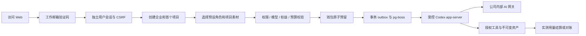
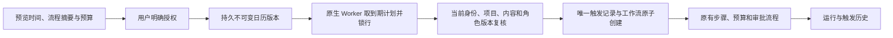
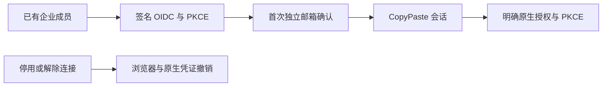
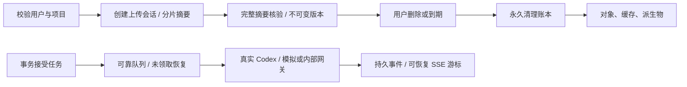
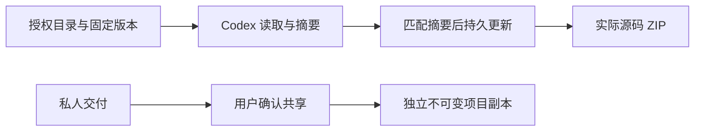
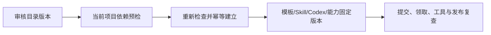

# CopyPaste Platform

[English](README.en.md) · 原生企业 Agent 服务 · 0.5.0

本仓库提供真实 PostgreSQL 持久化、用户与管理员身份、企业/项目权限、Codex 任务执行、营销资产、数据分析、流程、设备调度与运营控制面。它是独立 Git 仓库，不依赖相邻仓库源码。完整项目主文档位于交付根目录的 `docs/`。

## 运行前提

Windows x64 已验证；Node.js 22.14+、npm、Git、原生 Codex `0.163.0-alpha.10.2`、FFmpeg/FFprobe。依赖锁文件随仓库提交。所有步骤使用原生进程，禁止 Docker、WSL 和虚拟化环境。其他操作系统未执行验收。

```powershell
npm ci
npm run setup:local
npm run db:local
```

保留数据库终端，在另一个终端执行：

```powershell
npm run db:migrate
npm run dev
```

本机 API：`http://localhost:4310`；数据库：`127.0.0.1:55432`。`db:local` 初始化开发数据库和全部迁移；`db:migrate` 也准备隔离的 `copypaste_test` 数据库。迁移只通过 owner 身份执行，API 使用独立受限连接。

`setup:local` 仅在 `.env` 不存在时生成随机数据库密码及持久 MASTER_KEY。`.env.example` 是无密钥配置参考，不能覆盖现有 `.env`。Windows 中文路径通过临时 ASCII junction 供 PostgreSQL 引导使用，数据和二进制仍位于本仓库；关闭使用原生 pg_ctl 完成 checkpoint，确认退出后只移除该别名；不强制结束数据库。

## 从访问到使用



邮箱首次验证可创建用户。验证码 10 分钟有效、最多 5 次错误、并发只有一个消费者。开发邮件写入 `.data/mailbox/<challenge-id>.json`，需在本机查看验证码；生产必须使用 SMTP。Web/Admin 会话分别使用 HttpOnly Cookie，写请求检查 Origin、CSRF；原生端使用 PKCE、短期 access token 和轮换 refresh family。退出、封禁与会话撤销使令牌失效。

## 管理员开户

```powershell
npm run admin:create -- admin@your-company.example super_admin
```

在 `.data/enrolment/<id>.json` 中读取本次生成的 TOTP enrolment URI，导入认证器后删除文件。管理员需邮箱验证码和 TOTP 双重验证；没有共享默认账号、密码或后门。CLI 是受信部署操作，不向普通用户暴露。

后台支持 8 个内置角色、68 个权限键，global/tenant/project 范围、显式 deny、金额/期限/批次数限制及委派限制。敏感操作要求最近 10 分钟内 MFA；不能自授权限或撤销最后一个永久有效超级管理员。

0.3.0 补齐后续管理员的邮件邀请、本人邮箱验证与真实 TOTP 开通、姓名编辑、状态 CAS、停用/恢复、重发、他人重设 MFA、本人更换验证器及会话撤销。邀请及设置仅哈希保存能力，新密钥加密存储；未投递能力完成或撤销后清除。管理员公开 API 不暴露密钥、令牌和邀请链接。新增 `008-admin-identity-lifecycle.sql`、`src/admin-identities.ts` 及 14 组真实数据库/API 测试。首次 CLI 引导继续保留，生产 SMTP 与 SSO 单独验收。

## 已实现模块

| 模块       | 本次实现                                                                                                    |
| ---------- | ----------------------------------------------------------------------------------------------------------- |
| 身份与企业 | OTP、独立 Admin MFA、原生 PKCE、邀请、成员/项目授权、最后 owner 保护、数据库 RLS                            |
| Agent      | 唯一 Codex 内核、版本固定、28 个哈希校验 Skill 包、18 个角色、任务/事件/取消/租约/fencing                   |
| 费用与权益 | HKD 整数 micros、资金来源批次、预算预留/一次结算、人工确认入账/赠送/来源退款、个人/企业 VIP、冻结套餐版本   |
| Admin      | 完整分页用户与企业列表、按权限消耗、两步预览提交、独立审批、内容隔离/撤销分享、批量/导出、配置发布、审计    |
| 素材与设计 | 本地/S3 存储适配、不可变版本、授权下载/预览、品牌资料、图文/PNG 图层工程、SVG/PNG、真实 FFmpeg MP4 模板动效 |
| 数据       | CSV 导入、精确汇总 CTR/CPC/CPA/ROAS、零分母 null、SEO HTML 审核、Google/GA4/GSC/Meta OAuth 与有界报表适配   |
| 流程与设备 | 最多 8 步持久工作流、数据/Agent/人工审批、设备注册、Ed25519 签名命令、限时目录 grant、一次性 nonce 结果     |

18 个角色：全栈、前端、后端/API、软件测试、UI/UX、设计师、品牌视觉、广告创意、电商、社媒、插画/IP、字体版式、演示、网页/落地页、信息图、视频动效、营销分析、流程自动化。定义见 `catalog/role-preset-catalog.json`，实际 Skill 内容见 `skills/` 与 `catalog/skill-packages.json`。

安装 Skill 不代表该角色已完成真实业务验收。当前全部角色的资格状态为 `pending_live_validation`；AI 未配置时禁止假成功。

### 当前 Codex 工具边界

实际工具包括 `project_assets`、`asset_text_read`、`deliver_text`、`marketing_metrics`；按角色开放 `code_read`、`code_write`、`code_package`、`font_catalog`、`design_render`、`image2_generate`、`image2_edit`。源代码支持 CAS 哈希编辑、真实 ZIP 和 manifest，但不执行用户不可信代码或声称已运行测试。设计工具生成可编辑 JSON、SVG、PNG 及有限模板 MP4。图像生成/修改只调用内部 Images 接口。

目录里其他长期规划的 tool_id 不等于本次已注册工具。AI 视频与语音尚未实现；需要这些能力的角色明确不可用。人工本地文件调度已贯通，Codex 自动调度本地文件工具尚未接入。

## 持续专家、私密会话与记忆

0.2.0 新增项目内专属专家：基于已安装角色定制职责、品牌和工具子集；每次修改产生不可变版本。会话固定专家版本，用户可明确采纳新版。内核始终为 Codex，前端不能提交模型、provider 或可执行 Skill 覆盖。

会话只对所属用户可见；普通企业管理员不因此获得他人的会话正文。任务、事件、版本和派生文件继承私有归属，API 与 PostgreSQL RLS 同时校验。共享项目任务不能读取用户其他私密任务的文件。私密文件须由本人明确发布为新的共享副本，再进行项目分享。

消息支持保存笔记和委派，委派分为 ask / plan / execute。ask 和 plan 只开放读取工具，execute 才能生成交付物；每次模型任务独立预算预留与计费。消息 UUID 去重、会话版本比较和每会话单任务约束共同防止重复收费。计划批准重新校验输入摘要、专家/记忆/会话版本及预算；同一批准产生一个执行子任务。

记忆分企业、品牌、项目、会话和个人五种范围，记录版本及有效期。任务冻结精确引用，执行及后续工具再次检查授权、到期和内容隔离。删除撤销可读取正文及缓存重放，并保留防重复的幂等墓碑；物理对象/运行缓存回收仍待建设。有在途或费用待对账任务的会话禁止删除。


## 云端每日 / 每周工作流

0.4.0 以服务端持久日历执行已发布工作流，用户关闭页面后仍会运行。`009-workflow-schedules.sql`、`src/schedule-time.ts`、`src/schedules.ts` 与 Worker 保存不可变配置版本、触发历史及执行引用。创建/修改须确认工作流版本、定义摘要、执行身份与每次预算；时间采用 IANA 时区。夏令时不存在的时刻略过，重复时刻只执行第一次。



每计划同时一个运行；审批、在途 Agent 或费用待对账子任务会阻止重叠。漏跑可选只补最近一次或略过逾时，长期漏跑合并记录；暂停期间不补跑。项目管理员恢复需重新确认当前授权，后台恢复保留原授权且须近期 MFA、范围权限、CAS 与原因，不能复活已撤销授权。结束时间排他，单项目最多 50 个未退役计划；不是硬实时 SLA。14 组新增测试涵盖真实 PostgreSQL/API、并发、千日漏跑及日历边界；Delivery `qa:schedules` 另验真实系统时钟。

## 内部 AI 网关联调

服务端 `.env` 需配置 `AI_BASE_URL`、`AI_ALLOWED_HOSTS`、`AI_API_KEY`、准确的 `AI_MODEL`，并登记实际 HKD token 费率。Base URL 通常包含 `/v1`；禁止凭 URL 携带凭证、禁止生产 HTTP、禁止自动回退外部模型。

```powershell
npm run codex:probe
```

此命令只验证实际 Codex 版本、initialize 和 thread/start，不发送真实模型 turn。正式启用前还需用公司网关完成 `/responses` 工具回合、实测 token 用量和异常核查，然后设置 `AI_VERIFIED=true`。Image 2 另需 `AI_IMAGE_MODEL`、`AI_IMAGE_HKD_MICROS_PER_IMAGE` 和 `AI_IMAGE_VERIFIED=true`，核查 `/images/generations`、`/images/edits` 的真实 PNG 输出。

`tests/runtime.test.ts` 启动真实 Codex 并与本地受控 Responses fixture 完成工具回合，验证内部路由和用量；它不是公司真实模型能力证明。尚未获得公司网关配置，未进行其真实联调。

## 金额和运营规则

1 HKD = 1,000,000 micros。金额全程用整数，不使用浮点记账。赠送、确认付款、预算预留、消耗和退款分别留账；确认付款引用全局唯一。VIP 不充值钱包，钱包余额不等于 VIP 权限。

Starter / Pro / Business 的并发默认值为 1 / 3 / 8，单任务预算上限为 HK$100 / 500 / 5,000。这些是试点默认约束，月费为未定价占位 0，不代表免费商业承诺；后台可发布版本化套餐。

费用/VIP 操作采用 5 分钟预览 + payload hash + 目标版本 + 幂等提交；默认 HK$10,000 及以上要求另一位管理员审批。上游结果未知时保留预留并进入 `reconciling`，禁止盲目再次收费。付款是人工确认记录，尚无在线支付收单。

批量操作按操作者的批次数上限执行；CSV 导出最多 500 行、15 分钟过期、仅原管理员可下载且重查权限。用户/消耗/内容的集合查询在 SQL 层过滤授权范围及显式拒绝。

## API、检查和目录

```powershell
npm run typecheck
npm run build
npm test
npm run contracts:export
```

`contracts/implemented-routes.json` 导出 167 个实际 Fastify method/path；十个有序数据库迁移随仓库交付。它是实际路由清单，不冒充主文档的完整规划 OpenAPI。84 项原生测试覆盖身份、隔离、费用并发/重放、权限与 VIP、内容撤销、图片版本、真实 PNG/MP4、真实 Codex 受控协议回合及初始化取消、源代码包。浏览器/扩展/Desktop 验收由独立 delivery 仓库记录。

| 路径                   | 内容                                           |
| ---------------------- | ---------------------------------------------- |
| `src/`                 | API、业务域、Worker、权限和 Codex              |
| `migrations/`          | 按序事务迁移与数据库约束                       |
| `catalog/` / `skills/` | 角色、权限、Skill 包与哈希                     |
| `contracts/`           | 生成的 Codex 协议及实际路由                    |
| `scripts/`             | 本机启动、迁移、管理员开户、协议探测           |
| `tests/`               | 真实 PostgreSQL 与原生媒体/内核测试            |
| `.data/`               | 忽略的本机数据、邮件、密钥 enrolment、运行产物 |


截图来自独立 Admin 客户端，展示本 API 返回的真实开发数据；平台本身不包含该客户端 UI。

## 部署、恢复和已知边界

生产要求 HTTPS、真实 SMTP、独立数据库身份、持久 MASTER_KEY、受控出站和对象存储。开发原生数据库启动器在 production 被禁用。备份数据库、对象文件和 MASTER_KEY，并通过原生恢复演练后再上线；不要通过删除密钥来“重置”生产服务。

Google/Meta 需设置服务端 OAuth client secret、精确 API version、Google Ads developer token 和回调 URI；未获真实平台授权，尚未做线上报表验收。S3 适配未接真实存储验收。SAML/SCIM、强制 SSO、事件触发、团队并行 Agent、协同编辑、完整生成视频/语音、生产 SLO、Windows 代码签名和用户代码强隔离属于未完成范围。Codex 集成关闭 shell、浏览器搜索和其他 Agent 能力；原生 OS 服务账号/ACL/网络隔离仍是生产前置工作。

本代码未授予额外开源许可。第三方组件、字体和素材来源见 [THIRD_PARTY_NOTICES.md](THIRD_PARTY_NOTICES.md)。

## 0.5.0 企业身份与统一登录

OIDC 使用 code + PKCE S256、签章、state/nonce 与固定回调。先有注册账号及有效企业成员资格，再绑定企业身份；首次绑定需要独立的 CopyPaste 工作邮箱确认码，不按网域自动开户。配置改变、停用或本人解除连接会撤销关联用户的全部 CopyPaste Web/native/refresh 会话和旧执行授权。管理员登录仍独立使用邮箱与 TOTP。

新增全域 `admin.tenants.sso.write`（68 项动作之一），只默认授予超级及安全管理员；修改需近期 MFA、原因、CAS 与幂等键。保存会停用并清除旧验证；检查 discovery、公钥和 PKCE 不代表已验证 client secret 或真实企业账号。`openid-client` 6.8.8（MIT）开启 ID token 非对称签章检查。



部署配置 `SSO_ALLOWED_ORIGINS` 为所需的精确 HTTPS origin。默认回调为 `WEB_ORIGIN/v1/auth/sso/callback` 经 Web API 代理；跨域 `VITE_API_BASE` 可配 `SSO_CALLBACK_ORIGIN=API_ORIGIN`。生产拒绝 `SSO_ALLOW_LOCALHOST=true`。只有原生 fixture 验收时，用此环境开关启动开发控制器，执行 `qa:federation` 后停止并不带该开关重启。

迁移 010 作废没有来源会话的历史待交换原生码。兑换重查来源会话、用户版本及联邦身份；refresh 继承绑定及配置修订。撤销旧设备会话也撤销轮换后的凭证 family。测试使用真实 PostgreSQL 与签名 code/token/JWKS。此增量不包含 SAML/SCIM、强制 SSO 策略或真实公司 IdP 准入。


## 正在修复的实现增量

当前源码增加明确模拟模式、不可逆删除账本/物理对象和运行缓存清理、90/30 天保留与七天重放结果清理、4 MiB 分片续传、流式下载、持久 SSE 及执行前领取恢复。数据库迁移只前向追加并校验已记录的摘要。完整约束与尚未完成项见主文档 docs/technical/17-erasure-transfer-retention-events.md。旧 0.5.0 安装包不包含这些未发布改动。

模拟启动：已配置原生数据库后，在 PowerShell 为当前 API 进程设置 `$env:DEMO_MODE='true'` 再执行 `npm run dev`；也可在独立 delivery 仓库执行 `npm run demo`。生产模式或对外监听不允许启用模拟依赖。网页中的一次性演示额度是 gift，不是收款；Codex 进程和业务操作仍真实执行。



## 持久云文件（当前源码）

项目共享目录与私人会话目录、固定版本引用、目录搜索/移动/清理、显式副本共享已接入。编程角色在私人会话中读取、校验更新并打包云端工作源码；`asset.read` 工具可按节点与固定版本读取。023/024 为前向迁移，Admin 内容目录纳入节点。当前回归 139 项通过，包含五组云文件集成；模拟依赖不构成真实服务或角色准入。



工作源码限制为 500 文件 / 20 MB，单文件 1 MB；目录条目删除与源文件永久删除分别处理。完整协议、边界和证据见主文档 technical/18-persistent-cloud-files.md。

## 项目技能生命周期（当前源码）

项目方法新增精确安装及专家/任务版本绑定。普通停用影响新工作；卸载和永久安全撤销阻止包括旧任务在内的后续调用。重装产生新身份，专家须保存新版本后采用。工具调用及结果落库前复查当前方案，实际消耗按原预留结算。

平台全套回归 **145/145**；delivery 的 `npm run qa:skills` 通过三组浏览器验收，二十一份实际 HTTP 响应通过严格设计 schema。自定义包审核/发布、完整真实角色资格仍待完成，历史 0.5.0 安装包未替换。

## 默认助手与站内通知（当前源码）

默认助手使用固定 Codex、内部文字配置和 delivery-core 方法，不计入 18 个专业角色。无需先自建专家；POST /delegations 在同一事务中建立私人会话、消息、任务、精确方法绑定及预算。相同 client_message_id 重试复用原事务结果。共享默认实例不能被普通修改/删除，Owner/Admin 通过带版本检查的新版本明确采用重装后的方法；平台隔离后禁止自动重建。

026/027 为前向迁移。任务状态在事务提交时生成接收者通知，避免中间状态误报；当前授权、私人归属和项目范围始终重新检查。支持微秒游标、已读更新及 30 天保留，任务名称从当前任务读取。GET/PATCH /v1/notifications 及兼容企业嵌套路径可用，不发送外部通知。

六组默认助手、四组通知集成用例包含在 139 项回归内。Web 各四组、Chrome 八组与源码 Desktop 八组旅程使用真实 Codex及明确假数据依赖，完整模板规范、已付费步骤恢复和正式角色资格仍未完成。详见主文档 technical/20 与 technical/21。


## 运行前资料补齐 / Pre-execution inputs

028 增加显式文件/连接需求。任务在首次模型调用前等待，保持一笔原预留；当前资源全部明确确认后，同任务只入队一次。当前版本、权限及连接类型在领取、工具、心跳与落库复查。取消释放未使用的预留，运行后撤销按实际用量处理。计划绑定资料；来源变化须重新规划。管理员正文权限可审阅需求说明，取消/重试仍按权限和原私人归属执行。

Explicit file/connection prerequisites hold the original reservation before the first model turn. CAS confirmation queues the same task once; revoked or changed inputs are rechecked throughout execution. Plans bind the selected sources, and administrative retries preserve the input requirements and private audience. Paid-step continuation and automatic dependency discovery remain unfinished. See the master documentation, technical/22-pre-execution-input-checkpoint.md.

## 执行容量与公平派发（当前源码）

前向迁移 029 在数据库内原子检查平台、企业、当前用户方案和能力槽，多个原生 Worker 共享计数。默认 10 个 handler、企业 2 槽、图片/媒体各 2 槽且企业媒体 1 槽；未知的已启动对账仍占槽。未完成工作配额与实际执行容量是两个约束。容量满时原任务保持 queued、attempt=0 和单笔预留，两秒后再派发；队列按企业位置交错，重复回调不重新预留。七组隔离数据库/原生队列测试通过，完整负载压测及逐供应商限流待完成。

## 后台记录与可重复的原生集成测试

清理记录 API 增加当前范围内的状态/类别/字面 ID 筛选、过滤后计数和稳定排序的分页；后台列表默认 50 条、最大 100。迁移 030 仅新增查询索引，旧迁移保持字节不变。每页清理进度批量读取，普通列表不包含对象路径或租约凭据；只读管理员直接重试返回 403。

应用集成测试及迁移测试分别创建 `copypaste_suite_<随机 UUID>` 原生 PostgreSQL 库和 `.data/test-runs/<随机 UUID>`，应用全部迁移，关闭应用后仅清理自建库/目录。要求本地原生 PostgreSQL 及 loopback `OWNER_DATABASE_URL`；不重置演示库或历史 `copypaste_test`。独立隔离保证待对账任务不会污染下一次测试的执行容量。首次发现的失败报告与后续修复结果均保存在 delivery/evidence。

## 持久角色模板与 Codex 版本

新增迁移 031、真实模板/运行/能力版本注册表，以及 `/v1/agent-templates` 的目录、详情、预检和实例化。预检只保存五分钟回执；创建时按当前项目权限、方案、方法、工具和能力重新检查，再原子安装及绑定。禁止覆盖内核、网关或技能身份。配置失效在新委派预留费用前拒绝；领取、工具及发布再次检查。历史无绑定版本保持原始记录，完整升级/发布仍待完成。



六组新增平台检查及八组 Web/Electron 流程通过，21 份实际 HTTP 样本通过严格 schema。18 个专业模板仍未完成真实业务资格；至少 12 个合格角色的要求保留。未实现工具显示缺项，不能把全部目录条目标为可执行。


