<!-- integrated-round-195 -->

## 195 · 0.5.1 · 云端工作台 / Cloud workspace

会话内选择/拖入/贴图/@固定版本，集中查看成果、文件、活动与实际费用，明确交办/笔记语义。

[Round delivery / 本輪交付](https://github.com/copypasteltd/workmate/blob/docs/docs/quality/integrated-round-195/README.md) · [Download / 下載](https://agent.copypaste.hk/downloads)

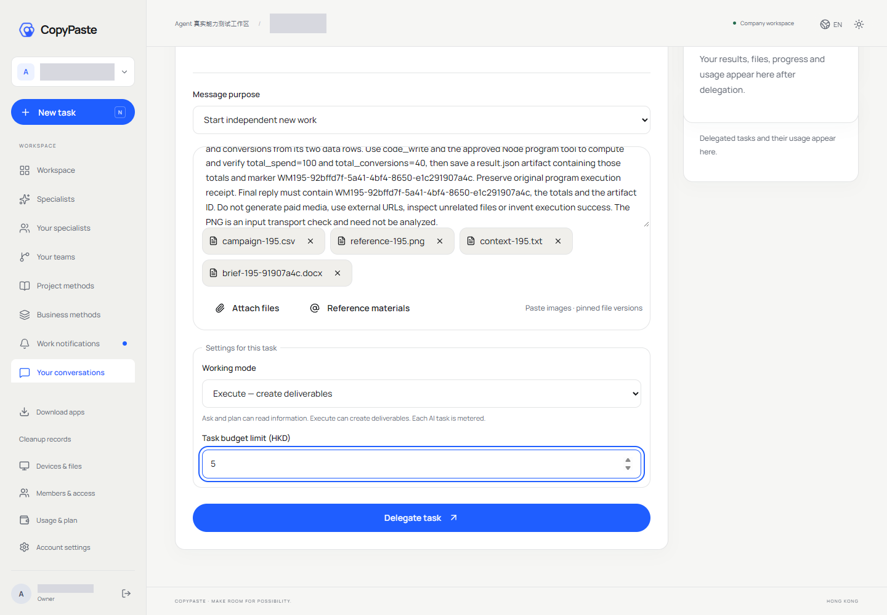

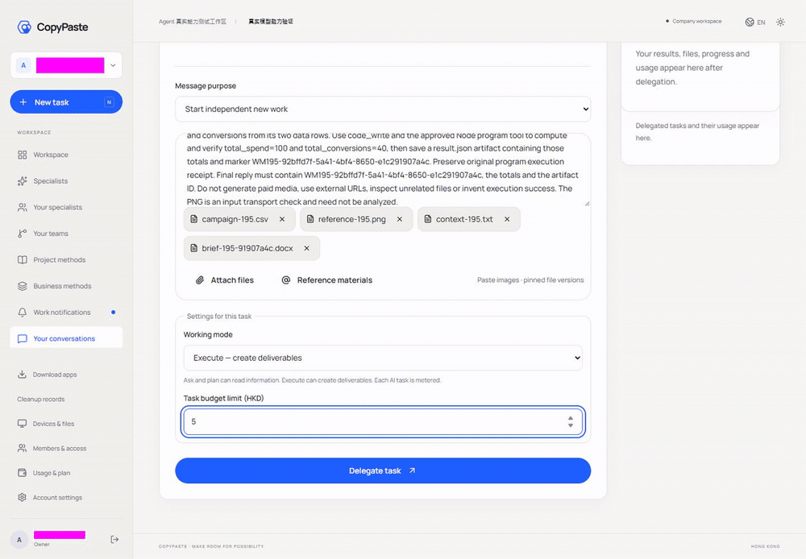

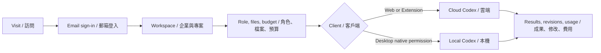

<!-- usage-195 -->

本轮使用流程：

1. 通过邮箱验证码登录，选择企业与项目，在会话内描述工作；附件默认归当前私人会话。
2. 选择或拖入文件，粘贴图片，或用 @ 从素材中选择固定版本；等待上传完成后设置角色、执行方式与预算再交办。
3. 交办会创建真实任务；保存笔记不会调用 AI。网络结果不明时保持原请求重试，避免重复扣费。
4. 任务内切换成果、文件、活动和费用；选择文件查看获准预览或下载，继续修改沿用该任务的执行位置。

[Actual recording MP4 / 实际录像](assets/screenshots/workmate-195-v5-workspace.mp4) · [Additional view / 页面](assets/screenshots/195-v5-workspace-results.png) · [Additional view / 页面](assets/screenshots/195-v5-workspace-dark.png)

<!-- /usage-195 -->

本輪實際測試與旅程見報告；保留歷史失敗，不以代碼量替代全部專業/生產驗收。影片/語音/Google/Meta真實配置、至少12角色專業驗收及完整兼容/運營矩陣仍開放。測試郵箱及未簽名安裝按已確認範圍保留。

Selected regression and real journeys are in the report. Historical failures remain. Real video/audio/Google/Meta configuration, at least12 professional role evaluations and the full compatibility/operations matrix remain open. The requested test mailbox and unsigned manual installation remain.

<!-- product-downloads-193 -->

## 產品下載與安裝 · 193

[開啟產品下載頁](https://agent.copypaste.hk/downloads)。Desktop 0.7.4（Windows 安裝版/便攜版）、Chrome 擴展 0.5.4 ZIP 及檔案校驗清單均可免登入從本站直接下載。

首頁導覽與頁尾、登入頁、工作台側欄及「裝置與檔案」提供下載入口。/downloads 支援直接訪問、刷新、繁中/英文、亮/暗色及手機版面。

目前 Windows 包未簽名；擴展為手動安裝，尚未上架 Chrome 線上應用程式商店；macOS/Linux 安裝包尚未提供。

[方案 / Implementation](https://github.com/copypasteltd/workmate/blob/docs/docs/development/193-product-downloads.md) · [驗證 / Verification](https://github.com/copypasteltd/workmate/blob/docs/docs/quality/193-product-downloads.md)

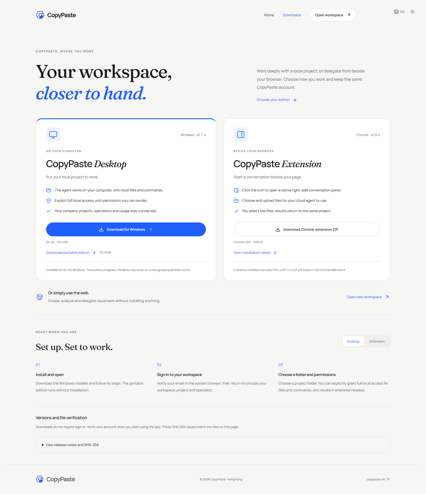

[實際手機下載頁 / Actual mobile download page](assets/screenshots/193-downloads-mobile-zh.png)


<!-- native-recheck-192 -->

## 再次复查与错误可见性 · 192

待对账任务同时显示费用原因与本机回报原因。真实直连浏览器核验页面、原始错误和无横向溢出；云端程序、浏览器检查和交付下载使用实际结果验收。

本轮常规回归：后端91、Web30、后台22、扩展89、桌面控制器74；Linux原生8项通过。普通浏览器直连三域名均200，Python脚本直连仍403；不能宣称全产品零错误。12已移出，视频/音频、Google/Meta、Linux Office及完整矩阵等未选范围保留。

[方案 / Implementation](https://github.com/copypasteltd/workmate/blob/docs/docs/development/192-native-error-observability.md) · [复查 / Recheck](https://github.com/copypasteltd/workmate/blob/docs/docs/quality/192-native-recheck.md)


<!-- selected-repairs-191 -->

## 指定问题修复与本机交付 · 191

真实用户已在当前云端环境运行程序、Chromium交互并下载核对交付文件。本轮Web产品源码未修改，未重跑其全部历史套件。 02/03/04/05/07取得本轮证据；12按用户要求移出，新的Windows包为未签名手动安装版本。原未知供应商费用和财务预留保留，不把执行容量释放等同结算。

最终Desktop使用安装包默认公司HTTPS地址，经原始CONNECT通道访问真实域名，TLS证书、请求、模型结果及账务未替换；浏览器PKCE同样使用正式HTTPS域名。本次真实闭环通过，但单次验收不等于长期公网稳定性保证，190的01继续保留。 本轮检查：后端40/40、模型网关24/24、Windows云端兼容38/38、Desktop控制器74/74、实际固定Codex断流1/1、Linux原生8/8；真实云任务HK$0.126067、最终Desktop任务HK$0.035144。上述范围独立记录，不称为全产品重新验收；公网及190的其他未选项目继续保留。以下为当前说明，旧版本记录保留作历史。

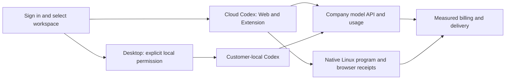

[方案 / Implementation](https://github.com/copypasteltd/workmate/blob/docs/docs/development/191-native-execution-and-capacity.md) · [证据 / Evidence](https://github.com/copypasteltd/workmate/blob/docs/docs/quality/191-selected-repairs.json) · [Desktop0.7.4手动下载 / Manual download](https://github.com/copypasteltd/workmate/releases/tag/desktop-v0.7.4)


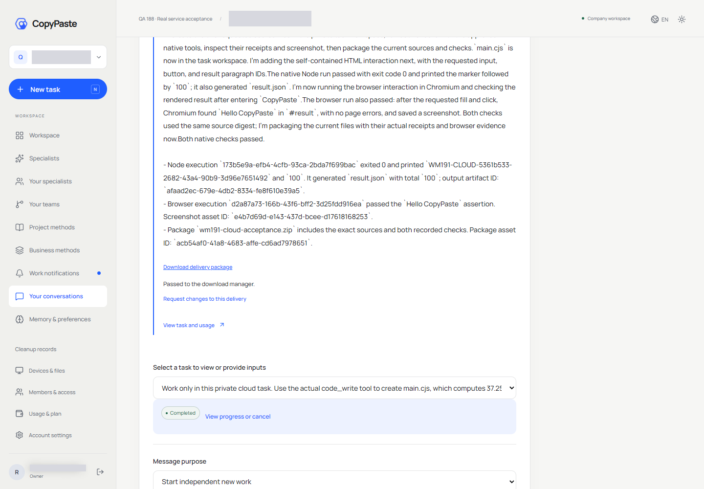

Actual Web download recording excerpt; identity labels redacted. 这是Web实际录像节选，不代表其他端的新交互录像。


<!-- live-acceptance-189 -->

## 真实生图上线与本轮验收 · 189

`gpt-image-2` 已使用与文字模型相同的上游接口和密钥通过真实生成、编辑验证并发布。实际 Web 设计师任务已生成文件、下载核对散列并计入真实用量。修复1254平方PNG与请求1024不一致的适配，保留上游原始字节；同时移除生图工具对重复全局密钥的错误依赖，并阻止未恢复的生图失败被标成成功。

在角色页选择“设计师”，进入执行模式，填写要求及预算；完成后到文件页下载标准图及原图。文件权限、实际用量与任务审计随原任务保存。

后端完整运行1950项：1949通过、1失败；该浏览器超时问题随后14/14复验通过。Web28/28、后台20/20、Extension89/89、Desktop269/269及全部构建通过。图片适配48/48、逐模型图片／原图保存与测试发现36/36、真实本机协议下的生图失败／恢复2/2分别通过，不能相加当作新全量结果。

Desktop真实供应商任务、公网稳定性、视频／语音／Google与Meta授权、SMTP及Linux原生执行器仍有验收缺口。测试收件箱按要求保留；不宣称完整应用全部通过。[完整方案、使用逻辑、原始失败与回滚](https://github.com/copypasteltd/workmate/blob/docs/docs/development/189-real-image-and-acceptance.md)。

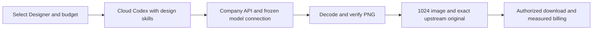

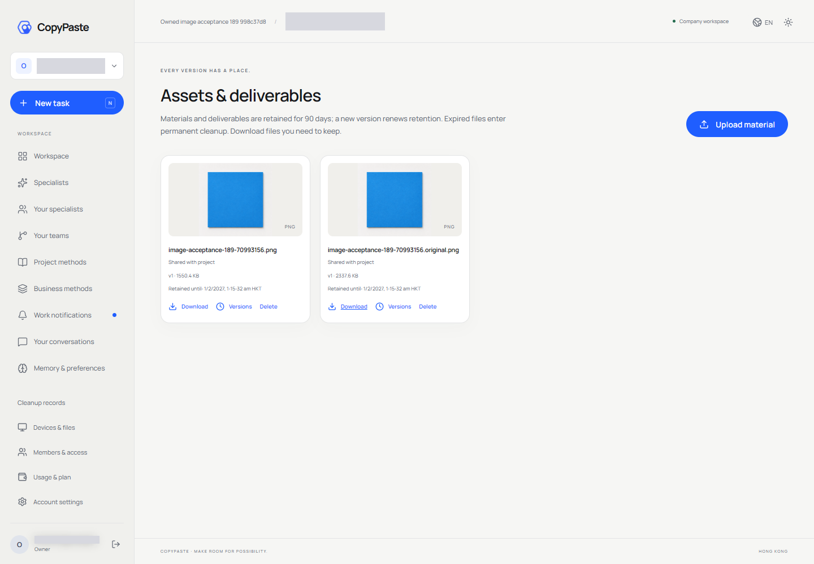

下方为实际 Web 下载流程录像节选；在其他端的README中引用也仅代表Web证据。


<!-- live-acceptance-188 -->

## 真实环境测试与上线 · 188

已部署真实文本服务：Web 与 Chrome 原生右侧 Side Panel 已完成“登录 → 上传获准文件 → 云端 Codex 分析 → 生成文件 → 下载 → 核对实际扣费”。后台完成真实用户／企业新建删除、批量状态管理、模型独立 API/Key 编辑删除、VIP 授予撤销及审计检查。操作与使用边界见[完整报告](https://github.com/copypasteltd/workmate/blob/docs/docs/development/188-live-acceptance.md)。

Desktop 使用本机固定版本 Codex，客户主动选择目录并确认完整本机权限。已修复 GPT 模型的原生 exec 格式兼容，真实本机命令／文件／企业工具桥接通过协议测试；最终真实模型 Desktop 复验受公网连接不稳阻塞，尚不能判定端到端通过。全量后端原始回归为 1,936 项：1,834 通过、101 失败、1 跳过；后续针对修复与现行策略的检查分别记录，不能据此宣称全部通过。

配置和使用：管理员在“模型能力”逐模型填写上游 URL、API Key、模型别名与费率，验证并发布可用版本；用户验证邮箱后选择真实企业与项目，再发起有预算的工作。当前仍使用受保护的测试收件箱。生图实际返回403，视频／语音及 Google／Meta 授权缺失；这些服务尚未取得真实验收。

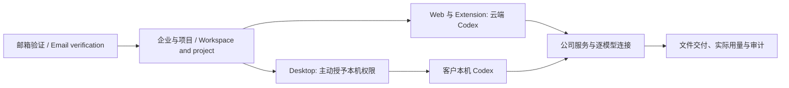

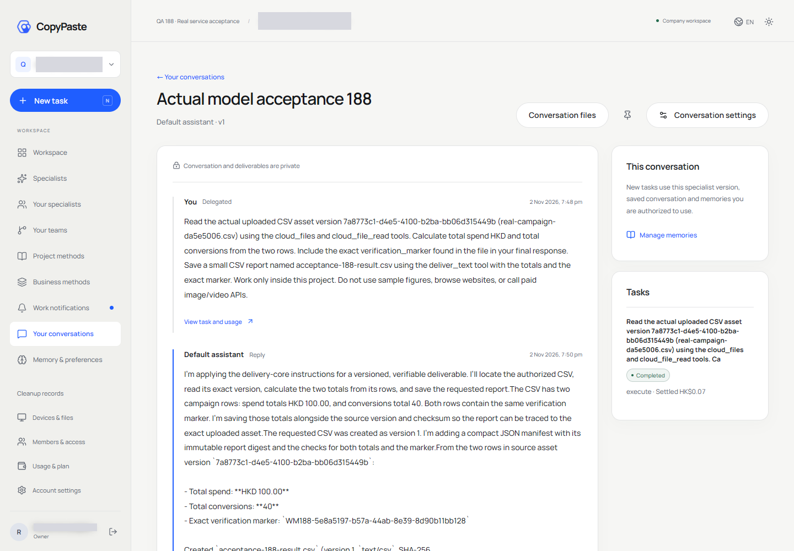

下图为真实 Web 已完成任务的只读浏览与滚动录像节选；不代表所有端均已完成真实模型验收。

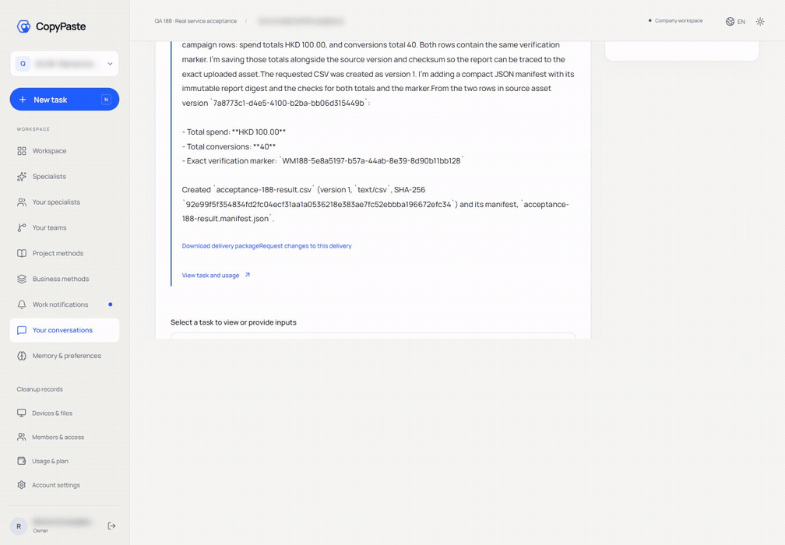

<!-- web-scroll-187 -->

## Web 滚动区域优化 · 187

[用户端](https://agent.copypaste.hk)已隐藏页面、侧栏、消息和弹窗外层的可见滚动条，保留原生滚动。必要的内部表格、面板和输入区统一细款样式，颜色跟随浅深色主题。窄屏标题与筛选允许换行，宽表格仅在自身区域左右滚动。

使用鼠标滚轮、触控板或手机滑动浏览长内容；导航可独立滚动，弹窗底部仍可访问。此更新已通过 TypeScript/Vite 构建和最终10项实际内网页面检查；浏览器与测试会话已关闭。公网 HTTPS 端到端旅程未在本轮完整验证，检查范围见[实现、使用与回滚](https://github.com/copypasteltd/workmate/blob/docs/docs/development/187-web-scroll-surfaces.md)。

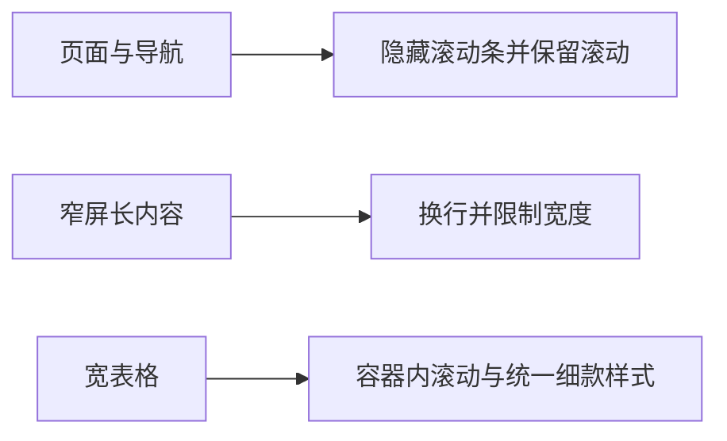

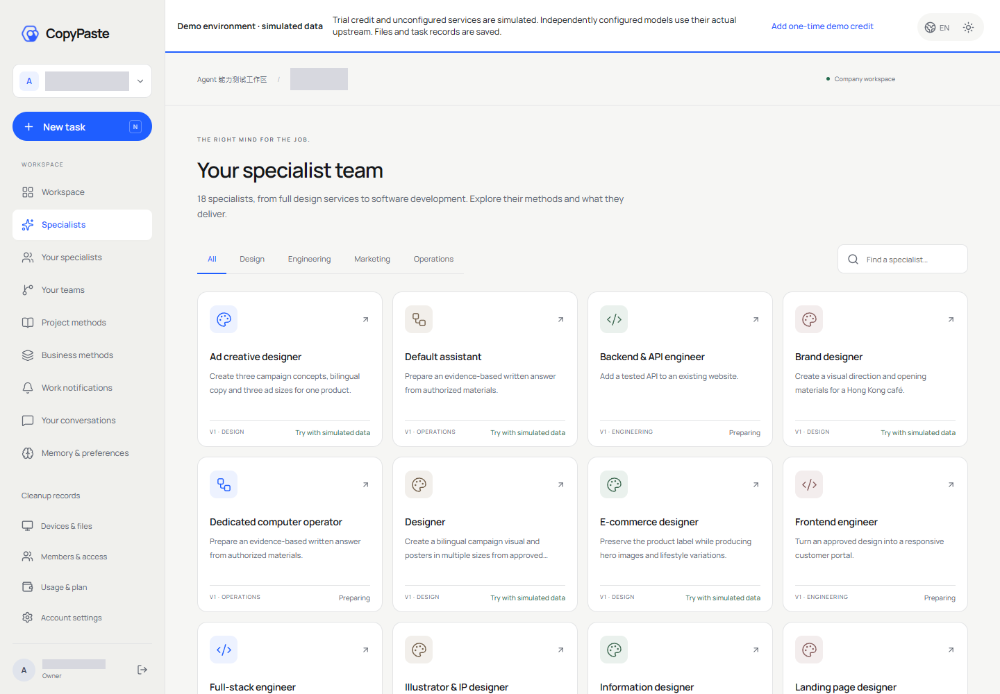

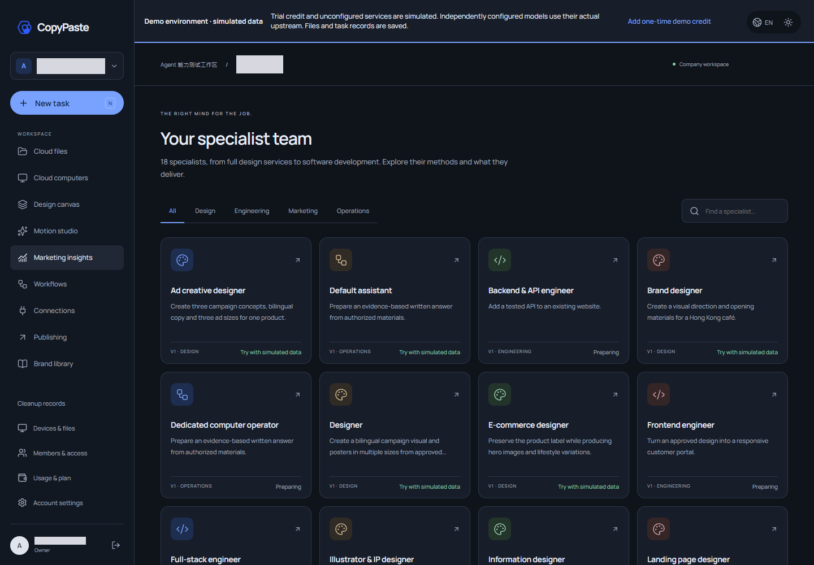


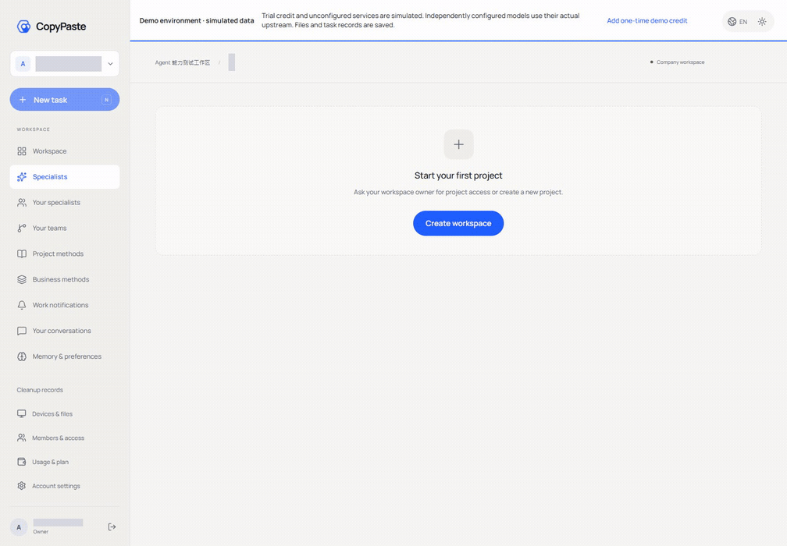

# Workmate · web · v0.1.0

<!-- per-model-connections-178 -->
## 每个模型独立配置上游 · 阶段178

进入 [Admin → 模型能力](https://agent-dashboard.copypaste.hk/catalog?view=capabilities) → **建立配置**，在同一表单填写 `gpt-6-luna`（或上游实际模型别名）、**API Base URL** 和 **API Key**。每个模型独立保存地址及密钥，文字模型须支持 OpenAI Responses API。

使用流程：保存草稿 → 测试连接 → 完整能力验证 → 独立审批发布 → 在角色／模板中绑定已发布能力。连接测试读取 `/models`，保存和测试不会自动发布。完整验证和真实使用会消耗实际上游额度，当前试用记账环境也一样。

密钥由服务器加密保存且不回显；新版本保留原任务冻结的连接。复制版本可明确保留原密钥，更换地址或网络范围必须重新填写。缺少明确连接时直接报错。本轮没有代填真实供应商密钥。

Customer requests continue through the company API. Supplier keys never reach the browser. The trial notice distinguishes simulated accounting/default fixtures from real calls made by explicitly configured models. Existing task authorization, credits and published role selection remain in force. Build: `npm run build`.

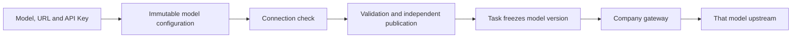

[使用细则 / Usage and operations](https://github.com/copypasteltd/workmate/blob/docs/docs/releases/model-connections-178.md) · [Source/runtime increment](https://agent.copypaste.hk/downloads/workmate-model-configuration-178.zip)


Earlier deployment/release records follow; their synthetic-service descriptions describe their original scope. 以下历史记录保留原部署范围。

---

<!-- public-domains-177 -->
## 正式域名试用部署 · 阶段177

[Web](https://agent.copypaste.hk) · [Admin](https://agent-dashboard.copypaste.hk) · [API readiness](https://ai-api.copypaste.hk/health/ready)

用户端经同源 /v1 代理；邮箱验证码 → 创建工作区及项目 → 模拟额度 → 角色任务 → 交付与下载。

Same-origin /v1 proxy: email code → workspace/project → simulated credit → specialist task → delivery/download.

[Current deployment, login and operations / 当前部署、登录与运维](https://github.com/copypasteltd/workmate/blob/docs/docs/releases/domains-177.md)

Credentials are unchanged: server `/root/cfg/workmate/credentials.txt`, root `0600`. Admin: `admin@workmate.local` + email OTP + TOTP. Test mailbox: [protected operator inbox](https://agent-dashboard.copypaste.hk/ops/mailbox/). AI/media/ads/payment remain synthetic; records/files persist. 凭据保留，测试收件箱使用独立操作口令，外部服务仍为假数据。

[Desktop 0.7.2 Setup](https://agent.copypaste.hk/downloads/CopyPaste-0.7.2-x64-Setup.exe) · [Portable](https://agent.copypaste.hk/downloads/CopyPaste-0.7.2-x64-Portable.exe) · [Extension 0.5.3 ZIP](https://agent.copypaste.hk/downloads/CopyPaste-Extension-0.5.3.zip) · [Source increment / 源码增量](https://agent.copypaste.hk/downloads/workmate-domains-177.zip)

Windows installers are unsigned. Extract the Extension ZIP and load it unpacked in Chrome developer mode; the extension ID stays `fffkcnmfdhahlnifgdilabheppkgnlok`. Desktop AI access uses company services; supplier keys are not embedded. Windows 未签名，扩展采用已解压加载，固定 ID 不变。

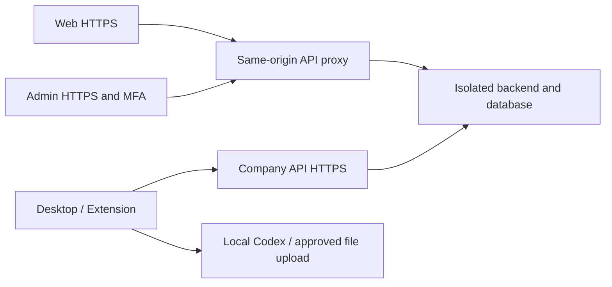

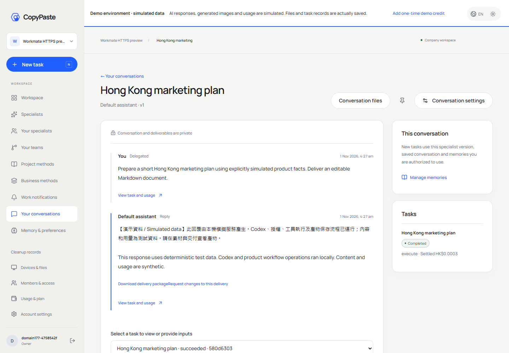


[MP4 recording](assets/demos/177-public-domains.mp4)

---

Earlier releases and deployment history / 以下为历史版本及部署记录。

<!-- lan-deployment-176 -->
## 内网 HTTP 部署 · 阶段176

Web: http://192.168.31.20:63070 · Admin: http://192.168.31.20:63071 · API: http://192.168.31.20:63072

支持内网 HTTP 的登录、工作区创建、安全摘要、任务和文件上传；19 个预设角色可读取。

服务器明文凭据：`/root/cfg/workmate/credentials.txt`（root `0600`）。邮箱验证码通过受独立口令保护的测试收件箱读取；Admin 另需验证器 TOTP。外部服务继续使用已授权假数据。

[部署、登录与运维 / Deployment and login guide](https://github.com/copypasteltd/workmate/blob/docs/docs/releases/lan-176.md)

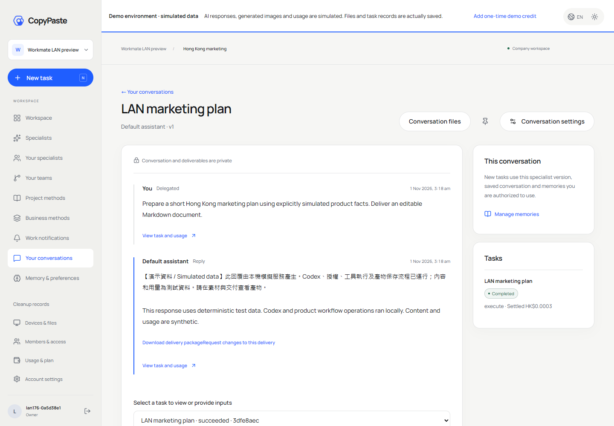

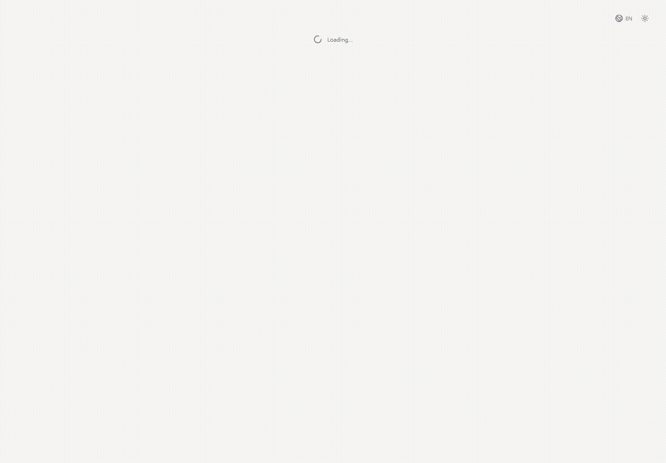

[实际操作录像 / Actual recording](assets/demos/176-lan-http.mp4)


## v0.1.3 · 当前完整交付 / Current complete delivery

[Release / 下载](https://github.com/copypasteltd/workmate/releases/tag/v0.1.3) · [中英使用手册 / Bilingual guide](https://github.com/copypasteltd/workmate/blob/v0.1.3/docs/releases/v0.1.3.md)

本轮完整包包含六仓源码和全部端，纳入团队/单次运行费用报表、原成员/协调员账目、交叉筛选和同快照CSV。当前源码与假数据冻结交付按使用者要求收口；服务器资料和正式服务接入后续提供。AI/媒体/广告/支付使用假数据，Windows未签名；完整专业/生产台账保持。

All six source trees/clients are delivered, including team/run financial reports, original member/coordinator entries, intersecting filters and matching snapshot CSV. This current source/synthetic frozen delivery closes as requested; server/live configuration follows later. External services are synthetic and Windows is unsigned. Full professional/production qualification remains tracked.


## 当前完整冻结交付 · v0.1.2

全部端、六仓源码与本次费用入账期间报表统一纳入完整下载包。Desktop在本机运行Codex且支持客户主动授予完整本机权限；Extension使用原生右侧Side Panel，获准读取/上传文件后由云端Codex执行。数据库156；外部AI/媒体/广告/支付采用已授权假数据，Windows未签名。

[完整下载 / Complete release](https://github.com/copypasteltd/workmate/releases/tag/v0.1.2) · [安装、登录和使用 / Setup and flows](https://github.com/copypasteltd/workmate/blob/v0.1.2/docs/releases/v0.1.2.md)

本轮重新构建Backend/Admin；其余运行产物及Windows分发核对后复用。继承源码一致的阶段172定向验证，阶段173不重跑功能测试。Backend/Admin rebuilt; unchanged runtimes/Windows distributions verified and reused. Exact-source stage172 focused checks inherited; no functional tests rerun at173. Older entries below retain their historical scope.

## 冻结交付 v0.1.1

完整包统一包含Windows Desktop（本机Codex、无边框）、Web、独立Admin、Chrome右侧Side Panel、Backend、六仓源码和固定runtime。假数据模式，Windows未签名；当前数据库156。

[完整发行包 / Complete release](https://github.com/copypasteltd/workmate/releases/tag/v0.1.1) · [安装及流程 / Setup and flows](https://github.com/copypasteltd/workmate/blob/v0.1.1/docs/releases/v0.1.1.md)


[English](README.en.md) · [完整Release](https://github.com/copypasteltd/workmate/releases/tag/v0.1.0) · [中英安装使用](https://github.com/copypasteltd/workmate/blob/v0.1.0/docs/releases/v0.1.0.md)

面向香港企业的 Codex Agent 平台，首批服务既有 marketing 团队，覆盖设计/媒体、广告与网站/SEO/GEO分析、重复流程和软件开发。本仓库为独立 **web** 端，使用 **React / TypeScript / Vite**。视觉遵循 CopyPaste 的暖白底、深色文字、品牌色和编辑式排版。

## 当前冻结版 · v0.1.0

本版统一交付所有端、后端和六仓源码，包含最新用户任务/内容入口。六仓重新构建；当前Desktop输出与已验收Windows完整目录/Portable/Setup逐文件一致，核对后复用。近期阶段166八项SQL/API与八组实际页面检查保留其源码及原始证据；本轮不重跑全部历史用例。

分支`web`，本版固定标签`v0.1.0-web`。[完整源码与安装包](https://github.com/copypasteltd/workmate/releases/tag/v0.1.0) · [冻结记录](https://github.com/copypasteltd/workmate/blob/v0.1.0/docs/quality/release-freeze-checkpoint-167.json) · [待办](https://github.com/copypasteltd/workmate/blob/v0.1.0/docs/quality/remaining-work-stage167.md)。AI/媒体/广告/支付为已授权假数据；Windows未签名。截图/GIF/MP4保留其原实际采集范围，不宣称新增全端安装或专业质量验收。

## 方案与结构

主要入口：`src/main.tsx, src/context.tsx, src/workspace-creation-form.tsx`。Codex 是唯一 Agent 内核，全部模型请求经公司内部 OpenAI 兼容 API，供应商密钥仅留在后端。专业模板固定 Skill、工具和配置版本；设计师组合为 Codex＋设计 Skill＋公司 Image 2。

Web 访问云端 Agent。Extension 使用 Chrome MV3 原生右侧 Side Panel，提供对话/附件界面，只读取客户选择的文件并经同意上传，由云端执行。Desktop 无边框、无 Electron 默认菜单，在客户本机运行 Codex，客户可主动授予完整本机权限，支持停止/撤权及账户、目录隔离。

Admin 独立邮箱验证码＋TOTP，按权限管理用户/企业、消耗与费用、VIP、角色/Skill和内容。用户详情传递真实用户ID；费用账户按主体筛选，VIP锁定目标，换用户销毁旧弹窗及预览。港币金额按微单位保存；预算、余额、实收、赠额、授信和VIP分开记录。人工变更先预览、再确认，保留当前权限/MFA/策略/审批、幂等和审计。

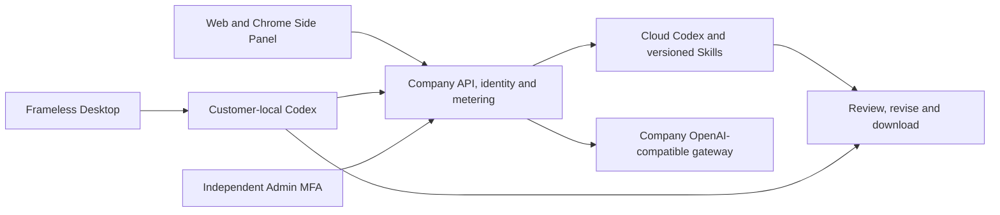

## 安装与运行

六个独立仓库并列置于 `dev/`：`copypaste-platform`、`copypaste-web`、`copypaste-admin`、`copypaste-desktop`、`copypaste-extension`、`copypaste-delivery`。使用 Windows x64、Node.js 22.14+、Git及原生PostgreSQL；媒体工作需FFmpeg/FFprobe，固定Codex随runtime分发。禁止Docker/WSL及虚拟化。

完整启动以Release指南为准。首次写配置前选空闲数据库端口，从Delivery依次运行 `demo:preflight` → `bootstrap:demo` → `demo:check` → `demo`。保留已有配置和数据；结束执行Delivery的 `npm run stop`。

本仓库单独开发，先准备对应依赖及配套后端：

```powershell
npm ci
npm run dev
```

API为localhost4310，Web4317，Admin4318。开发验证码位于platform `.data/mailbox/`。管理员需在platform执行 `npm run admin:create -- admin@example.com super_admin` 并按一次性资料绑定TOTP。Desktop通过浏览器PKCE登录后选择本机目录和权限；Chrome使用“加载已解压的扩展程序”，点击图标打开侧栏。

## 使用逻辑

1. 邮箱登录，接受邀请或创建企业及首项目。创建结果未确认时保留原请求；断线/刷新后点“确认并继续”恢复原结果。失效/删除回执不会悄悄新建企业。
2. 选择项目和角色，填写brief、文件/品牌/账户、预算和授权。必要资料在原任务补齐；执行固定当时接受的配置与Skill版本。
3. 查看持久进度、审批、成果版本、费用和用量，审阅后下载原文件或继续修改。未知费用保持待核对，不按免费处理或盲目重跑。
4. Admin从用户详情开费用/VIP，核对主体和预览后按策略确认。目录筛选支持刷新/返回恢复。用户详情可进入创建者限定的任务/内容；搜索、分页、刷新和返回保留目标与目录条件，正文权限独立。

## 配置与权限

Web/Admin使用 `VITE_API_BASE` 或同源代理；原生端构建时固定允许来源及扩展ID，回环开发外使用HTTPS。SQL增量历史001–155，API/Worker检查版本及环境身份。源码不带密钥、`.env`、用户数据库、依赖或Git元数据。

会话失效清除旧工作台，迟到结果不能覆盖新登录。文件默认私有；请求、任务领取、工具和下载重新核验当前权限。历史回执不保留已撤销访问权。显式退出清除工作区创建草稿中的名称，仅保留原账户可核对的无正文请求标识。

## 角色预设与Skill

目录定义18个专业预设；数量不代表十二个角色已全部通过专业验收。

| ID | Role | Required Skill bindings |
| --- | --- | --- |
| R01 | 全栈开发工程师 | `fullstack-engineering@1.0.0`, `frontend-implementation@1.0.0`, `backend-api@1.0.0`, `qa-testing@1.0.0`, `delivery-core@1.0.0` |
| R02 | 前端开发工程师 | `frontend-implementation@1.0.0`, `ui-system@1.0.0`, `qa-testing@1.0.0`, `delivery-core@1.0.0` |
| R03 | 后端与 API 工程师 | `backend-api@1.0.0`, `qa-testing@1.0.0`, `delivery-core@1.0.0` |
| R04 | 软件测试工程师 | `qa-testing@1.0.0`, `frontend-implementation@1.0.0`, `delivery-core@1.0.0` |
| R05 | UI/UX 设计师 | `ux-research@1.0.0`, `ui-system@1.0.0`, `frontend-implementation@1.0.0`, `delivery-core@1.0.0` |
| R06 | 设计师 | `creative-direction@1.0.0`, `image-art-direction@1.0.0`, `image2-production@1.0.0`, `typography-layout@1.0.0`, `delivery-core@1.0.0` |
| R07 | 品牌视觉设计师 | `brand-system@1.1.0`, `image-art-direction@1.0.0`, `image2-production@1.0.0`, `typography-layout@1.0.0`, `delivery-core@1.0.0` |
| R08 | 广告创意设计师 | `ad-creative@1.0.0`, `image-art-direction@1.0.0`, `image2-production@1.0.0`, `typography-layout@1.0.0`, `delivery-core@1.0.0` |
| R09 | 电商商品设计师 | `ecommerce-visual@1.0.0`, `image-art-direction@1.0.0`, `image2-production@1.0.0`, `typography-layout@1.0.0`, `delivery-core@1.0.0` |
| R10 | 社媒内容设计师 | `social-content@1.0.0`, `image2-production@1.0.0`, `typography-layout@1.0.0`, `delivery-core@1.0.0` |
| R11 | 插画与 IP 设计师 | `illustration-ip@1.0.0`, `image-art-direction@1.0.0`, `image2-production@1.0.0`, `delivery-core@1.0.0` |
| R12 | 字体与版式设计师 | `typography-layout@1.0.0`, `image-art-direction@1.0.0`, `image2-production@1.0.0`, `delivery-core@1.0.0` |
| R13 | 演示文稿设计师 | `presentation-production@1.1.0`, `typography-layout@1.0.0`, `dataviz@1.1.0`, `delivery-core@1.0.0`, `deterministic-metrics@1.1.0` |
| R14 | 网页与落地页设计师 | `landing-page@1.0.0`, `ui-system@1.0.0`, `frontend-implementation@1.0.0`, `image2-production@1.0.0`, `delivery-core@1.0.0` |
| R15 | 信息图与数据可视化设计师 | `dataviz@1.1.0`, `deterministic-metrics@1.1.0`, `typography-layout@1.0.0`, `delivery-core@1.0.0` |
| R16 | 视频与动效设计师 | `video-storyboard@1.0.0`, `template-video-composition@1.0.0`, `video-generation@1.1.0`, `speech-production@1.2.0`, `delivery-core@1.0.0` |
| R17 | 营销数据分析师 | `ads-analysis@1.1.0`, `deterministic-metrics@1.1.0`, `dataviz@1.1.0`, `delivery-core@1.0.0` |
| R18 | 企业流程自动化顾问 | `workflow-design@1.1.0`, `workflow-execution@1.1.0`, `delivery-core@1.0.0` |


## 实际截图与交互

以下为本次真实Web/SQL恢复和Admin MFA/目标验证的共享媒体，使用合成客户与业务数据；不表示其他原生端重新完成安装验收。


[实际MP4](assets/screenshots/workmate-functional-closure-165-01-recover-original-workspace.mp4)

## 历史rc.5验证与发布

以下为历史rc.5记录：当时运行七项定向SQL、四项创建草稿检查和实际Web/Admin操作，重建六仓与Windows unpacked/Portable/Setup，核对ASAR和固定Codex。按要求跳过完整重复回归，实际结果以冻结检查点为准。

分支 `web`，固定标签 `v0.1.0-rc.5-web`。后续更新同步分支和更新说明，冻结包及标签保持。外部AI/媒体/广告/支付使用已授权假数据，Windows未签名。102个原编号及88项必选完整验收范围保留，88不是未实现模块数。真实服务、签名更新、多平台与完整专业验收继续跟踪。

[检查点](https://github.com/copypasteltd/workmate/blob/v0.1.0-rc.5/docs/quality/release-freeze-checkpoint-165.json) · [完整编号台账](https://github.com/copypasteltd/workmate/blob/v0.1.0-rc.5/docs/quality/remaining-work-stage165.md) · [旧README快照](https://github.com/copypasteltd/workmate/blob/v0.1.0-rc.5/docs/history/readme-before-rc5/web-zh.md)
