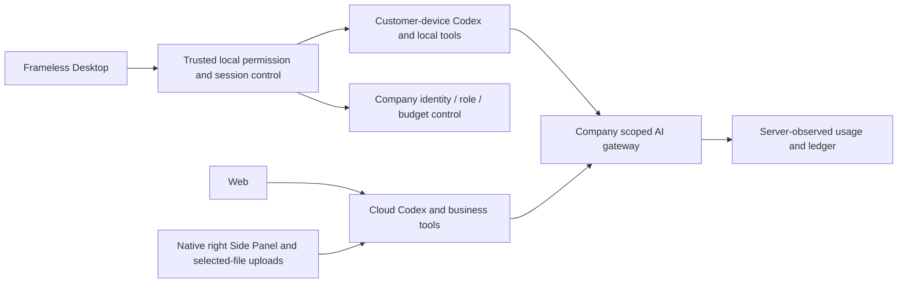

# Workmate · CopyPaste Web

[English](README.en.md) · [主文档](https://github.com/copypasteltd/workmate/blob/docs/docs/README.md)

[Backend](https://github.com/copypasteltd/workmate/tree/backend) · [Web](https://github.com/copypasteltd/workmate/tree/web) · [Admin Dashboard](https://github.com/copypasteltd/workmate/tree/admin) · [Desktop](https://github.com/copypasteltd/workmate/tree/desktop) · [Chrome Extension](https://github.com/copypasteltd/workmate/tree/extension) · [Delivery](https://github.com/copypasteltd/workmate/tree/delivery)

面向香港企业的云端 Agent 产品。当前仓库负责 **Web**；当前远程分支为 `web`.

<!-- client01-direction -->
## 当前客户端方向与实现差异

CLIENT01（2026-10-22）要求 **Desktop 在客户本机运行 Codex Agent**，提供客户可主动授予的 **完整本机权限**，操作能力对标 Codex Desktop。**Extension 在 Chrome 原生右侧栏采用 ChatGPT 式对话/附件结构**，获取、读取用户获选文件并上传，由云端 Codex 执行。全部产品 AI 请求仍走公司内部网关。

**当前实现：** Desktop 在客户本机运行 Codex，支持明确完整授权、文件/终端、同线程继续和公司工具/费用；现已接通原生追问、选择/自填回答，以及等待时停止和撤权。当前源码通过 47 项客户端测试、17 项真实原生测试和 12 项实际打包 Electron 旅程检查。后端源码未变，沿用阶段 73 的 818 项完整回归范围。16 角色的本机协议接通不等于完整专业验收；视频/流程工具、完整浏览器/应用自动化、18 角色/29 Skill 及生产验收继续跟踪。供应商响应和系统窗口决定明确模拟。Extension 继续使用原生右侧栏云端对话与获选文件上传。见 [实现方案](https://github.com/copypasteltd/workmate/blob/docs/docs/technical/74-desktop-native-user-input.md)、[源码和媒体证据](https://github.com/copypasteltd/workmate/blob/docs/docs/quality/desktop-native-input-checkpoint.json)。

下方架构图表示已实现的云端/文件桥接基线，不是 Desktop 本机 Agent 的目标架构。

本机 supervisor 的实现及历史原生权限测试见 [技术说明](https://github.com/copypasteltd/workmate/blob/docs/docs/technical/70-desktop-native-codex-supervisor.md)。

<!-- /client01-direction -->

## 架构与约束

仅使用 Codex，全部 AI 请求经公司内部 OpenAI 兼容服务器。Web、Desktop、扩展和 Admin 共用服务端身份、权限、来源与计费控制。设计沿用 CopyPaste 的品牌素材、色系、字体和中英界面。



## 产品与使用逻辑

1. 访问工作台，通过邮箱验证码登录。首次验证可创建客户账户；正式邮件通过 SMTP，本地演示使用开发邮箱投递。
2. 建立或选择企业、项目，进入工作区。成员、项目权限、费用来源及私有会话所有者由服务端检查。
3. 选择默认助手、18 个角色预设，或建立自己的专员。固定角色、技能、品牌、模型和费率版本后提交工作。
4. 根据任务选择文件、品牌资料和营销连接。先检查方案/权限与预算，再原子预留费用并执行。
5. 查看任务状态、消息、产物、实际来源和用量。需要补资料时明确选择获准版本，沿用原任务继续；刷新保留尚未提交的选择。
6. 下载或明确发布交付副本；失效来源、撤权或当前读取失败会隐藏不可读取内容。通知、计划、会话和记忆保持各自范围。

## 页面与业务

工作区、专员目录、个人专员、项目方法/Skill、通知、私有会话、记忆、项目、文件/设备、成员、用量方案和账户设置共用企业/项目上下文。创作涵盖设计、品牌、广告、电商、社交、版式、演示、信息设计与模板视频；营销涵盖文件分析、广告连接和有范围的网站诊断/修改草稿/复查。

`src/main.tsx` 负责入口和路由；独立领域组件承接会话、任务、资料、创作、连接与分析；`src/api.ts` 和会话逻辑统一接入后台。React/TypeScript/Vite；字体与品牌素材随仓库提供，不要求运行时访问第三方字体 CDN。

## 启动

```powershell
npm ci
npm run dev
```

访问 `http://localhost:4317`，并先启动 backend 的 `http://localhost:4310`。配置参考 `.env.example` 和 `vite.config.ts`。前端只配置公司服务地址，不接收模型 API 密钥。生产按部署文档发布静态构建、设置 HTTPS、Cookie/Origin/CSP 和后台访问。

## 交互约束

当前任务自动刷新保留输入选择；切换企业、项目、任务或读取失败清空原内容。任务状态、已记录用量和已结算费用分别显示。首次模型调用前缺资料，与已付费完成回合后缺资料有不同文案。公开副本和下载仍受当前来源、保留期与权限约束。

## 初次检出与环境

新工作副本可单独检出本分支；已有本地仓库直接更新，不重新初始化。

```powershell
git clone --single-branch --branch web git@github.com:copypasteltd/workmate.git copypaste-web
cd copypaste-web
```

Node.js ≥22.14、npm 和 Git；锁文件固定依赖。当前验收环境为 Windows x64。后端/完整交付还需要原生 PostgreSQL 启动资源、固定 Codex `0.163.0-alpha.10.2` 与 FFmpeg/FFprobe。禁止本地 Docker、WSL 和虚拟化。跨端运行使用多个独立工作目录；布局见 [workspace](https://github.com/copypasteltd/workmate/blob/docs/docs/governance/04-git-branches-and-publication.md).

## 检查与验证范围

```powershell
npm run typecheck
npm test
npm run build
```

历史源码的平台完整 **802/802**、任务专项 **52/52**，六仓库 **13 项**类型/构建/既有客户端测试检查、真实打包程序和原生侧栏旅程 **32 项**通过。保留原 782 项命名回归测试。任务专项调用实际 PostgreSQL、身份、账本与 Worker；另有实际 Codex 子进程连接模拟内部网关的续接验证。UI 回合及业务数据按授权模拟。原 102 项需求仍为 81 项局部验证、21 项未证明完成、0 项完整验收。

完整规范 TaskDTO/任务创建、任意执行中暂停、未知外部结果恢复、全角色独立业务、GEO、真实供应商和生产/签名/商店验收仍继续跟踪。

本次同步补充统一任务接口和原任务输入事务。当前用户界面继续通过既有项目/会话接口使用同一执行域；下方重新录制的实际交互验证该流程的兼容性，并非声称界面已经切换到全部规范任务接口。接口边界、精确金额、幂等回执、来源撤销和未接入业务参数见 [方案细则](https://github.com/copypasteltd/workmate/blob/docs/docs/technical/68-canonical-task-contracts-and-input-transactions.md)。

## 实际页面与交互

实际录制，保留原捕获时间；AI 回合与业务数据为明确模拟。Admin 演示表单不代表财务提交。


[MP4](assets/screenshots/workmate-10-interaction.mp4) · [录制与源码回执](https://github.com/copypasteltd/workmate/blob/docs/docs/quality/workmate-media-10.json)

## 方案细则与更新

- [Product](https://github.com/copypasteltd/workmate/blob/docs/docs/product/01-prd.md)
- [Architecture](https://github.com/copypasteltd/workmate/blob/docs/docs/technical/01-architecture-and-stack.md)
- [Identity and permissions](https://github.com/copypasteltd/workmate/blob/docs/docs/technical/07-security-and-permissions.md)
- [Task continuation](https://github.com/copypasteltd/workmate/blob/docs/docs/technical/66-paid-native-input-checkpoints.md)
- [Admin](https://github.com/copypasteltd/workmate/blob/docs/docs/product/08-admin-dashboard.md)
- [Native clients](https://github.com/copypasteltd/workmate/blob/docs/docs/technical/30-native-window-and-browser-sidepanel.md)
- [Canonical task update](https://github.com/copypasteltd/workmate/blob/docs/docs/changes/2026-10-22-canonical-task-repair.md)
- [Local Codex update](https://github.com/copypasteltd/workmate/blob/docs/docs/changes/2026-10-22-native-codex-supervisor.md)

后续修改需要同步中英 README、受影响的实际截图/GIF、更新说明和对应分支。提交后通过 Delivery 发布流程核对远程 SHA；不强推覆盖协作者。`.env`、数据库、会话、依赖和安装产物不进入 Git。历史 README 原字节见 [archive](https://github.com/copypasteltd/workmate/blob/docs/docs/quality/history/stage66-before-workmate-readmes/manifest.json).

本次 Desktop 本机执行：[具体方案](https://github.com/copypasteltd/workmate/blob/docs/docs/technical/73-desktop-native-company-tools.md) · [源码与真实旅程证据](https://github.com/copypasteltd/workmate/blob/docs/docs/quality/desktop-company-tools-checkpoint.json)；既有媒体保持原始源码范围。

本次公司工具更新：[更新说明](https://github.com/copypasteltd/workmate/blob/docs/docs/changes/2026-10-23-desktop-company-tools.md) · [源码检查点](https://github.com/copypasteltd/workmate/blob/docs/docs/quality/desktop-company-tools-checkpoint.json)；较早回执和媒体保持原始源码范围。

阶段 74 本机追问更新：[更新说明](https://github.com/copypasteltd/workmate/blob/docs/docs/changes/2026-10-23-desktop-native-input.md) · [当前源码检查点](https://github.com/copypasteltd/workmate/blob/docs/docs/quality/desktop-native-input-checkpoint.json)。较早报告及媒体保留原始源码范围。
