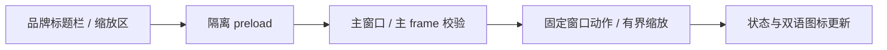
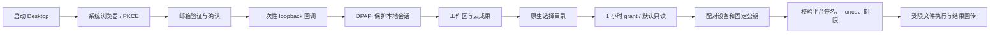
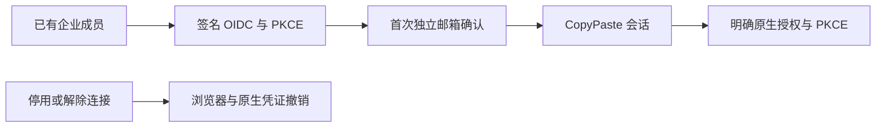
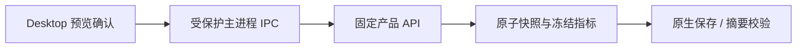
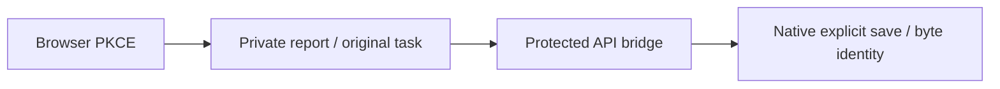
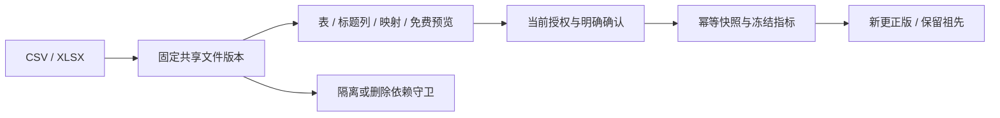
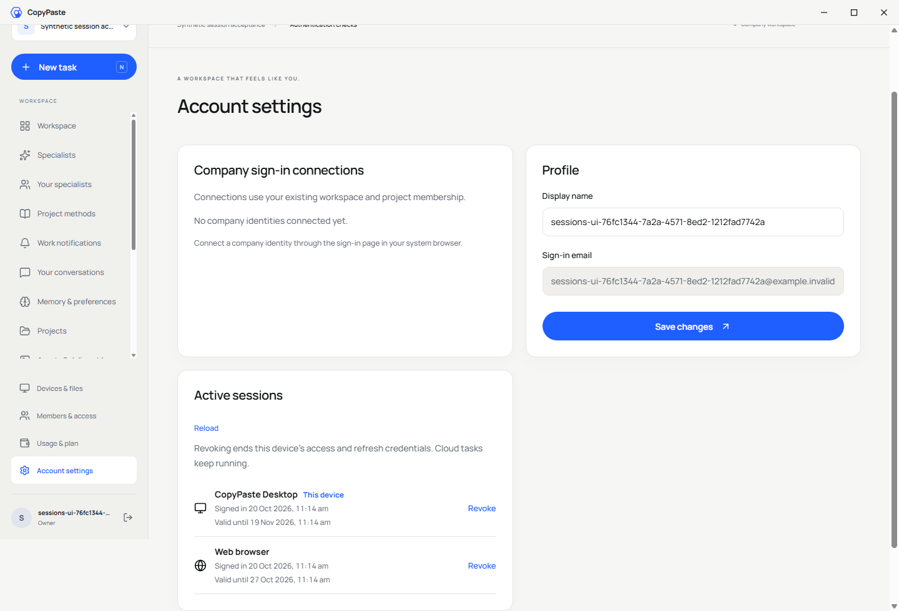

# CopyPaste Desktop

[English](README.en.md) · Windows 企业 Agent 客户端 · 0.5.0

独立 Electron 仓库，内置完整 Web 工作区快照与窄权限本地桥接。支持系统浏览器登录、Windows 用户级凭证保护、明确的本地目录授权、平台签名文件排程，以及 Chrome Native Messaging。实际 Agent 内核仍由公司平台的 Codex 执行，客户端不直连模型供应商。


## 无边框窗口

主窗口移除原生边框、标题框和 Electron 默认菜单，Alt 不会弹出菜单栏。40px 品牌标题栏可拖动，提供双语最小化/最大化/还原/关闭按钮并随浅深主题变化；弹窗位于标题栏下方。八个边缘/角落支持缩放，最小 800×600；右下角也支持方向键（10px）和 Shift+方向键（50px）。原生文件选择/权限对话框继续使用系统 UI。

标题栏在隔离的 preload 内创建，位于 Web renderer 快照之外；显式同步 renderer 不会覆盖窗口实现。主进程对窗口 IPC 同时核对自己的 webContents 和主 frame，只允许固定窗口动作和有界缩放。沙箱、context isolation 和关闭 Node integration 继续生效。




当前源码的客户端预览构建位于 `release/frameless/`：`CopyPaste-0.5.0-x64-Setup.exe`、`CopyPaste-0.5.0-x64-Portable.exe`、`win-unpacked/CopyPaste.exe`。它们使用本机 localhost 配置，未签名；先前无边框预览原字节保留在 `release/frameless-stage30/`，历史完整 0.5.0 包继续独立保留。重建执行 `npm run build`，再执行 `node node_modules/electron-builder/cli.js --win portable nsis --config.directories.output=release/frameless --publish never`。

交付仓库的 `npm run qa:native-surfaces` 验证真实窗口、Alt、按钮、指针/键盘缩放下限、跨窗口 IPC 拒绝、真实 PKCE、工作区/弹窗及主题语言。设置 `COPYPASTE_DESKTOP_EXECUTABLE` 为上述解包 EXE 可验证打包版，报告 `evidence/native-surfaces.json`。完整签名更新、卸载及多显示器/DPI 系统矩阵仍有待验收。

2026-10-20 复核修复了登录成功后停留在登录页的问题：本地 API 白名单补齐只读 `/v1/session/context`，以及工作区创建、成员控制、分析证据和报告所需的既有业务入口。凭证交换仍由主进程完成，renderer 不可调用认证凭证或 Admin 接口；URL 规范化后的越界路径也会拒绝。25 项 Desktop 测试及类型检查通过。交付工具把当前测试绑定到客户端运行文件、源码、安装器及扩展字节，拒绝用历史通过报告验收新包；Setup/Portable 的安装、卸载和完整原生认证矩阵仍独立待验收。

## 运行与构建

Windows x64、Node.js 22.14+、npm。当前只验收 Windows；没有生成 macOS/Linux 安装包。先启动 platform 与 Web，再执行：

```powershell
npm ci
npm run typecheck
npm test
npm run build
npm start
```

公开 `deployment.json` 指定 API、Web origin 与官方扩展 ID；构建时可用 `COPYPASTE_API_ORIGIN` / `COPYPASTE_WEB_ORIGIN` 覆盖，运行时同名环境变量也可覆盖。只接受 HTTPS 或 localhost。当前交付二进制面向本机演示，默认 `localhost:4310/4317`；部署到公司云端须先修改此配置重新打包。

```powershell
npm run package
```

生成 `release/CopyPaste-0.5.0-x64-Setup.exe`、`release/CopyPaste-0.5.0-x64-Portable.exe` 和 `release/win-unpacked/CopyPaste.exe`。`package:dir` 只产生解包应用用于验收。安装包尚未代码签名；不会声称已有签名证书或商店发布。原生开发，禁止 Docker、WSL 和虚拟化环境。

## 登录与本地访问



每次授权校验 state、PKCE、精确 loopback 回调和单次 code；access token 短期，refresh family 轮换。退出撤销平台会话并撤销本地目录权限。Windows DPAPI CurrentUser 保护本地 profile key；数据使用 AES-256-GCM 认证加密，明文凭证不落盘。密钥不依赖并发 Chromium profile，主客户端与 Native Host 可跨进程读取同一授权。DPAPI 通过固定原生 Windows PowerShell/.NET helper 调用，秘密只经 stdin；不执行客户命令或动态脚本。

本地状态在 `%APPDATA%/CopyPaste/`，QA 可通过 `COPYPASTE_USER_DATA` 使用隔离目录。已安装产品的正常用户数据不属于源码工作区；开发源码、依赖和打包产物都在本仓库。

目录根路径只留在本机。默认 read/list，写入需要额外同意且只创建新文件；最长 1 小时、最多 20 个 grant。读取最大 5 MB，创建文本最大 2 MB，目录最多 500 项。路径禁止越界、符号链接/junction、ADS、设备名、尾点/尾空格；现有文件不被覆盖。命令 journal 有数量及字节上限，撤销/过期先于重放检查。并行 Host 通过跨进程锁串行修改 journal。

下载必须经过公司 API 与原生保存对话框，保存采用 create-only；上传必须来自明确选择的文件或授权目录。云命令验证 Ed25519 签名、固定公钥、nonce 与过期时间；结果使用原生 bearer+nonce 回传，尚未实现客户端结果签名。

## 专家与会话

0.2.0 内置最新 Web 工作区：专属专家、私密会话、五种范围的记忆，以及问答/计划/执行模式。笔记经有限原生 API 桥接保存到平台，重新加载后恢复；原生端和 Web 共用同一用户身份与权限规则。私密任务产物须明确发布才成为项目共享副本。


## Chrome 桥接

使用 Setup 安装到稳定路径，在设备页点击连接 Chrome helper 并确认，注册 `HKCU/Software/Google/Chrome/NativeMessagingHosts/hk.copypaste.agent`。只允许 `deployment.json` 中官方 ID；扩展自身还需可选 nativeMessaging 权限和逐目录授权。便携版路径可能变化，正式桥接使用 Setup 安装版。

受信部署人员也可在已构建仓库执行：

```powershell
npm run native:register -- fffkcnmfdhahlnifgdilabheppkgnlok 'C:\YourStableInstall\CopyPaste.exe'
```

注册操作改变当前用户的 Chrome native-host 配置，应只指向稳定、可信的本产品可执行文件；QA 不覆盖用户原有注册。Native Host 采用 Chrome 长度前缀 JSON 协议，响应最多 900 KB。

## 独立渲染器快照

`renderer/` 是随仓库提交的 Web 源快照，构建不需要相邻 Web 仓库。显式更新时执行：

```powershell
npm run renderer:sync -- 'D:\path\to\copypaste-web'
npm run build
```

`renderer-source.json` 记录来源和哈希。主进程 contextIsolation、sandbox 开启，nodeIntegration/webview 关闭；页面 CSP 禁止直接网络，所有请求走有限 IPC。拒绝额外权限、任意外链和窗口导航。Native Host 独立运行时不创建浏览器页面。

## 验证与边界

`npm test` 包括路径/撤销/重放/create-only、固定 API origin，以及真实 Windows DPAPI 跨进程解密与篡改拒绝。delivery 的 `qa:desktop` 使用实际打包应用，执行邮箱/PKCE、专家创建/私密会话笔记持久化、加密凭证、本地目录、云签名命令、Chrome 帧协议；测试对话框选择预设 fixture 路径，未自动批准用户真实目录。`qa:packaged` 另核查 isPackaged、版本与启动。

公司 AI 网关与外部广告平台仍需真实联调。当前没有任意桌面 UI 控制、客户 shell 执行、完整 AI 视频/语音；这不是已验收的所有长期规划功能。所有 QA 创建的浏览器与应用均在 finally 关闭。见 [第三方说明](THIRD_PARTY_NOTICES.md)；主文档位于交付根目录 `docs/`。

Chrome Host 使用 `resources/native-host.cmd` 启动受限 Node 模式脚本，避免 GUI 标准输入丢失；源码为 `src/native-host.ts`，与主窗口的输入输出分开处理。

## 云端定时流程

0.4.0 内置同版 Web 日历界面，支持每日/每周、IANA 时区、预算预览、明确授权、版本与历史以及暂停/恢复/退役。请求经原生 bearer 桥接，权限与浏览器端一致；客户端关闭后云端仍运行。该日历不授予未经确认的本地目录权限。Delivery `qa:desktop` 在实际打包应用中创建并显示计划，再退役测试计划。


## 0.5.0 企业身份与统一登录

OIDC 使用 code + PKCE S256、签章、state/nonce 与固定回调。先有注册账号及有效企业成员资格，再绑定企业身份；首次绑定需要独立的 CopyPaste 工作邮箱确认码，不按网域自动开户。配置改变、停用或本人解除连接会撤销关联用户的全部 CopyPaste Web/native/refresh 会话和旧执行授权。管理员登录仍独立使用邮箱与 TOTP。

用户在系统浏览器选择企业身份，完成后点击授权，真实 loopback PKCE 回调将独立原生凭证保存至本机 DPAPI 保护的存储。工作区账号设置显示企业连接。后台停用连接后，既有原生 access/refresh 与待交换码失效，不保留本地独立登录后门。




## 当前修复中的文件通道

工作台同步 Web 的分片续传、模拟标识、删除进度和保留期限。原生请求桥转发稳定 Idempotency-Key，重连不会分配重复上传会话。下载先由用户选择目标，以流写临时文件并验证字节数与 SHA-256，拒绝覆盖已有文件；异常清理临时文件，上限 1 GiB。JSON IPC 的任务事件按游标逐页读取。

目前源码增量尚未重打 Windows 安装包，需继续执行原生界面与打包回归；历史 0.5.0 安装包不包含本节更改。

## 本轮源码验收

原生源码验收已通过：系统浏览器 PKCE 登录、稳定上传幂等键、29 MiB 实际分片上传、摘要一致的流式下载、拒绝覆盖既有文件，以及原生桥上的同一云目录浏览。验收结束关闭独立浏览器与客户端。


以上针对当前源码运行；旧 0.5.0 安装包尚未重打包，不含本轮新增功能。

## 专案技能管理（当前源码快照）

项目方法新增精确安装及专家/任务版本绑定。普通停用影响新工作；卸载和永久安全撤销阻止包括旧任务在内的后续调用。重装产生新身份，专家须保存新版本后采用。工具调用及结果落库前复查当前方案，实际消耗按原预留结算。

平台全套回归 **185/185**；delivery 的 `npm run qa:skills` 通过三组浏览器验收，31 份实际 HTTP 请求／响应样本通过严格设计 schema。自定义包审核/发布、完整真实角色资格仍待完成，历史 0.5.0 安装包未替换。

## 默认助手与通知（当前源码）

同步快照支持直接使用默认文字助手、私人会话和站内通知。源码 Electron 八组旅程验证原生 PKCE、29 MiB 传输及拒绝覆盖、云目录、真实 Codex 的模拟文字文件和通知定位。首次启动可读取两个公开配置/内容接口以展示演示提示；未登录私人请求仍拒绝，写入仍要求原生凭证。

模拟提示在登录前后持续显示。`npm test` 四组原生测试通过。所有浏览器和 Electron 测试实例已关闭；历史安装包仍不包含此增量。


## 运行前资料 / Pre-execution inputs

源码快照支持与 Web 相同的等待、搜索、明确选择和私人补传流程。原生验收使用实际上传的 29 MiB 文件版本，确认首次模型调用前等待，再由同任务生成真实文件；模型依赖为明确假数据。计划来源变化与当前权限由服务端重新核验。当前共八组 Electron 旅程通过，历史安装包仍待重新发布。

The renderer snapshot includes the same initial input checkpoint as Web. Native QA selects the version of the actual 29 MiB upload and resumes the original task through the authenticated bridge. Eight source Electron journeys passed using real Codex with synthetic model dependencies. These source changes are not included in the historical installer.


## 容量排队（当前源码）

渲染快照同步企业共用名额等待提示和用量说明。服务端统一实施企业、当前用户方案与能力执行上限，容量满时保留同一任务及预留，空位释放后自动继续。源码构建与既有八组原生流程另行验证；历史安装包不含本增量。

## 原生模板选择与企业隔离

当前源码渲染器同步 Web 的持久模板目录、依赖预检及实例化。主进程校验企业 UUID，只向固定产品 API 转发企业头和受保护凭证；未提供、外部或非法企业身份被拒绝。真实 PKCE 后可以在 Desktop 建立专家，再由 Web 查看同一持久记录；没有隐式启动 AI 或扣费。

`qa:agent-templates` 验证当前源码 Electron，独立 profile，结束后关闭应用及浏览器。18 个专业角色仍待真实资格；此截图不代表历史 0.5.0 安装包已更新。


## 原生 PDF 导出与保存（当前源码）

同步的画布提供单页 PDF 图片审阅稿，保留源工程。真实 PKCE 登录后由主进程以受保护令牌请求产品 API，并经现有流式下载保存到明确选定的位置。新增验收实际保存 PDF，摘要与服务端不可变版本一致，结束后关闭自建应用。历史安装包未重打。


## 营销 CSV、精确指标与来源（当前源码）

导入先预览并确认账户、币种、时区、实体层级、归因和转化定义；支持通用 CSV 及 Google/Meta 风格候选表头与手动映射。原始 UTF-8/BOM、SHA-256、映射和计算结果真实保存。相同项目内重复请求或成功回执丢失后的重试只返回原快照；被隔离的数据不能绕过限制重新上传。未知转化不计零，CTR/CPC/CPM/CVR/CPA/ROAS 用精确小数先加总再计算，历史结果冻结。

原始 CSV、标准化 CSV、带 11 项证据的 JSON 计算报告及实际 SVG 可下载。页面显示实际数据日期；上传时间不冒充平台取数截止时间。没有正式广告账户同步、跨平台转化去重、FX 或完整 AI 叙述验收；营销分析角色仍未合格。模型依赖继续使用获准假数据，数据库与文件逻辑真实执行。历史安装包未重打。

独立 renderer 快照包含相同流程。`qa:marketing-analytics` 使用真实 PKCE、受保护 IPC，完成 Meta 风格导入及原生 CSV 保存；本地字节与原文一致，自建 Electron/浏览器在 finally 关闭。当前源码构建、renderer 类型检查和四项原生单元测试通过。




## AnalysisSpec 私人报告（当前源码）

在行销分析选择已有快照、业务问题、日期/比较区间、指标、维度和 HKD 最高预算。预览不调用模型或预留费用；明确确认后原子建立私人 Codex 任务、冻结计算/证据及单笔预留。来源、账户、币种、时区及归因独立；重复事实去重，冲突拒绝，比较零值/无数据保留原因。接受后丢失回执重试返回原报告。

真实 Codex 通过分页事实工具读取固定值，服务端检查证据占位符及数字字面量后发布固定 HTML 资产，JSON 保留完整计算。自然语言语义和专业业务质量仍待验收；当前模型为明确标识的假数据。来源隔离/删除和项目撤权阻止读取及下载。完整 102 条综合验收、正式连接、专业角色资格和生产发布仍未完成，历史安装包未更新。

独立 renderer 已同步到 **41** 个来源摘要，不依赖相邻 Web 源码构建。真实浏览器 PKCE、受保护 IPC、报告读取、原任务 HashRouter 跳转及原生 HTML 保存均经过实际 Electron 验证；保存字节与 Web 下载 SHA-256 一致，自建应用及浏览器均关闭。构建、renderer 类型检查和四项原生单元测试通过。




## CSV／XLSX 文件导入与更正历史（当前源码）

营销输入现在先保存为项目共享文件的固定版本，再预览工作表、标题列、映射和账户口径。Google/Meta 经规范 `POST /v1/dataset-imports`，通用表格沿用兼容入口；预览不调用模型或预留费用。重复上传、接受回执丢失与重试不重复建立相同快照。原始 CSV/XLSX 下载校验实际字节及 SHA-256。

XLSX 限 5,000,000 字节、50 张工作表、100 列和 10,000 数据行；多表须明确选择，标题列为 1–100。只读解析共享/内联字符串、XML 中文字符引用、精确数字及 1900/1904 日期；金额输入最多六位小数，冻结指标保留八位。拒绝公式（含缓存结果）、宏、外链、加密文件和数据区合并单元格。错误定位实际工作表单元格。预览失败仍保留已明确上传的项目原始文件，界面提前说明。

更正新建不可变快照并记录完整祖先链，保留旧指标和历史报告；AnalysisSpec 在建立任务/预算前拒绝同时汇总祖先及更正版。来源隔离或删除阻止依赖数据、报告和文件读取；删除恢复流程关闭尚未领取的任务并释放未用预留，已运行或费用不明的任务保留原对账规则。私人文件须先明确发布为共享副本。



平台完整回归 **185/185**，严格实际 HTTP 样本 **31/31**，文件导入四组及原有 CSV 六组 Web/源码 Electron 流程通过；原生类型检查和四项单元通过。模型/媒体依赖为获准假数据，数据库、Codex、文件与授权逻辑真实执行。完整 102 条综合验收、全部官方导出格式、正式连接器、专业业务资格和生产发布仍待完成，历史 0.5.0 安装包未重打。详细规则见主文档 `docs/technical/29-file-imports-and-correction-lineage.md`。

该导入阶段的独立渲染快照共 41 项来源摘要（当前认证增量为 43 项）。主进程只开放规范导入的精确 POST 路径，继续校验固定 origin、企业和凭证；实际 Electron 完成 PKCE、分片上传、Meta XLSX 导入及原生字节一致下载。


无边框窗口中的任务详情新增“暂停排队 / 继续工作”，首次模型调用前沿用同一任务与原预留，通过现有原生 API 桥执行。真实浏览器 PKCE、暂停/恢复及取消释放额度已通过 Delivery `qa:task-controls` 验证。当前为源码变更；上一轮 `release/frameless/` 预览包保留原提交与摘要，尚未包含本轮排队控制。已付费步骤恢复仍未完成。


## 会话竞争与本地退出

原生会话控制器限制迟到的登录/刷新回写；并发刷新合并为一次，旧 401 不得清除后来登录的账户。确定失效才移除凭证，临时故障保留可恢复状态。退出先清空加密凭证，撤销本地目录与缓存结果，并凭刷新凭证撤销服务端整族；访问令牌过期也可退出。离线时明确提示服务端撤销未确认，可从其他已登入装置完成。登录替换也清理先前目录和设备关联。


本轮是源码与构建交付；历史无边框预览安装包保留原提交与 SHA-256，不包含本轮会话修复。`npm test` 覆盖 10 组会话竞争/持久化与原有原生能力，交付仓库 `qa:sessions` 验证真实 Electron/PKCE 和远端撤销。

## 规范原生认证与重试 / Canonical native authentication and retry

浏览器授权明确使用 S256，首次交换及刷新调用规范 `/v1/auth/token`。首次交换的未知响应最多以同一标识重试一次；刷新标识先随 DPAPI 保护的加密状态保存，响应丢失后可恢复原轮换。新登录改变本地身份版本，刷新保持不变；退出和新登录继续隔离迟到结果。

Native sign-in and refresh consume the canonical token contract. A first code exchange retries an unknown result once under the same key; definitive rejections are not retried. Refresh request identities persist with DPAPI-protected credentials, so a committed response loss can recover one rotation without triggering reuse revocation. Real Electron fault-injection checks live in Delivery `qa:sessions`. Historical frameless preview installers retain their original manifest and do not contain these source updates.

当前 `npm test` **24/24**，原生会话十五组、首次交换四组及文件/DPAPI 等原有能力均通过；渲染来源摘要 **43** 项。 / Current native tests: **24/24**; renderer provenance: **43** files.

历史启动限制：此前十二组原生复核未完成，失败与诊断仍见 `evidence/auth-recovery-open-issue.json`，原七组 `sessions.json` 保持原字节。2026-10-20 当前源码十二组已通过，使用新的 `evidence/auth-recovery-current.json`；具体范围和截图见下文，完整安装包／SSO／系统矩阵仍待验收。

Historical startup limitation: the earlier twelve-flow run did not complete; its failures and diagnostic comparison remain unchanged. The current-source rerun now passes **12/12** in `evidence/auth-recovery-current.json`, with scope and screenshots below. The original seven-flow session receipt remains historical. Complete packaged authentication, SSO and system matrices are still unaccepted.

## 用户资料契约 / User profile contract

原生设备同步及本仓库 renderer 快照均改用受认证的 `GET /v1/session/context` 读取工作区授权；规范 `GET /v1/me` 仅返回 `User`。renderer 通过显式 `renderer:sync` 复制并重新记录摘要，未单独修改快照。此次源码改动未重新构建历史界面预览安装包。

Device sync and the explicit renderer snapshot now read workspace authorization from authenticated `GET /v1/session/context`. Canonical `GET /v1/me` returns only `User`. Snapshot provenance is regenerated by `renderer:sync`; earlier preview installers are not rebuilt by this source change.

## 成员管理同步 / Membership renderer update

显式 renderer 快照同步规范邀请、独立成员 ID、项目授权选择、分页、投递状态与移除确认；主进程传递企业头。45 份 renderer 来源摘要随仓库记录。当前源码类型检查和构建通过；当前源码十二组原生认证／会话恢复另列通过；完整安装包认证、SSO／系统矩阵仍未验收。

The explicit 45-file renderer snapshot includes canonical invitation/member operations, project selection, pagination, delivery status and removal confirmation. IPC forwards the tenant header. Current sources typecheck/build and twelve source authentication/session-recovery groups now pass separately; complete packaged authentication, SSO and system acceptance remain outstanding.

## 成员暂停反馈来源同步

renderer 已从明确指定的 Web 来源同步后台暂停提示并构建，来源摘要随仓库保存。原生无边框、自绘窗口控件和菜单移除规则保持有效；本次页面复核没有重打安装器／便携包；源码认证十二组通过，完整安装包／系统矩阵仍待验收。

## 当前源码认证恢复复核（2026-10-20）

Delivery `qa:sessions` 的 Web／源码 Electron／MV3 十二组现已 12/12。Desktop 实际浏览器 S256 授权、首次交换和刷新已提交回执丢失的同键恢复、DPAPI 凭证清理、Web 远程撤销、离线退出未确认反馈均已实测。769 份三端／服务端源码和运行文件前后一致，测试凭证及自建浏览器、Electron、MV3 已清理；旧启动失败与诊断保留原字节。




本次使用 source Electron 和当前 dist／renderer-dist，不把十二组记为 Setup／Portable 安装包认证。原生边框及默认菜单继续移除；窗口／右侧栏外观使用单独 10/10 原生预览证据。完整安装卸载、系统／DPI、签名／更新和企业身份矩阵仍待验收。

2026-10-20 退款增量后当前源码复核：Web 成员 6/6（169 份来源）、Admin 成员 6/6（196 份）和 Web/源码 Electron/MV3 认证 12/12（775 份）通过，前后摘要一致，拥有的会话、浏览器、Electron 和扩展进程均已清理。首轮 Electron 调试连接超时原回执保留，随后相同源码重跑通过。Desktop 无边框和原生 Side Panel 预览包保持原字节；完整安装包认证及系统矩阵仍须独立验收。
