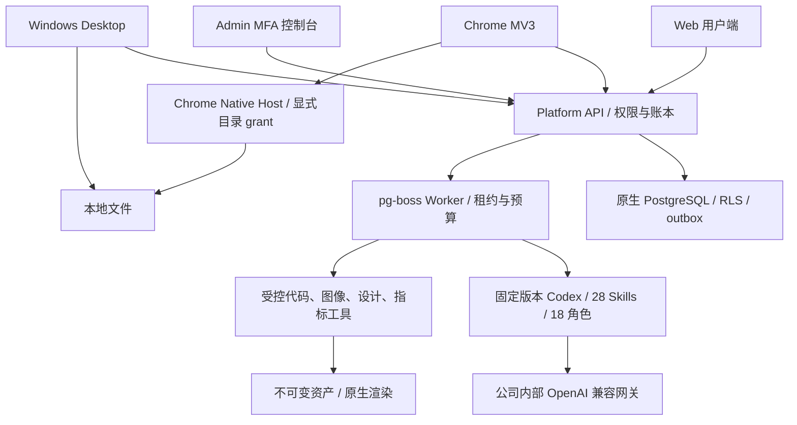

# CopyPaste 交付与集成

[English](README.en.md) · 原生开发控制器、验收与交付入口 · 0.3.0

本仓库与五个产品仓库分别使用独立 Git，不把它们合并成单一仓库。项目位于 `D:\dev\copypasted\自有agent\`；源码、依赖、产物位于 `dev/`，主需求/设计/质量文档位于 `docs/`。各仓库的 README、图与截图随仓库交付。


## 仓库清单

| 同级目录              | 职责                                                                      | 默认入口         |
| --------------------- | ------------------------------------------------------------------------- | ---------------- |
| `copypaste-platform`  | 身份、企业权限、API/Worker、Codex、费用/VIP、素材/数据/流程、Admin 控制面 | `localhost:4310` |
| `copypaste-web`       | 用户 Web 完整访问/登录/初始化/工作区                                      | `localhost:4317` |
| `copypaste-admin`     | 独立 MFA 后台与 16 个运营页面                                             | `localhost:4318` |
| `copypaste-extension` | Chrome MV3 侧栏、PKCE、主动文件/网页、原生桥接                            | 加载 `dist/`     |
| `copypaste-desktop`   | Windows 客户端、目录授权、签名命令、Chrome Host                           | Setup / Portable |
| `copypaste-delivery`  | 本仓库，启动、停止、验收、版本与证据                                      | 命令行           |

每个仓库有自己的 package.json、锁文件、main 分支、中英 README 和素材来源说明。Web/Admin/Desktop 构建不要求相邻源码。只有本集成仓库的启动/QA 需要明确放在上述同级布局；也可用 `COPYPASTE_DEV_ROOT` 指定启动/构建根目录。浏览器 QA 脚本当前依赖上述同级布局和默认本机端口。

## 已安装环境直接查看

```powershell
# 本仓库执行；控制器占用 4319 仅供本机关闭
npm start
```

打开 `http://localhost:4317` 或 `http://localhost:4318`。保留终端。关闭时在本仓库另一终端：

```powershell
npm run stop
```

控制器依次启动真实 PostgreSQL、平台、Web、Admin；等待真实就绪；关闭时通过仅本机随机令牌控制口，先停 API、再停界面与数据库。端口已有进程时直接失败并保留它，不杀用户已有程序。原生 pg_ctl 关闭会完成 checkpoint；已验证无崩溃恢复的持久重启及原有 5173/5174 服务进程保持。控制器令牌、进程状态及日志只在忽略的 `.data/`。

## 干净环境复现

原生 Windows x64、Node.js 22.14+、npm、Git、FFmpeg/FFprobe、固定 Codex `0.163.0-alpha.10.2`。不得调度 Docker、WSL 或虚拟化环境。锁文件含原生 PostgreSQL/Electron 依赖，首次安装可能下载对应平台二进制。保持六个仓库同级，先停止旧开发服务：

```powershell
npm ci
npm run bootstrap
npm start
```

控制器就绪后，在 platform 仓库的另一个终端准备隔离测试库和管理员：

```powershell
npm run db:migrate
npm run admin:create -- admin@your-company.example super_admin
```

把 platform `.data/enrolment/<id>.json` 的 TOTP URI 导入认证器并删除 enrolment 文件。用户可自己用工作邮箱注册，无默认账号；开发验证码在 platform `.data/mailbox/`，生产必须配置真实 SMTP。

Bootstrap 不安装个人全局工具，也不覆盖现有 `.env`。数据库/API 保留本机已有试点数据，不能用 QA 数据替代真实企业资料。MASTER_KEY 丢失会影响加密凭证、签名及会话验证，应与数据库/对象文件一并备份。

## 四端和平台关系



AI key 只在服务端 `.env`，所有 AI 经内部网关。没有公司 Base URL、精确模型别名、密钥和实际费率时，界面正常访问、非 AI 业务可用，AI 任务明确不可用。

## 验证命令与证据

```powershell
npm run verify
npm run qa:web
npm run qa:persistent
npm run qa:admin-identities
npm run qa:extension
# 先在 Desktop 仓库执行 npm run package:dir 或 npm run package
npm run qa:desktop
npm run qa:packaged
python -X utf8 scripts/review-repositories.py
```

浏览器 QA 需要 Chromium。可通过 `CHROME_BIN` 指定现有原生可执行文件，或 `npx playwright install chromium` 安装 Playwright 自带版本；本次机器已安装。所有测试只创建并关闭自己的页面/上下文/进程，不关闭用户原有浏览器。

| 证据文件                          | 含义                                                                        |
| --------------------------------- | --------------------------------------------------------------------------- |
| `evidence/verification.json`      | 六仓库类型检查/构建、平台 51 项测试、Desktop 3 项测试、实际路由导出         |
| `evidence/web-admin.json`         | 真实邮件登录、初始化、PNG 素材/图层与媒体、数据/流程、16 页 Admin、费用/VIP |
| `evidence/persistent-work.json`   | 专家/私密会话/记忆、移动/深色主题、Admin 正文隔离与删除的 8 项浏览器检查 |
| `evidence/admin-identities.json` | 管理员邀请、邮箱与真实 MFA、更换验证器、受限权限、停用/恢复与重发邀请的 6 组浏览器检查 |
| `evidence/extension.json`         | 实际 MV3、Chrome identity PKCE、上传、token 隔离、退出                      |
| `evidence/desktop.json`           | 实际打包应用、PKCE、加密存储、真实目录、签名云命令、Native Host 帧          |
| `evidence/packaged-windows.json`  | 实际 Windows 包启动、isPackaged、版本和截图                                 |
| `evidence/native-controller.json` | 启动/关闭控制器与原有服务保留核查                                           |
| `evidence/repository-review.json` | 仓库边界、双语 README/图/截图、真实本机密钥排除及来源哈希                   |
| `evidence/release-manifest.json`  | 最终 Git 提交、构建产物 SHA-256 与范围                                      |

报告只代表实际运行过的检查。受控 Responses fixture 启动真实 Codex 并执行工具回合，但不等于公司真实模型业务准入。主文档的 102 项长期验收没有被批量标为通过。静态文档核查另外在根目录运行 `python -X utf8 docs/tools/validate_docs.py`。

## 数据库生命周期复核

`npm run qa:lifecycle` 要求先停止现有 CopyPaste 控制器。它自行启动、关闭、重启原生服务，核对 PostgreSQL checkpoint、当前版本就绪、专家/会话/记忆记录保留及既有服务 PID，最后停止自己的栈。之后用 `npm start` 恢复查看。此检查不启动虚拟化或浏览器。

0.1.0 与 0.2.0 原始验收副本保存在 `evidence/versions/`；当前 evidence 对应 0.3.0。长期需求继续由各仓库及主文档跟踪。

## 二进制与演示流程

所有检查通过且六仓库已提交、工作区干净后，在本仓库执行 `npm run release`。它验证证据，生成 `release/`：六个可离线克隆的 Git bundle、Web/Admin/Chrome 成品 ZIP、Windows Setup/Portable，以及包含精确提交和 SHA-256 的清单。`git clone <文件.bundle> <目录>` 可恢复独立仓库。发布产物和 `evidence/release-manifest.json` 均忽略入 Git，避免提交自引用；源码内保留生成脚本及已执行的验收报告。

执行 `python -X utf8 scripts/verify-release.py` 可再次核查全部文件摘要、ZIP CRC/入口，实际离线克隆六仓库并比对提交、分支、tree、源码索引及干净状态。它只在本仓库 `.data/release-restore/` 建立临时 checkout，核查后删除自己创建的目录；结果写入忽略的 `evidence/release-restore.json`。

Desktop `npm run package` 输出 Windows x64 Setup、Portable 和 win-unpacked；当前为未签名、本机 origin 构建。Chrome 加载扩展 `dist/`；生产发布需改公开部署 origin、匹配扩展 ID，安装版经用户确认注册 Native Host。未自动安装应用、发布商店、创建线上收款或部署生产。

建议演示顺序：邮箱注册 → 创建企业/项目 → 专属专家/私密会话/记忆 → 品牌/素材 → 创意工程 SVG/PNG/MP4 → CSV 指标 → 工作流审批 → Admin 用户详情、确认入账、VIP → 扩展登录上传 → Desktop 登录、目录授权与云文件指令。实际 Agent 生成环节须公司网关联调后启用。

## 尚未完成的发布工作

公司 AI/SMTP/广告 OAuth/S3 需真实凭证及联调；Windows 签名证书、生产原生服务账号/ACL/网络隔离、备份恢复/SLO 需部署核查。SSO、云定时计划、并行团队 Agent、协同编辑、完整 AI 视频/语音、在线收单、客户代码强隔离不在本次已实现范围。已安装 18 个角色/28 个 Skills 仍待真实角色任务验收，不能按可用资格数量宣传。

主需求和设计优先级未被删除；本仓库交付实际实现和证据，不用页面存在冒充全部产品验收。各端完整操作说明见各自中英 README；[第三方说明](THIRD_PARTY_NOTICES.md)记录工具和截图来源。
