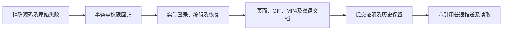
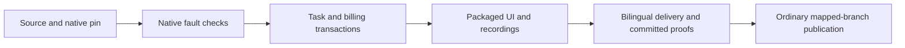
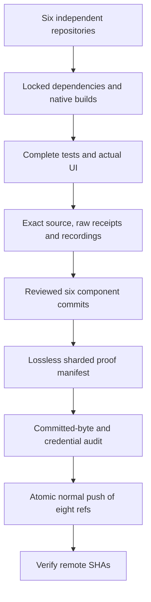

# Workmate · CopyPaste Enterprise Agent · delivery

[简体中文](README.md) · [English](README.en.md)

<!-- native-publishing-stage126 -->
## 原生 Codex 发布工具与交付 · 阶段126

后端修复角色工具准入与素材版本来源，真实固定云端Codex完成账户→预览→准备→状态四工具调用，客户仍须在发布页明确确认。当前专项09通过5/5，启动故障03通过9/9；完整16文件相关回归见本轮检查点。新增受限启动恢复要求未提交轮次、关闭网关后模型请求为零、原进程完全退出；两次上限和原费用身份继续执行。

06中断缺少最终／清理回执，08失败132/133；red01、green02及其他原失败均保留原结论，不补写成功。修正并单独验证测试辅助器的实际进程创建时间检查。底层偶发原生／Windows延迟原因尚未证明，Desktop本机恢复及四工具组合也不计入云端资格。

阶段126发布入口为 `node scripts/publish-workmate-v9.mjs --push`，`--check` 只核查。V9校验本轮源码、原始日志和可携带归档，保留历史证明、既有截图/GIF与失败记录，沿用六个独立仓库和普通八引用原子推送及SHA回读。七个独立检出并行完成只读核查，中央文档的main/docs在最终复查时只检查同一目录一次；对象导入和远端写操作按顺序执行。正式发布以最终执行回执为准。

本轮没有新增界面或媒体录制；下方阶段125实拍仍按其原源码范围保存。偶发原生超时根因、视频播放/拖动、签名安装、完整角色组合和整体验收继续开放。模型与账户仍按授权使用模拟数据；禁止Docker/WSL，回收自建进程。

[方案与界限](https://github.com/copypasteltd/workmate/blob/docs/docs/technical/126-native-publication-tools.md) · [本轮更新及待办](https://github.com/copypasteltd/workmate/blob/docs/docs/changes/126-native-publication-tools.md)

<!-- controlled-publications-stage125 -->
## 受控发布验收与交付 · 阶段125

新增模拟OAuth、完整相关后端、实际Web/Admin、打包Electron及Chrome原生右侧栏检查。每次使用新编号，保留检查器原文、确切源码、原日志、真实截图和GIF／MP4，禁止覆盖失败。必须回收自建浏览器、预览进程、原生PostgreSQL及夹具，禁止Docker／WSL。

阶段125历史通过范围：后端09为117/117、CLI07为5/5、分析08为12/12、Desktop媒体03为21/21、Extension02为70/70、Web/Admin12为14/14；实际打包Desktop／Chrome原生右侧栏02为10/10通过，源文件与包字节匹配，自建浏览器、Electron、API、数据库及夹具均已关闭。Web/Admin原始记录覆盖四档宽度，早先无效宽度声明及所有失败保留。

本阶段发布入口为 `node scripts/publish-workmate-v8.mjs --push`；`--check` 只核查。执行器要求六个独立产品仓库与中央文档均已提交，读取普通开发目录，校验当前源码、原始回执、历史证明、双语说明、实际媒体及远端祖先后，普通原子推送八个映射分支并读取最终SHA。以最终回执为发布依据，不强推。

阶段专用验收脚本保留相邻 `copypaste-*-publication-125` 候选路径及固定未签名目录包，不是其他检出的通用启动器。正常安装与启动按下方说明；独立检出复现、签名安装、新增发布视频、四个发布工具的实际Codex调用及至少十二个角色的专业资格仍待完成。

[本阶段方案与限制](https://github.com/copypasteltd/workmate/blob/docs/docs/technical/125-controlled-publishing-and-native-media.md) · [源码与证据清单](https://github.com/copypasteltd/workmate/blob/docs/docs/quality/publications-checkpoint-125.json)


<!-- admin-profile-revisions-124 -->
## 阶段124发布及验证

本轮在后端与 Admin 独立仓库补齐专家、品牌和记忆修订；68项相关后端、11项后台单元、8项实际页面及14次布局观察通过，8张截图、3组GIF/MP4与失败原件保存。Desktop保留客户本机Codex，Extension保留原生右侧栏与云端Codex。

阶段124入口为 `node scripts/publish-workmate-v7.mjs --push`。六个组件与中央文档提交后，V7检查确切源码、历史证明、媒体、双语说明、凭证与远端祖先，普通原子推送八个映射引用，再读取实际SHA。不会强推；以执行器最终回执为发布依据。运行环境只用原生工具，不使用Docker/WSL。

[方案与验证](https://github.com/copypasteltd/workmate/blob/docs/docs/technical/124-admin-profile-revisions.md) · [实际后台画面](https://github.com/copypasteltd/workmate/blob/admin/README.md)

<!-- admin-content-revisions-123 -->
## 管理员正文修订与交付核查 · 阶段 123

阶段123发布命令为 `node scripts/publish-workmate-v6.mjs --push`，`--check` 只核查。V6 先校验六个独立组件和中央文档的提交、精确源码、原始证据、双语说明、媒体、历史对象、凭据与远端祖先关系，再普通原子推送八个映射引用并读取实际 SHA。历史证明身份及失败记录全部保留，不强推。

当前增量已取得五个完整相关后端文件 **75/75**、实际 Admin 页面 **7/7**，以及四档宽度的 7 次弹窗与输入边界观察。后台专项验证三类修订、范围权限/MFA、并发、幂等、审计失败回滚、独立管理员来源、数据库角色与不可变性；实际页面包括真实邮件/MFA、表单、原提交响应丢失后恢复和撤权清除正文。编辑流程没有模型请求，不增加任务或费用。

`qualify-admin-content-v1`–`v4` 与页面 V1/V2 脚本保留各次执行时的代码和源码快照；它们是绑定当次工作树、原生数据库及端口的验收工具，不应在其他检出目录直接复用所属资源标识。正常启动按下方工作区说明；当前可复查证据位于中央 [checkpoint](https://github.com/copypasteltd/workmate/blob/docs/docs/quality/admin-content-checkpoint-123.json) 和 [归档索引](https://github.com/copypasteltd/workmate/blob/docs/docs/quality/admin-content-evidence-123/index.json)。



[实际页面及交互录制](https://github.com/copypasteltd/workmate/blob/admin/README.md) · [完整方案](https://github.com/copypasteltd/workmate/blob/docs/docs/technical/123-admin-content-revisions.md)。本增量不重新宣称完整后端回归、正式供应商质量或完整产品验收。

<!-- runtime-startup-122 -->

## Codex 启动与轮次隔离 · 阶段 122

阶段 122 历史发布命令为 `node scripts/publish-workmate-v5.mjs --push`；`--check` 只核查。该执行器要求当时的交付仓库已提交、中央源码证明与限定证据一致，再普通原子推送八个映射引用并重新读取 SHA。当前清单使用上方 V6 入口。

账务专项保留首轮 78／79 加一次取消、首次独立失败及后续独立通过的原始记录；此前失败的确切根因仍未证明。最终完整相关文件范围以[本轮 checkpoint](https://github.com/copypasteltd/workmate/blob/docs/docs/quality/runtime-startup-checkpoint-122.json)为准。新增真实数据夹具单独计时，恢复与账本断言仍为 120 秒；原 RPC／任务期限不变。

最终五个完整相关文件共 79 项通过、0 失败／取消／跳过；源码未变化，夹具与数据库回收及端口关闭核对通过。这项限定回归不代替新的完整后端或生产稳定性验收。

本轮执行器固定实际源码、原生可执行文件与原始输出，保留失败尝试，并分别验证初始化恢复、轮次隔离、账务事务和真实打包页面。执行器只控制本次拥有的原生进程、目录、数据库与浏览器；不用 Docker、WSL 或虚拟机。

已取得云端原生 12 项、Desktop 单元 180 项／原生 25 项、Web 20 项及打包 UI 8 项限定通过记录。相关脚本保留当次工作目录和源码，不应把历史执行器当作另一个产品启动入口。常规使用继续按下方启动说明进行；生产签名发行、真实供应商质量和完整 102 项验收单独跟踪。



[完整方案 / Behavior and verification](https://github.com/copypasteltd/workmate/blob/docs/docs/technical/122-codex-startup-and-turn-isolation.md)

## 产品与边界

首批面向现有客户的 marketing 团队，完整范围包含生图、设计/字体、视频/特效、广告和网站分析、SEO/GEO、企业重复流程及软件开发。目录已有 18 个精确 Skill 绑定的候选角色；至少十二个逐一完成专业任务、修改及异常处理的角色仍是验收要求。设计师由 Codex、设计 Skill 与公司 Image 2 组合。Agent 内核唯一使用 Codex；全部 AI 请求走公司 OpenAI 兼容后端。当前开发使用已授权假数据，不代表真实模型专业质量已经验收。

工具保留原始 TAP、失败报告、验证器、所选源码摘要和实际截图/GIF/MP4，区分假模型回复、原生 Codex 与真实文件/数据库/账本。原生测试只拥有自己的端口、进程、目录和数据库对象；关闭不用的自建浏览器并保留用户页面/服务。发布前检查七个仓库、双语 README、媒体、凭据、历史对象大小及提交清单；仅向明确映射分支普通推送并核对八个远程 SHA，不强推。

## 仓库与执行位置

| Branch | Directory | Runtime |
| --- | --- | --- |
| [backend](https://github.com/copypasteltd/workmate/tree/backend) | `dev/copypaste-platform` | Fastify / PostgreSQL / cloud Codex |
| [web](https://github.com/copypasteltd/workmate/tree/web) | `dev/copypaste-web` | React / Vite / cloud workspace |
| [admin](https://github.com/copypasteltd/workmate/tree/admin) | `dev/copypaste-admin` | React / separate Admin identity |
| [desktop](https://github.com/copypasteltd/workmate/tree/desktop) | `dev/copypaste-desktop` | Electron / customer-local Codex |
| [extension](https://github.com/copypasteltd/workmate/tree/extension) | `dev/copypaste-extension` | Chrome MV3 / native Side Panel / cloud Codex |
| [delivery](https://github.com/copypasteltd/workmate/tree/delivery) | `dev/copypaste-delivery` | Native development, QA and publication tools |

各组件为独立 Git 仓库，保留上述并列布局。项目仅使用原生工具；禁止 Docker、WSL 和虚拟机。

## 使用逻辑

1. 将六个分支分别检出为 dev 下的独立仓库，安装各自锁定依赖，保留现有配置与数据。
2. bootstrap 校验目录并构建；demo 启动自有原生数据库、API、Worker、假模型服务及 Web/Admin。
3. 逐文件运行后端回归；各端另跑类型、构建、单元、真实本机 Codex 与实际 UI，保留源码、原始日志和失败。
4. 对所有者、端口、进程、目录和浏览器独立核对清理；录制使用真实墙上时间，说明假数据与真实执行边界。
5. 绑定六个实际 Git 提交、双语 README、媒体和全部历史证据，再通过发布器正常原子推送并核对八个分支。



## 启动与使用

### 本地启动

以下命令在已检出的对应仓库内执行。完整工作区将六个独立仓库并列放在 `dev/`，见[分支与检出布局](https://github.com/copypasteltd/workmate/blob/docs/docs/governance/04-git-branches-and-publication.md)。使用 Windows x64、Node.js >=22.14、npm/Git，以及文档约束的原生 PostgreSQL、FFmpeg/FFprobe 与固定 Codex 资源；保留已有本地配置和数据，不使用 Docker/WSL/虚拟机。

```powershell
Set-Location 'D:/dev/copypasted/自有agent/dev/copypaste-delivery'
npm ci
npm run bootstrap
npm run demo
```

Web 为 `http://localhost:4317`，Admin 为 `http://localhost:4318`；API 端口 4310、控制器 4319、原生 PostgreSQL 55432。结束时使用 `npm run stop`，仅关闭控制器自建进程并正常停止数据库。内置示范模拟文本/图片并可使用剪辑/模板影片；生成式影片须配置公司契约，当前生成验收使用明确的媒体夹具。本机 Desktop 另需独立固定的原生内核。

### 当前使用流程

1. 完成登录、企业成员/邀请和项目选择。原生端通过浏览器 PKCE 登录；Admin 使用独立 MFA 身份。过期、撤销、换企业不应静默切换身份和资料范围。
2. 选择专业角色，提供工作说明及明确获准的资料/账号。缺少必要输入时请求客户补齐。项目负责人可以保存草稿、核对依赖、预览并明确发布不可变共享指引；发布不启动 AI、不增加权限。
3. 新任务固定当时接受的角色、Skill、品牌、资料和指引版本。既有工作保留原版，包括原先没有共享配置的状态。来源被隔离、删除或撤权后隐藏失效正文并阻断后续使用；历史内容不是越权入口。
4. 确认预算和必要的操作/媒体授权，查看真实状态、进度、文件与原费用回执。修改沿原工作谱系继续。未知用量保持原预留供对账，不能当作免费或盲目重新执行。
5. Admin 可按独立权限管理用户/企业状态、查看获准消耗，预览并确认人工费用/赠额和 VIP 权益/到期。余额、实收记录、授信、预算和 VIP 分别保存；同一确认幂等，操作保留审计，不能因重放重复赠额。

## 配置、权限与费用

本候选要求完整 SQL001–129 增量历史。API/Worker 准入拒绝缺失、变更或不支持的版本，并独立检查恢复环境身份。公司模型别名、已验证媒体能力、精确费率及供应商密钥只在后端配置；未配置能力保持不可用。当前开发继续使用已授权假数据。

Web/Admin 使用 `VITE_API_BASE` 或同源代理，开发端口为 4317/4318。Desktop/Extension 构建时固定 `COPYPASTE_API_ORIGIN`、`COPYPASTE_WEB_ORIGIN`，Desktop 另固定 `COPYPASTE_EXTENSION_ID`。除获准回环开发场景外使用 HTTPS；渲染器与扩展不持有公司供应商密钥。

文件默认私有，项目共享需要客户明确操作。新请求、Worker 领取、工具及下载重新核验权限；旧历史不能绕过撤权或正文治理。金额使用精确港币微单位；预算、余额、授信、实收与 VIP 分开记录。稳定请求身份防止重复赠额、建任务和预留；未知费用或物理清理保留待核对。

## 预设角色与 Skill

目录定义 18 个专业预设及默认助手，每次执行固定 Skill 版本和注册工具。模板数量不等于至少十二个角色已通过完整专业资格验收。

| ID | Role | Required Skill bindings |
| --- | --- | --- |
| R01 | 全栈开发工程师 | `fullstack-engineering@1.0.0`, `frontend-implementation@1.0.0`, `backend-api@1.0.0`, `qa-testing@1.0.0`, `delivery-core@1.0.0` |
| R02 | 前端开发工程师 | `frontend-implementation@1.0.0`, `ui-system@1.0.0`, `qa-testing@1.0.0`, `delivery-core@1.0.0` |
| R03 | 后端与 API 工程师 | `backend-api@1.0.0`, `qa-testing@1.0.0`, `delivery-core@1.0.0` |
| R04 | 软件测试工程师 | `qa-testing@1.0.0`, `frontend-implementation@1.0.0`, `delivery-core@1.0.0` |
| R05 | UI/UX 设计师 | `ux-research@1.0.0`, `ui-system@1.0.0`, `frontend-implementation@1.0.0`, `delivery-core@1.0.0` |
| R06 | 设计师 | `creative-direction@1.0.0`, `image-art-direction@1.0.0`, `image2-production@1.0.0`, `typography-layout@1.0.0`, `delivery-core@1.0.0` |
| R07 | 品牌视觉设计师 | `brand-system@1.1.0`, `image-art-direction@1.0.0`, `image2-production@1.0.0`, `typography-layout@1.0.0`, `delivery-core@1.0.0` |
| R08 | 广告创意设计师 | `ad-creative@1.0.0`, `image-art-direction@1.0.0`, `image2-production@1.0.0`, `typography-layout@1.0.0`, `delivery-core@1.0.0` |
| R09 | 电商商品设计师 | `ecommerce-visual@1.0.0`, `image-art-direction@1.0.0`, `image2-production@1.0.0`, `typography-layout@1.0.0`, `delivery-core@1.0.0` |
| R10 | 社媒内容设计师 | `social-content@1.0.0`, `image2-production@1.0.0`, `typography-layout@1.0.0`, `delivery-core@1.0.0` |
| R11 | 插画与 IP 设计师 | `illustration-ip@1.0.0`, `image-art-direction@1.0.0`, `image2-production@1.0.0`, `delivery-core@1.0.0` |
| R12 | 字体与版式设计师 | `typography-layout@1.0.0`, `image-art-direction@1.0.0`, `image2-production@1.0.0`, `delivery-core@1.0.0` |
| R13 | 演示文稿设计师 | `presentation-production@1.1.0`, `typography-layout@1.0.0`, `dataviz@1.1.0`, `delivery-core@1.0.0`, `deterministic-metrics@1.1.0` |
| R14 | 网页与落地页设计师 | `landing-page@1.0.0`, `ui-system@1.0.0`, `frontend-implementation@1.0.0`, `image2-production@1.0.0`, `delivery-core@1.0.0` |
| R15 | 信息图与数据可视化设计师 | `dataviz@1.1.0`, `deterministic-metrics@1.1.0`, `typography-layout@1.0.0`, `delivery-core@1.0.0` |
| R16 | 视频与动效设计师 | `video-storyboard@1.0.0`, `template-video-composition@1.0.0`, `video-generation@1.1.0`, `speech-production@1.2.0`, `delivery-core@1.0.0` |
| R17 | 营销数据分析师 | `ads-analysis@1.1.0`, `deterministic-metrics@1.1.0`, `dataviz@1.1.0`, `delivery-core@1.0.0` |
| R18 | 企业流程自动化顾问 | `workflow-design@1.1.0`, `workflow-execution@1.1.0`, `delivery-core@1.0.0` |

设计师组合为 Codex＋设计 Skill＋公司 Image 2。可选 R19 云端电脑操作员必须绑定另行确认的租约与 AI 预算；本机 Desktop 不提供该创建入口，继续由客户本机执行。

[Role contract](https://github.com/copypasteltd/workmate/blob/backend/catalog/role-preset-catalog.json) · [Skill packages](https://github.com/copypasteltd/workmate/blob/backend/catalog/skill-packages.json)

## 可选专属云电脑

先核对不可变方案/报价、付款方、固定时长、确切私有文件及终端/可视/Agent 独立范围，Agent 默认未授权。明确同意后预留资源费，后续 Codex 指令另有精确 AI 上限。无自动续期。停止、到期或撤权阻断后续操作；实际用量和清理证据齐全才结算，未知进入核对。

Linux 物理节点源码使用原生 Node22/systemd、cgroup、XFS project quota 和有界桌面工具。本地 Windows 核查未启动 Linux 主机。Delivery 中以新编号运行 `node native/build-package.mjs NN` 构建源码包；安装前核对外部固定摘要，默认不启动服务，恢复要求确切安装 UUID。

## 实际界面与交互录制

下列为真实产品界面截图和按墙上时间录制的交互。客户、模型、媒体响应明确使用假数据；所注明的原生 Codex、文件、数据库和账务路径实际运行。假节点画面不代表真实 Linux 远端桌面已验收。

此无界面组件引用 extension 的实际产品交互，展示配套集成流程；不是独立 delivery 页面。


[Original MP4](https://github.com/copypasteltd/workmate/blob/extension/assets/screenshots/workmate-dedicated-extension-03-folder-response.mp4)

## 验证与交付状态

整合后的客户端/工具共 338 项通过：Web 20、Admin 9、Extension 63、Desktop 180、实际本机 Codex 22、Delivery 44，对应类型/构建通过。Desktop、Web/Admin、原生侧栏各有 8 项限定实际 UI 检查，共 29 张截图与 5 组 GIF/MP4。后端完整成功须有最终完整清单回执，检查点记录实际结果并保留失败。

安装原生前置依赖后执行本仓库 `npm run typecheck`、`npm run build` 及测试脚本。Delivery 默认 `npm test` 仅覆盖原生界面完整性，完整单元清单使用 `node --test --test-concurrency=1 tests/*.test.mjs`。`node scripts/qualify-delivered-clients-v1.mjs NN` 在 Delivery 使用新两位编号及并列布局检查完整客户端清单；历史候选专项执行器保留原目录要求。

完整产品验收仍开放：至少十二个专业角色资格、全权限/业务/兼容矩阵、真实服务质量、签名安装更新、生产负载恢复及客户业务接受。以编号清单管理完成条件，不以测试数量推算完成率；使用后清理自建浏览器/进程，保留用户资源。

[Implementation / 方案](https://github.com/copypasteltd/workmate/blob/docs/docs/technical/121-dedicated-cloud-and-client-execution.md) · [Checkpoint / 证据](https://github.com/copypasteltd/workmate/blob/docs/docs/quality/dedicated-cloud-checkpoint.json) · [Open requirements / 未完成项](https://github.com/copypasteltd/workmate/blob/docs/docs/quality/remaining-work-2026-10-29.md) · [Branch layout / 检出布局](https://github.com/copypasteltd/workmate/blob/docs/docs/governance/04-git-branches-and-publication.md)
