# Workmate · CopyPaste Desktop

[English](README.en.md) · [Documentation](https://github.com/copypasteltd/workmate/blob/docs/docs/README.en.md) · [Desktop branch](https://github.com/copypasteltd/workmate/tree/desktop)

<!-- brand-production-stage79 -->

## 固定品牌版本与生产检查

客户本机 Codex 与无边框窗口保持；新增品牌管理表单，同时验证小窗口的隐藏滚动条和键盘访问。

1. 登录并选企业/项目，在 Web 或 Desktop 打开「品牌资料」。设置名称、色彩、字体及使用声明、核准产品事实/价格、促销期限、渠道/语言和可选固定 Logo 文件。上传字体须共享至当前项目。
2. 发布不可变版本。以后编辑会产生新版；并发旧版编辑报冲突。已有专家和任务继续使用绑定版本，需要升级时显式采用新的专家版本。
3. 选历史版本检查文字或固定事实。缺字定位到 Unicode 码点，过期促销或字体声明阻止新生产；价格事实使用存储文字和金额，不静默换字体或价格。
4. 绑定品牌的云端设计任务必须携带匹配的品牌/版本和渠道/语言。文字使用固定声明字体配置，显式引用事实键时使用存储文字和价格。产物保留来源依赖和可编辑 JSON；SVG 文字转路径，PNG 和有限的单页 PDF 审阅稿是真实渲染。字体登记只记录客户声明，不证明版权。

启动依赖客户端前，在已配置后端使用 `npm run db:migrate` 应用 **SQL096**。已发布 SQL001–095 与两份原有 OpenAPI 各自的字节保留。新增品牌契约包含四项操作；配置服务共 438 项，`DEMO_MODE=true` 时另有一项演示额度操作。旧品牌在当前权限下保留可读，不补造历史版本或许可；固定字体生产前需明确发布 v2 资料并采用新的专家版本，旧任务不自动改绑。

Desktop 在客户本机运行 Codex，提供明确可撤销的完整本机权限，无原生边框/菜单；纵横滚动条外观隐藏，同时保留滚轮、键盘、焦点定位及 800×600、1280×800、1440×980 实际窗口访问。保留真实进度。Extension 是云端 Codex 的原生右侧栏。全部 AI 请求经公司网关；测试后关闭自建浏览器，禁止 Docker/WSL/虚拟机。

当前分别通过：**平台 874/874 项**（68 文件/17 批，保留此前 861 项并新增 13 项）、客户端 68 项、打包 Desktop 30 项、品牌 Web 四项、Web/Admin 品质四项及原生侧栏八项。保留原生内核 17 项的 57 份绑定源码均未变化。数据库、身份、文件、账本和本机 Codex 真实运行，模型/客户/业务数据为明确夹具。原 102 REQ/102 TC 为 82 部分验证、20 未证明、0 完整验收；G01–G10、TC-056 真实客户盲审继续未证明。Desktop 品牌表单证据不等于全部本机专业角色的品牌约束已验收。

Desktop33、品牌 Web02 和 Web/Admin08 保留实际收据；其后只有一个未被这些旅程执行的扩展测试文件补充加载等待和登录诊断，前后字节及无关范围已单独核对。它们的应用/界面和执行旅程/验证器未变；新扩展运行及平台23使用更新后的测试文件，精确边界见检查点。

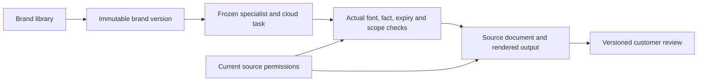


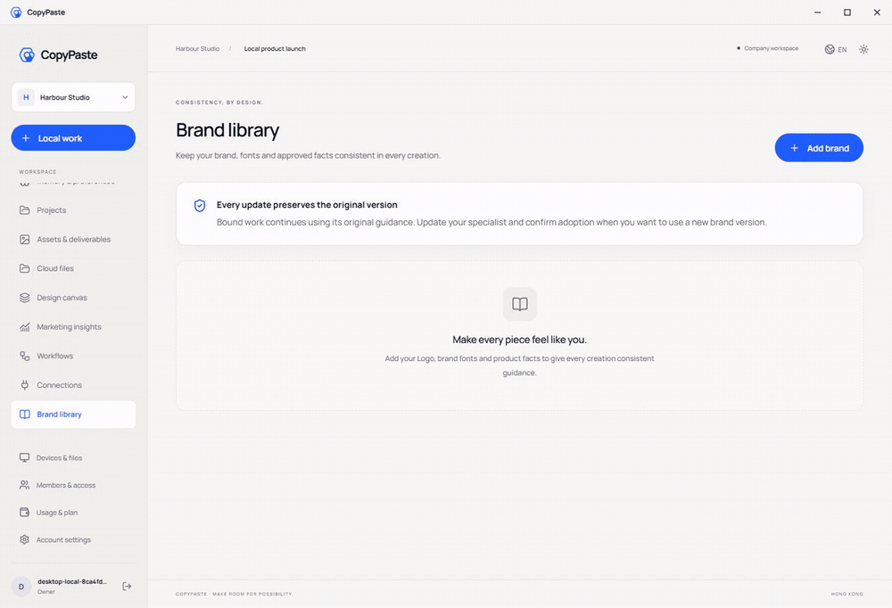

[MP4](assets/screenshots/workmate-brand-33-brand-library.mp4) · [Design / 方案](https://github.com/copypasteltd/workmate/blob/docs/docs/technical/79-versioned-brand-production.md) · [Contract / 契约](https://github.com/copypasteltd/workmate/blob/docs/docs/contracts/brand-production-openapi.json) · [Evidence / 证据](https://github.com/copypasteltd/workmate/blob/docs/docs/quality/brand-production-checkpoint.json) · [Changes / 更新](https://github.com/copypasteltd/workmate/blob/docs/docs/changes/2026-10-24-versioned-brand-production.md)

<details>
<summary>阶段 78 交付及完整安装参考：旧计数保留原验证范围</summary>

<!-- business-quality-stage78 -->

## 当前交付审阅与使用流程

无边框 Windows 客户端，在客户电脑运行 Codex、文件、终端和浏览器工具。 新增接受、需修改、弃用的版本化交付审阅；人工基线、累计投入和修改次数独立填报。项目用量与后台交付品质面板分别显示技术成功、客户接受、实际读取复用及公司服务成本。

Desktop 保持客户本机 Codex、明确可撤销的完整本机权限及无边框/无 Electron 菜单。隐藏纵横滚动条外观，保留真实滚轮/键盘访问；内容重排，800×600 下聚焦输入框、聊天输入区和费用回执可见。此前进度条约束已撤销，保留真实进度。Extension 仍为独立原生右侧栏，聊天及获准文件上传至云端 Codex；所有 AI 请求走公司网关。

1. 登录并选择企业/项目，在正确执行位置创建任务。Desktop 另选本机目录并明确授权；Extension 不要求安装 Desktop。
2. 查看真实结果，打开 Desktop「审阅本次交付」或任务评价表单，保存接受、需修改或弃用及可选意见。任务或交付换版时需重新载入后审阅。
3. 按需填写累计人工数字。空值为未知，0 为明确没有投入；保存后保留展开的表单与输入访问。
4. 在项目用量或 Admin「交付品质」查看当前有权范围；未确认费用不冒充完整成本。服务成本不含退款抵减、外部服务及人工，不推断 ROI 或续费。

上线依赖接口/界面前先应用增量 SQL095；SQL001–094 与原任务 OpenAPI 保持原样。未固定交付版本的旧接受状态需客户重新审阅。保留原评价接口，当前表单强制任务版本、交付摘要及幂等键。写评价需要项目 approve 权限；Admin 的 `admin.usage.read` 仅查看授权范围汇总，不能代客户接受、从汇总读取意见正文或授予 OS 权限。

独立构建入口为 `npm ci`、批准的 `COPYPASTE_LOCAL_CODEX_BIN`、`npm run runtime:prepare`、`npm run build`、`npm start`；未签名候选使用 `npm run package:dir`。固定版本/摘要、公司入口及原生配置详见下方完整指南；签名及人工安装/升级验收继续待完成。

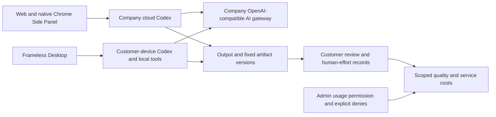

当前源码验证：平台 861/861 项（67 文件/17 批）、客户端 68 项、实际打包 Desktop 26 项、Web/Admin 四项及原生侧栏 8 项分别通过，不相加。保留的 17 项原生内核证据中 57 份绑定源码均未变化。身份、数据库、文件、费用和本机 Codex 真实运行；模型/业务/客户输入与系统对话框决定明确为夹具。TC-056 真实任务基线/盲审、18 角色/29 Skill 的全专业交付、完整 OS/Codex Desktop 对齐及生产门槛继续未证明；原 102 REQ/102 TC 和 81 部分/21 未证明/0 完整验收保持。

Desktop31 与 Web/Admin07 保留原始执行记录；其后仅一份迁移测试中的两个版本期望值从 94 更新为 95，前后字节已归档并逐字核对，运行代码、界面和旅程脚本均未变化。平台21重新执行更新后的全套测试；该保留证据边界见检查点。

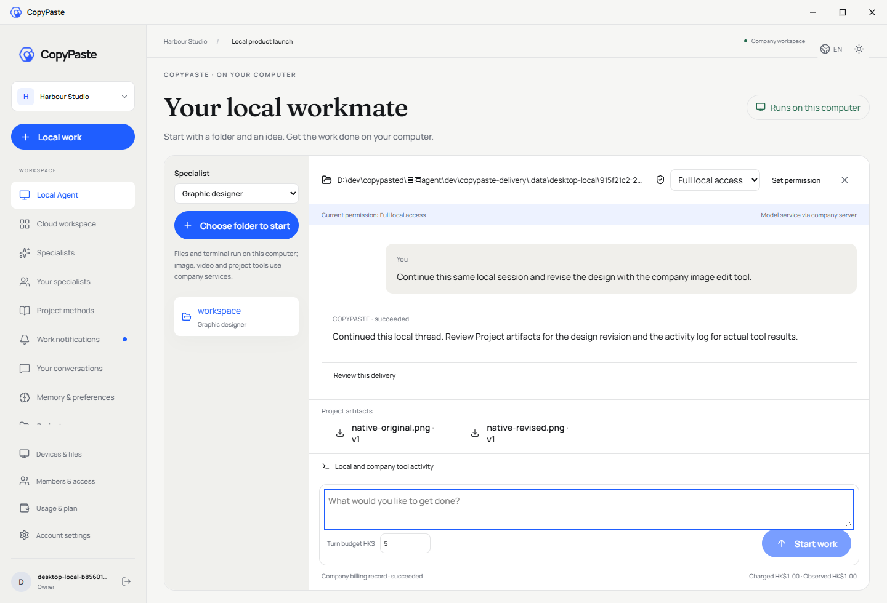

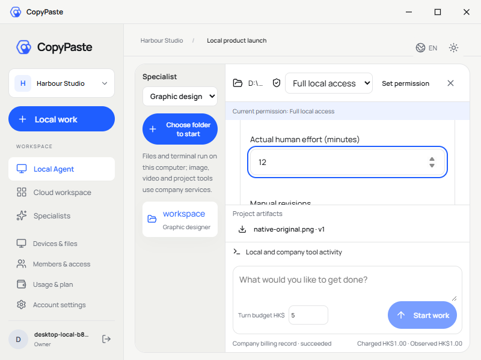

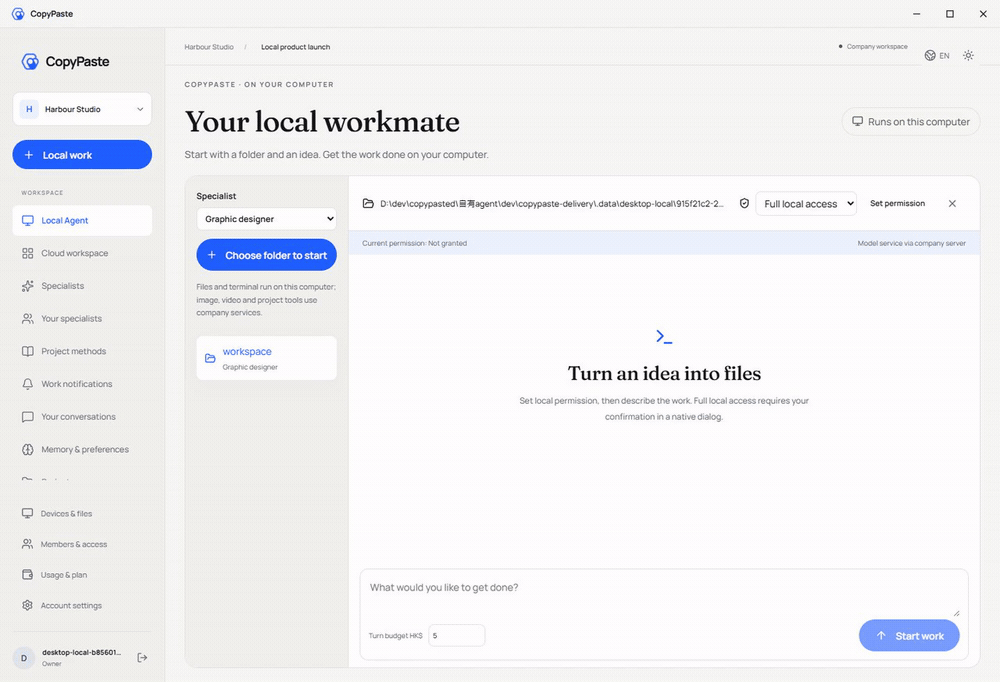

[MP4](assets/screenshots/workmate-local-31-local-agent.mp4)

[Design](https://github.com/copypasteltd/workmate/blob/docs/docs/technical/78-business-delivery-quality.md) · [Contract](https://github.com/copypasteltd/workmate/blob/docs/docs/contracts/business-quality-openapi.json) · [Exact source and media evidence](https://github.com/copypasteltd/workmate/blob/docs/docs/quality/business-quality-checkpoint.json) · [Changes](https://github.com/copypasteltd/workmate/blob/docs/docs/changes/2026-10-23-business-delivery-quality.md)

<details>
<summary>完整安装、架构与历史验证记录（较早计数和截图保留原时点范围）</summary>

**阶段 77 历史实现：** Desktop 在客户本机运行 Codex，提供客户明确完整授权、本机文件/终端、同线程继续、原生追问、公司设计/视频工具与本机父子流程。新增十二项本机浏览器工具，可真实导航、操作、上传、截图和下载；停止/撤权回收任务页面。Desktop 隐藏可见滚动条，成果、代码和表格自动换行，保留纵向滚动与键盘访问；已撤销此前进度条约束，保留真实进度反馈。当前分别验证平台 851 项、客户端 68 项、原生内核 17 项、独立 Electron 浏览器 10 项和实际打包旅程 25 项，不相加。18 角色/29 Skill 的完整专业交付、全部 OS 应用与 Codex Desktop 全面能力对齐、真实模型及生产验收仍待证明。Extension 继续独立的 ChatGPT 式原生右侧栏、获准文件上传与云端 Codex，本轮未重跑其 UI。见 [方案](https://github.com/copypasteltd/workmate/blob/docs/docs/technical/77-desktop-native-browser.md)、[界面约束](https://github.com/copypasteltd/workmate/blob/docs/docs/requirements/04-desktop-layout-and-scroll.md)及 [源码/媒体检查点](https://github.com/copypasteltd/workmate/blob/docs/docs/quality/desktop-browser-checkpoint.json)。

## 产品与执行位置

Windows 无边框本机 Agent。Codex 进程、会话循环、文件和终端工具在客户电脑运行；推理使用公司内部 OpenAI 兼容服务器。Web 与 Chrome Extension 使用云端 Codex；上传文件服务不能替代 Desktop 本机内核。

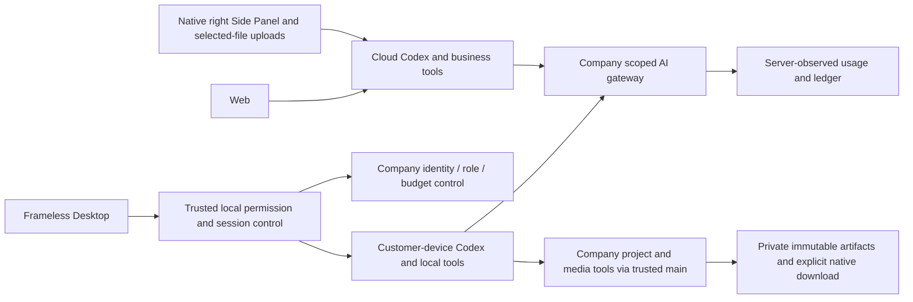

## 登录与使用流程

1. 启动 Desktop，在固定公司浏览器页面完成邮箱/企业身份与 PKCE 授权，通过 localhost 回调返回，选择企业和项目。
2. 选择已支持本机工具的角色，通过系统目录窗口选择工作目录；选目录本身不授予执行权限。
3. 选择唯读、目录内读写或完整本机权限，在系统对话框确认。完整权限默认取消，明确涵盖当前 OS 用户可访问的工作目录外资源。
4. 输入要求和每轮预算。主进程预留一次预算，取得任务级凭据并启动随包锁定 Codex；查看消息、终端输出、文件变更及公司费用记录。
5. 公司生图、设计与资料工具按当前角色开放；产物显示明确版本，点击下载并在系统窗口选择保存位置。本机文件和命令仍在客户电脑执行。
6. 在同一本机线程继续追问。可停止运行、空闲时调整权限或随时撤权；退出账号撤销本机授权。网络重试不会盲目重跑已接受的本机动作。

公司 Admin 可管理服务、VIP 和费用，但不能代授本机 OS 权限。完整模式为 `danger-full-access` / `never`，授权后不逐命令重复确认，也不会提升系统账号权限。授权持续至撤权/登出，与可选旧文件桥的一小时、仅新建权限相互独立。

## 实现结构与恢复

- `src/main.ts`: 可信身份、系统对话框、IPC 和生命周期。
- `src/local-agent.ts`: 加密会话日志、稳定请求键、归属、授权与结果同步。
- `src/local-codex.ts`: 原生 app-server、固定 Skill、检查点、沙箱、流式事件、中断和自有进程关闭。
- `src/preload.cts` / `renderer/src/local-agent.tsx`: 受限桥与本机界面；凭据和二进制路径不经 IPC 传给页面。
- `src/window-controls.ts`: 40px 自绘标题栏；`frame:false`、`thickFrame:false`，无 Electron/Alt 菜单。

每个本机回合有不可变的 desktop 执行归属。Desktop 原生登录不能入队云端 Agent 任务；尚不支持的本机工具需要明确前往 Web。操作结果标记为客户设备上报，费用只用公司服务端观测。结算响应丢失只重传结果；未知操作、租约过期或缺少 usage 保留待核对预留，禁止自动重跑。

开启 contextIsolation/sandbox，关闭 nodeIntegration。通用页面 API 禁止原生执行/推理接口及编码别名。本机日志加密并绑定账号、登录 epoch、企业和项目；登出停止自有运行时，同账号页面刷新可恢复历史。禁止 Docker/WSL/虚拟机、PATH 回退与替代内核。

## 检出、配置与启动

```powershell
git clone --single-branch --branch desktop git@github.com:copypasteltd/workmate.git copypaste-desktop
cd copypaste-desktop
npm ci
$env:COPYPASTE_LOCAL_CODEX_BIN = 'D:\approved-runtime\codex.exe'
npm run runtime:prepare
npm run build
npm start
```

使用 Windows x64、Node.js ≥22.14 和 `contracts/local-codex-runtime.json` 指定的版本/摘要（`0.163.0-alpha.11`）。上述路径为显式示例，需提供已批准的二进制及相邻原生辅助程序。准备脚本验证版本/摘要，将原生资源写入忽略的 `.data/runtime/windows-x64` 并生成清单；不下载、不搜索 PATH。云端运行时有独立版本锁。

通过 `deployment.json` 或 `COPYPASTE_API_ORIGIN`、`COPYPASTE_WEB_ORIGIN`、`COPYPASTE_EXTENSION_ID` 配置公司入口和扩展 ID；生产需公司 HTTPS。供应商主密钥保留服务器。后端按原生迁移流程应用 092。

```powershell
npm run typecheck
npm test
$env:COPYPASTE_LOCAL_CODEX_TEST_BIN = $env:COPYPASTE_LOCAL_CODEX_BIN
npm run test:local
npm run package:dir
npm run package
```

打包把 Codex 及辅助程序放入 `resources/local-codex`。`package` 在忽略的 `release/` 生成 NSIS Setup 与 Portable；当前自动化证据验证的是独立未签名 unpacked 候选程序，确切路径/ASAR/原生摘要见检查点。签名、人工安装/升级/卸载和真实供应商资格仍待验收，不把本地凭据或状态提交 Git。

原生界面在本仓库独立维护、独立构建；`renderer:sync` 拒绝用 Web 快照覆盖。共享变更需显式合并，再运行 `node scripts/record-renderer.mjs` 记录实际源码摘要。

## 当前实际页面与交互

实际打包 Electron 与真实原生 Codex；身份、数据库、本机文件、沙箱和账本真实运行。模型/图片响应、系统选目录/授权/保存决定为明确测试夹具，不等同人工点击或正式供应商验收。


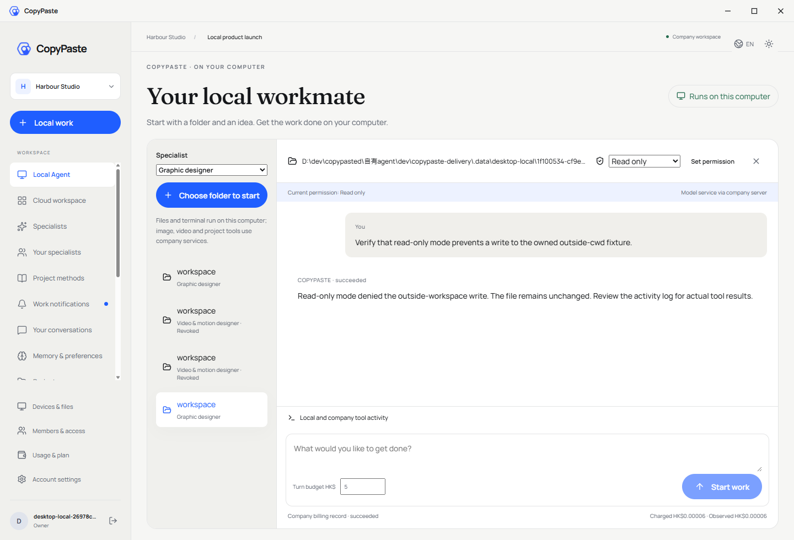

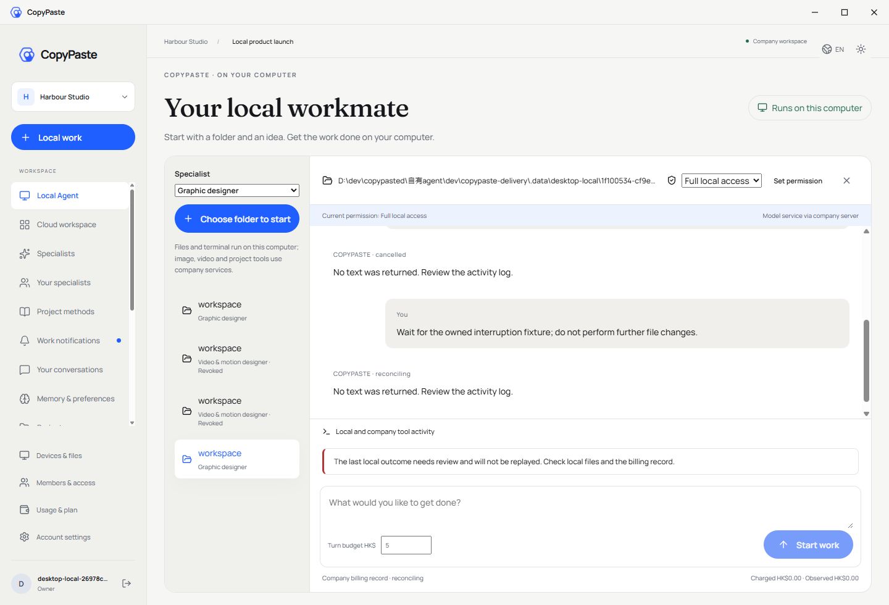


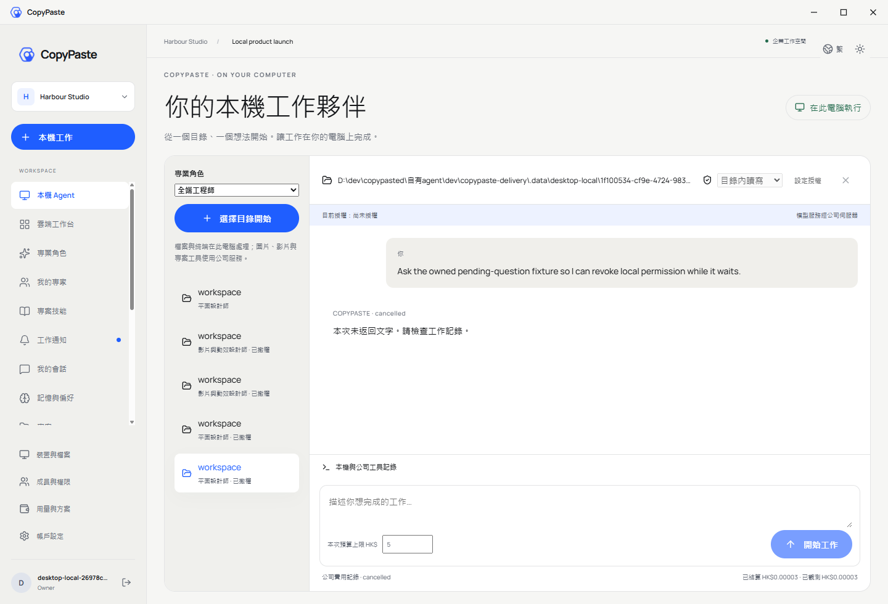


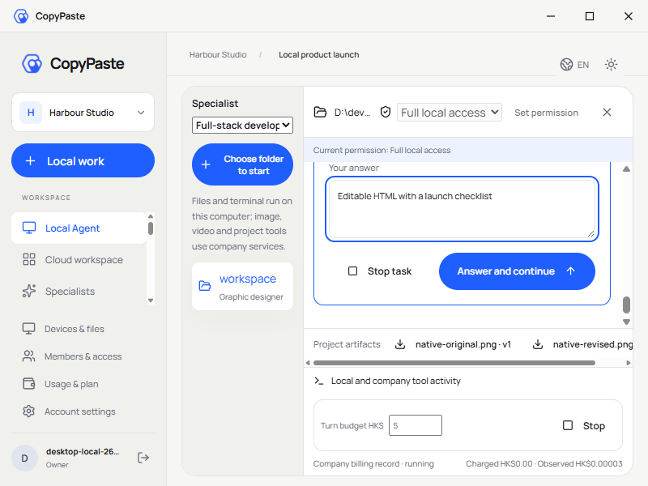


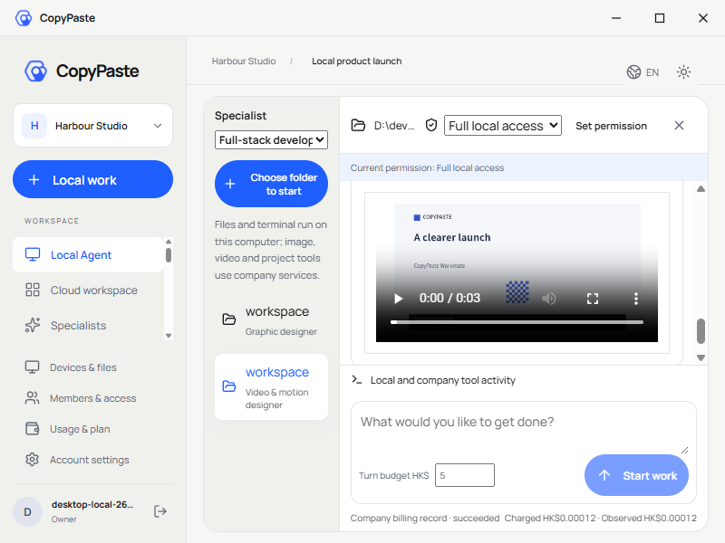


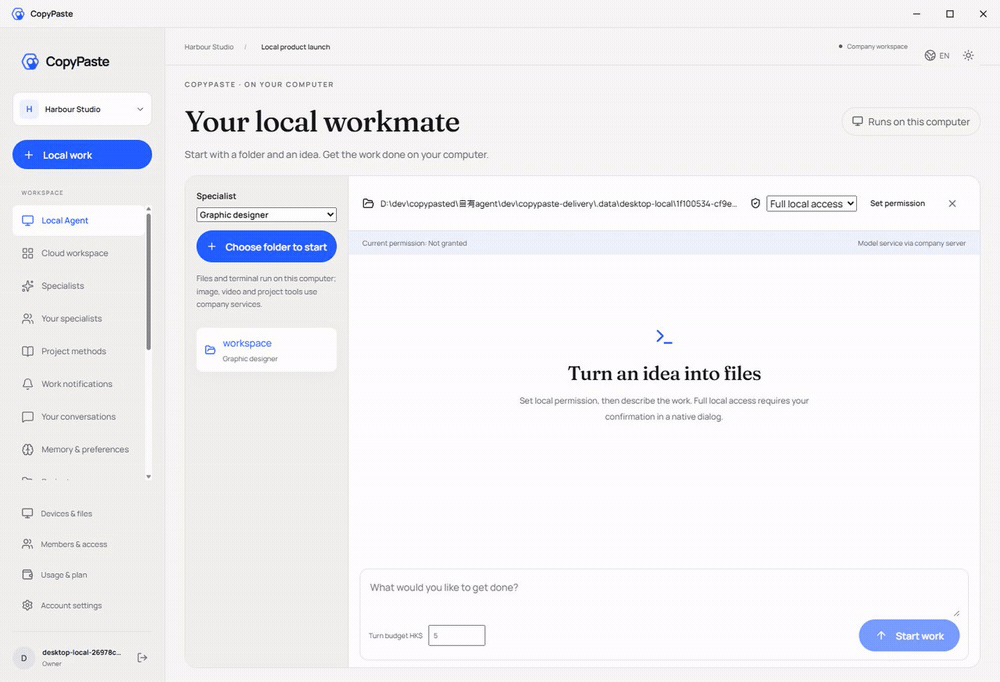

[MP4](assets/screenshots/workmate-local-19-local-agent.mp4) · [Source and capture checkpoint](https://github.com/copypasteltd/workmate/blob/docs/docs/quality/desktop-video-checkpoint.json) · [Design and recovery](https://github.com/copypasteltd/workmate/blob/docs/docs/technical/75-desktop-private-video.md)

## 覆盖与剩余范围

18 个角色现可在客户本机启动 Codex，流程顾问使用本机子角色执行。协议准入、Skill 摘要及本轮有界流程验证不等同全部专业成果验收。当前平台 848 项、重叠定向 75 项、真实父子流程 3 项、本机内核 17 项、客户端 56 项、打包旅程 19 项分别通过。18 角色/29 Skill、完整浏览器/应用操作及原 102 REQ/TC、NFR、G01–G10 保留；81 部分 / 21 未证明 / 0 完整验收。

可选 Native Messaging 文件桥继续独立存在，不授予完整 Agent 权限，也不是 Extension 选文件上传/云端对话的前置。使用浏览器后关闭本任务不再需要的页面，保留用户标签页。

[更新说明](https://github.com/copypasteltd/workmate/blob/docs/docs/changes/2026-10-23-desktop-company-tools.md) · [Repository and branch policy](https://github.com/copypasteltd/workmate/blob/docs/docs/governance/04-git-branches-and-publication.md) · [Requirements](https://github.com/copypasteltd/workmate/blob/docs/docs/requirements/03-client-execution-amendment.md)

后续同步中英 README、受影响截图/GIF 和更新说明，提交并推送对应分支，核对远程 SHA，不强推。本地状态、依赖、原生二进制及安装器保持忽略。

## 本机公司工具契约

Agent 循环保持在客户电脑。主进程为锁定的原生运行时注册可信 `copypaste` 动态工具，绑定任务、调用、线程及回合，在效果前及返回前重验公司权限。本机唯读拒绝公司写入；原生 schema 投影不替代原始业务参数验证。同一调用重试复用持久结果，已接受而未知的图片操作阻断后续调用并保留费用核对。私有产物按明确版本下载，保存目标由系统窗口选择。

阶段 73 公司工具历史更新：[更新说明](https://github.com/copypasteltd/workmate/blob/docs/docs/changes/2026-10-23-desktop-company-tools.md) · [源码检查点](https://github.com/copypasteltd/workmate/blob/docs/docs/quality/desktop-company-tools-checkpoint.json)；较早回执和媒体保持原始源码范围。

## 本机追问与继续工作

问题出现在本机对话中，选项不预选。完整回答后点击 **回答并继续**，沿用原任务、原线程、原回合和原预留。刷新页面保留仍在等待的问题；停止、撤权、登出和关闭清除等待，旧回答和重复提交被拒绝。问题/答案字段只作主进程临时状态，但提交内容仍会进入 Codex 本机记录和公司模型上下文。最小窗口等待时收起不可用输入框和大标题，给问题留出空间；固定停止和预算仍可访问。

受限 `answer` IPC 只传会话 id、一次性问题 id 和校验后的答案。`src/local-input.ts` 负责有界协议，`local-codex.ts` 保证人工等待不阻塞事件队列，`local-agent.ts` 在交付前重验归属、权限和公司执行状态。

阶段 74 本机追问更新：[更新说明](https://github.com/copypasteltd/workmate/blob/docs/docs/changes/2026-10-23-desktop-native-input.md) · [当前源码检查点](https://github.com/copypasteltd/workmate/blob/docs/docs/quality/desktop-native-input-checkpoint.json)。较早报告及媒体保留原始源码范围。

阶段 74 历史记录：当时验收后刷新未打包的界面源码摘要索引；其他覆盖源码和实际程序包未变，见[独立元数据核对](https://github.com/copypasteltd/workmate/blob/docs/docs/quality/desktop-native-input-renderer-manifest-01.json)，不增加原生/UI 测试计数。

## 私有视频工程

选择 **影片与动效设计师**、目录及所需本机授权。本机 Codex 使用列出、读取、排队、状态、修改、重做和取消七项公司工具。已排队仍表示制作未完成；六项私有产物全部可用后才显示下载。真实 MP4 可内嵌播放，成片、时间线、脚本、分镜、字幕和检查文件均经鉴权，并由原生保存窗口选路径。

同线程修改基于明确版本，保留旧 MP4；明确重做创建新制作，刷新状态不会重做。活动任务停止/撤权只取消原任务未完成制作，并阻止迟到编码结果发布。空闲回合撤回 OS 权限不撤销已受理的公司制作，卡片仍可按当前公司项目权限取消。同项目其他成员不能读取私有定义和输出。

公司服务实际运行 FFmpeg，本流程没有 AI 媒体费用；本机推理继续按原预算和服务端使用量结算。Renderer profile 2 修复最小横版 CTA 布局，旧 profile 1 可读取，升级渲染器需明确新版本。`renderer/src/local-video.tsx` 处理有界状态卡片；`src/local-codex.ts` 只从实际工具结果提取安全 id 与版本。

阶段 75 私有视频更新：[更新说明](https://github.com/copypasteltd/workmate/blob/docs/docs/changes/2026-10-23-desktop-private-video.md) · [当前检查点](https://github.com/copypasteltd/workmate/blob/docs/docs/quality/desktop-video-checkpoint.json)。旧报告保留原始源码范围，平台/本机主进程验证与后续界面验证明确记录。

<!-- desktop-native-browser-stage77 -->

## 本机浏览器与 Desktop 界面

新建本机会话，选择工作目录并明确授予「完整本机权限」，再描述浏览器工作。本机 Codex 使用版本化 `copypaste_browser` 命名空间的十二项工具：页面列表、打开、导航、历史、快照、截图、交互、隔离脚本、等待、对话框、下载及关闭。交互包含真实点击、填写/输入/选择、按键、滚动/拖动及明确本机文件上传。可信无边框地址栏与远程网页使用独立渲染器。完成的下载保留在所选目录的 browser-downloads；模型截图直接捕获真实网页，README 浏览器录制使用真实 OS 窗口捕获，不拼接页面。

当前本机授权、公司身份、项目权限、调用归属和预算逐次核验；网页不能授予 OS 权限或取得公司推理凭据。调用 ID 绑定具体操作，结果未知不自动重放。Stop、撤权、登出和退出关闭任务页面及未完成下载，保留已完成文件和客户原有窗口。旧线程保留原工具绑定；使用浏览器工具须新建会话。

此前进度条约束已撤销；真实上传、任务、流程和视频反馈继续显示。隐藏滚动条外观不禁用原生滚动。成果换行、代码与表格重排，重点滚动区可聚焦；800×600、1280×800、1440×980 实际窗口保留输入与费用操作。检查包含真实滚轮、Home/End、最后一个下载按钮焦点，及紧凑费用/设备/账户页面和英文/繁中浅深主题；自动化未宣称实测物理触控板或每种系统缩放。

当前完整清单为 66 个测试文件 / 17 批 / 851 项通过，保留此前全部 848 项。SQL001–094 和 428 条 HTTP 接口均未变。仅 UI 自有夹具的用户/平台/企业容量配置为 32，并新增不可变网关策略版本 2（32 槽位、每分钟 10,000 请求），以保留多次取消后的未知结果和费用预留；初始策略、生产默认及容量控制不变。模型响应、业务页面与系统对话框决定明确模拟。原 102 REQ/102 TC、NFR 和 G01–G10 仍为 81 部分 / 21 未证明 / 0 完整验收。Extension 产品和验证器字节未变，本轮没有新增其 UI 结论。

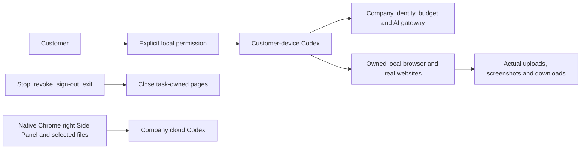


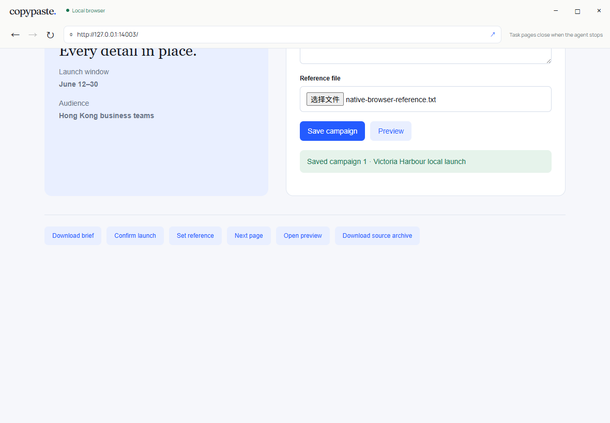


[MP4](assets/screenshots/workmate-local-28-local-agent.mp4) · [Browser GIF](assets/screenshots/workmate-local-28-native-browser.gif) · [Browser MP4](assets/screenshots/workmate-local-28-native-browser.mp4) · [繁中深色](assets/screenshots/workmate-local-28-layout-compact-zh-dark.png)

[Design](https://github.com/copypasteltd/workmate/blob/docs/docs/technical/77-desktop-native-browser.md) · [Requirements](https://github.com/copypasteltd/workmate/blob/docs/docs/requirements/04-desktop-layout-and-scroll.md) · [Evidence](https://github.com/copypasteltd/workmate/blob/docs/docs/quality/desktop-browser-checkpoint.json) · [Changes](https://github.com/copypasteltd/workmate/blob/docs/docs/changes/2026-10-23-desktop-native-browser.md)

<details>
<summary>阶段 76 历史实现与截图（旧滚动条布局）</summary>

<!-- desktop-native-workflow-stage76 -->

## 本机流程与核查

选择「流程顾问」、本机目录并明确授予所需本机权限。描述要求并确认冻结的流程步骤；执行前另行查看每个子角色的预算和合计，批准具体版本后才预留费用、启动本机子 Codex。遇到人工审批步骤须再次明确批准，之后才运行下一角色。查看真实本机文件、私有 SOP/流程 JSON/恢复说明下载与公司用量记录；顾问对话及未完成步骤分别计费。Stop 或撤权会终止本机父子进程；已受理但结果未知的操作保留待对账状态，不会自动重放。

首个子集支持最多八步的顺序本机 Codex、人工审批及广告汇总。每个子角色使用独立的 Skills、公司工具和推理凭据，沿用客户当前明确授予的目录及本机权限。完整本机权限不扩大公司的客户数据、项目权限或预算；云端 Worker 与定时任务不能接管本机流程。每个流程版本从真实读取账本冻结外部来源，复用到新会话及派生 SOP 时仍保留；旧创建任务删除不会替代外部来源的有效性判断。来源停用同时约束首次读取、缓存、子任务启动和私有或明确发布的衍生成果；管理员继续遵守权限、MFA、原因及审计控制。关闭应用也会阻止仍等待日志落盘的请求稍后启动。

阶段 76 当时的平台清单为 65 个实际测试文件、17 个完整批次、848 项通过，保留阶段 75 全部 830 项回归。SQL001–093 未改写；SQL094 增加本机流程来源与不可变版本。实际 428 条接口清单保留此前全部 415 条。原 102 REQ/102 TC、NFR 和 G01–G10 维持 81 项部分验证 / 21 项未证明 / 0 项完整验收；旧证据及媒体仅证明其原始源码。

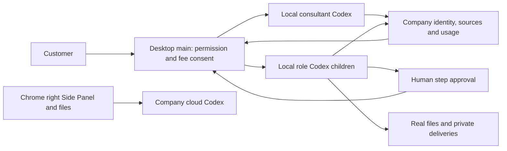

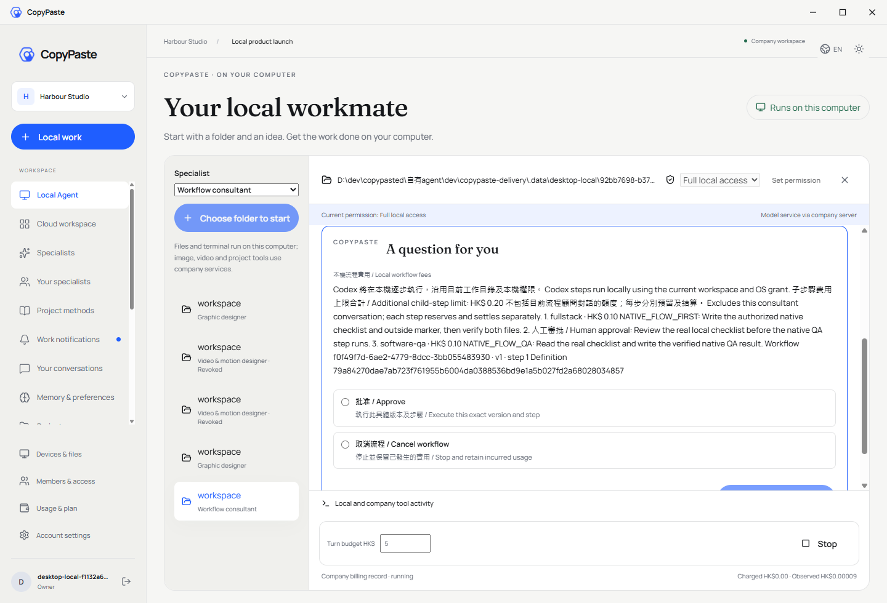

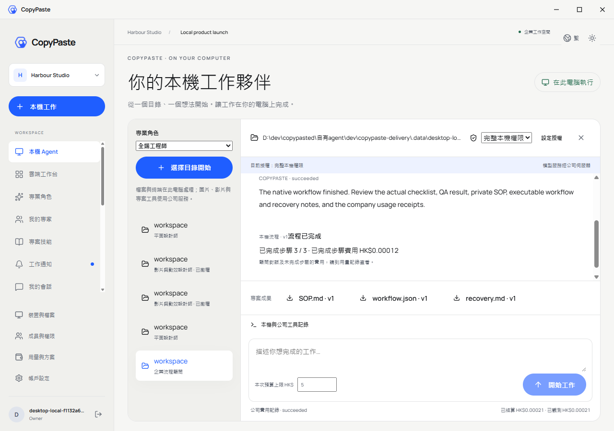


[MP4](assets/screenshots/workmate-local-21-local-agent.mp4) · [800×600](assets/screenshots/workmate-local-21-workflow-compact-en.png)

[设计与生命周期](https://github.com/copypasteltd/workmate/blob/docs/docs/technical/76-desktop-native-workflows.md) · [绑定证据](https://github.com/copypasteltd/workmate/blob/docs/docs/quality/desktop-workflow-checkpoint.json) · [更新说明](https://github.com/copypasteltd/workmate/blob/docs/docs/changes/2026-10-23-desktop-native-workflows.md)

</details>

</details>


</details>
