# Workmate · CopyPaste Enterprise Agent · delivery

<!-- native-teams-stage139 -->
## 本机专家团队 · 阶段139

执行`npm run qa:native-teams-backend -- <新两位编号>`检查真实原生PostgreSQL与费用／权限回归，执行`npm run qa:native-teams -- <新两位编号>`构建并操作真实Windows包。依赖原生Node、PostgreSQL运行库、Chrome、FFmpeg和锁定Codex；不用Docker／WSL。保留每次原始通过及失败。

最多16步、7位成员加1位通用协调员、3步并行，共用一个明确授权目录；并行编辑应分配到不同文件。审阅免费，批准预算固定，预留与实际费用分开；已接受但未知的操作不重跑。撤权先停止本机工具，未同步回执继续可见。团队ZIP仅包含主动提交的成果，本机未提交文件留在本机。

60项后端、36项扩展、81项本机控制／下载回归及6项实际Windows旅程通过；4张截图、1组GIF／MP4、3档布局及1个独立解压的完整团队包绑定1756份确切源码。

业务／模型答复及本机目录／授权／保存窗口的选择决定为受控假数据；实际OTP／PKCE、本机Codex、Windows文件操作、公司计量、撤权和ZIP解压确实执行。Windows包未签名；全部专业角色质量、签名安装、真实公司模型／广告账户及跨机器工程恢复继续独立验收。

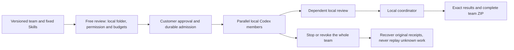

[需求](https://github.com/copypasteltd/workmate/blob/main/docs/requirements/16-desktop-native-teams.md) · [接口／权限／恢复／交付方案](https://github.com/copypasteltd/workmate/blob/main/docs/technical/139-desktop-native-teams.md) · [源码与证据](https://github.com/copypasteltd/workmate/blob/main/docs/quality/native-teams-checkpoint-139.json) · [全部编号](https://github.com/copypasteltd/workmate/blob/main/docs/quality/remaining-work-stage139.md)

真实Desktop操作，业务内容为假数据：


- [workmate-native-teams-139-05-review-before-local-run-en.png](https://github.com/copypasteltd/workmate/blob/desktop/assets/screenshots/workmate-native-teams-139-05-review-before-local-run-en.png)
- [workmate-native-teams-139-05-completed-local-team-en.png](https://github.com/copypasteltd/workmate/blob/desktop/assets/screenshots/workmate-native-teams-139-05-completed-local-team-en.png)
- [workmate-native-teams-139-05-whole-team-access-revoked-zh.png](https://github.com/copypasteltd/workmate/blob/desktop/assets/screenshots/workmate-native-teams-139-05-whole-team-access-revoked-zh.png)
- [workmate-native-teams-139-05-local-team.mp4](https://github.com/copypasteltd/workmate/blob/desktop/assets/screenshots/workmate-native-teams-139-05-local-team.mp4)

<!-- delivery-revision-stage138 -->
## 原成果修改与新版本交付 · 阶段138

执行`npm run qa:delivery-revision-backend -- <新两位编号>`验证原生数据库及相关回归，执行`npm run qa:delivery-revision -- <新两位编号>`完整构建并操作实际三端。需要本机Node、原生PostgreSQL运行库、Chrome、FFmpeg及已锁定的本机Codex。每次尝试单独保留，不改写原失败；不调度Docker或WSL。

可选择整份交付、答复、单文件、Unicode文字选段、图片区域或有效视频时段。预览不调用AI或预留费用；确认后建立单独预算的新任务，沿用原角色与来源，保留原成果及费用。源文件换版或撤回将阻断后续读取与完成交付。获准项目编辑可修改共享工作，私有会话保留原归属。结果未知时继续核对原请求。

文字预览上限1 MiB，图片／MP4内嵌预览4 MiB；更大或不支持预览的文件可下载后按完整文件提出修改。整份修改最多引用20个文件，视频时段须有保留的有效时长。图片／视频位置是修改意见，不能视为编辑操作审批或专业质量通过；专门工作流保留原确认步骤。

34项当前后端检查（含13项新增修改测试）、36项扩展状态检查、73项桌面控制／下载回归及9项三端实际旅程通过。11张实际截图、3组GIF／MP4、7档布局和3个独立解压的下载包绑定1732份确切源码。

业务／模型答复及原生文件／授权窗口选择为明确受控的假数据；登录、数据库权限、确切文件、实际打包本机Codex、Windows原生窗口、Chrome右侧栏和新成果下载实际运行。Windows包未签名。真实公司模型／账户、完整专业角色输出、安装矩阵和工程恢复继续独立验收。

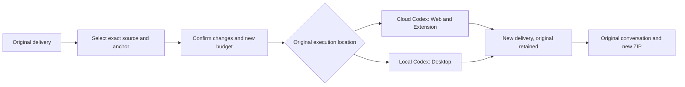

[需求](https://github.com/copypasteltd/workmate/blob/main/docs/requirements/15-delivery-revisions.md) · [方案与使用逻辑](https://github.com/copypasteltd/workmate/blob/main/docs/technical/138-source-bound-delivery-revisions.md) · [源码与原始证据](https://github.com/copypasteltd/workmate/blob/main/docs/quality/delivery-revision-checkpoint-138.json) · [全部编号](https://github.com/copypasteltd/workmate/blob/main/docs/quality/remaining-work-stage138.md)

实际产品操作，业务内容为假数据：


其他实际页面截图及MP4录屏：

- [workmate-delivery-revision-138-06-lost-response-retained.png](https://github.com/copypasteltd/workmate/blob/web/assets/screenshots/workmate-delivery-revision-138-06-lost-response-retained.png)
- [workmate-delivery-revision-138-06-image-anchor-en.png](https://github.com/copypasteltd/workmate/blob/web/assets/screenshots/workmate-delivery-revision-138-06-image-anchor-en.png)
- [workmate-delivery-revision-138-06-video-anchor-en.png](https://github.com/copypasteltd/workmate/blob/web/assets/screenshots/workmate-delivery-revision-138-06-video-anchor-en.png)
- [workmate-delivery-revision-138-06-revised-delivery-zh.png](https://github.com/copypasteltd/workmate/blob/web/assets/screenshots/workmate-delivery-revision-138-06-revised-delivery-zh.png)
- [workmate-delivery-revision-138-06-delivery-revision.mp4](https://github.com/copypasteltd/workmate/blob/web/assets/screenshots/workmate-delivery-revision-138-06-delivery-revision.mp4)

<!-- delivery-package-stage137 -->
## 完整交付与原对话下载 · 阶段137

主要业务按“提交目标 → 补充资料 → 执行 → 审阅 → 下载成果 → 原对话修改”继续收口。现在 Web 和 Chrome 原生右侧栏可直接在原聊天下载完整当前交付包，任务审阅区也提供入口；Desktop 使用公司授权接口和原生保存窗口。取消保存不发请求、不显示成功，侧栏提示跨刷新及繁英切换保留。

ZIP 包含实际成果、文字答复（如有）、任务及素材固定版本、SHA-256清单及中英编辑说明。同名文件分别保留，失败／停止工作的现有成果明确标示为部分交付。源代码ZIP、SVG／PPTX、工程JSON及只读成片分别按实际编辑能力说明，不虚构源工程。没有提交为交付物的本机文件仍留在本机；Desktop Agent仍是本机Codex，云端包不会扫描本机工作区。

用户看到的任务版本和交付摘要必须一致。后端顺序读取真实文件、流式校验大小与摘要，在受控磁盘生成ZIP，完成后再次检查当前权限、来源、保留期限及精确版本；文件损坏、素材撤回或版本变化会拒绝整个包。只读项目成员可下载获准共享成果，审阅仍需批准权限；管理员身份不自动获取私有会话。导出不调用AI、不创建新任务、不增加AI费用。容量为16 GiB／10,000个成果／文字条目，超限明确拒绝，不悄悄遗漏文件。

本轮不新增数据库迁移：Backend沿用SQL135并重新构建，Web／Desktop／Extension重新构建。扩展新增Chrome `downloads` 权限，使用浏览器默认下载位置及冲突改名；授权只在公司请求头中传递。新增契约为Backend `contracts/delivery-package-v1.json`。从Delivery执行 `npm run qa:delivery-package-backend -- <新两位编号>` 或 `npm run qa:delivery-package -- <新两位编号>`；后者默认完整构建、创建未签名Windows包并操作实际右侧栏与原生下载。

21项当前后端检查（含11项新打包测试）、37项扩展状态检查、1项桌面下载回归、12项边界绑定及10项三端实际旅程通过。9张实际截图、3组GIF／MP4、7档布局和3个独立解压的下载包绑定1713份确切源码。 使用受控Codex适配器和假业务内容；真实OTP／PKCE、文件读取、权限、原生窗口和Chrome下载管理器实际运行。Desktop保存窗口的选择结果由夹具指定到本轮自有目录。本轮未重新证明全部本机Codex工具、真实公司模型、专业素材质量或完整跨环境工程恢复。既有52项后端／来源回归另有阶段内原始记录，按其自身源码范围保留，不混称本轮全平台回归。


[需求](https://github.com/copypasteltd/workmate/blob/main/docs/requirements/14-complete-delivery-package.md) · [方案与使用逻辑](https://github.com/copypasteltd/workmate/blob/main/docs/technical/137-complete-delivery-package.md) · [确切源码与证据](https://github.com/copypasteltd/workmate/blob/main/docs/quality/delivery-package-checkpoint-137.json) · [全部编号](https://github.com/copypasteltd/workmate/blob/main/docs/quality/remaining-work-stage137.md)

实际客户流程截图与交互（业务内容为假数据）：


<!-- business-inputs-stage136 -->
## 业务问题与原任务续跑 · 阶段136

Agent遇到确实缺少的尺寸、目标受众或业务口径，可在原对话提出问题。客户可点击建议再修改，也可直接自由回答，最后明确确认；没有预选或自动提交。多项问题逐项保存，全部补齐后继续同一任务、同一会话和原预算预留，已计量用量统一结算。确认的问题和答案保留为原对话备注，相同请求重试不重复写入。

Web和Chrome原生右侧栏直接在原聊天展示问题，Desktop既有云任务详情也支持补答。繁中／英文切换保留未提交的回答，失败保留文字；扩展切换身份或会话清除草稿，来源不可读时清除受保护问题。建议仅供选择，答案不授予文件、广告账户、工具、本机或额外费用权限。

服务端严格区分`question`／`file`／`connection`，最多8项建议、4,000字符回答，校验版本、当前权限、来源及整批合法性后才写入。已确认答案不可改写。付费提问必须处于已完成且计量明确的Codex回合边界，继续原线程；取消只结算已知用量。删除私有会话清除问题、答案、检查点及正文，保留必要费用事实。

SQL135须在启动API／Worker前迁移：Backend执行`npm run db:migrate`。原SQL001–134、原二十项任务定义及主OpenAPI保持原字节；新增结构在`contracts/business-inputs-v1.schema.json`，扩展原创建／补交接口。原依赖文件与连接结构继续有效，问题使用`answer`而非`resource_ids`。

122项后端集成检查（含11项新增问题测试）、61项扩展状态检查、12项交付绑定及14项实际三端流程通过；9张实际截图、3组GIF／MP4及7个尺寸检查绑定确切来源。 原生Codex检查使用实际固定二进制和合成Responses服务，页面旅程使用受控工具和假业务回复。客户端初次完整构建成功；修正页面夹具后复用逐字节一致的源码和Windows包，原失败记录保留。可在Delivery执行`npm run qa:business-inputs-backend -- <新两位编号>`或`npm run qa:business-inputs -- <新两位编号>`；后者默认完整构建并创建独立原生测试数据库。

Desktop本机Codex及客户主动授予的本机完整权限沿用独立流程，本轮新增的是其云端任务视图问答。实际Windows窗口保持无边框、无Electron菜单、无可见纵向滚动轨和横向溢出；扩展保持实际Chrome原生右侧SIDE_PANEL。使用假数据，Windows包未签名；真实生产模型及全部角色专业交付仍待验收。完整编号仍开放88条必需、12条未确认建议、1条可选，REQ-095原始验收维持。

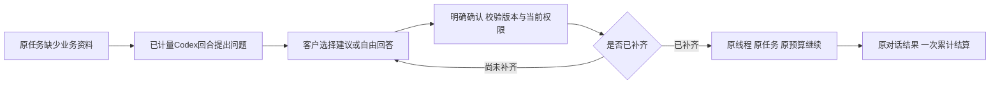

[需求](https://github.com/copypasteltd/workmate/blob/main/docs/requirements/13-business-brief-inputs.md) · [实现与使用逻辑](https://github.com/copypasteltd/workmate/blob/main/docs/technical/136-business-brief-clarification.md) · [全部102条编号](https://github.com/copypasteltd/workmate/blob/main/docs/quality/remaining-work-stage136.md) · [源码与原始验收](https://github.com/copypasteltd/workmate/blob/main/docs/quality/business-inputs-checkpoint-136.json)


<!-- client-errors-stage135 -->
## 四端连接与登录恢复 · 阶段135

Web、Admin、Desktop及Extension对读取失败显示当前语言的连接说明，保留有效登录。提交后响应丢失或无法解析时，提示先查收结果；应用层不会自动重发；浏览器可能在底层重传，服务端按原消息编号去重。客服授权继续使用原编号和期限，扩展委派继续使用原消息编号，显式重试不生成第二个任务。后台轮询不清除提交结果未确认的提醒，切换繁中／英文会更新同一错误提示，已知连接异常不显示Electron内部文字、地址或响应正文。

受保护请求收到401时，先核对所属登录并清除当前身份；HTML或空正文不能绕过清除。旧请求不能注销新登录或覆盖新防伪标记。Admin即时隐藏独立管理外壳，支持会话列表的连接错误与表单／撤销提醒分开，列表恢复后只清除本次连接提示。

15项连接／身份检查（含实际HTTP故障）、12项交付文件绑定、1项原生桥检查及30项实际四端流程通过。20张截图、7组实际GIF／MP4绑定源码；包含真实右侧SIDE_PANEL、客户OTP／PKCE及独立管理员TOTP、真实提交后响应丢失与同消息重试。09重新编译／构建Extension及Delivery，复用与02逐字节相同的后台、Web、Admin、Desktop源码及Windows包；没有伪称再次完整打包。旧失败与执行原件保留。Delivery当前`npm test`包含严格编译、文件绑定及连接检查；`npm run qa:client-errors -- <新的两位编号>`默认完整构建。

Desktop仍在客户本机运行Codex，完整本机权限单独授予，保持无边框、无Electron菜单及可见滚动条。Extension通过Chrome工具栏打开原生右侧栏，负责获准文件上传和云端执行。业务使用假数据，模型未运行，Windows包未签名。完整验收仍有88条必需、12条未确认建议、1条可选开放；REQ-095原始验收维持。

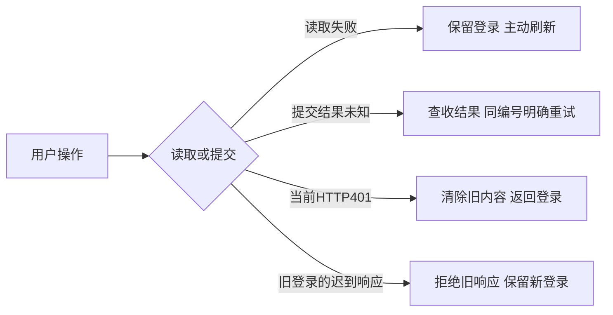

[使用与实现](https://github.com/copypasteltd/workmate/blob/main/docs/technical/135-client-connection-and-session-recovery.md) · [全部102条编号](https://github.com/copypasteltd/workmate/blob/main/docs/quality/remaining-work-stage135.md) · [源码与验收绑定](https://github.com/copypasteltd/workmate/blob/main/docs/quality/client-errors-checkpoint-135.json)


<!-- support-recovery-stage134 -->
## 客户授权恢复与客服原始验收 · 阶段134

客户从 **Web／Desktop → 账户设置 → 客服限时协助** 选择项目、原因及期限，空项目选择只表示元资料。首次提交固定申请编号和截止时间。响应丢失后可点击**查收先前申请**，或使用相同资料重试；刷新先查询既有结果，不自动再次提交。不同资料不能替换尚未确认的申请。查收展示目前有效／撤销／到期状态，不会续期；客户随时可在列表撤销。

恢复记录只在当前浏览器会话保存随机编号、申请摘要和固定截止时间，不保存原因、项目ID、正文或凭证。禁用存储时仅当前renderer内可恢复；服务器已经提交的授权仍显示在列表中。切换账户或企业后，迟到的结果不能回填新表单。原生Desktop桥仅新增客户查收GET，不开放管理员支持接口。

**原始REQ-095／TC-095已通过验收**，十二条条件逐项对应当前源码与真实执行证据：真实管理员和只读提示、明确范围、独立正文权限、写入／付款／VIP／凭证拒绝、无隐身登录、真实到期、撤销及审计失败回滚。本轮关闭这一条原始需求；全平台无障碍REQ-055、完整权限与竞争矩阵REQ-094继续各自跟踪。

65项相关后端检查、1项原生桥边界检查、18项实际Admin／Web／打包Desktop旅程及10条构建命令通过。覆盖提交前／后真实HTTP响应丢失、刷新、实际切换企业、同内容重试、当前回执查收、真实到期和原生客户撤销；客服操作期间user／native会话、刷新令牌和本机授权码行数不增加。确切源码绑定9截图和5组实时GIF／MP4。支持页面验证键盘及文字放大，Web／Admin采用CSS 200%，Desktop采用实际原生webContents 200%缩放；不据此关闭全平台浏览器／读屏验收。

Desktop继续在客户本机运行Codex，客户独立主动授予完整本机权限；保持无边框、无Electron默认菜单和无可见滚动条。Extension继续使用Chrome原生Side Panel承载获准文件上传与云端执行。本轮模型没有运行，业务及保留结果为合成夹具，Windows包未签名。自建浏览器、原生客户端与数据库均已关闭。

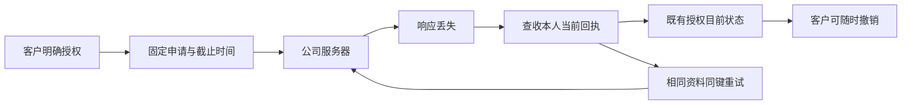

[方案 / Behavior](https://github.com/copypasteltd/workmate/blob/main/docs/technical/134-support-grant-recovery-and-acceptance.md) · [TC-095 acceptance](https://github.com/copypasteltd/workmate/blob/main/docs/quality/tc095-acceptance-134.json) · [Checkpoint](https://github.com/copypasteltd/workmate/blob/main/docs/quality/support-recovery-checkpoint-134.json) · [完整编号清单 / Remaining work](https://github.com/copypasteltd/workmate/blob/main/docs/quality/remaining-work-stage134.md)


[Recovery recording](https://github.com/copypasteltd/workmate/blob/web/assets/screenshots/workmate-support-recovery-134-04-grant-result-recovery.mp4) · [Retry recording](https://github.com/copypasteltd/workmate/blob/web/assets/screenshots/workmate-support-recovery-134-04-fixed-intent-retry.mp4) · [Native grant](https://github.com/copypasteltd/workmate/blob/desktop/assets/screenshots/workmate-support-recovery-134-04-customer-grant.mp4) · [Native revocation](https://github.com/copypasteltd/workmate/blob/desktop/assets/screenshots/workmate-support-recovery-134-04-customer-revocation.gif) · [200% Admin](https://github.com/copypasteltd/workmate/blob/admin/assets/screenshots/workmate-support-recovery-134-04-support-en-200.png) · [Chinese dark Admin](https://github.com/copypasteltd/workmate/blob/admin/assets/screenshots/workmate-support-recovery-134-04-support-zh-dark.png)

本轮1条需求验收完成；仍有88条必需、12条未确认建议和1条可选记录开放。这是完整验收记录数量，不代表101个未编码模块。完整源码交付复现、签名安装、生产接入及其余业务验收继续按编号推进；下方历史章节保留原运行范围。

---

<!-- support-access-stage133 -->
## 受控客服与原生客户授权 · 阶段133

客户从 **Web／Desktop → 账户设置 → 客服限时协助** 选择实际项目、原因及15／30／60分钟期限；空选择只包含企业／用户元资料。把授权ID提供给客服，并可随时在同一客户表单撤销。

管理员以自己的邮箱与TOTP登录 **Admin → 支援工作台**，明确选择客户、企业、项目、期限及可选客户授权。只读横幅持续显示真实身份和截止时间。共享正文还需要当前独立正文权限，私人会话保持私有；该视图不提供写入、费用、VIP或客户登录权限。

客服接口现会核对任务原始来源。来源隔离／到期或版本擦除后，保留正文不可继续返回，诊断标题也会隐藏。所选正文绑定当前版本，审计期间变化会被拒绝。页面取消旧请求，拒绝迟到任务／会话响应；版本变化、来源撤回、隐藏、失败、撤销或到期后清空正文。服务端逐次判断权限；可见Admin约每两秒复查。

59项后台相关测试及13项实际Admin／Web／打包原生Desktop旅程通过，确切源码绑定6截图和3组实时GIF／MP4。实际验证OTP／PKCE、邮箱／TOTP、客户授权／撤销、迟到响应、来源撤回、真实到期、繁中深色、四档Admin宽度和三档原生无边框窗口。所属浏览器、客户端与测试数据库均已关闭。模型没有运行，业务数据、保留结果和夹具文件读取明确为合成数据；Windows包仍未签名。

Desktop继续在本机运行Codex，本机权限由客户独立主动授权；客服表单只调用客户接口，管理员视图留在Admin。Extension继续使用Chrome原生Side Panel，承载获准文件上传及云端执行；本轮没有修改Extension执行代码。

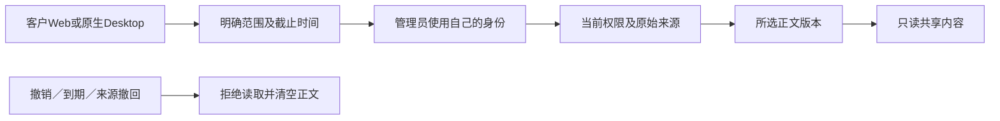

[实现方案](https://github.com/copypasteltd/workmate/blob/main/docs/technical/133-controlled-support-source-and-native-access.md) · [Checkpoint](https://github.com/copypasteltd/workmate/blob/main/docs/quality/support-access-checkpoint-133.json) · [完整编号待办](https://github.com/copypasteltd/workmate/blob/main/docs/quality/remaining-work-stage133.md)


[Native grant recording](https://github.com/copypasteltd/workmate/blob/desktop/assets/screenshots/workmate-support-access-133-02-customer-grant.mp4) · [Selection recording](https://github.com/copypasteltd/workmate/blob/admin/assets/screenshots/workmate-support-access-133-02-task-selection.mp4) · [Revocation recording](https://github.com/copypasteltd/workmate/blob/desktop/assets/screenshots/workmate-support-access-133-02-customer-revocation.mp4) · [Web metadata-only grant](https://github.com/copypasteltd/workmate/blob/web/assets/screenshots/workmate-support-access-133-02-metadata-grant-en.png) · [Chinese dark Admin](https://github.com/copypasteltd/workmate/blob/admin/assets/screenshots/workmate-support-access-133-02-support-zh-dark.png) · [Source withdrawn](https://github.com/copypasteltd/workmate/blob/admin/assets/screenshots/workmate-support-access-133-02-source-withdrawn-en.png)

仍有89条必需完整验收、12条未确认建议及1条可选记录开放，不代表102个未编码模块。完整权限竞争矩阵、各页面无障碍、签名安装和生产接入继续按编号推进；下方历史章节保留原范围。

---

<!-- content-history-stage132 -->
## 后台完整内容历史 · 阶段132

从「用户端内容 → 阅读正文」进入会话、专家或记忆，每页最多50条，可前后翻页或直达首尾。专家和记忆从最新版本开始，区分「客户版本」与「管理员修订」，展开后可查看完整版本记录。

每次请求复核当前MFA会话、两项正文读取权限、企业／项目范围及显式拒绝。签名游标拒绝旧版本继续翻页。阅读器在可见时每15秒及重新聚焦时复查；权限失效或可读来源变化后清空正文。关闭或切换内容会取消旧请求，迟到响应不能覆盖新内容。正文和游标不写入浏览器存储；助手来源不可用时隐藏正文。

新增GET `/v1/admin/content/:kind/:id/history`，使用`edge=first|last`或服务器返回的`cursor`，固定每页50条。SQL134维护消息历史修订号。旧正文接口保留原限制并增加`truncated`与`history_url`。普通客户会话仍保留既有80条输入限制。

54项后端相关测试及9项实际后台旅程通过。真实API创建205版专家、205版记忆及66条客户消息，实际运行原生PostgreSQL、邮箱/MFA、管理员修订、来源撤回、权限拒绝、迟到响应及375/768/1440布局。业务数据和保留的助手结果明确为合成数据，模型没有运行。原始失败及对应源码保留；本轮通过旅程留有5张截图和2组实时GIF/MP4。所有所属测试资源已关闭。

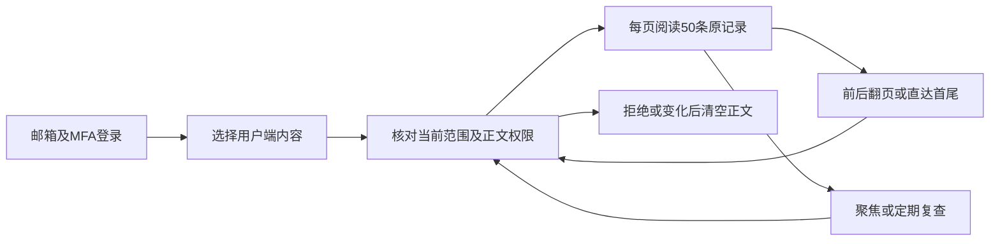

[实现方案](https://github.com/copypasteltd/workmate/blob/main/docs/technical/132-admin-content-history.md) · [Checkpoint](https://github.com/copypasteltd/workmate/blob/main/docs/quality/content-history-checkpoint-132.json) · [完整编号待办](https://github.com/copypasteltd/workmate/blob/main/docs/quality/remaining-work-stage132.md) · [API supplement](https://github.com/copypasteltd/workmate/blob/backend/contracts/admin-content-history-route-additions.json)


[Oldest memory version](https://github.com/copypasteltd/workmate/blob/admin/assets/screenshots/workmate-content-history-132-02-oldest-memory-en.png) · [Administrator provenance](https://github.com/copypasteltd/workmate/blob/admin/assets/screenshots/workmate-content-history-132-02-administrator-provenance-en.png) · [中文页面](https://github.com/copypasteltd/workmate/blob/admin/assets/screenshots/workmate-content-history-132-02-memory-history-zh.png) · [Permission denied](https://github.com/copypasteltd/workmate/blob/admin/assets/screenshots/workmate-content-history-132-02-permission-withdrawn-en.png) · [Navigation MP4](https://github.com/copypasteltd/workmate/blob/admin/assets/screenshots/workmate-content-history-132-02-complete-version-navigation.mp4) · [Withdrawal MP4](https://github.com/copypasteltd/workmate/blob/admin/assets/screenshots/workmate-content-history-132-02-permission-withdrawal.mp4)

仍有89条必需、12条未确认建议及1条可选完整验收记录开放；它们不是102个未编码模块。本轮仅验收限定历史阅读范围，完整后台运营、全部角色、生产模型/连接器及签名安装继续按编号推进。下方历史章节保留其原始范围。

---

<!-- durable-receipt-stage131 -->
## 本机结果与费用回执持久同步 · 阶段131

本机子任务完成后，即使公司接口未收到完成请求，或已结算但响应丢失，原始结果仍保存在本机。父任务只有确认子任务回执后才能清理操作记录。恢复连线后选择“同步已储存的回执”；撤销本机权限后或完整退出并重新打开应用后，仍可同步原回执。同步不会重新运行命令、启动QA或新增模型请求。

已知成功的子任务按公司实际观测结算一次。未知父任务继续保留原预算、等待费用核对；同步成功不代表整个流程成功，也不解除未知本机副作用限制。账号切换和服务端权限继续校验，不能绕过原登录族或企业权限。

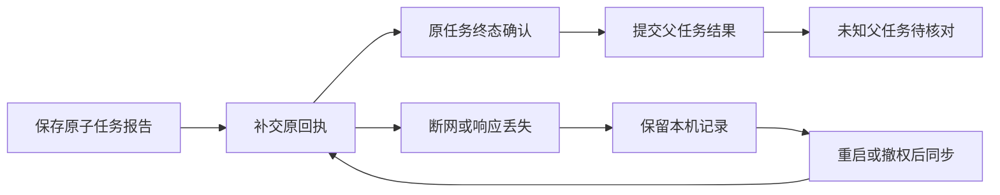

限定验证通过：124项控制层检查（含15项新增回执边界）、43项真实固定Codex检查、3条真实本机/SQL回执丢失流程、2项编译检查和8项实际未签名Desktop界面检查。旧版与新版对照确认原缺陷：旧版遗漏子任务完成请求，新版先子后父。真实进程、命令、文件、数据库、HTTP响应丢失和完整应用重启已运行；模型回答及系统对话框选择为测试输入。全部所属测试资源已关闭，原始失败、执行脚本和源码快照保留。

[实现方案](https://github.com/copypasteltd/workmate/blob/main/docs/technical/131-desktop-durable-receipt-sync.md) · [当前检查点](https://github.com/copypasteltd/workmate/blob/main/docs/quality/receipt-sync-checkpoint-131.json) · [完整编号待办](https://github.com/copypasteltd/workmate/blob/main/docs/quality/remaining-work-stage131.md)


[Fee confirmation](https://github.com/copypasteltd/workmate/blob/desktop/assets/screenshots/workmate-receipt-sync-131-01-child-fee-confirmation-en.png) · [撤权后中文提示](https://github.com/copypasteltd/workmate/blob/desktop/assets/screenshots/workmate-receipt-sync-131-01-revoked-receipts-pending-zh.png) · [Original receipts synchronized](https://github.com/copypasteltd/workmate/blob/desktop/assets/screenshots/workmate-receipt-sync-131-01-original-receipts-synchronized-en.png) · [Loss/withdrawal MP4](https://github.com/copypasteltd/workmate/blob/desktop/assets/screenshots/workmate-receipt-sync-131-01-receipt-loss-and-permission-withdrawal.mp4) · [Restart/sync MP4](https://github.com/copypasteltd/workmate/blob/desktop/assets/screenshots/workmate-receipt-sync-131-01-receipt-sync-after-application-restart.mp4)

当前仍有89条必需、12条未确认建议、1条可选完整验收记录开放，不能理解为102个模块尚未编码。任意崩溃/旧进程回收、换登录族后的处理、全部父任务账务核对、专业角色、正式模型/媒体及签名安装继续推进。当前增量使用阶段131独立清单与发布器；阶段128和130证据保持各自历史范围。

```powershell
node scripts/qualify-receipt-journeys-v2.mjs 11
$env:COPYPASTE_NPM_CLI = 'C:\path\to\npm-cli.js'
node scripts/run-desktop-receipt-131-v2.mjs 11
```

实际前置配置、固定运行时、原生数据库路径及合格逻辑报告需要先准备；版本化脚本绑定本轮明确通过的前置报告，其他代码版本需建立新的资格脚本和执行编号，不得修改已执行脚本来套用新结果。

---

<!-- workflow-recovery-stage130 -->
## 本机父子流程恢复与取消 · 阶段130

本轮修复停止或正常完成任务时，后台授权保活响应卡住导致收尾等待的问题。主任务和每个子任务分别取消并等待自己的保活观察器；即使底层请求忽略取消，其迟到响应也不能继续启动任务。正常完成不会因此取消父任务；提交本机轮次前仍必须重新检查当前权限。

客户流程为：浏览器登录与企业工作区 → 选择本机目录并主动授权 → 确认额外子任务费用 → 本机开发者执行 → 客户审核实际文件 → 本机QA执行 → 下载SOP、固定版本JSON和恢复说明。两个子任务分别发生真实初始化/建会话故障后，在公司持久证明零准入的前提下各恢复一次；原任务、原预算、截止与worker attempt保持一致。

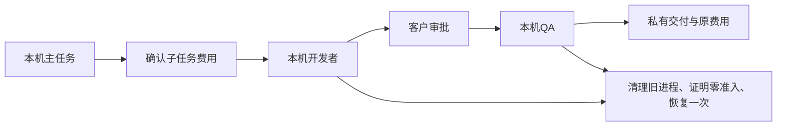

限定验证通过：109项控制层、43项真实固定Codex、3个完整原生父子流程、2项当前编译和8项实际未签名打包界面检查。打包旅程使用真实Electron、原生PostgreSQL、本机命令与文件；模型回答、对话框选择及注入的传输故障为测试输入。三个原生窗口宽度保持无边框、无默认菜单、无可见滚动条及无横向溢出，全部所属资源已关闭。原始失败及其源码快照保持不变。

[实现方案](https://github.com/copypasteltd/workmate/blob/docs/docs/technical/130-desktop-workflow-recovery.md) · [当前检查点](https://github.com/copypasteltd/workmate/blob/docs/docs/quality/workflow-recovery-checkpoint-130.json) · [完整编号待办](https://github.com/copypasteltd/workmate/blob/docs/docs/quality/remaining-work-stage130.md)


[费用确认](https://github.com/copypasteltd/workmate/blob/desktop/assets/screenshots/workmate-workflow-recovery-130-01-child-fee-confirmation-en.png) · [英文完成画面](https://github.com/copypasteltd/workmate/blob/desktop/assets/screenshots/workmate-workflow-recovery-130-01-two-recovered-children-completed-en.png) · [中文完成画面](https://github.com/copypasteltd/workmate/blob/desktop/assets/screenshots/workmate-workflow-recovery-130-01-two-recovered-children-completed-zh.png) · [完整实时MP4](https://github.com/copypasteltd/workmate/blob/desktop/assets/screenshots/workmate-workflow-recovery-130-01-parent-child-startup-recovery.mp4)

完整验收仍有89条必需、12条未确认建议和1条可选记录开放；它们是完整验收记录，不等于102个功能尚未编码。任意崩溃/多节点、所有本机工具、全部专业角色、丢失子任务完成回执的持久补交、正式模型及签名安装等继续推进。当前发布由阶段130独立清单和发布器约束；旧V11入口及阶段128清单保留历史源码范围，不用于发布本轮变更。

运行复核 / Reproduce:

```powershell
node scripts/qualify-workflow-journeys-v1.mjs NN
$env:COPYPASTE_NPM_CLI="<absolute npm-cli.js path>"
node scripts/run-desktop-workflow-130-v1.mjs NN
Set-Location ../..
python -X utf8 docs/tools/publish_workflow_recovery_130_v1.py --push
```

每次使用新的两位编号；已执行的脚本、日志、报告和快照不得覆盖。原生联调需要两个既有publication-125检出、固定Codex和公司测试配置；打包复核还需要原生Windows工具、已准备的Chromium/FFmpeg。发布器从工作区根目录执行；先提交所有匹配源码、材料与独立清单。 / Use a fresh two-digit attempt; never overwrite executed verifiers, logs, reports or snapshots. Native qualification requires both publication-125 checkouts, pinned Codex and private test configuration. Packaged QA also requires native Windows tooling and prepared Chromium/FFmpeg. Run publication from the workspace root after committing reviewed matching sources, media and the independent manifest.

[简体中文](README.md) · [English](README.en.md)

<!-- startup-recovery-stage128 -->
## 本机启动安全恢复 · 阶段128

Desktop 在客户电脑运行固定版本 Codex。客户选择目录并主动授权后，初始化或打开会话若发生明确的传输故障，主进程先回收旧进程和锁，再请求公司服务检查原任务。只有轮次尚未准入、没有任何模型/输入计数/公司工具准入，且身份、权限与原截止仍有效，才允许恢复一次。最多两次启动，沿用原任务、原预算预留和 worker attempt，不延长原截止。

界面显示「正在重连」。连接结果未确认时，「重试连线」仅取回原请求结果；可能已执行的工作需先核对本机文件及费用。撤权、协议拒绝、清理失败、已提交轮次和结果未知均禁止自动重做。推理凭证仅传给可信本机运行器，不写入本机恢复日志或渲染页面。

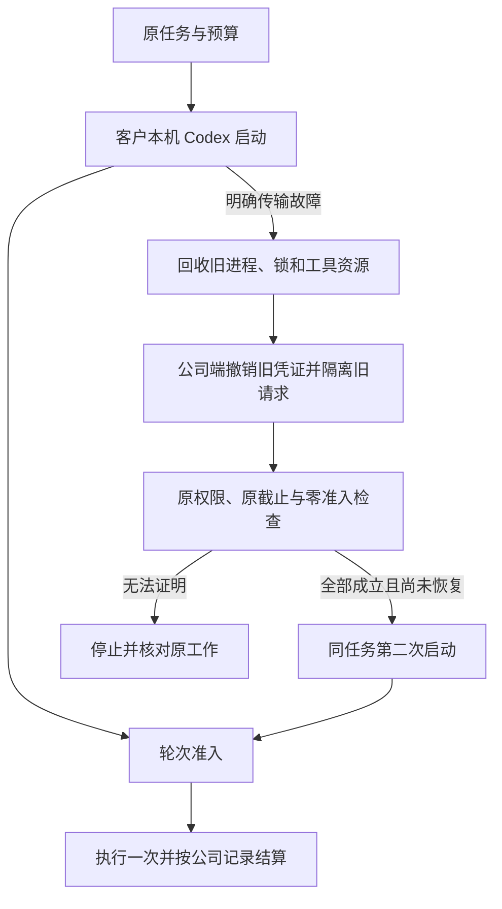

服务端通过 SQL133 升级；应先使用所有者执行完整迁移，再启动相应 API。新客户端声明 `desktop-startup-recovery-v1`；`/startup-recovery` 使用原绑定、固定契约摘要和原恢复请求键，`/turn-admission` 在 `turn/start` 前登记。旧客户端保持原执行流程，不能取得新的恢复许可。

本轮检查点记录控制层、实际固定 Codex、原生 SQL 与实际未签名打包客户端的限定验证。模型回答和对话框选择按用户要求使用假数据；尚不代表正式模型、签名安装、全部崩溃组合或专业角色整体验收。各旧阶段的包和画面仍对应其原源码。

本轮限定检查通过：91项相关控制层、43项真实固定版本Codex、30项原生数据库/API、3项当前编译和6项实际未签名打包界面检查。实际旅程验证了登录、授权、一次启动恢复、原任务的一次收费、单次回答、待响应时撤权，以及1000/1240/1440三个原生窗口宽度。当前截图、GIF和MP4来自成功的04次运行；失败的01—03次运行及原始记录均完整保留。发布入口为V11，远端状态以最终推送回执和SHA回读为准。

所有受审源码、媒体、双语说明和中央发布清单提交后，在本仓库执行：

```powershell
node scripts/publish-workmate-v11.mjs --push
```

`--check`仅核查，不推送。V11检查真实已提交内容、所有历史证明、媒体和链接，以及八个映射分支的祖先关系，再进行普通原子推送并逐一回读SHA。中央文档仓库中与本轮无关的未跟踪用户文件予以保留并写入回执；受跟踪文件及各端仓库必须干净。失败时保留回执，不强推。

[方案与接口](https://github.com/copypasteltd/workmate/blob/docs/docs/technical/128-desktop-startup-recovery.md) · [匹配源码与验证](https://github.com/copypasteltd/workmate/blob/docs/docs/quality/startup-recovery-checkpoint-128.json) · [编号待办](https://github.com/copypasteltd/workmate/blob/docs/docs/quality/remaining-work-stage128.md)


[Original receipt](https://github.com/copypasteltd/workmate/blob/desktop/assets/screenshots/workmate-startup-recovery-128-04-original-local-receipt.png) · [Withdrawal screenshot](https://github.com/copypasteltd/workmate/blob/desktop/assets/screenshots/workmate-startup-recovery-128-04-permission-revoked-before-turn.png) · [Withdrawal GIF](https://github.com/copypasteltd/workmate/blob/desktop/assets/screenshots/workmate-startup-recovery-128-04-revoke-pending-startup.gif) · [Recovery MP4](https://github.com/copypasteltd/workmate/blob/desktop/assets/screenshots/workmate-startup-recovery-128-04-startup-and-original-receipt.mp4) · [Withdrawal MP4](https://github.com/copypasteltd/workmate/blob/desktop/assets/screenshots/workmate-startup-recovery-128-04-revoke-pending-startup.mp4)

<!-- local-startup-stage127 -->
## 本机启动的源码、打包与交付 · 阶段127

Desktop补齐主任务/子任务启动期间授权续租、准备阶段关闭屏障、待响应原生请求的撤权及清楚的双语提示。执行仍在客户本机，原任务和原费用不变。当前限定检查为控制层73项、真实固定Codex38项和实际打包窗口5项，最终结果绑定检查点中的确切源码和包。实际SQL、进程及窗口均运行；模型回答和原生对话框选择为测试数据。

先浏览器OTP/PKCE登录并创建工作区，再选择目录及明确本机授权；等待启动、查看原任务完成及费用，另验证启动中撤权无新模型调用。窗口实测1000/1240/1440宽度无边框、无默认菜单、无可见滚动条或横向溢出。实拍截图、GIF和MP4随Desktop仓库交付。

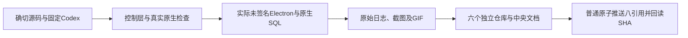

阶段127的历史发布入口为`node scripts/publish-workmate-v10.mjs --push`；`--check`只核查。V10检查源码、已提交Git内容、双语说明、真实媒体、原始失败及全部历史证明，再普通原子更新八个映射分支并读取最终SHA。阶段128使用V11；各旧结果保留原源码范围。

`run-desktop-startup-v1/v2/v3/v4.mjs`与对应QA脚本均保留执行时原文。01因测试选择默认取消而停在授权，02复用相同包通过但实拍显示内部错误码；修改双语提示后，03重跑控制层/原生并构建新包，前三项通过但窗口宽度等待超时；04复用字节未变的03包，绑定页面所属窗口、恢复普通窗口与100%缩放，并共同检查OS及页面实际宽度。旧窗口状态与超时底层原因尚未证明。失败、取消、清理回执和旧媒体全部保留。阶段脚本依赖记录的相邻候选目录、固定资源及隔离数据库，不能当成任意检出的通用启动命令。所有自建窗口、进程与原生PostgreSQL必须收尾；禁止Docker/WSL。

Desktop自动启动恢复、签名安装、完整专业角色与89条必需整体验收仍开放。后续恢复必须先撤销并等待旧请求退出，再原子证明零准入，不能凭零费用直接重试。

[方案](https://github.com/copypasteltd/workmate/blob/docs/docs/technical/127-desktop-startup-lifecycle.md) · [检查点](https://github.com/copypasteltd/workmate/blob/docs/docs/quality/local-startup-checkpoint-127.json) · [本轮变更与待办](https://github.com/copypasteltd/workmate/blob/docs/docs/changes/127-desktop-startup-lifecycle.md) · [实际截图与GIF](https://github.com/copypasteltd/workmate/blob/desktop/README.md)

<!-- native-publishing-stage126 -->
## 原生 Codex 发布工具与交付 · 阶段126

后端修复角色工具准入与素材版本来源，真实固定云端Codex完成账户→预览→准备→状态四工具调用，客户仍须在发布页明确确认。当前专项09通过5/5，启动故障03通过9/9；完整16文件相关回归10通过155/155，源码未变且所属原生数据库／夹具清理通过。新增受限启动恢复要求未提交轮次、关闭网关后模型请求为零、原进程完全退出；两次上限和原费用身份继续执行。

06中断缺少最终／清理回执，08为132通过、1失败；red01、green02及其他原失败均保留原结论，不补写成功。修正并单独验证测试辅助器的实际进程创建时间检查。底层偶发原生／Windows延迟原因尚未证明，Desktop本机恢复及四工具组合也不计入云端资格。

阶段126发布入口为 `node scripts/publish-workmate-v9.mjs --push`，`--check` 只核查。V9校验本轮源码、原始日志和可携带归档，保留历史证明、既有截图/GIF与失败记录，沿用六个独立仓库和普通八引用原子推送及SHA回读。七个独立检出并行完成只读核查，中央文档的main/docs在最终复查时只检查同一目录一次；对象导入和远端写操作按顺序执行。正式发布以最终执行回执为准。

本轮没有新增界面或媒体录制；下方阶段125实拍仍按其原源码范围保存。偶发原生超时根因、视频播放/拖动、签名安装、完整角色组合和整体验收继续开放。模型与账户仍按授权使用模拟数据；禁止Docker/WSL，回收自建进程。

[方案与界限](https://github.com/copypasteltd/workmate/blob/docs/docs/technical/126-native-publication-tools.md) · [本轮更新及待办](https://github.com/copypasteltd/workmate/blob/docs/docs/changes/126-native-publication-tools.md)

<!-- controlled-publications-stage125 -->
## 受控发布验收与交付 · 阶段125

新增模拟OAuth、完整相关后端、实际Web/Admin、打包Electron及Chrome原生右侧栏检查。每次使用新编号，保留检查器原文、确切源码、原日志、真实截图和GIF／MP4，禁止覆盖失败。必须回收自建浏览器、预览进程、原生PostgreSQL及夹具，禁止Docker／WSL。

阶段125历史通过范围：后端09为117/117、CLI07为5/5、分析08为12/12、Desktop媒体03为21/21、Extension02为70/70、Web/Admin12为14/14；实际打包Desktop／Chrome原生右侧栏02为10/10通过，源文件与包字节匹配，自建浏览器、Electron、API、数据库及夹具均已关闭。Web/Admin原始记录覆盖四档宽度，早先无效宽度声明及所有失败保留。

本阶段发布入口为 `node scripts/publish-workmate-v8.mjs --push`；`--check` 只核查。执行器要求六个独立产品仓库与中央文档均已提交，读取普通开发目录，校验当前源码、原始回执、历史证明、双语说明、实际媒体及远端祖先后，普通原子推送八个映射分支并读取最终SHA。以最终回执为发布依据，不强推。

阶段专用验收脚本保留相邻 `copypaste-*-publication-125` 候选路径及固定未签名目录包，不是其他检出的通用启动器。正常安装与启动按下方说明；独立检出复现、签名安装、新增发布视频、四个发布工具的实际Codex调用及至少十二个角色的专业资格仍待完成。

[本阶段方案与限制](https://github.com/copypasteltd/workmate/blob/docs/docs/technical/125-controlled-publishing-and-native-media.md) · [源码与证据清单](https://github.com/copypasteltd/workmate/blob/docs/docs/quality/publications-checkpoint-125.json)


<!-- admin-profile-revisions-124 -->
## 阶段124发布及验证

本轮在后端与 Admin 独立仓库补齐专家、品牌和记忆修订；68项相关后端、11项后台单元、8项实际页面及14次布局观察通过，8张截图、3组GIF/MP4与失败原件保存。Desktop保留客户本机Codex，Extension保留原生右侧栏与云端Codex。

阶段124入口为 `node scripts/publish-workmate-v7.mjs --push`。六个组件与中央文档提交后，V7检查确切源码、历史证明、媒体、双语说明、凭证与远端祖先，普通原子推送八个映射引用，再读取实际SHA。不会强推；以执行器最终回执为发布依据。运行环境只用原生工具，不使用Docker/WSL。

[方案与验证](https://github.com/copypasteltd/workmate/blob/docs/docs/technical/124-admin-profile-revisions.md) · [实际后台画面](https://github.com/copypasteltd/workmate/blob/admin/README.md)

<!-- admin-content-revisions-123 -->
## 管理员正文修订与交付核查 · 阶段 123

阶段123发布命令为 `node scripts/publish-workmate-v6.mjs --push`，`--check` 只核查。V6 先校验六个独立组件和中央文档的提交、精确源码、原始证据、双语说明、媒体、历史对象、凭据与远端祖先关系，再普通原子推送八个映射引用并读取实际 SHA。历史证明身份及失败记录全部保留，不强推。

当前增量已取得五个完整相关后端文件 **75/75**、实际 Admin 页面 **7/7**，以及四档宽度的 7 次弹窗与输入边界观察。后台专项验证三类修订、范围权限/MFA、并发、幂等、审计失败回滚、独立管理员来源、数据库角色与不可变性；实际页面包括真实邮件/MFA、表单、原提交响应丢失后恢复和撤权清除正文。编辑流程没有模型请求，不增加任务或费用。

`qualify-admin-content-v1`–`v4` 与页面 V1/V2 脚本保留各次执行时的代码和源码快照；它们是绑定当次工作树、原生数据库及端口的验收工具，不应在其他检出目录直接复用所属资源标识。正常启动按下方工作区说明；当前可复查证据位于中央 [checkpoint](https://github.com/copypasteltd/workmate/blob/docs/docs/quality/admin-content-checkpoint-123.json) 和 [归档索引](https://github.com/copypasteltd/workmate/blob/docs/docs/quality/admin-content-evidence-123/index.json)。

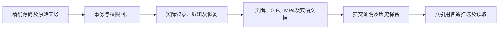

[实际页面及交互录制](https://github.com/copypasteltd/workmate/blob/admin/README.md) · [完整方案](https://github.com/copypasteltd/workmate/blob/docs/docs/technical/123-admin-content-revisions.md)。本增量不重新宣称完整后端回归、正式供应商质量或完整产品验收。

<!-- runtime-startup-122 -->

## Codex 启动与轮次隔离 · 阶段 122

阶段 122 历史发布命令为 `node scripts/publish-workmate-v5.mjs --push`；`--check` 只核查。该执行器要求当时的交付仓库已提交、中央源码证明与限定证据一致，再普通原子推送八个映射引用并重新读取 SHA。当前清单使用上方 V6 入口。

账务专项保留首轮 78／79 加一次取消、首次独立失败及后续独立通过的原始记录；此前失败的确切根因仍未证明。最终完整相关文件范围以[本轮 checkpoint](https://github.com/copypasteltd/workmate/blob/docs/docs/quality/runtime-startup-checkpoint-122.json)为准。新增真实数据夹具单独计时，恢复与账本断言仍为 120 秒；原 RPC／任务期限不变。

最终五个完整相关文件共 79 项通过、0 失败／取消／跳过；源码未变化，夹具与数据库回收及端口关闭核对通过。这项限定回归不代替新的完整后端或生产稳定性验收。

本轮执行器固定实际源码、原生可执行文件与原始输出，保留失败尝试，并分别验证初始化恢复、轮次隔离、账务事务和真实打包页面。执行器只控制本次拥有的原生进程、目录、数据库与浏览器；不用 Docker、WSL 或虚拟机。

已取得云端原生 12 项、Desktop 单元 180 项／原生 25 项、Web 20 项及打包 UI 8 项限定通过记录。相关脚本保留当次工作目录和源码，不应把历史执行器当作另一个产品启动入口。常规使用继续按下方启动说明进行；生产签名发行、真实供应商质量和完整 102 项验收单独跟踪。

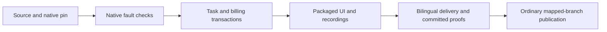

[完整方案 / Behavior and verification](https://github.com/copypasteltd/workmate/blob/docs/docs/technical/122-codex-startup-and-turn-isolation.md)

## 产品与边界

首批面向现有客户的 marketing 团队，完整范围包含生图、设计/字体、视频/特效、广告和网站分析、SEO/GEO、企业重复流程及软件开发。目录已有 18 个精确 Skill 绑定的候选角色；至少十二个逐一完成专业任务、修改及异常处理的角色仍是验收要求。设计师由 Codex、设计 Skill 与公司 Image 2 组合。Agent 内核唯一使用 Codex；全部 AI 请求走公司 OpenAI 兼容后端。当前开发使用已授权假数据，不代表真实模型专业质量已经验收。

工具保留原始 TAP、失败报告、验证器、所选源码摘要和实际截图/GIF/MP4，区分假模型回复、原生 Codex 与真实文件/数据库/账本。原生测试只拥有自己的端口、进程、目录和数据库对象；关闭不用的自建浏览器并保留用户页面/服务。发布前检查七个仓库、双语 README、媒体、凭据、历史对象大小及提交清单；仅向明确映射分支普通推送并核对八个远程 SHA，不强推。

## 仓库与执行位置

| Branch | Directory | Runtime |
| --- | --- | --- |
| [backend](https://github.com/copypasteltd/workmate/tree/backend) | `dev/copypaste-platform` | Fastify / PostgreSQL / cloud Codex |
| [web](https://github.com/copypasteltd/workmate/tree/web) | `dev/copypaste-web` | React / Vite / cloud workspace |
| [admin](https://github.com/copypasteltd/workmate/tree/admin) | `dev/copypaste-admin` | React / separate Admin identity |
| [desktop](https://github.com/copypasteltd/workmate/tree/desktop) | `dev/copypaste-desktop` | Electron / customer-local Codex |
| [extension](https://github.com/copypasteltd/workmate/tree/extension) | `dev/copypaste-extension` | Chrome MV3 / native Side Panel / cloud Codex |
| [delivery](https://github.com/copypasteltd/workmate/tree/delivery) | `dev/copypaste-delivery` | Native development, QA and publication tools |

各组件为独立 Git 仓库，保留上述并列布局。项目仅使用原生工具；禁止 Docker、WSL 和虚拟机。

## 使用逻辑

1. 将六个分支分别检出为 dev 下的独立仓库，安装各自锁定依赖，保留现有配置与数据。
2. bootstrap 校验目录并构建；demo 启动自有原生数据库、API、Worker、假模型服务及 Web/Admin。
3. 逐文件运行后端回归；各端另跑类型、构建、单元、真实本机 Codex 与实际 UI，保留源码、原始日志和失败。
4. 对所有者、端口、进程、目录和浏览器独立核对清理；录制使用真实墙上时间，说明假数据与真实执行边界。
5. 绑定六个实际 Git 提交、双语 README、媒体和全部历史证据，再通过发布器正常原子推送并核对八个分支。

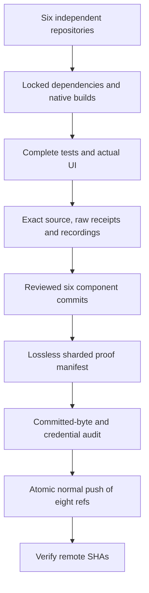

## 启动与使用

### 本地启动

以下命令在已检出的对应仓库内执行。完整工作区将六个独立仓库并列放在 `dev/`，见[分支与检出布局](https://github.com/copypasteltd/workmate/blob/docs/docs/governance/04-git-branches-and-publication.md)。使用 Windows x64、Node.js >=22.14、npm/Git，以及文档约束的原生 PostgreSQL、FFmpeg/FFprobe 与固定 Codex 资源；保留已有本地配置和数据，不使用 Docker/WSL/虚拟机。

```powershell
Set-Location 'D:/dev/copypasted/自有agent/dev/copypaste-delivery'
npm ci
npm run bootstrap
npm run demo
```

Web 为 `http://localhost:4317`，Admin 为 `http://localhost:4318`；API 端口 4310、控制器 4319、原生 PostgreSQL 55432。结束时使用 `npm run stop`，仅关闭控制器自建进程并正常停止数据库。内置示范模拟文本/图片并可使用剪辑/模板影片；生成式影片须配置公司契约，当前生成验收使用明确的媒体夹具。本机 Desktop 另需独立固定的原生内核。

### 当前使用流程

1. 完成登录、企业成员/邀请和项目选择。原生端通过浏览器 PKCE 登录；Admin 使用独立 MFA 身份。过期、撤销、换企业不应静默切换身份和资料范围。
2. 选择专业角色，提供工作说明及明确获准的资料/账号。缺少必要输入时请求客户补齐。项目负责人可以保存草稿、核对依赖、预览并明确发布不可变共享指引；发布不启动 AI、不增加权限。
3. 新任务固定当时接受的角色、Skill、品牌、资料和指引版本。既有工作保留原版，包括原先没有共享配置的状态。来源被隔离、删除或撤权后隐藏失效正文并阻断后续使用；历史内容不是越权入口。
4. 确认预算和必要的操作/媒体授权，查看真实状态、进度、文件与原费用回执。修改沿原工作谱系继续。未知用量保持原预留供对账，不能当作免费或盲目重新执行。
5. Admin 可按独立权限管理用户/企业状态、查看获准消耗，预览并确认人工费用/赠额和 VIP 权益/到期。余额、实收记录、授信、预算和 VIP 分别保存；同一确认幂等，操作保留审计，不能因重放重复赠额。

## 配置、权限与费用

本候选要求完整 SQL001–133 增量历史。API/Worker 准入拒绝缺失、变更或不支持的版本，并独立检查恢复环境身份。公司模型别名、已验证媒体能力、精确费率及供应商密钥只在后端配置；未配置能力保持不可用。当前开发继续使用已授权假数据。

Web/Admin 使用 `VITE_API_BASE` 或同源代理，开发端口为 4317/4318。Desktop/Extension 构建时固定 `COPYPASTE_API_ORIGIN`、`COPYPASTE_WEB_ORIGIN`，Desktop 另固定 `COPYPASTE_EXTENSION_ID`。除获准回环开发场景外使用 HTTPS；渲染器与扩展不持有公司供应商密钥。

文件默认私有，项目共享需要客户明确操作。新请求、Worker 领取、工具及下载重新核验权限；旧历史不能绕过撤权或正文治理。金额使用精确港币微单位；预算、余额、授信、实收与 VIP 分开记录。稳定请求身份防止重复赠额、建任务和预留；未知费用或物理清理保留待核对。

## 预设角色与 Skill

目录定义 18 个专业预设及默认助手，每次执行固定 Skill 版本和注册工具。模板数量不等于至少十二个角色已通过完整专业资格验收。

| ID | Role | Required Skill bindings |
| --- | --- | --- |
| R01 | 全栈开发工程师 | `fullstack-engineering@1.0.0`, `frontend-implementation@1.0.0`, `backend-api@1.0.0`, `qa-testing@1.0.0`, `delivery-core@1.0.0` |
| R02 | 前端开发工程师 | `frontend-implementation@1.0.0`, `ui-system@1.0.0`, `qa-testing@1.0.0`, `delivery-core@1.0.0` |
| R03 | 后端与 API 工程师 | `backend-api@1.0.0`, `qa-testing@1.0.0`, `delivery-core@1.0.0` |
| R04 | 软件测试工程师 | `qa-testing@1.0.0`, `frontend-implementation@1.0.0`, `delivery-core@1.0.0` |
| R05 | UI/UX 设计师 | `ux-research@1.0.0`, `ui-system@1.0.0`, `frontend-implementation@1.0.0`, `delivery-core@1.0.0` |
| R06 | 设计师 | `creative-direction@1.0.0`, `image-art-direction@1.0.0`, `image2-production@1.0.0`, `typography-layout@1.0.0`, `delivery-core@1.0.0` |
| R07 | 品牌视觉设计师 | `brand-system@1.1.0`, `image-art-direction@1.0.0`, `image2-production@1.0.0`, `typography-layout@1.0.0`, `delivery-core@1.0.0` |
| R08 | 广告创意设计师 | `ad-creative@1.0.0`, `image-art-direction@1.0.0`, `image2-production@1.0.0`, `typography-layout@1.0.0`, `delivery-core@1.0.0` |
| R09 | 电商商品设计师 | `ecommerce-visual@1.0.0`, `image-art-direction@1.0.0`, `image2-production@1.0.0`, `typography-layout@1.0.0`, `delivery-core@1.0.0` |
| R10 | 社媒内容设计师 | `social-content@1.0.0`, `image2-production@1.0.0`, `typography-layout@1.0.0`, `delivery-core@1.0.0` |
| R11 | 插画与 IP 设计师 | `illustration-ip@1.0.0`, `image-art-direction@1.0.0`, `image2-production@1.0.0`, `delivery-core@1.0.0` |
| R12 | 字体与版式设计师 | `typography-layout@1.0.0`, `image-art-direction@1.0.0`, `image2-production@1.0.0`, `delivery-core@1.0.0` |
| R13 | 演示文稿设计师 | `presentation-production@1.1.0`, `typography-layout@1.0.0`, `dataviz@1.1.0`, `delivery-core@1.0.0`, `deterministic-metrics@1.1.0` |
| R14 | 网页与落地页设计师 | `landing-page@1.0.0`, `ui-system@1.0.0`, `frontend-implementation@1.0.0`, `image2-production@1.0.0`, `delivery-core@1.0.0` |
| R15 | 信息图与数据可视化设计师 | `dataviz@1.1.0`, `deterministic-metrics@1.1.0`, `typography-layout@1.0.0`, `delivery-core@1.0.0` |
| R16 | 视频与动效设计师 | `video-storyboard@1.0.0`, `template-video-composition@1.0.0`, `video-generation@1.1.0`, `speech-production@1.2.0`, `delivery-core@1.0.0` |
| R17 | 营销数据分析师 | `ads-analysis@1.1.0`, `deterministic-metrics@1.1.0`, `dataviz@1.1.0`, `delivery-core@1.0.0` |
| R18 | 企业流程自动化顾问 | `workflow-design@1.1.0`, `workflow-execution@1.1.0`, `delivery-core@1.0.0` |

设计师组合为 Codex＋设计 Skill＋公司 Image 2。可选 R19 云端电脑操作员必须绑定另行确认的租约与 AI 预算；本机 Desktop 不提供该创建入口，继续由客户本机执行。

[Role contract](https://github.com/copypasteltd/workmate/blob/backend/catalog/role-preset-catalog.json) · [Skill packages](https://github.com/copypasteltd/workmate/blob/backend/catalog/skill-packages.json)

## 可选专属云电脑

先核对不可变方案/报价、付款方、固定时长、确切私有文件及终端/可视/Agent 独立范围，Agent 默认未授权。明确同意后预留资源费，后续 Codex 指令另有精确 AI 上限。无自动续期。停止、到期或撤权阻断后续操作；实际用量和清理证据齐全才结算，未知进入核对。

Linux 物理节点源码使用原生 Node22/systemd、cgroup、XFS project quota 和有界桌面工具。本地 Windows 核查未启动 Linux 主机。Delivery 中以新编号运行 `node native/build-package.mjs NN` 构建源码包；安装前核对外部固定摘要，默认不启动服务，恢复要求确切安装 UUID。

## 实际界面与交互录制

下列为真实产品界面截图和按墙上时间录制的交互。客户、模型、媒体响应明确使用假数据；所注明的原生 Codex、文件、数据库和账务路径实际运行。假节点画面不代表真实 Linux 远端桌面已验收。

此无界面组件引用 extension 的实际产品交互，展示配套集成流程；不是独立 delivery 页面。


[Original MP4](https://github.com/copypasteltd/workmate/blob/extension/assets/screenshots/workmate-dedicated-extension-03-folder-response.mp4)

## 验证与交付状态

整合后的客户端/工具共 338 项通过：Web 20、Admin 9、Extension 63、Desktop 180、实际本机 Codex 22、Delivery 44，对应类型/构建通过。Desktop、Web/Admin、原生侧栏各有 8 项限定实际 UI 检查，共 29 张截图与 5 组 GIF/MP4。后端完整成功须有最终完整清单回执，检查点记录实际结果并保留失败。

安装原生前置依赖后执行本仓库 `npm run typecheck`、`npm run build` 及测试脚本。Delivery 默认 `npm test` 仅覆盖原生界面完整性，完整单元清单使用 `node --test --test-concurrency=1 tests/*.test.mjs`。`node scripts/qualify-delivered-clients-v1.mjs NN` 在 Delivery 使用新两位编号及并列布局检查完整客户端清单；历史候选专项执行器保留原目录要求。

完整产品验收仍开放：至少十二个专业角色资格、全权限/业务/兼容矩阵、真实服务质量、签名安装更新、生产负载恢复及客户业务接受。以编号清单管理完成条件，不以测试数量推算完成率；使用后清理自建浏览器/进程，保留用户资源。

[Implementation / 方案](https://github.com/copypasteltd/workmate/blob/docs/docs/technical/121-dedicated-cloud-and-client-execution.md) · [Checkpoint / 证据](https://github.com/copypasteltd/workmate/blob/docs/docs/quality/dedicated-cloud-checkpoint.json) · [Open requirements / 未完成项](https://github.com/copypasteltd/workmate/blob/docs/docs/quality/remaining-work-2026-10-29.md) · [Branch layout / 检出布局](https://github.com/copypasteltd/workmate/blob/docs/docs/governance/04-git-branches-and-publication.md)
