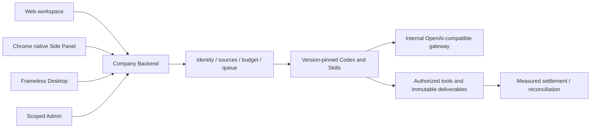

# Workmate · CopyPaste Backend

[English](README.en.md) · [主文档](https://github.com/copypasteltd/workmate/blob/docs/docs/README.md)

[Backend](https://github.com/copypasteltd/workmate/tree/backend) · [Web](https://github.com/copypasteltd/workmate/tree/web) · [Admin Dashboard](https://github.com/copypasteltd/workmate/tree/admin) · [Desktop](https://github.com/copypasteltd/workmate/tree/desktop) · [Chrome Extension](https://github.com/copypasteltd/workmate/tree/extension) · [Delivery](https://github.com/copypasteltd/workmate/tree/delivery)

面向香港企业的云端 Agent 产品。当前仓库负责 **Backend**；当前远程分支为 `backend`.

## 架构与约束

仅使用 Codex，全部 AI 请求经公司内部 OpenAI 兼容服务器。Web、Desktop、扩展和 Admin 共用服务端身份、权限、来源与计费控制。设计沿用 CopyPaste 的品牌素材、色系、字体和中英界面。



## 服务结构与执行逻辑

| 模块 | 代码位置 | 实际职责 |
| --- | --- | --- |
| 身份和企业 | `src/` 身份、成员、会话模块 | 邮箱验证码、Admin MFA、PKCE、企业/项目范围和私有所有者 |
| Agent 执行 | `src/worker.ts`、Codex runtime、`catalog/`、`skills/` | 固定 Codex/技能/模型版本、受控工具、租约、fencing、事件 |
| 任务续接 | `src/paid-task-inputs.ts`、`src/task-tool-reuse.ts` | 完成且明确计量的回合等待资料，恢复原任务/线程，重查来源后复用完成结果 |
| 费用和权益 | billing、wallet、VIP、plan、approval 模块 | HKD 整数微单位、预留、累计结算、人工入账、礼赠、退款、VIP 与额度分离 |
| 创作和分析 | design、video、marketing、SEO 模块 | 图片接口、布局交付、FFmpeg 模板视频、CSV/XLSX、广告指标、连接同步、网站证据 |
| 内容和管理 | Admin、source、erasure 模块 | 分范围元数据/正文权限、隔离、保留期、审计、独立复核和受控擦除 |
| 持久化 | `migrations/`、PostgreSQL、pg-boss、storage | 强制 RLS、幂等事务、不可改写事实、队列、不可变文件版本 |

Web 会话使用 HttpOnly Cookie、Origin 和 CSRF；原生端经浏览器登录、PKCE 与轮换刷新令牌接入。Admin 身份与客户身份分开。所有后台读取和工具使用均重查当前企业、项目、私有范围与来源状态。

模型缺资料时只能描述需求，不能自选资源 ID。已完成且用量明确的回合保留原预算预留；用户明确选择当前获准版本后，新的执行尝试恢复原 Codex 线程。上限为八轮、三十二项依赖；取消结算已知用量，未知结果进入核对。

## 初始化和启动

```powershell
npm ci
npm run setup:local
npm run db:local
```

保留数据库终端，在另一个终端执行：

```powershell
npm run db:migrate
npm run dev
```

完整集成测试需按主文档检出同级 docs/合同及完整工作区；仅检出 backend 时先执行类型检查和编译。

API 为 `http://localhost:4310`，原生 PostgreSQL 为 `127.0.0.1:55432`。`setup:local` 只在缺少配置时生成本地密码和持久 MASTER_KEY；保留原配置和数据库，不用示例文件覆盖。`db:migrate` 准备开发与测试库。迁移使用 owner，应用/控制/队列使用分离身份。

管理员首次登记：`npm run admin:create -- admin@your-company.example super_admin`。将本地 enrolment 文件中的 TOTP 配置导入验证器，按运行说明清理该敏感文件；没有共享默认管理员密码。

## 公司 AI 网关

只在服务器配置 `AI_BASE_URL`、`AI_ALLOWED_HOSTS`、`AI_API_KEY`、`AI_MODEL`、实际 HKD 费率及验证开关。Codex 使用公司 OpenAI 兼容 Responses 接口；Image 2 使用内部 Images 生成/编辑接口。先执行 `npm run codex:probe`，再按文档验收真实工具回合、用量和错误。模拟响应不证明真实模型或费率已验收。

`.env.example` 是无密钥参考。生产还需 HTTPS、SMTP、持久加密密钥、受限出网、存储与备份恢复；本地原生数据库启动器拒绝生产模式。

## 接口与数据

`contracts/implemented-routes.json` 记录实现路由；`contracts/`、`catalog/` 与主文档中的规范 API 各自保留范围。原规范 TaskDTO/任务创建接口仍有未完成内容，路由数量不能代替规范验收。SQL001–091 保持已应用字节；修复追加迁移。

代码工具可读取、按摘要编辑和打包获准代码；不会执行不受信任的客户代码，也不把未执行的测试显示为通过。设计交付包括编辑数据、SVG/PNG 和模板 MP4；AI 视频/语音、全角色独立业务验收另行跟踪。

## 初次检出与环境

新工作副本可单独检出本分支；已有本地仓库直接更新，不重新初始化。

```powershell
git clone --single-branch --branch backend git@github.com:copypasteltd/workmate.git copypaste-platform
cd copypaste-platform
```

Node.js ≥22.14、npm 和 Git；锁文件固定依赖。当前验收环境为 Windows x64。后端/完整交付还需要原生 PostgreSQL 启动资源、固定 Codex `0.163.0-alpha.10.2` 与 FFmpeg/FFprobe。禁止本地 Docker、WSL 和虚拟化。跨端运行使用多个独立工作目录；布局见 [workspace](https://github.com/copypasteltd/workmate/blob/docs/docs/governance/04-git-branches-and-publication.md).

## 检查与验证范围

```powershell
npm run typecheck
npm run build
npm test
```

平台完整 **782/782**、专项 **34/34**，六仓库 **13 项**类型/构建/现有客户端测试检查通过；真实打包程序和原生侧栏旅程 **32 项**。保留所有原 765 项命名测试。实际 Codex 子进程的工具/线程/用量通过模拟内部 API 验证；本次 UI 回合和业务数据按授权模拟。原 102 项需求仍为 81 项局部验证、21 项未证明完成、0 项完整验收，不能把本次截图或测试数量认作完整产品验收。

完整规范 TaskDTO/任务创建、任意执行中暂停、未知外部结果恢复、全角色独立业务、GEO、真实供应商和生产/签名/商店验收仍继续跟踪。

## 实际页面与交互

本服务没有独立用户页面；以下为连接本服务的实际 Web 界面，来源明确保留。

实际录制，保留原捕获时间；AI 回合与业务数据为明确模拟。Admin 演示表单不代表财务提交。


[MP4](assets/screenshots/workmate-06-interaction.mp4) · [录制与源码回执](https://github.com/copypasteltd/workmate/blob/docs/docs/quality/workmate-media-06.json)

## 方案细则与更新

- [Product](https://github.com/copypasteltd/workmate/blob/docs/docs/product/01-prd.md)
- [Architecture](https://github.com/copypasteltd/workmate/blob/docs/docs/technical/01-architecture-and-stack.md)
- [Identity and permissions](https://github.com/copypasteltd/workmate/blob/docs/docs/technical/07-security-and-permissions.md)
- [Task continuation](https://github.com/copypasteltd/workmate/blob/docs/docs/technical/66-paid-native-input-checkpoints.md)
- [Admin](https://github.com/copypasteltd/workmate/blob/docs/docs/product/08-admin-dashboard.md)
- [Native clients](https://github.com/copypasteltd/workmate/blob/docs/docs/technical/30-native-window-and-browser-sidepanel.md)
- [Release notes](https://github.com/copypasteltd/workmate/blob/docs/docs/changes/2026-10-22-workmate-publication.md)

后续修改需要同步中英 README、受影响的实际截图/GIF、更新说明和对应分支。提交后通过 Delivery 发布流程核对远程 SHA；不强推覆盖协作者。`.env`、数据库、会话、依赖和安装产物不进入 Git。历史 README 原字节见 [archive](https://github.com/copypasteltd/workmate/blob/docs/docs/quality/history/stage66-before-workmate-readmes/manifest.json).
