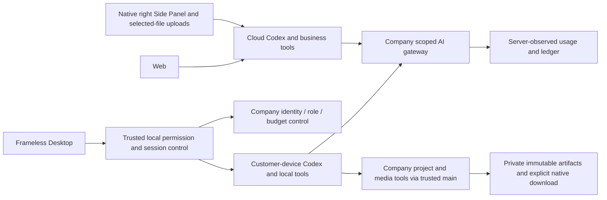
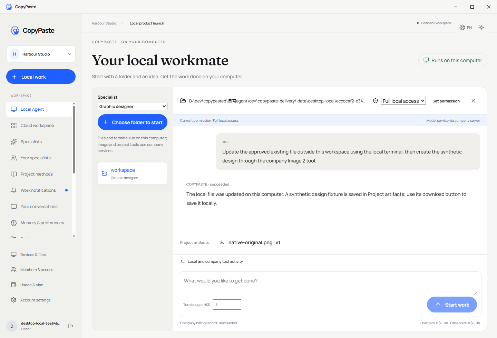
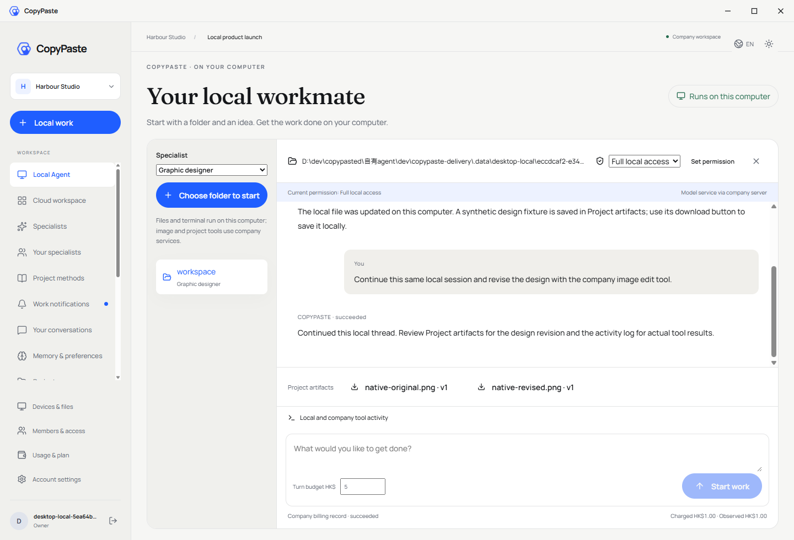
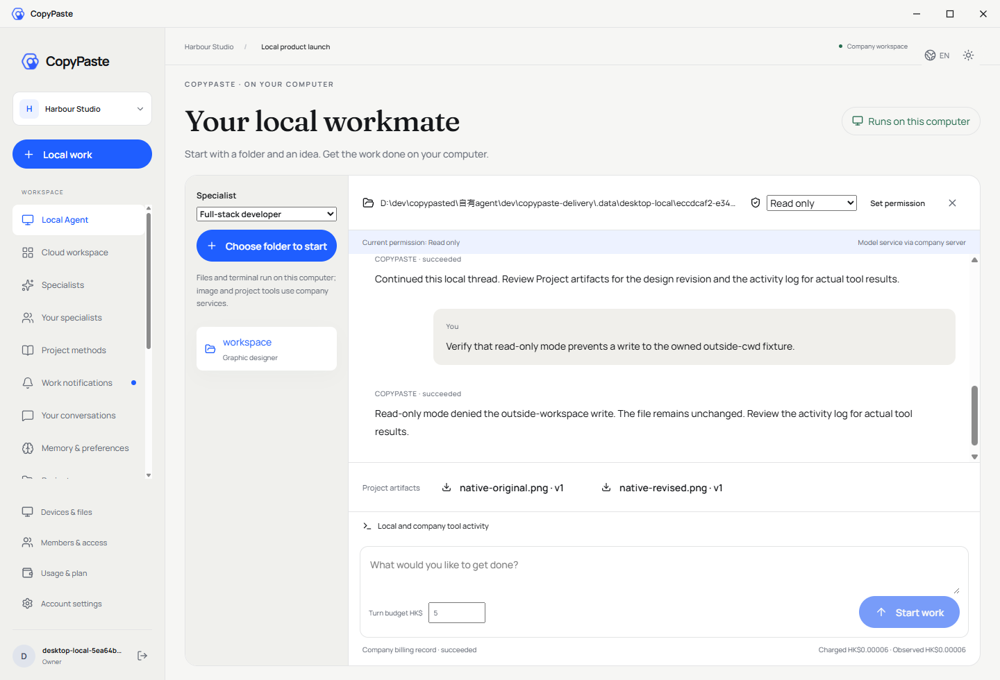
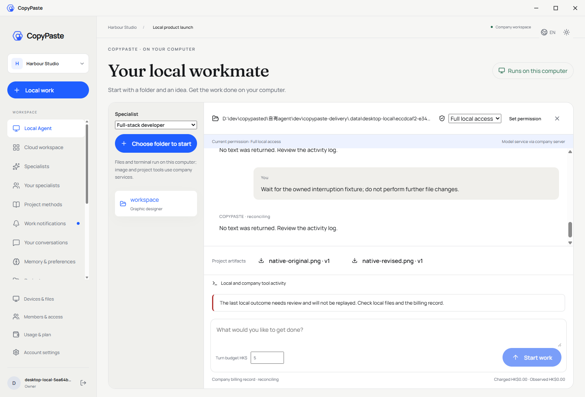
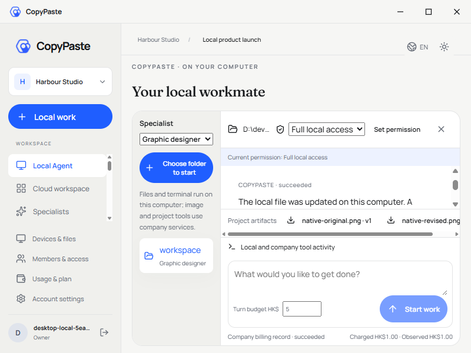
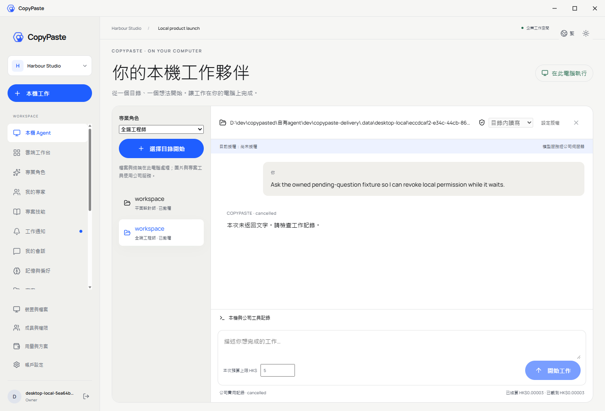
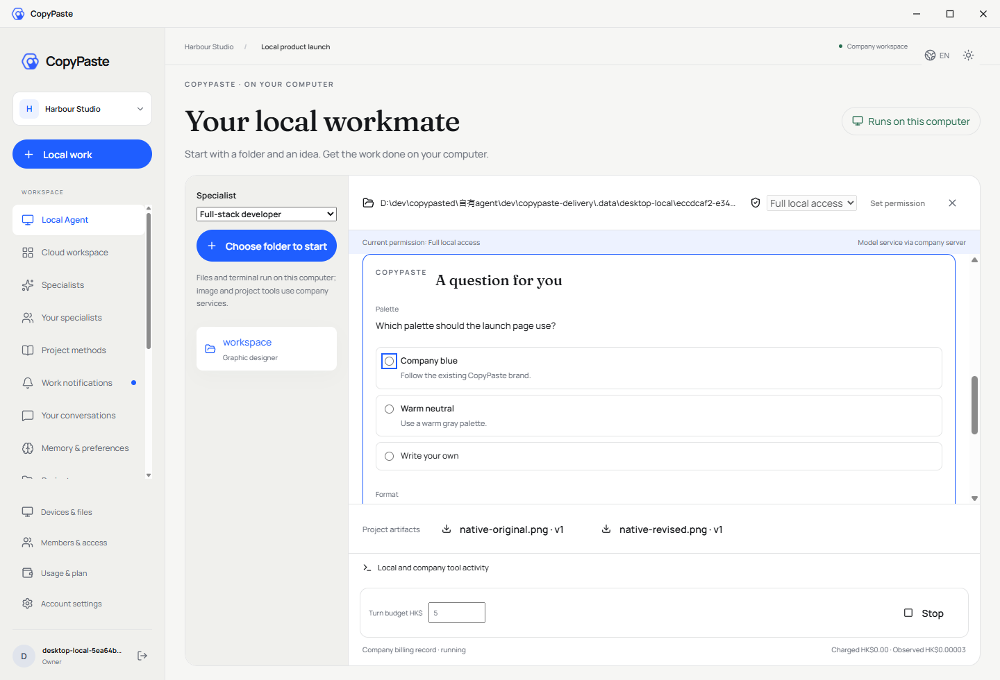
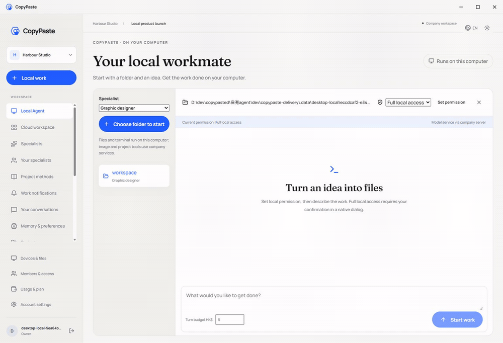

# Workmate · CopyPaste Desktop

[English](README.en.md) · [Documentation](https://github.com/copypasteltd/workmate/blob/docs/docs/README.en.md) · [Desktop branch](https://github.com/copypasteltd/workmate/tree/desktop)

**当前实现：** Desktop 在客户本机运行 Codex，支持明确完整授权、文件/终端、同线程继续和公司工具/费用；现已接通原生追问、选择/自填回答，以及等待时停止和撤权。当前源码通过 47 项客户端测试、17 项真实原生测试和 12 项实际打包 Electron 旅程检查。后端源码未变，沿用阶段 73 的 818 项完整回归范围。16 角色的本机协议接通不等于完整专业验收；视频/流程工具、完整浏览器/应用自动化、18 角色/29 Skill 及生产验收继续跟踪。供应商响应和系统窗口决定明确模拟。Extension 继续使用原生右侧栏云端对话与获选文件上传。见 [实现方案](https://github.com/copypasteltd/workmate/blob/docs/docs/technical/74-desktop-native-user-input.md)、[源码和媒体证据](https://github.com/copypasteltd/workmate/blob/docs/docs/quality/desktop-native-input-checkpoint.json)。

## 产品与执行位置

Windows 无边框本机 Agent。Codex 进程、会话循环、文件和终端工具在客户电脑运行；推理使用公司内部 OpenAI 兼容服务器。Web 与 Chrome Extension 使用云端 Codex；上传文件服务不能替代 Desktop 本机内核。



## 登录与使用流程

1. 启动 Desktop，在固定公司浏览器页面完成邮箱/企业身份与 PKCE 授权，通过 localhost 回调返回，选择企业和项目。
2. 选择已支持本机工具的角色，通过系统目录窗口选择工作目录；选目录本身不授予执行权限。
3. 选择唯读、目录内读写或完整本机权限，在系统对话框确认。完整权限默认取消，明确涵盖当前 OS 用户可访问的工作目录外资源。
4. 输入要求和每轮预算。主进程预留一次预算，取得任务级凭据并启动随包锁定 Codex；查看消息、终端输出、文件变更及公司费用记录。
5. 公司生图、设计与资料工具按当前角色开放；产物显示明确版本，点击下载并在系统窗口选择保存位置。本机文件和命令仍在客户电脑执行。
6. 在同一本机线程继续追问。可停止运行、空闲时调整权限或随时撤权；退出账号撤销本机授权。网络重试不会盲目重跑已接受的本机动作。

公司 Admin 可管理服务、VIP 和费用，但不能代授本机 OS 权限。完整模式为 `danger-full-access` / `never`，授权后不逐命令重复确认，也不会提升系统账号权限。授权持续至撤权/登出，与可选旧文件桥的一小时、仅新建权限相互独立。

## 实现结构与恢复

- `src/main.ts`: 可信身份、系统对话框、IPC 和生命周期。
- `src/local-agent.ts`: 加密会话日志、稳定请求键、归属、授权与结果同步。
- `src/local-codex.ts`: 原生 app-server、固定 Skill、检查点、沙箱、流式事件、中断和自有进程关闭。
- `src/preload.cts` / `renderer/src/local-agent.tsx`: 受限桥与本机界面；凭据和二进制路径不经 IPC 传给页面。
- `src/window-controls.ts`: 40px 自绘标题栏；`frame:false`、`thickFrame:false`，无 Electron/Alt 菜单。

每个本机回合有不可变的 desktop 执行归属。Desktop 原生登录不能入队云端 Agent 任务；尚不支持的本机工具需要明确前往 Web。操作结果标记为客户设备上报，费用只用公司服务端观测。结算响应丢失只重传结果；未知操作、租约过期或缺少 usage 保留待核对预留，禁止自动重跑。

开启 contextIsolation/sandbox，关闭 nodeIntegration。通用页面 API 禁止原生执行/推理接口及编码别名。本机日志加密并绑定账号、登录 epoch、企业和项目；登出停止自有运行时，同账号页面刷新可恢复历史。禁止 Docker/WSL/虚拟机、PATH 回退与替代内核。

## 检出、配置与启动

```powershell
git clone --single-branch --branch desktop git@github.com:copypasteltd/workmate.git copypaste-desktop
cd copypaste-desktop
npm ci
$env:COPYPASTE_LOCAL_CODEX_BIN = 'D:\approved-runtime\codex.exe'
npm run runtime:prepare
npm run build
npm start
```

使用 Windows x64、Node.js ≥22.14 和 `contracts/local-codex-runtime.json` 指定的版本/摘要（`0.163.0-alpha.11`）。上述路径为显式示例，需提供已批准的二进制及相邻原生辅助程序。准备脚本验证版本/摘要，将原生资源写入忽略的 `.data/runtime/windows-x64` 并生成清单；不下载、不搜索 PATH。云端运行时有独立版本锁。

通过 `deployment.json` 或 `COPYPASTE_API_ORIGIN`、`COPYPASTE_WEB_ORIGIN`、`COPYPASTE_EXTENSION_ID` 配置公司入口和扩展 ID；生产需公司 HTTPS。供应商主密钥保留服务器。后端按原生迁移流程应用 092。

```powershell
npm run typecheck
npm test
$env:COPYPASTE_LOCAL_CODEX_TEST_BIN = $env:COPYPASTE_LOCAL_CODEX_BIN
npm run test:local
npm run package:dir
npm run package
```

打包把 Codex 及辅助程序放入 `resources/local-codex`。`package` 在忽略的 `release/` 生成 NSIS Setup 与 Portable；当前自动化证据验证的是独立未签名 unpacked 候选程序，确切路径/ASAR/原生摘要见检查点。签名、人工安装/升级/卸载和真实供应商资格仍待验收，不把本地凭据或状态提交 Git。

原生界面在本仓库独立维护、独立构建；`renderer:sync` 拒绝用 Web 快照覆盖。共享变更需显式合并，再运行 `node scripts/record-renderer.mjs` 记录实际源码摘要。

## 当前实际页面与交互

实际打包 Electron 与真实原生 Codex；身份、数据库、本机文件、沙箱和账本真实运行。模型/图片响应、系统选目录/授权/保存决定为明确测试夹具，不等同人工点击或正式供应商验收。


















[MP4](assets/screenshots/workmate-local-12-local-agent.mp4) · [Source and capture checkpoint](https://github.com/copypasteltd/workmate/blob/docs/docs/quality/desktop-native-input-checkpoint.json) · [Design and recovery](https://github.com/copypasteltd/workmate/blob/docs/docs/technical/74-desktop-native-user-input.md)

## 覆盖与剩余范围

16 个角色接通软件开发、页面、图像/品牌/电商/社交/插画/排版/简报/资讯设计及营销分析的本机协议；准入及 Skill 摘要验证不等同完整专业工作流验收。video-motion、workflow-consultant 的本机工具仍待接通。产品 18 角色及 29 Skill 目标全部保留；完整本机媒体/设计/营销、应用与浏览器自动化继续逐项接入验证；原生追问已按阶段 74 的当前源码检查点验证。旧 802 项平台完整回归和云端/文件桥录屏只覆盖当时源码。原 102 REQ/102 TC、NFR、G01–G10 仍为 81 项局部验证、21 项未证明、0 项完整验收。

可选 Native Messaging 文件桥继续独立存在，不授予完整 Agent 权限，也不是 Extension 选文件上传/云端对话的前置。使用浏览器后关闭本任务不再需要的页面，保留用户标签页。

[更新说明](https://github.com/copypasteltd/workmate/blob/docs/docs/changes/2026-10-23-desktop-company-tools.md) · [Repository and branch policy](https://github.com/copypasteltd/workmate/blob/docs/docs/governance/04-git-branches-and-publication.md) · [Requirements](https://github.com/copypasteltd/workmate/blob/docs/docs/requirements/03-client-execution-amendment.md)

后续同步中英 README、受影响截图/GIF 和更新说明，提交并推送对应分支，核对远程 SHA，不强推。本地状态、依赖、原生二进制及安装器保持忽略。

## 本机公司工具契约

Agent 循环保持在客户电脑。主进程为锁定的原生运行时注册可信 `copypaste` 动态工具，绑定任务、调用、线程及回合，在效果前及返回前重验公司权限。本机唯读拒绝公司写入；原生 schema 投影不替代原始业务参数验证。同一调用重试复用持久结果，已接受而未知的图片操作阻断后续调用并保留费用核对。私有产物按明确版本下载，保存目标由系统窗口选择。

本次公司工具更新：[更新说明](https://github.com/copypasteltd/workmate/blob/docs/docs/changes/2026-10-23-desktop-company-tools.md) · [源码检查点](https://github.com/copypasteltd/workmate/blob/docs/docs/quality/desktop-company-tools-checkpoint.json)；较早回执和媒体保持原始源码范围。

## 本机追问与继续工作

问题出现在本机对话中，选项不预选。完整回答后点击 **回答并继续**，沿用原任务、原线程、原回合和原预留。刷新页面保留仍在等待的问题；停止、撤权、登出和关闭清除等待，旧回答和重复提交被拒绝。问题/答案字段只作主进程临时状态，但提交内容仍会进入 Codex 本机记录和公司模型上下文。最小窗口等待时收起不可用输入框和大标题，给问题留出空间；固定停止和预算仍可访问。

受限 `answer` IPC 只传会话 id、一次性问题 id 和校验后的答案。`src/local-input.ts` 负责有界协议，`local-codex.ts` 保证人工等待不阻塞事件队列，`local-agent.ts` 在交付前重验归属、权限和公司执行状态。

阶段 74 本机追问更新：[更新说明](https://github.com/copypasteltd/workmate/blob/docs/docs/changes/2026-10-23-desktop-native-input.md) · [当前源码检查点](https://github.com/copypasteltd/workmate/blob/docs/docs/quality/desktop-native-input-checkpoint.json)。较早报告及媒体保留原始源码范围。

验收后刷新未打包的界面源码摘要索引；其他覆盖源码和实际程序包未变，见[独立元数据核对](https://github.com/copypasteltd/workmate/blob/docs/docs/quality/desktop-native-input-renderer-manifest-01.json)，不增加原生/UI 测试计数。
