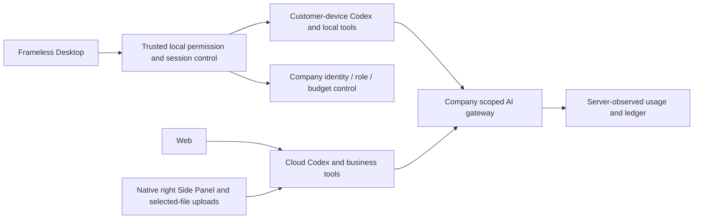
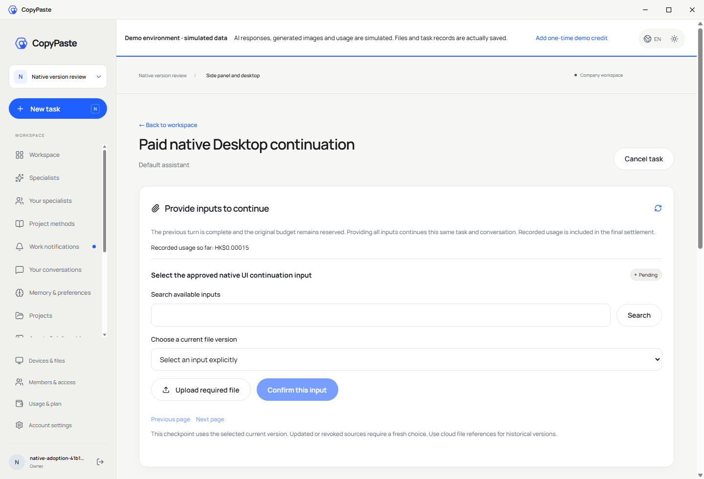
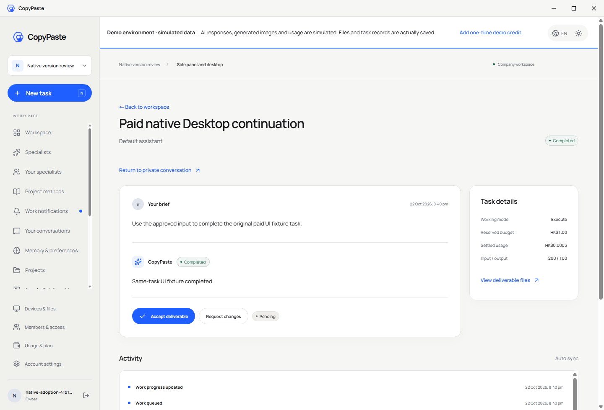
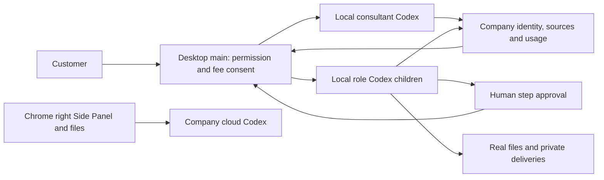

# Workmate · CopyPaste Backend

[English](README.en.md) · [主文档](https://github.com/copypasteltd/workmate/blob/docs/docs/README.md)

[Backend](https://github.com/copypasteltd/workmate/tree/backend) · [Web](https://github.com/copypasteltd/workmate/tree/web) · [Admin Dashboard](https://github.com/copypasteltd/workmate/tree/admin) · [Desktop](https://github.com/copypasteltd/workmate/tree/desktop) · [Chrome Extension](https://github.com/copypasteltd/workmate/tree/extension) · [Delivery](https://github.com/copypasteltd/workmate/tree/delivery)

面向香港企业的云端 Agent 产品。当前仓库负责 **Backend**；当前远程分支为 `backend`.

<!-- client01-direction -->
## 当前客户端方向与实现差异

CLIENT01（2026-10-22）要求 **Desktop 在客户本机运行 Codex Agent**，提供客户可主动授予的 **完整本机权限**，操作能力对标 Codex Desktop。**Extension 在 Chrome 原生右侧栏采用 ChatGPT 式对话/附件结构**，获取、读取用户获选文件并上传，由云端 Codex 执行。全部产品 AI 请求仍走公司内部网关。

**当前实现：** Desktop 在客户本机运行 Codex，提供明确完整授权、本机文件/终端、同线程继续、原生追问及公司图片/设计/视频工具。流程顾问现可使用不可变私有流程、追加子步骤费用确认、人工逐步审批和真实本机角色子 Codex；支持真实 SOP/JSON/恢复说明下载、Stop/撤权及内容来源治理。当前验证为平台 848 项、重叠定向 75 项、真实父子流程 3 项、本机内核回归 17 项、客户端 56 项和实际打包旅程 19 项；这些范围分别报告，不相加。18 个角色已通过本机协议准入，全部 18 角色/29 Skill 的完整专业交付、浏览器/第三方应用操作与 Codex Desktop 全面能力对齐、真实模型及生产验收继续跟踪。模型响应与系统窗口决定明确模拟。Extension 保持 ChatGPT 式原生右侧栏、获选文件读取上传和云端 Agent，无需 Desktop；本轮未重新执行 Extension UI。见 [实现方案](https://github.com/copypasteltd/workmate/blob/docs/docs/technical/76-desktop-native-workflows.md)、[源码与媒体检查点](https://github.com/copypasteltd/workmate/blob/docs/docs/quality/desktop-workflow-checkpoint.json)。

Desktop 在客户本机运行 Codex；Web 和 Extension 由公司云端执行。下方架构图按这一执行边界呈现。

本机 supervisor 的实现及历史原生权限测试见 [技术说明](https://github.com/copypasteltd/workmate/blob/docs/docs/technical/70-desktop-native-codex-supervisor.md)。

<!-- /client01-direction -->

## 架构与约束

仅使用 Codex，全部 AI 请求经公司内部 OpenAI 兼容服务器。Web、Desktop、扩展和 Admin 共用服务端身份、权限、来源与计费控制。设计沿用 CopyPaste 的品牌素材、色系、字体和中英界面。



## 服务结构与执行逻辑

| 模块 | 代码位置 | 实际职责 |
| --- | --- | --- |
| 身份和企业 | `src/` 身份、成员、会话模块 | 邮箱验证码、Admin MFA、PKCE、企业/项目范围和私有所有者 |
| Agent 执行 | `src/worker.ts`、Codex runtime、`catalog/`、`skills/` | 固定 Codex/技能/模型版本、受控工具、租约、fencing、事件 |
| 任务续接 | `src/paid-task-inputs.ts`、`src/task-tool-reuse.ts` | 完成且明确计量的回合等待资料，恢复原任务/线程，重查来源后复用完成结果 |
| 费用和权益 | billing、wallet、VIP、plan、approval 模块 | HKD 整数微单位、预留、累计结算、人工入账、礼赠、退款、VIP 与额度分离 |
| 创作和分析 | design、video、marketing、SEO 模块 | 图片接口、布局交付、FFmpeg 模板视频、CSV/XLSX、广告指标、连接同步、网站证据 |
| 内容和管理 | Admin、source、erasure 模块 | 分范围元数据/正文权限、隔离、保留期、审计、独立复核和受控擦除 |
| 持久化 | `migrations/`、PostgreSQL、pg-boss、storage | 强制 RLS、幂等事务、不可改写事实、队列、不可变文件版本 |

Web 会话使用 HttpOnly Cookie、Origin 和 CSRF；原生端经浏览器登录、PKCE 与轮换刷新令牌接入。Admin 身份与客户身份分开。所有后台读取和工具使用均重查当前企业、项目、私有范围与来源状态。

模型缺资料时只能描述需求，不能自选资源 ID。已完成且用量明确的回合保留原预算预留；用户明确选择当前获准版本后，新的执行尝试恢复原 Codex 线程。上限为八轮、三十二项依赖；取消结算已知用量，未知结果进入核对。

## 初始化和启动

```powershell
npm ci
npm run setup:local
npm run db:local
```

保留数据库终端，在另一个终端执行：

```powershell
npm run db:migrate
npm run dev
```

完整集成测试需按主文档检出同级 docs/合同及完整工作区；仅检出 backend 时先执行类型检查和编译。

API 为 `http://localhost:4310`，原生 PostgreSQL 为 `127.0.0.1:55432`。`setup:local` 只在缺少配置时生成本地密码和持久 MASTER_KEY；保留原配置和数据库，不用示例文件覆盖。`db:migrate` 准备开发与测试库。迁移使用 owner，应用/控制/队列使用分离身份。

管理员首次登记：`npm run admin:create -- admin@your-company.example super_admin`。将本地 enrolment 文件中的 TOTP 配置导入验证器，按运行说明清理该敏感文件；没有共享默认管理员密码。

## 公司 AI 网关

只在服务器配置 `AI_BASE_URL`、`AI_ALLOWED_HOSTS`、`AI_API_KEY`、`AI_MODEL`、实际 HKD 费率及验证开关。Codex 使用公司 OpenAI 兼容 Responses 接口；Image 2 使用内部 Images 生成/编辑接口。先执行 `npm run codex:probe`，再按文档验收真实工具回合、用量和错误。模拟响应不证明真实模型或费率已验收。

`.env.example` 是无密钥参考。生产还需 HTTPS、SMTP、持久加密密钥、受限出网、存储与备份恢复；本地原生数据库启动器拒绝生产模式。

## 接口与数据

`contracts/implemented-routes.json` 记录实现路由；`contracts/`、`catalog/` 与主文档中的规范 API 各自保留范围。原规范 TaskDTO/任务创建接口仍有未完成内容，路由数量不能代替规范验收。SQL001–091 保持已应用字节；修复追加迁移。

代码工具可读取、按摘要编辑和打包获准代码；不会执行不受信任的客户代码，也不把未执行的测试显示为通过。设计交付包括编辑数据、SVG/PNG 和模板 MP4；AI 视频/语音、全角色独立业务验收另行跟踪。

## 统一任务 API 使用顺序

1. 登录并选择企业和项目，安装一个实际专家，取得 agent_id；Web 写请求使用当前 Cookie 和 CSRF，原生请求使用当前 PKCE 凭证。
2. 发送 POST /v1/tasks，携带 X-Tenant-ID 和独立 Idempotency-Key。budget 为 `{"currency":"HKD","amount_micros":"1000000"}`，表示 HKD 1；请求另含 project_id、agent_id、`type:"delegation"` 和 `input:{"prompt":"具体工作要求"}`。
3. 202 返回 task_id、status、version 和 Location。轮询 Location 得到白名单 Task，或订阅原持久 SSE；交付物从原资产接口读取。
4. 控制请求使用最新 expected_version 和独立请求键，action 为 cancel 或当前可用检查点的 pause / resume。请求重放返回当前资源，不复活旧状态。
5. needs_input 时读取 pending_input_fields，按任务依赖的候选资源选择版本；POST inputs 的 answers 为 `{"input-1":{"resource_ids":["实际版本 UUID"]}}`。整批验证通过后才修改状态，继续保留原任务、原线程及原预算。

专用创作/分析/SEO/流程/设备参数与 retry 尚未在此统一创建/控制入口全面接入，明确报错；使用已有专用业务入口。未保留专家身份的历史任务使用原项目接口，不补造执行身份。运行中的暂停和未知动作核对恢复仍待实现。

## 初次检出与环境

新工作副本可单独检出本分支；已有本地仓库直接更新，不重新初始化。

```powershell
git clone --single-branch --branch backend git@github.com:copypasteltd/workmate.git copypaste-platform
cd copypaste-platform
```

Node.js ≥22.14、npm 和 Git；锁文件固定依赖。当前验收环境为 Windows x64。后端/完整交付还需要原生 PostgreSQL 启动资源、云端锁定 Codex `0.163.0-alpha.10.2` 与 FFmpeg/FFprobe；Desktop 独立锁定 `0.163.0-alpha.11`，以其运行时清单为准。禁止本地 Docker、WSL 和虚拟化。跨端运行使用多个独立工作目录；布局见 [workspace](https://github.com/copypasteltd/workmate/blob/docs/docs/governance/04-git-branches-and-publication.md).

## 检查与验证范围

```powershell
npm run typecheck
npm run build
npm test
```

历史源码的平台完整 **802/802**、任务专项 **52/52**，六仓库 **13 项**类型/构建/既有客户端测试检查、真实打包程序和原生侧栏旅程 **32 项**通过。保留原 782 项命名回归测试。任务专项调用实际 PostgreSQL、身份、账本与 Worker；另有实际 Codex 子进程连接模拟内部网关的续接验证。UI 回合及业务数据按授权模拟。原 102 项需求仍为 81 项局部验证、21 项未证明完成、0 项完整验收。

完整规范 TaskDTO/任务创建、任意执行中暂停、未知外部结果恢复、全角色独立业务、GEO、真实供应商和生产/签名/商店验收仍继续跟踪。

本次同步补充统一任务接口和原任务输入事务。当前用户界面继续通过既有项目/会话接口使用同一执行域；下方重新录制的实际交互验证该流程的兼容性，并非声称界面已经切换到全部规范任务接口。接口边界、精确金额、幂等回执、来源撤销和未接入业务参数见 [方案细则](https://github.com/copypasteltd/workmate/blob/docs/docs/technical/68-canonical-task-contracts-and-input-transactions.md)。

## 实际页面与交互

本服务没有独立用户页面；以下为连接本服务的实际 Web 界面，来源明确保留。

实际录制，保留原捕获时间；AI 回合与业务数据为明确模拟。Admin 演示表单不代表财务提交。






[MP4](assets/screenshots/workmate-10-interaction.mp4) · [录制与源码回执](https://github.com/copypasteltd/workmate/blob/docs/docs/quality/workmate-media-10.json)

## 方案细则与更新

- [Product](https://github.com/copypasteltd/workmate/blob/docs/docs/product/01-prd.md)
- [Architecture](https://github.com/copypasteltd/workmate/blob/docs/docs/technical/01-architecture-and-stack.md)
- [Identity and permissions](https://github.com/copypasteltd/workmate/blob/docs/docs/technical/07-security-and-permissions.md)
- [Task continuation](https://github.com/copypasteltd/workmate/blob/docs/docs/technical/66-paid-native-input-checkpoints.md)
- [Admin](https://github.com/copypasteltd/workmate/blob/docs/docs/product/08-admin-dashboard.md)
- [Native clients](https://github.com/copypasteltd/workmate/blob/docs/docs/technical/30-native-window-and-browser-sidepanel.md)
- [Canonical task update](https://github.com/copypasteltd/workmate/blob/docs/docs/changes/2026-10-22-canonical-task-repair.md)
- [Local Codex update](https://github.com/copypasteltd/workmate/blob/docs/docs/changes/2026-10-22-native-codex-supervisor.md)

后续修改需要同步中英 README、受影响的实际截图/GIF、更新说明和对应分支。提交后通过 Delivery 发布流程核对远程 SHA；不强推覆盖协作者。`.env`、数据库、会话、依赖和安装产物不进入 Git。历史 README 原字节见 [archive](https://github.com/copypasteltd/workmate/blob/docs/docs/quality/history/stage66-before-workmate-readmes/manifest.json).

阶段 73 Desktop 本机执行：[具体方案](https://github.com/copypasteltd/workmate/blob/docs/docs/technical/73-desktop-native-company-tools.md) · [源码与真实旅程证据](https://github.com/copypasteltd/workmate/blob/docs/docs/quality/desktop-company-tools-checkpoint.json)；既有媒体保持原始源码范围。

## Desktop 本机执行准入

迁移 092 固定 cloud/desktop 执行归属；只有 Desktop 原生登录 family 可创建/开始/续租/上报本机执行，Web/Extension/Admin 不能代授 OS 权限。创建仍复用角色/Skill、原价和费用预留；本机任务不入云队列。原生 scoped Responses 在准入/派发重验身份、归属、租约、能力及服务端预算，拒绝未知/托管工具。完成先封锁推理，再关闭上游，仅按公司观测结算；未知本机/供应商结果保留待核对预留。严格路由、RLS、幂等和恢复见上方方案。

## 本机公司工具契约

Agent 循环保持在客户电脑。主进程为锁定的原生运行时注册可信 `copypaste` 动态工具，绑定任务、调用、线程及回合，在效果前及返回前重验公司权限。本机唯读拒绝公司写入；原生 schema 投影不替代原始业务参数验证。同一调用重试复用持久结果，已接受而未知的图片操作阻断后续调用并保留费用核对。私有产物按明确版本下载，保存目标由系统窗口选择。

阶段 73 公司工具历史更新：[更新说明](https://github.com/copypasteltd/workmate/blob/docs/docs/changes/2026-10-23-desktop-company-tools.md) · [源码检查点](https://github.com/copypasteltd/workmate/blob/docs/docs/quality/desktop-company-tools-checkpoint.json)；较早回执和媒体保持原始源码范围。

阶段 74 本机追问更新：[更新说明](https://github.com/copypasteltd/workmate/blob/docs/docs/changes/2026-10-23-desktop-native-input.md) · [当前源码检查点](https://github.com/copypasteltd/workmate/blob/docs/docs/quality/desktop-native-input-checkpoint.json)。较早报告及媒体保留原始源码范围。

阶段 75 私有视频更新：[更新说明](https://github.com/copypasteltd/workmate/blob/docs/docs/changes/2026-10-23-desktop-private-video.md) · [当前检查点](https://github.com/copypasteltd/workmate/blob/docs/docs/quality/desktop-video-checkpoint.json)。旧报告保留原始源码范围，平台/本机主进程验证与后续界面验证明确记录。

<!-- desktop-native-workflow-stage76 -->

## 本机流程与核查

选择「流程顾问」、本机目录并明确授予所需本机权限。描述要求并确认冻结的流程步骤；执行前另行查看每个子角色的预算和合计，批准具体版本后才预留费用、启动本机子 Codex。遇到人工审批步骤须再次明确批准，之后才运行下一角色。查看真实本机文件、私有 SOP/流程 JSON/恢复说明下载与公司用量记录；顾问对话及未完成步骤分别计费。Stop 或撤权会终止本机父子进程；已受理但结果未知的操作保留待对账状态，不会自动重放。

首个子集支持最多八步的顺序本机 Codex、人工审批及广告汇总。每个子角色使用独立的 Skills、公司工具和推理凭据，沿用客户当前明确授予的目录及本机权限。完整本机权限不扩大公司的客户数据、项目权限或预算；云端 Worker 与定时任务不能接管本机流程。每个流程版本从真实读取账本冻结外部来源，复用到新会话及派生 SOP 时仍保留；旧创建任务删除不会替代外部来源的有效性判断。来源停用同时约束首次读取、缓存、子任务启动和私有或明确发布的衍生成果；管理员继续遵守权限、MFA、原因及审计控制。关闭应用也会阻止仍等待日志落盘的请求稍后启动。

当前平台完整清单为 65 个实际测试文件、17 个完整批次、848 项通过，保留阶段 75 全部 830 项回归。SQL001–093 未改写；SQL094 增加本机流程来源与不可变版本。实际 428 条接口清单保留此前全部 415 条。原 102 REQ/102 TC、NFR 和 G01–G10 维持 81 项部分验证 / 21 项未证明 / 0 项完整验收；旧证据及媒体仅证明其原始源码。




[设计与生命周期](https://github.com/copypasteltd/workmate/blob/docs/docs/technical/76-desktop-native-workflows.md) · [绑定证据](https://github.com/copypasteltd/workmate/blob/docs/docs/quality/desktop-workflow-checkpoint.json) · [更新说明](https://github.com/copypasteltd/workmate/blob/docs/docs/changes/2026-10-23-desktop-native-workflows.md)
