# CopyPaste Platform

## 营销账户同步与三端入口（阶段 61）

「连接应用」支持 Google Ads、Meta Ads、Google Analytics 4 和 Search Console。点击供应商、完成明确标识的模拟授权，等待账户/属性/站点发现完成后，选择获准账户及可使用快照的项目。确认范围、选择日期，再明确创建快照。页面显示持久分页、错误、限流后的下一次重试时间和不可变历史；排队/执行中可取消，失败重试创建新的关联作业。

当前按用户要求使用假数据：供应商夹具仅在非生产回环开发模式启用，执行实际 HTTP、OAuth state、Google S256 PKCE 和分页；界面、快照与来源均标记模拟。它没有取得真实广告或网站账户。配置正式接入前，须单独核对供应商应用资格、实际账户权限、版本和报表口径。所有 AI 调用仍经公司内部 OpenAI 兼容服务，Agent 内核仅 Codex。

账户只能选自授权目录；Google 经理账户、GA4 reporting identity/时区、GSC 站点权限与 Meta 广告读取范围保留。快照分别记录抓取时间、日期/粒度、账户币种、查询摘要和覆盖限制；未提供的数据截止时间或指标保持未知。Meta 重叠购买类型不相加，GA4 流量与事件保持独立粒度，GSC 分页完成不表示覆盖所有明细。查看事实或下载真正的 JSON/CSV；Google/Meta 的规范化分析数据集保持到不可变源资产的关联。

普通账户目录和历史使用有界分页，选择范围采用版本检查。撤销清除凭证、取消未完成作业并阻止迟到发布，已发布快照继续受原项目权限、保留期和内容治理控制。Admin 可按授权企业/项目查看连接与同步元数据；正文读取与撤销独立授权，撤销要求新鲜 MFA 并返回可审计的持久操作，不暴露 token。源隔离/过期/删除同步限制分析、下载和分享；物理删除保留不含正文的历史凭证。

Desktop 使用**无边框、自绘拖动区和最小化/最大化/关闭按钮**，无系统边框、Electron 默认菜单或 Alt 菜单。供应商授权只经固定公司网页在浏览器完成，再回到本地工作台；受保护 JSON 通过当前会话桥接与原生保存窗口下载。Extension 点击工具栏打开/收起 **Chrome 原生 Side Panel**，默认右侧并遵循 Chrome 用户偏好；侧栏的「营销账户与同步」仅打开固定公司工作台，不接受任意外部网址。

验证：专项 **39/39** 纳入完整平台 **674/674**，保留原全部 638 项命名测试；实际 Web/Admin **17 项**、新打包原生端 **16 项**通过。独立测试：web 8, admin 3, desktop 27, extension 21, delivery 12。两库原生 SQL071→077 保留 157 张原公共表的全部行摘要及 SQL001–071；七张新增表强制 RLS，旧连接只补目录，不补账户/项目权限或业务历史。

当前预览：Desktop `release/connectors-61/`，Extension `release/connectors-61/CopyPaste-0.5.0-sidepanel.zip`。实际执行了 unpacked 程序；Setup/Portable 未签名且未执行安装验收，仍使用 localhost 配置。原始 102 项及 TC/NFR/G01–G10、完整专业角色和生产验收条件全部保留。下方较早阶段的回执与截图保留原执行范围。

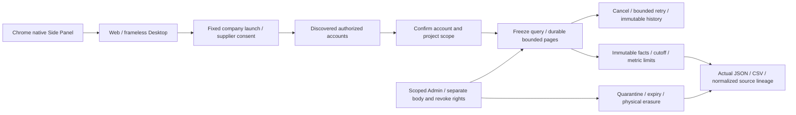


## 模板视频与当前客户端（阶段 60）

在「设计画布 → 影片制作」创建工程，分别填写脚本、分镜、品牌、字幕及项目共享 PNG 的固定版本。可选固定 WAV/MP3，填写音轨入点、增益和自有/已授权声明。保存工程后明确点击渲染，再播放或下载 MP4、工程 JSON、脚本、分镜、WebVTT 和媒体检测六类文件；修改追加版本，失败保留记录并由用户明确重试，排队和执行中均可取消。

`campaign-cuts-1` 支持 3–60 秒、24/25/30/30000÷1001 fps 和偶数尺寸 256–1920 px，受总像素帧预算约束。以整数帧保存时间线，原生 FFmpeg 编码 H.264/yuv420p 与 AAC/48 kHz，验证实际帧数、时长、解码及音量。固定 Noto Sans TC 字体保留 OFL、来源提交和完整 SHA；缺字、文字溢出、缺失/隔离/过期素材、过短音轨明确失败。编码器指纹是版本输出摘要，工程导出引用源素材，重做需要原项目固定版本和一致环境，不保证跨环境逐字节相同。

新渲染队列拥有独立版本、租约、并发额度、取消与最终发布校验。Admin 继续分别控制企业/项目范围、正文查看、隔离、恢复与删除。分享及普通下载都重验派生来源；删除清理实际对象和正文副本。原生合成不调用 AI，AI HK$0 只描述本次合成，原素材费用另计。

R16 视频角色以新预设 v1.1.0 开放已实现的 `video.render` 合成工具，执行模式中的受控 Codex 工具可幂等提交工程与排队；只读、计划及私有会话不暴露共享写入工具。新增第 29 个预设 Skill `template-video-composition`，原 28 个包和 18 个角色的完整验收条件保留，旧角色版本不自动改写。生成式视频、特效、TTS/ASR 和完整专业角色仍按独立需求跟踪。

专项 **34/34** 纳入完整平台 **638/638**，保留原全部 607 项命名测试；实际 Web **10 项**、新打包原生流程 **17 项**通过。Web 8、Desktop 25、Extension 21、Delivery 12 项独立测试通过。两库 069→071 保留 154 张原公共表全部行摘要及 SQL001–069，新三表强制 RLS。

Desktop 无系统边框、Electron 默认菜单或 Alt 菜单，使用自绘窗口控制；受保护成片通过现有登录桥接在本地播放器打开。Extension 工具栏仍打开/收起 Chrome 原生 Side Panel，默认右侧并遵循 Chrome 用户偏好；新增视频工作台入口。当前预览位于 Desktop `release/video-60/` 和 Extension `release/video-60/CopyPaste-0.5.0-sidepanel.zip`。实际执行 unpacked 程序；安装器/便携版未签名、未执行安装验收，使用 localhost 后端。原始 102 项及 TC/NFR/G01–G10 的综合验收条件保留。

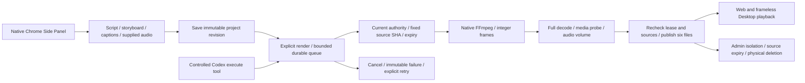


## 批量设计与当前客户端（阶段 59）

设计画布新增按创意 × 语言 × 尺寸建立的交付矩阵，每批最多 60 格。提供繁中/英文文案、同项目固定 PNG 和默认或自订尺寸；每种尺寸重新布局，保存实际 PNG、SVG 与 JSON 编辑描述。修改、重试、失败和输出历史均按单元独立保存。排版本身不调用 AI，费用来源明确为本地合成、AI HK$0，不包含已有素材的上游费用。

领取与发布分别检查当前权限、输入修订和素材；取消、撤权及过期租约阻止迟到输出。后台原正文权限和企业/项目范围继续适用；源图隔离阻止派生文件读取，删除会物理清理所有嵌入副本。SVG 引用服务器字体，本阶段不分发或宣称完成自订字体商用授权。

专项 **22/22** 包含于完整平台 **607/607**，保留全部原 588 项命名测试；实际 Web **10 项**及新打包客户端 **13 项**流程通过。Web 8、Desktop 25、Extension 21、交付工具 12 项独立单元测试通过。两库 068→069 各保留 151 张原公共表全部行摘要及 SQL001–068，新三表强制 RLS。

Desktop 保留无边框、自绘窗口控制和无 Electron 默认菜单；扩展工具栏打开原生 Side Panel，再次点击收起。侧栏提供批量设计入口，完整画布在公司工作台打开。当前预览路径为 Desktop `release/matrices-59-02/`、Extension `release/matrices-59-02/CopyPaste-0.5.0-sidepanel.zip`；旧包不覆盖。安装器和便携版未签名、未进行安装或商店发行验收，使用 localhost 后端。全部其他专业业务、实网服务、完整 102 项及 TC/NFR/G01–G10 继续独立跟踪。

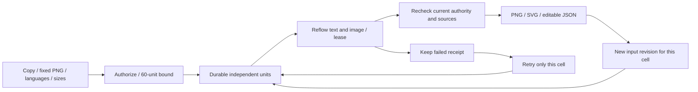


## 调用管理后台（阶段 58）

Admin 的“调用管理”提供策略草稿与独立发布、逐请求筛选和费用字段授权、不可变人工证据及下载、费用确认、容量释放和原任务结算。费用、容量及客户扣费分别执行，保留原始未知观测；实际费率从任务冻结版本推导，不接受客户端填写结算额。平台输入计数费用不转入客户钱包。现有任意金额核账不能绕过逐请求记录。

专项 **158/158** 包含于完整 **588/588**，保留阶段 57 全部 559 个命名测试；753 份平台来源与实际类型检查、构建一致。实际构建版 Admin 浏览器通过 **10 项流程、29 份严格响应样本**，覆盖真实邮箱/TOTP 登录、另一管理员审批、独立费用/容量、一次结算、权限隐藏、中英文、深色和窄屏。模拟 AI 来源明确标识；所有自建浏览器及服务均已关闭。

两套现有原生数据库完成 067→068，各保留 144 张原公共表完整行摘要、SQL001–067 与历史校验值。七张新表强制 RLS，不自动新增既有管理员权限、政策发布、证据或费用。完整原始 102 项、TC/NFR/G01–G10、真实模型资格和发行验收继续跟踪；以下旧章节保留各自历史范围。

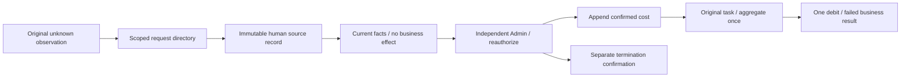

### 既有管理员显式启用

在 Platform 仓库使用受控运维身份，先预览指定的已启用且完成 MFA 的全局超级管理员：

```powershell
node --env-file=.env --import tsx scripts/admin-enable-provider-control.ts --principal PRINCIPAL_UUID --reason "指定调用管理负责人"
node --env-file=.env --import tsx scripts/admin-enable-provider-control.ts --principal PRINCIPAL_UUID --reason "指定调用管理负责人" --apply --expected-hash PREVIEW_SHA256
```

第二条必须使用第一次的完整摘要及相同原因；目标权限或数据库变化时重新预览。启用会撤销旧会话，管理员须重新完成邮箱/TOTP 登录。至少分别启用两位管理员才能执行独立审批；该命令不会自行选择或扩大既有角色。不要将 `.env` 或摘要前后的身份配置提交到仓库。

## 逐调用预算（阶段 57）

文本生成先通过公司内部 `/v1/responses/input_tokens` 计数完整实际上下文，以冻结费率和明确输出上限原子分配预算；图片与文本共用任务原预留。计数费用须明确验证及定价，由平台承担，缺少计数或价格时禁止猜测后继续生成。每个证明绑定原操作、摘要、主体和能力，只能使用一次。Admin 能力验证具有单次与每日平台预算，不使用客户钱包。

最终结算聚合持久调用的精确费用分子，统一取整并只入账一次。未知结果保留承诺，用量不符或超限先存真实消费再进入核账，不扩大客户预算。仅报告模拟文本计数的注入测试适配器，不能给实际图片调用添加未经供应商记录的文本费用。

专项 **129/129** 包含于全量 **559/559**，741 份来源前后一致，保留阶段 56 全部 546 项命名测试；类型检查与实际构建通过。两套现有原生数据库完成 066→067，各保留 136 张原公共表全部行摘要、SQL001–066 和历史校验值。新增八表强制 RLS，仅为明确未执行的任务补建原预算边界，未补造历史消费或已验证价格。SQL067 自此不可改写。

Codex、原生 PostgreSQL 和费用事务实际执行，模型/媒体使用获准假数据。本阶段没有打开浏览器或客户端；既有截图和安装包保留其原来源范围。完整 Admin 策略发布、请求目录、按证据核对费用/容量及原始 102 项综合验收继续跟踪。以下旧章节按各自阶段理解。

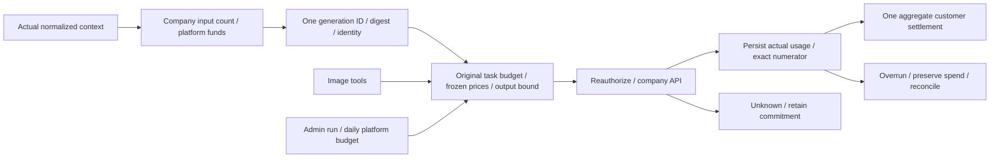

## 持久供应商请求（阶段 56）

真实 Worker 的文本、图片及后台验证共用 PostgreSQL 准入、跨进程并发/速率限额和发出前重新鉴权。不可变请求归属、策略与事件固定原任务、能力及费率；未知结果和进程丢失继续占容量，不自动重放。合法终止的用量事务完成后才把有界终止帧交给 Codex，避免下一轮在落盘期间误撞“忙碌”限制。精确费用分子供聚合后统一取整，逐请求事实不会再次扣账。

专项 **116/116** 包含于全量 **546/546**，738 份来源前后一致，保留阶段 55 全部 531 项命名测试；类型检查及实际构建通过。两套现有原生数据库完成 065→066，各保留 132 张原公共表全部行摘要与 SQL001–065 字节和历史校验值，未补造历史请求。SQL066 已进入不可改写的迁移历史。

Codex 与原生 PostgreSQL 实际执行，模型及媒体使用获准假数据。本轮没有打开浏览器或客户端；以前截图和原生包保留其原来源范围。逐调用预算、后台完整策略发布/核对和原始综合验收继续跟踪；以下旧章节仅适用于其时源码。

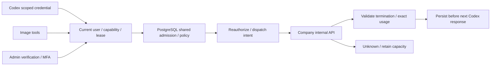

## 内部推理请求（阶段 55）

Codex 每次运行使用独立、限时、限定模型/强度/工具的 loopback 凭证，内核不再获得公司主密钥。文本、图片及后台验证共用[受控出站入口](src/internal-ai-gateway.ts)；每笔请求重新检查当前用户/任务/能力/预算预留，后台验证还检查真实会话及 MFA。完整 SSE 帧通过工具白名单后才交给内核；不明结果不自动重发。图片生成与编辑均检查实际单张 1024×1024 PNG，保留冻结价格和已知费用。

当前专项 **112/112**，完整平台回归 **531/531**，733 份来源前后一致，原 484 项命名测试全部保留；专项包含于全量，不累加。构建通过。实际用户取消接口验证在首次请求前取消会释放原预算预留并记录零消耗。模型及媒体使用获准假数据，Codex、身份、数据库及权限实际运行。跨 Worker 的供应商限额、逐调用预算和完整原始验收继续独立实现；下方历史阶段数字只适用于其时源码。

Scoped inference uses one expiring loopback credential per Codex run. The kernel never receives the company master key. Every implemented AI path shares server-controlled routing, current authorization, trusted attribution, protocol/tool validation and bounded reads. Earlier measured spend survives a later local denial; uncertain dispatched operations are never automatically replayed. See [.env.example](.env.example) for request ceilings and [integration tests](tests/internal-ai-gateway.test.ts) for authorization, streaming, media and natural process-exit checks. Durable provider limits and per-call budget allocation remain separate work.

Validation: **112/112 focused checks within 531/531 full tests**, 733 unchanged source files and all 484 earlier named tests retained. Build passed. Cancelling through the user API before the first dispatch releases the original reservation with known zero spend. Codex, PostgreSQL and authorization are real; model and media responses are simulated. This is a bounded repair, not full product acceptance.

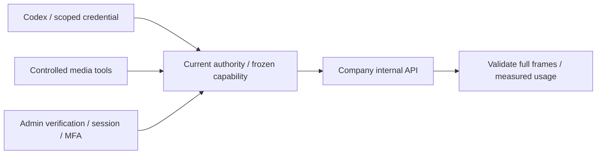

## 明确采用版本（阶段 54）

默认助手更新、专家设置与会话采用先比较明确模型、推理强度、单价及 Skill 版本，再由用户确认。五分钟比较绑定实际登录会话与配置状态，过期或变化拒绝确认；重试使用持久幂等键。已接收任务继续原模型和原费率。

当前平台完整回归 **484/484**，保留原 462 项测试；专项 **93/93** 与全量重叠，不相加。实际构建版 Web **12/12**，新版无边框打包 Desktop 与真实 Chrome 原生侧栏 **11/11**。AI/媒体使用已授权假数据，身份、PostgreSQL、权限与版本事务实际执行。原始 102 项综合验收继续跟踪；以下旧章节保留其时源码与产物范围。

前向迁移 `065-explicit-agent-adoption.sql` 增加企业/用户 RLS、限定列消耗和有界 Skill 共享锁。两套现有数据库完整保留各自 131 张原公共表及 SQL001–064 字节和校验值，不补造历史采用事实。核心为 `src/agent-adoption.ts`，语义集成测试为 `tests/agent-adoption.test.ts`。

## 受控能力配置与后台发布（阶段 53）

新增专用能力配置、固定 Codex/内部网关验证、独立审批发布及回滚、数据库当前能力和旧任务继续原绑定。对应 `src/capability-releases.ts`、`src/capability-verification.ts` 与[前向迁移 064](migrations/064-controlled-capability-releases.sql)。当前完整回归 04 通过 **462/462**，726 份来源前后一致，失败、取消、跳过均为零；包含全部阶段 52 的 435 项原测试。候选 11 的 71/71 与全量重叠，不累加。构建版 Admin 实际浏览器流程 06 通过 11/11，保留 14 张未编辑截图；补充合同 02 通过六项检查。

064 已应用到两套现有本地数据库，各自保留 125 张原公共表的完整行摘要、001–063 字节及历史迁移校验值；六张新控制表强制 RLS，普通应用账号没有直接权限，不补造历史发布。064 自此保持不可修改。全量回归的两个延期夹具已在工作进程退出后实际回收，全部本轮自建数据库、浏览器与服务已关闭。

图片验证完整解码 PNG，检查 CRC、扫描线与有界解压；已接受但损坏的响应保留待对账及已知费用，不重发模型调用。本地 HTTP 夹具分配 Fetch 允许的端口，保留真实禁止端口的零请求反例。验证结果与持久暂存清理任务分开保存，实际删除才确认完成；重试不会调用模型或修改费用。

`npm test` 通过 `scripts/run-tests-owned.mjs` 运行：Windows 有限占用可交由父级在测试进程退出后实际回收；回收失败仍使整轮失败。两组真实子进程测试验证活跃进程及替换路径均不可删除。完整回归 01 的 456/458、02 的 458/458、03 的 460/461 及全部候选原始证据保留，各自对应当时源码。SQL 001–063 与历史保留目录不变。补充机器合同位于主文档 `docs/contracts/capability-releases.openapi.json`，与原始 OpenAPI 分别跟踪；用户模型/价格比较与明确采用、网关逐请求限制及完整综合验收仍待完成。下方 435/435 属于阶段 52 原源码基线。

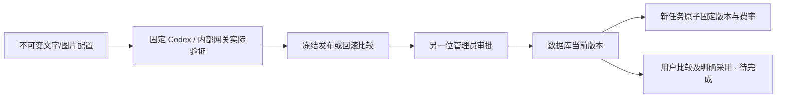

## 任务模型与价格冻结（阶段 52 历史基线）

新任务在入队和预算预留的同一事务内固定 Codex profile、内部模型、推理强度和费率版本。Worker、图片生成/编辑和结算读取原绑定；管理员及用户重试继承原版本。撤销阻止继续调用但保留原费用事实；未知图片结果继续对账。没有原绑定的历史任务不会按今天的配置补造记录。

[迁移 063](migrations/063-frozen-task-capabilities.sql) 追加不可变且受 RLS 保护的绑定。应用账号仍不能修改全局能力或 Codex profile；有界数据库函数只提供版本锁。当时专项与既有模板、私人工作流及真实 Codex 回归 35/35。两库 062→063 各保留 124 张原公共表和历史 SQL 字节；首轮权限、夹具及全量旧断言失败原样保留。阶段 52 当时尚未完成后台验证/发布/回滚和用户版本确认；后续后台子流程见上方阶段 53，用户确认及完整 REQ-045/099 仍待验收。下方阶段 51 及更早数字属于其时基线。

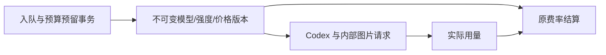

核心验证见 [能力与冻结费用测试](tests/capability-bindings.test.ts)。模型、媒体继续使用受控假依赖，身份、权限、PostgreSQL、实际 Codex 和账本真实执行。

阶段 52 完整平台回归 435/435，714 份参与源码前后一致，失败/取消/跳过均为 0，TypeScript 检查与构建通过。首次 434/435 的原始结果及旧测试源码保留，仅修正默认配置变化时旧任务应继续原绑定的断言，未删除新委派和运行撤销的检查。

## 限时只读客服协助 / Controlled support

新增限时只读支持授权及规范 Admin 支持会话。范围绑定真实管理员会话、目标身份/成员版本、明确项目和截止时间；正文与费用/VIP权限独立，私人正文不开放。062 为追加迁移；旧记录不自动取得用户视图。


阶段 51 当前平台回归 424/424（711 份来源），受控支持页面 8/8（816 份来源、9 张未编辑截图）。14 组支持专项、原规范检查、迁移保留及独立原生检查是有界证据，完整 102 项验收继续跟踪；当前包已重建，阶段 50 包原字节另存。

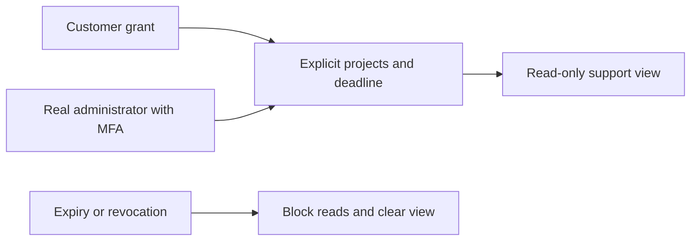


[English](README.en.md) · 原生企业 Agent 服务 · 0.5.0

本仓库提供真实 PostgreSQL 持久化、用户与管理员身份、企业/项目权限、Codex 任务执行、营销资产、数据分析、流程、设备调度与运营控制面。它是独立 Git 仓库，不依赖相邻仓库源码。完整项目主文档位于交付根目录的 `docs/`。

## 事务费用通知与三端账户（阶段 50）

迁移 061 把规范账目、收款登记/核实及退款来源的真实 INSERT 与通知意图放在同一事务。独立维护任务按当前合法接收人投递，唯一约束及锁定批次防止重复；投递失败不重做资金。GET/PATCH 费用通知每次重验会话、企业、角色和账户；未知退款金额为 null，原要求金额独立保留，不暴露内部原因、银行参考或证据。两库升级前后各 120 张原公共表完整行摘要一致，001–060 不改，历史通知不回填。

阶段 50 当时平台回归 410/410，真实三端费用流程 8/8。AI/媒体和付款证据使用获准本机模拟；身份、数据库、权限、账本及通知实际执行。原始 102 项综合验收、生产银行及完整安装/系统矩阵继续单独跟踪。

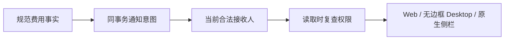


## VIP 与明确赠额的组合开通（阶段 49）

现有 VIP 表单可明确勾选配套赠额，分别填写精确 HKD 金额、独立到期日及原因。一次冻结预览及一次确认生成父操作；服务端在同一事务内提交规范 VIP 与赠额两个子操作。任何一步失败均回滚，任一风险策略触发时整体等待另一位同时具备双方权限的管理员审批，待审期间不产生权益或额度。

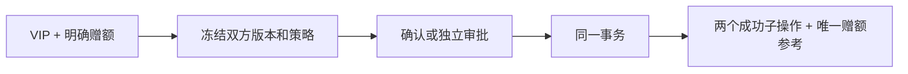


平台当前全量为 394/394（703 份来源前后一致）；新增 19 组专项已包含其中。实际 Admin 与用户读取有 9 组浏览器检查、12 张原始截图；125 份原规范响应与 1 份补充严格组合请求分别校验。060 为前向追加；两套原生数据库每库 119 张原公共表的完整行摘要前后一致，001–059 和历史空校验值保持原样。失败夹具与两次验证脚本错误均保留原回执。原始全部 REQ/TC/NFR/G01–G10、专业角色质量、真实外部服务和生产/安装验收继续跟踪。完整事实以主文档 `docs/technical/49-atomic-vip-and-explicit-credit.md` 与 Delivery 当前回执为准。


## 不可变方案定义与历史授权绑定

新增方案家族、不可变草稿/版本、冻结发佈预览和独立审批；原始 AdminPlanDraft / AdminVersionReason 写入返回严格 202 AdminOperation。全域权限、重叠 deny、近期 MFA、当前原会话/策略/前态、并发幂等和审计原子回滚在服务端执行。旧 plan catalog 旁路封闭，已发出的 plan_body 不可原地修改；空快照旧授权只在升级时计算一次，并明确记录“现在计算的绑定”，不补造原授予事实。


原生数据库增加前向迁移 056，001–055 原字节保留。方案/迁移/Skill 聚焦 24 项通过；完整平台回归以 delivery 当前回执为准。发佈不入账、不收费、不自动开通 VIP。完整规范授权、用户端方案接口、席位/储存实际配额和跨端权益事件仍待完成。详细升级与边界见交付根目录 `docs/technical/46-immutable-plans-and-legacy-grant-bindings.md`。

## 运行前提

Windows x64 已验证；Node.js 22.14+、npm、Git、原生 Codex `0.163.0-alpha.10.2`、FFmpeg/FFprobe。依赖锁文件随仓库提交。所有步骤使用原生进程，禁止 Docker、WSL 和虚拟化环境。其他操作系统未执行验收。

```powershell
npm ci
npm run setup:local
npm run db:local
```

保留数据库终端，在另一个终端执行：

```powershell
npm run db:migrate
npm run dev
```

本机 API：`http://localhost:4310`；数据库：`127.0.0.1:55432`。`db:local` 初始化开发数据库和全部迁移；`db:migrate` 也准备隔离的 `copypaste_test` 数据库。迁移只通过 owner 身份执行，API 使用独立受限连接。

`setup:local` 仅在 `.env` 不存在时生成随机数据库密码及持久 MASTER_KEY。`.env.example` 是无密钥配置参考，不能覆盖现有 `.env`。Windows 中文路径通过临时 ASCII junction 供 PostgreSQL 引导使用，数据和二进制仍位于本仓库；关闭使用原生 pg_ctl 完成 checkpoint，确认退出后只移除该别名；不强制结束数据库。

## 从访问到使用

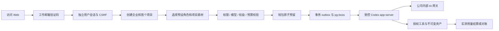

邮箱首次验证可创建用户。验证码 10 分钟有效、最多 5 次错误、并发只有一个消费者。开发邮件写入 `.data/mailbox/<challenge-id>.json`，需在本机查看验证码；生产必须使用 SMTP。Web/Admin 会话分别使用 HttpOnly Cookie，写请求检查 Origin、CSRF；原生端使用 PKCE、短期 access token 和轮换 refresh family。退出、封禁与会话撤销使令牌失效。

## 管理员开户

```powershell
npm run admin:create -- admin@your-company.example super_admin
```

在 `.data/enrolment/<id>.json` 中读取本次生成的 TOTP enrolment URI，导入认证器后删除文件。管理员需邮箱验证码和 TOTP 双重验证；没有共享默认账号、密码或后门。CLI 是受信部署操作，不向普通用户暴露。

后台支持 8 个内置角色、68 个权限键，global/tenant/project 范围、显式 deny、金额/期限/批次数限制及委派限制。敏感操作要求最近 10 分钟内 MFA；不能自授权限或撤销最后一个永久有效超级管理员。

0.3.0 补齐后续管理员的邮件邀请、本人邮箱验证与真实 TOTP 开通、姓名编辑、状态 CAS、停用/恢复、重发、他人重设 MFA、本人更换验证器及会话撤销。邀请及设置仅哈希保存能力，新密钥加密存储；未投递能力完成或撤销后清除。管理员公开 API 不暴露密钥、令牌和邀请链接。新增 `008-admin-identity-lifecycle.sql`、`src/admin-identities.ts` 及 14 组真实数据库/API 测试。首次 CLI 引导继续保留，生产 SMTP 与 SSO 单独验收。

## 已实现模块

| 模块       | 本次实现                                                                                                    |
| ---------- | ----------------------------------------------------------------------------------------------------------- |
| 身份与企业 | OTP、独立 Admin MFA、原生 PKCE、邀请、成员/项目授权、最后 owner 保护、数据库 RLS                            |
| Agent      | 唯一 Codex 内核、版本固定、28 个哈希校验 Skill 包、18 个角色、任务/事件/取消/租约/fencing                   |
| 费用与权益 | HKD 整数 micros、资金来源批次、预算预留/一次结算、人工确认入账/赠送/来源退款、个人/企业 VIP、冻结套餐版本   |
| Admin      | 完整分页用户与企业列表、按权限消耗、两步预览提交、独立审批、内容隔离/撤销分享、批量/导出、配置发布、审计    |
| 素材与设计 | 本地/S3 存储适配、不可变版本、授权下载/预览、品牌资料、图文/PNG 图层工程、SVG/PNG、真实 FFmpeg MP4 模板动效 |
| 数据       | CSV 导入、精确汇总 CTR/CPC/CPA/ROAS、零分母 null、SEO HTML 审核、Google/GA4/GSC/Meta OAuth 与有界报表适配   |
| 流程与设备 | 最多 8 步持久工作流、数据/Agent/人工审批、设备注册、Ed25519 签名命令、限时目录 grant、一次性 nonce 结果     |

18 个角色：全栈、前端、后端/API、软件测试、UI/UX、设计师、品牌视觉、广告创意、电商、社媒、插画/IP、字体版式、演示、网页/落地页、信息图、视频动效、营销分析、流程自动化。定义见 `catalog/role-preset-catalog.json`，实际 Skill 内容见 `skills/` 与 `catalog/skill-packages.json`。

安装 Skill 不代表该角色已完成真实业务验收。当前全部角色的资格状态为 `pending_live_validation`；AI 未配置时禁止假成功。

### 当前 Codex 工具边界

实际工具包括 `project_assets`、`asset_text_read`、`deliver_text`、`marketing_metrics`；按角色开放 `code_read`、`code_write`、`code_package`、`font_catalog`、`design_render`、`image2_generate`、`image2_edit`。源代码支持 CAS 哈希编辑、真实 ZIP 和 manifest，但不执行用户不可信代码或声称已运行测试。设计工具生成可编辑 JSON、SVG、PNG 及有限模板 MP4。图像生成/修改只调用内部 Images 接口。

目录里其他长期规划的 tool_id 不等于本次已注册工具。AI 视频与语音尚未实现；需要这些能力的角色明确不可用。人工本地文件调度已贯通，Codex 自动调度本地文件工具尚未接入。

## 持续专家、私密会话与记忆

0.2.0 新增项目内专属专家：基于已安装角色定制职责、品牌和工具子集；每次修改产生不可变版本。会话固定专家版本，用户可明确采纳新版。内核始终为 Codex，前端不能提交模型、provider 或可执行 Skill 覆盖。

会话只对所属用户可见；普通企业管理员不因此获得他人的会话正文。任务、事件、版本和派生文件继承私有归属，API 与 PostgreSQL RLS 同时校验。共享项目任务不能读取用户其他私密任务的文件。私密文件须由本人明确发布为新的共享副本，再进行项目分享。

消息支持保存笔记和委派，委派分为 ask / plan / execute。ask 和 plan 只开放读取工具，execute 才能生成交付物；每次模型任务独立预算预留与计费。消息 UUID 去重、会话版本比较和每会话单任务约束共同防止重复收费。计划批准重新校验输入摘要、专家/记忆/会话版本及预算；同一批准产生一个执行子任务。

记忆分企业、品牌、项目、会话和个人五种范围，记录版本及有效期。任务冻结精确引用，执行及后续工具再次检查授权、到期和内容隔离。删除撤销可读取正文及缓存重放，并保留防重复的幂等墓碑；物理对象/运行缓存回收仍待建设。有在途或费用待对账任务的会话禁止删除。


## 云端每日 / 每周工作流

0.4.0 以服务端持久日历执行已发布工作流，用户关闭页面后仍会运行。`009-workflow-schedules.sql`、`src/schedule-time.ts`、`src/schedules.ts` 与 Worker 保存不可变配置版本、触发历史及执行引用。创建/修改须确认工作流版本、定义摘要、执行身份与每次预算；时间采用 IANA 时区。夏令时不存在的时刻略过，重复时刻只执行第一次。

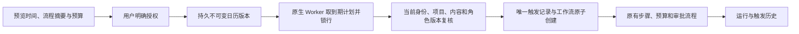

每计划同时一个运行；审批、在途 Agent 或费用待对账子任务会阻止重叠。漏跑可选只补最近一次或略过逾时，长期漏跑合并记录；暂停期间不补跑。项目管理员恢复需重新确认当前授权，后台恢复保留原授权且须近期 MFA、范围权限、CAS 与原因，不能复活已撤销授权。结束时间排他，单项目最多 50 个未退役计划；不是硬实时 SLA。14 组新增测试涵盖真实 PostgreSQL/API、并发、千日漏跑及日历边界；Delivery `qa:schedules` 另验真实系统时钟。

## 内部 AI 网关联调

服务端 `.env` 需配置 `AI_BASE_URL`、`AI_ALLOWED_HOSTS`、`AI_API_KEY`、准确的 `AI_MODEL`，并登记实际 HKD token 费率。Base URL 通常包含 `/v1`；禁止凭 URL 携带凭证、禁止生产 HTTP、禁止自动回退外部模型。

```powershell
npm run codex:probe
```

此命令只验证实际 Codex 版本、initialize 和 thread/start，不发送真实模型 turn。正式启用前还需用公司网关完成 `/responses` 工具回合、实测 token 用量和异常核查，然后设置 `AI_VERIFIED=true`。Image 2 另需 `AI_IMAGE_MODEL`、`AI_IMAGE_HKD_MICROS_PER_IMAGE` 和 `AI_IMAGE_VERIFIED=true`，核查 `/images/generations`、`/images/edits` 的真实 PNG 输出。

`tests/runtime.test.ts` 启动真实 Codex 并与本地受控 Responses fixture 完成工具回合，验证内部路由和用量；它不是公司真实模型能力证明。尚未获得公司网关配置，未进行其真实联调。

## 金额和运营规则

1 HKD = 1,000,000 micros。金额全程用整数，不使用浮点记账。赠送、确认付款、预算预留、消耗和退款分别留账；确认付款引用全局唯一。VIP 不充值钱包，钱包余额不等于 VIP 权限。

Starter / Pro / Business 的并发默认值为 1 / 3 / 8，单任务预算上限为 HK$100 / 500 / 5,000。这些是试点默认约束，月费为未定价占位 0，不代表免费商业承诺；后台可发布版本化套餐。

费用/VIP 操作采用 5 分钟预览 + payload hash + 目标版本 + 幂等提交；默认 HK$10,000 及以上要求另一位管理员审批。上游结果未知时保留预留并进入 `reconciling`，禁止盲目再次收费。付款是人工确认记录，尚无在线支付收单。

批量操作按操作者的批次数上限执行；CSV 导出最多 500 行、15 分钟过期、仅原管理员可下载且重查权限。用户/消耗/内容的集合查询在 SQL 层过滤授权范围及显式拒绝。

## API、检查和目录

```powershell
npm run typecheck
npm run build
npm test
npm run contracts:export
```

0.5.0 原始发布包含 167 个 Fastify method/path、十个迁移和 84 项测试；当前源码清单为常规 248 个 method/path、35 个迁移和 185 项通过的原生测试。路由数量不等同完整规范 OpenAPI。测试覆盖身份、隔离、费用并发/重放、权限/VIP、内容撤销、图文/PDF/MP4、真实 Codex 受控协议、源码包及新增持久工作流程。浏览器/扩展/Desktop 证据由独立 delivery 仓库记录。

| 路径                   | 内容                                           |
| ---------------------- | ---------------------------------------------- |
| `src/`                 | API、业务域、Worker、权限和 Codex              |
| `migrations/`          | 按序事务迁移与数据库约束                       |
| `catalog/` / `skills/` | 角色、权限、Skill 包与哈希                     |
| `contracts/`           | 生成的 Codex 协议及实际路由                    |
| `scripts/`             | 本机启动、迁移、管理员开户、协议探测           |
| `tests/`               | 真实 PostgreSQL 与原生媒体/内核测试            |
| `.data/`               | 忽略的本机数据、邮件、密钥 enrolment、运行产物 |


截图来自独立 Admin 客户端，展示本 API 返回的真实开发数据；平台本身不包含该客户端 UI。

## 部署、恢复和已知边界

生产要求 HTTPS、真实 SMTP、独立数据库身份、持久 MASTER_KEY、受控出站和对象存储。开发原生数据库启动器在 production 被禁用。备份数据库、对象文件和 MASTER_KEY，并通过原生恢复演练后再上线；不要通过删除密钥来“重置”生产服务。

Google/Meta 需设置服务端 OAuth client secret、精确 API version、Google Ads developer token 和回调 URI；未获真实平台授权，尚未做线上报表验收。S3 适配未接真实存储验收。SAML/SCIM、强制 SSO、事件触发、团队并行 Agent、协同编辑、完整生成视频/语音、生产 SLO、Windows 代码签名和用户代码强隔离属于未完成范围。Codex 集成关闭 shell、浏览器搜索和其他 Agent 能力；原生 OS 服务账号/ACL/网络隔离仍是生产前置工作。

本代码未授予额外开源许可。第三方组件、字体和素材来源见 [THIRD_PARTY_NOTICES.md](THIRD_PARTY_NOTICES.md)。

## 0.5.0 企业身份与统一登录

OIDC 使用 code + PKCE S256、签章、state/nonce 与固定回调。先有注册账号及有效企业成员资格，再绑定企业身份；首次绑定需要独立的 CopyPaste 工作邮箱确认码，不按网域自动开户。配置改变、停用或本人解除连接会撤销关联用户的全部 CopyPaste Web/native/refresh 会话和旧执行授权。管理员登录仍独立使用邮箱与 TOTP。

新增全域 `admin.tenants.sso.write`（68 项动作之一），只默认授予超级及安全管理员；修改需近期 MFA、原因、CAS 与幂等键。保存会停用并清除旧验证；检查 discovery、公钥和 PKCE 不代表已验证 client secret 或真实企业账号。`openid-client` 6.8.8（MIT）开启 ID token 非对称签章检查。

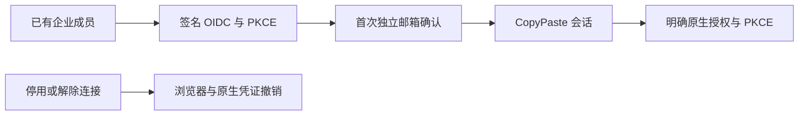

部署配置 `SSO_ALLOWED_ORIGINS` 为所需的精确 HTTPS origin。默认回调为 `WEB_ORIGIN/v1/auth/sso/callback` 经 Web API 代理；跨域 `VITE_API_BASE` 可配 `SSO_CALLBACK_ORIGIN=API_ORIGIN`。生产拒绝 `SSO_ALLOW_LOCALHOST=true`。只有原生 fixture 验收时，用此环境开关启动开发控制器，执行 `qa:federation` 后停止并不带该开关重启。

迁移 010 作废没有来源会话的历史待交换原生码。兑换重查来源会话、用户版本及联邦身份；refresh 继承绑定及配置修订。撤销旧设备会话也撤销轮换后的凭证 family。测试使用真实 PostgreSQL 与签名 code/token/JWKS。此增量不包含 SAML/SCIM、强制 SSO 策略或真实公司 IdP 准入。


## 正在修复的实现增量

当前源码增加明确模拟模式、不可逆删除账本/物理对象和运行缓存清理、90/30 天保留与七天重放结果清理、4 MiB 分片续传、流式下载、持久 SSE 及执行前领取恢复。数据库迁移只前向追加并校验已记录的摘要。完整约束与尚未完成项见主文档 docs/technical/17-erasure-transfer-retention-events.md。旧 0.5.0 安装包不包含这些未发布改动。

模拟启动：已配置原生数据库后，在 PowerShell 为当前 API 进程设置 `$env:DEMO_MODE='true'` 再执行 `npm run dev`；也可在独立 delivery 仓库执行 `npm run demo`。生产模式或对外监听不允许启用模拟依赖。网页中的一次性演示额度是 gift，不是收款；Codex 进程和业务操作仍真实执行。

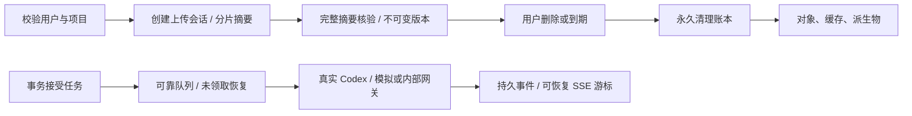

## 持久云文件（当前源码）

项目共享目录与私人会话目录、固定版本引用、目录搜索/移动/清理、显式副本共享已接入。编程角色在私人会话中读取、校验更新并打包云端工作源码；`asset.read` 工具可按节点与固定版本读取。023/024 为前向迁移，Admin 内容目录纳入节点。当前回归 139 项通过，包含五组云文件集成；模拟依赖不构成真实服务或角色准入。

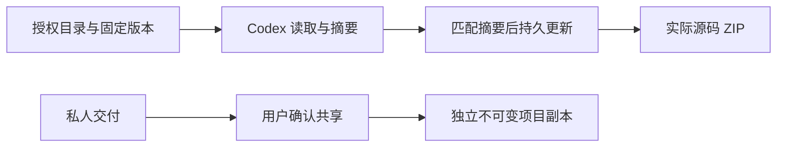

工作源码限制为 500 文件 / 20 MB，单文件 1 MB；目录条目删除与源文件永久删除分别处理。完整协议、边界和证据见主文档 technical/18-persistent-cloud-files.md。

## 项目技能生命周期（当前源码）

项目方法新增精确安装及专家/任务版本绑定。普通停用影响新工作；卸载和永久安全撤销阻止包括旧任务在内的后续调用。重装产生新身份，专家须保存新版本后采用。工具调用及结果落库前复查当前方案，实际消耗按原预留结算。

平台全套回归 **185/185**；delivery 的 `npm run qa:skills` 通过三组浏览器验收，31 份实际 HTTP 请求／响应样本通过严格设计 schema。自定义包审核/发布、完整真实角色资格仍待完成，历史 0.5.0 安装包未替换。

## 默认助手与站内通知（当前源码）

默认助手使用固定 Codex、内部文字配置和 delivery-core 方法，不计入 18 个专业角色。无需先自建专家；POST /delegations 在同一事务中建立私人会话、消息、任务、精确方法绑定及预算。相同 client_message_id 重试复用原事务结果。共享默认实例不能被普通修改/删除，Owner/Admin 通过带版本检查的新版本明确采用重装后的方法；平台隔离后禁止自动重建。

026/027 为前向迁移。任务状态在事务提交时生成接收者通知，避免中间状态误报；当前授权、私人归属和项目范围始终重新检查。支持微秒游标、已读更新及 30 天保留，任务名称从当前任务读取。GET/PATCH /v1/notifications 及兼容企业嵌套路径可用，不发送外部通知。

六组默认助手、四组通知集成用例包含在 139 项回归内。Web 各四组、Chrome 八组与源码 Desktop 八组旅程使用真实 Codex及明确假数据依赖，完整模板规范、已付费步骤恢复和正式角色资格仍未完成。详见主文档 technical/20 与 technical/21。


## 运行前资料补齐 / Pre-execution inputs

028 增加显式文件/连接需求。任务在首次模型调用前等待，保持一笔原预留；当前资源全部明确确认后，同任务只入队一次。当前版本、权限及连接类型在领取、工具、心跳与落库复查。取消释放未使用的预留，运行后撤销按实际用量处理。计划绑定资料；来源变化须重新规划。管理员正文权限可审阅需求说明，取消/重试仍按权限和原私人归属执行。

Explicit file/connection prerequisites hold the original reservation before the first model turn. CAS confirmation queues the same task once; revoked or changed inputs are rechecked throughout execution. Plans bind the selected sources, and administrative retries preserve the input requirements and private audience. Paid-step continuation and automatic dependency discovery remain unfinished. See the master documentation, technical/22-pre-execution-input-checkpoint.md.

## 执行容量与公平派发（当前源码）

前向迁移 029 在数据库内原子检查平台、企业、当前用户方案和能力槽，多个原生 Worker 共享计数。默认 10 个 handler、企业 2 槽、图片/媒体各 2 槽且企业媒体 1 槽；未知的已启动对账仍占槽。未完成工作配额与实际执行容量是两个约束。容量满时原任务保持 queued、attempt=0 和单笔预留，两秒后再派发；队列按企业位置交错，重复回调不重新预留。七组隔离数据库/原生队列测试通过，完整负载压测及逐供应商限流待完成。

## 后台记录与可重复的原生集成测试

清理记录 API 增加当前范围内的状态/类别/字面 ID 筛选、过滤后计数和稳定排序的分页；后台列表默认 50 条、最大 100。迁移 030 仅新增查询索引，旧迁移保持字节不变。每页清理进度批量读取，普通列表不包含对象路径或租约凭据；只读管理员直接重试返回 403。

应用集成测试及迁移测试分别创建 `copypaste_suite_<随机 UUID>` 原生 PostgreSQL 库和 `.data/test-runs/<随机 UUID>`，应用全部迁移，关闭应用后仅清理自建库/目录。要求本地原生 PostgreSQL 及 loopback `OWNER_DATABASE_URL`；不重置演示库或历史 `copypaste_test`。独立隔离保证待对账任务不会污染下一次测试的执行容量。首次发现的失败报告与后续修复结果均保存在 delivery/evidence。

## 持久角色模板与 Codex 版本

新增迁移 031、真实模板/运行/能力版本注册表，以及 `/v1/agent-templates` 的目录、详情、预检和实例化。预检只保存五分钟回执；创建时按当前项目权限、方案、方法、工具和能力重新检查，再原子安装及绑定。禁止覆盖内核、网关或技能身份。配置失效在新委派预留费用前拒绝；领取、工具及发布再次检查。历史无绑定版本保持原始记录，完整升级/发布仍待完成。

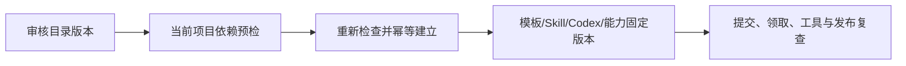

六组新增平台检查及八组 Web/Electron 流程通过，21 份实际 HTTP 样本通过严格 schema。18 个专业模板仍未完成真实业务资格；至少 12 个合格角色的要求保留。未实现工具显示缺项，不能把全部目录条目标为可执行。


## PDF 审阅稿交付（当前源码）

画布及 Codex `design_render` 生成实际单页 PDF；文字与图层保存在源工程或独立 editable JSON，PDF 为图片审阅稿。格式由 `layout.render`、`document.render`、`video.render` 分别约束。导出检查当前可见版本；相同请求响应丢失后重试沿用幂等键，保留原产物与源快照。

完整原生回归 **185/185**。delivery 的七组 Web/源码 Electron 验收包含真实下载、原生保存、pypdf/Poppler 独立解析渲染与摘要校验。模拟模型和真实文件逻辑分明；完整审阅包、印刷标准及至少 12 个真实合格角色仍未完成。


## 营销 CSV、精确指标与来源（当前源码）

导入先预览并确认账户、币种、时区、实体层级、归因和转化定义；支持通用 CSV 及 Google/Meta 风格候选表头与手动映射。原始 UTF-8/BOM、SHA-256、映射和计算结果真实保存。相同项目内重复请求或成功回执丢失后的重试只返回原快照；被隔离的数据不能绕过限制重新上传。未知转化不计零，CTR/CPC/CPM/CVR/CPA/ROAS 用精确小数先加总再计算，历史结果冻结。

原始 CSV、标准化 CSV、带 11 项证据的 JSON 计算报告及实际 SVG 可下载。页面显示实际数据日期；上传时间不冒充平台取数截止时间。没有正式广告账户同步、跨平台转化去重、FX 或完整 AI 叙述验收；营销分析角色仍未合格。模型依赖继续使用获准假数据，数据库与文件逻辑真实执行。历史安装包未重打。

迁移 032/033 增加来源及冻结指标，既有迁移保持字节不变。当前原生回归 **185/185**，包括四组文档指标算例、四组 CSV 检查和四组 PostgreSQL 集成检查。后台正文读取沿用独立权限与审计；删除清空原文、事实、口径与指标。主文档见交付根目录 docs/technical/27-marketing-import-metrics-and-evidence.md。

```mermaid
flowchart LR
  CSV[原文与明确映射] --> Validate[权限与逐行校验]
  Validate --> Identity[项目内原子去重]
  Identity --> Snapshot[不可变来源与冻结指标]
  Snapshot --> Evidence[精确值与证据]
  Evidence --> Files[授权 CSV / JSON / SVG]
```


## AnalysisSpec 私人报告（当前源码）

在行销分析选择已有快照、业务问题、日期/比较区间、指标、维度和 HKD 最高预算。预览不调用模型或预留费用；明确确认后原子建立私人 Codex 任务、冻结计算/证据及单笔预留。来源、账户、币种、时区及归因独立；重复事实去重，冲突拒绝，比较零值/无数据保留原因。接受后丢失回执重试返回原报告。

真实 Codex 通过分页事实工具读取固定值，服务端检查证据占位符及数字字面量后发布固定 HTML 资产，JSON 保留完整计算。自然语言语义和专业业务质量仍待验收；当前模型为明确标识的假数据。来源隔离/删除和项目撤权阻止读取及下载。完整 102 条综合验收、正式连接、专业角色资格和生产发布仍未完成，历史安装包未更新。

前向迁移 034 为报告、依赖、Snapshot/Evidence、受限分析师和私有资产设置数据库守卫。新增规范 `POST /v1/reports`、`GET /v1/reports/:report`、`GET /v1/snapshots/:snapshot` 和 `GET /v1/evidence/:evidence`，要求当前身份与企业头，写入另需 CSRF/幂等。原生回归 **185/185**，实际清单 **247** 个 method/path、**35** 个迁移；路径数量不代表完整契约通过。旧冻结证据索引用 `node --env-file=.env --import tsx scripts/verify-analysis-index.ts` 只读核对，不重算历史。

```mermaid
flowchart LR
  Confirm[Explicit scope and budget] --> Atomic[Private task / frozen facts / one reservation]
  Atomic --> Codex[Authorized paginated facts / real Codex]
  Codex --> Validate[References and numeric literals]
  Validate --> Asset[Immutable HTML version / JSON export]
```


## CSV／XLSX 文件导入与更正历史（当前源码）

营销输入现在先保存为项目共享文件的固定版本，再预览工作表、标题列、映射和账户口径。Google/Meta 经规范 `POST /v1/dataset-imports`，通用表格沿用兼容入口；预览不调用模型或预留费用。重复上传、接受回执丢失与重试不重复建立相同快照。原始 CSV/XLSX 下载校验实际字节及 SHA-256。

XLSX 限 5,000,000 字节、50 张工作表、100 列和 10,000 数据行；多表须明确选择，标题列为 1–100。只读解析共享/内联字符串、XML 中文字符引用、精确数字及 1900/1904 日期；金额输入最多六位小数，冻结指标保留八位。拒绝公式（含缓存结果）、宏、外链、加密文件和数据区合并单元格。错误定位实际工作表单元格。预览失败仍保留已明确上传的项目原始文件，界面提前说明。

更正新建不可变快照并记录完整祖先链，保留旧指标和历史报告；AnalysisSpec 在建立任务/预算前拒绝同时汇总祖先及更正版。来源隔离或删除阻止依赖数据、报告和文件读取；删除恢复流程关闭尚未领取的任务并释放未用预留，已运行或费用不明的任务保留原对账规则。私人文件须先明确发布为共享副本。

```mermaid
flowchart LR
  File[CSV / XLSX] --> Version[固定共享文件版本]
  Version --> Preview[表 / 标题列 / 映射 / 免费预览]
  Preview --> Confirm[当前授权与明确确认]
  Confirm --> Snapshot[幂等快照与冻结指标]
  Snapshot --> Correction[新更正版 / 保留祖先]
  Version --> Lifecycle[隔离或删除依赖守卫]
```

平台完整回归 **185/185**，严格实际 HTTP 样本 **31/31**，文件导入四组及原有 CSV 六组 Web/源码 Electron 流程通过；原生类型检查和四项单元通过。模型/媒体依赖为获准假数据，数据库、Codex、文件与授权逻辑真实执行。完整 102 条综合验收、全部官方导出格式、正式连接器、专业业务资格和生产发布仍待完成，历史 0.5.0 安装包未重打。详细规则见主文档 `docs/technical/29-file-imports-and-correction-lineage.md`。

迁移 035 绑定来源版本与更正链；247 个实际 method/path、35 个前向迁移。新增八组工作簿解析与五组隔离原生数据库检查。


当前源码支持用户侧首次模型调用前的排队暂停/同任务恢复，Admin 与用户端复用同一检查点守卫；核对原用户权限、原预留、依赖及版本，拒绝重放运行中或不明操作。原生 Codex 适配器已验证跨进程原历史/工具续聊、增量用量、中断和回执 I/O 故障保留消耗。业务 Worker 的已付费步骤恢复仍未接通。该阶段完整回归 185/185（当前结果以 Delivery 回执为准）；详见主文档 `docs/technical/31-task-controls-and-native-continuation.md`。

## 跨端会话撤销修复

`GET /v1/me/sessions` 区分 Web、Desktop 和扩展，标明当前会话，并保留访问令牌已过期但仍可刷新的设备条目；不返回凭证。新增 `POST /v1/auth/native/revoke`，以对应 client_id 的刷新凭证撤销整族，不需要有效访问令牌、不轮换新凭证，未知/已撤销凭证返回相同回执。刷新、退出与撤销按同一用户锁顺序串行，旧列表 ID 可撤销已经轮换的家族。成员移除拒绝该企业的新调用，不能凭刷新令牌恢复已撤销的企业权限。

`tests/auth-sessions.test.ts` 使用隔离原生数据库验证会话目录、过期与重放、真实刷新/撤销竞争、跨用户与 CSRF、邀请与移除后的浏览器/原生/设备入口；不依赖任何模型调用。此路由是实际实现接口，未据此改写规范契约或宣布完整身份/生产门槛通过。

## 规范用户认证 / Canonical user authentication

新增原 OpenAPI 的 challenges（202）、sessions（201）、当前 session DELETE、S256 authorize GET（302）和 token（201），旧接口继续兼容。迁移 036 将验证码/会话/轮换与加密幂等回执原子提交；验证码绑定 HTTP-only 浏览器 flow，授权需浏览器会话与用户导航或显式 CSRF。撤销、冻结、过期和历史轮换不可通过旧回执复活；重试返回同一令牌的剩余有效期。

The five original user authentication operations now have real Web, Desktop and Extension consumers. Migration 036 stores encrypted atomic request receipts, preserving one-use codes and refresh reuse revocation while allowing the same unknown request to recover. Browser consent requires a product browser session; native Bearer credentials cannot grant another client. Cached replies never revive revoked or expired credentials. Remaining token lifetime is preserved.

`tests/auth-contract.test.ts` validates actual isolated PostgreSQL/API behavior against ten exact original schema dependencies. The previous canonical-authentication increment passed **203/203**. Delivery `npm run qa:platform` captures raw TAP bytes and SHA-256. Subsequent `/v1/me` and workspace-context changes are documented below; canonical invitation/admin contracts and the complete identity matrix remain separate work; route counts are not acceptance counts.

## 用户资料与工作区上下文 / User profile and workspace context

`GET /v1/me` 严格返回原始规范的 `User`：`id`、`email`、`display_name`，不再夹带企业列表、偏好或 CSRF。三端初始化改用受认证的 `GET /v1/session/context`，返回现有资料、有效工作区和浏览器 CSRF；原生 Bearer 优先时 CSRF 恒为 null，即使同时携带其他账号的 Cookie。两个接口均重新验证实际会话并禁止缓存。

`GET /v1/me` now matches the original `User` contract exactly. Authenticated client bootstrap uses `GET /v1/session/context` for profile preferences, active workspace access and browser CSRF. A selected native Bearer never receives the CSRF of a concurrently supplied browser cookie. Both routes retain current-session validation and `no-store`. Existing preview installers remain historical.

资料阶段平台回归 **207/207**，包括两组原始 User/跨身份上下文检查及两组真实文件清理竞态回归。孤儿扫描仅忽略对象已被并发删除的 ENOENT；权限和繁忙错误保留。首次 204/205 失败和修复后原始 TAP 均由 Delivery 记录。 / Profile-stage platform regression: **207/207**. Two profile/context groups and two deterministic filesystem-race groups cover the new changes; EACCES and EBUSY still propagate. The first 204/205 failure and corrected raw TAP are both preserved.

## 邀请与成员权限 / Invitations and membership

邀请创建/接受返回规范 201 Invite/Member；MemberList 支持独立成员 UUID、企业头和分页。共享事务锁保护当前权限与最后所有者。成员移除同步撤销旧待用邀请；加密邮件队列支持退避、八次投递、撤销和轮换重发。十三组专项覆盖此闭环，完整后台/原生与生产邮件仍待验收。

Canonical invitation create/accept return 201 Invite/Member. MemberList uses stable membership IDs, required tenant headers and pagination. Shared transaction locks protect current authority and the last owner. Removal revokes old unused invitations. Encrypted durable delivery supports bounded attempts, revocation and versioned resend. Thirteen integration groups cover this lifecycle; full Admin/native and production SMTP acceptance remain pending.

```mermaid
flowchart LR
  Manager --> Invitation --> EncryptedQueue --> Email
  Email --> EmailLogin --> CurrentAuthority --> Member
  Member --> Removal --> RevokeUnusedInvites
```

上一轮稳定源码平台全套回归 **220/220**（原始回执已归档到 Delivery 的 `evidence/stage35-platform/`）（包括十三组邀请/成员专项）；完整原始 TAP 与摘要保存在 Delivery。 / Previous stable-source platform regression: **220/220** (now archived in Delivery `evidence/stage35-platform/`), including thirteen invitation/member groups. Original TAP bytes and their digest are preserved in Delivery.

## Admin 成员控制

规范后台成员变更返回持久 202 AdminOperation；范围/MFA、管理暂停、版本与最后 owner、加密邀请撤销和独立审批使用共用领域守卫。每项操作绑定真实不可变策略快照，历史未记录策略的记录明确拒绝规范读取。专项和真实 HTTP 回执在 Delivery；完整后台/原生与生产验收仍待完成。

```mermaid
flowchart LR
  CurrentScope --> RecentMFA --> FrozenPreview --> Policy
  Policy --> DirectApply
  Policy --> IndependentReview --> Recheck --> DirectApply
  DirectApply --> MembershipAndAudit
```

本轮最终稳定源码平台回归 **233/233**，新增 Admin 成员专项 **13/13**；当前真实后台成员 HTTP **5/5**，原规范捕获样本 **43/43**。完整原始回执位于 Delivery `evidence/`；页面验收与生产/完整原生门槛另行保留。


## 后台账户与取消费用守卫（当前源码）

全局用户资料/状态、全部会话撤销及企业状态使用四个规范 POST 和严格 202 AdminOperation；原 PATCH 已移除。前向迁移 039 增加实际版本、标签与关闭标记；命令复查范围/deny、近期 MFA、CSRF、幂等和版本。关闭/重开默认由不同管理员复核，绑定原会话、前态、期限及不可变真实策略。全局停用撤销全部会话/refresh/待交换 code 和相关待用邀请；单企业停用保留其他企业访问。批量状态也执行当前守卫，不能绕过复核重开 closed。

账户、用户和后台取消共用领域逻辑；已尝试或有外部费用的任务保留预留并进入对账，不因非 running 状态而按零费用释放。十二组原生隔离数据库专项覆盖版本、范围、凭证、审批变化、并发创建和取消费用边界。完整回归以 Delivery 回执为准；原始规范列表/详情/费用/VIP 及全部综合验收仍未完成。

```mermaid
flowchart LR
  A[资料 / 状态 / 会话] --> P[预览 / 权限 / MFA / 版本]
  P --> R[直接执行或独立复核]
  R --> S[账户与凭证]
  R --> C[在途取消守卫]
  C --> B[初始任务释放 / 已执行费用对账]
  S --> L[持久操作与审计]
  B --> L
```


## 规范用户和企业目录增量

`GET /v1/admin/users`、`GET /v1/admin/users/{user_id}`、`GET /v1/admin/tenants` 采用原始严格 DTO。用户以全局 ID 去重，查询接受规范 q/limit/cursor，企业、项目、用户、状态、有效 VIP 和确认扣费时段可组合筛选。完整联系方式、费用和 VIP 按独立字段许可及当前范围投影，显式 deny 约束搜索和筛选。签名游标绑定当前身份、会话、权限和筛选，保留微秒并列顺序，15 分钟过期；列表没有伪造总条数。

迁移 040 为钱包新增持久账务账户 UUID；真实邮箱和企业联合登录更新 last_login_at，原生刷新不增加登录次数。确认扣费汇总真实 charge 账本并按原任务的企业/项目范围交集及半开入账时段过滤，保留十进制微额字符串；未知或无权字段不当作零。当前补充 management-context 仅提供获准的详情显示资料，原规范响应保持严格。

专项运行 `node --env-file=.env --import tsx --test --test-concurrency=1 tests/admin-directory.test.ts`，十一组目录及导出隔离原生 PostgreSQL 检查通过。规范 fixture 的七个依赖与原 OpenAPI 原字节摘要逐一核对。需要正常启动本机原生 PostgreSQL；禁止 Docker/WSL。完整费用/VIP 写规范、消费钻取和全部产品验收仍独立待完成。

```mermaid
flowchart LR
  Session[当前 AdminSession 与 MFA] --> Scope[动作 / 字段 / 企业 / 项目范围]
  Scope --> Cursor[签名游标与去重目录]
  Cursor --> User[严格 AdminUser / AdminTenant]
  Scope --> Ledger[确认扣费账本]
  Ledger --> User
  User --> Audit[访问审计与页面]
```

用户导出同步迁移到规范用户游标，超过既有 500 条同步上限明确拒绝，避免静默截断；下载发送前在当前 MFA 和权限锁内复核完整授权摘要。新增检查包含真实脱敏 CSV、501 条上限拒绝和下载撤权，完整规范异步导出仍待实现。

## 授信与实际扣费来源 / Credit and settlement sources

预留、结算、过期和资金调整使用 BigInt 计算累计金额。授信预留之后收到的有效资金可在结算时消耗，其他任务冻结的批次保持预留。实际债务等于资金批次剩余总额减钱包净余额，不能仅取负余额；新增资金先偿还实际债务，只有余额生成可用批次。信用上限不能低于实际债务或现有预算承诺。

迁移 041 为新扣费保存不可变 paid/gift/credit 来源，为新入账保存实际偿还债务部分。数据库检查任务、企业、资金种类和提交时来源合计；账本及来源在同一事务回滚。历史账本不改写，迁移前的未知来源不补造。专项命令 `node --env-file=.env --import tsx --test --test-concurrency=1 tests/billing-sources.test.ts` 使用独立原生 PostgreSQL，完整结果以 Delivery 当前原始 TAP 为准。

Reservations, settlement, expiry and funding use BigInt for accumulated amounts. A credit-backed hold can consume subsequently received funds at settlement while preserving other tasks' funded holds. Actual credit debt is gross remaining funding lots minus the net wallet balance. New funding first repays that debt; only the remainder becomes available credit. Reducing the credit limit must preserve both debt and existing budget commitments.

Migration 041 records immutable sources for new paid/gift/credit charges and actual debt repayments from new funding. Database guards validate tenant, task, bucket and exact source totals at commit. Financial records roll back together. Historical ledger bytes remain unchanged and missing historical sources are not invented. Run the focused command above against native PostgreSQL; the current Delivery TAP is authoritative. Personal accounts and three canonical financial commands are described below. Full payment/refund/VIP APIs, verification and the remaining financial workflow still require acceptance.

```mermaid
flowchart LR
  Hold[Original hold] --> Lots[Own allocations and currently free lots]
  Lots --> Debt[Credit for the remaining cost]
  Debt --> Commit[Charge and immutable sources in one transaction]
  Commit --> Guard[Database verifies exact source total]
  Funding[New funding] --> Repay[Repay actual credit debt]
  Repay --> Remainder[Only the remainder funds a new lot]
```

Windows 原生 PostgreSQL 的 ASCII 路径别名现在放在 `%LOCALAPPDATA%/CopyPaste/native-runtime-aliases/`，避免运行中的可执行路径依赖系统临时目录。这里只创建每次启动独立的目录和 junction；真实源码、程序和数据库始终位于本仓库。若用户缓存路径本身含非 ASCII 字符，可用 `COPYPASTE_NATIVE_ALIAS_ROOT` 指定稳定的 ASCII 路径。停止后只清理本次拥有且仍指向本仓库的别名。

On Windows, the native PostgreSQL ASCII junction now lives under the stable per-user application cache instead of the OS temporary directory. Only the owned directory and junction live there; source, executable bytes and database files stay in this repository. `COPYPASTE_NATIVE_ALIAS_ROOT` can select a stable ASCII location when the user cache path contains non-ASCII characters. Shutdown removes only this launch's matching junction. The change is verified with an actual native restart and fresh connections to both existing databases.


## 个人/企业账务主体与实际事件 / Billing subjects and events

迁移 042–044 为个人和企业提供真实独立账户；个人的正式与模拟模式分别开户，初始不充值、不授信。直接任务创建支持 `X-Billing-Account-ID`，校验本人/本企业、模式和项目权限，将付款人冻结于任务并纳入幂等摘要。其他工作流暂未接入付款上下文时明确拒绝选择头，不忽略后扣企业款；用户端选择 UI 仍待完成。

`GET /v1/me/billing-accounts` 只返回本人当前模式账户。三处规范 Admin 账户/账本读取采用原始严格 DTO，显示实际实付/赠送批次、预留和债务。全局/企业许可及重叠项目 deny 决定企业整体账户可见性；个人财务要求全局许可并受全部重叠成员企业/项目 deny 约束。旧企业费用列表排除个人付款项。

账务操作者、操作、Journal 及任务预留/消费/释放/信用调整记录持久保存，来源 ID 均对应真实记录；数据库拒绝改写历史、重新归属账户或资金来源。历史未记录的操作者、策略或资金来源不补造。注册时间仅表示新增索引的时间。详情见项目主文档 `docs/technical/40-billing-subjects-and-financial-event-provenance.md`。

八组账户、十一组目录及十二组结算专项联合通过；首次失败原始 TAP 与最终专项输出保存在 Delivery。完整回归以当前 `evidence/alignment-platform.json` / `.tap` 为准。三项规范费用命令、审批及当前 Admin 表单见下节；付款凭证核验、退款对账、消费退回原桶、不可变方案/VIP、其余客户端消费者及全部综合验收仍未完成。

Personal and enterprise wallets now share the same exact funding, expiry, reservation, settlement and debt engine. Personal modes are separate, task payers are immutable, and financial journal identities refer to real persisted events. Canonical account reads enforce whole-subject permissions and signed pagination. The complete fee/payment/entitlement workflows and client consumers remain required; backend integration results do not close their acceptance gates.

## 规范费用命令与真实审批请求

已实现账户 gift/debit/credit-limit 的纯预览、版本／来源冻结、精确金额、香港日界与模式隔离的日限、幂等提交和独立审批。047 保存真实审批请求及不可变决定，规范 `/v1/admin/approvals/{approval_id}/decisions` 使用真实请求 UUID；审批回执保留实际操作者、策略与流水。旧三项费用入口阻断，不能绕过新约束。审计失败与资金变更整体回滚。

费用与迁移聚焦 16/16 组通过，最终全量结果以 Delivery 的 `evidence/alignment-platform.json/.tap` 为准；运行前后校验源码及 verifier 不变。045 首次字段读取错误由新迁移 046 修复，旧 SQL 与失败记录保留。两库当前应用 001–047；001–015 历史未登记的执行摘要不推测补写。

当前三个命令不代表完整付款、退款、VIP、outbox 或审批目录验收。Admin 的真实浏览器消费者与精确金额测试已接入；完整范围参照中央 `docs/technical/41-canonical-fee-commands-and-independent-approvals.md`。

## 统一审批请求（2026-10-20）

现有费用、企业成员、账户和旧后台待审批操作共用独立请求。规范目录使用范围受限的签名游标，决定必须携带真实请求版本、摘要、原因及幂等键，返回 202 AdminOperation。业务权限与审批权限、当前 MFA、准确原会话、冻结策略和前态均在事务内复查；业务、决定、审计与回执一起提交，后台实际登记过期。SQL 048 保留原费用请求与决定，缺失原事实的旧操作取消并留下迁移记录。

```mermaid
flowchart LR
  Command[冻结业务操作] --> Request[独立审批请求]
  Request --> Review[有权的另一位管理员审阅]
  Review --> Checks[当前权限 MFA 原会话 版本 摘要]
  Checks --> Commit[业务 决定 审计 回执原子提交]
  Request --> Expiry[后台过期与系统审计]
```

原 OpenAPI 与 SQL 001–047 保持原字节。旧 operation decision 入口拒绝隐式补版本；完整付款、凭证、退款、VIP、通知及综合后台验收继续跟踪，未据此标记整项通过。

阶段 43 全量平台回归 **303/303**，669 份参与源码前后摘要一致；原始 TAP SHA-256 为 `1615f06e75496988f37cb30872ee35ba7f981c23c7e8d98b3f8e409f16df612f`。53/53 审批及升级专项单独保留，未加总为额外平台测试。

## 人工付款与准确入账（2026-10-20）

新增规范付款目录、凭据登记和另一位管理员核实，登记与核实均不改余额。充值使用已核实且未入账的同主体/模式付款，金额完全一致；账户预览、香港日界限额与独立审批沿用共用费用控制器。原付款与真实流水互相关联，先偿还实际授信债务，不重复创造可用额度。付款事实只追加，操作意图不可变；旧充值入口禁止绕过。

```mermaid
flowchart LR
  Receipt[原凭据版本] --> Record[登记付款]
  Record --> Verify[另一管理员核实]
  Verify --> Preview[原付款与账户预览]
  Preview --> Authority[当前权限 MFA 限额及必要审批]
  Authority --> Post[入账 债务还款 审计 幂等原子提交]
```

SQL 049–052 已追加至两库，旧 SQL 原字节保留；050 预览字段及 049 别名错误通过 051/052 修复，原始失败保留。21/21 费用专项及 5/5 实际浏览器组通过；完整平台回归以最新 Delivery JSON/TAP 为准。这不是支付机构、完整退款/VIP或全部 102 项验收通过。中央文档：`docs/technical/44-manual-payment-evidence-and-exact-posting.md`。

最终当前源码全量回归 **310/310**，676 份源码/verifier 前后摘要一致；原始 TAP SHA-256 为 `5b499c16a50ec57427ed7ff7cf4681ba2e0cef0330e97159dde7e9d25e291119`。四组更新旧旅程专项和 21 组费用专项与全量重叠，不另行累加。首次 306/310 原始失败及旧 303 项快照均保留。

## 原交易退款与资金核实（2026-10-20，后续增量）

消费补偿严格返还原赠额、付费和实际偿还来源，保留赠额到期时间；未偿授信只注销对应消费债务。现金退款绑定已核实原付款，先冻结未用金额，再由另一管理员逐次核实实付、剩余未付或未知/差额；部分付款不会误报全部成功。历史缺失偿还来源要求对账，不补造历史。

当前平台全量 324/324、683 份参与源码前后一致；费用及退款实际页面 8/8、47 份来源一致；原规范实际响应 100/100，补充退款合同 14/14 单独校验。50 项专项与全量重叠。SQL 053–055 已实际应用于两个原生数据库；001–052 不改写。AI、媒体和外部支付仍按明确模拟范围验收；历史授信人工对账、正式支付/VIP/outbox、完整系统及全部综合验收继续保留。较早章节的数字记录各阶段历史。

```mermaid
flowchart LR
  Intent[原交易与退款预览] --> Review[当前权限与必要独立审批]
  Review --> Sources[消费按原来源补偿]
  Review --> Hold[原付款可退资金冻结]
  Hold --> Other[另一管理员核实实际结果]
  Other --> Paid[实付部分扣款]
  Other --> Unpaid[剩余未付解除预留]
  Other --> Unknown[未知或差额保持待对账]
```

2026-10-20 退款增量后当前源码复核：Web 成员 6/6（169 份来源）、Admin 成员 6/6（196 份）和 Web/源码 Electron/MV3 认证 12/12（775 份）通过，前后摘要一致，拥有的会话、浏览器、Electron 和扩展进程均已清理。首轮 Electron 调试连接超时原回执保留，随后相同源码重跑通过。Desktop 无边框和原生 Side Panel 预览包保持原字节；完整安装包认证及系统矩阵仍须独立验收。

2026-10-20 方案版本增量後的當前源碼復核：Web 成員 6/6（172 份來源）、Admin 成員 6/6（200 份），Web／源碼 Electron／MV3 認證 12/12（779 份）；測試前後摘要一致，自建瀏覽器／Electron／擴展均關閉，測試憑證清理。新增不可變方案定義與固定歷史授權綁定不改寫原生預覽包。完整 VIP／配額、安裝包認證及系統驗收仍按主文檔繼續追蹤。

## 规范 VIP 生命周期与实时权益（阶段 47）

Admin 现在通过原规范授予／修订命令管理个人或企业 VIP：固定方案 UUID、来源、区间、原操作者与原操作保留；延长、暂停、恢复、撤销及预约替换追加不可变修订。冻结预览、当前 MFA／整体范围与显式拒绝、独立审批、版本冲突、同键恢复、审计回滚和通知 outbox 共同执行。付费来源须匹配已独立核实的付款与财务权限；VIP 不直接扣款或赠额。旧通用 VIP 写入口拒绝绕过。

```mermaid
flowchart LR
  Admin[当前授权管理员] --> Preview[冻结参数与主体版本]
  Preview --> Guard[锁内权限 MFA 策略与前态]
  Guard --> Review[必要的独立审批]
  Guard --> Commit[同事务提交]
  Review --> Commit
  Commit --> Facts[授予 修订 审计 操作与 outbox]
  Facts --> Effective[服务器当前时间合并个人和企业权益]
  Effective --> Runtime[资源 角色 能力 预算与本机授权检查]
```

用户原规范 `GET /v1/plans` 与 `GET /v1/effective-entitlements` 已接入；有效功能和角色合并，同类配额取最大值，显式授予不额外叠加免费能力。开始／到期／替换按服务器时刻执行，worker 失败不延长权益。补充通知接口只显示真实用户当前模式与主体范围。

阶段 47 原回执：完整平台回归 354/354（694 份来源前后一致），VIP 专项与其重叠。原始 OpenAPI 与 11 个 VIP 依赖 schema 保持不变。001–056 与阶段 46 提交原字节一致，057 已应用后不改写。升级第一次启动主库先自动迁移，缺少其升级前行快照；测试库有完整 056→057 比较，失败记录和主库限制保留。15 条旧迁移本来没有摘要，仍为 null。

运行 `npm run build`、`npm test`；实际页面与原生复核由 Delivery 独立仓库提供。完整席位／存储执行、VIP 加赠额的原子操作、所有安装／SSO／系统及原始 102 条综合验收仍单独跟踪。此前章节的结果属于各自历史阶段；完整当前证据见主文档 `docs/technical/47-canonical-vip-lifecycle-and-effective-entitlements.md`。

## 企业席位与存储执行（阶段 48）

企业方案现在实际约束启用成员、云文件保留版本和有效上传预留；个人 VIP 不扩充企业容量。邀请接受、成员恢复、Admin 审批、文件复制/派生和上传转换均走数据库守卫。降级保留现有资源并拒绝新增占用；只有实际擦除成功才释放保留字节。后台聚合读取同时要求企业和权益整体权限，不暴露私人文件明细。

新增补充 GET `/v1/tenants/:tenant/resource-usage` 与 `/v1/admin/tenants/:tenant/resource-usage`，原严格 `EffectiveEntitlements` 不变。字节为十进制整数字符串。058 与 059 已在原生 PostgreSQL 主库/测试库顺序执行，分别核对 23 类原有业务行；已应用 SQL 不再修改。首次完整回归的私人附件删除冲突保留原失败，以 059 前向修复，原删除测试未放宽。

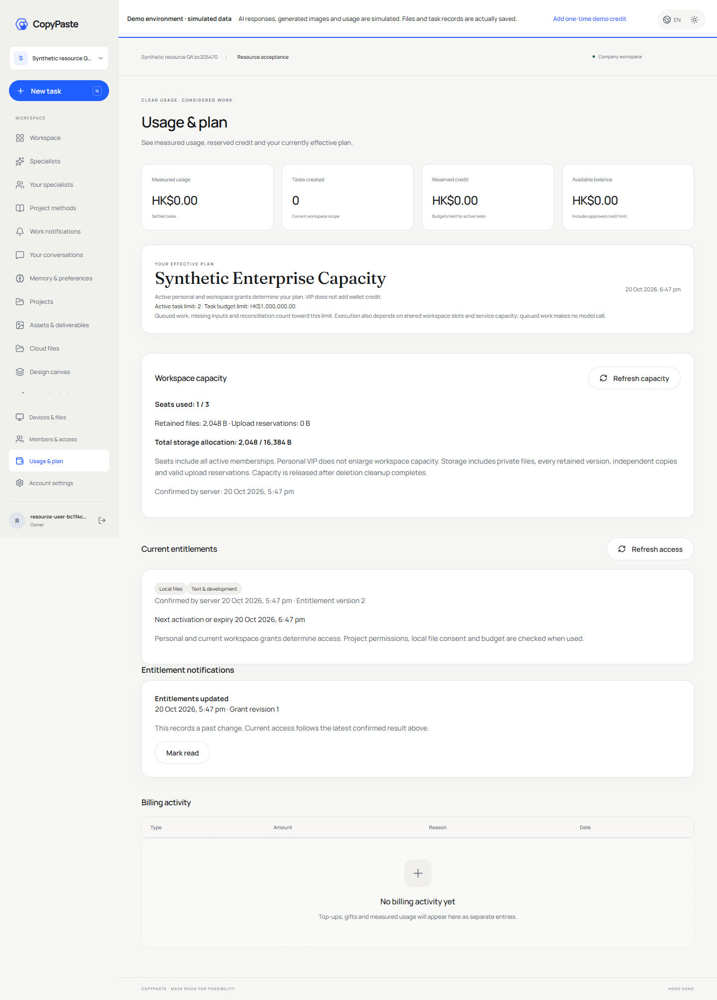

