# CopyPaste Chrome Extension

<!-- stage66-current-paid-inputs:start -->
Chrome MV3 使用真正原生 Side Panel，支持查看并解决原任务的付费资料请求。

## 补资料后继续原来的付费工作（阶段 66）

已经完成且用量明确的 Codex 回合，现在可以请求用户补充获准文件或现有营销连接。模型只描述缺口，用户明确选择资料；同一任务保留原会话、原生线程、原预算预留及累计用量，重新检查权限、来源和容量后继续。不会因为补资料而另建一笔任务预留。最多八轮、三十二项资料依赖；未知外部结果保留核对状态。

完成的事务工具保存不可改写回执，续接时先检查当前授权、输出及来源，再复用相同操作结果。代码包还比较实际源文件清单和摘要，源码变化后生成新包。等待补资料期间取消，仍结算已知用量；未知用量不当成免费。Web、Desktop 和 Side Panel 区分“已记录用量”和“已结算费用”，也区分首次调用前等待与已付费回合后的等待。

三端在同一任务自动刷新时保留用户的资料选择；实际检查等待至少两次任务刷新响应后再确认。切换工作范围或当前读取被拒绝时，移除旧任务内容及输入控件。首轮发现表单重建问题的失败记录和当时包保留，新包在独立目录中构建。

验证：平台 **782/782**，保留此前全部 **765 项**命名测试；定向 **34/34**，六仓库 **13 项**检查通过。实际 Codex 子进程恢复原线程、工具及历史，并验证完成文件复用和单次累计结算；模型 API 响应为用户授权的模拟数据。原生客户端旅程 **32 项**通过，Web、打包 Desktop 和真正原生 Side Panel 的补资料操作使用明确标注的模拟模型回合夹具。

Desktop 采用无边框窗口、自绘拖动区及最小化/最大化/关闭按钮，无 Electron 默认或 Alt 菜单。扩展点击工具栏打开 Chrome 原生 Side Panel，默认右侧并遵循浏览器偏好；没有 action popup。新安装包、便携包及侧栏 ZIP 为未签名的 localhost 预览，尚未验收实际安装、签名、商店发布或正式模型服务。

两库原生 SQL087→091 核对原 169 张公共表的完整旧字段行摘要、迁移字节、所有权及 RLS；只显式扩展容量领取函数并增加检查点/工具回执守卫。新列回填为零或空值，两张执行事实表为空，不补造历史。开发和脚本位于 D 盘 `dev/`，主文档位于 `docs/`；禁用本地 Docker/WSL/虚拟化。

仅使用 Codex，全部 AI 请求经过公司内部 OpenAI 兼容服务器。原 102 项需求及全部 TC/NFR/G01–G10 继续保留：81 项局部验证、21 项未证明完成、0 项完整验收。完整规范 TaskDTO/任务创建接口、任意执行中暂停、未知副作用恢复、所有独立角色业务及生产验收继续跟踪。

[实现说明](../../docs/technical/66-paid-native-input-checkpoints.md) · [执行绑定](../../docs/quality/paid-input-checkpoint.json) · [新客户端产物](../../docs/quality/paid-input-artifacts.json)

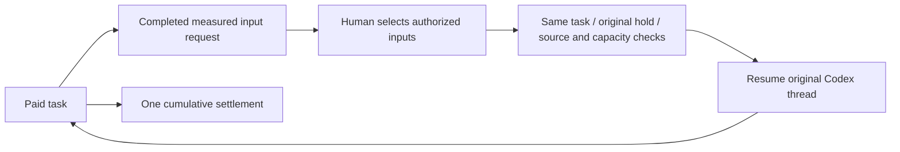

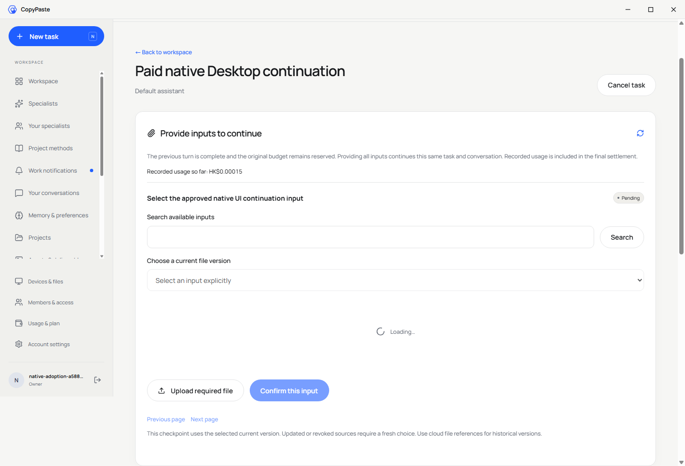
<!-- stage66-current-paid-inputs:end -->

<!-- stage65-current-history-source-lineage:start -->
本阶段保持真正原生浏览器侧栏与现有 ZIP 字节。

## 会话与实际读取的来源约束（阶段 65）

模型实际读取的文件版本、云文件引用和营销数据集现在保存不可改写的来源引用。历史助手结果、固定记忆和已批准计划的来源失效后，后续模型、工具重放、事件和产物保存都会重新检查；新付费委派在创建任务和预留资金前拒绝失效历史。会话显示不可用提示，任务列表与详情保留状态和费用元数据并隐藏失效的验收正文。原 PLAN_STALE / PLAN_INPUT_CHANGED 和首次输入补选语义保留。受控删除明确擦除元数据；普通更新不能因缺省擦除标记而改写来源。

显式发布创建独立副本并冻结已确认的输入来源。删除原私有会话仍保留已发布副本；被实际消费的原始文件、数据集或固定记忆失效时，派生副本和公开分享仍受来源约束。恢复来源不改变当前项目、用户或私有范围权限。

验证：平台 **765/765**，保留此前全部 **746 项**命名测试；定向 **51/51**，六仓库 **13 项**检查通过。包括真实 HTTP SSE、实际 Worker 工具、文件下载、计划、资金预留及公开分享；AI 和业务数据按授权模拟。两库 SQL081→087 保留原 168 张公共表的全部行摘要、旧迁移和原函数定义，新增来源表为空，不补造历史读取。

Desktop 保持无边框、自绘窗口控制、无 Electron 默认或 Alt 菜单；Extension 使用 Chrome 原生 Side Panel，默认右侧并遵循浏览器偏好。既有包与原生旅程只做当前字节核对，原截图和旅程保留原后台源码范围。本阶段未完成新后台的跨端界面验收、签名安装、商店发布或正式环境验收。

仅使用 Codex，全部 AI 请求经公司内部 OpenAI 兼容服务器。原 102 项需求、全部 TC/NFR/G01–G10 保留：81 项局部验证、21 项未证明完成、0 项完整验收。

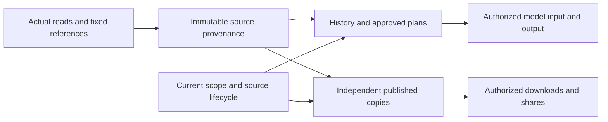
<!-- stage65-current-history-source-lineage:end -->

<!-- stage64-current-report-task-source-fences:start -->
保持真正 Chrome 原生侧栏交互，默认右侧；本阶段仅核对既有客户端与 ZIP 字节。

## 报告与任务历史的当前来源约束（阶段 64）

营销分析和原始 SEO 诊断的通用任务详情、项目任务列表、JSON 历史消息及两种 SSE 事件入口，现与专用报告共用当前来源约束。来源被隔离或到期后，已有事件流会在下一批读取时停止发送正文并关闭。恢复来源仍须通过当前企业、项目、私有所有者和登录身份检查；原有报告及历史事件保持不可变。

分析数据集、原始 CSV、报告产物与终态分析任务的保留期在清理前生效。过期分析输入会在创建任务和预留费用之前拒绝。来源锁等待正常任务更新后，还会重新核对用户权限版本，避免并发撤权后仍返回消息。

验证：平台完整 **746/746**，保留前阶段全部 **734 项**命名测试；新增定向 **12/12**，六仓库 **13 项**检查通过。使用实际 HTTP 事件流、Worker 保存的模型消息，以及真实锁定 Codex/内部模拟网关；AI 和业务数据继续按授权模拟。两库原生 SQL080→081 保留 **168 张**原公共表的全部行摘要、所有旧迁移和表所有者/RLS，仅更新两个报告访问函数。

**Desktop 无边框、无 Electron 默认菜单或 Alt 菜单**；扩展工具栏切换 **Chrome 原生 Side Panel**，默认右侧并遵循浏览器位置偏好。现有客户端、ASAR、扩展 ZIP 及阶段 63 预览包已只读核对。下方真实截图和原生检查保留其原后台版本范围，本阶段没有新增后台的浏览器/原生端旅程验收。安装、签名、商店发布和正式环境仍待完成。

仅使用 Codex，所有 AI 请求走公司内部 OpenAI 兼容服务器。原 102 项需求、全部 TC/NFR/G01–G10 保留；81 项局部验证、21 项未证明完成、0 项完整验收。

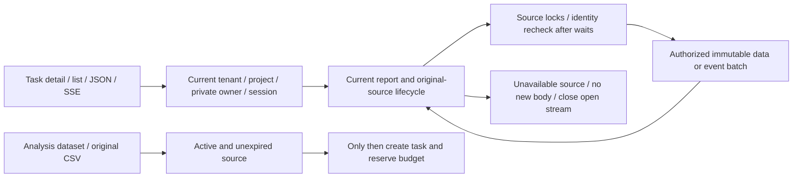
<!-- stage64-current-report-task-source-fences:end -->

<!-- stage63-source-governed-website-changes:start -->
本仓库是 Chrome MV3 扩展。工具栏按钮切换原生侧栏，固定入口进入已授权公司工作台；本地文件能力继续要求明确的设备/目录权限。

## 网站修改任务（阶段 63）

从「行销分析 → 网站诊断与复查」选择 1–20 个问题，确认冻结的原始证据、修改目标和独立 AI 预算，保存为私有任务。可暂停/继续尚未开始的任务、取消任务、查看原始证据、下载 JSON 和 HTML 修改草稿，再明确发起同范围复查。草稿需要人工审核；网站修改和 CMS 写回需要另行实施与授权。未改动的模拟页面在复查中仍显示问题持续存在。

仅使用 **Codex**，全部 AI 请求经公司内部 OpenAI 兼容网关。当前按授权使用**模拟业务与 AI 数据**；代码确实执行登录、权限、原生 HTTP 夹具、Codex 子进程、计费回执和文件保存。草稿必须完整覆盖实际读取的所选问题；伪造、未读、遗漏或重复引用不能生成交付资产。来源、缓存祖先、隔离、保留期、撤权和删除约束同时覆盖草稿与主动发布副本；Admin 的元数据、正文与内容操作权限分别执行。

**Desktop 无边框、无 Electron 默认菜单和 Alt 菜单**，使用自绘拖动区与窗口控制，文件通过当前租户的受限认证桥和原生保存窗口下载。**Extension 点击工具栏打开/收起 Chrome 原生 Side Panel**，默认右侧并遵循浏览器位置偏好；固定公司入口打开网站工作台。

验证：完整平台 **734/734**，保留前阶段全部 **716 项**命名测试；当前实际 Web/Admin **18 项**、新包原生 **23 项**，六仓库 13 项检查通过。两库原生 SQL079→080 保留 **167 张**原表全部行摘要和 SQL001–079；新增表为空且强制 RLS。安装包位于 Desktop `release/seo-changes-63-02/`，扩展位于 Extension `release/seo-changes-63-02/CopyPaste-0.5.0-sidepanel.zip`。

已运行当前 unpacked Desktop 和真正 Chrome 侧栏。Setup/Portable 未签名，安装、商店发布、正式站点/模型及完整产品验收仍待完成。原 102 项需求、TC/NFR/G01–G10 保留；81 项有局部证据、21 项未证明完成、0 项完整验收。下方较早阶段的说明、截图与回执仅代表当时的源码和包。

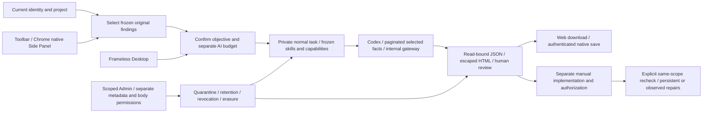

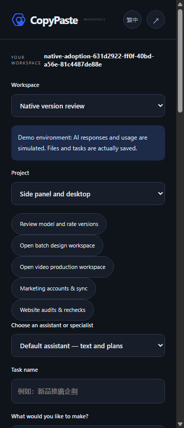
<!-- stage63-source-governed-website-changes:end -->

本仓库是 Chrome MV3 原生侧栏扩展。点击工具栏图标即可打开/收起侧栏；从侧栏选择已登录的企业和项目，或主动进入固定的公司工作台。文件与 Native Messaging 继续遵守显式授权和既有范围控制。

## 有范围约束的网站诊断与复查（阶段 62）

在「行销分析 → 网站诊断与复查」确认起始网址、精确主机、路径前缀、页面请求数和 AI 预算，再明确授权启动。工作台显示范围、请求进度、未检查页面和访问限制；问题保留逐 URL 原文、取回时间、HTTP/字符编码及摘要，支持真实 JSON/HTML 下载。修复后明确建立相同范围的新复查，仅对实际检查的页面判定变化，旧版本保持不可变。

按当前授权使用**模拟业务和 AI 数据**。抓取在非生产夹具执行真实原生 HTTP；Codex 是唯一 Agent 内核，报告由实际 Codex 进程经公司内部 OpenAI 兼容模拟网关生成。公网部署和真实模型质量尚未验收。仅公开获准主机/路径，每个 DNS 回答和重定向校验地址范围；不转发登录凭证、不执行脚本或提交表单。robots、登录、错误、剩余范围和串行抓取限制明确显示。存储不足停止抓取并释放未使用的模型预留。

来源、缓存祖先、复查历史、报告及主动发布副本受当前私有权限、保留期、隔离和删除约束；读取存储后再次检查身份。Admin 的企业/项目范围、元数据、正文和内容操作权限分别执行，隔离来源同时阻止客户继续读取派生证据。完整「保存修改任务」、Search Console 连接指标、GEO 观测、规范 TaskDTO 和原全部验收条件继续保留。

**Desktop 无边框**，保留自绘拖动区、最小化/最大化/关闭，无 Electron 默认边框、应用菜单或 Alt 菜单。登录使用邮箱验证码会话（本地测试邮箱投递）与实际 PKCE 流程；下载通过当前租户认证桥和原生保存窗口。**Extension 工具栏开关 Chrome 原生 Side Panel**，默认右侧并遵循 Chrome 的位置偏好；「网站诊断与复查」仅打开固定公司工作台，临时测试标签页在验收后关闭。

验证：专项 **45/45**，完整平台 **716/716**，保留前一阶段全部 **674 项**命名测试；实际 Web/Admin **13 项**、当前新包原生 **20 项**。两库 SQL077→079 保留原 **164 张**公共表全部行摘要和 SQL001–077，三张新增表为空并强制 RLS。完整产品仍为 81 项有局部证据、21 项未证明完成、0 项完整验收。

当前 localhost 预览：Desktop `release/scoped-seo-62-02/`；Extension `release/scoped-seo-62-02/CopyPaste-0.5.0-sidepanel.zip`。已执行 unpacked Desktop 与真正的 Chrome 侧栏；Setup/Portable 未签名，未执行安装、商店发布或生产验收。以下较早章节为历史记录，其「当前」只指当时的源码和包。

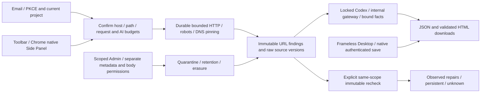

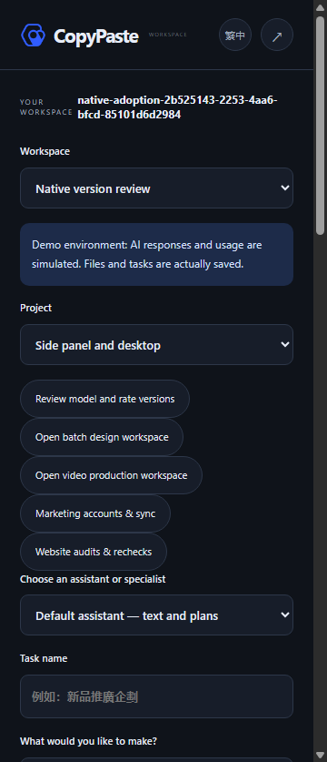

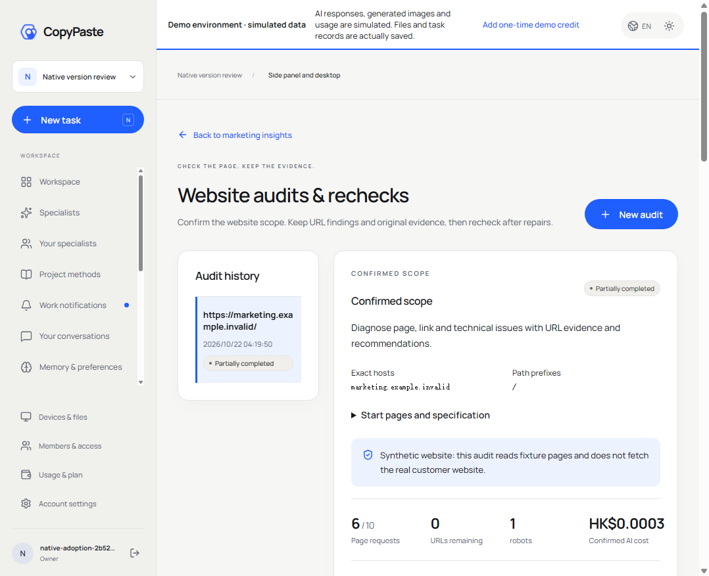

## 营销账户同步与三端入口（阶段 61）

「连接应用」支持 Google Ads、Meta Ads、Google Analytics 4 和 Search Console。点击供应商、完成明确标识的模拟授权，等待账户/属性/站点发现完成后，选择获准账户及可使用快照的项目。确认范围、选择日期，再明确创建快照。页面显示持久分页、错误、限流后的下一次重试时间和不可变历史；排队/执行中可取消，失败重试创建新的关联作业。

当前按用户要求使用假数据：供应商夹具仅在非生产回环开发模式启用，执行实际 HTTP、OAuth state、Google S256 PKCE 和分页；界面、快照与来源均标记模拟。它没有取得真实广告或网站账户。配置正式接入前，须单独核对供应商应用资格、实际账户权限、版本和报表口径。所有 AI 调用仍经公司内部 OpenAI 兼容服务，Agent 内核仅 Codex。

账户只能选自授权目录；Google 经理账户、GA4 reporting identity/时区、GSC 站点权限与 Meta 广告读取范围保留。快照分别记录抓取时间、日期/粒度、账户币种、查询摘要和覆盖限制；未提供的数据截止时间或指标保持未知。Meta 重叠购买类型不相加，GA4 流量与事件保持独立粒度，GSC 分页完成不表示覆盖所有明细。查看事实或下载真正的 JSON/CSV；Google/Meta 的规范化分析数据集保持到不可变源资产的关联。

普通账户目录和历史使用有界分页，选择范围采用版本检查。撤销清除凭证、取消未完成作业并阻止迟到发布，已发布快照继续受原项目权限、保留期和内容治理控制。Admin 可按授权企业/项目查看连接与同步元数据；正文读取与撤销独立授权，撤销要求新鲜 MFA 并返回可审计的持久操作，不暴露 token。源隔离/过期/删除同步限制分析、下载和分享；物理删除保留不含正文的历史凭证。

Desktop 使用**无边框、自绘拖动区和最小化/最大化/关闭按钮**，无系统边框、Electron 默认菜单或 Alt 菜单。供应商授权只经固定公司网页在浏览器完成，再回到本地工作台；受保护 JSON 通过当前会话桥接与原生保存窗口下载。Extension 点击工具栏打开/收起 **Chrome 原生 Side Panel**，默认右侧并遵循 Chrome 用户偏好；侧栏的「营销账户与同步」仅打开固定公司工作台，不接受任意外部网址。

验证：专项 **39/39** 纳入完整平台 **674/674**，保留原全部 638 项命名测试；实际 Web/Admin **17 项**、新打包原生端 **16 项**通过。独立测试：web 8, admin 3, desktop 27, extension 21, delivery 12。两库原生 SQL071→077 保留 157 张原公共表的全部行摘要及 SQL001–071；七张新增表强制 RLS，旧连接只补目录，不补账户/项目权限或业务历史。

当前预览：Desktop `release/connectors-61/`，Extension `release/connectors-61/CopyPaste-0.5.0-sidepanel.zip`。实际执行了 unpacked 程序；Setup/Portable 未签名且未执行安装验收，仍使用 localhost 配置。原始 102 项及 TC/NFR/G01–G10、完整专业角色和生产验收条件全部保留。下方较早阶段的回执与截图保留原执行范围。

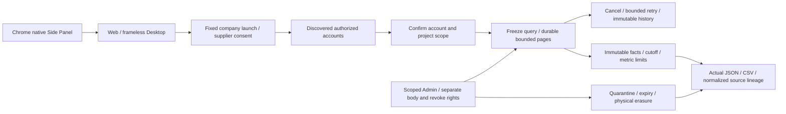

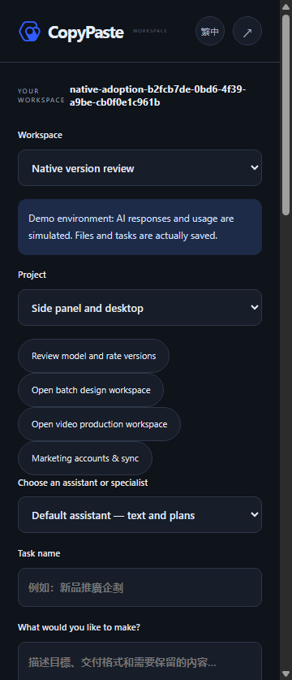

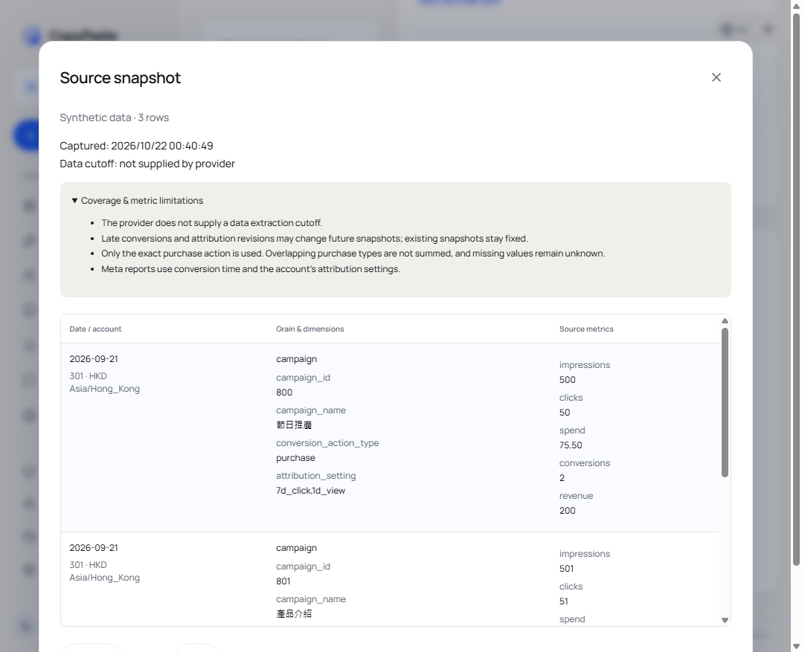

## 模板视频与当前客户端（阶段 60）

在「设计画布 → 影片制作」创建工程，分别填写脚本、分镜、品牌、字幕及项目共享 PNG 的固定版本。可选固定 WAV/MP3，填写音轨入点、增益和自有/已授权声明。保存工程后明确点击渲染，再播放或下载 MP4、工程 JSON、脚本、分镜、WebVTT 和媒体检测六类文件；修改追加版本，失败保留记录并由用户明确重试，排队和执行中均可取消。

`campaign-cuts-1` 支持 3–60 秒、24/25/30/30000÷1001 fps 和偶数尺寸 256–1920 px，受总像素帧预算约束。以整数帧保存时间线，原生 FFmpeg 编码 H.264/yuv420p 与 AAC/48 kHz，验证实际帧数、时长、解码及音量。固定 Noto Sans TC 字体保留 OFL、来源提交和完整 SHA；缺字、文字溢出、缺失/隔离/过期素材、过短音轨明确失败。编码器指纹是版本输出摘要，工程导出引用源素材，重做需要原项目固定版本和一致环境，不保证跨环境逐字节相同。

新渲染队列拥有独立版本、租约、并发额度、取消与最终发布校验。Admin 继续分别控制企业/项目范围、正文查看、隔离、恢复与删除。分享及普通下载都重验派生来源；删除清理实际对象和正文副本。原生合成不调用 AI，AI HK$0 只描述本次合成，原素材费用另计。

R16 视频角色以新预设 v1.1.0 开放已实现的 `video.render` 合成工具，执行模式中的受控 Codex 工具可幂等提交工程与排队；只读、计划及私有会话不暴露共享写入工具。新增第 29 个预设 Skill `template-video-composition`，原 28 个包和 18 个角色的完整验收条件保留，旧角色版本不自动改写。生成式视频、特效、TTS/ASR 和完整专业角色仍按独立需求跟踪。

专项 **34/34** 纳入完整平台 **638/638**，保留原全部 607 项命名测试；实际 Web **10 项**、新打包原生流程 **17 项**通过。Web 8、Desktop 25、Extension 21、Delivery 12 项独立测试通过。两库 069→071 保留 154 张原公共表全部行摘要及 SQL001–069，新三表强制 RLS。

Desktop 无系统边框、Electron 默认菜单或 Alt 菜单，使用自绘窗口控制；受保护成片通过现有登录桥接在本地播放器打开。Extension 工具栏仍打开/收起 Chrome 原生 Side Panel，默认右侧并遵循 Chrome 用户偏好；新增视频工作台入口。当前预览位于 Desktop `release/video-60/` 和 Extension `release/video-60/CopyPaste-0.5.0-sidepanel.zip`。实际执行 unpacked 程序；安装器/便携版未签名、未执行安装验收，使用 localhost 后端。原始 102 项及 TC/NFR/G01–G10 的综合验收条件保留。

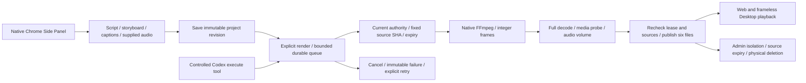

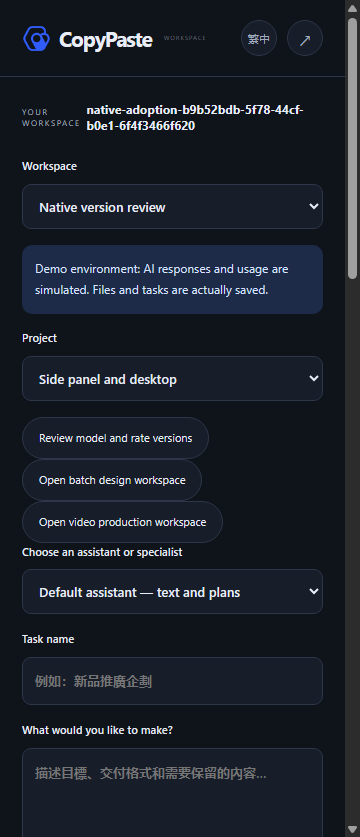

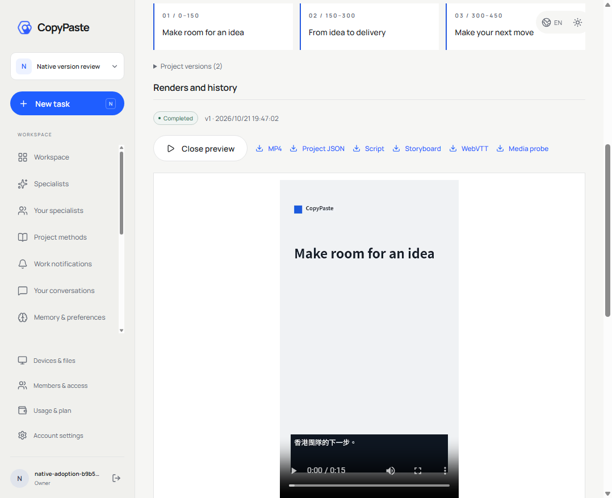

## 批量设计与当前客户端（阶段 59）

设计画布新增按创意 × 语言 × 尺寸建立的交付矩阵，每批最多 60 格。提供繁中/英文文案、同项目固定 PNG 和默认或自订尺寸；每种尺寸重新布局，保存实际 PNG、SVG 与 JSON 编辑描述。修改、重试、失败和输出历史均按单元独立保存。排版本身不调用 AI，费用来源明确为本地合成、AI HK$0，不包含已有素材的上游费用。

领取与发布分别检查当前权限、输入修订和素材；取消、撤权及过期租约阻止迟到输出。后台原正文权限和企业/项目范围继续适用；源图隔离阻止派生文件读取，删除会物理清理所有嵌入副本。SVG 引用服务器字体，本阶段不分发或宣称完成自订字体商用授权。

专项 **22/22** 包含于完整平台 **607/607**，保留全部原 588 项命名测试；实际 Web **10 项**及新打包客户端 **13 项**流程通过。Web 8、Desktop 25、Extension 21、交付工具 12 项独立单元测试通过。两库 068→069 各保留 151 张原公共表全部行摘要及 SQL001–068，新三表强制 RLS。

Desktop 保留无边框、自绘窗口控制和无 Electron 默认菜单；扩展工具栏打开原生 Side Panel，再次点击收起。侧栏提供批量设计入口，完整画布在公司工作台打开。当前预览路径为 Desktop `release/matrices-59-02/`、Extension `release/matrices-59-02/CopyPaste-0.5.0-sidepanel.zip`；旧包不覆盖。安装器和便携版未签名、未进行安装或商店发行验收，使用 localhost 后端。全部其他专业业务、实网服务、完整 102 项及 TC/NFR/G01–G10 继续独立跟踪。

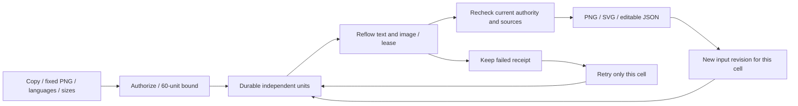

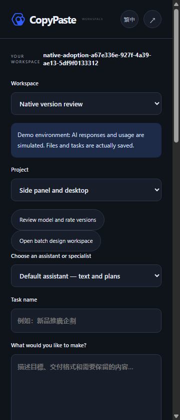

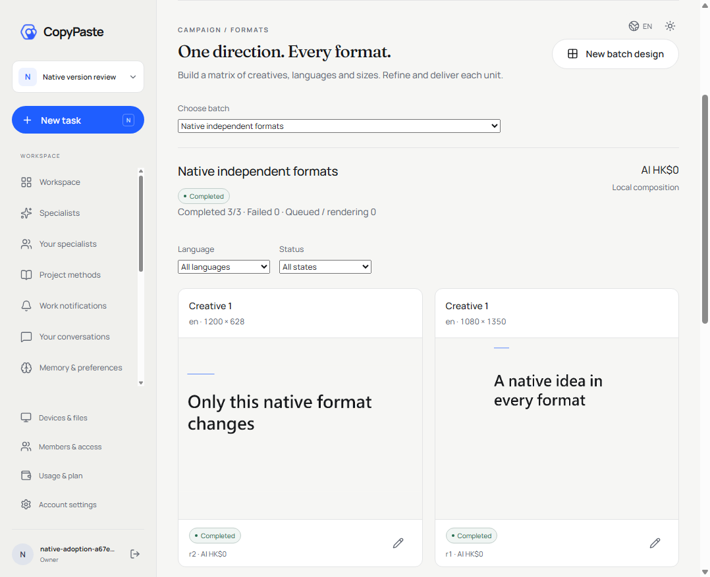

## 明确采用版本（阶段 54）

默认助手更新、专家设置与会话采用先比较明确模型、推理强度、单价及 Skill 版本，再由用户确认。五分钟比较绑定实际登录会话与配置状态，过期或变化拒绝确认；重试使用持久幂等键。已接收任务继续原模型和原费率。

当前平台完整回归 **484/484**，保留原 462 项测试；专项 **93/93** 与全量重叠，不相加。实际构建版 Web **12/12**，新版无边框打包 Desktop 与真实 Chrome 原生侧栏 **11/11**。AI/媒体使用已授权假数据，身份、PostgreSQL、权限与版本事务实际执行。原始 102 项综合验收继续跟踪；以下旧章节保留其时源码与产物范围。

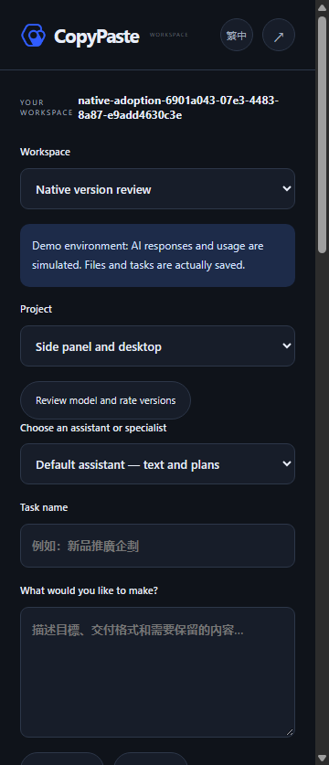

点击工具栏图标打开原生 Side Panel，默认右侧，再次点击收起；不设置 action popup。新增双语“檢視模型與費率版本”进入公司固定 `/app/specialists` 工作区，侧栏继续使用独立精简渲染器。左右位置由 Chrome 偏好决定。新版可加载 ZIP：`release/adoption-54/CopyPaste-0.5.0-sidepanel.zip`，原 `release/sidepanel/` 字节保留。

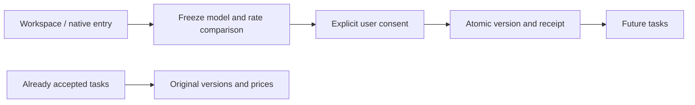

## 限时只读客服协助 / Controlled support

继续由 Chrome 工具栏按钮开启原生右侧 Side Panel。客服授权在 Web 账户设置管理，侧栏不会获取管理员支持会话或用户的其他登录凭证。

阶段 51 当前平台回归 424/424（711 份来源），受控支持页面 8/8（816 份来源、9 张未编辑截图）。14 组支持专项、原规范检查、迁移保留及独立原生检查是有界证据，完整 102 项验收继续跟踪；当前包已重建，阶段 50 包原字节另存。

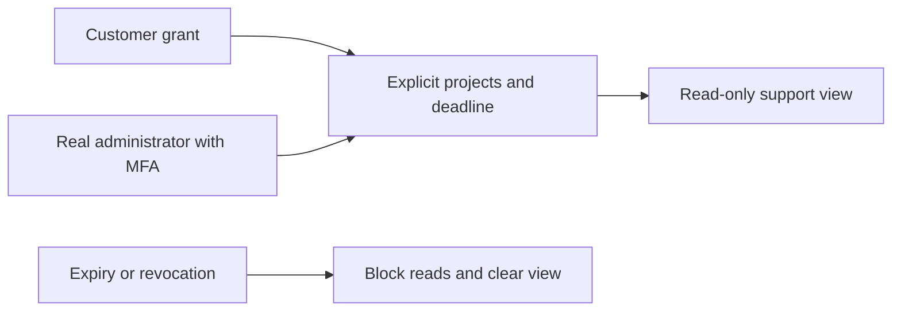


[English](README.en.md) · Chrome MV3 侧栏与原生桥接 · 0.5.0

独立 Git 仓库。扩展让用户在 Chrome 选择工作区/项目、提交角色任务、主动提供本地文件或当前网页；持续目录操作通过已安装 Desktop 的原生桥接完成。模型执行与计费始终由平台承担，扩展不保存 AI key。


阶段 49 历史联调已验证无边框 Desktop、Chrome 原生右侧 Side Panel、实时权益/通知和退出，当时安装器保持原字节。下方阶段 50 随费用视图源码重建当前预览；完整安装/签名/SSO/系统验收仍单独跟踪。

## 事务费用通知与三端账户（阶段 50）

工具栏仍打开真实 Chrome 原生 Side Panel，默认右侧；左右位置由浏览器偏好决定。侧栏增加精确个人余额、最近五条账户通知、未读筛选和已读切换，完整历史/工作事件在 Web 查看。企业切换、失败读取、撤权和退出清空旧内容，工作区/请求序号拒绝迟到结果。深色提示文字已实际校验对比度 11.59:1；本轮仅使用自建浏览器并完整关闭。

阶段 50 当时平台回归 410/410，真实三端费用流程 8/8。AI/媒体和付款证据使用获准本机模拟；身份、数据库、权限、账本及通知实际执行。原始 102 项综合验收、生产银行及完整安装/系统矩阵继续单独跟踪。

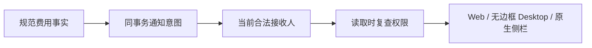

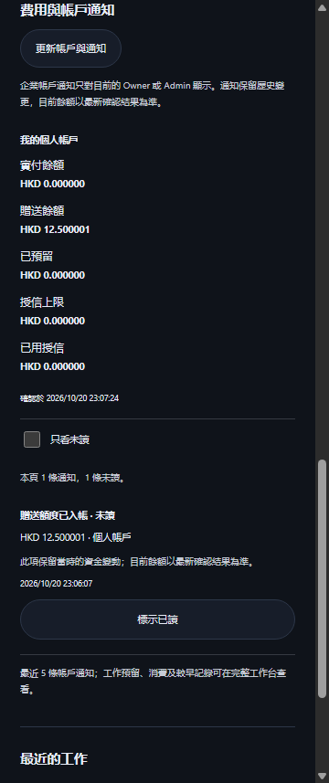

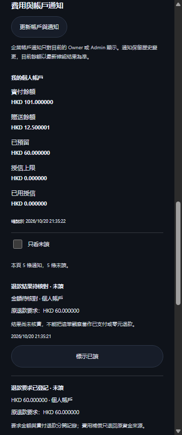

## 点击后在浏览器侧栏出现

出现方式参照新版 MetaMask：在 Chrome 扩展菜单选择 CopyPaste，或固定图标后点击，打开当前窗口的原生 Side Panel，默认位于右侧。再次点击收起；切换网页/标签页保留同一全局侧栏，关闭侧栏不取消云任务。初始化及浏览器重启不会自动弹出界面。

manifest 使用 `side_panel.default_path`，action 不设置 `default_popup`；service worker 每次启动、安装/更新和浏览器启动都恢复 `openPanelOnActionClick: true` 与受信存储访问级别。不会用新标签、悬浮层或 popup 代替侧栏。右/左位置由 Chrome 用户偏好管理，扩展无法强制覆盖；设为左侧的用户可在 Chrome 外观/侧边栏设置切回右侧。产品仍兼容 Chrome 120；较新 Chrome 的 `getLayout()` 仅用于 QA 读取布局。

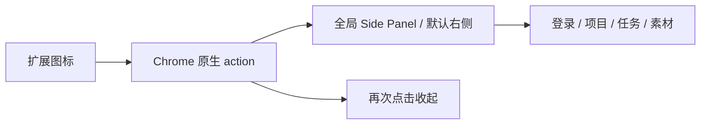

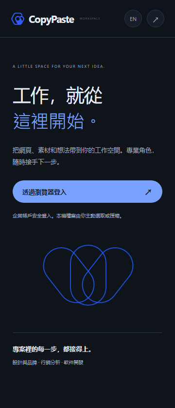

该图来自真正 SIDE_PANEL 文档的 CDP 截图，仅含侧栏内容。交付仓库 `qa:native-surfaces` 通过 `Extensions.triggerAction` 执行真实浏览器按钮默认动作，断言右侧布局、SIDE_PANEL、网页宽度缩小、不增加普通标签页、切页保留和再次收起。2026-10-20 对当前构建重新执行该验证，并将扩展全部 dist 文件和源码字节绑定到实际测试报告。原有 `qa:extension` 八组是先前登录和业务流程的增量记录；完整认证矩阵继续独立验收。测试在 finally 关闭自己的浏览器。

当前可加载 ZIP 位于 `release/sidepanel/CopyPaste-0.5.0-sidepanel.zip`，解压后在 `chrome://extensions` 加载目录。先前预览原字节保留在 `release/sidepanel-stage30/`。交付清单记录新包 SHA-256；预览使用 localhost origin，商店发布和生产配置仍需正式交付。

## 构建与加载

Node.js 22.14+、Chrome 120+，本次实际验收使用原生 Chromium。先运行 platform 和 Web：

```powershell
npm ci
npm run typecheck
npm run build
```

在 `chrome://extensions` 打开开发者模式，加载本仓库 `dist/`，再打开 CopyPaste 侧栏。固定 unpacked ID：`fffkcnmfdhahlnifgdilabheppkgnlok`。`manifest-key.txt` 仅含公开 SPKI 公钥，用于稳定 ID，不是模型密钥或商店私钥。平台 `EXTENSION_ID` 及 Desktop `deployment.json` 必须一致。

默认 API/Web 为 `http://localhost:4310` / `http://localhost:4317`。生产构建在 PowerShell 设置：

```powershell
$env:COPYPASTE_API_ORIGIN='https://api.your-company.example'
$env:COPYPASTE_WEB_ORIGIN='https://agent.your-company.example'
npm run build
```

只接受 HTTPS 公司 origin 或 localhost 开发地址；参数不能包含路径、凭证和查询。`dist/manifest.json` 的 host permission 只包含 API origin。未提交 Chrome Web Store，也未声称已获得上架授权。所有本机操作原生执行，禁止 Docker、WSL 和虚拟化环境。

## 登录与使用流程

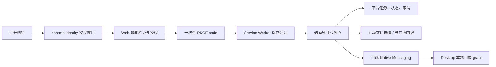

登录在公司 Web 页面完成；回调地址严格绑定 Chrome identity URL。access/refresh 仅在受信 service worker 的 `chrome.storage.session` 保存，不在侧栏、localStorage 或 `storage.local` 保存。浏览器会话结束后需要重新登录；刷新轮换和退出由平台验证。扩展 local 存储只保存语言偏好。

文件必须通过用户手势选择，当前扩展限 5 MB；平台再次检查项目权限。当前网页抓取需要用户点击，使用 activeTab/scripting，排除表单、可编辑与隐藏内容，不后台全站采集。

## 与 Web / Desktop 的配合

0.2.0 使用同版平台身份、权限和任务接口，构建时从 package.json 写入 manifest 版本。侧栏提供轻量任务和素材入口；专属专家配置、完整私密会话和记忆管理在 Web 或 Desktop 工作区完成。私密成果须明确发布才成为可分享的项目素材。

## 原生本地目录

Chrome 扩展本身不能扫描任意本地路径。先安装 Desktop 的 Windows Setup 版，在设备页面点击连接 Chrome helper，经本机确认后仅注册当前 Windows 用户的官方扩展来源，再在扩展中授予可选 nativeMessaging 权限。

每个目录另行通过原生选择器授权，1 小时到期，默认只读；创建文件需要额外同意。支持列目录、预览、上传、仅创建新文本文件、撤销。禁止路径穿越、符号链接/junction、设备名、ADS、覆盖现有文件和远程 shell。Native Messaging 单条结果控制在 900 KB 内；更大文件使用显式文件选择器。

## 验证、代码与边界

- `src/background.ts`：PKCE、token 轮换、受限 API/原生消息、当前页抓取。
- `src/panel.ts`：项目/角色/任务、文件上传、目录工具与语言选择。
- `scripts/build.mjs`：公开部署 origin、固定 manifest、稳定扩展 ID。
- delivery `npm run qa:extension`：真实 MV3、chrome.identity 登录、上传、会话隐私和退出；创建的浏览器上下文在 finally 关闭。
- delivery `npm run qa:desktop`：实际打包 Windows native host 的长度帧、来源 allowlist、目录 grant 和本地文件流程。系统注册表安装本身由用户明确确认，不在 QA 中覆盖既有注册项。

扩展界面支持中/英切换，部分动态状态保留繁体中文；完整产品翻译仍需复核。公司 AI 网关未联调时不能提交可执行 AI 任务；缺少企业时先到 Web 初始化。云端每日/每周计划在 Web 或 Desktop 管理；完整 Desktop 自主操作与 AI 视频/语音仍按主文档待建设。素材与依赖见 [说明](THIRD_PARTY_NOTICES.md)。

## 0.5.0 企业身份与统一登录

OIDC 使用 code + PKCE S256、签章、state/nonce 与固定回调。先有注册账号及有效企业成员资格，再绑定企业身份；首次绑定需要独立的 CopyPaste 工作邮箱确认码，不按网域自动开户。配置改变、停用或本人解除连接会撤销关联用户的全部 CopyPaste Web/native/refresh 会话和旧执行授权。管理员登录仍独立使用邮箱与 TOTP。

企业身份复用系统浏览器授权页：点击登录后，在 Web 选择企业登入，完成身份验证及必要的邮箱确认，再明确授权 Chrome 回调。扩展保留独立 PKCE、短期 access token、轮换 refresh；服务端码绑定签发来源会话与用户版本。退出来源或撤销企业身份后，未交换旧码不能继续使用。本地文件及 Native Messaging 目录授权仍须明确操作。

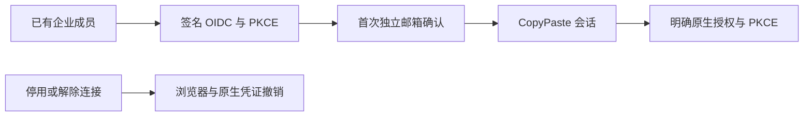

## 默认助手与通知（当前源码）

侧栏可直接选择默认文字助手，也保留专业角色。提交使用稳定请求编号；未知响应重试复用原私人会话和任务。企业或项目切换后，旧请求不得覆盖新列表/任务。模拟企业持续显示假数据提示。通知列出当前接收者最近 20 条，支持已读切换及原项目/任务跳转；完整分页和会话继续在工作台处理。

Delivery `qa:extension` 八组真实 MV3 旅程已通过：PKCE、接受响应丢失后的真实重试与 Codex 文字文件、通知定位、320/420/768 宽度和两主题/语言、主动上传、凭证隐私/退出、接受响应延迟期间切换项目，以及运行前补齐文件。模型为明确模拟依赖，未取得正式专业角色资格，旧发布 ZIP 未替换。

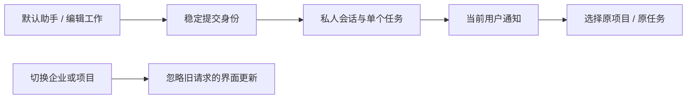


## 先补齐资料 / Provide inputs first

可明确选择「先等我提供档案」，侧栏搜索/分页选择当前版本后继续同一任务，保持原预留。上方选取器上传到共享项目（5 MiB），不会自动选中；私人补传和新连接授权在完整工作台进行。可以在侧栏为既有连接需求选择已授权连接；不自动同步账户或报表。取消等待会释放未使用预留。

Submit an explicit file prerequisite, then search and select a current version to resume the same task and budget. The existing picker uploads to the shared project (5 MiB); selection remains explicit. Private attachments and new connector authorization use the full workspace. Existing connection requests can select an authorized connection without automatically importing reports. The input form was checked at three widths in both themes.

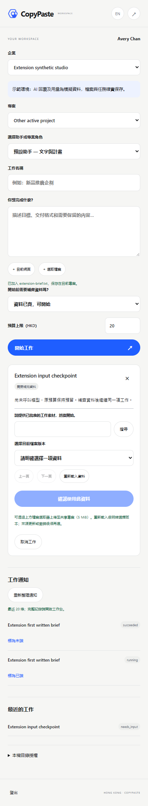
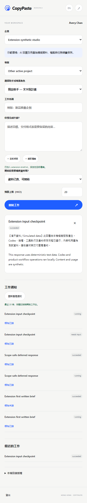

## 共用名额排队（当前源码）

侧栏识别服务端容量等待，说明模型未启动、预算保持预留及原工作自动继续。此约束与 Web/Desktop 共用同一队列及数据库，不通过扩展重复创建或收费。历史 ZIP 保持原版。

## 与持久模板目录的关系

当前 Web 与 Desktop 新增模板预检/实例化；扩展继续使用已验证的默认文字委派、通知和明确授权文件流程，本次未新增扩展内模板编辑器。专业模板尚待真实业务资格，不因扩展能连接同一服务就计为已验收。

侧栏任务详情新增“暂停排队 / 继续工作”，只允许首次模型调用前控制原任务；保留原预留，并同步最近任务状态。Delivery `qa:task-controls` 通过真实 MV3/PKCE 验证业务操作，运行中的暂停不开放。本轮为源码变更，上一轮 `release/sidepanel/` ZIP 未更新；原生右侧 SIDE_PANEL 出现方式继续遵守既有专项验证。


## 会话失效与退出

后台合并并发刷新，限制迟到登录/刷新回写；确定的 401 清除当前凭证并通知所有打开的受信侧栏，旧账户请求不会清除后来登录的凭证。失效后清空账号、任务、文件和通知视图，停止轮询。退出先清空 session 存储，再凭刷新凭证撤销整族；访问令牌过期也可完成。离线时显示服务端撤销未确认，不伪装已撤销。


此前 `npm test` 有 10 组会话竞争/故障测试；交付仓库 `qa:sessions` 使用真实 MV3 与 identity PKCE 验证远端撤销和过期访问退出。本次业务测试用独立 MV3 文档，不替代原生 SIDE_PANEL 出现模式专项。原侧栏预览 ZIP 保留原清单，未包含本轮修复。

## 规范认证与多侧栏 / Canonical authentication and multiple panels

首次 S256 交换和刷新使用规范 token 接口；首次未知响应最多同标识重试一次，刷新标识随受信 session 存储持久保存。同一身份的刷新不重载工作区；新登录清理旧账号、任务、项目及文件状态后自动更新所有已打开侧栏。旧账号迟到的未授权回执不能清除后来账号。

Canonical code exchange and refresh preserve request identities across unknown replies. Accepting a new sign-in updates every existing panel; ordinary rotation retains the local identity epoch. View revisions are checked before processing errors, so an old unauthorized response cannot clear a replacement account. Delivery exercises two actual MV3 documents and a different-account replacement; the native SIDE_PANEL appearance has its own separate verification.

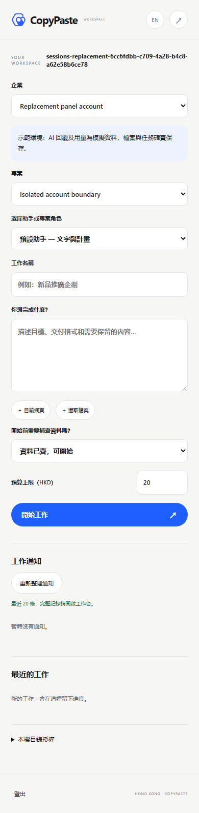

The historical Side Panel ZIP retains its original manifest and does not include these source changes.

当前 `npm test` **19/19**，包含十五组会话竞争/持久化边界与四组首次交换重试检查。 / Current native tests: **19/19**, including fifteen session and four initial-exchange checks.

历史启动限制：此前十二组原生复核未完成，失败与诊断仍见 `evidence/auth-recovery-open-issue.json`，原七组 `sessions.json` 保持原字节。2026-10-20 当前源码十二组已通过，使用新的 `evidence/auth-recovery-current.json`；具体范围和截图见下文，完整安装包／SSO／系统矩阵仍待验收。

Historical startup limitation: the earlier twelve-flow run did not complete; its failures and diagnostic comparison remain unchanged. The current-source rerun now passes **12/12** in `evidence/auth-recovery-current.json`, with scope and screenshots below. The original seven-flow session receipt remains historical. Complete packaged authentication, SSO and system matrices are still unaccepted.

## 用户资料契约 / User profile contract

侧栏初始化与项目刷新改用受认证的 `GET /v1/session/context` 读取本人资料和工作区；规范 `GET /v1/me` 仅返回 `User`。原生凭证仍只在受信任后台保存，多面板换账号守卫继续生效。本次源码和 dist 构建不改写历史侧栏 ZIP。

Panel bootstrap and project refresh now use authenticated `GET /v1/session/context` for profile and workspace access. Canonical `GET /v1/me` returns only `User`. Credentials remain in the trusted background; multiple-panel identity fences remain active. Historical preview ZIPs are preserved.

## 当前 MV3 会话恢复复核（2026-10-20）

Delivery `qa:sessions` 的 Web／源码 Electron／MV3 十二组现已 12/12：真实 identity S256 登录，首次交换和刷新回执丢失的同键恢复，实际 session storage 撤销，两份已打开业务页自动登录／换账号、旧账号迟到 401 隔离及过期访问仍可退出。769 份源码／运行文件一致，凭证和自建三端实例均清理；旧失败诊断保持原字节，模型调用 0。


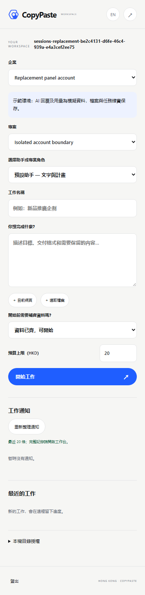

当前认证使用实际 MV3 业务文档；右侧栏出现方式另由原生 SIDE_PANEL action 的 10/10 外观证据覆盖，不能用此截图替代。侧栏 ZIP 原字节保持不变，完整打包／身份／系统及成员旅程仍须验收。

2026-10-20 退款增量后当前源码复核：Web 成员 6/6（169 份来源）、Admin 成员 6/6（196 份）和 Web/源码 Electron/MV3 认证 12/12（775 份）通过，前后摘要一致，拥有的会话、浏览器、Electron 和扩展进程均已清理。首轮 Electron 调试连接超时原回执保留，随后相同源码重跑通过。Desktop 无边框和原生 Side Panel 预览包保持原字节；完整安装包认证及系统矩阵仍须独立验收。

2026-10-20 方案版本增量後的當前源碼復核：Web 成員 6/6（172 份來源）、Admin 成員 6/6（200 份），Web／源碼 Electron／MV3 認證 12/12（779 份）；測試前後摘要一致，自建瀏覽器／Electron／擴展均關閉，測試憑證清理。新增不可變方案定義與固定歷史授權綁定不改寫原生預覽包。完整 VIP／配額、安裝包認證及系統驗收仍按主文檔繼續追蹤。

## 当前右侧原生侧栏与权益同步

点击浏览器工具栏图标后，在浏览器右侧打开真正的 `SIDE_PANEL`，页面相应缩窄，不额外创建 popup 或普通标签页。再次点击收起，换标签页／导航保留同一个侧栏文档，浏览器重启后恢复入口行为。当前重建扩展与无边框 Desktop 的 10 组原生表面检查及 6 组真实登录／VIP 联调通过。

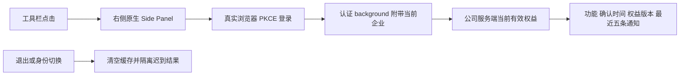

侧栏每 15 秒及手动刷新；个人和当前企业权益由服务器合并，仍须项目／文件授权和预算。通知已读属于本人，不授予额外能力。原生联调验证同一用户在 Desktop 标记已读后，侧栏读取同一条持久记录；暂停按真实免费方案回退，并实际退出清理凭据。19 项单元检查通过；完整 Native Host 大文件、安装／发布和所有生产验收仍保留。

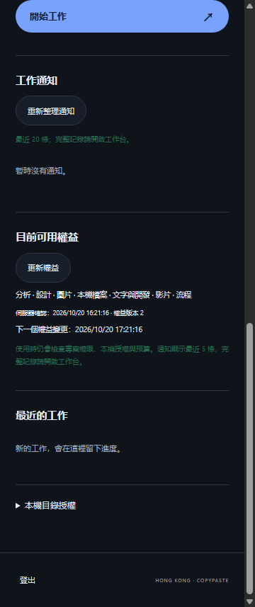
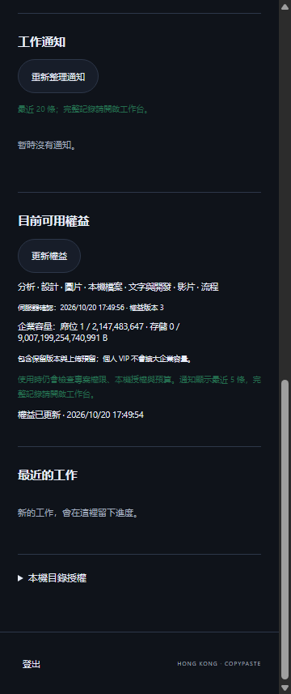

验收使用实际浏览器 action 触发与 CDP 附着真实侧栏，未把 `sidepanel.html` 当普通网页替代。构建 `npm run build`；在 Chrome 扩展管理页加载 `dist/`。当前 ZIP 和字节摘要由相邻 Delivery 仓库的 `package:surfaces` 统一记录。

## 企业席位与存储执行（阶段 48）

真实原生 Side Panel 的权益摘要新增企业席位、保留字节、上传预留、上限及超额状态。字节用 BigInt 显示，企业/项目及登录上下文限制继续执行；个人 VIP 不改变共用企业容量。点击扩展图标在浏览器侧栏出现的方式保持有效，关闭自建验收页面后不留下额外标签页。


