# Workmate · CopyPaste Admin Dashboard

[English](README.en.md) · [主文档](https://github.com/copypasteltd/workmate/blob/docs/docs/README.md)

<!-- brand-production-stage79 -->

## 固定品牌版本与生产检查

Admin 保留完整范围鉴权；品牌元数据管理、受授权正文中的版本历史与质量汇总使用各自权限。

1. 登录并选企业/项目，在 Web 或 Desktop 打开「品牌资料」。设置名称、色彩、字体及使用声明、核准产品事实/价格、促销期限、渠道/语言和可选固定 Logo 文件。上传字体须共享至当前项目。
2. 发布不可变版本。以后编辑会产生新版；并发旧版编辑报冲突。已有专家和任务继续使用绑定版本，需要升级时显式采用新的专家版本。
3. 选历史版本检查文字或固定事实。缺字定位到 Unicode 码点，过期促销或字体声明阻止新生产；价格事实使用存储文字和金额，不静默换字体或价格。
4. 绑定品牌的云端设计任务必须携带匹配的品牌/版本和渠道/语言。文字使用固定声明字体配置，显式引用事实键时使用存储文字和价格。产物保留来源依赖和可编辑 JSON；SVG 文字转路径，PNG 和有限的单页 PDF 审阅稿是真实渲染。字体登记只记录客户声明，不证明版权。

启动依赖客户端前，在已配置后端使用 `npm run db:migrate` 应用 **SQL096**。已发布 SQL001–095 与两份原有 OpenAPI 各自的字节保留。新增品牌契约包含四项操作；配置服务共 438 项，`DEMO_MODE=true` 时另有一项演示额度操作。旧品牌在当前权限下保留可读，不补造历史版本或许可；固定字体生产前需明确发布 v2 资料并采用新的专家版本，旧任务不自动改绑。

Desktop 在客户本机运行 Codex，提供明确可撤销的完整本机权限，无原生边框/菜单；纵横滚动条外观隐藏，同时保留滚轮、键盘、焦点定位及 800×600、1280×800、1440×980 实际窗口访问。保留真实进度。Extension 是云端 Codex 的原生右侧栏。全部 AI 请求经公司网关；测试后关闭自建浏览器，禁止 Docker/WSL/虚拟机。

当前分别通过：**平台 874/874 项**（68 文件/17 批，保留此前 861 项并新增 13 项）、客户端 68 项、打包 Desktop 30 项、品牌 Web 四项、Web/Admin 品质四项及原生侧栏八项。保留原生内核 17 项的 57 份绑定源码均未变化。数据库、身份、文件、账本和本机 Codex 真实运行，模型/客户/业务数据为明确夹具。原 102 REQ/102 TC 为 82 部分验证、20 未证明、0 完整验收；G01–G10、TC-056 真实客户盲审继续未证明。Desktop 品牌表单证据不等于全部本机专业角色的品牌约束已验收。

品牌正文及历史读取仍须限时支持授权；元数据/品质权限不能读取客户正文或代客户接受成果。原有用户、内容、消耗、费用与 VIP 管理继续使用各自范围命令及审批。

Desktop33、品牌 Web02 和 Web/Admin08 保留实际收据；其后只有一个未被这些旅程执行的扩展测试文件补充加载等待和登录诊断，前后字节及无关范围已单独核对。它们的应用/界面和执行旅程/验证器未变；新扩展运行及平台23使用更新后的测试文件，精确边界见检查点。

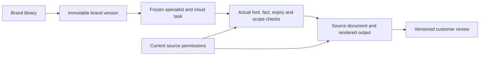

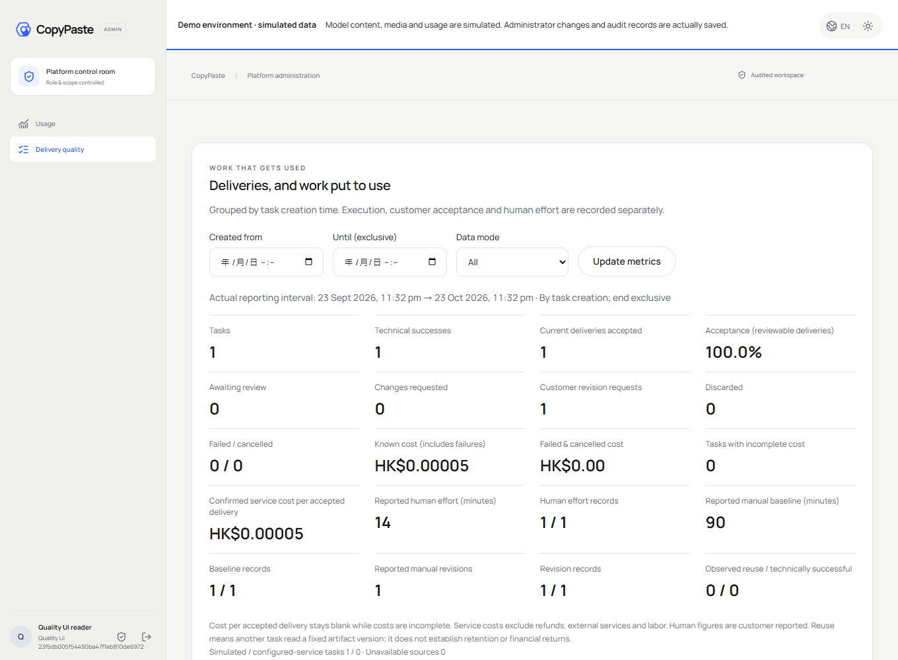

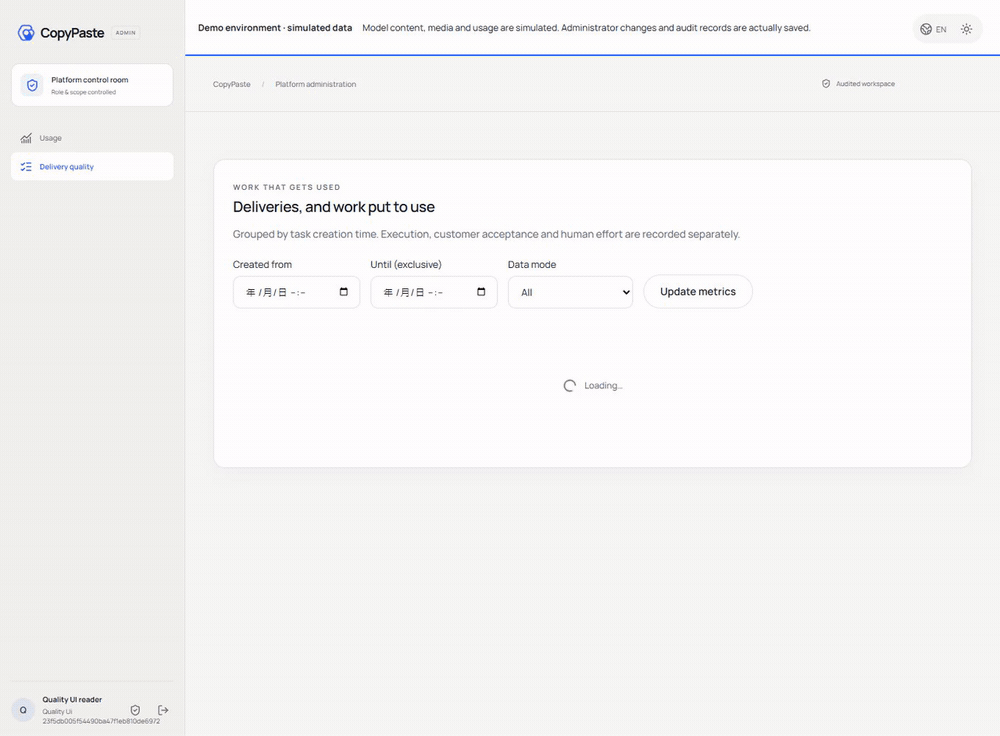

[MP4](assets/screenshots/workmate-quality-08-delivery-quality.mp4) · [Design / 方案](https://github.com/copypasteltd/workmate/blob/docs/docs/technical/79-versioned-brand-production.md) · [Contract / 契约](https://github.com/copypasteltd/workmate/blob/docs/docs/contracts/brand-production-openapi.json) · [Evidence / 证据](https://github.com/copypasteltd/workmate/blob/docs/docs/quality/brand-production-checkpoint.json) · [Changes / 更新](https://github.com/copypasteltd/workmate/blob/docs/docs/changes/2026-10-24-versioned-brand-production.md)

<details>
<summary>阶段 78 交付及完整安装参考：旧计数保留原验证范围</summary>

<!-- business-quality-stage78 -->

## 当前交付审阅与使用流程

独立 MFA 管理后台，按明确范围管理用户、费用、VIP、内容及权限。 新增接受、需修改、弃用的版本化交付审阅；人工基线、累计投入和修改次数独立填报。项目用量与后台交付品质面板分别显示技术成功、客户接受、实际读取复用及公司服务成本。

Desktop 保持客户本机 Codex、明确可撤销的完整本机权限及无边框/无 Electron 菜单。隐藏纵横滚动条外观，保留真实滚轮/键盘访问；内容重排，800×600 下聚焦输入框、聊天输入区和费用回执可见。此前进度条约束已撤销，保留真实进度。Extension 仍为独立原生右侧栏，聊天及获准文件上传至云端 Codex；所有 AI 请求走公司网关。

1. 登录并选择企业/项目，在正确执行位置创建任务。Desktop 另选本机目录并明确授权；Extension 不要求安装 Desktop。
2. 查看真实结果，打开 Desktop「审阅本次交付」或任务评价表单，保存接受、需修改或弃用及可选意见。任务或交付换版时需重新载入后审阅。
3. 按需填写累计人工数字。空值为未知，0 为明确没有投入；保存后保留展开的表单与输入访问。
4. 在项目用量或 Admin「交付品质」查看当前有权范围；未确认费用不冒充完整成本。服务成本不含退款抵减、外部服务及人工，不推断 ROI 或续费。

上线依赖接口/界面前先应用增量 SQL095；SQL001–094 与原任务 OpenAPI 保持原样。未固定交付版本的旧接受状态需客户重新审阅。保留原评价接口，当前表单强制任务版本、交付摘要及幂等键。写评价需要项目 approve 权限；Admin 的 `admin.usage.read` 仅查看授权范围汇总，不能代客户接受、从汇总读取意见正文或授予 OS 权限。

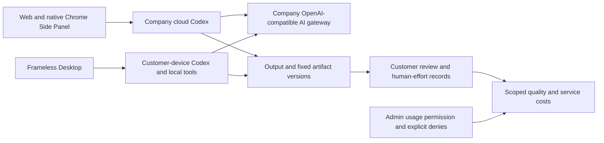

当前源码验证：平台 861/861 项（67 文件/17 批）、客户端 68 项、实际打包 Desktop 26 项、Web/Admin 四项及原生侧栏 8 项分别通过，不相加。保留的 17 项原生内核证据中 57 份绑定源码均未变化。身份、数据库、文件、费用和本机 Codex 真实运行；模型/业务/客户输入与系统对话框决定明确为夹具。TC-056 真实任务基线/盲审、18 角色/29 Skill 的全专业交付、完整 OS/Codex Desktop 对齐及生产门槛继续未证明；原 102 REQ/102 TC 和 81 部分/21 未证明/0 完整验收保持。

Desktop31 与 Web/Admin07 保留原始执行记录；其后仅一份迁移测试中的两个版本期望值从 94 更新为 95，前后字节已归档并逐字核对，运行代码、界面和旅程脚本均未变化。平台21重新执行更新后的全套测试；该保留证据边界见检查点。


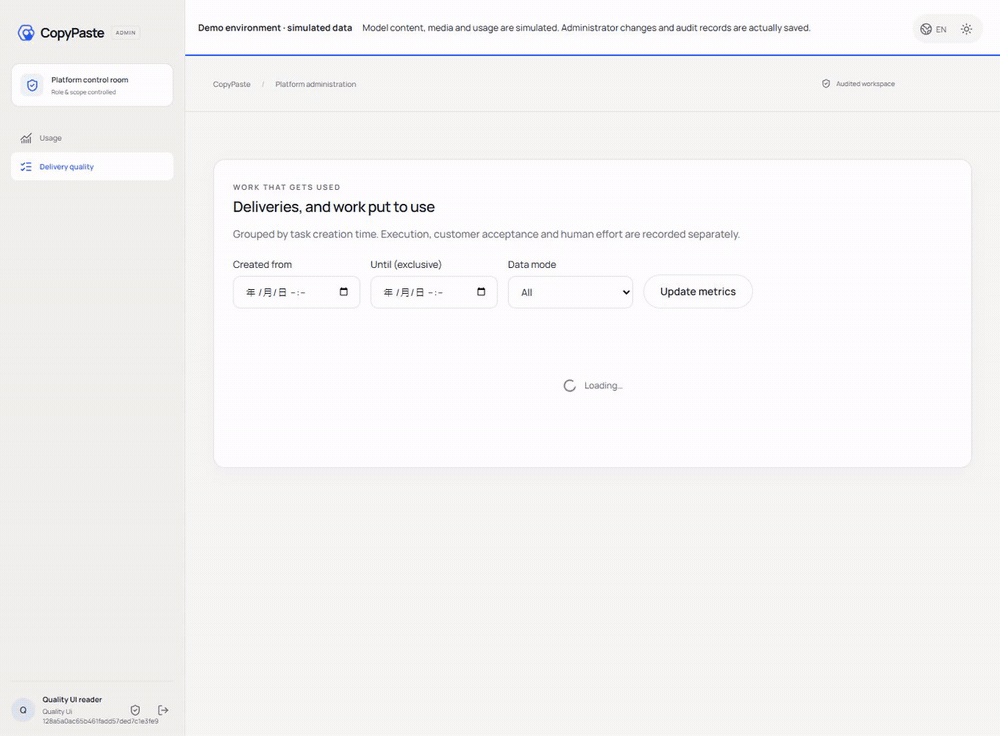

[MP4](assets/screenshots/workmate-quality-07-delivery-quality.mp4)

[Design](https://github.com/copypasteltd/workmate/blob/docs/docs/technical/78-business-delivery-quality.md) · [Contract](https://github.com/copypasteltd/workmate/blob/docs/docs/contracts/business-quality-openapi.json) · [Exact source and media evidence](https://github.com/copypasteltd/workmate/blob/docs/docs/quality/business-quality-checkpoint.json) · [Changes](https://github.com/copypasteltd/workmate/blob/docs/docs/changes/2026-10-23-business-delivery-quality.md)

<details>
<summary>完整安装、架构与历史验证记录（较早计数和截图保留原时点范围）</summary>

[Backend](https://github.com/copypasteltd/workmate/tree/backend) · [Web](https://github.com/copypasteltd/workmate/tree/web) · [Admin Dashboard](https://github.com/copypasteltd/workmate/tree/admin) · [Desktop](https://github.com/copypasteltd/workmate/tree/desktop) · [Chrome Extension](https://github.com/copypasteltd/workmate/tree/extension) · [Delivery](https://github.com/copypasteltd/workmate/tree/delivery)

面向香港企业的云端 Agent 产品。当前仓库负责 **Admin Dashboard**；当前远程分支为 `admin`.

<!-- client01-direction -->
## 当前客户端方向与实现差异

CLIENT01（2026-10-22）要求 **Desktop 在客户本机运行 Codex Agent**，提供客户可主动授予的 **完整本机权限**，操作能力对标 Codex Desktop。**Extension 在 Chrome 原生右侧栏采用 ChatGPT 式对话/附件结构**，获取、读取用户获选文件并上传，由云端 Codex 执行。全部产品 AI 请求仍走公司内部网关。

**阶段 77 历史实现：** Desktop 在客户本机运行 Codex，提供客户明确完整授权、本机文件/终端、同线程继续、原生追问、公司设计/视频工具与本机父子流程。新增十二项本机浏览器工具，可真实导航、操作、上传、截图和下载；停止/撤权回收任务页面。Desktop 隐藏可见滚动条，成果、代码和表格自动换行，保留纵向滚动与键盘访问；已撤销此前进度条约束，保留真实进度反馈。当前分别验证平台 851 项、客户端 68 项、原生内核 17 项、独立 Electron 浏览器 10 项和实际打包旅程 25 项，不相加。18 角色/29 Skill 的完整专业交付、全部 OS 应用与 Codex Desktop 全面能力对齐、真实模型及生产验收仍待证明。Extension 继续独立的 ChatGPT 式原生右侧栏、获准文件上传与云端 Codex，本轮未重跑其 UI。见 [方案](https://github.com/copypasteltd/workmate/blob/docs/docs/technical/77-desktop-native-browser.md)、[界面约束](https://github.com/copypasteltd/workmate/blob/docs/docs/requirements/04-desktop-layout-and-scroll.md)及 [源码/媒体检查点](https://github.com/copypasteltd/workmate/blob/docs/docs/quality/desktop-browser-checkpoint.json)。

Desktop 在客户本机运行 Codex；Web 和 Extension 由公司云端执行。下方架构图按这一执行边界呈现。

本机 supervisor 的实现及历史原生权限测试见 [技术说明](https://github.com/copypasteltd/workmate/blob/docs/docs/technical/70-desktop-native-codex-supervisor.md)。

<!-- /client01-direction -->

## 架构与约束

仅使用 Codex，全部 AI 请求经公司内部 OpenAI 兼容服务器。Web、Desktop、扩展和 Admin 共用服务端身份、权限、来源与计费控制。设计沿用 CopyPaste 的品牌素材、色系、字体和中英界面。

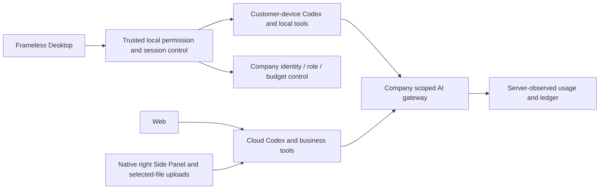

## 管理范围与使用流程

1. 由受信任 CLI 登记或管理员邀请；使用独立管理员邮箱验证码和 TOTP 登录。客户会话不能直接进入管理后台。
2. 按当前授权范围筛选用户、企业、项目、账户状态、VIP 和扣费期间；查看实际发起者归属的消耗，预留和待核对款项分别处理。
3. 用户详情显示企业归属、方案、权益、费用来源和管理上下文；可根据明确权限管理账户、会话、成员、VIP 和费用。
4. 敏感写操作先预览目标、版本、参数和影响，再用幂等命令提交。超出策略的金额、期限或批次要求独立复核；MFA 时效和防自我授权规则持续生效。
5. 内容列表、正文读取、下载、隔离/恢复、公开分享撤销和擦除分别受权限约束，并进入审计。普通企业管理员不会自动获得他人的私有会话正文。

## 权限和控制面

8 个内置管理角色、68 个规范权限键覆盖全局/企业/项目范围、显式拒绝、金额/期限/批次限制和有界委派。财务、VIP、成员、用户身份、内容、方案、模型/费率配置、供应方请求、审批、导出与审计按独立领域执行。

VIP 与余额分离：开通权益不等于充值。费用支持人工确认入账、礼赠、来源约束的退款及核对；在线支付收单尚未接入。策略/方案版本不可变，前后版本检查和幂等保护避免重复操作。

## 代码结构

`src/main.tsx` 提供导航和用户详情；`src/directory.tsx` 提供目录/期间筛选；审批、费用、权益、内容与配置使用相应领域组件。后台 API 才是授权和账目事实来源；隐藏按钮不能替代服务端权限检查。

## 启动

```powershell
npm ci
npm run dev
```

访问 `http://localhost:4318`；先启动 backend 并完成管理身份登记。`npm run build` 生成静态发布文件。生产需独立管理入口、HTTPS、邮件、MFA、权限指派、可用恢复管理员及审计保留策略。

## 演示范围

本次实际录制通过后台邮箱 OTP 与 TOTP 建立独立会话，展示目录筛选、用户消耗、VIP 和费用表单。演示没有把打开表单等同于完成财务入账。完整写入、审批、并发及权限验证见保留的数据库/API 与管理端记录。

## 初次检出与环境

新工作副本可单独检出本分支；已有本地仓库直接更新，不重新初始化。

```powershell
git clone --single-branch --branch admin git@github.com:copypasteltd/workmate.git copypaste-admin
cd copypaste-admin
```

Node.js ≥22.14、npm 和 Git；锁文件固定依赖。当前验收环境为 Windows x64。后端/完整交付还需要原生 PostgreSQL 启动资源、云端锁定 Codex `0.163.0-alpha.10.2` 与 FFmpeg/FFprobe；Desktop 独立锁定 `0.163.0-alpha.11`，以其运行时清单为准。禁止本地 Docker、WSL 和虚拟化。跨端运行使用多个独立工作目录；布局见 [workspace](https://github.com/copypasteltd/workmate/blob/docs/docs/governance/04-git-branches-and-publication.md).

## 检查与验证范围

```powershell
npm run typecheck
npm test
npm run build
```

历史源码的平台完整 **802/802**、任务专项 **52/52**，六仓库 **13 项**类型/构建/既有客户端测试检查、真实打包程序和原生侧栏旅程 **32 项**通过。保留原 782 项命名回归测试。任务专项调用实际 PostgreSQL、身份、账本与 Worker；另有实际 Codex 子进程连接模拟内部网关的续接验证。UI 回合及业务数据按授权模拟。原 102 项需求仍为 81 项局部验证、21 项未证明完成、0 项完整验收。

完整规范 TaskDTO/任务创建、任意执行中暂停、未知外部结果恢复、全角色独立业务、GEO、真实供应商和生产/签名/商店验收仍继续跟踪。

本次同步补充统一任务接口和原任务输入事务。当前用户界面继续通过既有项目/会话接口使用同一执行域；下方重新录制的实际交互验证该流程的兼容性，并非声称界面已经切换到全部规范任务接口。接口边界、精确金额、幂等回执、来源撤销和未接入业务参数见 [方案细则](https://github.com/copypasteltd/workmate/blob/docs/docs/technical/68-canonical-task-contracts-and-input-transactions.md)。

## 实际页面与交互

实际录制，保留原捕获时间；AI 回合与业务数据为明确模拟。Admin 演示表单不代表财务提交。

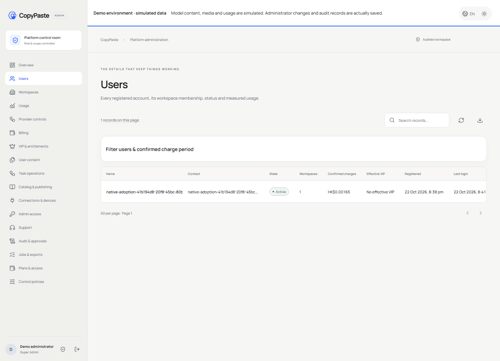


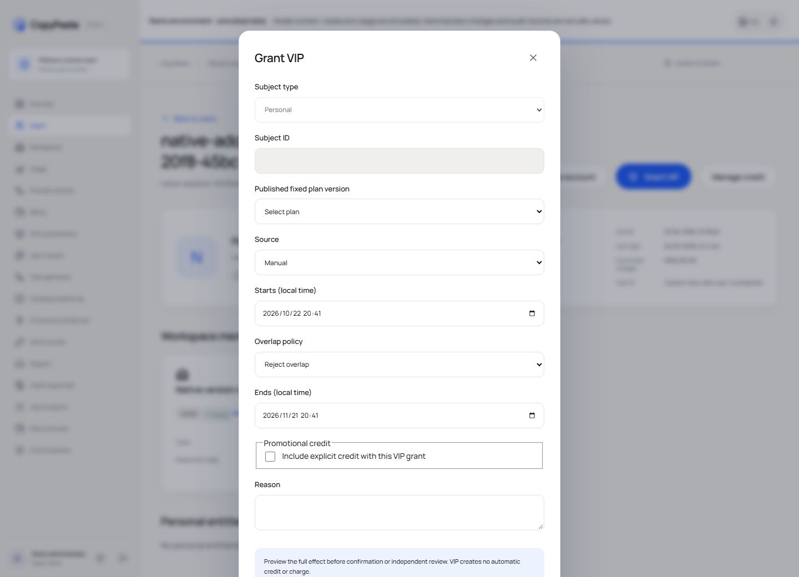

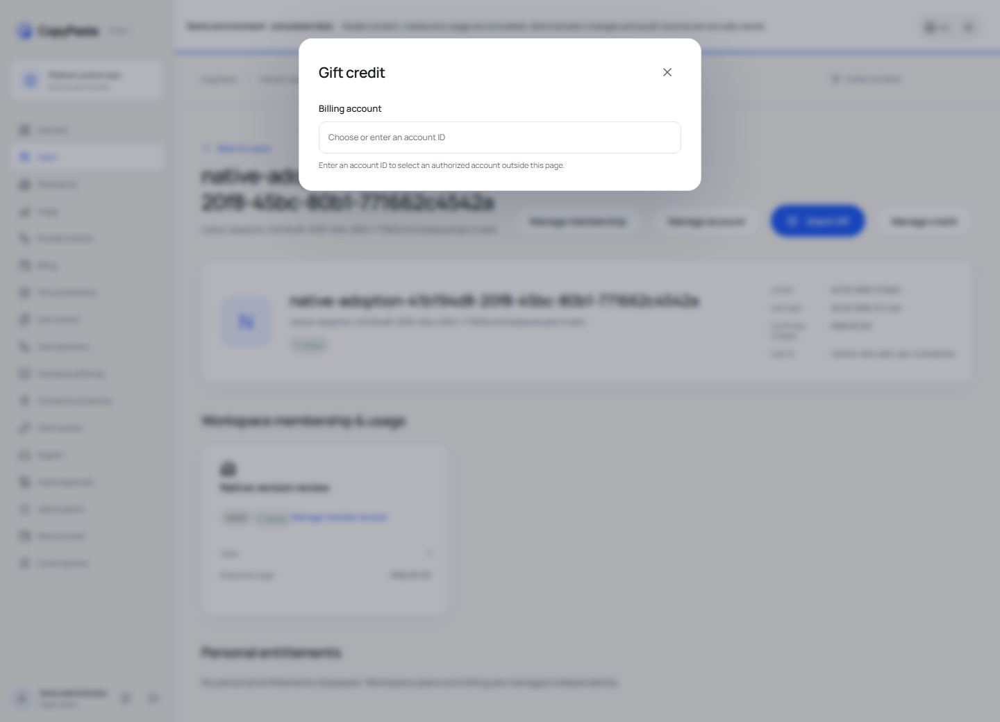


[MP4](assets/screenshots/workmate-10-interaction.mp4) · [录制与源码回执](https://github.com/copypasteltd/workmate/blob/docs/docs/quality/workmate-media-10.json)

## 方案细则与更新

- [Product](https://github.com/copypasteltd/workmate/blob/docs/docs/product/01-prd.md)
- [Architecture](https://github.com/copypasteltd/workmate/blob/docs/docs/technical/01-architecture-and-stack.md)
- [Identity and permissions](https://github.com/copypasteltd/workmate/blob/docs/docs/technical/07-security-and-permissions.md)
- [Task continuation](https://github.com/copypasteltd/workmate/blob/docs/docs/technical/66-paid-native-input-checkpoints.md)
- [Admin](https://github.com/copypasteltd/workmate/blob/docs/docs/product/08-admin-dashboard.md)
- [Native clients](https://github.com/copypasteltd/workmate/blob/docs/docs/technical/30-native-window-and-browser-sidepanel.md)
- [Canonical task update](https://github.com/copypasteltd/workmate/blob/docs/docs/changes/2026-10-22-canonical-task-repair.md)
- [Local Codex update](https://github.com/copypasteltd/workmate/blob/docs/docs/changes/2026-10-22-native-codex-supervisor.md)

后续修改需要同步中英 README、受影响的实际截图/GIF、更新说明和对应分支。提交后通过 Delivery 发布流程核对远程 SHA；不强推覆盖协作者。`.env`、数据库、会话、依赖和安装产物不进入 Git。历史 README 原字节见 [archive](https://github.com/copypasteltd/workmate/blob/docs/docs/quality/history/stage66-before-workmate-readmes/manifest.json).

阶段 73 Desktop 本机执行：[具体方案](https://github.com/copypasteltd/workmate/blob/docs/docs/technical/73-desktop-native-company-tools.md) · [源码与真实旅程证据](https://github.com/copypasteltd/workmate/blob/docs/docs/quality/desktop-company-tools-checkpoint.json)；既有媒体保持原始源码范围。

阶段 73 公司工具历史更新：[更新说明](https://github.com/copypasteltd/workmate/blob/docs/docs/changes/2026-10-23-desktop-company-tools.md) · [源码检查点](https://github.com/copypasteltd/workmate/blob/docs/docs/quality/desktop-company-tools-checkpoint.json)；较早回执和媒体保持原始源码范围。

阶段 74 本机追问更新：[更新说明](https://github.com/copypasteltd/workmate/blob/docs/docs/changes/2026-10-23-desktop-native-input.md) · [当前源码检查点](https://github.com/copypasteltd/workmate/blob/docs/docs/quality/desktop-native-input-checkpoint.json)。较早报告及媒体保留原始源码范围。

阶段 75 私有视频更新：[更新说明](https://github.com/copypasteltd/workmate/blob/docs/docs/changes/2026-10-23-desktop-private-video.md) · [当前检查点](https://github.com/copypasteltd/workmate/blob/docs/docs/quality/desktop-video-checkpoint.json)。旧报告保留原始源码范围，平台/本机主进程验证与后续界面验证明确记录。

<!-- desktop-native-browser-stage77 -->

## 本机浏览器与 Desktop 界面

新建本机会话，选择工作目录并明确授予「完整本机权限」，再描述浏览器工作。本机 Codex 使用版本化 `copypaste_browser` 命名空间的十二项工具：页面列表、打开、导航、历史、快照、截图、交互、隔离脚本、等待、对话框、下载及关闭。交互包含真实点击、填写/输入/选择、按键、滚动/拖动及明确本机文件上传。可信无边框地址栏与远程网页使用独立渲染器。完成的下载保留在所选目录的 browser-downloads；模型截图直接捕获真实网页，README 浏览器录制使用真实 OS 窗口捕获，不拼接页面。

当前本机授权、公司身份、项目权限、调用归属和预算逐次核验；网页不能授予 OS 权限或取得公司推理凭据。调用 ID 绑定具体操作，结果未知不自动重放。Stop、撤权、登出和退出关闭任务页面及未完成下载，保留已完成文件和客户原有窗口。旧线程保留原工具绑定；使用浏览器工具须新建会话。

此前进度条约束已撤销；真实上传、任务、流程和视频反馈继续显示。隐藏滚动条外观不禁用原生滚动。成果换行、代码与表格重排，重点滚动区可聚焦；800×600、1280×800、1440×980 实际窗口保留输入与费用操作。检查包含真实滚轮、Home/End、最后一个下载按钮焦点，及紧凑费用/设备/账户页面和英文/繁中浅深主题；自动化未宣称实测物理触控板或每种系统缩放。

当前完整清单为 66 个测试文件 / 17 批 / 851 项通过，保留此前全部 848 项。SQL001–094 和 428 条 HTTP 接口均未变。仅 UI 自有夹具的用户/平台/企业容量配置为 32，并新增不可变网关策略版本 2（32 槽位、每分钟 10,000 请求），以保留多次取消后的未知结果和费用预留；初始策略、生产默认及容量控制不变。模型响应、业务页面与系统对话框决定明确模拟。原 102 REQ/102 TC、NFR 和 G01–G10 仍为 81 部分 / 21 未证明 / 0 完整验收。Extension 产品和验证器字节未变，本轮没有新增其 UI 结论。

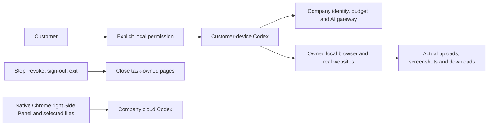


[Design](https://github.com/copypasteltd/workmate/blob/docs/docs/technical/77-desktop-native-browser.md) · [Requirements](https://github.com/copypasteltd/workmate/blob/docs/docs/requirements/04-desktop-layout-and-scroll.md) · [Evidence](https://github.com/copypasteltd/workmate/blob/docs/docs/quality/desktop-browser-checkpoint.json) · [Changes](https://github.com/copypasteltd/workmate/blob/docs/docs/changes/2026-10-23-desktop-native-browser.md)

<details>
<summary>阶段 76 历史实现与截图（旧滚动条布局）</summary>

<!-- desktop-native-workflow-stage76 -->

## 本机流程与核查

选择「流程顾问」、本机目录并明确授予所需本机权限。描述要求并确认冻结的流程步骤；执行前另行查看每个子角色的预算和合计，批准具体版本后才预留费用、启动本机子 Codex。遇到人工审批步骤须再次明确批准，之后才运行下一角色。查看真实本机文件、私有 SOP/流程 JSON/恢复说明下载与公司用量记录；顾问对话及未完成步骤分别计费。Stop 或撤权会终止本机父子进程；已受理但结果未知的操作保留待对账状态，不会自动重放。

首个子集支持最多八步的顺序本机 Codex、人工审批及广告汇总。每个子角色使用独立的 Skills、公司工具和推理凭据，沿用客户当前明确授予的目录及本机权限。完整本机权限不扩大公司的客户数据、项目权限或预算；云端 Worker 与定时任务不能接管本机流程。每个流程版本从真实读取账本冻结外部来源，复用到新会话及派生 SOP 时仍保留；旧创建任务删除不会替代外部来源的有效性判断。来源停用同时约束首次读取、缓存、子任务启动和私有或明确发布的衍生成果；管理员继续遵守权限、MFA、原因及审计控制。关闭应用也会阻止仍等待日志落盘的请求稍后启动。

阶段 76 当时的平台清单为 65 个实际测试文件、17 个完整批次、848 项通过，保留阶段 75 全部 830 项回归。SQL001–093 未改写；SQL094 增加本机流程来源与不可变版本。实际 428 条接口清单保留此前全部 415 条。原 102 REQ/102 TC、NFR 和 G01–G10 维持 81 项部分验证 / 21 项未证明 / 0 项完整验收；旧证据及媒体仅证明其原始源码。

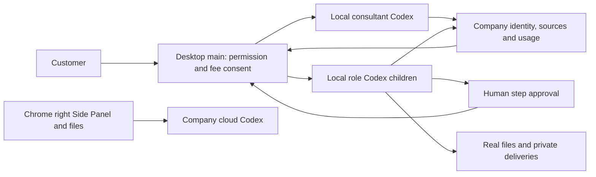


[设计与生命周期](https://github.com/copypasteltd/workmate/blob/docs/docs/technical/76-desktop-native-workflows.md) · [绑定证据](https://github.com/copypasteltd/workmate/blob/docs/docs/quality/desktop-workflow-checkpoint.json) · [更新说明](https://github.com/copypasteltd/workmate/blob/docs/docs/changes/2026-10-23-desktop-native-workflows.md)

</details>

</details>


</details>
