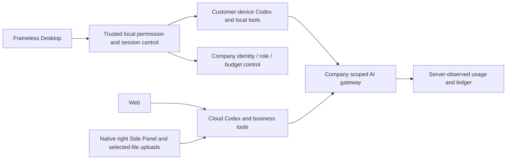
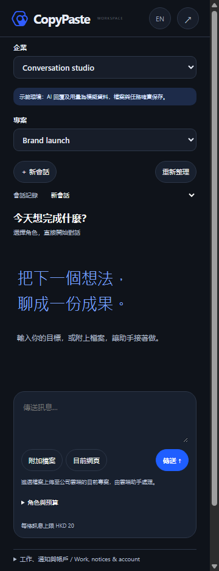
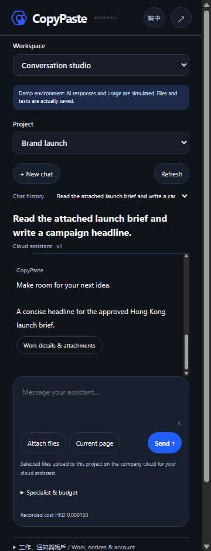
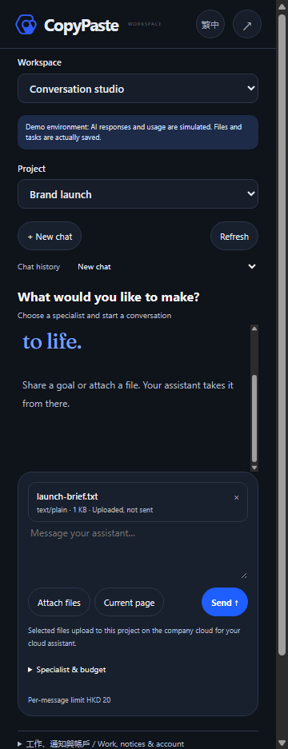

# Workmate · CopyPaste Chrome Extension

[English](README.en.md) · [主文档](https://github.com/copypasteltd/workmate/blob/docs/docs/README.md)

[Backend](https://github.com/copypasteltd/workmate/tree/backend) · [Web](https://github.com/copypasteltd/workmate/tree/web) · [Admin Dashboard](https://github.com/copypasteltd/workmate/tree/admin) · [Desktop](https://github.com/copypasteltd/workmate/tree/desktop) · [Chrome Extension](https://github.com/copypasteltd/workmate/tree/extension) · [Delivery](https://github.com/copypasteltd/workmate/tree/delivery)

面向香港企业的云端 Agent 产品。当前仓库负责 **Chrome Extension**；当前远程分支为 `extension`.

<!-- client01-direction -->
## 当前客户端方向与实现差异

CLIENT01（2026-10-22）要求 **Desktop 在客户本机运行 Codex Agent**，提供客户可主动授予的 **完整本机权限**，操作能力对标 Codex Desktop。**Extension 在 Chrome 原生右侧栏采用 ChatGPT 式对话/附件结构**，获取、读取用户获选文件并上传，由云端 Codex 执行。全部产品 AI 请求仍走公司内部网关。

**当前实现：** Desktop 在客户本机运行 Codex，支持明确完整授权、文件/终端、同线程继续和公司工具/费用；现已接通原生追问、选择/自填回答，以及等待时停止和撤权。当前源码通过 47 项客户端测试、17 项真实原生测试和 12 项实际打包 Electron 旅程检查。后端源码未变，沿用阶段 73 的 818 项完整回归范围。16 角色的本机协议接通不等于完整专业验收；视频/流程工具、完整浏览器/应用自动化、18 角色/29 Skill 及生产验收继续跟踪。供应商响应和系统窗口决定明确模拟。Extension 继续使用原生右侧栏云端对话与获选文件上传。见 [实现方案](https://github.com/copypasteltd/workmate/blob/docs/docs/technical/74-desktop-native-user-input.md)、[源码和媒体证据](https://github.com/copypasteltd/workmate/blob/docs/docs/quality/desktop-native-input-checkpoint.json)。

下方架构图表示已实现的云端/文件桥接基线，不是 Desktop 本机 Agent 的目标架构。

本机 supervisor 的实现及历史原生权限测试见 [技术说明](https://github.com/copypasteltd/workmate/blob/docs/docs/technical/70-desktop-native-codex-supervisor.md)。

<!-- /client01-direction -->

## 架构与约束

仅使用 Codex，全部 AI 请求经公司内部 OpenAI 兼容服务器。Web、Desktop、扩展和 Admin 共用服务端身份、权限、来源与计费控制。设计沿用 CopyPaste 的品牌素材、色系、字体和中英界面。



## 原生侧栏形态

Chrome Manifest V3 使用 `side_panel.default_path` 和 `chrome.sidePanel.setPanelBehavior({openPanelOnActionClick:true})`。点击工具栏打开真正的浏览器 Side Panel，再次点击可收起；没有 action popup 或模拟侧栏标签页。默认右侧，并遵循 Chrome 用户设置的侧栏位置。

`src/background.ts` 处理生命周期、公司授权和侧栏行为；`src/conversation.ts` 管理私有云端会话、附件版本和发送回执，`src/chat-panel.ts` 渲染消息和输入，`src/panel.ts` 连接企业/项目、任务和账户；`public/sidepanel.html`、`public/panel.css` 提供本地界面，`scripts/build.mjs` 生成固定服务地址、CSP 和稳定扩展 ID。

## 使用流程

1. 构建并加载扩展，固定到浏览器工具栏。
2. 点击图标，浏览器右侧打开工作区。通过固定公司网页完成邮箱验证和 PKCE 授权。
3. 选择企业/项目，开始新会话或从历史继续；角色与每条消息预算在折叠设置中，普通消息无需填写工作名称。
4. 选择或拖入文件，等待“已上传，待发送”，再发送消息。每次只绑定当前消息的明确版本；断网重试或重开侧栏沿用原消息与预算，避免重复收费。
5. 在同一云端会话继续追问，查看真实增量事件、成果与费用。可请求停止；来源失效清空旧内容。基础上传和对话不需要安装 Desktop。

浏览器扩展不能任意读取电脑所有路径。上传依赖用户选择；持续目录与设备任务需要明确授权及 Native Messaging companion。`nativeMessaging` 是可选权限；模型不能授予本地权限。

## 构建与加载

```powershell
npm ci
npm run build
```

在 `chrome://extensions` 开启开发者模式，选择“加载已解压的扩展程序”，选择当前仓库 `dist/`，然后固定并点击图标。需要 Chrome 120+；当前原生 Side Panel 旅程使用保留记录中的实际 Chromium。

`COPYPASTE_API_ORIGIN` 和 `COPYPASTE_WEB_ORIGIN` 在构建时设置，默认本地 4310/4317，生产要求公司 HTTPS Origin。保留 `manifest-key.txt` 以维持扩展 ID；其内容是公开公钥，不是签名私钥。`extension-id.txt` 用于服务端与 companion 注册。

源代码分支提供可复现构建；本地预览 ZIP 位于忽略的 `release/paid-input-66-03/`。商店提交、签名、跨浏览器/系统以及真实供应商接入另行验收。

## 初次检出与环境

新工作副本可单独检出本分支；已有本地仓库直接更新，不重新初始化。

```powershell
git clone --single-branch --branch extension git@github.com:copypasteltd/workmate.git copypaste-extension
cd copypaste-extension
```

Node.js ≥22.14、npm 和 Git；锁文件固定依赖。当前验收环境为 Windows x64。后端/完整交付还需要原生 PostgreSQL 启动资源、固定 Codex `0.163.0-alpha.10.2` 与 FFmpeg/FFprobe。禁止本地 Docker、WSL 和虚拟化。跨端运行使用多个独立工作目录；布局见 [workspace](https://github.com/copypasteltd/workmate/blob/docs/docs/governance/04-git-branches-and-publication.md).

## 检查与验证范围

```powershell
npm run typecheck
npm test
npm run build
```

历史源码的平台完整 **802/802**、任务专项 **52/52**，六仓库 **13 项**类型/构建/既有客户端测试检查、真实打包程序和原生侧栏旅程 **32 项**通过。保留原 782 项命名回归测试。任务专项调用实际 PostgreSQL、身份、账本与 Worker；另有实际 Codex 子进程连接模拟内部网关的续接验证。UI 回合及业务数据按授权模拟。原 102 项需求仍为 81 项局部验证、21 项未证明完成、0 项完整验收。

完整规范 TaskDTO/任务创建、任意执行中暂停、未知外部结果恢复、全角色独立业务、GEO、真实供应商和生产/签名/商店验收仍继续跟踪。

本次同步补充统一任务接口和原任务输入事务。当前用户界面继续通过既有项目/会话接口使用同一执行域；下方重新录制的实际交互验证该流程的兼容性，并非声称界面已经切换到全部规范任务接口。接口边界、精确金额、幂等回执、来源撤销和未接入业务参数见 [方案细则](https://github.com/copypasteltd/workmate/blob/docs/docs/technical/68-canonical-task-contracts-and-input-transactions.md)。

## 实际页面与交互

实际录制，保留原捕获时间；AI 回合与业务数据为明确模拟。Admin 演示表单不代表财务提交。






[MP4](assets/screenshots/workmate-chat-05-conversation.mp4) · [录制与源码回执](https://github.com/copypasteltd/workmate/blob/docs/docs/quality/extension-chat-checkpoint.json)

## 方案细则与更新

- [Product](https://github.com/copypasteltd/workmate/blob/docs/docs/product/01-prd.md)
- [Architecture](https://github.com/copypasteltd/workmate/blob/docs/docs/technical/01-architecture-and-stack.md)
- [Identity and permissions](https://github.com/copypasteltd/workmate/blob/docs/docs/technical/07-security-and-permissions.md)
- [Task continuation](https://github.com/copypasteltd/workmate/blob/docs/docs/technical/66-paid-native-input-checkpoints.md)
- [Admin](https://github.com/copypasteltd/workmate/blob/docs/docs/product/08-admin-dashboard.md)
- [Native clients](https://github.com/copypasteltd/workmate/blob/docs/docs/technical/30-native-window-and-browser-sidepanel.md)
- [Canonical task update](https://github.com/copypasteltd/workmate/blob/docs/docs/changes/2026-10-22-canonical-task-repair.md)
- [Local Codex update](https://github.com/copypasteltd/workmate/blob/docs/docs/changes/2026-10-22-native-codex-supervisor.md)

后续修改需要同步中英 README、受影响的实际截图/GIF、更新说明和对应分支。提交后通过 Delivery 发布流程核对远程 SHA；不强推覆盖协作者。`.env`、数据库、会话、依赖和安装产物不进入 Git。历史 README 原字节见 [archive](https://github.com/copypasteltd/workmate/blob/docs/docs/quality/history/stage66-before-workmate-readmes/manifest.json).

## 当前对话与消息附件

从企业/项目进入新会话或恢复历史，在底部输入消息；角色和每条消息预算可在设置中调整。文件选择/拖入、读取和上传由浏览器完成，等待“已上传，待发送”后绑定本条消息的明确版本。普通会话不必另填工作名称，基础上传/对话无需 Desktop 或 Native Messaging。通知、账户及独立任务表单折叠保留。

断网后的待确认请求与侧栏恢复沿用原内容、预算和幂等键；当前来源拒绝或内容隔离会清空旧回复并阻止发送。普通未发送附件不跨关闭恢复，已上传文件仍保存在项目。当前每条消息最多 20 个非空附件、每个最多 5 MiB；仍受服务端类型与额度检查。

本次 32 项测试、类型/构建及 7 项真实右侧栏旅程检查通过；身份、上传、Worker、成果和账本真实执行，模型回合明确模拟。下方旧四端媒体记录保留原范围。




[本次源码及媒体检查点](https://github.com/copypasteltd/workmate/blob/docs/docs/quality/extension-chat-checkpoint.json) · [具体方案与恢复规则](https://github.com/copypasteltd/workmate/blob/docs/docs/technical/71-extension-cloud-conversations.md)

本次 Desktop 本机执行：[具体方案](https://github.com/copypasteltd/workmate/blob/docs/docs/technical/73-desktop-native-company-tools.md) · [源码与真实旅程证据](https://github.com/copypasteltd/workmate/blob/docs/docs/quality/desktop-company-tools-checkpoint.json)；既有媒体保持原始源码范围。

本次公司工具更新：[更新说明](https://github.com/copypasteltd/workmate/blob/docs/docs/changes/2026-10-23-desktop-company-tools.md) · [源码检查点](https://github.com/copypasteltd/workmate/blob/docs/docs/quality/desktop-company-tools-checkpoint.json)；较早回执和媒体保持原始源码范围。

阶段 74 本机追问更新：[更新说明](https://github.com/copypasteltd/workmate/blob/docs/docs/changes/2026-10-23-desktop-native-input.md) · [当前源码检查点](https://github.com/copypasteltd/workmate/blob/docs/docs/quality/desktop-native-input-checkpoint.json)。较早报告及媒体保留原始源码范围。
