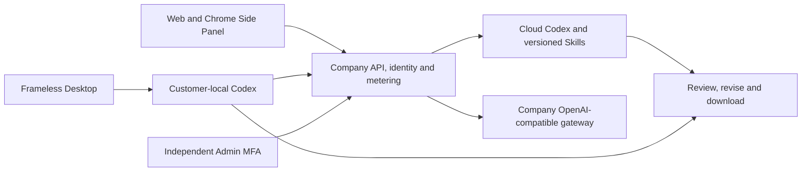

# Workmate · extension · v0.1.0-rc.5

[English](README.en.md) · [完整Release](https://github.com/copypasteltd/workmate/releases/tag/v0.1.0-rc.5) · [中英安装使用](https://github.com/copypasteltd/workmate/blob/v0.1.0-rc.5/docs/releases/v0.1.0-rc.5.md)

面向香港企业的 Codex Agent 平台，首批服务既有 marketing 团队，覆盖设计/媒体、广告与网站/SEO/GEO分析、重复流程和软件开发。本仓库为独立 **extension** 端，使用 **Chrome MV3 / native right Side Panel**。视觉遵循 CopyPaste 的暖白底、深色文字、品牌色和编辑式排版。

## 方案与结构

主要入口：`src/ and dist/`。Codex 是唯一 Agent 内核，全部模型请求经公司内部 OpenAI 兼容 API，供应商密钥仅留在后端。专业模板固定 Skill、工具和配置版本；设计师组合为 Codex＋设计 Skill＋公司 Image 2。

Web 访问云端 Agent。Extension 使用 Chrome MV3 原生右侧 Side Panel，提供对话/附件界面，只读取客户选择的文件并经同意上传，由云端执行。Desktop 无边框、无 Electron 默认菜单，在客户本机运行 Codex，客户可主动授予完整本机权限，支持停止/撤权及账户、目录隔离。

Admin 独立邮箱验证码＋TOTP，按权限管理用户/企业、消耗与费用、VIP、角色/Skill和内容。用户详情传递真实用户ID；费用账户按主体筛选，VIP锁定目标，换用户销毁旧弹窗及预览。港币金额按微单位保存；预算、余额、实收、赠额、授信和VIP分开记录。人工变更先预览、再确认，保留当前权限/MFA/策略/审批、幂等和审计。



## 安装与运行

六个独立仓库并列置于 `dev/`：`copypaste-platform`、`copypaste-web`、`copypaste-admin`、`copypaste-desktop`、`copypaste-extension`、`copypaste-delivery`。使用 Windows x64、Node.js 22.14+、Git及原生PostgreSQL；媒体工作需FFmpeg/FFprobe，固定Codex随runtime分发。禁止Docker/WSL及虚拟化。

完整启动以Release指南为准。首次写配置前选空闲数据库端口，从Delivery依次运行 `demo:preflight` → `bootstrap:demo` → `demo:check` → `demo`。保留已有配置和数据；结束执行Delivery的 `npm run stop`。

本仓库单独开发，先准备对应依赖及配套后端：

```powershell
npm ci
npm run build
```

API为localhost4310，Web4317，Admin4318。开发验证码位于platform `.data/mailbox/`。管理员需在platform执行 `npm run admin:create -- admin@example.com super_admin` 并按一次性资料绑定TOTP。Desktop通过浏览器PKCE登录后选择本机目录和权限；Chrome使用“加载已解压的扩展程序”，点击图标打开侧栏。

## 使用逻辑

1. 邮箱登录，接受邀请或创建企业及首项目。创建结果未确认时保留原请求；断线/刷新后点“确认并继续”恢复原结果。失效/删除回执不会悄悄新建企业。
2. 选择项目和角色，填写brief、文件/品牌/账户、预算和授权。必要资料在原任务补齐；执行固定当时接受的配置与Skill版本。
3. 查看持久进度、审批、成果版本、费用和用量，审阅后下载原文件或继续修改。未知费用保持待核对，不按免费处理或盲目重跑。
4. Admin从用户详情开费用/VIP，核对主体和预览后按策略确认。目录筛选支持刷新/返回恢复。用户专属任务/内容的统一筛选入口仍待补齐。

## 配置与权限

Web/Admin使用 `VITE_API_BASE` 或同源代理；原生端构建时固定允许来源及扩展ID，回环开发外使用HTTPS。SQL增量历史001–155，API/Worker检查版本及环境身份。源码不带密钥、`.env`、用户数据库、依赖或Git元数据。

会话失效清除旧工作台，迟到结果不能覆盖新登录。文件默认私有；请求、任务领取、工具和下载重新核验当前权限。历史回执不保留已撤销访问权。显式退出清除工作区创建草稿中的名称，仅保留原账户可核对的无正文请求标识。

## 角色预设与Skill

目录定义18个专业预设；数量不代表十二个角色已全部通过专业验收。

| ID | Role | Required Skill bindings |
| --- | --- | --- |
| R01 | 全栈开发工程师 | `fullstack-engineering@1.0.0`, `frontend-implementation@1.0.0`, `backend-api@1.0.0`, `qa-testing@1.0.0`, `delivery-core@1.0.0` |
| R02 | 前端开发工程师 | `frontend-implementation@1.0.0`, `ui-system@1.0.0`, `qa-testing@1.0.0`, `delivery-core@1.0.0` |
| R03 | 后端与 API 工程师 | `backend-api@1.0.0`, `qa-testing@1.0.0`, `delivery-core@1.0.0` |
| R04 | 软件测试工程师 | `qa-testing@1.0.0`, `frontend-implementation@1.0.0`, `delivery-core@1.0.0` |
| R05 | UI/UX 设计师 | `ux-research@1.0.0`, `ui-system@1.0.0`, `frontend-implementation@1.0.0`, `delivery-core@1.0.0` |
| R06 | 设计师 | `creative-direction@1.0.0`, `image-art-direction@1.0.0`, `image2-production@1.0.0`, `typography-layout@1.0.0`, `delivery-core@1.0.0` |
| R07 | 品牌视觉设计师 | `brand-system@1.1.0`, `image-art-direction@1.0.0`, `image2-production@1.0.0`, `typography-layout@1.0.0`, `delivery-core@1.0.0` |
| R08 | 广告创意设计师 | `ad-creative@1.0.0`, `image-art-direction@1.0.0`, `image2-production@1.0.0`, `typography-layout@1.0.0`, `delivery-core@1.0.0` |
| R09 | 电商商品设计师 | `ecommerce-visual@1.0.0`, `image-art-direction@1.0.0`, `image2-production@1.0.0`, `typography-layout@1.0.0`, `delivery-core@1.0.0` |
| R10 | 社媒内容设计师 | `social-content@1.0.0`, `image2-production@1.0.0`, `typography-layout@1.0.0`, `delivery-core@1.0.0` |
| R11 | 插画与 IP 设计师 | `illustration-ip@1.0.0`, `image-art-direction@1.0.0`, `image2-production@1.0.0`, `delivery-core@1.0.0` |
| R12 | 字体与版式设计师 | `typography-layout@1.0.0`, `image-art-direction@1.0.0`, `image2-production@1.0.0`, `delivery-core@1.0.0` |
| R13 | 演示文稿设计师 | `presentation-production@1.1.0`, `typography-layout@1.0.0`, `dataviz@1.1.0`, `delivery-core@1.0.0`, `deterministic-metrics@1.1.0` |
| R14 | 网页与落地页设计师 | `landing-page@1.0.0`, `ui-system@1.0.0`, `frontend-implementation@1.0.0`, `image2-production@1.0.0`, `delivery-core@1.0.0` |
| R15 | 信息图与数据可视化设计师 | `dataviz@1.1.0`, `deterministic-metrics@1.1.0`, `typography-layout@1.0.0`, `delivery-core@1.0.0` |
| R16 | 视频与动效设计师 | `video-storyboard@1.0.0`, `template-video-composition@1.0.0`, `video-generation@1.1.0`, `speech-production@1.2.0`, `delivery-core@1.0.0` |
| R17 | 营销数据分析师 | `ads-analysis@1.1.0`, `deterministic-metrics@1.1.0`, `dataviz@1.1.0`, `delivery-core@1.0.0` |
| R18 | 企业流程自动化顾问 | `workflow-design@1.1.0`, `workflow-execution@1.1.0`, `delivery-core@1.0.0` |


## 实际截图与交互

以下为本次真实Web/SQL恢复和Admin MFA/目标验证的共享媒体，使用合成客户与业务数据；不表示其他原生端重新完成安装验收。


[实际MP4](assets/screenshots/workmate-functional-closure-165-01-recover-original-workspace.mp4)

## 验证与发布

本次运行七项定向SQL、四项创建草稿检查和实际Web/Admin操作，重建六仓与Windows unpacked/Portable/Setup，核对ASAR和固定Codex。按要求跳过完整重复回归，实际结果以冻结检查点为准。

分支 `extension`，固定标签 `v0.1.0-rc.5-extension`。后续更新同步分支和更新说明，冻结包及标签保持。外部AI/媒体/广告/支付使用已授权假数据，Windows未签名。102个原编号及88项必选完整验收范围保留，88不是未实现模块数。真实服务、签名更新、多平台与完整专业验收继续跟踪。

[检查点](https://github.com/copypasteltd/workmate/blob/v0.1.0-rc.5/docs/quality/release-freeze-checkpoint-165.json) · [完整编号台账](https://github.com/copypasteltd/workmate/blob/v0.1.0-rc.5/docs/quality/remaining-work-stage165.md) · [旧README快照](https://github.com/copypasteltd/workmate/blob/v0.1.0-rc.5/docs/history/readme-before-rc5/extension-zh.md)

## 本端界面与录制 / Component interface and recording

此前已记录的实际原生界面，保留原测试范围；本次构建不等于重复现场验收。Previously recorded native interface with its original scope; this rebuild is not a repeat installation test.


[MP4](assets/screenshots/workmate-workflow-view-03-cloud-schedule-sidepanel.mp4)
