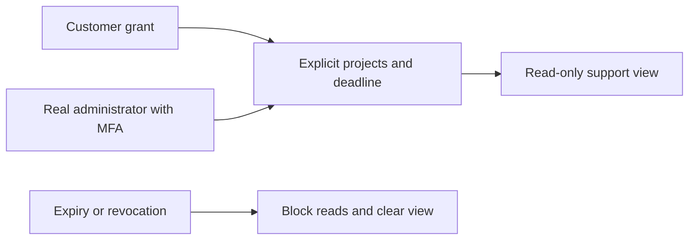
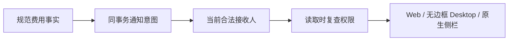
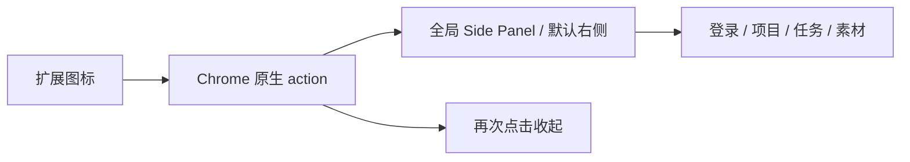
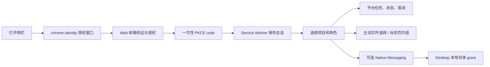
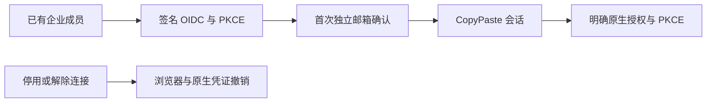
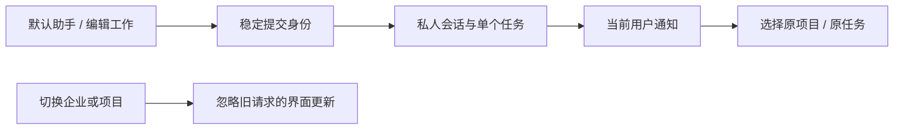
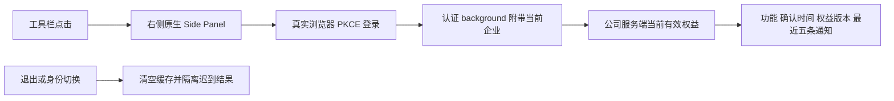

# CopyPaste Chrome Extension

## 限时只读客服协助 / Controlled support

继续由 Chrome 工具栏按钮开启原生右侧 Side Panel。客服授权在 Web 账户设置管理，侧栏不会获取管理员支持会话或用户的其他登录凭证。

阶段 51 当前平台回归 424/424（711 份来源），受控支持页面 8/8（816 份来源、9 张未编辑截图）。14 组支持专项、原规范检查、迁移保留及独立原生检查是有界证据，完整 102 项验收继续跟踪；当前包已重建，阶段 50 包原字节另存。




[English](README.en.md) · Chrome MV3 侧栏与原生桥接 · 0.5.0

独立 Git 仓库。扩展让用户在 Chrome 选择工作区/项目、提交角色任务、主动提供本地文件或当前网页；持续目录操作通过已安装 Desktop 的原生桥接完成。模型执行与计费始终由平台承担，扩展不保存 AI key。


阶段 49 历史联调已验证无边框 Desktop、Chrome 原生右侧 Side Panel、实时权益/通知和退出，当时安装器保持原字节。下方阶段 50 随费用视图源码重建当前预览；完整安装/签名/SSO/系统验收仍单独跟踪。

## 事务费用通知与三端账户（阶段 50）

工具栏仍打开真实 Chrome 原生 Side Panel，默认右侧；左右位置由浏览器偏好决定。侧栏增加精确个人余额、最近五条账户通知、未读筛选和已读切换，完整历史/工作事件在 Web 查看。企业切换、失败读取、撤权和退出清空旧内容，工作区/请求序号拒绝迟到结果。深色提示文字已实际校验对比度 11.59:1；本轮仅使用自建浏览器并完整关闭。

阶段 50 当时平台回归 410/410，真实三端费用流程 8/8。AI/媒体和付款证据使用获准本机模拟；身份、数据库、权限、账本及通知实际执行。原始 102 项综合验收、生产银行及完整安装/系统矩阵继续单独跟踪。




## 点击后在浏览器侧栏出现

出现方式参照新版 MetaMask：在 Chrome 扩展菜单选择 CopyPaste，或固定图标后点击，打开当前窗口的原生 Side Panel，默认位于右侧。再次点击收起；切换网页/标签页保留同一全局侧栏，关闭侧栏不取消云任务。初始化及浏览器重启不会自动弹出界面。

manifest 使用 `side_panel.default_path`，action 不设置 `default_popup`；service worker 每次启动、安装/更新和浏览器启动都恢复 `openPanelOnActionClick: true` 与受信存储访问级别。不会用新标签、悬浮层或 popup 代替侧栏。右/左位置由 Chrome 用户偏好管理，扩展无法强制覆盖；设为左侧的用户可在 Chrome 外观/侧边栏设置切回右侧。产品仍兼容 Chrome 120；较新 Chrome 的 `getLayout()` 仅用于 QA 读取布局。




该图来自真正 SIDE_PANEL 文档的 CDP 截图，仅含侧栏内容。交付仓库 `qa:native-surfaces` 通过 `Extensions.triggerAction` 执行真实浏览器按钮默认动作，断言右侧布局、SIDE_PANEL、网页宽度缩小、不增加普通标签页、切页保留和再次收起。2026-10-20 对当前构建重新执行该验证，并将扩展全部 dist 文件和源码字节绑定到实际测试报告。原有 `qa:extension` 八组是先前登录和业务流程的增量记录；完整认证矩阵继续独立验收。测试在 finally 关闭自己的浏览器。

当前可加载 ZIP 位于 `release/sidepanel/CopyPaste-0.5.0-sidepanel.zip`，解压后在 `chrome://extensions` 加载目录。先前预览原字节保留在 `release/sidepanel-stage30/`。交付清单记录新包 SHA-256；预览使用 localhost origin，商店发布和生产配置仍需正式交付。

## 构建与加载

Node.js 22.14+、Chrome 120+，本次实际验收使用原生 Chromium。先运行 platform 和 Web：

```powershell
npm ci
npm run typecheck
npm run build
```

在 `chrome://extensions` 打开开发者模式，加载本仓库 `dist/`，再打开 CopyPaste 侧栏。固定 unpacked ID：`fffkcnmfdhahlnifgdilabheppkgnlok`。`manifest-key.txt` 仅含公开 SPKI 公钥，用于稳定 ID，不是模型密钥或商店私钥。平台 `EXTENSION_ID` 及 Desktop `deployment.json` 必须一致。

默认 API/Web 为 `http://localhost:4310` / `http://localhost:4317`。生产构建在 PowerShell 设置：

```powershell
$env:COPYPASTE_API_ORIGIN='https://api.your-company.example'
$env:COPYPASTE_WEB_ORIGIN='https://agent.your-company.example'
npm run build
```

只接受 HTTPS 公司 origin 或 localhost 开发地址；参数不能包含路径、凭证和查询。`dist/manifest.json` 的 host permission 只包含 API origin。未提交 Chrome Web Store，也未声称已获得上架授权。所有本机操作原生执行，禁止 Docker、WSL 和虚拟化环境。

## 登录与使用流程



登录在公司 Web 页面完成；回调地址严格绑定 Chrome identity URL。access/refresh 仅在受信 service worker 的 `chrome.storage.session` 保存，不在侧栏、localStorage 或 `storage.local` 保存。浏览器会话结束后需要重新登录；刷新轮换和退出由平台验证。扩展 local 存储只保存语言偏好。

文件必须通过用户手势选择，当前扩展限 5 MB；平台再次检查项目权限。当前网页抓取需要用户点击，使用 activeTab/scripting，排除表单、可编辑与隐藏内容，不后台全站采集。

## 与 Web / Desktop 的配合

0.2.0 使用同版平台身份、权限和任务接口，构建时从 package.json 写入 manifest 版本。侧栏提供轻量任务和素材入口；专属专家配置、完整私密会话和记忆管理在 Web 或 Desktop 工作区完成。私密成果须明确发布才成为可分享的项目素材。

## 原生本地目录

Chrome 扩展本身不能扫描任意本地路径。先安装 Desktop 的 Windows Setup 版，在设备页面点击连接 Chrome helper，经本机确认后仅注册当前 Windows 用户的官方扩展来源，再在扩展中授予可选 nativeMessaging 权限。

每个目录另行通过原生选择器授权，1 小时到期，默认只读；创建文件需要额外同意。支持列目录、预览、上传、仅创建新文本文件、撤销。禁止路径穿越、符号链接/junction、设备名、ADS、覆盖现有文件和远程 shell。Native Messaging 单条结果控制在 900 KB 内；更大文件使用显式文件选择器。

## 验证、代码与边界

- `src/background.ts`：PKCE、token 轮换、受限 API/原生消息、当前页抓取。
- `src/panel.ts`：项目/角色/任务、文件上传、目录工具与语言选择。
- `scripts/build.mjs`：公开部署 origin、固定 manifest、稳定扩展 ID。
- delivery `npm run qa:extension`：真实 MV3、chrome.identity 登录、上传、会话隐私和退出；创建的浏览器上下文在 finally 关闭。
- delivery `npm run qa:desktop`：实际打包 Windows native host 的长度帧、来源 allowlist、目录 grant 和本地文件流程。系统注册表安装本身由用户明确确认，不在 QA 中覆盖既有注册项。

扩展界面支持中/英切换，部分动态状态保留繁体中文；完整产品翻译仍需复核。公司 AI 网关未联调时不能提交可执行 AI 任务；缺少企业时先到 Web 初始化。云端每日/每周计划在 Web 或 Desktop 管理；完整 Desktop 自主操作与 AI 视频/语音仍按主文档待建设。素材与依赖见 [说明](THIRD_PARTY_NOTICES.md)。

## 0.5.0 企业身份与统一登录

OIDC 使用 code + PKCE S256、签章、state/nonce 与固定回调。先有注册账号及有效企业成员资格，再绑定企业身份；首次绑定需要独立的 CopyPaste 工作邮箱确认码，不按网域自动开户。配置改变、停用或本人解除连接会撤销关联用户的全部 CopyPaste Web/native/refresh 会话和旧执行授权。管理员登录仍独立使用邮箱与 TOTP。

企业身份复用系统浏览器授权页：点击登录后，在 Web 选择企业登入，完成身份验证及必要的邮箱确认，再明确授权 Chrome 回调。扩展保留独立 PKCE、短期 access token、轮换 refresh；服务端码绑定签发来源会话与用户版本。退出来源或撤销企业身份后，未交换旧码不能继续使用。本地文件及 Native Messaging 目录授权仍须明确操作。



## 默认助手与通知（当前源码）

侧栏可直接选择默认文字助手，也保留专业角色。提交使用稳定请求编号；未知响应重试复用原私人会话和任务。企业或项目切换后，旧请求不得覆盖新列表/任务。模拟企业持续显示假数据提示。通知列出当前接收者最近 20 条，支持已读切换及原项目/任务跳转；完整分页和会话继续在工作台处理。

Delivery `qa:extension` 八组真实 MV3 旅程已通过：PKCE、接受响应丢失后的真实重试与 Codex 文字文件、通知定位、320/420/768 宽度和两主题/语言、主动上传、凭证隐私/退出、接受响应延迟期间切换项目，以及运行前补齐文件。模型为明确模拟依赖，未取得正式专业角色资格，旧发布 ZIP 未替换。




## 先补齐资料 / Provide inputs first

可明确选择「先等我提供档案」，侧栏搜索/分页选择当前版本后继续同一任务，保持原预留。上方选取器上传到共享项目（5 MiB），不会自动选中；私人补传和新连接授权在完整工作台进行。可以在侧栏为既有连接需求选择已授权连接；不自动同步账户或报表。取消等待会释放未使用预留。

Submit an explicit file prerequisite, then search and select a current version to resume the same task and budget. The existing picker uploads to the shared project (5 MiB); selection remains explicit. Private attachments and new connector authorization use the full workspace. Existing connection requests can select an authorized connection without automatically importing reports. The input form was checked at three widths in both themes.


## 共用名额排队（当前源码）

侧栏识别服务端容量等待，说明模型未启动、预算保持预留及原工作自动继续。此约束与 Web/Desktop 共用同一队列及数据库，不通过扩展重复创建或收费。历史 ZIP 保持原版。

## 与持久模板目录的关系

当前 Web 与 Desktop 新增模板预检/实例化；扩展继续使用已验证的默认文字委派、通知和明确授权文件流程，本次未新增扩展内模板编辑器。专业模板尚待真实业务资格，不因扩展能连接同一服务就计为已验收。

侧栏任务详情新增“暂停排队 / 继续工作”，只允许首次模型调用前控制原任务；保留原预留，并同步最近任务状态。Delivery `qa:task-controls` 通过真实 MV3/PKCE 验证业务操作，运行中的暂停不开放。本轮为源码变更，上一轮 `release/sidepanel/` ZIP 未更新；原生右侧 SIDE_PANEL 出现方式继续遵守既有专项验证。


## 会话失效与退出

后台合并并发刷新，限制迟到登录/刷新回写；确定的 401 清除当前凭证并通知所有打开的受信侧栏，旧账户请求不会清除后来登录的凭证。失效后清空账号、任务、文件和通知视图，停止轮询。退出先清空 session 存储，再凭刷新凭证撤销整族；访问令牌过期也可完成。离线时显示服务端撤销未确认，不伪装已撤销。


此前 `npm test` 有 10 组会话竞争/故障测试；交付仓库 `qa:sessions` 使用真实 MV3 与 identity PKCE 验证远端撤销和过期访问退出。本次业务测试用独立 MV3 文档，不替代原生 SIDE_PANEL 出现模式专项。原侧栏预览 ZIP 保留原清单，未包含本轮修复。

## 规范认证与多侧栏 / Canonical authentication and multiple panels

首次 S256 交换和刷新使用规范 token 接口；首次未知响应最多同标识重试一次，刷新标识随受信 session 存储持久保存。同一身份的刷新不重载工作区；新登录清理旧账号、任务、项目及文件状态后自动更新所有已打开侧栏。旧账号迟到的未授权回执不能清除后来账号。

Canonical code exchange and refresh preserve request identities across unknown replies. Accepting a new sign-in updates every existing panel; ordinary rotation retains the local identity epoch. View revisions are checked before processing errors, so an old unauthorized response cannot clear a replacement account. Delivery exercises two actual MV3 documents and a different-account replacement; the native SIDE_PANEL appearance has its own separate verification.


The historical Side Panel ZIP retains its original manifest and does not include these source changes.

当前 `npm test` **19/19**，包含十五组会话竞争/持久化边界与四组首次交换重试检查。 / Current native tests: **19/19**, including fifteen session and four initial-exchange checks.

历史启动限制：此前十二组原生复核未完成，失败与诊断仍见 `evidence/auth-recovery-open-issue.json`，原七组 `sessions.json` 保持原字节。2026-10-20 当前源码十二组已通过，使用新的 `evidence/auth-recovery-current.json`；具体范围和截图见下文，完整安装包／SSO／系统矩阵仍待验收。

Historical startup limitation: the earlier twelve-flow run did not complete; its failures and diagnostic comparison remain unchanged. The current-source rerun now passes **12/12** in `evidence/auth-recovery-current.json`, with scope and screenshots below. The original seven-flow session receipt remains historical. Complete packaged authentication, SSO and system matrices are still unaccepted.

## 用户资料契约 / User profile contract

侧栏初始化与项目刷新改用受认证的 `GET /v1/session/context` 读取本人资料和工作区；规范 `GET /v1/me` 仅返回 `User`。原生凭证仍只在受信任后台保存，多面板换账号守卫继续生效。本次源码和 dist 构建不改写历史侧栏 ZIP。

Panel bootstrap and project refresh now use authenticated `GET /v1/session/context` for profile and workspace access. Canonical `GET /v1/me` returns only `User`. Credentials remain in the trusted background; multiple-panel identity fences remain active. Historical preview ZIPs are preserved.

## 当前 MV3 会话恢复复核（2026-10-20）

Delivery `qa:sessions` 的 Web／源码 Electron／MV3 十二组现已 12/12：真实 identity S256 登录，首次交换和刷新回执丢失的同键恢复，实际 session storage 撤销，两份已打开业务页自动登录／换账号、旧账号迟到 401 隔离及过期访问仍可退出。769 份源码／运行文件一致，凭证和自建三端实例均清理；旧失败诊断保持原字节，模型调用 0。


当前认证使用实际 MV3 业务文档；右侧栏出现方式另由原生 SIDE_PANEL action 的 10/10 外观证据覆盖，不能用此截图替代。侧栏 ZIP 原字节保持不变，完整打包／身份／系统及成员旅程仍须验收。

2026-10-20 退款增量后当前源码复核：Web 成员 6/6（169 份来源）、Admin 成员 6/6（196 份）和 Web/源码 Electron/MV3 认证 12/12（775 份）通过，前后摘要一致，拥有的会话、浏览器、Electron 和扩展进程均已清理。首轮 Electron 调试连接超时原回执保留，随后相同源码重跑通过。Desktop 无边框和原生 Side Panel 预览包保持原字节；完整安装包认证及系统矩阵仍须独立验收。

2026-10-20 方案版本增量後的當前源碼復核：Web 成員 6/6（172 份來源）、Admin 成員 6/6（200 份），Web／源碼 Electron／MV3 認證 12/12（779 份）；測試前後摘要一致，自建瀏覽器／Electron／擴展均關閉，測試憑證清理。新增不可變方案定義與固定歷史授權綁定不改寫原生預覽包。完整 VIP／配額、安裝包認證及系統驗收仍按主文檔繼續追蹤。

## 当前右侧原生侧栏与权益同步

点击浏览器工具栏图标后，在浏览器右侧打开真正的 `SIDE_PANEL`，页面相应缩窄，不额外创建 popup 或普通标签页。再次点击收起，换标签页／导航保留同一个侧栏文档，浏览器重启后恢复入口行为。当前重建扩展与无边框 Desktop 的 10 组原生表面检查及 6 组真实登录／VIP 联调通过。



侧栏每 15 秒及手动刷新；个人和当前企业权益由服务器合并，仍须项目／文件授权和预算。通知已读属于本人，不授予额外能力。原生联调验证同一用户在 Desktop 标记已读后，侧栏读取同一条持久记录；暂停按真实免费方案回退，并实际退出清理凭据。19 项单元检查通过；完整 Native Host 大文件、安装／发布和所有生产验收仍保留。


验收使用实际浏览器 action 触发与 CDP 附着真实侧栏，未把 `sidepanel.html` 当普通网页替代。构建 `npm run build`；在 Chrome 扩展管理页加载 `dist/`。当前 ZIP 和字节摘要由相邻 Delivery 仓库的 `package:surfaces` 统一记录。

## 企业席位与存储执行（阶段 48）

真实原生 Side Panel 的权益摘要新增企业席位、保留字节、上传预留、上限及超额状态。字节用 BigInt 显示，企业/项目及登录上下文限制继续执行；个人 VIP 不改变共用企业容量。点击扩展图标在浏览器侧栏出现的方式保持有效，关闭自建验收页面后不留下额外标签页。


