# Workmate · CopyPaste Web

<!-- audio-authorizations-stage85 -->

在云端 Codex 原任务中核对提案、确认使用并查看成果。

### 本地启动

以下命令在已检出的对应仓库内执行。完整工作区将六个独立仓库并列放在 `dev/`，见[分支与检出布局](https://github.com/copypasteltd/workmate/blob/docs/docs/governance/04-git-branches-and-publication.md)。使用 Windows x64、Node.js >=22.14、npm/Git，以及文档约束的原生 PostgreSQL、FFmpeg/FFprobe 与固定 Codex 资源；保留已有本地配置和数据，不使用 Docker/WSL/虚拟机。

```powershell
Set-Location 'D:/dev/copypasted/自有agent/dev/copypaste-web'
npm ci
npm run dev
```

先启动后端，再打开 `http://localhost:4317`；静态构建使用 `npm run build`。通过邮箱/验证码登录并选择企业/项目。

### 当前使用流程

1. 邮箱/验证码登录，选择企业/项目和「**影片与动效设计师**」预设（1.4.0，加载 speech-production 1.2.0），描述脚本或附加获准的固定版本 WAV/MP3。Web/Extension 使用云端 Codex；Desktop 先选本机目录并主动授予所需本机权限，完整权限经原生确认，可随时撤回。
2. 原 Codex 任务提出精确文案或音源版本/摘要/时长、语言/已核验声音/速度、用途及固定公司报价。「**确认配音或转写**」卡片初始不勾选，权利依据和用途初始为空。客户核对内容及费用，亲自填写依据与用途、勾选并「确认并继续」，也可以拒绝。模型参数的权利声明及完整本机权限不能代替具体客户确认。
3. 原工具最多等待五分钟；等待不提交音频 POST、不增加音频作业预留、服务容量或第二轮 AI。原任务已有推理用量仍真实计费。客户确认后再次检查当前会话、来源、角色/Skill、任务租约、权限、能力、共享预算和容量，再派发唯一音频操作。停止、过期、拒绝及失权阻断派发；撤回阻断后续交付/下载，但已提交的未知或真实费用保留，未知 POST 不自动重发。
4. 在「配音与字幕 → 查看音讯与字幕」播放/保存受保护 WAV，检查原始转写和实际时间；接口核对字节数与 SHA-256。人工字幕修订另存不可覆盖版本，替换时间需客户明确提供，保留旧版本且无 AI 调用。服务未返回时间时不造时间；并发冲突保留编辑。
5. Admin 独立登录并通过 MFA，在「调用管理」查看音频作业及客户授权记录。请求读取控制范围元数据，费用读取独立控制金额，正文读取加近期 MFA 才能审计读取敏感确认/原始正文；后台没有替客户确认操作。原任务删除会擦除正文，仅保留最小摘要、状态与费用事实。

升级客户端前，后端执行 npm run db:migrate 应用 **SQL102**。SQL001–101 及四份已发布原始/音频 OpenAPI 字节保留，audio-authorizations-openapi.json 为增量当前契约。升级取消尚未派发的旧音频并确认零音频费；已派发未知结果保留费用预留。历史完成文件保留原始字节，明确标记旧模型声明，不补造客户确认。

公司网关地址、密钥、精确配音/转写别名、已核验声音/语言、正数字符/毫秒费率和时间戳能力仅配置在后端。音频容量初始为零，按已有独立审批策略发布。普通 demo 不自动启用本轮明确音频夹具。全部 AI 经公司 OpenAI 兼容服务器，文本/图片/影片/音频共享任务预算。

Desktop 保留 CopyPaste 蓝/米白色、字体与明暗主题，**无 Electron 自带边框菜单，无任何可见纵向或横向滚动条**。长内容换行，真实滚轮/Home/End/Tab、末项焦点和任务/上传/媒体真实进度保留。已在实际打包 OS 窗口 1440×980、1280×800、800×600 检查，包括新客户确认表单。Extension 保持真实原生右侧 SIDE_PANEL、ChatGPT 式对话/附件及获准文件上传，无 Desktop 依赖。

实际核查：平台 **1001**（保留原 **988** 用例，78 文件/20 独立原生数据库批次）、音频/网关/升级 **56**、兼容 **80**、客户端 **124**、真实 Web/Admin/侧栏 **13**、打包本机 Desktop **41**。选定回执与全部当前记录源码摘要精确相符，实际媒体与自建资源关闭均保留。目录为 32 个包版本/29 类 Skill，已发布 31 个包及旧角色 1.3.0 完整保留；失败回执不覆盖。

本轮使用合成音调、固定转写/推理及明确原生对话框决策，只证明该局部流程。独立登录声明不等于法律权属审核。真实声音/粤语质量、后台音频能力核验/发布/回滚、未知 POST 外部证据/独立结算/恢复交付、签名安装、全部专业角色及完整 Codex Desktop 对齐仍保留。原 **102 REQ/102 TC：83 部分、19 未证明、0 完整验收；G01–G10 保留**。


[方案与边界](https://github.com/copypasteltd/workmate/blob/docs/docs/technical/85-audio-rights-and-administration.md) · [精确版本证据](https://github.com/copypasteltd/workmate/blob/docs/docs/quality/audio-authorizations-checkpoint.json) · [当前增量接口](https://github.com/copypasteltd/workmate/blob/docs/docs/contracts/audio-authorizations-openapi.json)

~~~mermaid
flowchart LR
    Login[Email / company / project] --> Role[Versioned role and Skill]
    Role --> Cloud[Web / Side Panel cloud Codex]
    Role --> Local[Desktop local Codex]
    Cloud --> Proposal[Immutable proposal / exact quote]
    Local --> Proposal
    Proposal --> Customer[Current customer session / explicit confirmation]
    Customer --> Gate[Current source / permission / budget / capacity]
    Gate --> Company[Company audio API / one submission]
    Company --> Assets[Private original / actual timing / versions]
    Customer --> Withdraw[Decline / Stop / withdraw]
    Withdraw --> Block[Block dispatch or delivery / retain real fees]
    Admin[Scoped Admin / audited content / separate costs] --> Proposal
~~~

实际已登录页面；截图未经改图，交互按观察时间录制。公司模型/媒体及原生对话框决策为明确夹具。

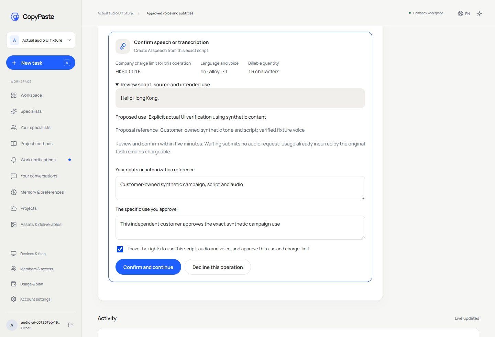

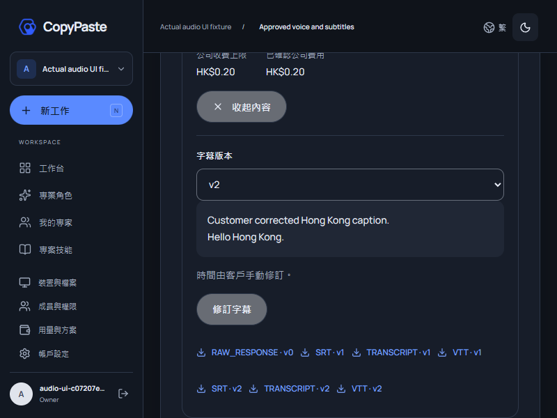

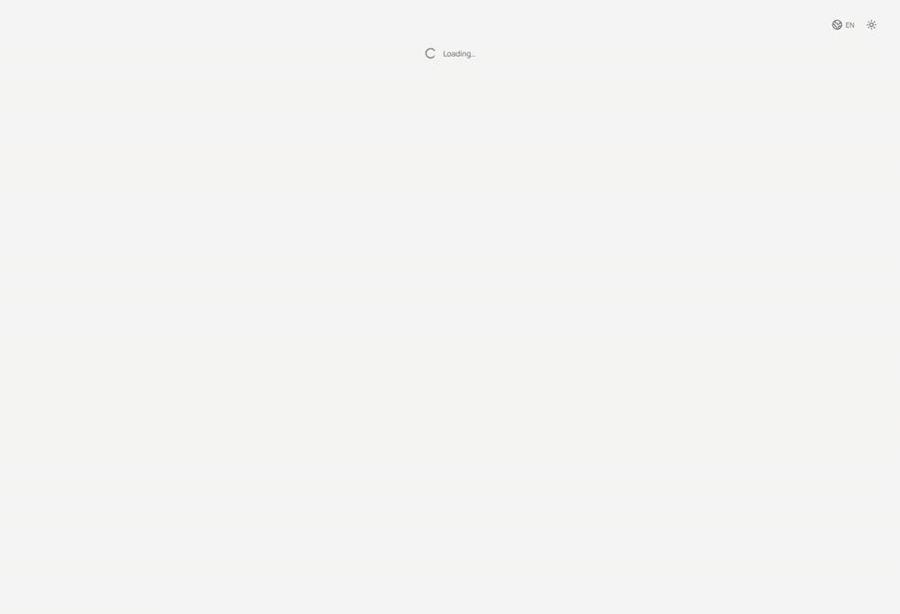

[原始 MP4](assets/screenshots/workmate-audio-08-audio-production.mp4)

<details>
<summary>以前交付细节与历史证据</summary>

<!-- audio-production-stage84 -->

在云端 Codex 任务中查看、播放及下载配音，直接修订字幕。

### 本地启动

以下命令在已检出的对应仓库内执行。完整工作区将六个独立仓库并列放在 `dev/`，见[分支与检出布局](https://github.com/copypasteltd/workmate/blob/docs/docs/governance/04-git-branches-and-publication.md)。使用 Windows x64、Node.js >=22.14、npm/Git，以及文档约束的原生 PostgreSQL、FFmpeg/FFprobe 与固定 Codex 资源；保留已有本地配置和数据，不使用 Docker/WSL/虚拟机。

```powershell
Set-Location 'D:/dev/copypasted/自有agent/dev/copypaste-web'
npm ci
npm run dev
```

先启动后端，再打开 `http://localhost:4317`；静态构建使用 `npm run build`。通过邮箱/验证码登录并选择企业/项目。

### 当前使用流程

1. 邮箱/验证码登录并选择企业/项目，选用「**影片与动效设计师**」预设（1.3.0，加载 `speech-production` 1.1.0），描述获准脚本或附加获准 WAV/MP3 素材。Desktop 先选本机目录并主动设置本机权限；完整权限由原生确认授予，可随时撤回。Web/Extension 使用云端 Codex，Desktop 编排保持在本机。
2. 在任务中要求配音或文件转写。服务端检查当前角色、可选已核验音频能力、语言/声音白名单、精确源文件版本、预算及已发布容量。全部 AI 经公司 OpenAI 兼容网关；推理、图片和音频共享任务预算。未配置音频不会阻断已有视频剪辑。
3. 打开「配音与字幕 → 查看音讯与字幕」，播放/保存实际 WAV；保护接口核对字节数与 SHA-256。转写保留原始 JSON、文字及服务实际返回的时间。没有时间戳时只显示文字，不编造字幕时间。
4. 选择当前版本后「修订字幕」，修改文字/时间、删除或新增字幕，填写原因并另存新版本。新增人工时间初始为空；旧版本只读，原文保留。发生并发修改时拒绝旧版本覆盖并保留编辑。人工修订不调用 AI，不新增生成收费。
5. Admin 使用独立邮箱/验证码/TOTP 身份。在「调用管理 → 配音与转写作业」中，`admin.ai.requests.read` 控制范围内元数据，`admin.ai.cost.read` 独立控制费用，`admin.content.body.read` 加近期 MFA 控制并审计原始正文读取。原始要求不可覆盖；来源隔离、删除或失权阻断当前预览/下载。确认费用沿用独立审批账本；已派发但结果未知时保留原预留，禁止自动重发。

升级前在后端执行 `npm run db:migrate` 应用新增 **SQL101**。公司 `AI_BASE_URL`、`AI_ALLOWED_HOSTS`、密钥、精确配音/转写别名、正数字符/毫秒费率及已核验声音/语言列表仅配置在服务端。协议核验后才能开启 `AI_SPEECH_VERIFIED` / `AI_TRANSCRIPTION_VERIFIED`；时间戳能力另行声明。音频 slots/RPM 初始为 **0**，需按已有独立审批发布容量策略。普通 `npm run demo` 不自动启用本音频夹具；本轮检查使用隔离、明确声明的假服务。

Desktop 沿用 CopyPaste 字体、蓝/米白色与浅深主题，**无 Electron 自带边框菜单，无可见纵向或横向滚动条**。内容换行，保留真实滚轮/Home/End、末项焦点及真实进度；字幕控件聚焦后缩放真实 OS 窗口，仍在 1440×980、1280×800、800×600 中可见。Extension 保持真实 Chrome 右侧栏、ChatGPT 式对话/附件及获准文件上传，无 Desktop 依赖。

实际核查：平台 **988** 项（保留原 **968** 项）、音频/网关 **43**、兼容 **80**、客户端测试 **124**、真实 Web/Admin/侧栏 **10**、打包本机 Desktop **40**。已检查三种桌面尺寸、实际 WAV 解码/保存、人工修订和自建资源清理。SQL001–100 与两份原 OpenAPI 保持各自已发布字节，七项音频接口为增量；当前运行时及实际执行的测试源码与选定回执一致。唯一无关快照差异是版本目录总数 30→31 的已复核测试更新；其完整四文件批次与剩余批次重新运行。以前通过及失败回执保持原范围与字节。

音频假服务使用可解码合成音调与固定转写。真实声线/粤语质量、独立人工授权确认、音频能力后台核验/发布/回滚、未知 POST 外部账单证据与恢复交付仍待补齐。保存的权利字段来自工具参数并绑定用户/任务，不是独立核实的人工同意。全部专业角色质量、签名安装及完整 Codex Desktop 对齐尚未完整验收。原 **102 REQ/102 TC：83 部分、19 未证明、0 完整验收；G01–G10 保留**。


[方案与边界](https://github.com/copypasteltd/workmate/blob/docs/docs/technical/84-internal-audio-production.md) · [精确版本证据](https://github.com/copypasteltd/workmate/blob/docs/docs/quality/audio-production-checkpoint.json) · [新增接口契约](https://github.com/copypasteltd/workmate/blob/docs/docs/contracts/audio-production-openapi.json)

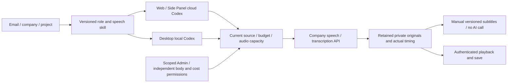

实际已登录页面；原始截图未经改图，交互按观察时间录制。音频、模型、业务内容及原生对话框决策均为明确夹具。


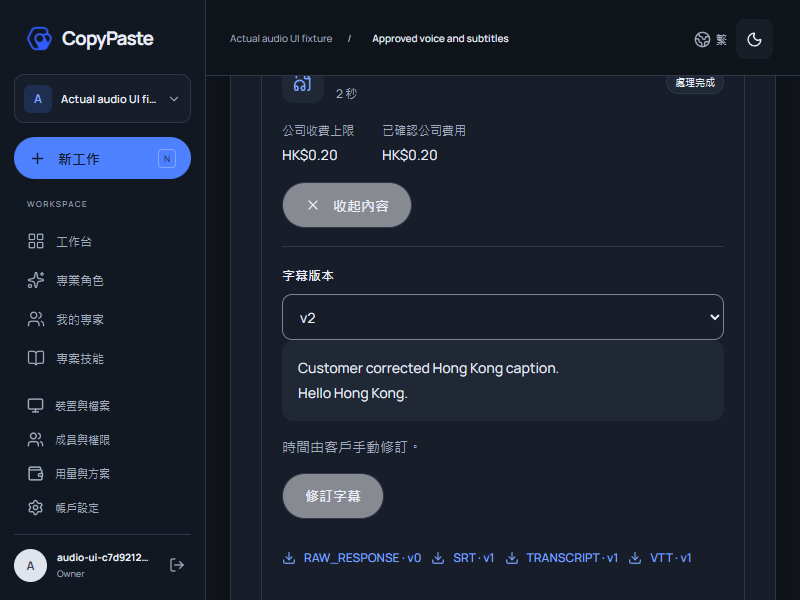

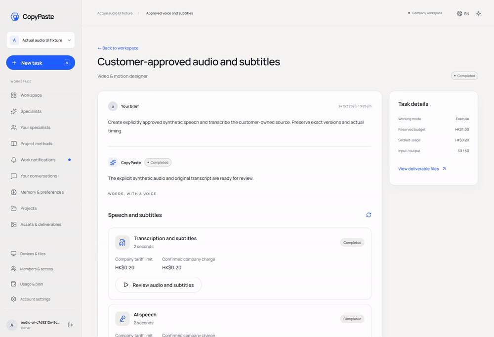

[原始 MP4](assets/screenshots/workmate-audio-06-audio-production.mp4)

<details>
<summary>以前交付细节与历史证据</summary>

<!-- geo-observation-stage83 -->

GEO 现已支持固定问句、可复现配置和原始回答留存。不可改写的配置固定完整 Agent 定义、skills、请求模型别名、Codex 内核、语言、请求地区及协议。独立 API 重复执行保持同一配置；消费者产品人工样本使用单独来源口径。

### 本地启动

以下命令在已检出的对应仓库内执行。完整工作区将六个独立仓库并列放在 `dev/`，见[分支与检出布局](https://github.com/copypasteltd/workmate/blob/docs/docs/governance/04-git-branches-and-publication.md)。使用 Windows x64、Node.js >=22.14、npm/Git，以及文档约束的原生 PostgreSQL、FFmpeg/FFprobe 与固定 Codex 资源；保留已有本地配置和数据，不使用 Docker/WSL/虚拟机。

```powershell
Set-Location 'D:/dev/copypasted/自有agent/dev/copypaste-web'
npm ci
npm run dev
```

先启动后端，再打开 `http://localhost:4317`；静态构建使用 `npm run build`。通过邮箱/验证码登录并选择企业/项目。

### 当前使用流程

1. 按现有邮箱流程登录并选择企业/项目。在「行销分析 → GEO 观测」中，先于「专业角色」建立未绑定品牌的 Agent，再保存固定问句与品牌别名。别名不会注入观测问句。修改问句、地区、语言或 Agent 时，基于已审核旧哈希另存不可改写的新版本。
2. 「执行 API 观测」显示当前可用任务名额和精确每问预算；费用确认框初始不选中。每题需要一个名额，服务端在锁内检查整组容量并原子预留全部预算。Starter 单名额不能绕过限制执行两题。独立云端 Codex 任务经公司 Responses 网关运行，不带历史/记忆，关闭检索及业务工具；重复执行新增 run。
3. 「保存已完成回答」将真实成功任务输出保存一次，形成私有 UTF-8 原文文件、SHA-256 和观察时间，不再调用模型。可打开原文、下载完整回答或导出 JSON。未完成答案保持缺失，未知用量保留待核实状态，不能填零。未完成观测导出仍保留有效 ISO 时间。
4. 「录入消费产品样本」填写产品、实际地区/语言/时间、可留空的显示模型、检索状态，并主动选中初始未勾选声明。当前表单一次录入一个固定问句；API 支持最多 20 个已知问句。粘贴完整原始回答；元数据标为用户提供、未经平台核实，不创建 AI 任务或模型费用。
5. 选择比较 A/B，可跨配置版本选择。实际下载包含双方原始回答、哈希及有效配置；明确区分同配置重复变化、配置差异和 API/人工来源，不混合汇总。字面别名和回答中的链接不等于实体核实、推荐、排名、独立检索证据或因果结论。请求地区只是提示上下文，服务商处理地区及实际解析的底层模型未知。
6. 记录默认私有，仅创建者在当前项目授权下访问，数据库强制 RLS。Admin 元数据、独立 `admin.content.body.read` 正文、项目范围隔离/恢复/删除与审计覆盖配置、run 和 sample。明确发布原文副本时继承 GEO 来源；隔离、过期或删除阻断当前导出、托管读取和派生成果。默认保留 90 天，删除日志处理真实任务取消/结算并回收答案文件及任务副本；无法撤回已另存到服务之外的文件。

Desktop 保留**本机 Codex**、可撤销的完整本机权限、无边框及无 Electron 菜单；明确标注「GEO 观测 · 浏览器」后打开公司 Web 地址，不以云端 Agent 替换本地执行。本机 GEO 协议仍待实现。无可见纵横滚动条，仍支持真实滚轮、局部 Home/End、整页 Ctrl+Home、末项焦点和真实进度。Extension 保留 ChatGPT 式对话/附件、获准本地文件上传和云端 Codex，通过浏览器真实右侧 Side Panel 使用；GEO 入口打开公司 Web 工作区，不依赖 Desktop。

局部验证：平台 **968/968**，保留全部原 **946** 项；GEO 专项 **22**、客户端 **124**、真实 Web/Admin/原生侧栏 **13**、打包本机 Desktop **37**。新增 SQL100，SQL001–099 与原 OpenAPI 字节保留。模型、图片、消费者回答与广告数据均为明确假数据。真实提供方质量/排名、全部专业角色、签名、完整 Codex Desktop 对齐、性能容量和原始完整验收仍保留。原 **102 REQ/102 TC：83 部分、19 未证明、0 完整验收；G01–G10 未证明**。

交互回执对应的产品/运行时源码字节保持一致。其后仅将两处最新迁移预期由 99 更新为 100，并把历史 098→099 夹具明确限定到 99；原有数据、来源 OID、预备查询和重复升级检查保留。完整回归资格覆盖 19 个独立数据库批次：复用第 33 轮源码相同的 01–07 批，第 34 轮重新执行 08–19 批。两个受影响测试文件均重新执行，逐项核对当前运行时、实际执行测试及辅助文件字节；失败原回执不重新标记。


[方案与边界](https://github.com/copypasteltd/workmate/blob/docs/docs/technical/83-reproducible-geo-observations.md) · [精确版本证据](https://github.com/copypasteltd/workmate/blob/docs/docs/quality/geo-observation-checkpoint.json) · [新增接口契约](https://github.com/copypasteltd/workmate/blob/docs/docs/contracts/geo-observation-openapi.json)

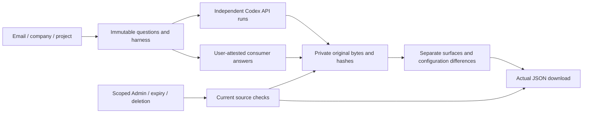

实际页面截图与按观察时间录制的交互。画面中的业务/模型内容为假数据；侧栏截图来自 Chrome 真实 SIDE_PANEL 上下文。


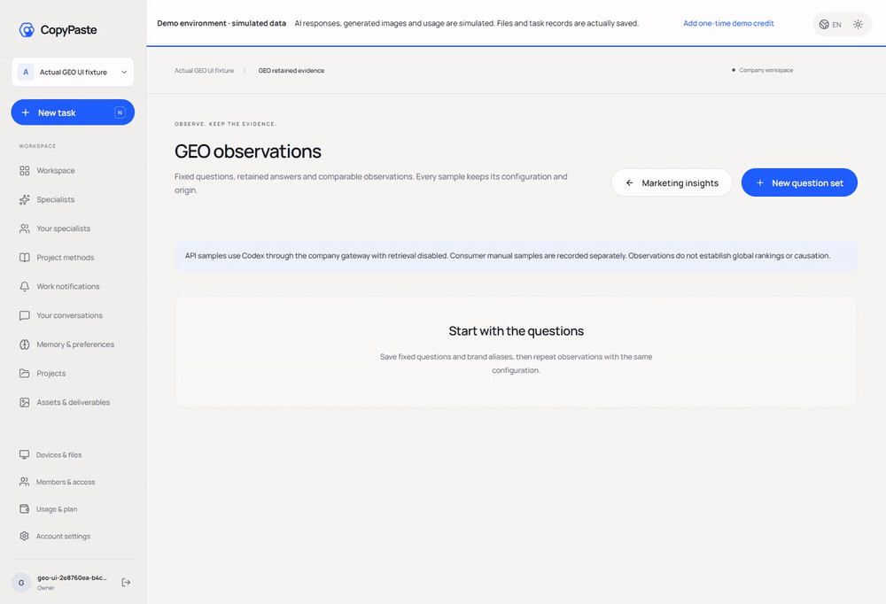

[原始 MP4](assets/screenshots/workmate-geo-05-geo-observations.mp4)

<details>
<summary>以前交付细节（保留历史证据范围）</summary>

<!-- creative-feedback-stage82 -->
## 已确认创意反馈与桌面布局

补齐素材到广告反馈的明确流程：用户先确认具体素材版本、广告身份及日期，再纳入投放事实。同名素材在不同账户下分别计算。身份仍属用户确认；当前官方连接为活动级数据，不能自动认领为某个 creative 的效果。

### 本地启动

以下命令在已检出的对应仓库内执行。完整工作区将六个独立仓库并列放在 `dev/`，见[分支与检出布局](https://github.com/copypasteltd/workmate/blob/docs/docs/governance/04-git-branches-and-publication.md)。使用 Windows x64、Node.js >=22.14、npm/Git，以及文档约束的原生 PostgreSQL、FFmpeg/FFprobe 与固定 Codex 资源；保留已有本地配置和数据，不使用 Docker/WSL/虚拟机。

```powershell
Set-Location 'D:/dev/copypasted/自有agent/dev/copypaste-web'
npm ci
npm run dev
```

先启动后端，再打开 `http://localhost:4317`；静态构建使用 `npm run build`。通过邮箱/验证码登录并选择企业/项目。

### 当前使用流程

1. 沿用邮箱登录并选择企业／项目，进入「行销分析 → 创意与广告反馈」。先准备共享素材，再导入有明确账户、币种、时区、归因和转化定义的 Google／Meta 广告级 CSV。活动级或口径不完整的来源不能选取。最多展示最近 100 项合资格来源；映射和报告提供分页。
2. 「建立候选」固定共享素材版本、来源、具体广告／渠道／活动、creative ID、日期及核对备注。相似名称和用户提供的平台资料只构成候选依据。检查冻结摘要及口径后，主动勾选默认未选中的单一创意声明并填写原因。更正身份须撤销后另建候选，原确认历史不可改写。
3. 选取最多 40 项已确认映射，建立指定日期的反馈。精确整数计算和十进制字符串保留金额精度；账户、平台、币种、时区、归因、转化、创意与素材版本分别呈现。相同广告日去重，冲突事实／竞争身份／重叠更正快照拒绝。缺失转化保持未知，没有观测的日期不当成零，不推断跨口径总计或因果提升。
4. 下载实际冻结 JSON，或在共享文件中明确选用报告作为下一轮 Codex 工作附件。模型实际读取及后续成果保留来源链；撤销、隔离、过期或授权失效阻止管理范围内的读取、下载和排队续作。已导出的外部副本由客户自行管理。
5. 后台内容列表、独立正文权限 `admin.content.body.read`、范围隔离／恢复／删除和审计覆盖映射及报告。元数据权限不授予正文读取。恢复映射不会静默重新公开旧隔离报告。保留期默认 90 天；删除日志先完成报告文件清理，再清除上级正文。元数据操作不能重写冻结身份或原确认。

Desktop 在客户本机运行 Codex，完整本机权限由客户主动授予并可撤销。保持无边框、无 Electron 菜单、无可见纵向／横向滚动条；表格／代码换行、紧凑布局保留滚轮、Home/End、焦点和真实任务／影片进度。实际打包窗口验证 800×600、1280×800、1440×980。Extension 继续 Chrome 原生右侧栏中的 ChatGPT 式对话／附件，获准文件上传给云端 Codex；新反馈入口打开完整云端工作台，不依赖 Desktop。

部署前在后端执行 `npm run db:migrate` 应用 **SQL099**。已发布 SQL001–098 和两份原 OpenAPI 字节保持。七项新增操作使用独立契约；实际配置服务为 454 项路由，另保留一项条件演示声明。公司网关凭据不进入渲染器或侧栏。

当前局部核对：平台 **946/946**，此前 **929** 项保留；反馈专项 **17/17**、既有分析／来源兼容 **43/43**、客户端检查 **124**、真实 Web **4**、打包 Desktop **36** 项。各计数范围独立。下方画面明确为 **Web**，复制到其他组件仓库仍保持该来源；广告身份／事实及模型内容为明确假数据，本机执行、文件、登录、数据库、精确计算与录制是真实运行。

原 **102 REQ/102 TC 保持 83 部分验证、19 未证明、0 完整验收**；NFR 和 G01–G10 保留。真实平台身份核验、专业营销成果、签名安装和完整 Codex Desktop 操作对标仍需后续证据。自建浏览器、页面服务及原生数据库均关闭，未使用 Docker／WSL／虚拟机。

所选专项、兼容、客户端、Web／打包 Desktop 和完整平台回执均针对当前精确源码重新执行。独立核对记录长页侧栏／偏好控件定位、原生录屏串行、主题过渡完成后的报告取景和 Windows 整页 Ctrl+Home。聚焦本机会话的 Home/End 及既有可达性条件保留，并新增页面末端导航与偏好控件可见检查。早期与失败记录保留原范围，不用于冒充当前源码通过。

[设计和权限](https://github.com/copypasteltd/workmate/blob/docs/docs/technical/82-confirmed-creative-feedback.md) · [精确证据](https://github.com/copypasteltd/workmate/blob/docs/docs/quality/creative-feedback-checkpoint.json) · [增量接口](https://github.com/copypasteltd/workmate/blob/docs/docs/contracts/creative-feedback-openapi.json)

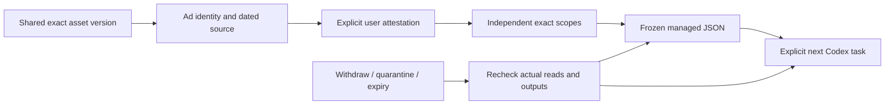

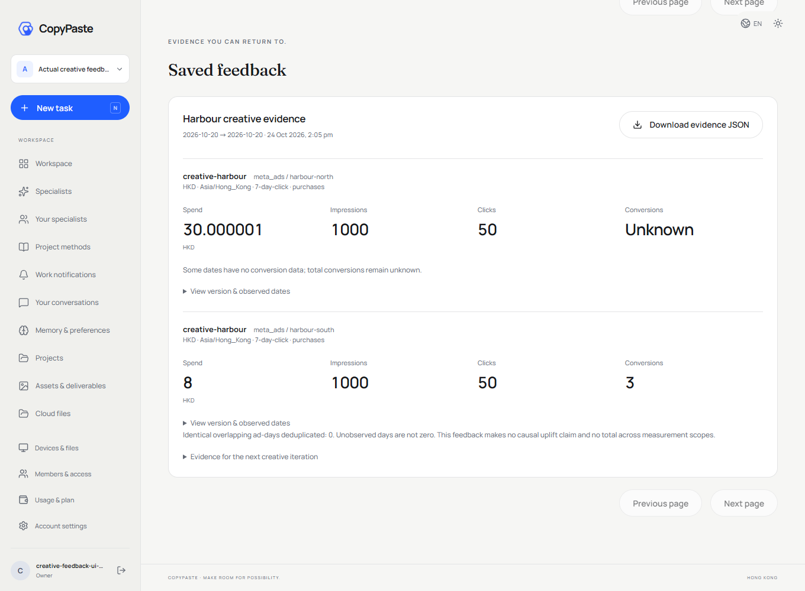

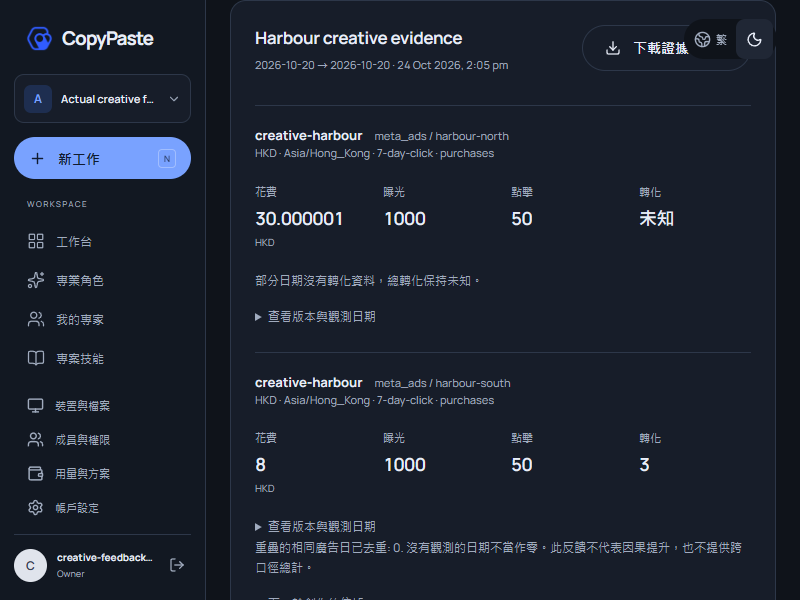

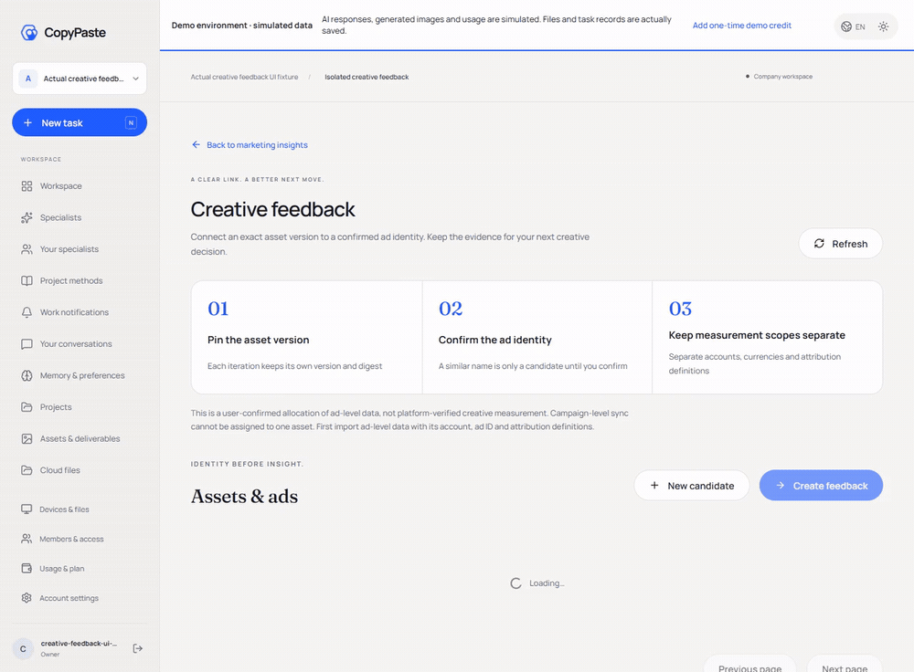

[实际录制 MP4](assets/screenshots/workmate-feedback-06-creative-feedback.mp4)


<details>
<summary>阶段 81 历史使用与完整安装参考；保留原范围</summary>

<!-- managed-video-stage81 -->
## 后台视频能力与当前交付

本仓库是 Workmate 的一个独立版本组件。后台已补齐视频模型的不可变草稿、实际验证、独立审批、发布与回滚，沿用文字和图片的管理流程。Web、本机 Desktop 和原生 Chrome 侧栏使用已发布版本，已有任务保留原模型和费率快照。

### 本地启动

以下命令在已检出的对应仓库内执行。完整工作区将六个独立仓库并列放在 `dev/`，见[分支与检出布局](https://github.com/copypasteltd/workmate/blob/docs/docs/governance/04-git-branches-and-publication.md)。使用 Windows x64、Node.js >=22.14、npm/Git，以及文档约束的原生 PostgreSQL、FFmpeg/FFprobe 与固定 Codex 资源；保留已有本地配置和数据，不使用 Docker/WSL/虚拟机。

```powershell
Set-Location 'D:/dev/copypasted/自有agent/dev/copypaste-web'
npm ci
npm run dev
```

先启动后端，再打开 `http://localhost:4317`；静态构建使用 `npm run build`。通过邮箱/验证码登录并选择企业/项目。

### 当前使用流程

1. 使用独立邮箱／TOTP 后台身份登录，进入「目录 → 模型能力 → 建立配置」，选择「影片生成」，填写公司模型别名、正数每秒港币费率和操作原因。Codex 与公司内部网关固定，草稿不能增加地址、密钥或其他内核。
2. 在「配置与验证」填写原因后执行验证，接口立即保存持久回执。全套 16 案例最多报价 184 秒，使用**平台验证预算**；关闭对话框不结束后台执行。进度只计实际验证的案例，可查看尺寸、时长、完整 MP4/H264 解码与取消后的实际观察，不用虚构百分比表示真实进度。
3. 「重新核对原作业」只查现有 operation；「停止此套验证」停止新调用，已发出作业仍须核对费用。结果未知时保留预算／容量占用，页面阻止再次验证；费用确认后，明确重新验证才会建立新回执和新的付费调用。当前费用与资格决定时的不可变回执分别显示。
4. 全部通过后「发布预览」比较模型与费率，再复核当前权限、近期 MFA、精确版本和原因，并由另一位管理员审批；申请人不能自审。回滚追加新发布事实，不重写历史。范围授权及显式拒绝保持，只有读取权限的管理员不能操作配置。
5. 服务退出后复用原作业和已确认内容，不重复生视频。SQL098 保留旧预算函数入口及全部原共享核账行为。部署前在后端执行 `npm run db:migrate` 应用 SQL098；SQL001–097 和两份原 OpenAPI 各自字节保持。公司网关凭据只留在服务器。版本化发布可在旧环境核验开关为 false 时提供已验证能力，真实供应商仍须独立验收。

Desktop 保持无边框，在客户本机运行 Codex，并支持客户主动授予、可撤销的完整本机权限。产品不出现可见纵向／横向滚动条，保留滚轮、键盘、焦点及真实任务／视频进度。Extension 使用 Chrome 原生右侧栏、ChatGPT 式对话和附件，获取／读取／上传获准文件，Agent 在云端运行，不依赖 Desktop。

当前平台 **929/929** 项，保留原 912 项，71 文件／18 批；另有旧能力发布／网关／客户视频兼容 **106/106**、契约 **7**、真实后台页面 **7** 项。下方图片和录像明确为 **Admin**，复制到客户端仓库用于共享配置使用说明；阶段 80 客户端源码和画面保留原验证范围，不冒充新全栈页面测试。本次后台使用真实身份、PostgreSQL、固定原生 Codex 版本检查及实际 MP4 解码，内部模型服务和视频内容为明确假数据。

原 **102 REQ/102 TC 保持 83 部分验证、19 未证明、0 完整验收**，G01–G10 保留。真实公司供应商、全部专业角色、完整视频业务、签名安装及完整 Codex Desktop 操作对标仍未证明。自建浏览器上下文／实例、页面服务和原生数据库均关闭，未使用 Docker／WSL／虚拟机。

首次组合回归因假服务被分配到本机 Node Fetch 在 HTTP 前拒绝的 2049 端口而失败，原失败 TAP、实际端口观察和自建进程／夹具清理记录全部保留。假服务已复用现有安全端口工具，测试到达信号等待加上时限；这项修复未修改产品源码、测试断言或测试名称。完整平台与 17 项专项使用修复后的夹具重新执行。此前兼容／页面录制的产品和验证器字节保持，两处后续测试夹具差异单独核对，不冒充重新录制页面。

[方案与权限](https://github.com/copypasteltd/workmate/blob/docs/docs/technical/81-managed-video-capability-releases.md) · [精确证据](https://github.com/copypasteltd/workmate/blob/docs/docs/quality/managed-video-checkpoint.json) · [增量接口](https://github.com/copypasteltd/workmate/blob/docs/docs/contracts/capability-releases.openapi.json)

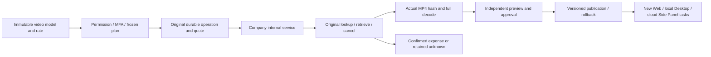


[后台交互 GIF](assets/screenshots/stage81-admin-workmate-managed-video-02-video-cancellation-and-cost-recovery.gif) · [实际录制 MP4](assets/screenshots/stage81-admin-workmate-managed-video-02-video-cancellation-and-cost-recovery.mp4)

<details>
<summary>阶段 80 历史使用与完整安装参考；旧计数保留原范围</summary>

<!-- generated-video-stage80 -->
## 生成式影片、费用控制与紧凑桌面布局

在影片专家的新任务中选择生成方式，直接查看真实进度、费用、播放及下载。

### 本地启动

以下命令在已检出的对应仓库内执行。完整工作区将六个独立仓库并列放在 `dev/`，见[分支与检出布局](https://github.com/copypasteltd/workmate/blob/docs/docs/governance/04-git-branches-and-publication.md)。使用 Windows x64、Node.js >=22.14、npm/Git，以及文档约束的原生 PostgreSQL、FFmpeg/FFprobe 与固定 Codex 资源；保留已有本地配置和数据，不使用 Docker/WSL/虚拟机。

```powershell
Set-Location 'D:/dev/copypasted/自有agent/dev/copypaste-web'
npm ci
npm run dev
```

先启动后端，再打开 `http://localhost:4317`；静态构建使用 `npm run build`。通过邮箱/验证码登录并选择企业/项目。

### 当前使用流程

1. 使用现有邮箱/验证码流程登录，选择企业/项目，创建「影片与动效」专家任务。新任务固定 R16 1.2.0 与 `video-generation` Skill；旧任务保留原角色和 Skill，使用生成式能力时需新建任务。
2. 在 Web 或 Desktop 选择「生成式影片」、时长（4/8/12/16/20 秒）及横向/纵向/正方形，填写需求并确认任务预算。模板/FFmpeg 合成是独立选项。Desktop 设置默认收起，展开后采用紧凑面板，留出会话和输入空间。Extension 在同一企业/项目的任务历史中打开已有云端影片任务，使用状态、播放和保存操作。
3. Codex 经公司内部服务调用。提交 HTTP 前持久保存原 operation 和报价，与推理/图片共用同一任务预算。输入计数、推理、图片与视频也共用准入限制；已完成调用释放并发后仍计入分钟速率，独立审核确认的终止事实参与并发计数，原请求记录保留。只显示服务回报的真实进度。用量未确认或结果不明时保留原预留，缺失 usage 不计为免费。
4. 「停止这次生成」只取消同一原作业，之后确认的用量仍可能产生费用。重试/恢复查原 operation，不重提生成。真实状态变化拒绝旧控制版本；后台续租和无变化的轮询不会使用户操作过期。
5. 完成状态须通过真实摘要、大小、格式、尺寸、时长及原生完整解码后才交付。可播放、保存真实 MP4；源文件隔离、成果撤回或授权失效后移除当前预览及下载，不用虚构文件冒充成功。内嵌预览限制 20 MB。
6. Admin 进入「调用管理 → 生成式影片作业」。元数据、费用和原作业重查按独立权限及企业/项目范围控制；重查需要近期 MFA、原因和审计，不发起新生成，也不获得提示词、参考图或视频正文。原任务费用结算保留独立审批与不可变用量事实。

升级前在后端执行 `npm run db:migrate` 应用新增 **SQL097**。已发布 SQL001–096 与两份原 OpenAPI 各自字节保持。配置公司 `AI_BASE_URL`、允许域名/密钥、精确 `AI_VIDEO_MODEL`、显式 `AI_VIDEO_VERIFIED`、正数秒费率 `AI_VIDEO_HKD_MICROS_PER_SECOND` 及可选回调签名密钥。公司能力未显式配置/核验时仅生成步骤不可用，凭据不进入渲染器或 Extension。公开 Sora 2/Videos API 已于 2026-09-24 停用，`company-video-jobs-v1` 是公司内部契约，不静默切换公开供应商。完整的管理后台视频能力验证/发布流程仍需补齐。

Desktop 无原生边框和 Electron 菜单，产品界面不出现可见纵向或横向滚动条。内容保持滚轮、Home/End、键盘聚焦、换行及最后操作可达；实际检查 800×600、1280×800、1440×980，英文/繁中及浅深主题。真实任务与视频进度保留。Codex 在客户本机执行，完整本机权限由客户主动授予并可撤销。Extension 保留原生右侧 Side Panel 和云端 Codex，不依赖 Desktop 或本地 Agent。

验证：平台 **912/912** 项，保留原 874 项；影片/网关专项 **60/60**；客户端单元 **69**；打包 Desktop **32**、Web/Admin **5**、原生侧栏 **9**；本机监督进程 **17/17**。各计数范围独立，不相加为产品验收。原生 Codex、身份、数据库、文件、媒体解码与账本是真实执行，模型推理/视频内容、客户数据与部分原生同意决定为明确夹具。自建浏览器/数据库均关闭，未使用 Docker/WSL/虚拟机。原 **102 REQ/102 TC 为 83 部分验证、19 未证明、0 完整验收**；真实公司媒体、完整 TC-019/TC-056、全部专业角色及 G01–G10 仍保留。

平台完整 70 文件、18 批采用已审查的同源码复核：一批遇到 Windows 1455 资源错误后，四个文件在新的自建数据库全部重跑通过；其余十七个完整通过批次的源码、测试、工具及内核字节完全相同。原失败尝试继续标记失败，不计入通过；每份选用回执保留原计划摘要，原始 TAP 不拼接、不改标。

[方案与协议](https://github.com/copypasteltd/workmate/blob/docs/docs/technical/80-generated-video-jobs.md) · [精确证据](https://github.com/copypasteltd/workmate/blob/docs/docs/quality/generated-video-checkpoint.json) · [增量接口](https://github.com/copypasteltd/workmate/blob/docs/docs/contracts/generated-video-openapi.json)

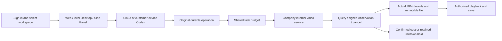


[交互 GIF](assets/screenshots/workmate-generated-08-generated-video.gif) · [实际录制 MP4](assets/screenshots/workmate-generated-08-generated-video.mp4)

<details>
<summary>阶段 79 历史文档与完整安装参考；旧计数保留原验证范围</summary>

[English](README.en.md) · [主文档](https://github.com/copypasteltd/workmate/blob/docs/docs/README.md)

<!-- brand-production-stage79 -->

## 固定品牌版本与生产检查

云端工作台新增可直接操作的品牌资料编辑、历史版本选择和生产前检查。

1. 登录并选企业/项目，在 Web 或 Desktop 打开「品牌资料」。设置名称、色彩、字体及使用声明、核准产品事实/价格、促销期限、渠道/语言和可选固定 Logo 文件。上传字体须共享至当前项目。
2. 发布不可变版本。以后编辑会产生新版；并发旧版编辑报冲突。已有专家和任务继续使用绑定版本，需要升级时显式采用新的专家版本。
3. 选历史版本检查文字或固定事实。缺字定位到 Unicode 码点，过期促销或字体声明阻止新生产；价格事实使用存储文字和金额，不静默换字体或价格。
4. 绑定品牌的云端设计任务必须携带匹配的品牌/版本和渠道/语言。文字使用固定声明字体配置，显式引用事实键时使用存储文字和价格。产物保留来源依赖和可编辑 JSON；SVG 文字转路径，PNG 和有限的单页 PDF 审阅稿是真实渲染。字体登记只记录客户声明，不证明版权。

启动依赖客户端前，在已配置后端使用 `npm run db:migrate` 应用 **SQL096**。已发布 SQL001–095 与两份原有 OpenAPI 各自的字节保留。新增品牌契约包含四项操作；配置服务共 438 项，`DEMO_MODE=true` 时另有一项演示额度操作。旧品牌在当前权限下保留可读，不补造历史版本或许可；固定字体生产前需明确发布 v2 资料并采用新的专家版本，旧任务不自动改绑。

Desktop 在客户本机运行 Codex，提供明确可撤销的完整本机权限，无原生边框/菜单；纵横滚动条外观隐藏，同时保留滚轮、键盘、焦点定位及 800×600、1280×800、1440×980 实际窗口访问。保留真实进度。Extension 是云端 Codex 的原生右侧栏。全部 AI 请求经公司网关；测试后关闭自建浏览器，禁止 Docker/WSL/虚拟机。

当前分别通过：**平台 874/874 项**（68 文件/17 批，保留此前 861 项并新增 13 项）、客户端 68 项、打包 Desktop 30 项、品牌 Web 四项、Web/Admin 品质四项及原生侧栏八项。保留原生内核 17 项的 57 份绑定源码均未变化。数据库、身份、文件、账本和本机 Codex 真实运行，模型/客户/业务数据为明确夹具。原 102 REQ/102 TC 为 82 部分验证、20 未证明、0 完整验收；G01–G10、TC-056 真实客户盲审继续未证明。Desktop 品牌表单证据不等于全部本机专业角色的品牌约束已验收。

Desktop33、品牌 Web02 和 Web/Admin08 保留实际收据；其后只有一个未被这些旅程执行的扩展测试文件补充加载等待和登录诊断，前后字节及无关范围已单独核对。它们的应用/界面和执行旅程/验证器未变；新扩展运行及平台23使用更新后的测试文件，精确边界见检查点。

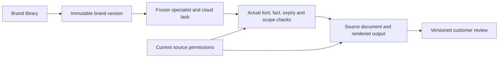


[MP4](assets/screenshots/workmate-brand-02-brand-library.mp4) · [Design / 方案](https://github.com/copypasteltd/workmate/blob/docs/docs/technical/79-versioned-brand-production.md) · [Contract / 契约](https://github.com/copypasteltd/workmate/blob/docs/docs/contracts/brand-production-openapi.json) · [Evidence / 证据](https://github.com/copypasteltd/workmate/blob/docs/docs/quality/brand-production-checkpoint.json) · [Changes / 更新](https://github.com/copypasteltd/workmate/blob/docs/docs/changes/2026-10-24-versioned-brand-production.md)

<details>
<summary>阶段 78 交付及完整安装参考：旧计数保留原验证范围</summary>

<!-- business-quality-stage78 -->

## 当前交付审阅与使用流程

轻度用户通过浏览器使用公司云端 Codex 与交付物。 新增接受、需修改、弃用的版本化交付审阅；人工基线、累计投入和修改次数独立填报。项目用量与后台交付品质面板分别显示技术成功、客户接受、实际读取复用及公司服务成本。

Desktop 保持客户本机 Codex、明确可撤销的完整本机权限及无边框/无 Electron 菜单。隐藏纵横滚动条外观，保留真实滚轮/键盘访问；内容重排，800×600 下聚焦输入框、聊天输入区和费用回执可见。此前进度条约束已撤销，保留真实进度。Extension 仍为独立原生右侧栏，聊天及获准文件上传至云端 Codex；所有 AI 请求走公司网关。

1. 登录并选择企业/项目，在正确执行位置创建任务。Desktop 另选本机目录并明确授权；Extension 不要求安装 Desktop。
2. 查看真实结果，打开 Desktop「审阅本次交付」或任务评价表单，保存接受、需修改或弃用及可选意见。任务或交付换版时需重新载入后审阅。
3. 按需填写累计人工数字。空值为未知，0 为明确没有投入；保存后保留展开的表单与输入访问。
4. 在项目用量或 Admin「交付品质」查看当前有权范围；未确认费用不冒充完整成本。服务成本不含退款抵减、外部服务及人工，不推断 ROI 或续费。

上线依赖接口/界面前先应用增量 SQL095；SQL001–094 与原任务 OpenAPI 保持原样。未固定交付版本的旧接受状态需客户重新审阅。保留原评价接口，当前表单强制任务版本、交付摘要及幂等键。写评价需要项目 approve 权限；Admin 的 `admin.usage.read` 仅查看授权范围汇总，不能代客户接受、从汇总读取意见正文或授予 OS 权限。

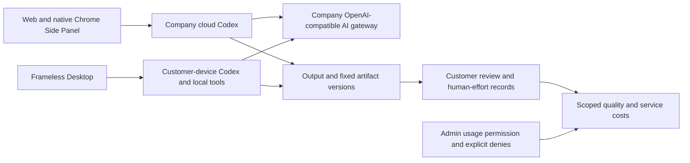

当前源码验证：平台 861/861 项（67 文件/17 批）、客户端 68 项、实际打包 Desktop 26 项、Web/Admin 四项及原生侧栏 8 项分别通过，不相加。保留的 17 项原生内核证据中 57 份绑定源码均未变化。身份、数据库、文件、费用和本机 Codex 真实运行；模型/业务/客户输入与系统对话框决定明确为夹具。TC-056 真实任务基线/盲审、18 角色/29 Skill 的全专业交付、完整 OS/Codex Desktop 对齐及生产门槛继续未证明；原 102 REQ/102 TC 和 81 部分/21 未证明/0 完整验收保持。

Desktop31 与 Web/Admin07 保留原始执行记录；其后仅一份迁移测试中的两个版本期望值从 94 更新为 95，前后字节已归档并逐字核对，运行代码、界面和旅程脚本均未变化。平台21重新执行更新后的全套测试；该保留证据边界见检查点。

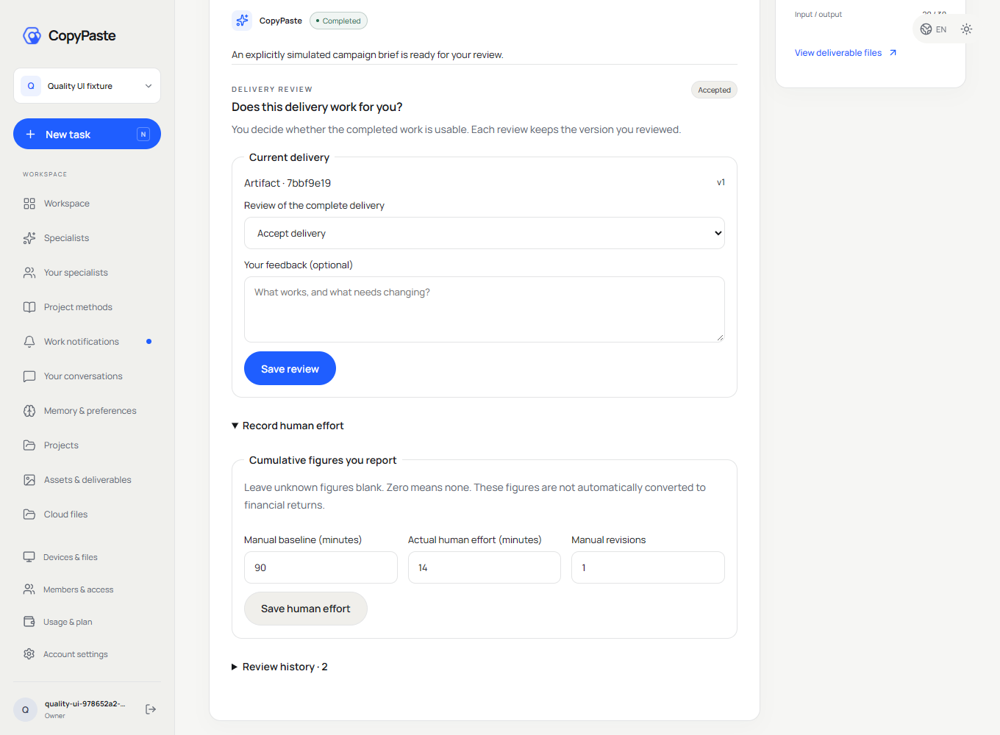

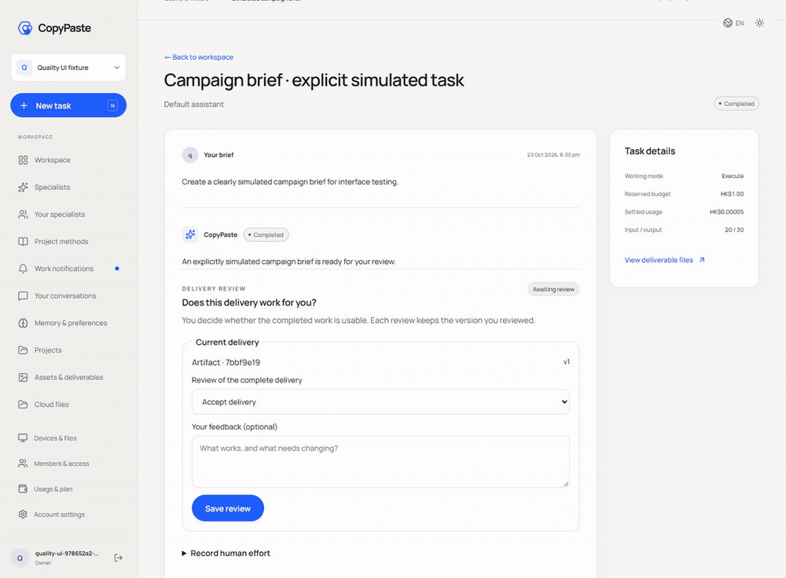

[MP4](assets/screenshots/workmate-quality-07-delivery-review.mp4)

[Design](https://github.com/copypasteltd/workmate/blob/docs/docs/technical/78-business-delivery-quality.md) · [Contract](https://github.com/copypasteltd/workmate/blob/docs/docs/contracts/business-quality-openapi.json) · [Exact source and media evidence](https://github.com/copypasteltd/workmate/blob/docs/docs/quality/business-quality-checkpoint.json) · [Changes](https://github.com/copypasteltd/workmate/blob/docs/docs/changes/2026-10-23-business-delivery-quality.md)

<details>
<summary>完整安装、架构与历史验证记录（较早计数和截图保留原时点范围）</summary>

[Backend](https://github.com/copypasteltd/workmate/tree/backend) · [Web](https://github.com/copypasteltd/workmate/tree/web) · [Admin Dashboard](https://github.com/copypasteltd/workmate/tree/admin) · [Desktop](https://github.com/copypasteltd/workmate/tree/desktop) · [Chrome Extension](https://github.com/copypasteltd/workmate/tree/extension) · [Delivery](https://github.com/copypasteltd/workmate/tree/delivery)

面向香港企业的云端 Agent 产品。当前仓库负责 **Web**；当前远程分支为 `web`.

<!-- client01-direction -->
## 当前客户端方向与实现差异

CLIENT01（2026-10-22）要求 **Desktop 在客户本机运行 Codex Agent**，提供客户可主动授予的 **完整本机权限**，操作能力对标 Codex Desktop。**Extension 在 Chrome 原生右侧栏采用 ChatGPT 式对话/附件结构**，获取、读取用户获选文件并上传，由云端 Codex 执行。全部产品 AI 请求仍走公司内部网关。

**阶段 77 历史实现：** Desktop 在客户本机运行 Codex，提供客户明确完整授权、本机文件/终端、同线程继续、原生追问、公司设计/视频工具与本机父子流程。新增十二项本机浏览器工具，可真实导航、操作、上传、截图和下载；停止/撤权回收任务页面。Desktop 隐藏可见滚动条，成果、代码和表格自动换行，保留纵向滚动与键盘访问；已撤销此前进度条约束，保留真实进度反馈。当前分别验证平台 851 项、客户端 68 项、原生内核 17 项、独立 Electron 浏览器 10 项和实际打包旅程 25 项，不相加。18 角色/29 Skill 的完整专业交付、全部 OS 应用与 Codex Desktop 全面能力对齐、真实模型及生产验收仍待证明。Extension 继续独立的 ChatGPT 式原生右侧栏、获准文件上传与云端 Codex，本轮未重跑其 UI。见 [方案](https://github.com/copypasteltd/workmate/blob/docs/docs/technical/77-desktop-native-browser.md)、[界面约束](https://github.com/copypasteltd/workmate/blob/docs/docs/requirements/04-desktop-layout-and-scroll.md)及 [源码/媒体检查点](https://github.com/copypasteltd/workmate/blob/docs/docs/quality/desktop-browser-checkpoint.json)。

Desktop 在客户本机运行 Codex；Web 和 Extension 由公司云端执行。下方架构图按这一执行边界呈现。

本机 supervisor 的实现及历史原生权限测试见 [技术说明](https://github.com/copypasteltd/workmate/blob/docs/docs/technical/70-desktop-native-codex-supervisor.md)。

<!-- /client01-direction -->

## 架构与约束

仅使用 Codex，全部 AI 请求经公司内部 OpenAI 兼容服务器。Web、Desktop、扩展和 Admin 共用服务端身份、权限、来源与计费控制。设计沿用 CopyPaste 的品牌素材、色系、字体和中英界面。

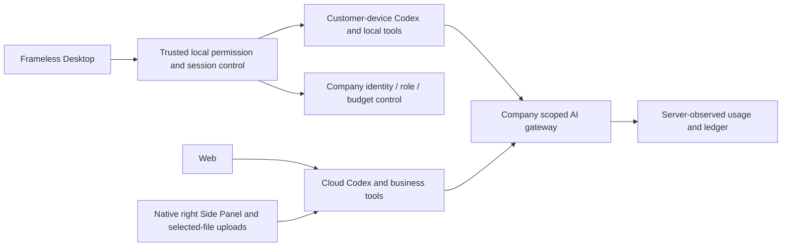

## 产品与使用逻辑

1. 访问工作台，通过邮箱验证码登录。首次验证可创建客户账户；正式邮件通过 SMTP，本地演示使用开发邮箱投递。
2. 建立或选择企业、项目，进入工作区。成员、项目权限、费用来源及私有会话所有者由服务端检查。
3. 选择默认助手、18 个角色预设，或建立自己的专员。固定角色、技能、品牌、模型和费率版本后提交工作。
4. 根据任务选择文件、品牌资料和营销连接。先检查方案/权限与预算，再原子预留费用并执行。
5. 查看任务状态、消息、产物、实际来源和用量。需要补资料时明确选择获准版本，沿用原任务继续；刷新保留尚未提交的选择。
6. 下载或明确发布交付副本；失效来源、撤权或当前读取失败会隐藏不可读取内容。通知、计划、会话和记忆保持各自范围。

## 页面与业务

工作区、专员目录、个人专员、项目方法/Skill、通知、私有会话、记忆、项目、文件/设备、成员、用量方案和账户设置共用企业/项目上下文。创作涵盖设计、品牌、广告、电商、社交、版式、演示、信息设计与模板视频；营销涵盖文件分析、广告连接和有范围的网站诊断/修改草稿/复查。

`src/main.tsx` 负责入口和路由；独立领域组件承接会话、任务、资料、创作、连接与分析；`src/api.ts` 和会话逻辑统一接入后台。React/TypeScript/Vite；字体与品牌素材随仓库提供，不要求运行时访问第三方字体 CDN。

## 启动

```powershell
npm ci
npm run dev
```

访问 `http://localhost:4317`，并先启动 backend 的 `http://localhost:4310`。配置参考 `.env.example` 和 `vite.config.ts`。前端只配置公司服务地址，不接收模型 API 密钥。生产按部署文档发布静态构建、设置 HTTPS、Cookie/Origin/CSP 和后台访问。

## 交互约束

当前任务自动刷新保留输入选择；切换企业、项目、任务或读取失败清空原内容。任务状态、已记录用量和已结算费用分别显示。首次模型调用前缺资料，与已付费完成回合后缺资料有不同文案。公开副本和下载仍受当前来源、保留期与权限约束。

## 初次检出与环境

新工作副本可单独检出本分支；已有本地仓库直接更新，不重新初始化。

```powershell
git clone --single-branch --branch web git@github.com:copypasteltd/workmate.git copypaste-web
cd copypaste-web
```

Node.js ≥22.14、npm 和 Git；锁文件固定依赖。当前验收环境为 Windows x64。后端/完整交付还需要原生 PostgreSQL 启动资源、云端锁定 Codex `0.163.0-alpha.10.2` 与 FFmpeg/FFprobe；Desktop 独立锁定 `0.163.0-alpha.11`，以其运行时清单为准。禁止本地 Docker、WSL 和虚拟化。跨端运行使用多个独立工作目录；布局见 [workspace](https://github.com/copypasteltd/workmate/blob/docs/docs/governance/04-git-branches-and-publication.md).

## 检查与验证范围

```powershell
npm run typecheck
npm test
npm run build
```

历史源码的平台完整 **802/802**、任务专项 **52/52**，六仓库 **13 项**类型/构建/既有客户端测试检查、真实打包程序和原生侧栏旅程 **32 项**通过。保留原 782 项命名回归测试。任务专项调用实际 PostgreSQL、身份、账本与 Worker；另有实际 Codex 子进程连接模拟内部网关的续接验证。UI 回合及业务数据按授权模拟。原 102 项需求仍为 81 项局部验证、21 项未证明完成、0 项完整验收。

完整规范 TaskDTO/任务创建、任意执行中暂停、未知外部结果恢复、全角色独立业务、GEO、真实供应商和生产/签名/商店验收仍继续跟踪。

本次同步补充统一任务接口和原任务输入事务。当前用户界面继续通过既有项目/会话接口使用同一执行域；下方重新录制的实际交互验证该流程的兼容性，并非声称界面已经切换到全部规范任务接口。接口边界、精确金额、幂等回执、来源撤销和未接入业务参数见 [方案细则](https://github.com/copypasteltd/workmate/blob/docs/docs/technical/68-canonical-task-contracts-and-input-transactions.md)。

## 实际页面与交互

实际录制，保留原捕获时间；AI 回合与业务数据为明确模拟。Admin 演示表单不代表财务提交。


[MP4](assets/screenshots/workmate-10-interaction.mp4) · [录制与源码回执](https://github.com/copypasteltd/workmate/blob/docs/docs/quality/workmate-media-10.json)

## 方案细则与更新

- [Product](https://github.com/copypasteltd/workmate/blob/docs/docs/product/01-prd.md)
- [Architecture](https://github.com/copypasteltd/workmate/blob/docs/docs/technical/01-architecture-and-stack.md)
- [Identity and permissions](https://github.com/copypasteltd/workmate/blob/docs/docs/technical/07-security-and-permissions.md)
- [Task continuation](https://github.com/copypasteltd/workmate/blob/docs/docs/technical/66-paid-native-input-checkpoints.md)
- [Admin](https://github.com/copypasteltd/workmate/blob/docs/docs/product/08-admin-dashboard.md)
- [Native clients](https://github.com/copypasteltd/workmate/blob/docs/docs/technical/30-native-window-and-browser-sidepanel.md)
- [Canonical task update](https://github.com/copypasteltd/workmate/blob/docs/docs/changes/2026-10-22-canonical-task-repair.md)
- [Local Codex update](https://github.com/copypasteltd/workmate/blob/docs/docs/changes/2026-10-22-native-codex-supervisor.md)

后续修改需要同步中英 README、受影响的实际截图/GIF、更新说明和对应分支。提交后通过 Delivery 发布流程核对远程 SHA；不强推覆盖协作者。`.env`、数据库、会话、依赖和安装产物不进入 Git。历史 README 原字节见 [archive](https://github.com/copypasteltd/workmate/blob/docs/docs/quality/history/stage66-before-workmate-readmes/manifest.json).

阶段 73 Desktop 本机执行：[具体方案](https://github.com/copypasteltd/workmate/blob/docs/docs/technical/73-desktop-native-company-tools.md) · [源码与真实旅程证据](https://github.com/copypasteltd/workmate/blob/docs/docs/quality/desktop-company-tools-checkpoint.json)；既有媒体保持原始源码范围。

阶段 73 公司工具历史更新：[更新说明](https://github.com/copypasteltd/workmate/blob/docs/docs/changes/2026-10-23-desktop-company-tools.md) · [源码检查点](https://github.com/copypasteltd/workmate/blob/docs/docs/quality/desktop-company-tools-checkpoint.json)；较早回执和媒体保持原始源码范围。

阶段 74 本机追问更新：[更新说明](https://github.com/copypasteltd/workmate/blob/docs/docs/changes/2026-10-23-desktop-native-input.md) · [当前源码检查点](https://github.com/copypasteltd/workmate/blob/docs/docs/quality/desktop-native-input-checkpoint.json)。较早报告及媒体保留原始源码范围。

阶段 75 私有视频更新：[更新说明](https://github.com/copypasteltd/workmate/blob/docs/docs/changes/2026-10-23-desktop-private-video.md) · [当前检查点](https://github.com/copypasteltd/workmate/blob/docs/docs/quality/desktop-video-checkpoint.json)。旧报告保留原始源码范围，平台/本机主进程验证与后续界面验证明确记录。

<!-- desktop-native-browser-stage77 -->

## 本机浏览器与 Desktop 界面

新建本机会话，选择工作目录并明确授予「完整本机权限」，再描述浏览器工作。本机 Codex 使用版本化 `copypaste_browser` 命名空间的十二项工具：页面列表、打开、导航、历史、快照、截图、交互、隔离脚本、等待、对话框、下载及关闭。交互包含真实点击、填写/输入/选择、按键、滚动/拖动及明确本机文件上传。可信无边框地址栏与远程网页使用独立渲染器。完成的下载保留在所选目录的 browser-downloads；模型截图直接捕获真实网页，README 浏览器录制使用真实 OS 窗口捕获，不拼接页面。

当前本机授权、公司身份、项目权限、调用归属和预算逐次核验；网页不能授予 OS 权限或取得公司推理凭据。调用 ID 绑定具体操作，结果未知不自动重放。Stop、撤权、登出和退出关闭任务页面及未完成下载，保留已完成文件和客户原有窗口。旧线程保留原工具绑定；使用浏览器工具须新建会话。

此前进度条约束已撤销；真实上传、任务、流程和视频反馈继续显示。隐藏滚动条外观不禁用原生滚动。成果换行、代码与表格重排，重点滚动区可聚焦；800×600、1280×800、1440×980 实际窗口保留输入与费用操作。检查包含真实滚轮、Home/End、最后一个下载按钮焦点，及紧凑费用/设备/账户页面和英文/繁中浅深主题；自动化未宣称实测物理触控板或每种系统缩放。

当前完整清单为 66 个测试文件 / 17 批 / 851 项通过，保留此前全部 848 项。SQL001–094 和 428 条 HTTP 接口均未变。仅 UI 自有夹具的用户/平台/企业容量配置为 32，并新增不可变网关策略版本 2（32 槽位、每分钟 10,000 请求），以保留多次取消后的未知结果和费用预留；初始策略、生产默认及容量控制不变。模型响应、业务页面与系统对话框决定明确模拟。原 102 REQ/102 TC、NFR 和 G01–G10 仍为 81 部分 / 21 未证明 / 0 完整验收。Extension 产品和验证器字节未变，本轮没有新增其 UI 结论。

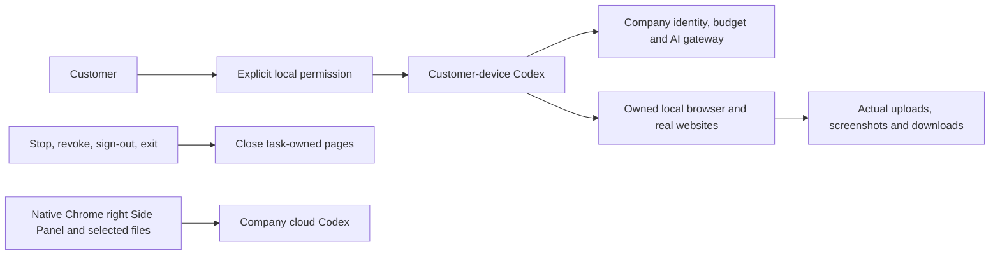


[Design](https://github.com/copypasteltd/workmate/blob/docs/docs/technical/77-desktop-native-browser.md) · [Requirements](https://github.com/copypasteltd/workmate/blob/docs/docs/requirements/04-desktop-layout-and-scroll.md) · [Evidence](https://github.com/copypasteltd/workmate/blob/docs/docs/quality/desktop-browser-checkpoint.json) · [Changes](https://github.com/copypasteltd/workmate/blob/docs/docs/changes/2026-10-23-desktop-native-browser.md)

<details>
<summary>阶段 76 历史实现与截图（旧滚动条布局）</summary>

<!-- desktop-native-workflow-stage76 -->

## 本机流程与核查

选择「流程顾问」、本机目录并明确授予所需本机权限。描述要求并确认冻结的流程步骤；执行前另行查看每个子角色的预算和合计，批准具体版本后才预留费用、启动本机子 Codex。遇到人工审批步骤须再次明确批准，之后才运行下一角色。查看真实本机文件、私有 SOP/流程 JSON/恢复说明下载与公司用量记录；顾问对话及未完成步骤分别计费。Stop 或撤权会终止本机父子进程；已受理但结果未知的操作保留待对账状态，不会自动重放。

首个子集支持最多八步的顺序本机 Codex、人工审批及广告汇总。每个子角色使用独立的 Skills、公司工具和推理凭据，沿用客户当前明确授予的目录及本机权限。完整本机权限不扩大公司的客户数据、项目权限或预算；云端 Worker 与定时任务不能接管本机流程。每个流程版本从真实读取账本冻结外部来源，复用到新会话及派生 SOP 时仍保留；旧创建任务删除不会替代外部来源的有效性判断。来源停用同时约束首次读取、缓存、子任务启动和私有或明确发布的衍生成果；管理员继续遵守权限、MFA、原因及审计控制。关闭应用也会阻止仍等待日志落盘的请求稍后启动。

阶段 76 当时的平台清单为 65 个实际测试文件、17 个完整批次、848 项通过，保留阶段 75 全部 830 项回归。SQL001–093 未改写；SQL094 增加本机流程来源与不可变版本。实际 428 条接口清单保留此前全部 415 条。原 102 REQ/102 TC、NFR 和 G01–G10 维持 81 项部分验证 / 21 项未证明 / 0 项完整验收；旧证据及媒体仅证明其原始源码。

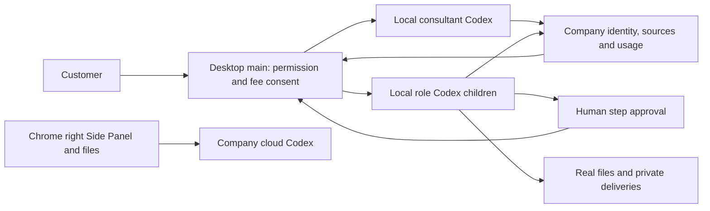


[设计与生命周期](https://github.com/copypasteltd/workmate/blob/docs/docs/technical/76-desktop-native-workflows.md) · [绑定证据](https://github.com/copypasteltd/workmate/blob/docs/docs/quality/desktop-workflow-checkpoint.json) · [更新说明](https://github.com/copypasteltd/workmate/blob/docs/docs/changes/2026-10-23-desktop-native-workflows.md)

</details>

</details>


</details>

</details>

</details>

</details>

</details>

</details>

</details>
