# CopyPaste Admin Dashboard

## 限时只读客服协助 / Controlled support

A13 支援工作台新增真实用户搜索、明确企业/项目选择、规范操作回执、限时只读视图和撤销。常驻横幅显示真实管理员、目标用户、只读及服务端截止时间；到期、撤权或读取失败清除内容。


阶段 51 当前平台回归 424/424（711 份来源），受控支持页面 8/8（816 份来源、9 张未编辑截图）。14 组支持专项、原规范检查、迁移保留及独立原生检查是有界证据，完整 102 项验收继续跟踪；当前包已重建，阶段 50 包原字节另存。

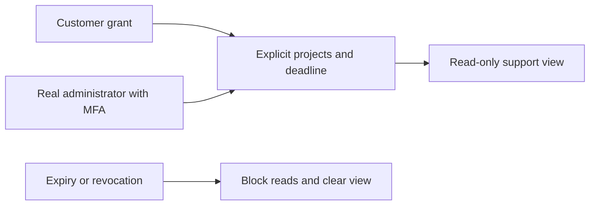


[English](README.en.md) · 独立运营控制台 · 0.5.0

本仓库是独立 Git 管理后台，与用户 Web 使用独立身份、Cookie 和入口。它管理用户、企业、消耗、费用、VIP、内容、任务、权限和产品配置；采用 CopyPaste 同源品牌样式及繁体中文/英文、浅深主题。所有实际授权、审计和事务在 platform 执行。


## 事务费用通知与三端账户（阶段 50）

既有费用及 VIP/显式赠额操作现在由平台原子捕获用户通知意图，仍沿用原权限、独立审批和精确账本来源。待审、拒绝和重复请求不会再产生资金或通知事实；银行证据和内部原因不进入用户通知。后台继续使用管理员身份，下面的图片是用户端实际收到的结果，不是后台冒充用户或新的资金写入口。

阶段 50 当时平台回归 410/410，真实三端费用流程 8/8。AI/媒体和付款证据使用获准本机模拟；身份、数据库、权限、账本及通知实际执行。原始 102 项综合验收、生产银行及完整安装/系统矩阵继续单独跟踪。

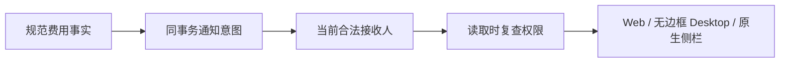

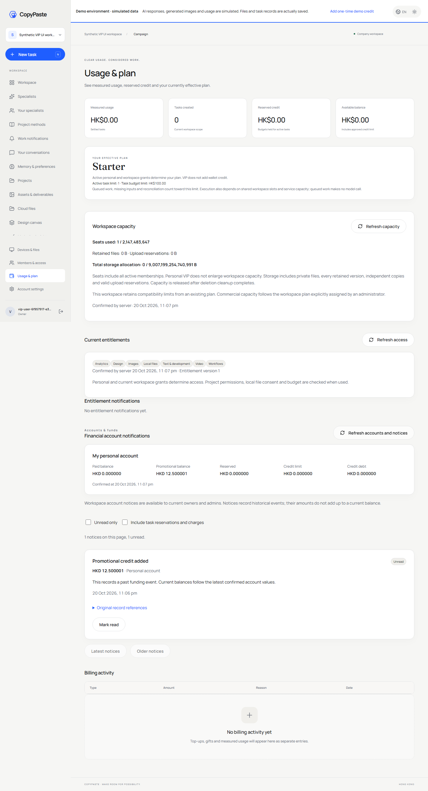

## VIP 与明确赠额的组合开通（阶段 49）

现有 VIP 表单可明确勾选配套赠额，分别填写精确 HKD 金额、独立到期日及原因。一次冻结预览及一次确认生成父操作；服务端在同一事务内提交规范 VIP 与赠额两个子操作。任何一步失败均回滚，任一风险策略触发时整体等待另一位同时具备双方权限的管理员审批，待审期间不产生权益或额度。

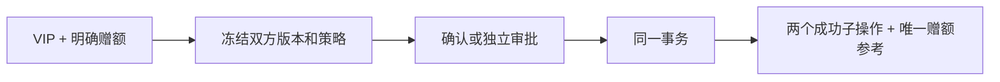


平台当前全量为 394/394（703 份来源前后一致）；新增 19 组专项已包含其中。实际 Admin 与用户读取有 9 组浏览器检查、12 张原始截图；125 份原规范响应与 1 份补充严格组合请求分别校验。060 为前向追加；两套原生数据库每库 119 张原公共表的完整行摘要前后一致，001–059 和历史空校验值保持原样。失败夹具与两次验证脚本错误均保留原回执。原始全部 REQ/TC/NFR/G01–G10、专业角色质量、真实外部服务和生产/安装验收继续跟踪。完整事实以主文档 `docs/technical/49-atomic-vip-and-explicit-credit.md` 与 Delivery 当前回执为准。


## 方案与权限

`/plans` 新增结构化方案表单、只读完整定义、同家族新版本、冻结发佈比较、确认与共用独立审批。页面沿用 CopyPaste 品牌、繁中/英文和浅深主题。精确 HKD 输入不会丢失大整数；校验失败保留表单、显示字段错误并将焦点移到可跳转摘要。原始保存版本不能原地编辑。


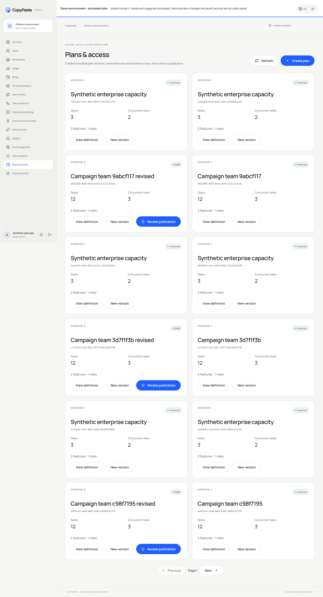


真实浏览器六组流程及八份原规范响应已通过，原报告、截图与源码摘要见 delivery 的 `admin-plans.json`、`admin-plan-contract-samples.json` 和 `admin-plan-screenshots.json`。旧 pricing 样式造成的首轮布局截图及缺失浏览器路径记录独立保留；当前 Admin 样式隔离并有布局断言。

发佈定义不会自动开通 VIP、记入余额或付款。完整规范 VIP 生命周期、席位/储存执行和用户端规范消费者仍需分别验收。此处为阶段 46 历史范围；后续规范 VIP 生命周期及组合赠额见本 README 的阶段 47/49 记录。

## 启动

Node.js 22.14+。先启动 platform API 与数据库，并通过 platform CLI 创建管理员、导入 TOTP：

```powershell
# 在 platform 仓库执行
npm run admin:create -- admin@your-company.example super_admin
```

然后在本仓库：

```powershell
npm ci
npm run dev
npm run typecheck
npm run build
```

访问 `http://localhost:4318`。生产部署 `dist/`，HTTPS 与精确 Admin origin，将 `/v1` 反向代理到平台；SPA 路由回退与 API 分开。可用 `.env.example` 中的公开 `VITE_API_BASE`。禁止将模型 key 或数据库凭证放入前端。禁止 Docker、WSL 和虚拟化环境。

管理员每次登录需邮箱验证码及 TOTP；敏感提交要求最近 10 分钟 MFA，过期后重新登录。开发 OTP 来自 platform 本机 mailbox；没有共享默认管理员。

## 16 个运营页面

| 页面        | 实现                                                                       |
| ----------- | -------------------------------------------------------------------------- |
| Overview    | 按各自权限范围汇总企业、用户、消耗、预留和对账                             |
| Users       | 数据库分页/检索、联系信息单独权限、用户详情、成员关系、消耗、状态/会话操作 |
| Workspaces  | 企业状态、成员数、按账务权限显示余额                                       |
| Usage       | 按用户/企业/项目范围汇总任务和实际 token/费用                              |
| Billing     | 个人／企业账户、原始流水、规范赠额／扣回／信用上限及审批；付款／退款契约待完成                            |
| VIP         | 个人或企业授权、开始/到期时间、暂停/恢复/延长/撤销                         |
| Content     | 全域内容元数据、正文/下载独立权限、隔离/恢复与版本检查                     |
| Execution   | 任务状态、取消、对账、满足条件的新子任务重试                               |
| Catalog     | 已安装角色/Skill 启停和展示、帮助/公告/导航版本发布                        |
| Connections | 已连接服务、范围、撤销                                                     |
| Access      | 邀请开户/真实 MFA、停用/恢复、会话、八类角色/68 权限、受限委派                  |
| Support     | 限时支持会话元数据与撤销；不具备静默代登录                                 |
| Audit       | 可追溯操作、结果与时间                                                     |
| Jobs        | 有预览/提交的用户状态批量操作、受控 CSV 导出                               |
| Plans       | 不可变方案家族/版本、结构化定义、冻结发佈比较及独立审批                                   |
| Policy      | 审批金额阈值与 VIP 最长期限的版本配置                                      |


## 管理员邀请与账号生命周期

0.3.0 在 Access 页面提供邀请开户及可选初始角色、范围、金额/期限/批次上限。账号和初始授权原子创建，逐项检查权限及委派来源。操作者只看到投递结果，邀请链接仅寄给受邀邮箱。未分配业务权限的已开通账号显示等待授权。


链接进入页面后立即移除 fragment，不保存在浏览器存储。验证码和 MFA 设置限时、限次、单消费；密钥只显示给已验证的本人。账号详情展示安全的会话元数据、角色/范围、MFA 及邮件状态。重发邀请会废弃旧链接和未完成设置；投递失败明确显示，支持重试。停用和恢复都不恢复旧会话。

本人通过侧栏「验证器设置」更换 MFA，需要近期登录及新的邮箱验证；新 TOTP 确认前保留旧密钥，成功后撤销旧会话并签发当前新会话。他人重设、状态及会话操作要求独立权限、记录版本与原因；不能自己重设或停用自己，最后一位已开通、有效的永久超管受到并发保护。邀请中账号不计入此保护。权限调整会撤销旧会话；未开通身份保留收件邀请，但须重新验证邮箱和设置 MFA。

解除 deny 会恢复权限，服务端同时检查委派权限、实际范围交集、限额和有效期；不能删除自己的 deny，也不能用全局授权绕过操作者在较小范围内的明确限制。绑定删除支持同键重试，避免重复撤销会话。


`src/admin-identities.tsx` 承载实际开通、本人 MFA 和账号详情。Delivery `npm run qa:admin-identities` 验证 6 组真实浏览器流程，平台另有 14 组 PostgreSQL/API 逻辑测试；截图隐藏密钥与验证码。生产 SMTP 与企业 SSO 尚需分别接入验证。

## 敏感操作流程

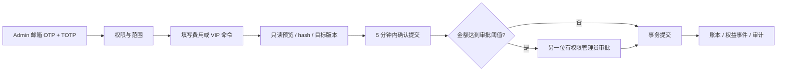

金额用 HKD 整数 micros；UI 输入换算不改变后端记账口径。付款必须填写已确认的唯一引用，后台不会自动向客户收款。VIP 不改变余额；余额不代表 VIP。月费默认值尚未商业定价。

权限包含 global/tenant/project 范围，显式拒绝优先，金额/期限/批次数及授权到期限制。权限委派不能超过自己的来源授权，不允许自授权，不允许破坏最后一位永久超级管理员的恢复权限。用户联系信息、消耗、余额、内容正文和下载分别控制；不能凭普通用户列表权限获得其他数据。

后台发布角色只能调整已安装定义的启用和展示；Skill 只能启停。可执行工具/内核/模型不能通过 JSON 绕过发布资格。内容隔离立即影响用户可见性、分享和后续执行。所有集合按 SQL 授权范围分页，不先全量拉取再前端过滤。

## 私密内容治理

内容列表包含专家、私密会话、记忆及原有业务资源。列表元数据与正文读取分别授权；正文检查记录审计。平台 Admin 须具备明确的范围及正文权限，普通客户管理员不因此获得其他用户的私密内容。

隔离立即影响用户 API、RLS 读取和运行任务的后续工具。会话删除先检查在途任务，再清空可读消息、任务正文、记忆版本及缓存重放；已删除会话/记忆不提供恢复按钮。专家职责变更通过专用版本接口，内容治理不能覆盖固定执行版本。重试保留私有归属与上下文，重新检查当前授权与权益。


## 验证与已知边界

`npm test` 是类型检查，真实 16 页、邮箱/TOTP、费用/VIP 提交、用户详情的浏览器旅程见 delivery `npm run qa:web`；私密正文、隔离/恢复由 `npm run qa:persistent` 验证；平台测试覆盖越权、并发、金额重放、VIP、委派和最后超级管理员保护。

CSV 导出最多 500 行、15 分钟有效并在下载时重查源权限。首次恢复超管由受信 CLI 引导；后续邀请开户、本人 MFA 开通、更换、停用/恢复、重发和会话撤销由 UI 完成。支持会话只提供元数据，不实现客户内容委托或代登录。在线支付、SAML/SCIM 和大规模导出仍未完成。

`src/main.tsx` 实现页面/运营命令，`api.ts` 处理 Cookie/CSRF，UI 为本仓库独立快照，来源记录在 `shared-source.json`。截图为真实开发数据，包含虚构 fixture 企业；主文档在交付根目录 `docs/`。素材许可见 [说明](THIRD_PARTY_NOTICES.md)。

## 云端定时执行控制

0.4.0 在 Execution 页增加授权范围内的计划检索和分页，仅显示元数据。暂停和恢复分别要求 `execution.pause` / `execution.resume`、近期 MFA、当前版本与原因。暂停只停止未来触发；恢复从现在开始，不补跑暂停区间。恢复保留原用户授权，已撤销时拒绝，要求项目管理员重新确认；Admin 不能借此替用户建立新授权。

内容治理可隔离或删除定时计划；删除清空全部配置版本及可重放正文，保留审计。隔离父工作流会停止后续触发并取消当前流程。`src/schedules.tsx` 提供界面，范围过滤与校验由平台执行。


## 0.5.0 企业身份与统一登录

OIDC 使用 code + PKCE S256、签章、state/nonce 与固定回调。先有注册账号及有效企业成员资格，再绑定企业身份；首次绑定需要独立的 CopyPaste 工作邮箱确认码，不按网域自动开户。配置改变、停用或本人解除连接会撤销关联用户的全部 CopyPaste Web/native/refresh 会话和旧执行授权。管理员登录仍独立使用邮箱与 TOTP。

企业列表的身份按钮提供 OIDC 配置、回调 URI、允许邮箱网域、client ID、只写 secret、签章与邮箱政策；可保存、检查、启用与停用。新增全域 `admin.tenants.sso.write`，普通用户运营员不能修改。界面说明检查只验证中继资料及公钥，停用及修改提示关联账号全部装置登出。

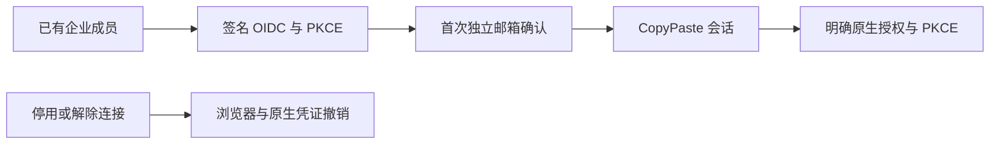


## 当前修复中的生命周期管理

内容管理增加持久的永久删除进度、清理失败子项和受作用域、近期 MFA、原因及幂等约束的重试。已永久删除的资产不能再恢复或修改正文/名称；对象下载在打开流后重新鉴权。模拟环境在后台持续标识，模拟额度与真实收款区分，金额很小时显示至六位小数。

本节是未发布的源码增量，0.5.0 归档保持原版本。完整治理范围和未完成条件见主文档 docs/quality/09-implementation-alignment-audit.md。


## 云目录内容控制（当前源码）

用户端新增的工作区节点进入统一内容资源目录。管理员按原有数据范围、正文权限、版本、原因与审计规则查看元数据、隔离、恢复和删除；隔离文件夹后，其后代不会继续出现在用户搜索或模型读取中。目录条目移除不等于删除独立源资产，永久源文件删除仍通过素材生命周期执行。

## 待补资料任务治理（当前源码）

有独立正文权限与数据范围的管理员可检查任务要求的资料说明、provider、scope、状态、已选资源 ID 和版本；检查记录审计，不返回凭证。支持角色的元数据权限不能读取私人要求。Execution 取消未启动的待补资料任务后释放原预留，不产生模型费用；重试保留私人归属和要求，再检查当前资源。

Delivery `qa:admin-task-inputs` 三组真实浏览器检查通过，平台负向测试另验证支持角色不能越权读正文。截图使用模拟业务数据，验收后关闭自建浏览器。


## 执行排队原因（当前源码）

Execution 列表新增可读的排队原因，区分企业共享、用户方案、平台与媒体/服务容量。原有执行读取权限、企业/项目数据范围、取消/重试和审计约束继续生效；不返回其他企业计数或凭证。独立 MFA 的实际页面流程记录在 delivery `qa:execution-capacity`。


## 清理记录分页与授权刷新

内容页的清理面板支持状态、类别和记录/目标 ID 搜索，URL 保留筛选及页码。默认每页 50 条，可选 25/50/100；长记录在有界区域滚动。通用后台集合、管理员身份及云端定时列表默认 50 条。轮询在前一请求结束后再安排，错误会隐藏旧记录，切换查询也不展示上一页。重试仍需独立删除权限、当前范围、最近 MFA、原因和幂等键。

Delivery `npm run qa:admin-records` 的五组浏览器检查覆盖 58 条可见记录、六条按范围排除的记录、翻页/组合筛选、授权到期、慢请求拒绝清空、四宽度与两主题/语言；模型与清理目标均是明确的测试数据，登录和授权查询真实执行。

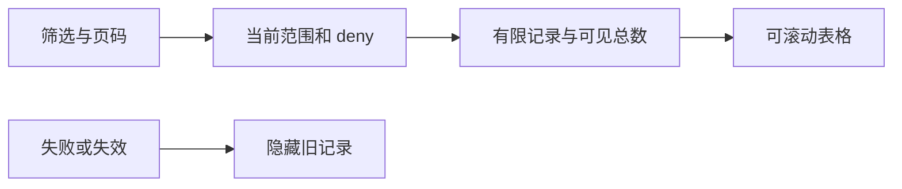


## 模板运行约束的管理边界

用户端新增的持久模板在预检与创建时复查当前角色/技能停用、项目权限和方案。运行配置与能力版本由服务端固定为 Codex/内部网关，撤销后阻止后续执行；不向客户暴露配置覆盖入口。当前 Admin 既有角色/技能管理继续生效，但模板草稿、完整版本编辑/发布和企业品牌覆盖面板仍待完成，不能把服务端注册表当作完整后台模板管理已交付。

排队任务的暂停/恢复现与用户端复用平台领域守卫：仅首次调用前、未领取且原预留有效时可操作；恢复会重新核对原受益用户、角色/技能、权益和输入来源。Admin 的范围权限不能替代用户被撤销的执行权，原因、版本、真人审计继续保留。详见主文档 `docs/technical/31-task-controls-and-native-continuation.md`。

## 企业成员管理

用户详情新增企业成员入口：选择角色、启用/后台暂停/移除、项目范围和原因，先预览前后差异，再执行或交由独立审批。审批人读取冻结业务参数与期限。未知响应重试复用原操作身份；原始原因和凭证不写入该浏览器回执。当前六组实际页面交互已通过，结果定位已修正，三张新图见下文；早期未验证回执与既有图库保持其历史来源。

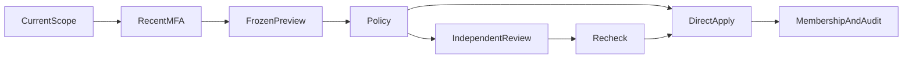


## 全局账户与单企业状态

用户详情的「编辑账户」分开管理名称/标签、账户状态和全部会话撤销；企业状态弹窗使用同一规范预览流程。表单读取当前版本与实际能力，确认前展示差异和在途处理，结果保持可见。关闭/重开默认需要另一位管理员，审批页先加载冻结命令再允许决定。全部写入使用规范 POST / 202 AdminOperation，失联重试保留同一幂等键；旧账户 PATCH 不再使用。界面沿用现有品牌 token、繁英标签、焦点管理及模态框，后端当前鉴权是最终边界。

全局冻结会撤销各端凭证；企业暂停仅影响该企业。取消已经执行的工作仍须结算或对账；关闭保留数据，不替代隐私删除。当前构建与 API/专项证据不替代完整页面、原生或发布包验收。


当前新账户表单实际浏览器 **5/5**：资料预览/确认、冻结、关闭进入待审批记录并拒绝自批、三宽度与英文浅色／繁中深色、Escape。最终实例均已关闭，其他成员/原生未完成项保持独立。结果页直接定位已筛选的审批或操作记录。


## 规范目录与范围消耗

用户列表、用户详情和企业列表已同步使用原始严格 AdminUserList/AdminUserDetail/AdminTenantList。筛选支持用户/企业/项目、状态、有效 VIP、确认扣费时段和每页笔数，重设或刷新会重置游标；前后翻页使用实际签名游标。仅显示本页数量，未授权的联系方式、金额和权益使用横线或明确权限提示，不伪造零值或无 VIP。

详情从独立的获准上下文显示企业名称、任务数和个人权益历史，账户、成员、费用及 VIP 入口继续绑定规范用户 ID。费用表单的企业选择完整读取所有获准游标页。页面类型检查和生产构建通过；实际 API 与 Vite 页面七组增量检查覆盖 23 用户的 20/3 分页、过滤、详情和现有管理入口、近期 MFA 及未登录拒绝。测试只用合成数据，自建 Chromium 完成后关闭。

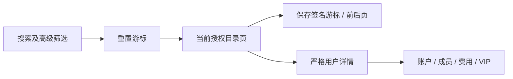


截图为实际本机页面。已验证英文浅色 375/768/1440 及繁中深色 375 宽度，未据此宣称全部语言/主题/页面或费用写操作均已验收；旧成员页面的独立未完成回执仍保留。

## 规范账务与独立审批（当前增量）

「费用与账务」已接入真实个人／企业账户、主体筛选、游标分页、原始流水、gift/debit/credit-limit 规范表单和独立审批。金额输入和展示保留六位小数，预览不改账；同一提交使用固定幂等键。审批使用独立请求 ID、冻结摘要及版本，另一位管理员的实时费用／审批权限和原提交者会话都会复核。后台沿用 CopyPaste 现有中英双语、浅深主题及品牌色。

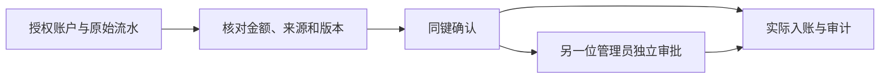

`npm test` 包含精确金额与边界测试；`npm run build` 检查生产构建。Delivery 的 `npm run qa:admin-fees` 执行真实 HTTP 和浏览器验证，4/4 组、10 份规范响应通过，并关闭全部自建浏览器。截图使用合成客户和模拟资金；没有调用外部付款或模型。


这不代表整个收费或后台体系验收完成。规范付款凭证／记录、支付退款对账、消费退款分桶、不可变方案/VIP、金融 outbox、完整规范审批目录与各用户端消费者仍须继续。现有旧入款、退款、VIP 页面保留其历史能力，不能当作上述完整契约。完整范围和限制见项目主文档 `docs/technical/41-canonical-fee-commands-and-independent-approvals.md`。

## 当前成员操作页面复核（2026-10-20）

成员结果链接现在按真实操作 ID 定位：待审批进入 `/audit?view=approvals&search=…`，已完成进入 `/jobs?search=…`。Delivery `npm run qa:admin-membership-ui` 使用两名范围受限管理员的实际邮箱／TOTP 登录，6/6 通过纯预览、暂停／恢复与 Web owner 提示、冻结参数、自批拒绝、另一管理员批准和繁中深色 390px。四份真实 AdminOperation 严格通过，179 份源码／verifier 一致。单元检查 3/3、生产构建通过；浏览器和会话关闭，临时管理员经数据库确认已暂停，没有模型调用。


此前未验证和最初失败回执仍原字节保留。当前成员审批采用补充冻结审阅／旧 decision 入口；完整原始审批目录、其他 Admin 业务和全部原生／系统验收仍待完成。详细证据见主文档 `docs/technical/42-current-membership-ui-and-native-auth-recovery.md`。

## 统一审批目录与独立审阅（2026-10-20）

审批目录使用原规范 AdminApprovalList，显示真实请求、关联操作、申请人、持久状态、期限与版本，使用签名游标分页。成员/账户结果可准确定位审批请求，审阅冻结参数后以版本与摘要提交规范决定。本人页面显示另一名管理员审阅提示；具有审批及业务权限的其他管理员可决定。费用沿用完整金额/来源审阅页面。概览单独显示当前权限范围内未超时的待审批计数。

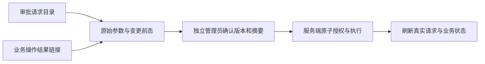


该增量不代表完整付款、退款、VIP 和全部后台权限矩阵验收；规范及完整剩余条件继续保留。

当前复核：成员 6/6、费用 4/4、账户 5/5；列表和决定的实际响应按原始 schema 验证。新组件的工作区与 Git LF 字节统一后重新复核，初始回执另行归档。

## 付款凭据与独立核实（2026-10-20）

费用页新增真实付款目录、签名游标、登记复核、独立核实和原付款充值。页面区分已收到、已核实与已入账；本人无法核实自己的凭据，核实不会增加余额。原付款 ID 自动带入充值预览，金额保持精确 HKD 字符串，幂等恢复不重复入账。自身提交完成后重新读取付款目录。


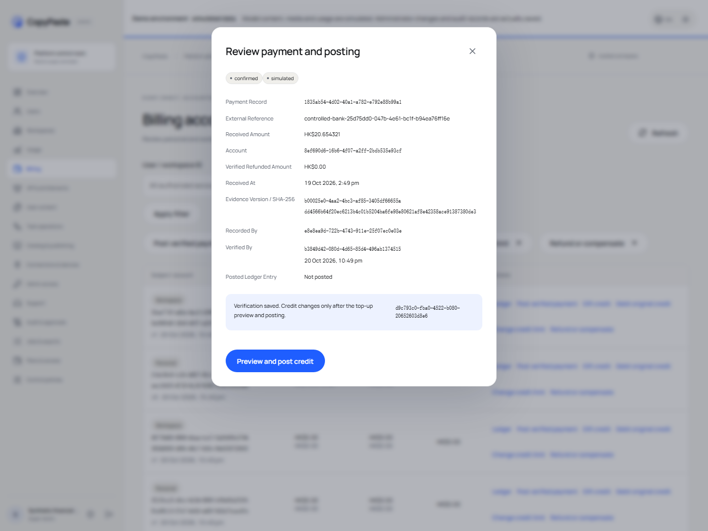


截图从完整原始实测截图裁取实际视口，原始截图仍在本仓库与交付证据中。两位真实邮件/TOTP 管理员与实际上传凭据的 5/5 浏览器组通过；AI/银行付款均未调用，凭据明确为模拟。完整退款、VIP及后台综合验收继续跟踪。

## 原交易退款与资金核实（2026-10-20，后续增量）

消费补偿严格返还原赠额、付费和实际偿还来源，保留赠额到期时间；未偿授信只注销对应消费债务。现金退款绑定已核实原付款，先冻结未用金额，再由另一管理员逐次核实实付、剩余未付或未知/差额；部分付款不会误报全部成功。历史缺失偿还来源要求对账，不补造历史。

当前平台全量 324/324、683 份参与源码前后一致；费用及退款实际页面 8/8、47 份来源一致；原规范实际响应 100/100，补充退款合同 14/14 单独校验。50 项专项与全量重叠。SQL 053–055 已实际应用于两个原生数据库；001–052 不改写。AI、媒体和外部支付仍按明确模拟范围验收；历史授信人工对账、正式支付/VIP/outbox、完整系统及全部综合验收继续保留。较早章节的数字记录各阶段历史。

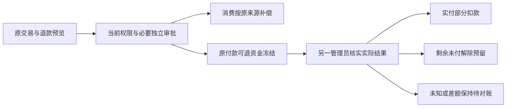

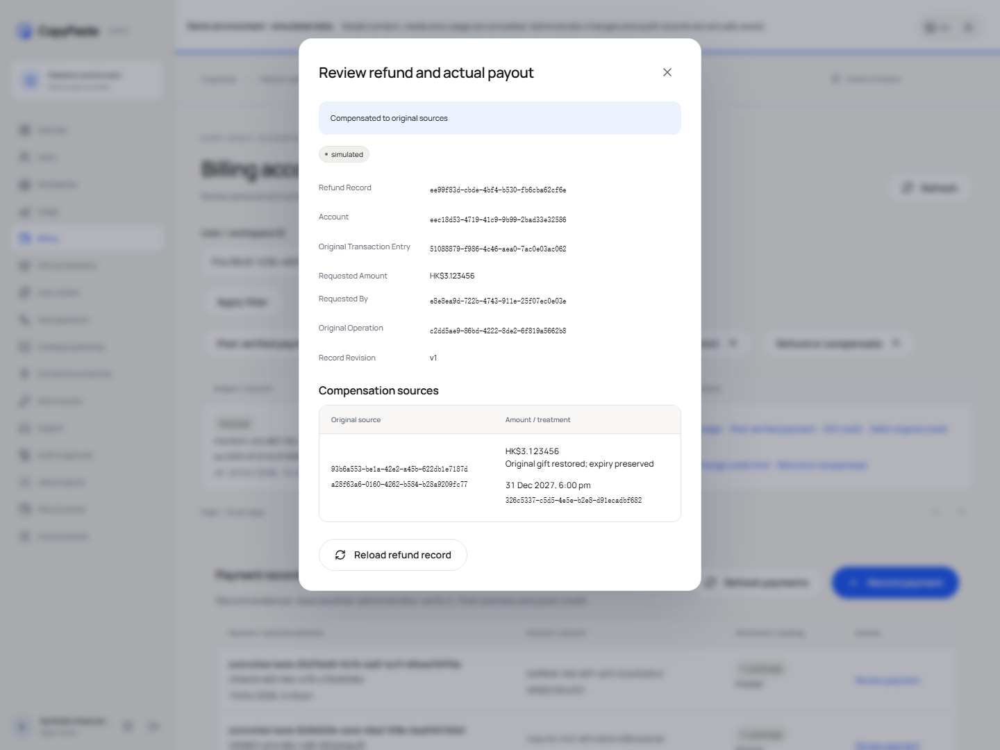

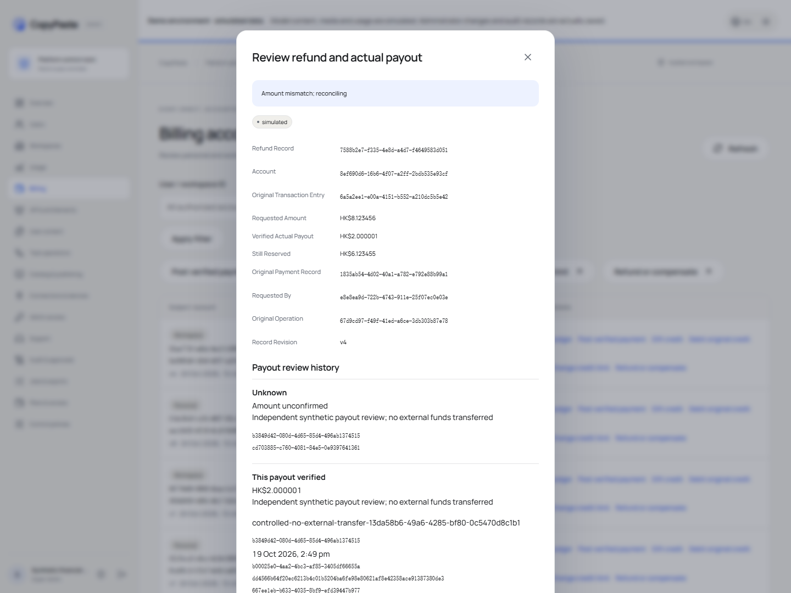

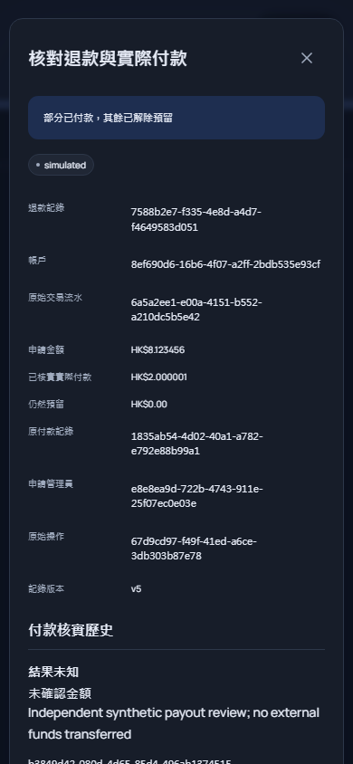

2026-10-20 退款增量后当前源码复核：Web 成员 6/6（169 份来源）、Admin 成员 6/6（196 份）和 Web/源码 Electron/MV3 认证 12/12（775 份）通过，前后摘要一致，拥有的会话、浏览器、Electron 和扩展进程均已清理。首轮 Electron 调试连接超时原回执保留，随后相同源码重跑通过。Desktop 无边框和原生 Side Panel 预览包保持原字节；完整安装包认证及系统矩阵仍须独立验收。

2026-10-20 方案版本增量後的當前源碼復核：Web 成員 6/6（172 份來源）、Admin 成員 6/6（200 份），Web／源碼 Electron／MV3 認證 12/12（779 份）；測試前後摘要一致，自建瀏覽器／Electron／擴展均關閉，測試憑證清理。新增不可變方案定義與固定歷史授權綁定不改寫原生預覽包。完整 VIP／配額、安裝包認證及系統驗收仍按主文檔繼續追蹤。

## 规范 VIP 管理与可追踪修订（阶段 47）

VIP 专页替换旧通用表单，提供个人／企业主体、已发佈固定方案、真实 UUID、来源、付款引用、起止时间、重叠策略和操作原因。先检查服务器版本并展示冻结比较，再确认提交。本人不能自批；原操作者、当前实际审批者和授予修订分别保留。详情支持延长、暂停、恢复和撤销；历史未知事实明确显示。失败保留输入并聚焦错误摘要，刷新不会丢失已提交回执。

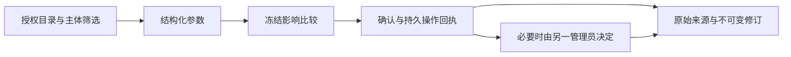

Delivery `npm run qa:admin-vip` 使用真实邮箱／TOTP 管理员和真实用户会话，6/6 组通过，9 份原始 schema 响应通过。涵盖无效主体后的输入保留／焦点、独立审批、用户端有效权益、暂停及真实修订、375px 繁中深色表单与预约预览。目录在自身区域横向滚动，页面保持视口宽度。原始失败和旧截图保留，不冒充完整后台验收。


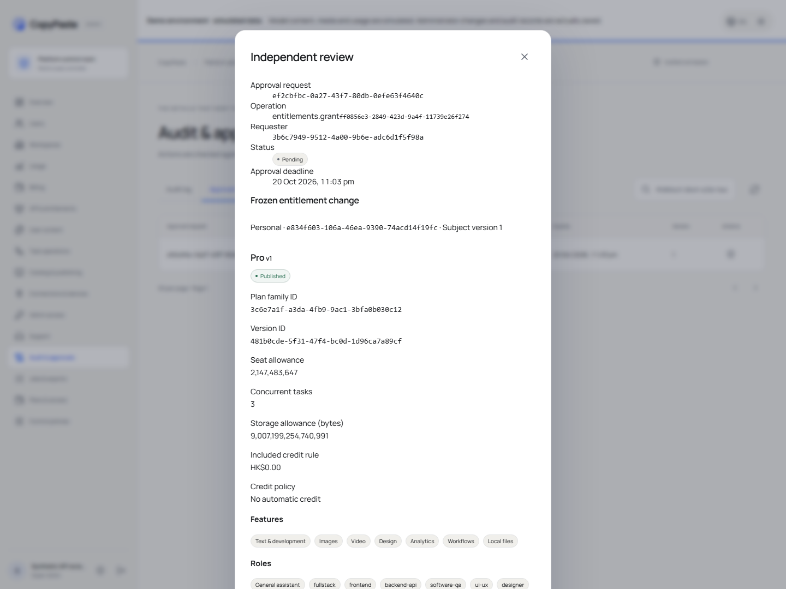
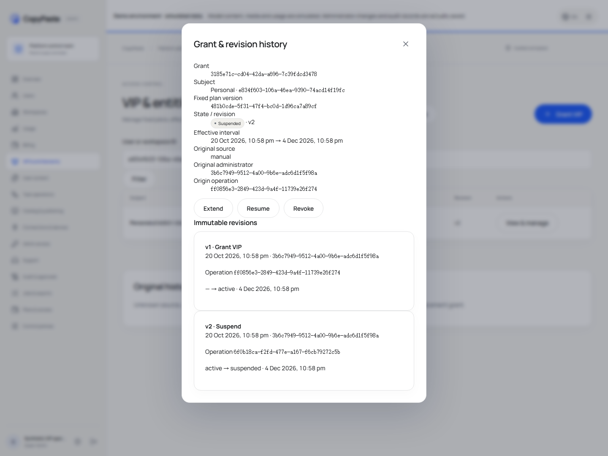


完整席位／存储控制、VIP 与赠额原子组合、全部后台权限／导出和综合验收继续按主文档追踪。模型和外部支付为明确模拟，登录、权限和账务记录真实执行。

## 企业席位与存储执行（阶段 48）

企业列表新增容量面板，显示启用席位、保留文件、有效上传预留、上限与超额状态。操作要求当前 `admin.tenants.read` 和 `admin.entitlements.read` 同时覆盖整个企业；项目范围 allow 不足，重叠 deny 拒绝读取。读取审计、失败/撤权清空、繁中/英文、浅深主题和窄屏状态均沿用共用控制。

容量为服务端实际统计，私人文件只计入企业合计，不显示其明细。增加/恢复成员及审批执行会重新校验现行容量；单纯修改已启用成员角色不重复占席位。

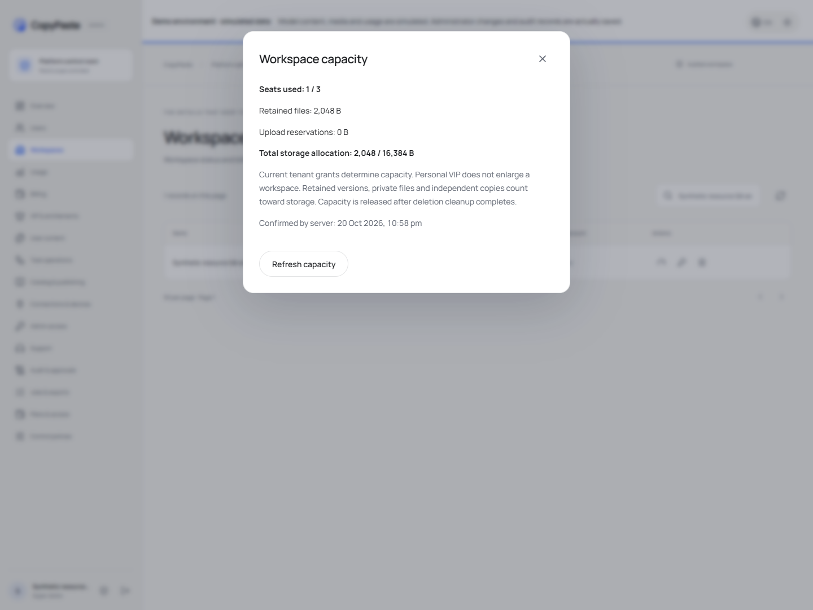
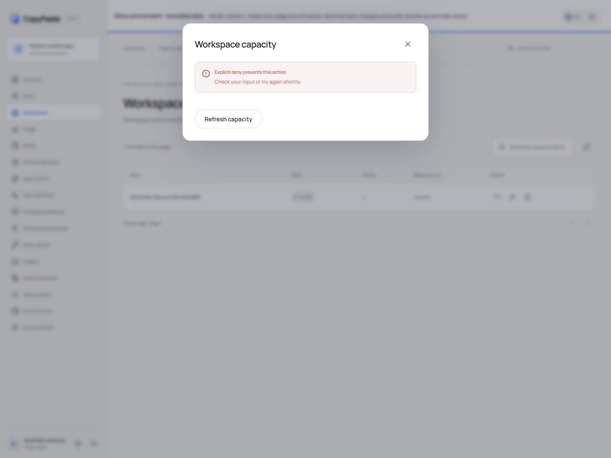
