## 163 · 登录失效、旧响应与实时进度

广告导入、报告、证据等业务接口失去登录时清除旧工作台；旧请求不能覆盖新登录。实时进度收到登录失效时返回登录；权限不足保留登录。28项定向请求检查、三端界面构建及3组实际Web/SQL旅程通过。当前为源码修复，尚未加入既有rc.3安装包；原冻结包保持。

[方案、构建与使用](https://github.com/copypasteltd/workmate/blob/docs/docs/development/163-session-boundary.md) · [原编号待项](https://github.com/copypasteltd/workmate/blob/docs/docs/quality/remaining-work-stage163.md)

共享的实际Web画面及录制；非本轮新增原生端验收。

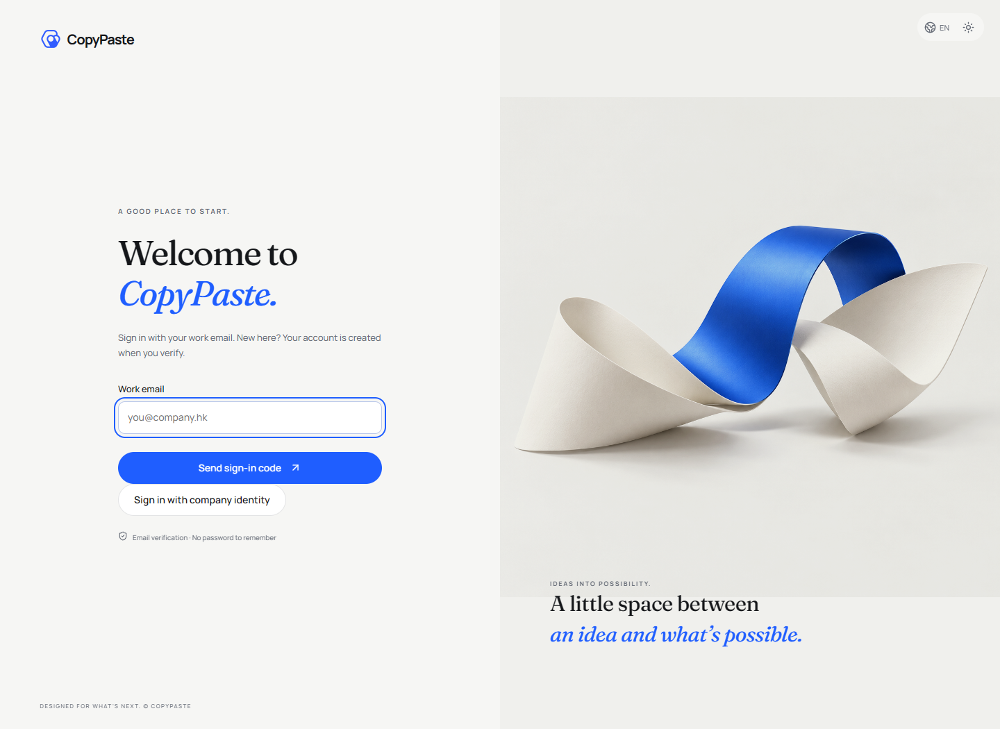

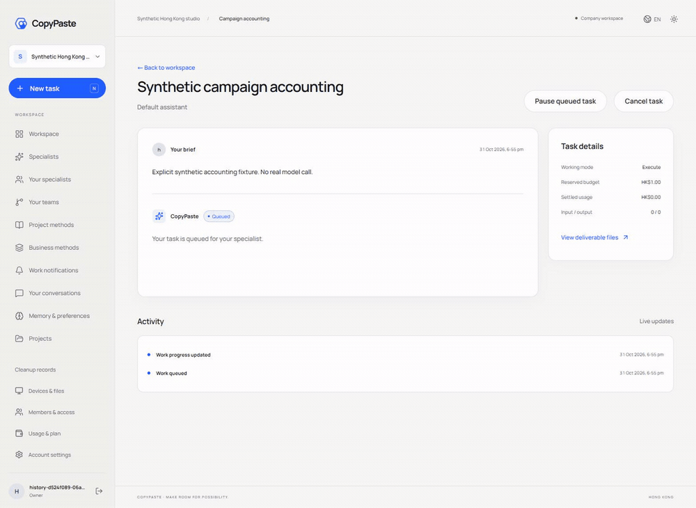

[MP4](assets/screenshots/workmate-session-boundary-163-04-session-revocation-to-signin.mp4)

---

## 162 · 冻结版源码启动补丁

完整rc.3已发布。本轮新增安装前端口检查及有效入门链接；当前分支直接使用，已解压rc.3源码可应用约719KB的精确补丁。先选择数据库端口，再依次运行 `npm run demo:preflight`、`npm run bootstrap:demo`、`npm run demo:check`、`npm run demo`；结束执行 `npm run stop`。六文件补丁及CLI的9项检查通过；保留客户配置、数据和冻结包。

[完整中英步骤](https://github.com/copypasteltd/workmate/blob/docs/docs/releases/v0.1.0-rc.3-onboarding-162.md) · [源码补丁](https://github.com/copypasteltd/workmate/releases/download/v0.1.0-rc.3/workmate-v0.1.0-rc.3-onboarding-162.zip)

下图及GIF沿用158实际首单流程，非本轮新增各原生端验收。

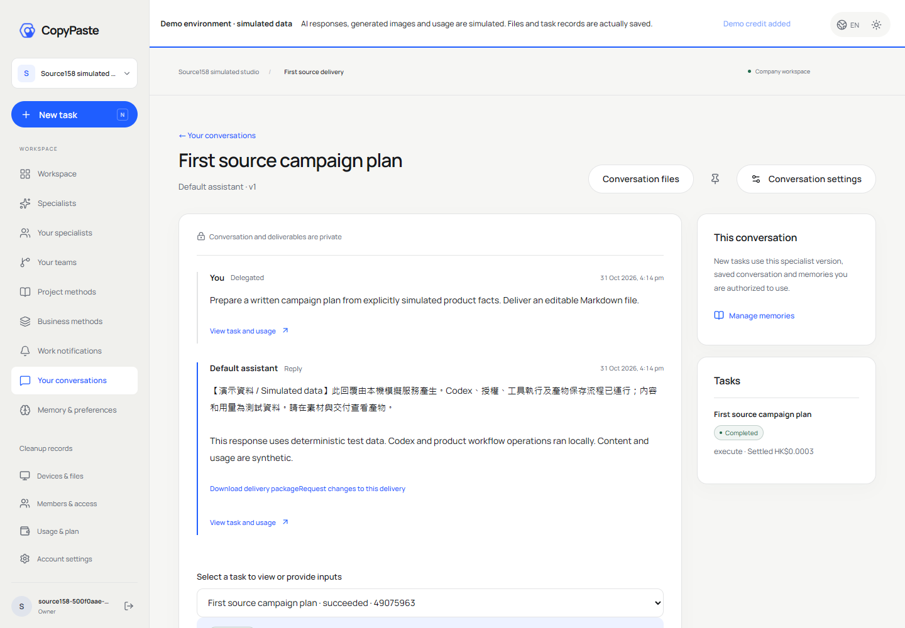

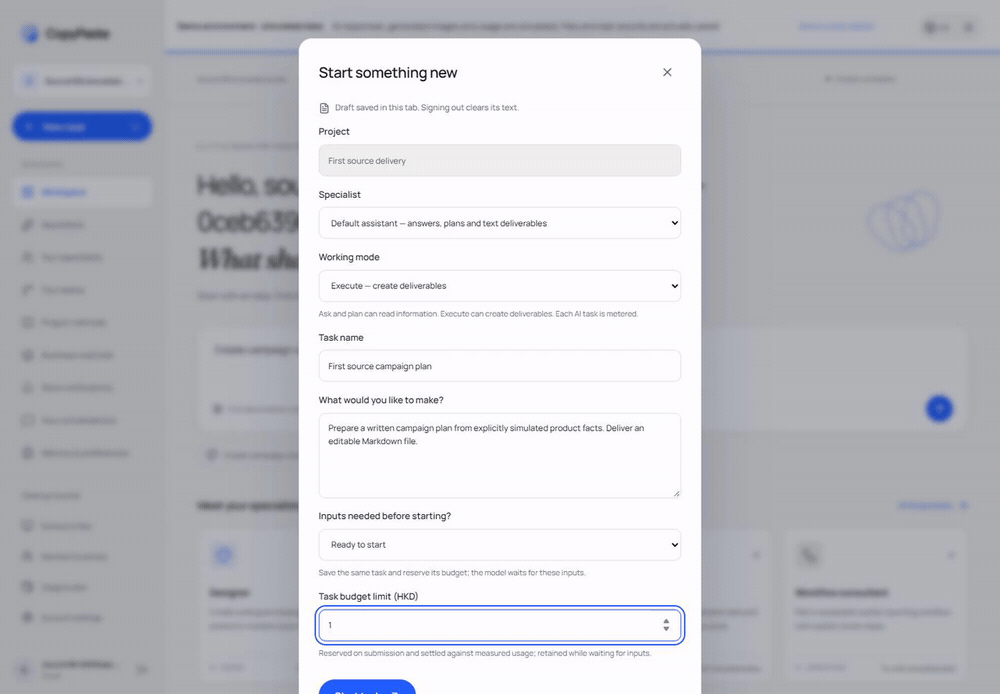

---

## v0.1.0-rc.3 · 完整冻结交付

本版纳入下方160修复。Desktop、Web、Admin、原生Chrome右侧栏、后端、六仓可构建源码及固定Codex配套文件统一封装；[完整使用说明](https://github.com/copypasteltd/workmate/blob/v0.1.0-rc.3/docs/releases/v0.1.0-rc.3.md)。[下载入口](https://github.com/copypasteltd/workmate/releases/tag/v0.1.0-rc.3)的资产以发布回执为准。外部接口使用获准假数据，Windows包未签名；完整生产验收继续独立跟踪。

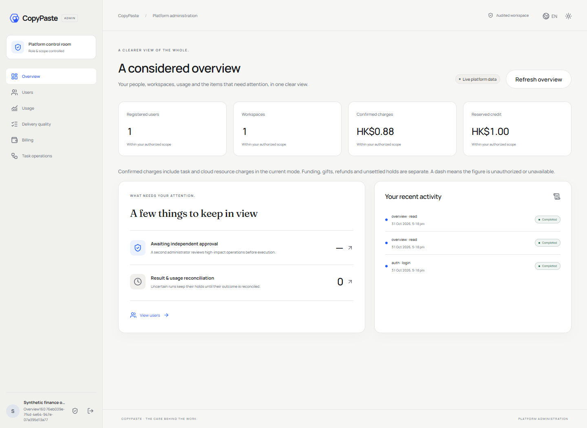


---

## 160 · 管理總覽的用戶、費用與目前權限

用戶數沿用完整用戶目錄的可見範圍；預留額度包含目前模式的個人與企業付款帳戶。累計確認扣費以帳本為準，包含任務及雲端資源，不混入充值、贈送、退款或未結算預留。每次請求在權限鎖後重驗目前MFA會話與權限；無權限或暫不可用的數字顯示破折號，可使用「重新載入總覽」恢復。

9項真實SQL/HTTP定向檢查、3組實際Admin操作通過；使用明確合成的客戶和費用資料，沒有模型請求或真正啟動雲端電腦。原失敗及檢查環境修正保持原紀錄。這是未凍結的後端/Admin原始碼修復；既有v0.1.0-rc.2包和標籤不變，其他端本輪同步說明及共用Admin媒體。

[方案及使用 / Implementation and usage](https://github.com/copypasteltd/workmate/blob/docs/docs/development/160-admin-overview-accuracy.md) · [編號待驗收 / Remaining](https://github.com/copypasteltd/workmate/blob/docs/docs/quality/remaining-work-stage160.md)

**實際Admin畫面；非各原生端新增驗收 / Actual Admin, not new native-client qualification**


[MP4](assets/screenshots/workmate-admin-overview-160-01-current-permission-overview.mp4)

---

## v0.1.0-rc.2 · GitHub Release 已发布

[完整下载 / Complete ZIP](https://github.com/copypasteltd/workmate/releases/download/v0.1.0-rc.2/workmate-v0.1.0-rc.2-complete.zip) · [发布页面 / Release](https://github.com/copypasteltd/workmate/releases/tag/v0.1.0-rc.2) · [发布记录 / Publication](https://github.com/copypasteltd/workmate/blob/docs/docs/releases/v0.1.0-rc.2-publication.md)

完整包850,454,316字节，内含七类分发包：Windows客户端、Web、Admin、Chrome右侧栏、后端、六仓可构建源码及固定Codex运行文件。GitHub六个附件的尺寸与SHA-256逐一匹配；实际公共页面和校验文件下载通过。旧冻结说明中的HTTP403是当时旧凭据的历史状态，本次已使用现有授权发布；冻结文件与全部版本标签保持不变。

用户流程与权限沿用下方完整说明。源码运行从 `npm run bootstrap:demo` → `npm run demo:check` → `npm run demo` 开始，结束执行 `npm run stop`。当前为模拟外部依赖、Windows未签名候选版；完整生产验收仍见原编号清单。

**实际GitHub发布页面和下载交互 / Actual public release and checksum download**


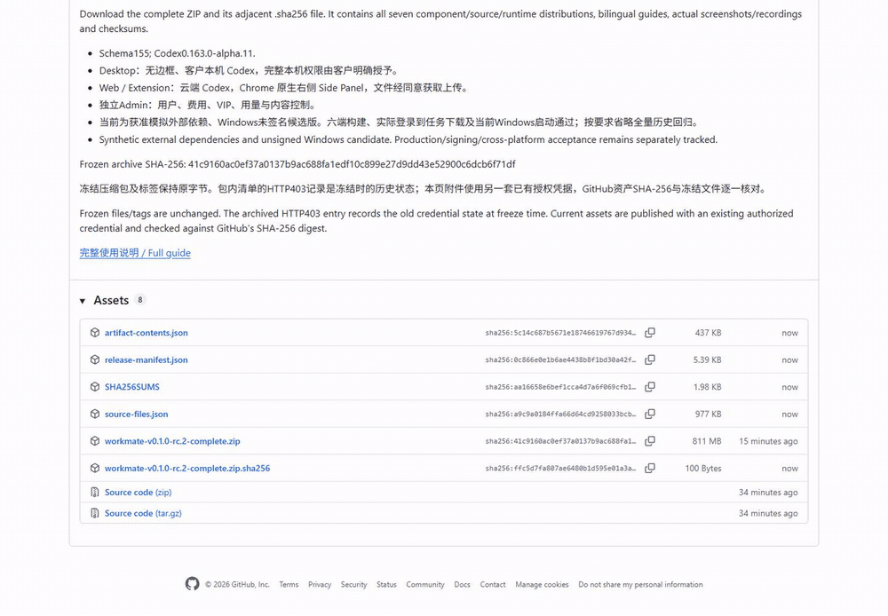

[MP4 recording / 下载交互录像](assets/screenshots/workmate-release-publication-159-01-release-assets-download.mp4)

---

## v0.1.0-rc.2 · 当前完整冻结发版

六仓当前源码与分发构建共同冻结至数据库155版。产品发版号与各组件npm版本独立。Web/Extension使用云端Codex，无边框Desktop在客户本机执行Codex并由客户明确授予权限；Admin保留独立身份及用户、费用、VIP、消耗与内容控制。

将buildable-sources与source-runtime两包解压合并至同一个较短父目录，在生成的dev/copypaste-delivery中依次执行 npm run bootstrap:demo → npm run demo:check → npm run demo。若55432被占用，在各个启动窗口先明确设置 COPYPASTE_SOURCE_DATABASE_PORT 为空闲本机端口；结束用 npm run stop。四个Codex文件须相邻保留。当前体验与录屏的外部依赖使用获准模拟数据，Codex、权限、文件与账本走真实实现；完整历史/跨系统/真实提供方回归按要求省略。

[Release guide / 发版说明](https://github.com/copypasteltd/workmate/blob/v0.1.0-rc.2/docs/releases/v0.1.0-rc.2.md) · [Source startup / 源码启动](https://github.com/copypasteltd/workmate/blob/v0.1.0-rc.2/docs/development/158-current-source-startup.md)

**Actual shared Web first-use flow / 实际Web源码首次使用（非各原生端新增完整验收）**


[MP4 recording / 交互录像](assets/screenshots/workmate-source-handoff-158-04-first-source-task.mp4)

---

## 157 · 云端会话独立多工作

同一私有云端会话可在套餐额度内提交独立新工作。先选择具体任务，再查看进度、补充资料或停止；各项预算和结果独立。Web保留相同输入的原请求键/版本以恢复丢失回复；Extension保留已保存的完整回执并抛弃旧目标的迟到进度。

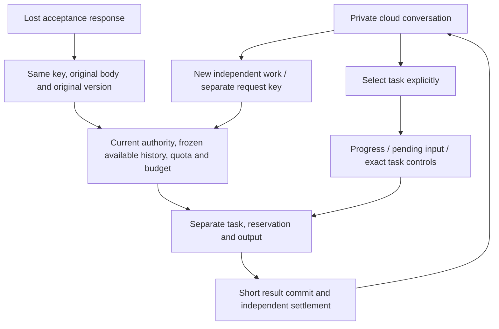

使用：从会话交付输入选择“开始独立新工作”；资料需求在所选任务卡中完成；控制链接打开该任务详情。升级先停止旧API/worker、备份并应用完整001–155前向迁移，再启动对应源码服务。旧冻结schema145二进制不兼容schema155。

7项实际SQL/HTTP/Worker（合成runtime）与Extension控制器检查、5组实际Web旅程；4PNG、1GIF/MP4。按快速发版约束跳过全量历史及跨系统回归。生产模型、媒体、真实外部平台及完整业务矩阵仍待验收。

本轮为stage157/schema155未冻结源码增量。v0.1.0-rc.1仍为stage148/schema145，不包含本轮内容。Desktop实际本机线程仍单轮运行，独立会话/团队可并行；本轮仅同步共享云端renderer。Admin本轮为方案/交付说明更新。截图和GIF均为真实Web界面，不表示安装版Desktop或真实Side Panel。

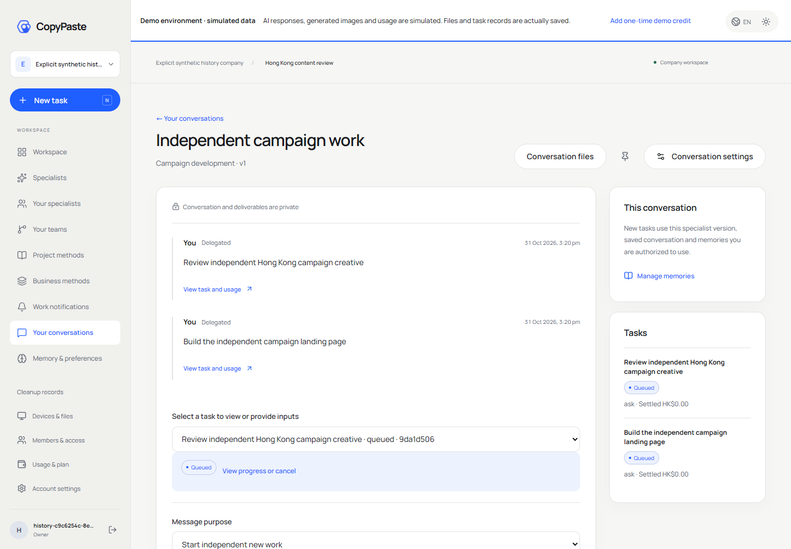

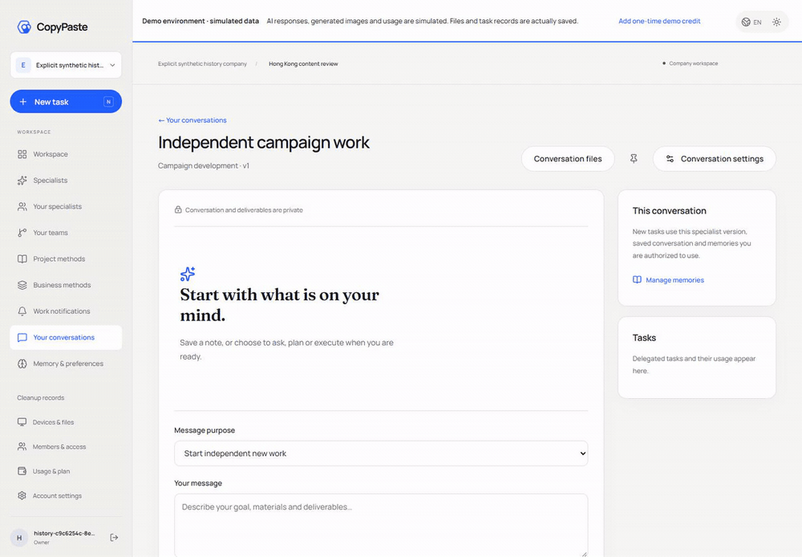

[MP4](assets/screenshots/workmate-conversation-work-157-04-independent-cloud-work.mp4)

---

<!-- conversation-directory-156 -->

我的会话 → 搜索或已封存 → 下一页/上一页 → 打开原会话继续。同名及封存记录超过200条也可完整浏览。Web/Desktop每页40条；扩展保留原生右侧栏及原首批200条，增加搜索、封存与翻页，浏览不切换当前聊天或清空草稿、附件和待确认消息。每页重新检查当前权限。

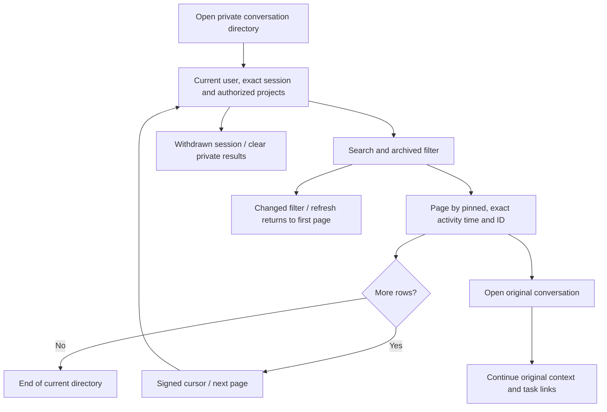

Media below show actual Web controls with synthetic business fixtures; directory reads make no model request.

Evidence correction: stage155 compact capture was English because its fixture reset locale on reload; it proves390px layout only. Stage156 switches the actual language control and asserts Chinese lang/title. Historical evidence remains unchanged.

7 focused SQL/HTTP checks and5 actual Web groups;7 PNGs and2 GIF/MP4 pairs. Backend/Web/Desktop/Extension checks and builds passed. Canonical GET /v1/conversations supports an optional project filter; legacy listing remains compatible. Live keyset pagination, not a frozen snapshot. Schema154; no new migration. Broad/installed-client/cross-OS/production matrices omitted. Unreleased after v0.1.0-rc.1; frozen artifacts and tags preserved.

[方案 / Implementation](https://github.com/copypasteltd/workmate/blob/docs/docs/development/156-conversation-directory.md) · [API](https://github.com/copypasteltd/workmate/blob/docs/docs/contracts/conversation-directory-openapi.json) · [完整待项 / Ledger](https://github.com/copypasteltd/workmate/blob/docs/docs/quality/remaining-work-stage156.md)


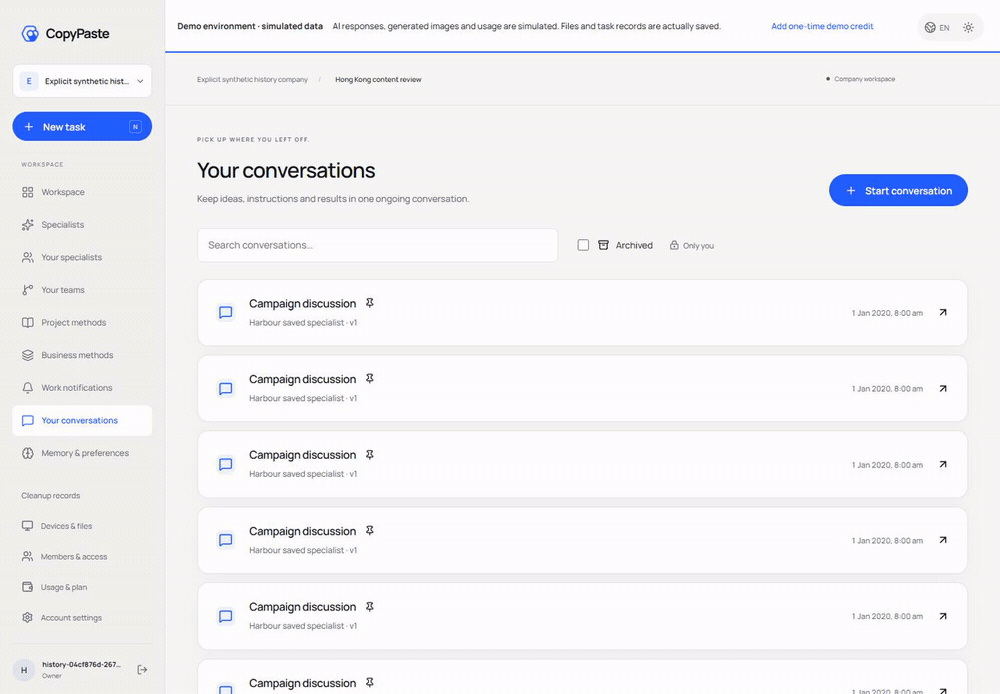

[Actual MP4](assets/screenshots/workmate-conversation-directory-156-02-older-private-conversations.mp4)

---

<!-- specialist-copy-155 -->

我的专家 → 复制 → 调整名称、职责或缩小工具 → 核对原品牌、模型费率与方法 → 勾选确认。副本保留原固定版本和模板来源；受理后丢失响应重试恢复同一副本，来源更新及撤权拒绝提交。对话、私人记忆、文件、凭据与本机权限不复制。

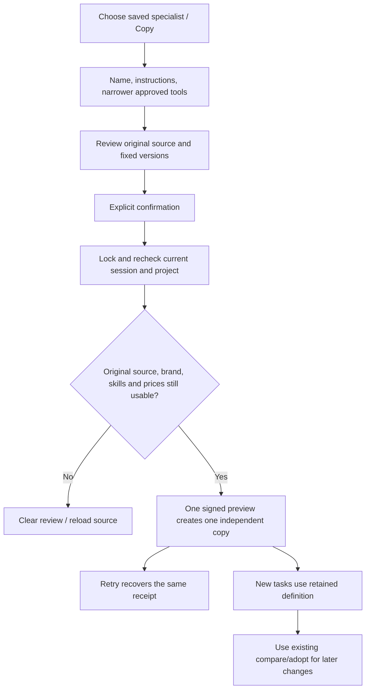

Media below show the actual Web flow; configuration copying makes no model request.

7 focused SQL/HTTP cases and5 actual Web groups;7 PNGs and2 GIF/MP4 pairs. Backend/Web/Desktop checks and builds passed. Synthetic fixtures; no model call. No new SQL migration: schema154. Broad historical, installed-client/cross-OS and production-provider matrices omitted. Unreleased after v0.1.0-rc.1; all frozen artifacts and tags preserved.

[方案 / Implementation](https://github.com/copypasteltd/workmate/blob/docs/docs/development/155-specialist-copy.md) · [API](https://github.com/copypasteltd/workmate/blob/docs/docs/contracts/specialist-copy-openapi.json) · [完整待项 / Ledger](https://github.com/copypasteltd/workmate/blob/docs/docs/quality/remaining-work-stage155.md)

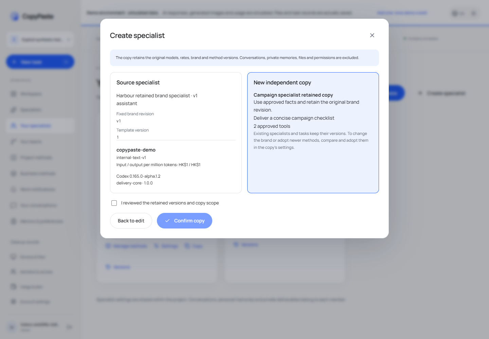

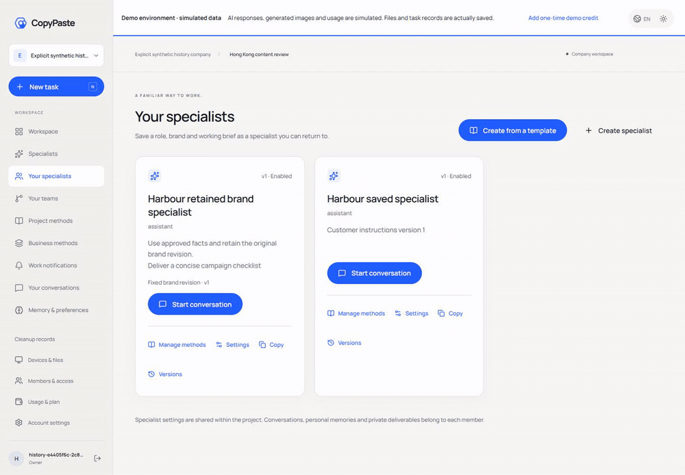

[Actual MP4](assets/screenshots/workmate-specialist-copy-155-02-reviewed-copy-recovery.mp4)

---

<!-- runtime-pause-154 -->

运行中云任务支持安全暂停和同任务、线程、预算继续。工作详情 → 暂停工作 → 等待当前轮次计量完成 → 继续工作。补充资料后仍保持暂停；未知副作用继续核对，取消按累计明确用量只结算一次。

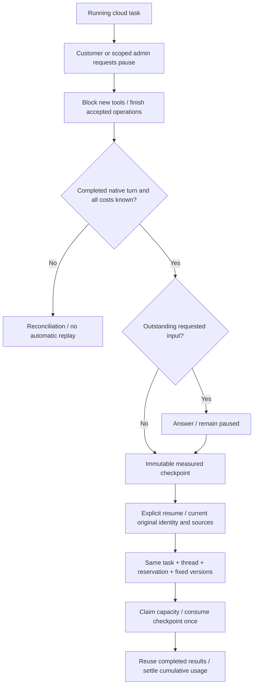

Media below show actual Web controls; this is not native UI acceptance for this component.

6 focused backend cases /5 actual Web/Admin groups;7 PNGs and2 GIF/MP4 pairs. All changed clients built. Explicit synthetic model adapter; no real provider request. Broad/installed-client/cross-OS regression omitted. Apply forward SQL153/154 using the backend migration procedure before updating. Unreleased after v0.1.0-rc.1; all five frozen ZIPs unchanged.

[方案 / Implementation](https://github.com/copypasteltd/workmate/blob/docs/docs/development/154-runtime-pause.md) · [API](https://github.com/copypasteltd/workmate/blob/docs/docs/contracts/runtime-pause-openapi.json) · [完整待项 / Ledger](https://github.com/copypasteltd/workmate/blob/docs/docs/quality/remaining-work-stage154.md)

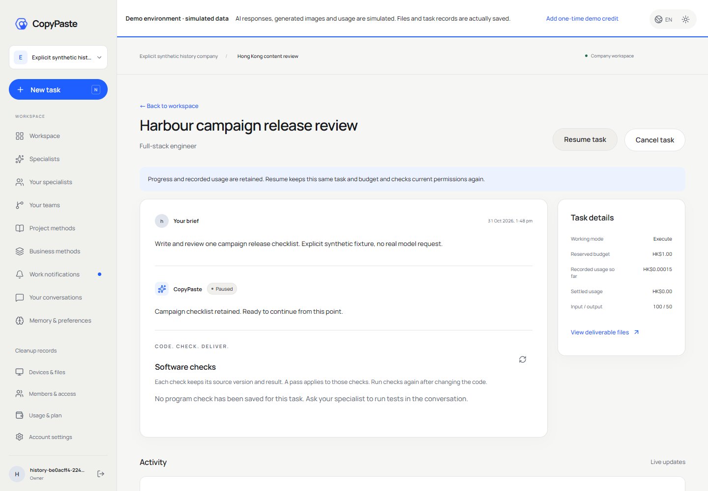

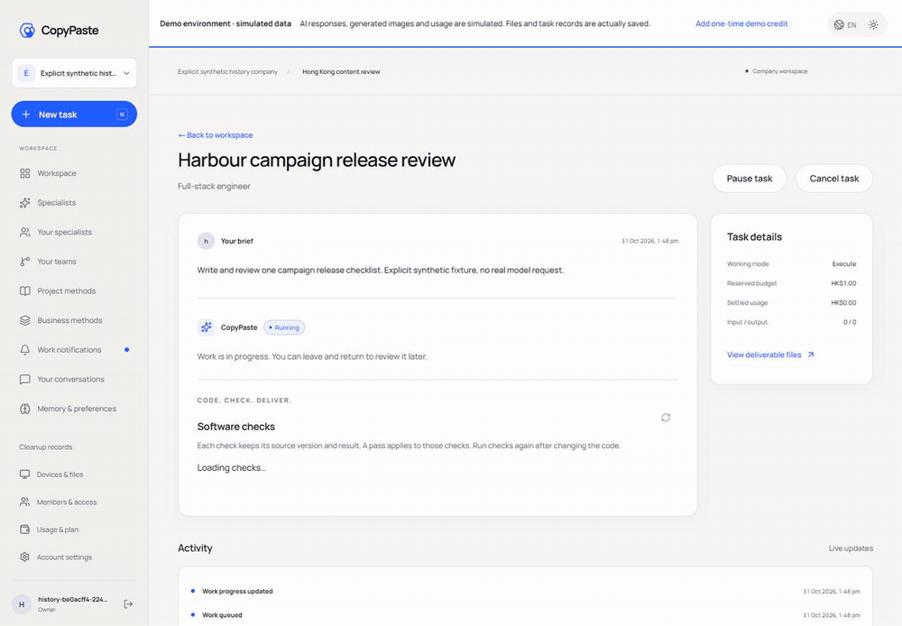

[Actual MP4](assets/screenshots/workmate-runtime-pause-154-01-running-pause-resume.mp4)

---

<!-- workflow-content-history-153 -->

后台工作流支持全部已保存定义与受控执行快照。进入内容目录 → 读取内容 → 展开精确版本并翻页。近期MFA、双内容权限、当前范围与来源复查同时生效，来源或权限变化清除正文。精确调查根隔离后仍可审阅；真实依赖撤回继续隐藏。共享历史连接永久擦除与完整授权导出。

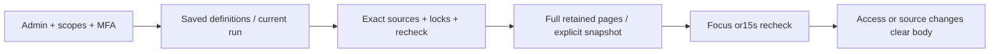

Media show the actual Admin journey; this component has no new client UI acceptance in153.

9 focused backend cases /7 actual browser groups passed with synthetic business/model data; no real provider request. Broad regression and unchanged client builds omitted. SQL150v2/151/152 are forward migrations. Unreleased increment; frozen v0.1.0-rc.1 and its five ZIPs unchanged.

[方案 / Implementation](https://github.com/copypasteltd/workmate/blob/docs/docs/development/153-workflow-content-history.md) · [API](https://github.com/copypasteltd/workmate/blob/docs/docs/contracts/workflow-content-history-openapi.json) · [完整待项 / Ledger](https://github.com/copypasteltd/workmate/blob/docs/docs/quality/remaining-work-stage153.md)

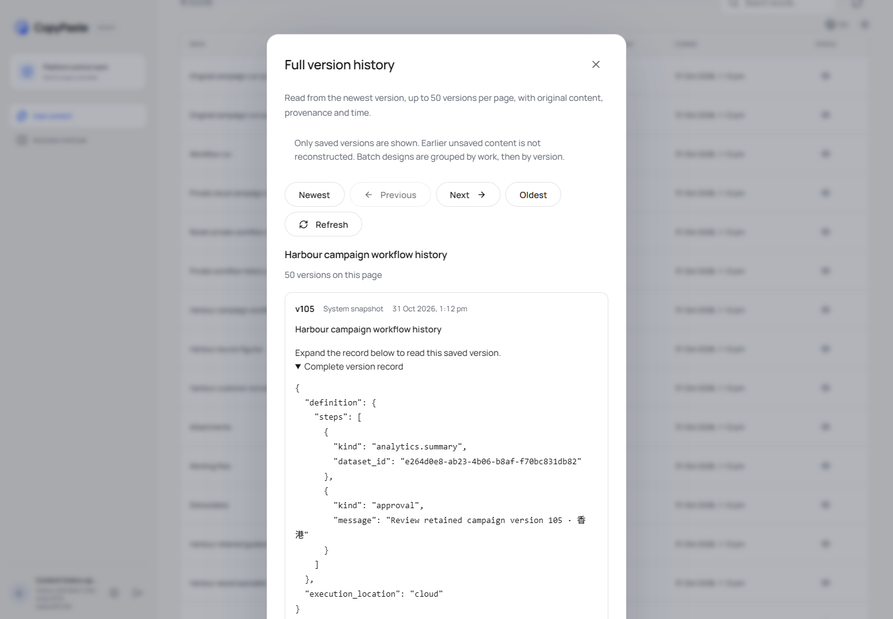

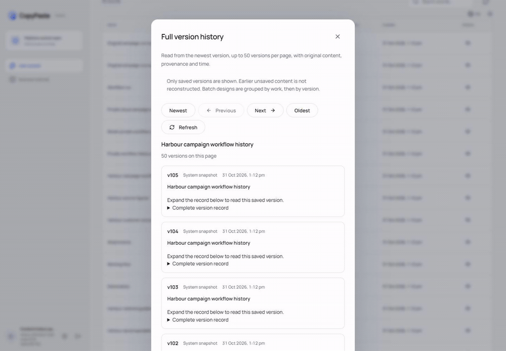

[Actual MP4](assets/screenshots/workmate-workflow-content-history-153-01-saved-workflow-history.mp4)

---

<!-- scope-data-export-152 -->

**未凍結增量152：完整授權資料匯出**

Web/Desktop：「專案」→「匯出資料」→核對預覽→確認→下載；企業owner/admin可匯出使用中專案與本人私人資料。管理企業不代表可讀其他成員私人正文。Admin在內容管理依範圍、正文/匯出權限和近期MFA匯出共享資料。原始CSV、全部可用檔案歷史版本、業務資料、會話及記憶歷史列入清單和SHA256SUMS；工作流歷史與固定輸出沿用當前來源限制。沒有匯出憑據、內部儲存位置、備份或未上傳本機檔案。

9項後端、6組真實三端下載、8步構建及12項本機邊界檢查通過，6張PNG、3組GIF/MP4保留。瀏覽器fallback能力及原生OS目的地是明確測試輸入；登入、SQL、HTTP、原始物件及ZIP真實核對。按快速發版省略16GiB/大型瀏覽器串流、跨OS、廣泛歷史與正式生產矩陣；沒有呼叫模型。首個v0.1.0-rc.1凍結包原樣保留，本增量不在其中。


Shared actual Web illustration; no new UI acceptance is claimed for this component.

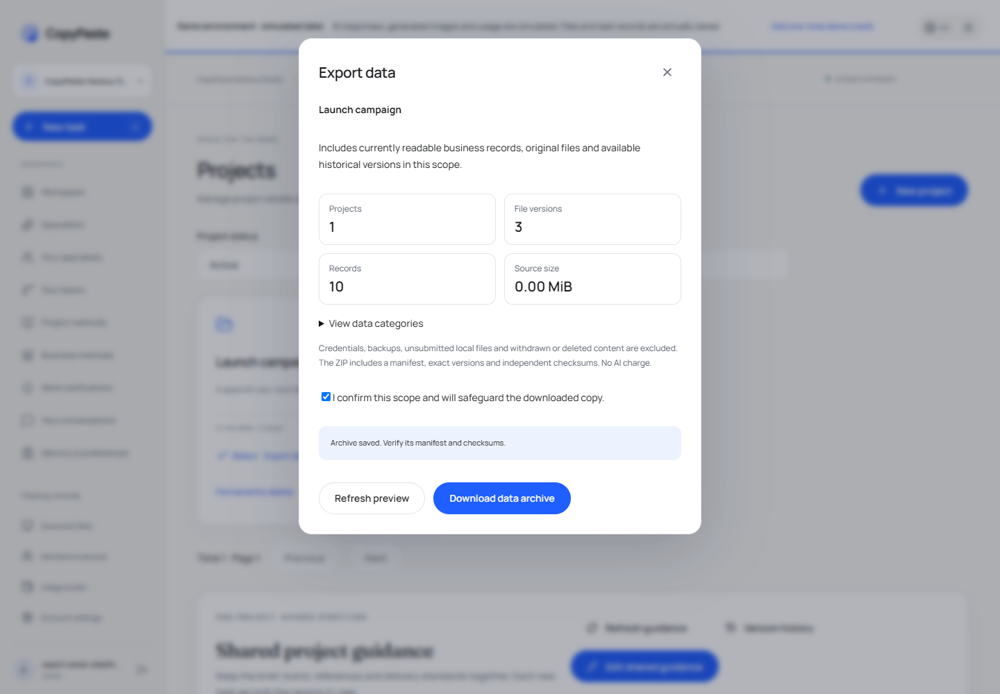

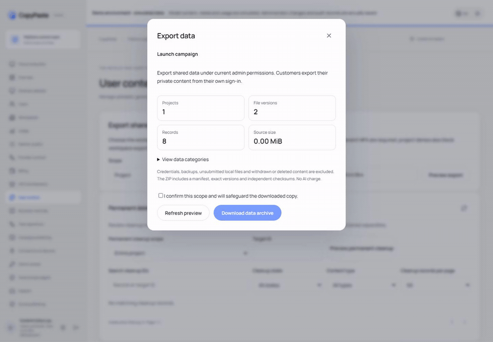

[Actual MP4](assets/screenshots/workmate-scope-data-export-152-03-scope-export.mp4)

---

<!-- ownership-transfer-151 -->

**未凍結增量151：企業所有權交接**

owner從「成員與權限」選擇同企業啟用的非owner成員，核對企業全名及責任，發起24小時交接。指定接收方由工作區提示進入收件區親自確認；完成時接收方成為owner、來源方成為admin，原子提交。拒絕/撤銷/過期或授權變更不會提升角色。私人資料、在途任務、付款主體與本機權限不移轉。後台在原成員管理中依當前範圍、MFA及明確拒絕查看/取消，不能代客戶接受；原特權審批繼續適用。

9項定向後端、6組實際三端流程、8步構建及12項本機邊界檢查通過，保留6張真實截圖與3組GIF/MP4；按要求省略廣泛歷史/生產/OS回歸，沒有呼叫AI。完整導出、真實供應方/廣告帳戶、簽名及完整驗收仍待完成。首個凍結v0.1.0-rc.1標籤與五個ZIP保留。

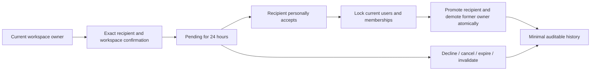

Shared actual Web illustration; no new UI acceptance for this component.

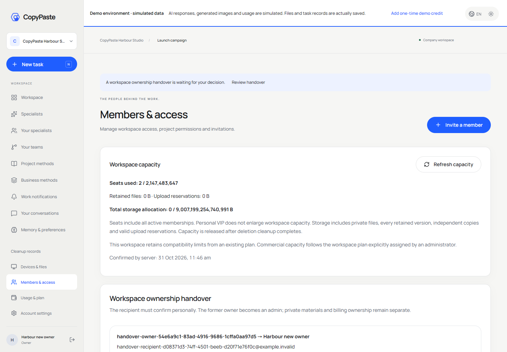

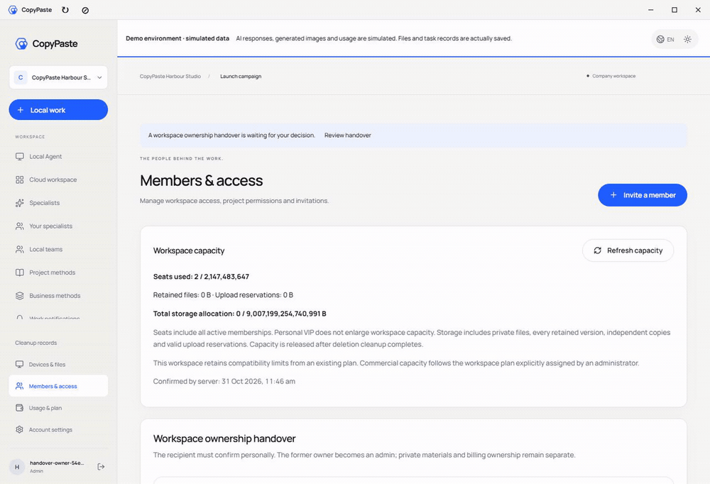

[Actual MP4](assets/screenshots/workmate-ownership-transfer-151-01-ownership-handover.mp4)

---

<!-- scope-erasure-150 -->

**未冻结增量150：项目/企业永久清理闭环**

owner/admin从「项目」预览永久删除，输入完整名称并确认不可恢复及保留范围；整企业仅owner可删。后台内容管理要求对应范围删除权限与近期MFA。/cleanup为独立账户页面，最后企业删除后仍可查看。立即阻止新工作与原文访问；本机/云端执行按公司实际用量收尾，未知费用保留核对。Desktop仍本机运行Codex；Extension仍为云端Agent与原生右侧栏。

11项当前后端检查、6组真实三端流程、初次8步构建及3步定向重构建通过。明确省略一项耗时旧备份重复检查，保留其先前单项通过及所有失败原件；未扩跑广泛回归或真实付费模型。必要帐务/审计、共用身份、其他范围引用与客户本机副本适用明确保留规则。完整导出、全部衍生/生产恢复验收、真实供应方/广告账号和签名仍待完成。首个冻结v0.1.0-rc.1标签及五个ZIP保持原样。

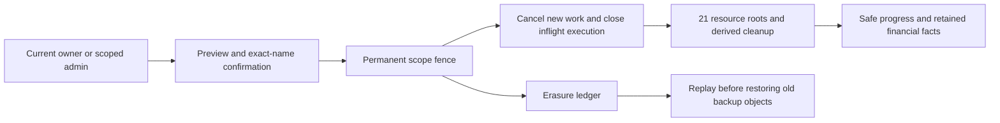

Shared actual Web illustration; no new UI acceptance for this component.


[Actual MP4](assets/screenshots/workmate-scope-erasure-150-04-scope-cleanup.mp4)

---

<!-- project-lifecycle-149 -->

**当前开发增量149：首个冻结版 `v0.1.0-rc.1` 后的项目管理修复**

企业 owner/admin 从「项目」筛选使用中/已封存/全部、搜索分页、编辑名称简介，并明确确认归档/恢复。归档最后一个项目后管理页仍可访问，可恢复原项目身份、资料与现有成员权限；已撤销授权不复建。普通成员仅见获准的活动项目。归档控制封存期间可用性，需要结束的任务请先明确取消。

后端在权限锁等待后重新鉴权，支持预期状态冲突与幂等重试；重放返回当前状态，避免恢复后再次封存。两端阻止旧列表覆盖新状态，恢复选中仅采用最新活动项目列表。Desktop仍在客户本机运行Codex并支持客户主动授予完整权限；Extension仍采用原生右侧栏及云端Agent，负责获准文件读取上传。

10项当前后端检查、5组真实界面旅程和6步构建通过，保留4张截图、2组真实GIF/MP4，资源均已关闭。未发起模型请求，按快速冻结要求省略广泛历史回归；原始失败验证及后继修正版均保留。聚合整删、生产联调及完整验收继续开放。原7个冻结标签和5个发行ZIP保持原样，149属于未冻结后续代码。

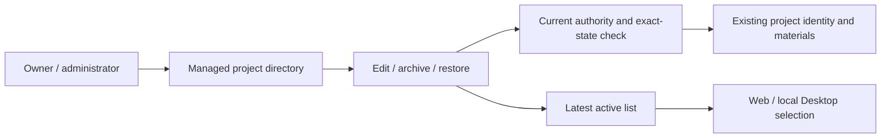

下图为真实Web共享流程示意，不代表本组件新增UI验收。

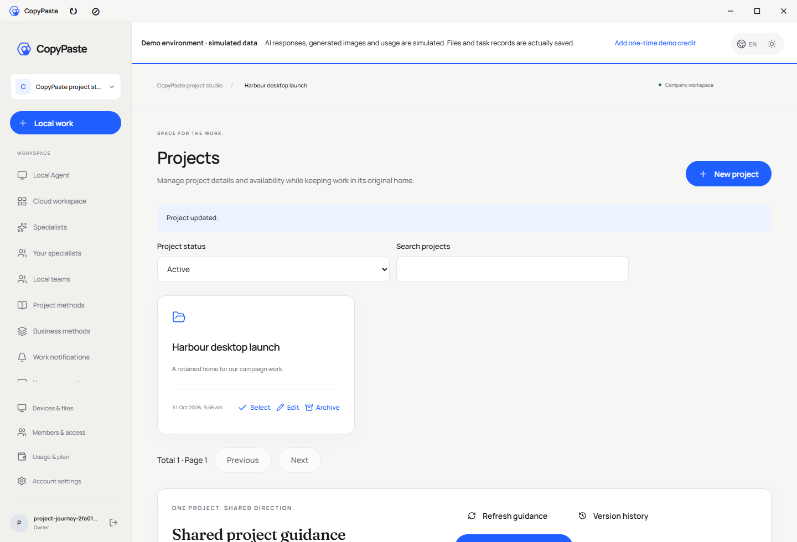

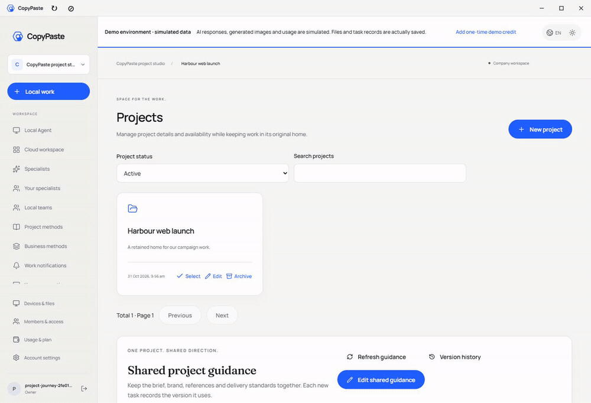

[Actual MP4](assets/screenshots/workmate-project-lifecycle-149-01-project-archive-restore.mp4)

---

<!-- frozen-release-148 -->

**固定运行时准备 / Pinned runtime preparation**：`runtime:prepare` 不下载或查找 PATH。先解压本版 Windows 便携 ZIP，在 PowerShell 设置 `$env:COPYPASTE_LOCAL_CODEX_BIN` 为解压目录中的 `resources/local-codex/codex.exe` 绝对路径（保留旁边全部 helper 文件），再在 desktop 执行 `npm run runtime:prepare`。源码单独交付时，需自行提供与 `contracts/local-codex-runtime.json` 相符的同一组原生文件。首次启动会自动执行原生 PostgreSQL 迁移到145，无需容器。

`runtime:prepare` neither downloads nor searches PATH. Extract this release's Windows directory ZIP, set PowerShell `$env:COPYPASTE_LOCAL_CODEX_BIN` to its absolute `resources/local-codex/codex.exe` path, keep all sibling helpers, and run desktop `npm run runtime:prepare`. A source-only install must supply the exact locked native files. Native database startup applies schema145 automatically.

运行后访问 Web `http://localhost:4317`、Admin `http://localhost:4318`。本机开发验证码保存在 platform `.data/mailbox/`，不是公共邮件服务。另开终端在 platform 执行 `npm run admin:create -- admin@example.com super_admin`，按 `.data/enrolment/` 的一次性资料绑定认证器后删除该私密资料；不提供共享默认密码。Windows 包连接同一后端后使用浏览器登录。

Open Web at localhost4317 and Admin at localhost4318. Development OTP messages are in platform `.data/mailbox/`. In another terminal run platform `npm run admin:create -- admin@example.com super_admin`, enroll its one-time authenticator material, then delete that private enrollment file. No shared administrator password is provided.

**首个冻结候选版本 / First frozen candidate: `v0.1.0-rc.1`**

本版用于 Windows x64 本地试用，AI 提供方使用已获准的模拟数据。产品版本与各组件 package.json 版本独立。Web / Extension 在云端运行 Codex；Desktop 在客户本机运行固定版本 Codex，可由客户主动授予完整本机权限。Extension 保留 Chrome 原生右侧 Side Panel，负责获准文件读取与上传。管理后台保留独立管理员登录、用户/企业控制、费用/VIP/用量及内容权限。

This release candidate provides a Windows x64 local trial with explicitly synthetic AI providers. Product and component versions are independent. Web and Extension use cloud Codex; Desktop runs pinned Codex locally with customer-controlled full OS permission. Extension uses Chrome's native right Side Panel for conversation and consented file upload. Admin provides separate administrator authentication, account controls, billing/VIP/usage and content permissions.

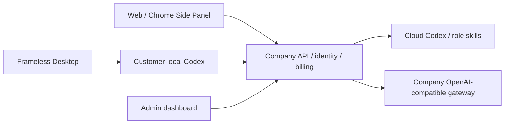

**首次启动 / First source startup**：六组件按 `copypaste-platform`、`copypaste-web`、`copypaste-admin`、`copypaste-desktop`、`copypaste-extension`、`copypaste-delivery` 放在同一父目录。要求 Windows x64、Node.js ≥22.14、Git、原生 .NET 构建工具；禁止 Docker/WSL。进入 delivery 执行 `npm run bootstrap`，在 desktop 执行 `npm run runtime:prepare`，回到 delivery 执行 `node scripts/start-frozen-demo-148.mjs`。该入口校验 Codex 版本及 SHA-256，避免使用系统 PATH 中的其他版本；停止用 `npm run stop`。管理员首次开户按 platform 已有 enrollment 命令创建独立管理员，勿使用客户登录代替。

Place all six named repositories under one parent. Run delivery `npm run bootstrap`, desktop `npm run runtime:prepare`, then delivery `node scripts/start-frozen-demo-148.mjs`. This entry verifies the pinned Codex binary instead of selecting an arbitrary PATH version. Stop with delivery `npm run stop`. Enroll an independent administrator using the platform's documented enrollment command.

**使用流程 / Journey**：浏览器打开 Web → 邮箱验证码 → 进入企业/项目 → 选择预设角色 → 提交任务并审核所需权限 → 查看结果、费用、下载。Desktop 配置同一后端，使用浏览器授权登录，再选择本机目录和权限。Chrome 在开发者模式加载 extension 的 `dist/`，点击扩展打开右侧面板、登录并主动选择上传文件。营销分析支持原始 CSV/XLSX 上传、明确数字/日期口径、字段映射、精确预览、确认和持久化分析快照；改变格式会撤销旧确认。

Open Web, verify email, select workspace/project and a role preset, review permissions, run a task and inspect results/usage/downloads. Desktop signs in through browser authorization and then selects local scope. Load Extension `dist/` unpacked in Chrome, click its action to open the native side panel, sign in and explicitly attach files. Marketing imports retain original bytes, require explicit conventions and mapping, preview exact facts and create a durable analysis snapshot; changing conventions clears confirmation.

**冻结依据 / Qualification**：当前后端 17 项必要检查通过；Web、Admin、Extension、Desktop 构建完成，Windows 未签名目录包已在真实窗口验证。当前 UI 冒烟覆盖 Web OTP、Desktop 原生 PKCE 和两端原文件→精确预览→分析快照，共 4 组旅程；保留 4 张实际截图、2 组实际 GIF/MP4。阶段147的真实本地/云端 Codex 与 Chrome 原生侧栏为历史证据，本轮未重复完整回归，也没有把模拟 AI 回复称作真实模型验收。

Seventeen focused backend checks passed. All client builds completed; the unsigned Windows directory package was exercised in a real window. Four current smoke groups cover Web OTP, native Desktop PKCE and actual original-file imports through durable snapshots, with four screenshots and two GIF/MP4 pairs. Stage147 local/cloud Codex and native Chrome Side Panel evidence stays historical. Broad regression was deliberately omitted at the user's request; synthetic model replies are not production model acceptance.

**边界 / Boundaries**：这是首个候选冻结版。生产内部 API/真实媒体和 Google/Meta 等账户联调、签名安装及更新、完整权限/故障/并发矩阵和全量验收仍待完成。项目/企业聚合整删尚未实现；归档项目的恢复权限路径需要修复，不能视为已支持。UTF-16 CSV 上传需 BOM；其他编码转换为 UTF-8。原有102项需求逐条记录保留，88项必需完整验收范围仍开放，并非88个模块完全未实现。

Production provider/account integration, signed installers/updates and comprehensive permission/failure/concurrency acceptance remain open. Aggregate project/tenant erasure is unimplemented; archived-project restoration still needs its access-path fix. UTF-16 CSV uploads require a BOM. All102 original requirement records remain, including88 open required full-acceptance scopes; this does not mean88 entirely missing modules.

冻结标签 / Frozen tags: `v0.1.0-rc.1` (docs), `v0.1.0-rc.1-backend`, `-web`, `-admin`, `-desktop`, `-extension`, `-delivery` (full tag prefix for each component). Each tag identifies a complete independent Git history; compact release source archives omit historical evidence/media, which remain available in Git.

实际 Web 页面（共享流程示意；非本组件新增 UI 验证） / Actual Web journey (shared illustration; not a new UI check of this component)

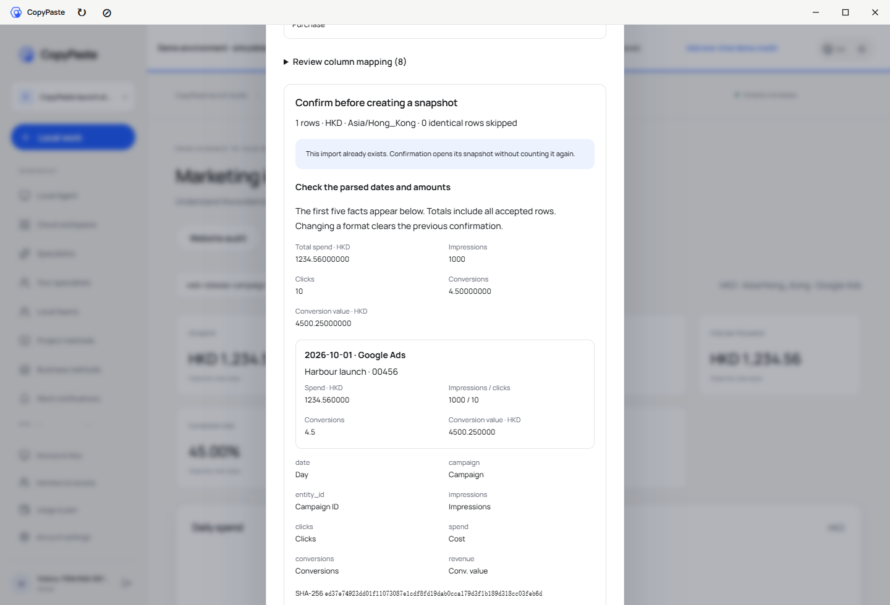

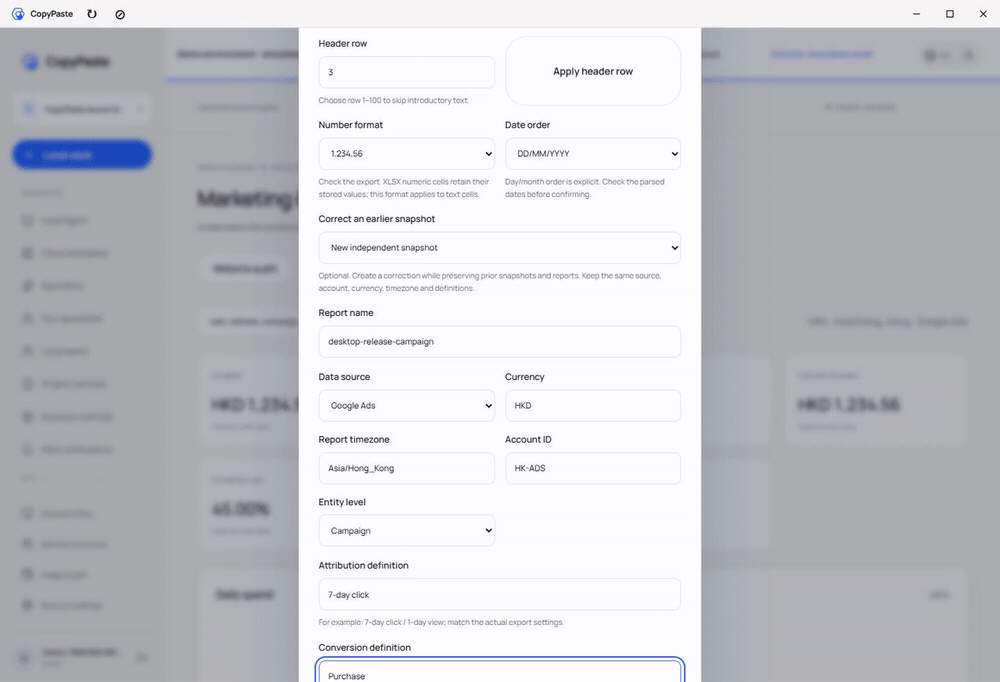

[Actual MP4](assets/screenshots/workmate-marketing-release-148-04-reviewed-marketing-import.mp4) · [Saved analysis](assets/screenshots/workmate-marketing-release-148-04-durable-analysis-snapshot-en.png)

---

<!-- business-history-stage144 -->

<!-- workflow-handoff-stage145 -->
## 阶段145：完整成果交接与失败确认

SQL140、完整交接读取、受限失败检查、云端及本机运行控制。

客户由流程顾问准备版本，核对输入、预算和失败策略，明确确认后执行；完成后下载原文件。已结算失败可按预设等待客户确认略过，整体失败与原费用保留，不自动重试。

39项后端＋12项可信本机控制、7项实际Web流程通过。模型响应为明确假数据；生产接入及完整本机Codex／OS验收仍开放。默认Desktop测试保留历史文件并选择当前修订。

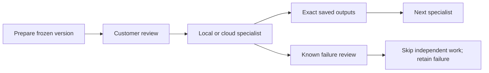

[完整方案与使用边界](https://github.com/copypasteltd/workmate/blob/docs/docs/development/145-workflow-handoffs-and-failure-review.md) · [102项原编号清单](https://github.com/copypasteltd/workmate/blob/docs/docs/quality/remaining-work-stage145.md)

以下为真实Web客户流程的共享发布截图／录制，不冒充本端专有界面。

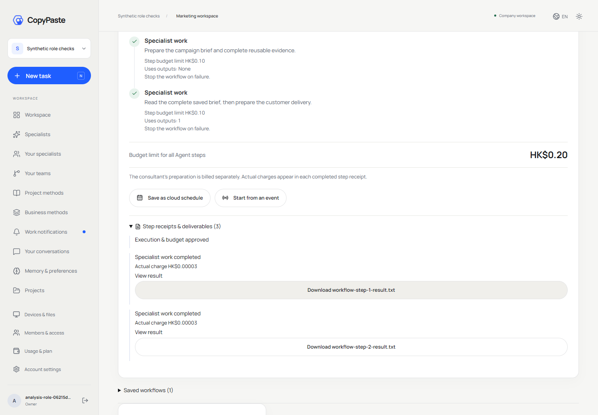

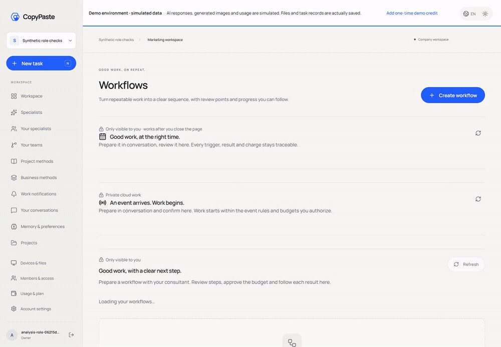

[MP4](assets/screenshots/workmate-workflow-handoff-145-03-exact-workflow-handoff.mp4)

## 后台业务版本闭环

阶段144补齐品牌、团队、简报、计划及全部设计工程的后台已保存历史，普通画布记录不可变版本，新品牌版本记录真实客户操作者。当前52项相关后端及9项实际Admin浏览器旅程通过。下图和录屏为本轮实际后台界面。

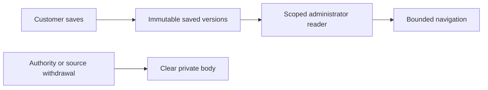


[MP4](assets/screenshots/workmate-business-history-144-01-business-version-navigation.mp4) · [详细方案 / Usage and implementation](https://github.com/copypasteltd/workmate/blob/docs/docs/development/144-admin-business-content-history.md)

使用「用户端内容 → 阅读内容 → 最新／最早／前后翻页」，展开记录可查看确切定义。阅读要求当前正文权限及项目范围，依赖撤回会隐藏正文；未保存过的旧内容不补造。Desktop继续在客户本机执行Codex，Extension保留原生浏览器右侧栏。原完整产品验收继续开放。

<!-- editable-projects-stage143 -->

新增矢量设计／演示文稿的持续编辑工程：从专员固定来源建立、逐页和逐层修改、保存历史版本、真实预览与SVG/PNG/PDF/PPTX交付、完整工程包跨项目恢复、品牌逐项核对与图表原值独立确认。同时补齐预览与保存排队、后台删除历史及实际衍生文件。

42项相关检查及真实三端旅程通过。使用假业务／模型数据，实际原生登录、存储和文件渲染；Windows包未签名。全部专业格式、Office与跨机器整项验收仍开放。 [方案与使用 / Design and usage](https://github.com/copypasteltd/workmate/blob/docs/docs/development/143-editable-project-workspaces.md).

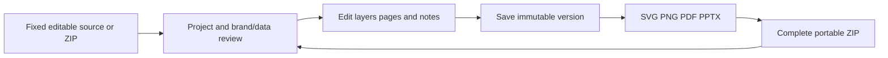

<!-- brand-reuse-stage142 -->

品牌工程可在新项目选择目的品牌固定版本，逐项映射字体、价格／促销事实、Logo和可选配色，核对实际差异并确认后恢复新副本。Web/Desktop继续编辑、输出PNG/PDF/SVG并再次打包；扩展在原生右侧栏完成上传、核对与恢复。修复文字矢量化导致品牌／矢量／演示稿源图片丢失的问题，保留图像和形状层叠顺序。

62项相关检查、真实三端旅程、5张截图和3组GIF／MP4已通过并绑定源码。假数据，无模型调用；Windows包未签名。全部格式恢复、跨机器和正式服务验收仍开放。 [方案 / Guide](https://github.com/copypasteltd/workmate/blob/docs/docs/development/142-brand-project-reuse.md).

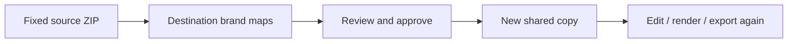

# Workmate · CopyPaste Enterprise Agent · platform

<!-- current-test-entry-141 -->
默认 `npm test` 自动选用各阶段测试组的最新数字版本，可用 `npm test -- --list` 查看。原失败尝试保持原字节，可通过 `node scripts/run-tests-owned.mjs tests/<文件>` 显式复现。六项端到端入口检查及实际 npm 入口确认旧失败不会混入日常检查；画布和影片运行时验证仍采用阶段140的真实三端记录。

<!-- creative-packages-stage140 -->
## 工程打包与恢复 · 阶段140

后端新增完整素材工程包导出、分片上传后的逐项校验、明确共用恢复、固定引用重映射和原请求回执。

导出和恢复不请求AI。上传前先明确确认项目共用，恢复前再确认素材权利；原工程不覆写，中断后核对原请求。当前支持普通分层画布和campaign-cuts影片；画布系统字型差异、品牌重绑、全部格式及跨机器恢复仍待完整验收。

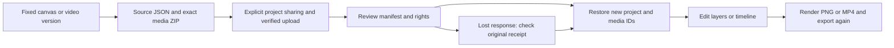

- [Format, APIs & usage / 格式、接口及使用](https://github.com/copypasteltd/workmate/blob/docs/docs/development/140-creative-project-packages.md)
- [Actual qualification / 实际验证](https://github.com/copypasteltd/workmate/blob/docs/docs/quality/creative-packages-checkpoint-140.json)
- [Open acceptance scopes / 未完成验收](https://github.com/copypasteltd/workmate/blob/docs/docs/quality/remaining-work-stage140.md)


- [Actual web interaction .MP4](https://github.com/copypasteltd/workmate/blob/web/assets/screenshots/workmate-creative-packages-140-07-project-restore.mp4)


- [Actual web interaction .GIF](https://github.com/copypasteltd/workmate/blob/web/assets/screenshots/workmate-creative-packages-140-07-project-restore.gif)
- [Actual desktop interaction .MP4](https://github.com/copypasteltd/workmate/blob/desktop/assets/screenshots/workmate-creative-packages-140-07-project-restore.mp4)
- [Actual desktop interaction .GIF](https://github.com/copypasteltd/workmate/blob/desktop/assets/screenshots/workmate-creative-packages-140-07-project-restore.gif)
- [Actual extension interaction .MP4](https://github.com/copypasteltd/workmate/blob/extension/assets/screenshots/workmate-creative-packages-140-07-project-restore.mp4)
- [Actual extension interaction .GIF](https://github.com/copypasteltd/workmate/blob/extension/assets/screenshots/workmate-creative-packages-140-07-project-restore.gif)

<!-- native-teams-stage139 -->

源码交付：保留原始运行检查点与失败记录；Git按执行时的原始字节保存代码及核查脚本，避免换行转换。交付检查点单独记录本次版本管理元数据调整。


## 本机专家团队 · 阶段139

升级前备份数据库并停止旧API／Worker，执行`npm run db:migrate`至SQL137，再用匹配代码构建启动。新增原生团队API及精确权限约束；数据库只为已审批协调员开放暂停登记，成员按自己的固定角色核验，受限函数仅返回发起人团队的音频终态，不开放原始音频表。云端队列只处理云端工作。

最多16步、7位成员加1位通用协调员、3步并行，共用一个明确授权目录；并行编辑应分配到不同文件。审阅免费，批准预算固定，预留与实际费用分开；已接受但未知的操作不重跑。撤权先停止本机工具，未同步回执继续可见。团队ZIP仅包含主动提交的成果，本机未提交文件留在本机。

60项后端、36项扩展、81项本机控制／下载回归及6项实际Windows旅程通过；4张截图、1组GIF／MP4、3档布局及1个独立解压的完整团队包绑定1756份确切源码。

业务／模型答复及本机目录／授权／保存窗口的选择决定为受控假数据；实际OTP／PKCE、本机Codex、Windows文件操作、公司计量、撤权和ZIP解压确实执行。Windows包未签名；全部专业角色质量、签名安装、真实公司模型／广告账户及跨机器工程恢复继续独立验收。

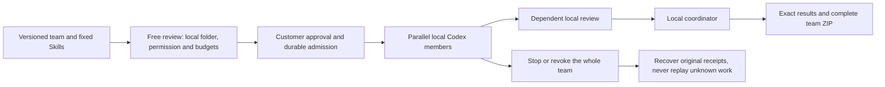

[需求](https://github.com/copypasteltd/workmate/blob/main/docs/requirements/16-desktop-native-teams.md) · [接口／权限／恢复／交付方案](https://github.com/copypasteltd/workmate/blob/main/docs/technical/139-desktop-native-teams.md) · [源码与证据](https://github.com/copypasteltd/workmate/blob/main/docs/quality/native-teams-release-checkpoint-139.json) · [全部编号](https://github.com/copypasteltd/workmate/blob/main/docs/quality/remaining-work-stage139.md)

真实Desktop操作，业务内容为假数据：


- [workmate-native-teams-139-05-review-before-local-run-en.png](https://github.com/copypasteltd/workmate/blob/desktop/assets/screenshots/workmate-native-teams-139-05-review-before-local-run-en.png)
- [workmate-native-teams-139-05-completed-local-team-en.png](https://github.com/copypasteltd/workmate/blob/desktop/assets/screenshots/workmate-native-teams-139-05-completed-local-team-en.png)
- [workmate-native-teams-139-05-whole-team-access-revoked-zh.png](https://github.com/copypasteltd/workmate/blob/desktop/assets/screenshots/workmate-native-teams-139-05-whole-team-access-revoked-zh.png)
- [workmate-native-teams-139-05-local-team.mp4](https://github.com/copypasteltd/workmate/blob/desktop/assets/screenshots/workmate-native-teams-139-05-local-team.mp4)

<!-- delivery-revision-stage138 -->
## 原成果修改与新版本交付 · 阶段138

API新增固定来源核对、预览及幂等修改受理，修改任务复用现有Worker；新增SQL136保护来源绑定不可改写。先备份并运行匹配代码的迁移，再启动API与Worker；不要使用旧API连接新schema。完整API字段及升级顺序见方案。

可选择整份交付、答复、单文件、Unicode文字选段、图片区域或有效视频时段。预览不调用AI或预留费用；确认后建立单独预算的新任务，沿用原角色与来源，保留原成果及费用。源文件换版或撤回将阻断后续读取与完成交付。获准项目编辑可修改共享工作，私有会话保留原归属。结果未知时继续核对原请求。

文字预览上限1 MiB，图片／MP4内嵌预览4 MiB；更大或不支持预览的文件可下载后按完整文件提出修改。整份修改最多引用20个文件，视频时段须有保留的有效时长。图片／视频位置是修改意见，不能视为编辑操作审批或专业质量通过；专门工作流保留原确认步骤。

34项当前后端检查（含13项新增修改测试）、36项扩展状态检查、73项桌面控制／下载回归及9项三端实际旅程通过。11张实际截图、3组GIF／MP4、7档布局和3个独立解压的下载包绑定1732份确切源码。

业务／模型答复及原生文件／授权窗口选择为明确受控的假数据；登录、数据库权限、确切文件、实际打包本机Codex、Windows原生窗口、Chrome右侧栏和新成果下载实际运行。Windows包未签名。真实公司模型／账户、完整专业角色输出、安装矩阵和工程恢复继续独立验收。

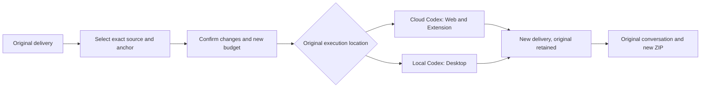

[需求](https://github.com/copypasteltd/workmate/blob/main/docs/requirements/15-delivery-revisions.md) · [方案与使用逻辑](https://github.com/copypasteltd/workmate/blob/main/docs/technical/138-source-bound-delivery-revisions.md) · [源码与原始证据](https://github.com/copypasteltd/workmate/blob/main/docs/quality/delivery-revision-checkpoint-138.json) · [全部编号](https://github.com/copypasteltd/workmate/blob/main/docs/quality/remaining-work-stage138.md)

实际产品操作，业务内容为假数据：


其他实际页面截图及MP4录屏：

- [workmate-delivery-revision-138-06-lost-response-retained.png](https://github.com/copypasteltd/workmate/blob/web/assets/screenshots/workmate-delivery-revision-138-06-lost-response-retained.png)
- [workmate-delivery-revision-138-06-image-anchor-en.png](https://github.com/copypasteltd/workmate/blob/web/assets/screenshots/workmate-delivery-revision-138-06-image-anchor-en.png)
- [workmate-delivery-revision-138-06-video-anchor-en.png](https://github.com/copypasteltd/workmate/blob/web/assets/screenshots/workmate-delivery-revision-138-06-video-anchor-en.png)
- [workmate-delivery-revision-138-06-revised-delivery-zh.png](https://github.com/copypasteltd/workmate/blob/web/assets/screenshots/workmate-delivery-revision-138-06-revised-delivery-zh.png)
- [workmate-delivery-revision-138-06-delivery-revision.mp4](https://github.com/copypasteltd/workmate/blob/web/assets/screenshots/workmate-delivery-revision-138-06-delivery-revision.mp4)

<!-- delivery-package-stage137 -->
## 完整交付与原对话下载 · 阶段137

主要业务按“提交目标 → 补充资料 → 执行 → 审阅 → 下载成果 → 原对话修改”继续收口。现在 Web 和 Chrome 原生右侧栏可直接在原聊天下载完整当前交付包，任务审阅区也提供入口；Desktop 使用公司授权接口和原生保存窗口。取消保存不发请求、不显示成功，侧栏提示跨刷新及繁英切换保留。

ZIP 包含实际成果、文字答复（如有）、任务及素材固定版本、SHA-256清单及中英编辑说明。同名文件分别保留，失败／停止工作的现有成果明确标示为部分交付。源代码ZIP、SVG／PPTX、工程JSON及只读成片分别按实际编辑能力说明，不虚构源工程。没有提交为交付物的本机文件仍留在本机；Desktop Agent仍是本机Codex，云端包不会扫描本机工作区。

用户看到的任务版本和交付摘要必须一致。后端顺序读取真实文件、流式校验大小与摘要，在受控磁盘生成ZIP，完成后再次检查当前权限、来源、保留期限及精确版本；文件损坏、素材撤回或版本变化会拒绝整个包。只读项目成员可下载获准共享成果，审阅仍需批准权限；管理员身份不自动获取私有会话。导出不调用AI、不创建新任务、不增加AI费用。容量为16 GiB／10,000个成果／文字条目，超限明确拒绝，不悄悄遗漏文件。

本轮不新增数据库迁移：Backend沿用SQL135并重新构建，Web／Desktop／Extension重新构建。扩展新增Chrome `downloads` 权限，使用浏览器默认下载位置及冲突改名；授权只在公司请求头中传递。新增契约为Backend `contracts/delivery-package-v1.json`。从Delivery执行 `npm run qa:delivery-package-backend -- <新两位编号>` 或 `npm run qa:delivery-package -- <新两位编号>`；后者默认完整构建、创建未签名Windows包并操作实际右侧栏与原生下载。

21项当前后端检查（含11项新打包测试）、37项扩展状态检查、1项桌面下载回归、12项边界绑定及10项三端实际旅程通过。9张实际截图、3组GIF／MP4、7档布局和3个独立解压的下载包绑定1713份确切源码。 使用受控Codex适配器和假业务内容；真实OTP／PKCE、文件读取、权限、原生窗口和Chrome下载管理器实际运行。Desktop保存窗口的选择结果由夹具指定到本轮自有目录。本轮未重新证明全部本机Codex工具、真实公司模型、专业素材质量或完整跨环境工程恢复。既有52项后端／来源回归另有阶段内原始记录，按其自身源码范围保留，不混称本轮全平台回归。


[需求](https://github.com/copypasteltd/workmate/blob/main/docs/requirements/14-complete-delivery-package.md) · [方案与使用逻辑](https://github.com/copypasteltd/workmate/blob/main/docs/technical/137-complete-delivery-package.md) · [确切源码与证据](https://github.com/copypasteltd/workmate/blob/main/docs/quality/delivery-package-checkpoint-137.json) · [全部编号](https://github.com/copypasteltd/workmate/blob/main/docs/quality/remaining-work-stage137.md)

实际客户流程截图与交互（业务内容为假数据）：


<!-- business-inputs-stage136 -->
## 业务问题与原任务续跑 · 阶段136

Agent遇到确实缺少的尺寸、目标受众或业务口径，可在原对话提出问题。客户可点击建议再修改，也可直接自由回答，最后明确确认；没有预选或自动提交。多项问题逐项保存，全部补齐后继续同一任务、同一会话和原预算预留，已计量用量统一结算。确认的问题和答案保留为原对话备注，相同请求重试不重复写入。

Web和Chrome原生右侧栏直接在原聊天展示问题，Desktop既有云任务详情也支持补答。繁中／英文切换保留未提交的回答，失败保留文字；扩展切换身份或会话清除草稿，来源不可读时清除受保护问题。建议仅供选择，答案不授予文件、广告账户、工具、本机或额外费用权限。

服务端严格区分`question`／`file`／`connection`，最多8项建议、4,000字符回答，校验版本、当前权限、来源及整批合法性后才写入。已确认答案不可改写。付费提问必须处于已完成且计量明确的Codex回合边界，继续原线程；取消只结算已知用量。删除私有会话清除问题、答案、检查点及正文，保留必要费用事实。

SQL135须在启动API／Worker前迁移：Backend执行`npm run db:migrate`。原SQL001–134、原二十项任务定义及主OpenAPI保持原字节；新增结构在`contracts/business-inputs-v1.schema.json`，扩展原创建／补交接口。原依赖文件与连接结构继续有效，问题使用`answer`而非`resource_ids`。

122项后端集成检查（含11项新增问题测试）、61项扩展状态检查、12项交付绑定及14项实际三端流程通过；9张实际截图、3组GIF／MP4及7个尺寸检查绑定确切来源。 原生Codex检查使用实际固定二进制和合成Responses服务，页面旅程使用受控工具和假业务回复。客户端初次完整构建成功；修正页面夹具后复用逐字节一致的源码和Windows包，原失败记录保留。可在Delivery执行`npm run qa:business-inputs-backend -- <新两位编号>`或`npm run qa:business-inputs -- <新两位编号>`；后者默认完整构建并创建独立原生测试数据库。

Desktop本机Codex及客户主动授予的本机完整权限沿用独立流程，本轮新增的是其云端任务视图问答。实际Windows窗口保持无边框、无Electron菜单、无可见纵向滚动轨和横向溢出；扩展保持实际Chrome原生右侧SIDE_PANEL。使用假数据，Windows包未签名；真实生产模型及全部角色专业交付仍待验收。完整编号仍开放88条必需、12条未确认建议、1条可选，REQ-095原始验收维持。

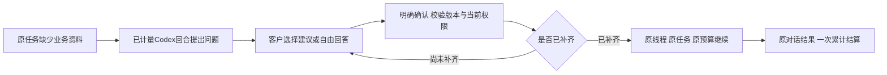

[需求](https://github.com/copypasteltd/workmate/blob/main/docs/requirements/13-business-brief-inputs.md) · [实现与使用逻辑](https://github.com/copypasteltd/workmate/blob/main/docs/technical/136-business-brief-clarification.md) · [全部102条编号](https://github.com/copypasteltd/workmate/blob/main/docs/quality/remaining-work-stage136.md) · [源码与原始验收](https://github.com/copypasteltd/workmate/blob/main/docs/quality/business-inputs-checkpoint-136.json)


<!-- client-errors-stage135 -->
## 四端连接与登录恢复 · 阶段135

Web、Admin、Desktop及Extension对读取失败显示当前语言的连接说明，保留有效登录。提交后响应丢失或无法解析时，提示先查收结果；应用层不会自动重发；浏览器可能在底层重传，服务端按原消息编号去重。客服授权继续使用原编号和期限，扩展委派继续使用原消息编号，显式重试不生成第二个任务。后台轮询不清除提交结果未确认的提醒，切换繁中／英文会更新同一错误提示，已知连接异常不显示Electron内部文字、地址或响应正文。

受保护请求收到401时，先核对所属登录并清除当前身份；HTML或空正文不能绕过清除。旧请求不能注销新登录或覆盖新防伪标记。Admin即时隐藏独立管理外壳，支持会话列表的连接错误与表单／撤销提醒分开，列表恢复后只清除本次连接提示。

15项连接／身份检查（含实际HTTP故障）、12项交付文件绑定、1项原生桥检查及30项实际四端流程通过。20张截图、7组实际GIF／MP4绑定源码；包含真实右侧SIDE_PANEL、客户OTP／PKCE及独立管理员TOTP、真实提交后响应丢失与同消息重试。09重新编译／构建Extension及Delivery，复用与02逐字节相同的后台、Web、Admin、Desktop源码及Windows包；没有伪称再次完整打包。旧失败与执行原件保留。Delivery当前`npm test`包含严格编译、文件绑定及连接检查；`npm run qa:client-errors -- <新的两位编号>`默认完整构建。

Desktop仍在客户本机运行Codex，完整本机权限单独授予，保持无边框、无Electron菜单及可见滚动条。Extension通过Chrome工具栏打开原生右侧栏，负责获准文件上传和云端执行。业务使用假数据，模型未运行，Windows包未签名。完整验收仍有88条必需、12条未确认建议、1条可选开放；REQ-095原始验收维持。

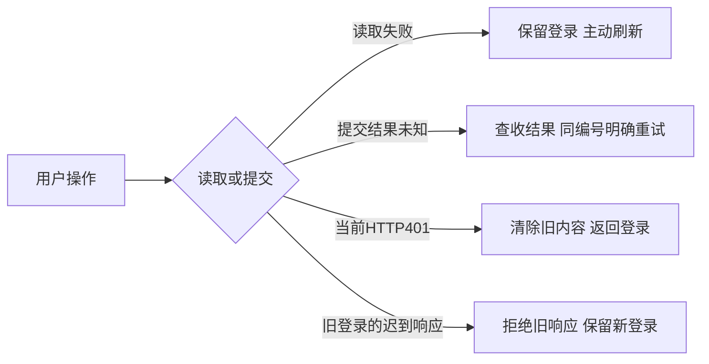

[使用与实现](https://github.com/copypasteltd/workmate/blob/main/docs/technical/135-client-connection-and-session-recovery.md) · [全部102条编号](https://github.com/copypasteltd/workmate/blob/main/docs/quality/remaining-work-stage135.md) · [源码与验收绑定](https://github.com/copypasteltd/workmate/blob/main/docs/quality/client-errors-checkpoint-135.json)


<!-- support-recovery-stage134 -->
## 客户授权恢复与客服原始验收 · 阶段134

客户从 **Web／Desktop → 账户设置 → 客服限时协助** 选择项目、原因及期限，空项目选择只表示元资料。首次提交固定申请编号和截止时间。响应丢失后可点击**查收先前申请**，或使用相同资料重试；刷新先查询既有结果，不自动再次提交。不同资料不能替换尚未确认的申请。查收展示目前有效／撤销／到期状态，不会续期；客户随时可在列表撤销。

恢复记录只在当前浏览器会话保存随机编号、申请摘要和固定截止时间，不保存原因、项目ID、正文或凭证。禁用存储时仅当前renderer内可恢复；服务器已经提交的授权仍显示在列表中。切换账户或企业后，迟到的结果不能回填新表单。原生Desktop桥仅新增客户查收GET，不开放管理员支持接口。

**原始REQ-095／TC-095已通过验收**，十二条条件逐项对应当前源码与真实执行证据：真实管理员和只读提示、明确范围、独立正文权限、写入／付款／VIP／凭证拒绝、无隐身登录、真实到期、撤销及审计失败回滚。本轮关闭这一条原始需求；全平台无障碍REQ-055、完整权限与竞争矩阵REQ-094继续各自跟踪。

65项相关后端检查、1项原生桥边界检查、18项实际Admin／Web／打包Desktop旅程及10条构建命令通过。覆盖提交前／后真实HTTP响应丢失、刷新、实际切换企业、同内容重试、当前回执查收、真实到期和原生客户撤销；客服操作期间user／native会话、刷新令牌和本机授权码行数不增加。确切源码绑定9截图和5组实时GIF／MP4。支持页面验证键盘及文字放大，Web／Admin采用CSS 200%，Desktop采用实际原生webContents 200%缩放；不据此关闭全平台浏览器／读屏验收。

Desktop继续在客户本机运行Codex，客户独立主动授予完整本机权限；保持无边框、无Electron默认菜单和无可见滚动条。Extension继续使用Chrome原生Side Panel承载获准文件上传与云端执行。本轮模型没有运行，业务及保留结果为合成夹具，Windows包未签名。自建浏览器、原生客户端与数据库均已关闭。

```mermaid
flowchart LR
  C[客户明确授权] --> F[固定申请与截止时间]
  F --> P[公司服务器]
  P --> L[响应丢失]
  L --> R[查收本人当前回执]
  R --> E[既有授权目前状态]
  R --> S[相同资料同键重试]
  S --> P
  E --> V[客户可随时撤销]
```

[方案 / Behavior](https://github.com/copypasteltd/workmate/blob/main/docs/technical/134-support-grant-recovery-and-acceptance.md) · [TC-095 acceptance](https://github.com/copypasteltd/workmate/blob/main/docs/quality/tc095-acceptance-134.json) · [Checkpoint](https://github.com/copypasteltd/workmate/blob/main/docs/quality/support-recovery-checkpoint-134.json) · [完整编号清单 / Remaining work](https://github.com/copypasteltd/workmate/blob/main/docs/quality/remaining-work-stage134.md)


[Recovery recording](https://github.com/copypasteltd/workmate/blob/web/assets/screenshots/workmate-support-recovery-134-04-grant-result-recovery.mp4) · [Retry recording](https://github.com/copypasteltd/workmate/blob/web/assets/screenshots/workmate-support-recovery-134-04-fixed-intent-retry.mp4) · [Native grant](https://github.com/copypasteltd/workmate/blob/desktop/assets/screenshots/workmate-support-recovery-134-04-customer-grant.mp4) · [Native revocation](https://github.com/copypasteltd/workmate/blob/desktop/assets/screenshots/workmate-support-recovery-134-04-customer-revocation.gif) · [200% Admin](https://github.com/copypasteltd/workmate/blob/admin/assets/screenshots/workmate-support-recovery-134-04-support-en-200.png) · [Chinese dark Admin](https://github.com/copypasteltd/workmate/blob/admin/assets/screenshots/workmate-support-recovery-134-04-support-zh-dark.png)

本轮1条需求验收完成；仍有88条必需、12条未确认建议和1条可选记录开放。这是完整验收记录数量，不代表101个未编码模块。完整源码交付复现、签名安装、生产接入及其余业务验收继续按编号推进；下方历史章节保留原运行范围。

---

<!-- support-access-stage133 -->
## 受控客服与原生客户授权 · 阶段133

客户从 **Web／Desktop → 账户设置 → 客服限时协助** 选择实际项目、原因及15／30／60分钟期限；空选择只包含企业／用户元资料。把授权ID提供给客服，并可随时在同一客户表单撤销。

管理员以自己的邮箱与TOTP登录 **Admin → 支援工作台**，明确选择客户、企业、项目、期限及可选客户授权。只读横幅持续显示真实身份和截止时间。共享正文还需要当前独立正文权限，私人会话保持私有；该视图不提供写入、费用、VIP或客户登录权限。

客服接口现会核对任务原始来源。来源隔离／到期或版本擦除后，保留正文不可继续返回，诊断标题也会隐藏。所选正文绑定当前版本，审计期间变化会被拒绝。页面取消旧请求，拒绝迟到任务／会话响应；版本变化、来源撤回、隐藏、失败、撤销或到期后清空正文。服务端逐次判断权限；可见Admin约每两秒复查。

59项后台相关测试及13项实际Admin／Web／打包原生Desktop旅程通过，确切源码绑定6截图和3组实时GIF／MP4。实际验证OTP／PKCE、邮箱／TOTP、客户授权／撤销、迟到响应、来源撤回、真实到期、繁中深色、四档Admin宽度和三档原生无边框窗口。所属浏览器、客户端与测试数据库均已关闭。模型没有运行，业务数据、保留结果和夹具文件读取明确为合成数据；Windows包仍未签名。

Desktop继续在本机运行Codex，本机权限由客户独立主动授权；客服表单只调用客户接口，管理员视图留在Admin。Extension继续使用Chrome原生Side Panel，承载获准文件上传及云端执行；本轮没有修改Extension执行代码。

```mermaid
flowchart LR
  C[客户Web或原生Desktop] --> G[明确范围及截止时间]
  G --> A[管理员使用自己的身份]
  A --> P[当前权限及原始来源]
  P --> R[所选正文版本]
  R --> V[只读共享内容]
  X[撤销／到期／来源撤回] --> K[拒绝读取并清空正文]
```

[实现方案](https://github.com/copypasteltd/workmate/blob/main/docs/technical/133-controlled-support-source-and-native-access.md) · [Checkpoint](https://github.com/copypasteltd/workmate/blob/main/docs/quality/support-access-checkpoint-133.json) · [完整编号待办](https://github.com/copypasteltd/workmate/blob/main/docs/quality/remaining-work-stage133.md)


[Native grant recording](https://github.com/copypasteltd/workmate/blob/desktop/assets/screenshots/workmate-support-access-133-02-customer-grant.mp4) · [Selection recording](https://github.com/copypasteltd/workmate/blob/admin/assets/screenshots/workmate-support-access-133-02-task-selection.mp4) · [Revocation recording](https://github.com/copypasteltd/workmate/blob/desktop/assets/screenshots/workmate-support-access-133-02-customer-revocation.mp4) · [Web metadata-only grant](https://github.com/copypasteltd/workmate/blob/web/assets/screenshots/workmate-support-access-133-02-metadata-grant-en.png) · [Chinese dark Admin](https://github.com/copypasteltd/workmate/blob/admin/assets/screenshots/workmate-support-access-133-02-support-zh-dark.png) · [Source withdrawn](https://github.com/copypasteltd/workmate/blob/admin/assets/screenshots/workmate-support-access-133-02-source-withdrawn-en.png)

仍有89条必需完整验收、12条未确认建议及1条可选记录开放，不代表102个未编码模块。完整权限竞争矩阵、各页面无障碍、签名安装和生产接入继续按编号推进；下方历史章节保留原范围。

---

<!-- content-history-stage132 -->
## 后台完整内容历史 · 阶段132

从「用户端内容 → 阅读正文」进入会话、专家或记忆，每页最多50条，可前后翻页或直达首尾。专家和记忆从最新版本开始，区分「客户版本」与「管理员修订」，展开后可查看完整版本记录。

每次请求复核当前MFA会话、两项正文读取权限、企业／项目范围及显式拒绝。签名游标拒绝旧版本继续翻页。阅读器在可见时每15秒及重新聚焦时复查；权限失效或可读来源变化后清空正文。关闭或切换内容会取消旧请求，迟到响应不能覆盖新内容。正文和游标不写入浏览器存储；助手来源不可用时隐藏正文。

新增GET `/v1/admin/content/:kind/:id/history`，使用`edge=first|last`或服务器返回的`cursor`，固定每页50条。SQL134维护消息历史修订号。旧正文接口保留原限制并增加`truncated`与`history_url`。普通客户会话仍保留既有80条输入限制。

54项后端相关测试及9项实际后台旅程通过。真实API创建205版专家、205版记忆及66条客户消息，实际运行原生PostgreSQL、邮箱/MFA、管理员修订、来源撤回、权限拒绝、迟到响应及375/768/1440布局。业务数据和保留的助手结果明确为合成数据，模型没有运行。原始失败及对应源码保留；本轮通过旅程留有5张截图和2组实时GIF/MP4。所有所属测试资源已关闭。

```mermaid
flowchart LR
  A[邮箱及MFA登录] --> B[选择用户端内容]
  B --> C[核对当前范围及正文权限]
  C --> D[每页阅读50条原记录]
  D --> E[前后翻页或直达首尾]
  E --> C
  D --> F[聚焦或定期复查]
  F --> C
  C --> G[拒绝或变化后清空正文]
```

[实现方案](https://github.com/copypasteltd/workmate/blob/main/docs/technical/132-admin-content-history.md) · [Checkpoint](https://github.com/copypasteltd/workmate/blob/main/docs/quality/content-history-checkpoint-132.json) · [完整编号待办](https://github.com/copypasteltd/workmate/blob/main/docs/quality/remaining-work-stage132.md) · [API supplement](https://github.com/copypasteltd/workmate/blob/backend/contracts/admin-content-history-route-additions.json)


[Oldest memory version](https://github.com/copypasteltd/workmate/blob/admin/assets/screenshots/workmate-content-history-132-02-oldest-memory-en.png) · [Administrator provenance](https://github.com/copypasteltd/workmate/blob/admin/assets/screenshots/workmate-content-history-132-02-administrator-provenance-en.png) · [中文页面](https://github.com/copypasteltd/workmate/blob/admin/assets/screenshots/workmate-content-history-132-02-memory-history-zh.png) · [Permission denied](https://github.com/copypasteltd/workmate/blob/admin/assets/screenshots/workmate-content-history-132-02-permission-withdrawn-en.png) · [Navigation MP4](https://github.com/copypasteltd/workmate/blob/admin/assets/screenshots/workmate-content-history-132-02-complete-version-navigation.mp4) · [Withdrawal MP4](https://github.com/copypasteltd/workmate/blob/admin/assets/screenshots/workmate-content-history-132-02-permission-withdrawal.mp4)

仍有89条必需、12条未确认建议及1条可选完整验收记录开放；它们不是102个未编码模块。本轮仅验收限定历史阅读范围，完整后台运营、全部角色、生产模型/连接器及签名安装继续按编号推进。下方历史章节保留其原始范围。

---

[简体中文](README.md) · [English](README.en.md)

<!-- startup-recovery-stage128 -->
## 本机启动安全恢复 · 阶段128

Desktop 在客户电脑运行固定版本 Codex。客户选择目录并主动授权后，初始化或打开会话若发生明确的传输故障，主进程先回收旧进程和锁，再请求公司服务检查原任务。只有轮次尚未准入、没有任何模型/输入计数/公司工具准入，且身份、权限与原截止仍有效，才允许恢复一次。最多两次启动，沿用原任务、原预算预留和 worker attempt，不延长原截止。

界面显示「正在重连」。连接结果未确认时，「重试连线」仅取回原请求结果；可能已执行的工作需先核对本机文件及费用。撤权、协议拒绝、清理失败、已提交轮次和结果未知均禁止自动重做。推理凭证仅传给可信本机运行器，不写入本机恢复日志或渲染页面。

```mermaid
flowchart TD
  Start[原任务与预算] --> Native[客户本机 Codex 启动]
  Native -->|明确传输故障| Clean[回收旧进程、锁和工具资源]
  Clean --> Fence[公司端撤销旧凭证并隔离旧请求]
  Fence --> Proof[原权限、原截止与零准入检查]
  Proof -->|全部成立且尚未恢复| Retry[同任务第二次启动]
  Native --> Gate[轮次准入]
  Retry --> Gate
  Gate --> Turn[执行一次并按公司记录结算]
  Proof -->|无法证明| Review[停止并核对原工作]
```

服务端通过 SQL133 升级；应先使用所有者执行完整迁移，再启动相应 API。新客户端声明 `desktop-startup-recovery-v1`；`/startup-recovery` 使用原绑定、固定契约摘要和原恢复请求键，`/turn-admission` 在 `turn/start` 前登记。旧客户端保持原执行流程，不能取得新的恢复许可。

本轮检查点记录控制层、实际固定 Codex、原生 SQL 与实际未签名打包客户端的限定验证。模型回答和对话框选择按用户要求使用假数据；尚不代表正式模型、签名安装、全部崩溃组合或专业角色整体验收。各旧阶段的包和画面仍对应其原源码。

本轮限定检查通过：91项相关控制层、43项真实固定版本Codex、30项原生数据库/API、3项当前编译和6项实际未签名打包界面检查。实际旅程验证了登录、授权、一次启动恢复、原任务的一次收费、单次回答、待响应时撤权，以及1000/1240/1440三个原生窗口宽度。当前截图、GIF和MP4来自成功的04次运行；失败的01—03次运行及原始记录均完整保留。发布入口为V11，远端状态以最终推送回执和SHA回读为准。

[方案与接口](https://github.com/copypasteltd/workmate/blob/docs/docs/technical/128-desktop-startup-recovery.md) · [匹配源码与验证](https://github.com/copypasteltd/workmate/blob/docs/docs/quality/startup-recovery-checkpoint-128.json) · [编号待办](https://github.com/copypasteltd/workmate/blob/docs/docs/quality/remaining-work-stage128.md)


[Original receipt](https://github.com/copypasteltd/workmate/blob/desktop/assets/screenshots/workmate-startup-recovery-128-04-original-local-receipt.png) · [Withdrawal screenshot](https://github.com/copypasteltd/workmate/blob/desktop/assets/screenshots/workmate-startup-recovery-128-04-permission-revoked-before-turn.png) · [Withdrawal GIF](https://github.com/copypasteltd/workmate/blob/desktop/assets/screenshots/workmate-startup-recovery-128-04-revoke-pending-startup.gif) · [Recovery MP4](https://github.com/copypasteltd/workmate/blob/desktop/assets/screenshots/workmate-startup-recovery-128-04-startup-and-original-receipt.mp4) · [Withdrawal MP4](https://github.com/copypasteltd/workmate/blob/desktop/assets/screenshots/workmate-startup-recovery-128-04-revoke-pending-startup.mp4)

<!-- native-publishing-stage126 -->
## 原生 Codex 发布工具修复 · 阶段126

新版社交内容角色可通过正常模板入口创建。已修复工具登记遗漏和预览来源记录的版本ID错误；严格素材版本、SHA-256、权限和数据库约束继续执行。

客户先登录、选择项目、连接并启用账户／策略，再选择固定素材和内容。真实Codex加载绑定Skill并依次调用 publication_accounts → publication_preview → publication_prepare → publication_status。准备操作停在 awaiting_confirmation，原客户在发布页复核并明确确认后才允许发送。咨询和计划模式保持只读。

~~~mermaid
flowchart LR
    A[客户登录与项目] --> B[创建社交内容角色]
    B --> C[Codex加载绑定Skill]
    C --> D[当前账户与确切素材预览]
    D --> E[准备并读取待确认操作]
    E --> F[客户在发布页明确确认]
    F --> G[现有受控发送与回执]
~~~

当前云端Worker原生专项09通过5/5：实际四工具调用、PNG／派生JPEG、原版本来源和哈希、调用ID、客户／项目归属、一次费用预留与计费、只读模式、拒绝自行确认，以及未确认操作不派发。完整16文件相关回归10通过155/155，源码未变，所属原生数据库和夹具已清理。模型与账户明确模拟；Codex、鉴权、SQL、文件、工具和费用逻辑真实执行。

启动恢复补齐thread/start和thread/resume，仅在未提交轮次且关闭网关后模型请求为零时允许重启一次。原60秒RPC截止、15分钟共享截止、最多两个进程、原任务／权限／费用预留保持执行；明确拒绝、取消、清理失败及已提交／未知操作不自动重放。独立真实原生故障03通过9/9，完整相关回归另核对恢复后只结算一次。Desktop本机恢复和四工具组合需要独立资格。

旧回归06中断而缺少最终／清理回执；08为132通过、1失败，发现零模型请求的线程创建超时。故障探针red01复现旧恢复缺口，green02为7通过、1失败，原因在测试辅助器进程创建时间检查，修正后green03通过。全部原件保留；底层偶发原生／Windows延迟原因仍未证明。

在按标准开发流程启动的原生测试数据库环境中，可执行：

~~~powershell
$env:CODEX_BIN = (Resolve-Path "../copypaste-desktop/.data/runtime/windows-x64/codex.exe").Path
$env:CODEX_VERSION = (Get-Content "../copypaste-desktop/contracts/local-codex-runtime.json" -Raw | ConvertFrom-Json).runtime_version
node --env-file=.env scripts/run-tests-owned.mjs tests/publication-native-tools-v3.test.ts
node --env-file=.env scripts/run-tests-owned.mjs tests/runtime-pre-turn.test.ts tests/runtime-startup.test.ts tests/runtime-startup-billing.test.ts tests/runtime.test.ts
~~~

需要固定版本及哈希的真实Codex可执行文件，具体原生依赖按下方启动说明配置。本地候选工作区的隔离资格脚本是开发验收记录，不作为任意检出路径的通用安装命令。

[方案与范围](https://github.com/copypasteltd/workmate/blob/docs/docs/technical/126-native-publication-tools.md) · [本轮更新](https://github.com/copypasteltd/workmate/blob/docs/docs/changes/126-native-publication-tools.md) · [本轮检查点](https://github.com/copypasteltd/workmate/blob/docs/docs/quality/native-publication-checkpoint-126.json) · [未完成项](https://github.com/copypasteltd/workmate/blob/docs/docs/quality/remaining-work-stage126.md)

界面截图与GIF见下方阶段125实际界面记录；本轮修改后端逻辑，没有新增UI／视频播放／签名安装／十二专业角色或完整产品验收。

<!-- controlled-publications-stage125 -->
## 受控社交发布 · 阶段125

新增账户授权、来源版本冻结、实际媒体预览、逐次客户确认、持久执行与未知结果核对。支持 Facebook 文字／图片／相簿／视频，以及 Instagram 图片／Reel／轮播／Story；每种格式独立校验素材与账户能力。Instagram 图片按要求生成 JPEG，Facebook 可以保留合格 PNG。

```mermaid
flowchart LR
  Source[获准文件确切版本] --> Preview[校验及冻结实际媒体]
  Preview --> Pending[等待原客户明确确认]
  Pending --> Intent[持久意图与副作用记录]
  Intent --> Provider[提供方]
  Provider --> Receipt[可归属回执]
  Provider --> Unknown[未知结果]
  Unknown --> Observe[只读核对或人工结案]
```

所有项目路由以 `/v1/tenants/:tenant/projects/:project/publications` 为前缀。预览和准备不会发布；客户确认绑定实际内容摘要、账户及当前版本。取消仅适用于尚未发送的操作；未知结果不得自动重发，人工结案也不证明发布失败。独立回执、备份恢复重放栅栏、账户与来源撤权、预算及配额约束在服务端执行。

Codex 工具为 `publication_accounts`、`publication_preview`、`publication_prepare`、`publication_status`。`prepare` 只能产生待确认记录。Desktop 仍由本机 Codex 发起公司工具调用。

Admin 新权限为 `admin.publication.read`、`admin.publication.policy.write`、`admin.publication.resolve`；私有正文及媒体还要求独立的 `admin.content.body.read`。旧管理员不会自动升级。已完成设置且有效的永久全局超级管理员，可由本地运营执行：

```powershell
npm run admin:enable-publications -- admin@example.com --acknowledge-global-publication-authority
```

新授权原子撤销旧会话并审计，需重新登录；重复／并发执行不重复授权或撤销新会话。命令不附带正文读取权限，且拒绝冲突角色和相关显式 deny。

阶段125历史相关后端117/117、授权CLI 5/5、分析专项12/12及实际Web/Admin 14/14通过。实际打包Desktop／Chrome原生右侧栏新增发布旅程10/10通过；这些不代表完整产品或至少十二个专业角色已验收，四个新增工具的实际Codex调用仍待验证。继续使用明确模拟数据。此前失败保留。

<!-- admin-profile-revisions-124 -->
## 专家、品牌及记忆修订 · 阶段 124

管理员现可在内容列表修订客户专家、品牌资料及全部五种范围的记忆，沿用当前范围的三项内容权限、近期 MFA、签名预览、明确确认、原请求核对和审计。既有团队、共享说明与方法修订继续保留；六个操作路径仍为 `/v1/admin/content-revisions/{kind}/{id}`，`kind` 闭集现在包括 `agents`、`brand_profiles`、`memories`、`agent_groups`、`project_configurations`、`solutions`。

| 内容 | 本次允许修改 | 版本与权限边界 |
| --- | --- | --- |
| 客户专家 | 名称、工作说明、固定角色允许的工具子集 | 保留 Codex、模型、Skill、模板和品牌版本；默认助手不可修订，旧会话保留原版本 |
| 品牌资料 | 色系、语气、核准文案、字型来源/使用依据、共享 PNG Logo、产品价格及促销 | 校验实际文件字节、确切资料版本和使用范围；旧工作保留旧品牌；港币等货币精确存储 |
| 记忆 | 名称、内容和有效期限 | 保留原范围、客户拥有者、项目、品牌和私人对话；企业范围记忆须具备企业权限，并受项目显式拒绝约束 |

迁移 [131](migrations/131-admin-profile-revisions.sql) 只追加结构，不改 SQL001–130。管理员版本使用独立来源字段，不伪装客户创建；`cp_app`/`cp_queue` 不可创建管理员事实。不可变事实、实际版本和审计必须同一事务提交，审计失败全部回滚。私人记忆永久删除时清除各版本正文及定义快照，保留管理与账务元数据。普通客户后续版本仍记录真实客户来源。

```mermaid
flowchart LR
  A[当前范围与近期 MFA] --> B[结构化专家／品牌／记忆编辑]
  B --> C[签名差异预览与固定依赖]
  C --> D[管理员明确确认]
  D --> E[事务内新版本、独立来源及审计]
  D --> F[响应丢失]
  F --> G[原请求键核对，不重复修改]
  B --> H[权限撤回即清空私人内容]
```

**验证：** 五个完整相关后端文件 **68/68**（包含25项新修订检查）、后台单元 **11/11**、实际后台流程 **8/8**、四档宽度 **14次**边界观察通过；8张 PNG 和3组实际 GIF/MP4 已保留。真实邮箱挑战/MFA、Hong Kong时区、HK$128.90精确显示、真正丢失的已提交响应和实时撤权均走实际实现；本编辑流程 AI 调用、任务与费用预留增量为零。历史失败和旧媒体保留，所属浏览器、API、预览及原生数据库已关闭。当前限定验证不替代全量后端、真实供应商或完整产品验收。

实现见 [领域逻辑](src/admin-profile-content.ts)、[修订服务](src/admin-content-revisions.ts)、[相关测试](tests/admin-profile-revisions.test.ts)。[完整设计及证据](https://github.com/copypasteltd/workmate/blob/docs/docs/technical/124-admin-profile-revisions.md) · [实际页面与录制](https://github.com/copypasteltd/workmate/blob/admin/README.md)

<!-- admin-content-revisions-123 -->
## 管理员正文修订 · 阶段 123

提供专业团队、共享项目说明和业务方法的结构化修订：团队追加版本；项目说明追加发布版本并替换草稿；业务方法建立同族草稿，保留客户试运行和发布要求。已有任务继续使用原来固定的版本。

操作必须同时具备当前对象范围的 `admin.content.read`、`admin.content.body.read`、`admin.content.version.create`，显式拒绝优先，并重查当前管理员会话及近期 MFA。预览签名绑定原版本、依赖、前后摘要、原因、管理员和会话，五分钟后失效。确认在同一事务追加版本、独立管理员来源和审计；不创建任务、不调用模型、不产生 AI 费用。客户创建流程保留原有读取权限，不授予修改模板的数据库权限。

六个接口统一位于 `/v1/admin/content-revisions/{kind}/{id}`：读取编辑内容、`GET /options?q=`、`GET /history`、`POST /previews`、`POST /apply` 和 `POST /requests/{key}`。`kind` 只允许 `agent_groups`、`project_configurations`、`solutions`。未知提交使用原幂等键核对；恢复回执只返回摘要和结果元数据。

```mermaid
flowchart LR
  A[范围权限与 MFA] --> B[读取及结构化定义]
  B --> C[签名差异预览]
  C --> D[管理员明确确认]
  D --> E[重查版本与依赖]
  E --> F[事务内追加版本、来源及审计]
  D --> G[响应未知]
  G --> H[原请求键核对结果]
```

实现见 [修订服务](src/admin-content-revisions.ts)、[迁移 130](migrations/130-admin-content-revisions.sql) 和 [专项测试](tests/admin-content-revisions.test.ts)。五个完整相关文件共 **75/75** 测试通过，其中新增修订专项 16 项；实际管理员登录、三类编辑、断线恢复、撤权及无费用副作用的 **7 项页面流程**通过。375/768/1024/1440px 的弹窗和输入边界另有实际检查。浏览器、所属服务及原生测试数据库均已关闭；假模型授权继续有效。原完整产品和生产验收单独跟踪。

[完整方案及证据](https://github.com/copypasteltd/workmate/blob/docs/docs/technical/123-admin-content-revisions.md) · [实际页面及 GIF/MP4](https://github.com/copypasteltd/workmate/blob/admin/README.md)

<!-- runtime-startup-122 -->

账务集成场景见 [runtime-startup-billing.test.ts](tests/runtime-startup-billing.test.ts)：先准备真实私有来源和原费用预留，再在保留的 120 秒上限内验证恢复及账本。两次初始失败及后续独立通过分别保留，最终完整相关文件计数以本轮 checkpoint 为准；此前失败根因仍未证明。

最终五个完整相关文件共 79 项通过，失败／取消／跳过均为 0；源码前后一致，私有夹具与原生数据库已回收并核对端口关闭。这是账务、网关、请求控制、SEO 和恢复集成的限定回归，未重新执行全部后端文件。最终恢复／账本核心断言约 79.7 秒，保留 120 秒上限。

## Codex 启动与轮次隔离 · 阶段 122

云端 Codex 初始化发生超时或断线时，仅在确认没有模型请求、旧进程及网关已关闭后恢复一次。60 秒 RPC 期限保持；两次启动共享原任务的 15 分钟期限、权限和预算。进入线程或模型调用后的失败不会自动重放。工具、输出和完成通知必须匹配当前线程与轮次。

12 项实际原生运行检查通过，包含真正等待 60 秒超时、恢复上限、取消、明确拒绝、清理失败及错误轮次拒绝。模型响应为明确假数据；历史偶发超时根因仍未证明。原生检查需要锁定的可执行文件与并列 Desktop 合约。

```mermaid
flowchart LR
  A[Original task and budget] --> B[Native Codex initialize]
  B --> C{Initialized?}
  C -->|Yes| D[Current thread and turn]
  C -->|No| E{Zero dispatch, old process closed, retry unused?}
  E -->|Yes, once| B
  E -->|No| F[Stop and report actual outcome]
  D --> G[Company tools and original settlement]
```

[完整方案 / Behavior and verification](https://github.com/copypasteltd/workmate/blob/docs/docs/technical/122-codex-startup-and-turn-isolation.md)

## 产品与边界

首批面向现有客户的 marketing 团队，完整范围包含生图、设计/字体、视频/特效、广告和网站分析、SEO/GEO、企业重复流程及软件开发。目录已有 18 个精确 Skill 绑定的候选角色；至少十二个逐一完成专业任务、修改及异常处理的角色仍是验收要求。设计师由 Codex、设计 Skill 与公司 Image 2 组合。Agent 内核唯一使用 Codex；全部 AI 请求走公司 OpenAI 兼容后端。当前开发使用已授权假数据，不代表真实模型专业质量已经验收。

使用 TypeScript、Fastify 和原生 PostgreSQL。应用身份不持有数据库 owner/BYPASSRLS 权限；HTTP、worker、下载和来源重用继续检查当前授权。任务账本、预留、实际消耗和未知费用分别记录，停止不伪造零费用。公司端配置模型、媒体能力、精确费率和允许地址；后端不允许客户端注入任意供应商密钥或任意模型地址。

## 仓库与执行位置

| Branch | Directory | Runtime |
| --- | --- | --- |
| [backend](https://github.com/copypasteltd/workmate/tree/backend) | `dev/copypaste-platform` | Fastify / PostgreSQL / cloud Codex |
| [web](https://github.com/copypasteltd/workmate/tree/web) | `dev/copypaste-web` | React / Vite / cloud workspace |
| [admin](https://github.com/copypasteltd/workmate/tree/admin) | `dev/copypaste-admin` | React / separate Admin identity |
| [desktop](https://github.com/copypasteltd/workmate/tree/desktop) | `dev/copypaste-desktop` | Electron / customer-local Codex |
| [extension](https://github.com/copypasteltd/workmate/tree/extension) | `dev/copypaste-extension` | Chrome MV3 / native Side Panel / cloud Codex |
| [delivery](https://github.com/copypasteltd/workmate/tree/delivery) | `dev/copypaste-delivery` | Native development, QA and publication tools |

各组件为独立 Git 仓库，保留上述并列布局。项目仅使用原生工具；禁止 Docker、WSL 和虚拟机。

## 使用逻辑

1. 校验登录、成员资格与项目范围，创建私有会话并固定角色、Skill、品牌和输入版本。
2. 以同一请求身份建立任务与费用预留，再由持久队列领取；每次工具、推理和下载重新核对当前授权。
3. 固定 Codex 调用公司 Responses API；文件、分析、媒体、审批与结果由注册工具提供，不能换用另一个内核。
4. 记录真实文件、事件、来源、实际消耗与未知费用；继续修改沿用原任务关系，结果未知的外部写入进入对账。
5. 通过独立 Admin 身份处理用户、内容、人工费用与 VIP；后台权限不替代客户本机授权。

```mermaid
flowchart TD
  Identity[Identity and current membership] --> Scope[Private session and pinned versions]
  Scope --> Hold[Idempotent task and payer hold]
  Hold --> Worker[Durable queue and pinned Codex]
  Worker --> Company[Company Responses and media APIs]
  Worker --> Tools[Scoped registered tools]
  Tools --> Result[Files, revisions and usage receipts]
  Admin[Separate MFA Admin] --> Policy[Users, funds, VIP, content and audit]
  Policy --> Scope
```

## 启动与使用

### 本地启动

以下命令在已检出的对应仓库内执行。完整工作区将六个独立仓库并列放在 `dev/`，见[分支与检出布局](https://github.com/copypasteltd/workmate/blob/docs/docs/governance/04-git-branches-and-publication.md)。使用 Windows x64、Node.js >=22.14、npm/Git，以及文档约束的原生 PostgreSQL、FFmpeg/FFprobe 与固定 Codex 资源；保留已有本地配置和数据，不使用 Docker/WSL/虚拟机。

```powershell
Set-Location 'D:/dev/copypasted/自有agent/dev/copypaste-platform'
npm ci
npm run setup:local
npm run db:local
```

保持数据库终端开启，在同一仓库的第二个终端运行 `npm run db:migrate`，再运行 `npm run dev`。API 为 `http://localhost:4310`。升级后端前应用 SQL104。后台管理员按现有 `admin:create` 流程创建并登记 MFA，不提供共用默认后台账号。

### 当前使用流程

1. 完成登录、企业成员/邀请和项目选择。原生端通过浏览器 PKCE 登录；Admin 使用独立 MFA 身份。过期、撤销、换企业不应静默切换身份和资料范围。
2. 选择专业角色，提供工作说明及明确获准的资料/账号。缺少必要输入时请求客户补齐。项目负责人可以保存草稿、核对依赖、预览并明确发布不可变共享指引；发布不启动 AI、不增加权限。
3. 新任务固定当时接受的角色、Skill、品牌、资料和指引版本。既有工作保留原版，包括原先没有共享配置的状态。来源被隔离、删除或撤权后隐藏失效正文并阻断后续使用；历史内容不是越权入口。
4. 确认预算和必要的操作/媒体授权，查看真实状态、进度、文件与原费用回执。修改沿原工作谱系继续。未知用量保持原预留供对账，不能当作免费或盲目重新执行。
5. Admin 可按独立权限管理用户/企业状态、查看获准消耗，预览并确认人工费用/赠额和 VIP 权益/到期。余额、实收记录、授信、预算和 VIP 分别保存；同一确认幂等，操作保留审计，不能因重放重复赠额。

## 配置、权限与费用

本候选要求完整 SQL001–133 增量历史。API/Worker 准入拒绝缺失、变更或不支持的版本，并独立检查恢复环境身份。公司模型别名、已验证媒体能力、精确费率及供应商密钥只在后端配置；未配置能力保持不可用。当前开发继续使用已授权假数据。

Web/Admin 使用 `VITE_API_BASE` 或同源代理，开发端口为 4317/4318。Desktop/Extension 构建时固定 `COPYPASTE_API_ORIGIN`、`COPYPASTE_WEB_ORIGIN`，Desktop 另固定 `COPYPASTE_EXTENSION_ID`。除获准回环开发场景外使用 HTTPS；渲染器与扩展不持有公司供应商密钥。

文件默认私有，项目共享需要客户明确操作。新请求、Worker 领取、工具及下载重新核验权限；旧历史不能绕过撤权或正文治理。金额使用精确港币微单位；预算、余额、授信、实收与 VIP 分开记录。稳定请求身份防止重复赠额、建任务和预留；未知费用或物理清理保留待核对。

迁移完成后使用 `npm run admin:create -- <email> [role]` 创建管理员。一次性 MFA 登记写入自有 `.data/enrolment/`，不提供共享默认管理员。当前配置与接口见 `.env.example`、`contracts/`、`migrations/`。

## 预设角色与 Skill

目录定义 18 个专业预设及默认助手，每次执行固定 Skill 版本和注册工具。模板数量不等于至少十二个角色已通过完整专业资格验收。

| ID | Role | Required Skill bindings |
| --- | --- | --- |
| R01 | 全栈开发工程师 | `fullstack-engineering@1.0.0`, `frontend-implementation@1.0.0`, `backend-api@1.0.0`, `qa-testing@1.0.0`, `delivery-core@1.0.0` |
| R02 | 前端开发工程师 | `frontend-implementation@1.0.0`, `ui-system@1.0.0`, `qa-testing@1.0.0`, `delivery-core@1.0.0` |
| R03 | 后端与 API 工程师 | `backend-api@1.0.0`, `qa-testing@1.0.0`, `delivery-core@1.0.0` |
| R04 | 软件测试工程师 | `qa-testing@1.0.0`, `frontend-implementation@1.0.0`, `delivery-core@1.0.0` |
| R05 | UI/UX 设计师 | `ux-research@1.0.0`, `ui-system@1.0.0`, `frontend-implementation@1.0.0`, `delivery-core@1.0.0` |
| R06 | 设计师 | `creative-direction@1.0.0`, `image-art-direction@1.0.0`, `image2-production@1.0.0`, `typography-layout@1.0.0`, `delivery-core@1.0.0` |
| R07 | 品牌视觉设计师 | `brand-system@1.1.0`, `image-art-direction@1.0.0`, `image2-production@1.0.0`, `typography-layout@1.0.0`, `delivery-core@1.0.0` |
| R08 | 广告创意设计师 | `ad-creative@1.0.0`, `image-art-direction@1.0.0`, `image2-production@1.0.0`, `typography-layout@1.0.0`, `delivery-core@1.0.0` |
| R09 | 电商商品设计师 | `ecommerce-visual@1.0.0`, `image-art-direction@1.0.0`, `image2-production@1.0.0`, `typography-layout@1.0.0`, `delivery-core@1.0.0` |
| R10 | 社媒内容设计师 | `social-content@1.0.0`, `image2-production@1.0.0`, `typography-layout@1.0.0`, `delivery-core@1.0.0` |
| R11 | 插画与 IP 设计师 | `illustration-ip@1.0.0`, `image-art-direction@1.0.0`, `image2-production@1.0.0`, `delivery-core@1.0.0` |
| R12 | 字体与版式设计师 | `typography-layout@1.0.0`, `image-art-direction@1.0.0`, `image2-production@1.0.0`, `delivery-core@1.0.0` |
| R13 | 演示文稿设计师 | `presentation-production@1.1.0`, `typography-layout@1.0.0`, `dataviz@1.1.0`, `delivery-core@1.0.0`, `deterministic-metrics@1.1.0` |
| R14 | 网页与落地页设计师 | `landing-page@1.0.0`, `ui-system@1.0.0`, `frontend-implementation@1.0.0`, `image2-production@1.0.0`, `delivery-core@1.0.0` |
| R15 | 信息图与数据可视化设计师 | `dataviz@1.1.0`, `deterministic-metrics@1.1.0`, `typography-layout@1.0.0`, `delivery-core@1.0.0` |
| R16 | 视频与动效设计师 | `video-storyboard@1.0.0`, `template-video-composition@1.0.0`, `video-generation@1.1.0`, `speech-production@1.2.0`, `delivery-core@1.0.0` |
| R17 | 营销数据分析师 | `ads-analysis@1.1.0`, `deterministic-metrics@1.1.0`, `dataviz@1.1.0`, `delivery-core@1.0.0` |
| R18 | 企业流程自动化顾问 | `workflow-design@1.1.0`, `workflow-execution@1.1.0`, `delivery-core@1.0.0` |

设计师组合为 Codex＋设计 Skill＋公司 Image 2。可选 R19 云端电脑操作员必须绑定另行确认的租约与 AI 预算；本机 Desktop 不提供该创建入口，继续由客户本机执行。

[Role contract](https://github.com/copypasteltd/workmate/blob/backend/catalog/role-preset-catalog.json) · [Skill packages](https://github.com/copypasteltd/workmate/blob/backend/catalog/skill-packages.json)

## 可选专属云电脑

先核对不可变方案/报价、付款方、固定时长、确切私有文件及终端/可视/Agent 独立范围，Agent 默认未授权。明确同意后预留资源费，后续 Codex 指令另有精确 AI 上限。无自动续期。停止、到期或撤权阻断后续操作；实际用量和清理证据齐全才结算，未知进入核对。

Linux 物理节点源码使用原生 Node22/systemd、cgroup、XFS project quota 和有界桌面工具。本地 Windows 核查未启动 Linux 主机。Delivery 中以新编号运行 `node native/build-package.mjs NN` 构建源码包；安装前核对外部固定摘要，默认不启动服务，恢复要求确切安装 UUID。

## 实际界面与交互录制

下列为真实产品界面截图和按墙上时间录制的交互。客户、模型、媒体响应明确使用假数据；所注明的原生 Codex、文件、数据库和账务路径实际运行。假节点画面不代表真实 Linux 远端桌面已验收。

此无界面组件引用 admin 的实际产品交互，展示配套集成流程；不是独立 platform 页面。


[Original MP4](https://github.com/copypasteltd/workmate/blob/admin/assets/screenshots/workmate-12-dedicated-cloud-plan.mp4)

## 验证与交付状态

整合后的客户端/工具共 338 项通过：Web 20、Admin 9、Extension 63、Desktop 180、实际本机 Codex 22、Delivery 44，对应类型/构建通过。Desktop、Web/Admin、原生侧栏各有 8 项限定实际 UI 检查，共 29 张截图与 5 组 GIF/MP4。后端完整成功须有最终完整清单回执，检查点记录实际结果并保留失败。

安装原生前置依赖后执行本仓库 `npm run typecheck`、`npm run build` 及测试脚本。Delivery 默认 `npm test` 仅覆盖原生界面完整性，完整单元清单使用 `node --test --test-concurrency=1 tests/*.test.mjs`。`node scripts/qualify-delivered-clients-v1.mjs NN` 在 Delivery 使用新两位编号及并列布局检查完整客户端清单；历史候选专项执行器保留原目录要求。

完整产品验收仍开放：至少十二个专业角色资格、全权限/业务/兼容矩阵、真实服务质量、签名安装更新、生产负载恢复及客户业务接受。以编号清单管理完成条件，不以测试数量推算完成率；使用后清理自建浏览器/进程，保留用户资源。

[Implementation / 方案](https://github.com/copypasteltd/workmate/blob/docs/docs/technical/121-dedicated-cloud-and-client-execution.md) · [Checkpoint / 证据](https://github.com/copypasteltd/workmate/blob/docs/docs/quality/dedicated-cloud-checkpoint.json) · [Open requirements / 未完成项](https://github.com/copypasteltd/workmate/blob/docs/docs/quality/remaining-work-2026-10-29.md) · [Branch layout / 检出布局](https://github.com/copypasteltd/workmate/blob/docs/docs/governance/04-git-branches-and-publication.md)


<!-- document-preview-stage146 -->
## 阶段146：实际文档分页与完整素材选择

原版本授权、真实文件转换、资源／进程约束、完整素材分页接口；运行前设置原生预览依赖。

进入文件工作区，搜索获准素材，明确选择固定版本，再预览／翻页／下载或交给角色。Extension点击已上传附件的预览按钮；预览不会发送附件或产生AI任务。19项后端检查、4组真实三端流程通过，9张截图与3组时序GIF／MP4。当前Office预览设置与真实验收为Windows x64，其他服务器平台待验收；生产AI与完整本机Codex／OS验收继续开放。

```powershell
npm ci
npm run setup:document-preview
npm run build
```

```mermaid
flowchart LR
  A[Select authorized source] --> B[Choose immutable version]
  B --> C[Check current authority]
  C --> D[Render actual document page]
  D --> E[Recheck authority]
  E --> F[Preview or pass exact reference]
```

[Design / 使用方案](https://github.com/copypasteltd/workmate/blob/docs/docs/development/146-document-pages-and-source-selection.md) · [Original numbered ledger / 原编号清单](https://github.com/copypasteltd/workmate/blob/docs/docs/quality/remaining-work-stage146.md)

以下为共享发布用的真实Web截图和录像，不作为本端专有页面验收。

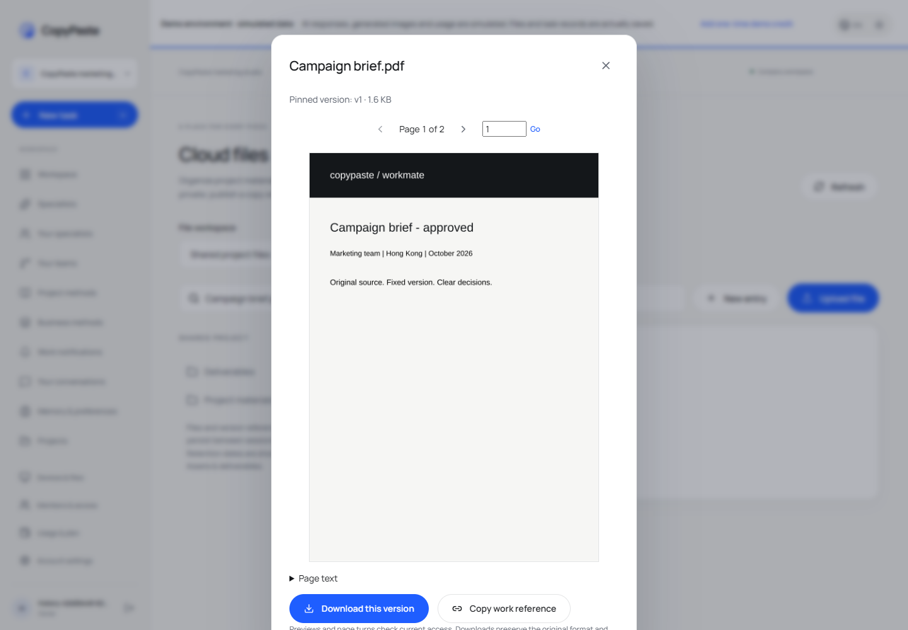

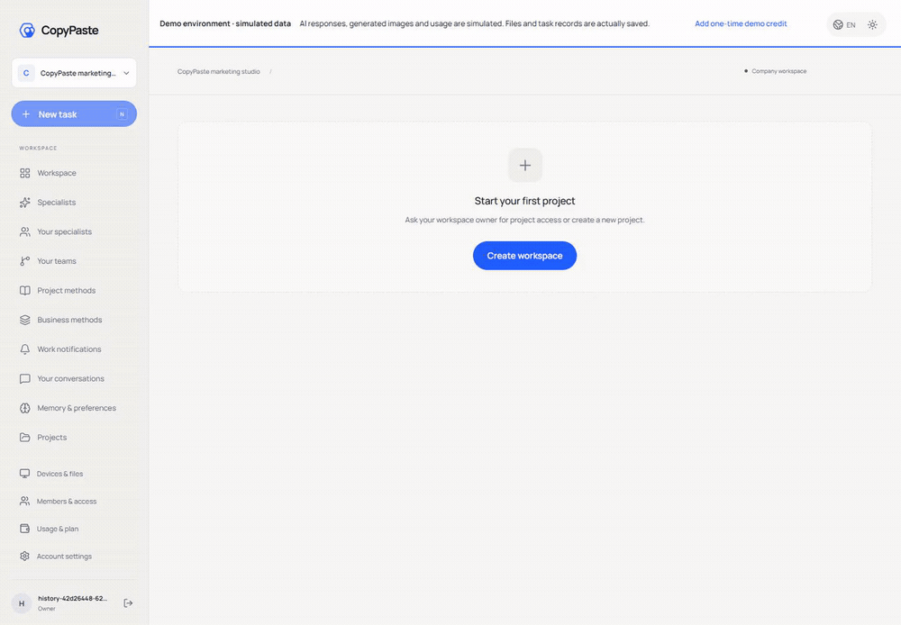

[Actual MP4 recording](assets/screenshots/workmate-document-preview-146-04-document-pages.mp4)


<!-- functional-closure-stage147 -->
## 阶段147：具名流程与原任务本机准备闭环

持久本机请求、任务范围私有续传、精确版本读取、运行输入摘要、定时／事件继承和独立费用结算。

使用顺序：登录并选择项目 → 原云任务请求本机文件 → Desktop选择目录／OS权限 → 核对本机独立费用 → 实际本机Codex执行 → 客户逐个上传并确认固定版本 → 原云任务沿原线程继续。工作流按不可变输入运行，查看完整命名交付；重复运行需分别确认规则及预算。

95项后端、5组实际三端流程、11张截图、5组GIF／MP4通过。内部模型继续使用获准假数据，Windows包未签名；完整专业／生产／OS验收保留。

后端覆盖由相同产品源码的92项既有检查与3项并发复测组成；原测试上下文错误及失败记录保留，不宣称新一次95项完整重跑。

```mermaid
flowchart LR
  A[Original cloud task] --> B[Request local material]
  B --> C[Folder and OS grant]
  C --> D[Review separate fees]
  D --> E[Actual local Codex]
  E --> F[Customer uploads exact files]
  F --> G[Same original cloud thread]
  G --> H[Complete delivery and settlement]
```

[Usage / 使用流程](https://github.com/copypasteltd/workmate/blob/docs/docs/development/147-functional-closure.md) · [Detailed contracts / 详细契约](https://github.com/copypasteltd/workmate/blob/docs/docs/technical/147-workflow-contract-and-local-handoff.md) · [Numbered ledger / 全部编号](https://github.com/copypasteltd/workmate/blob/docs/docs/quality/remaining-work-stage147.md)

以下为真实Web发布配图与录像，不作为Admin或其他端独立页面验收。

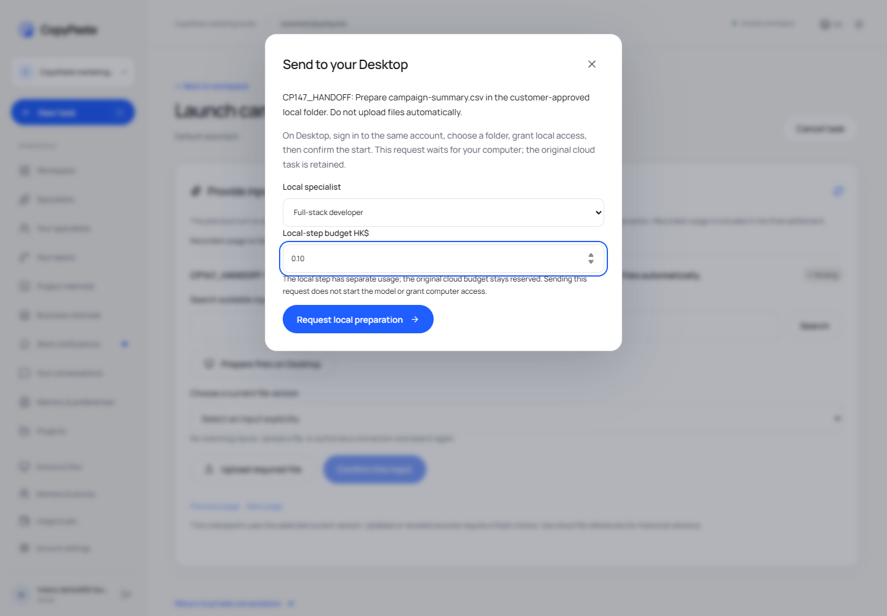

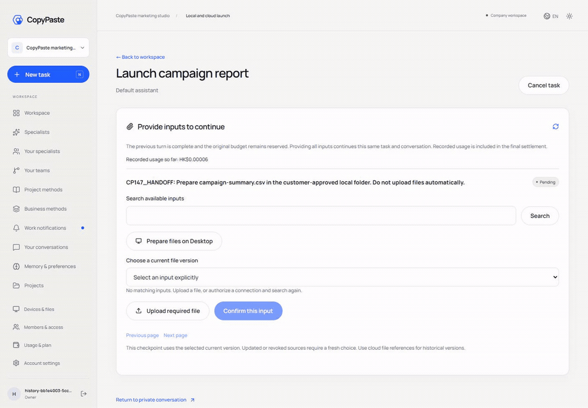

[Actual MP4](assets/screenshots/workmate-functional-closure-147-08-cloud-native-roundtrip.mp4)
