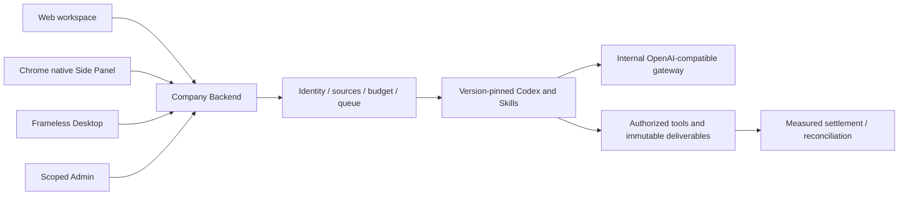

# Workmate · CopyPaste Desktop

[English](README.en.md) · [主文档](https://github.com/copypasteltd/workmate/blob/docs/docs/README.md)

[Backend](https://github.com/copypasteltd/workmate/tree/backend) · [Web](https://github.com/copypasteltd/workmate/tree/web) · [Admin Dashboard](https://github.com/copypasteltd/workmate/tree/admin) · [Desktop](https://github.com/copypasteltd/workmate/tree/desktop) · [Chrome Extension](https://github.com/copypasteltd/workmate/tree/extension) · [Delivery](https://github.com/copypasteltd/workmate/tree/delivery)

面向香港企业的 Agent 产品，Desktop 的目标为本机 Codex 客户端。当前仓库负责 **Desktop**；当前远程分支为 `desktop`.

<!-- client01-direction -->
## 当前客户端方向与实现差异

CLIENT01（2026-10-22）要求 **Desktop 在客户本机运行 Codex Agent**，提供客户可主动授予的 **完整本机权限**，操作能力对标 Codex Desktop。**Extension 在 Chrome 原生右侧栏采用 ChatGPT 式对话/附件结构**，获取、读取用户获选文件并上传，由云端 Codex 执行。全部产品 AI 请求仍走公司内部网关。

**当前实现：** Desktop 独立本机 Codex supervisor 已通过 9 项原生测试，产品的本机授权、费用和随包交付仍待接入。Extension 已接入原生右侧栏对话、历史、底部输入和明确文件版本附件；32 项扩展测试及 7 项真实侧栏旅程检查通过，模型回合按授权模拟。原 102 项及完整客户端验收继续跟踪。[本次扩展实现](https://github.com/copypasteltd/workmate/blob/docs/docs/technical/71-extension-cloud-conversations.md)。

下方架构图表示已实现的云端/文件桥接基线，不是 Desktop 本机 Agent 的目标架构。

本机 supervisor 的实现、实际权限测试与剩余产品接入见 [技术说明](https://github.com/copypasteltd/workmate/blob/docs/docs/technical/70-desktop-native-codex-supervisor.md)。

<!-- /client01-direction -->

## 架构与约束

仅使用 Codex，全部 AI 请求经公司内部 OpenAI 兼容服务器。Web、Desktop、扩展和 Admin 共用服务端身份、权限、来源与计费控制。设计沿用 CopyPaste 的品牌素材、色系、字体和中英界面。



## 原生窗口与结构

无边框 Electron 窗口，`frame:false`、`thickFrame:false`；清空应用菜单并禁用默认/Alt 菜单。40px 自绘标题栏提供拖动、最小化、最大化/还原和关闭。原生按钮状态已经在真实打包程序中验证。

`src/main.ts` 管理生命周期、登录、文件保存和受限 IPC；`src/preload.cts` 只暴露允许的桥；`src/window-controls.ts` 约束窗口动作；`renderer/` 是独立 React 界面快照。构建不依赖旁边的 Web 源码。

contextIsolation、sandbox 开启，nodeIntegration 关闭。渲染器不能任意调用 Admin、任意 URL 或访问系统文件。公司 API 和 Web Origin 在构建期固定；模型密钥保留在服务器。

## 使用流程

启动 → 打开固定公司登录网页 → 邮箱验证/PKCE 授权 → localhost 回调 → 选择企业和项目 → 使用与 Web 一致的任务、资料、会话和产物。登录与刷新族可撤销；请求附带当前范围。

用户选择文件/目录并授予有期限权限后，才执行获准操作。设备命令、签名、摘要、有效期和单次结果受后台及本地桥检查。文件下载通过当前租户的认证桥和原生保存窗口；取消不会产生一份虚假的成功文件。Codex 自动发起本地文件调度及强隔离客户代码执行仍有未完成部分。

## 开发和打包

```powershell
npm ci
npm run build
npm start
```

```powershell
npm run typecheck
npm test
npm run package
```

`COPYPASTE_API_ORIGIN`、`COPYPASTE_WEB_ORIGIN`、`COPYPASTE_EXTENSION_ID` 或 `deployment.json` 指定公司接入；由 `scripts/configure-deployment.mjs` 编译。正式环境使用 HTTPS。当前 localhost 预览生成 NSIS Setup 和 Portable，位于本地忽略的 `release/`。

当前验收运行的是 `release/paid-input-66-03/win-unpacked/CopyPaste.exe`。Setup/Portable 已生成但未签名，实际安装、升级/卸载、证书和分发矩阵尚未验收。

## 本地文件与扩展协作

可按文档注册 Native Messaging companion；扩展 ID 必须匹配固定允许列表。权限不能由模型或普通网页自行扩大。本地安装客户端与浏览器侧栏共用公司身份及后台业务，不在客户端嵌入独立 AI 供应商密钥。

## 初次检出与环境

新工作副本可单独检出本分支；已有本地仓库直接更新，不重新初始化。

```powershell
git clone --single-branch --branch desktop git@github.com:copypasteltd/workmate.git copypaste-desktop
cd copypaste-desktop
```

Node.js ≥22.14、npm 和 Git；锁文件固定依赖。当前验收环境为 Windows x64。后端/完整交付还需要原生 PostgreSQL 启动资源、固定 Codex `0.163.0-alpha.10.2` 与 FFmpeg/FFprobe。禁止本地 Docker、WSL 和虚拟化。跨端运行使用多个独立工作目录；布局见 [workspace](https://github.com/copypasteltd/workmate/blob/docs/docs/governance/04-git-branches-and-publication.md).

## 检查与验证范围

```powershell
npm run typecheck
npm test
npm run build
```

平台完整 **802/802**、任务专项 **52/52**，六仓库 **13 项**类型/构建/既有客户端测试检查、真实打包程序和原生侧栏旅程 **32 项**通过。保留原 782 项命名回归测试。任务专项调用实际 PostgreSQL、身份、账本与 Worker；另有实际 Codex 子进程连接模拟内部网关的续接验证。UI 回合及业务数据按授权模拟。原 102 项需求仍为 81 项局部验证、21 项未证明完成、0 项完整验收。

完整规范 TaskDTO/任务创建、任意执行中暂停、未知外部结果恢复、全角色独立业务、GEO、真实供应商和生产/签名/商店验收仍继续跟踪。

本次同步补充统一任务接口和原任务输入事务。当前用户界面继续通过既有项目/会话接口使用同一执行域；下方重新录制的实际交互验证该流程的兼容性，并非声称界面已经切换到全部规范任务接口。接口边界、精确金额、幂等回执、来源撤销和未接入业务参数见 [方案细则](https://github.com/copypasteltd/workmate/blob/docs/docs/technical/68-canonical-task-contracts-and-input-transactions.md)。

## 实际页面与交互

实际录制，保留原捕获时间；AI 回合与业务数据为明确模拟。Admin 演示表单不代表财务提交。


[MP4](assets/screenshots/workmate-10-interaction.mp4) · [录制与源码回执](https://github.com/copypasteltd/workmate/blob/docs/docs/quality/workmate-media-10.json)

## 方案细则与更新

### 本机 Codex 内核增量（尚未接入产品页面）

[LocalCodexSession](src/local-codex.ts) 直接启动锁定原生 Codex，以 stdio 管理线程、回合、终端/文件事件和停止。三种模式为只读、工作目录和完整本机权限；完整模式实际使用 `danger-full-access` / `never`。独立回归验证本机已有文件及工作目录外写入、真实 Skill 加载、同线程继续、只读降级、旧授权拒绝、撤回/停止、账号和项目隔离。费用仍须以后端网关回执为准，本机 tokenUsage 不用于自行结算。

先准备与 [本机运行锁](contracts/local-codex-runtime.json) 版本/摘要一致的 Windows 原生 Codex，并将任务专用 `COPYPASTE_LOCAL_CODEX_TEST_BIN` 设置为其绝对路径；不会搜索 PATH 或缺少依赖时跳过测试。在本仓库运行：

```powershell
npm run test:local
npm run build
node scripts/package-client-direction.mjs
```

最后一条命令新建 `release/client-direction-70-01/` 未签名 localhost 候选包，拒绝覆盖已有目录。包内含编译后的 supervisor 库，**页面仍使用原云端/文件桥接流程**；Codex 原生程序随包分发、本人权限界面、主进程 IPC、公司短期凭证/费用通道和完整工具资格尚未接入。当前截图/GIF 不作为本机 Agent 用户流程验收。新产品接入及测试边界见 [技术说明](https://github.com/copypasteltd/workmate/blob/docs/docs/technical/70-desktop-native-codex-supervisor.md) 和 [最新检查点](https://github.com/copypasteltd/workmate/blob/docs/docs/quality/local-codex-supervisor-checkpoint.json)。

### 需求、架构与历史更新

- [Product](https://github.com/copypasteltd/workmate/blob/docs/docs/product/01-prd.md)
- [Architecture](https://github.com/copypasteltd/workmate/blob/docs/docs/technical/01-architecture-and-stack.md)
- [Identity and permissions](https://github.com/copypasteltd/workmate/blob/docs/docs/technical/07-security-and-permissions.md)
- [Task continuation](https://github.com/copypasteltd/workmate/blob/docs/docs/technical/66-paid-native-input-checkpoints.md)
- [Admin](https://github.com/copypasteltd/workmate/blob/docs/docs/product/08-admin-dashboard.md)
- [Native clients](https://github.com/copypasteltd/workmate/blob/docs/docs/technical/30-native-window-and-browser-sidepanel.md)
- [Canonical task update](https://github.com/copypasteltd/workmate/blob/docs/docs/changes/2026-10-22-canonical-task-repair.md)
- [Local Codex update](https://github.com/copypasteltd/workmate/blob/docs/docs/changes/2026-10-22-native-codex-supervisor.md)

后续修改需要同步中英 README、受影响的实际截图/GIF、更新说明和对应分支。提交后通过 Delivery 发布流程核对远程 SHA；不强推覆盖协作者。`.env`、数据库、会话、依赖和安装产物不进入 Git。历史 README 原字节见 [archive](https://github.com/copypasteltd/workmate/blob/docs/docs/quality/history/stage66-before-workmate-readmes/manifest.json).
