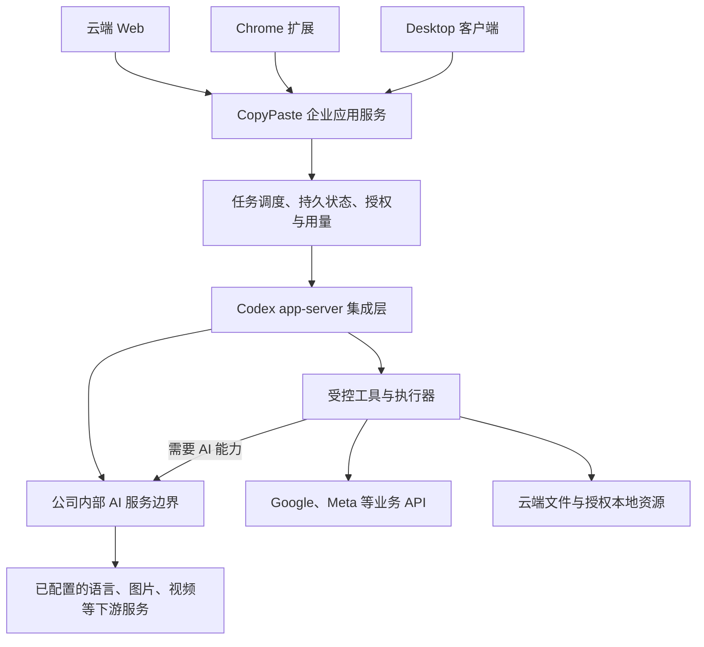

# 技术依据、网关验证与待决策事项

> 历史来源说明：本文件保留第一轮需求梳理。现行完整规格、接口、阶段和验收以 [文档总目录](README.md) 中的分册为准。

> 内核方向修正：相关技术建议已按 CORE01 回写为唯一使用 Codex；原候选比较已撤销。现行集成与配置约束见 [Codex 分册](technical/02-runtime-and-ai-gateway.md)。

版本：v0.1  
调研日期：2026-10-18  
用途：为 [产品需求](01-product-requirements.md) 和 [首期范围](02-mvp-and-validation.md) 提供依据；本稿不是已经实施的系统架构。

## 1. 已核对的公开信息

| 编号 | 来源及链接 | 本次核实的事实 |
| --- | --- | --- |
| S01 | [CopyPaste 官网](https://copypaste.hk/) | 官网介绍企业 AI、网络和支付基础设施及分阶段交付服务；原生 HTTP 读取成功 |
| S02 | [Grok Bot 介绍](https://x.ai/news/introducing-grok-bot)、[企业版介绍](https://x.ai/news/grok-bot-for-enterprise) | 对标方向包含持续的 Agent、云端计算环境、跨应用执行和任务委派 |
| S03 | 已停用的候选来源编号 | CORE01 收敛为 Codex 后，该候选来源不再参与选型、开发或验收；保留编号避免重用 |
| S04 | [Codex App Server](https://learn.chatgpt.com/docs/app-server) | 官方提供自定义客户端集成入口，涉及会话、事件、授权交互及执行生命周期 |
| S05 | [Codex Configuration Reference](https://learn.chatgpt.com/docs/config-file/config-reference) | 可配置模型 provider；当前 `wire_api` 支持值为 `responses` |
| S06 | [Codex Gateway Compatibility](https://learn.chatgpt.com/docs/enterprise/gateway-compatibility) | 网关需保留 Responses 的流式事件、多轮输入、工具调用及结果关联等行为 |
| S07 | [File System Access API](https://developer.chrome.com/docs/capabilities/web-apis/file-system-access) | 浏览器可在安全上下文、用户操作与授权条件下访问选中的本地文件或目录 |
| S08 | [Chrome Native Messaging](https://developer.chrome.com/docs/extensions/develop/concepts/native-messaging) | 扩展可以连接已注册的原生应用；原生 host 属于本地组件，需要安装或注册 |
| S09 | [Google Ads 接入迁移说明](https://developers.google.com/google-ads/api/docs/api-policy/developer-token) | 官方迁移说明写明 2026-09-09 起退役 developer token，访问级别转由 Google Cloud 项目管理 |
| S10 | [Google Analytics Data API](https://developers.google.com/analytics/devguides/reporting/data/v1) | 可程序化读取网站或应用报告数据，适用于自定义报表和业务集成 |
| S11 | [Google AI Features and Your Website](https://developers.google.com/search/docs/appearance/ai-features) | Google AI 搜索功能流量计入 Search Console 的整体 Web 搜索报告；常规 SEO 基础仍适用 |
| S12 | [Search Console Search Analytics](https://developers.google.com/webmaster-tools/v1/searchanalytics/query) | 官方提供搜索表现查询接口；可用维度、聚合与结果范围须按接口核对 |
| S13 | [GPT-6 Luna 官方模型页](https://developers.openai.com/api/docs/models/gpt-6-luna) | 官方模型名为 `gpt-6-luna`，支持 `max` 推理强度；推理与工具调用存在接口路径要求 |

说明：网页内容随时间变化，技术实现前需再次核对。以上记录仅证明公开文档描述，不证明公司内部网关已实现相同能力。

Meta 官方 [Insights 文档](https://developers.facebook.com/docs/marketing-api/insights/) 和 [授权文档](https://developers.facebook.com/docs/marketing-api/get-started/authorization/) 本次未能完整取回。具体权限名、应用审核、账户条件和配额保留为接入验证项，不在本稿中视为已核实。

## 2. Grok Bot 对标如何转换为需求

建议把对标拆成可单独验收的产品目标：

- Agent 有持续身份、职责、资料和历史，能够在多次任务间复用企业与品牌上下文。
- 用户通过自然语言委派工作，能够查看进展、补充资料和调整方向。
- 云端任务可以在用户离开界面后继续，完成后交付真实产物。
- Agent 能使用受控工具完成跨步骤工作，并在确有需要时交给用户处理。
- 浏览器操作、文件、业务 API 与本地程序按任务需要组合。

「是否每个 Agent 拥有长期独占的云电脑、是否展示实时电脑画面、是否需要多个专业 Agent 协作」尚未确定。这些会显著影响资源、浏览器会话、账号托管和运维成本，应单独决策。

建议首期先定义一个可配置的 marketing Agent，以持久品牌资料和任务记录实现持续服务，再按试点需要增加独占云电脑和更多 Agent 角色。

## 3. 必须分清的三个层次

| 层次 | 本项目中的含义 | 需要解决的问题 |
| --- | --- | --- |
| 模型与媒体服务 | 现有 `gpt 6 luna max`，以及后续图片、视频等能力 | 推理、视觉理解、生成、价格、限额与 API 协议 |
| Agent 内核 | Codex，唯一内核 | 上下文、工具循环、会话、执行事件和授权交互 |
| 企业产品平台 | CopyPaste 自建的企业服务 | 客户身份、项目、品牌、业务工具、任务调度、资产、计费及运营 |

选择内核不会自动补齐广告连接器、图片与视频服务，也不会自动生成多租户企业产品。已有模型同样不能替代任务执行器和确定性数据计算。

## 4. `gpt 6 luna max` 的候选映射与关键依赖

用户已确认内部 API 支持这一表述。官方资料中的对应配置可能是模型 `gpt-6-luna` 加 `reasoning.effort = max`；**这只是候选映射，内部别名和实际透传参数仍待核实**。

S13 对接口有一项直接影响本项目的说明：使用推理及工具调用应走 Responses；Chat Completions 中的 function calling 仅支持 `reasoning_effort = none`。因此，不能仅凭 `chat/completions` 的文本请求成功，认定当前 `max` 配置可以执行 Agent 工具循环。

应按现有模型及预期推理强度验证，不在选型过程中悄悄替换模型或降低强度。是否允许按工作负载配置不同强度，由产品方另行决定。

官方模型页把原生图片输入与文本输出列为模型能力；图片生成工具是另外的服务能力，视频也需对应媒体服务。内部是否开放这些能力，需要用真实任务验证。

## 5. 内部网关的能力验证表

下表全部为待执行项。本次未获得、读取或调用内部地址、凭证和模型接口。

| 验证项 | 要核实什么 | 通过证据 |
| --- | --- | --- |
| 基础身份与路由 | 准确 `base_url`、认证方式、模型别名、企业与任务归属 | 使用业务凭证的请求记录，返回正确模型及归属 |
| Responses | `POST /v1/responses` 及客户端实际使用的字段 | 目标内核完成真实会话，不能只靠健康检查或模型列表 |
| 流式事件 | 事件逐步到达，成功、失败、异常终止可区分 | 经过真实反向代理后的完整事件记录 |
| 工具循环 | 调用参数、调用 ID、工具结果及多轮历史保持一致 | 连续执行工具并返回最终产物；无丢失或错配 |
| 推理配置 | 模型别名和 `max` 的实际映射、是否接受且生效 | 以请求记录和网关实现说明确认；不会被静默丢弃 |
| 多模态输入 | 图片、截图及所需文件的输入路径和限制 | 目标素材被正确接收并参与任务 |
| 生图与编辑 | 开放哪些生成或编辑端点、参数与文件返回方式 | 从内部服务拿到真实图像及编辑结果 |
| 视频与其他 AI | 异步创建、查询、失败、取消、文件生命周期及限额 | 完整作业记录和实际媒体文件；只验证拟上线能力 |
| 错误与限流 | 授权失败、429、超时和上游错误的呈现与重试方式 | 可定位错误，重试受控，任务最终状态明确 |
| 用量与成本 | 文本及推理、图片、视频和工具等计量 | 可归属到任务；区分估算、暂计和最终费用 |
| 请求边界 | 插件、脚本、桌面和扩展中的 AI 调用路径 | 没有绕过内部服务的 AI 请求；供应商主密钥不下发 |

媒体作业状态和文件下载等接口可以由内部服务编排。需要明确哪些字段遵循 OpenAI 已有协议，哪些是公司自己的作业接口，避免把「OpenAI 兼容」当成未经定义的全能力承诺。

不要求现阶段一次实现所有音频、向量或视频功能；某项 AI 功能正式上线时，其调用路径必须满足内部服务约束。

## 6. 固定 Codex 的集成方法

CORE01 已确定唯一使用 Codex。通过 app-server 集成初始化、会话、执行事件和授权，provider 指向内部网关并验证 Responses 工具循环；固定 Codex、协议 schema 和技能包版本。企业隔离、媒体、连接器、资产、调度和计费由产品平台管理。

本阶段用现有内部模型、品牌资料与受控工具验证业务质量、错误恢复、延迟和完整费用。运行配置仅允许 Codex，发布与执行前检查；故障修复或回滚到已验收的 Codex 版本，不切换其他内核。当前完整约定见 [Codex 设计](technical/02-runtime-and-ai-gateway.md)。

## 7. 建议的逻辑架构

以下是职责分解，并未指定框架、数据库或云供应商。

企业应用服务管理身份、项目、资料和产品权限；调度层保存业务任务状态及结果。内核负责模型与工具交互，执行器完成文件、计算、媒体和业务系统操作。

首期建议 Codex 托管在云端，后续按需要加入受控本地执行器。桌面端是否也运行完整 Codex，属于部署位置选择；所有位置均受 CORE01 约束，AI 请求仍经内部服务器。

模型请求和媒体 AI 请求进入内部服务，Google / Meta 等业务访问保留独立连接器。对外服务端不应直接暴露未经产品身份与权限封装的内核控制接口。

云端执行应有明确隔离和资源策略；具体采用什么基础设施后续设计。本轮不会运行本地 Docker、WSL 或其他本地虚拟化环境，也不以它们为客户端使用前提。

## 8. 浏览器与本地文件的边界

| 需求层次 | 可选路径 | 产品含义 |
| --- | --- | --- |
| 单次读取和结果下载 | Web 上传/下载 | 最低安装门槛；已能覆盖部分本地文件需求 |
| 选择文件或目录并授权读写 | File System Access 等浏览器能力 | 仍需用户操作、有效授权与兼容性验证；不能宣称任意磁盘访问 |
| 当前页面协作 | Chrome 扩展与有限站点权限 | 适合上下文采集与网页任务入口 |
| 持续目录监听、本地脚本或程序 | 原生本地执行器；扩展可通过 Native Messaging 连接 | 存在本地安装和生命周期管理，不能只交付扩展包就认定完成 |
| 完整工作环境 | Desktop 工作台复用本地执行器 | 增加设备状态、运行历史、任务恢复及安装更新能力 |

建议先确认客户究竟需要「选择并使用文件」，还是「持续调度本机目录和程序」。二者决定的安装成本、权限和开发范围不同。

浏览器执行资源应按任务回收，包括成功、异常和取消路径。会话结束时关闭不用的任务标签页，避免持续占用内存，并保留用户已有页面。

## 9. 数据连接器与搜索分析的约束

Google Ads 必须同时验证应用身份、客户账户访问和生产访问级别。S09 记录了近期迁移，而部分旧页面仍使用旧术语；实现时应按目标 API 版本与最新接入说明核实，不把旧 developer-token 流程直接写死。

广告、网站行为和搜索表现分别接入、分别保留口径。统一报告层可以关联这些数据，但不能无依据消除平台归因差异或推断跨平台唯一用户。

Meta 连接器需在实际开发者账户、应用和试点广告账户上确认读数能力；自然内容、发布和私信另行验证。API 授权未完成时使用客户导出文件开展有限试点，准确标记数据更新时间。

GEO 观测先定义采样方法。任何用于观测的 AI 模型调用也必须走内部服务；未接入的模型或消费级产品，不应被列为已经覆盖。

## 10. 决策记录

| 编号 | 事项 | 状态 |
| --- | --- | --- |
| D01 | 首批客户为现有客户中的 marketing 团队 | 用户已确认 |
| D02 | 内部 AI API 已上线，支持 `gpt 6 luna max` | 用户已确认；具体技术映射待验证 |
| D03 | 所有 AI 请求经过内部服务器 | 用户硬约束 |
| D04 | 产品长期具备 Web、Chrome 扩展和 Desktop 入口 | 用户已明确方向；阶段安排待确认 |
| D05 | 首期以 Web 营销素材与分析流程验证价值 | 本轮建议 |
| D06 | 视频先做固定模板成片，再扩展生成与特效 | 本轮建议 |
| D07 | 唯一内核确定为 Codex，执行固定版本与内部网关集成验证 | 用户最新 CORE01 已确认；替代原候选比较建议 |
| D08 | 首个正式连接器暂建议 Google Ads | 本轮建议；由试点账户与工作频率决定 |
| D09 | 扩展与桌面复用本地执行器 | 本轮建议 |
| D10 | 所有项目文档保存在 `docs/` | 用户硬约束，已执行 |

## 11. 后续优先确认的问题

| 编号 | 问题 | 决定什么 |
| --- | --- | --- |
| Q01 | 对标 Grok Bot 时，是否必须具备长期独占云电脑、实时电脑画面和多个专业 Agent？ | 首期产品形态、执行环境与持续资源成本 |
| Q02 | 内部准确模型标识及协议是什么？`max` 是强制标准还是当前可用配置？目前是否已有图片、视频能力？ | 内核接入、工具循环与媒体交付依赖 |
| Q03 | 首批客户最常交付的三类素材是什么？最终文件、可编辑程度、语言、尺寸和视频规格有哪些硬要求？ | 素材模板、排版、导出与验收范围 |
| Q04 | 试点以 Google 还是 Meta 为主？现有广告、GA4、Search Console 账户能提供哪些授权和数据？ | 首个连接器、数据基线与分析价值 |
| Q05 | 本地需求是手动选文件，还是监听目录/调用程序？客户主要用什么操作系统，是否接受安装组件？ | 扩展、本地桥接与桌面的实际优先级 |
| Q06 | 首期可投入的团队、预算、目标时间及可接受的单次交付成本是多少？ | 排期、定价、媒体额度和资源策略 |
| Q07 | 预期并发、数据保留、服务时间、部署及模型处理区域有哪些要求？ | 非功能指标、服务边界与企业交付 |

以上问题供继续澄清；不影响本轮文档作为需求讨论基线。后续应先把回答更新为决策，再编写估时计划和详细技术设计。
