<!-- workflow-content-history-153 -->

[工作流完整阅读 / Workflow readers](development/153-workflow-content-history.md) · [API](contracts/workflow-content-history-openapi.json) · [完整待项 / Ledger](quality/remaining-work-stage153.md) · [更新 / Changes](changes/153-workflow-content-history.md)

Unreleased153; first frozen v0.1.0-rc.1 preserved. 9 focused backend cases /7 actual Admin groups.

---

<!-- scope-data-export-152 -->

[完整範圍匯出 / Authorized scope export](development/152-scope-data-export.md) · [完整待項 / Ledger](quality/remaining-work-stage152.md) · [更新 / Changes](changes/152-scope-data-export.md)

Unreleased increment152; frozen v0.1.0-rc.1 preserved. Focused functional checks only.

---

<!-- ownership-transfer-151 -->

[企業所有權交接 / Ownership handover](development/151-ownership-transfer.md) · [完整待項 / Ledger](quality/remaining-work-stage151.md) · [更新 / Changes](changes/151-ownership-transfer.md)

Unreleased increment151; frozen v0.1.0-rc.1 preserved. Focused checks only; original full acceptance stays open.

---

<!-- scope-erasure-150 -->

[聚合永久清理 / Permanent scope cleanup](development/150-scope-erasure.md) · [完整待项 / Full ledger](quality/remaining-work-stage150.md) · [更新 / Changes](changes/150-scope-erasure.md)

First frozen release retained. Increment150 is unreleased; focused checks only. 102 original records and88 required whole acceptance scopes remain.

---

<!-- project-lifecycle-149 -->

[项目管理与最后项目恢复 / Project archive and restore](development/149-project-management.md) · [完整编号 / Full ledger](quality/remaining-work-stage149.md) · [更新 / Changes](changes/149-project-management.md)

首个冻结版保留；149为其后的未冻结修复。10项后端检查、5组实际Web/Desktop旅程及6步构建通过；广泛回归按要求省略，102项原需求及88项必需完整验收范围保留。

First frozen release retained;149 is an unreleased follow-up. Ten backend cases, five actual client groups and six build steps passed. Broad regression was deliberately omitted; all102 original records and88 required whole acceptance scopes remain.

---

<!-- frozen-release-148 -->

[Workmate v0.1.0-rc.1 / 首个冻结候选版](releases/v0.1.0-rc.1.md) · [完整编号 / Ledger](quality/remaining-work-stage148.md) · [构建及发布方案 / Freeze plan](development/148-first-frozen-release.md)

17项后端必要检查与4组真实Web/Windows冒烟通过；按用户要求省略广泛回归，模拟AI。独立源码标签、运行包及校验值由发布回执绑定；完整验收继续开放。 / Seventeen focused backend checks and four real client smoke groups passed. Broad regression was deliberately omitted; AI providers are synthetic. Full acceptance remains open.

---

<!-- business-history-stage144 -->

<!-- workflow-handoff-stage145 -->
[Stage145：完整成果交接／失败确认](development/145-workflow-handoffs-and-failure-review.md) · [完整102编号／Original ledger](quality/remaining-work-stage145.md) · [需求补充／Requirements](requirements/10-workflow-handoffs.md)

51项业务／本机控制检查、7项实际Web流程；假数据模型，完整产品验收保持开放。51 targeted backend/native-control cases and seven actual Web journeys; synthetic models, full acceptance remains open.
## Administrator business histories

Stage144 adds administrator saved-version reading for brands, teams, briefs, schedules and every creative project kind. Ordinary canvas saves now retain immutable versions; new customer brand saves preserve their actor. Current checks: 52 related backend cases and 9 real Admin browser journeys. The capture below is the actual administrator interface shared by this release.

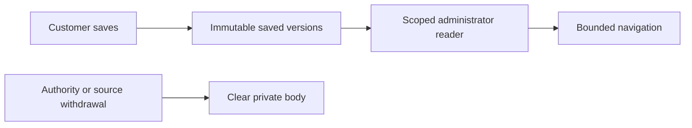

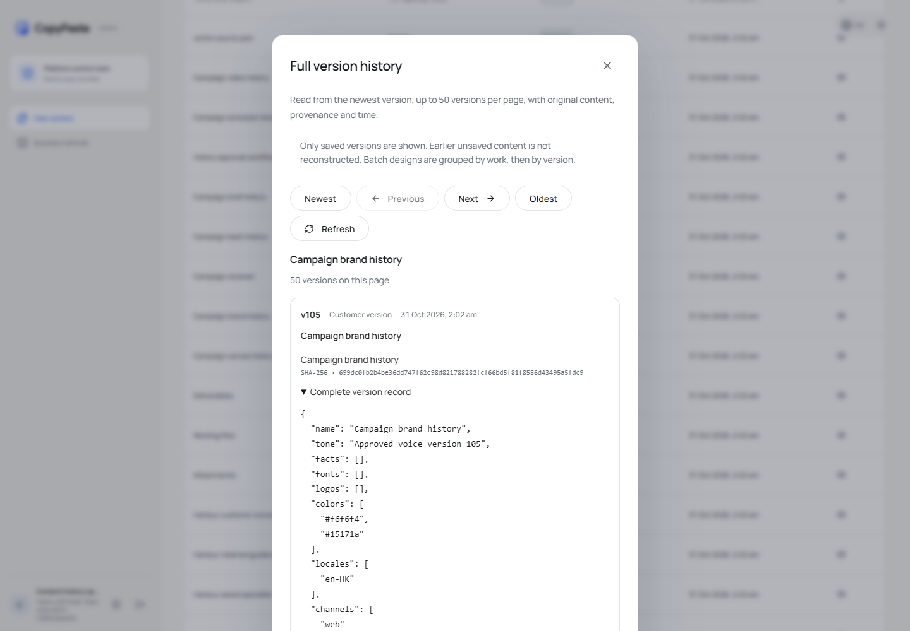

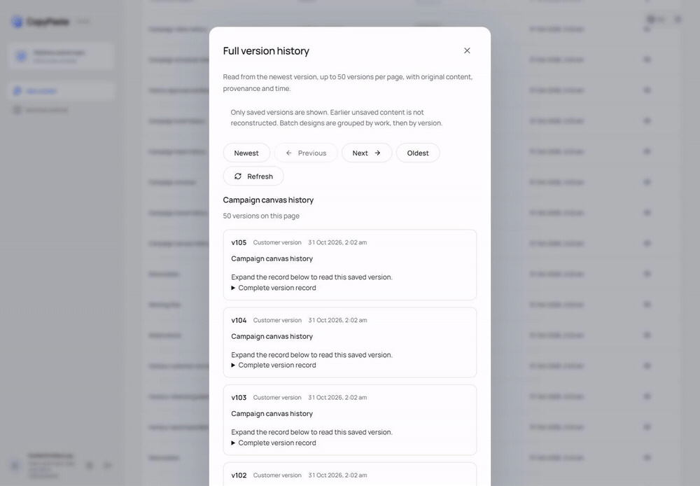

[MP4](assets/business-history-144/workmate-business-history-144-01-business-version-navigation.mp4) · [详细方案 / Usage and implementation](development/144-admin-business-content-history.md)

Use Client content → Read content → Newest/Oldest/Next/Previous. Expand a saved record for its exact definition. Reads require both content permissions and current project scope; revoked dependencies redact the body. Earlier unsaved versions are not invented. Desktop keeps customer-local Codex execution and Extension keeps its actual browser Side Panel. Original whole-product acceptance remains open.

<!-- editable-projects-stage143 -->

[矢量与演示工程 / Vector and presentation workspaces](development/143-editable-project-workspaces.md) · [更新 / Changes](changes/143-editable-project-workspaces.md) · [完整待验收 / Remaining scope](quality/remaining-work-stage143.md)

<!-- brand-reuse-stage142 -->

[品牌工程跨项目复用 / Reviewed destination-brand reuse](development/142-brand-project-reuse.md) · [更新 / Changes](changes/142-brand-project-reuse.md) · [当前完整待项 / Remaining scope](quality/remaining-work-stage142.md)

# Workmate · CopyPaste Enterprise Agent

<!-- current-test-entry-141 -->
Default checks now select the latest numeric attempt per suite and retain original historical failures. Six end-to-end checks, actual npm inspection and the compiler pass. Product runtime files and real Stage140 client evidence remain unchanged. See the [current source supplement](quality/test-discovery-checkpoint-141.json), [entry behavior](development/141-current-test-discovery.md) and [open acceptance scopes](quality/remaining-work-stage140.md).

<!-- creative-packages-stage140 -->
## Project packages & restore · Stage140

The current functional increment restores layered canvases and campaign videos with exact media, explicit sharing, new IDs and receipt recovery. Actual clients edit/render the restored copy. Original102 full-acceptance scopes remain intact.

Export and restore make no AI request. Confirm project sharing before upload and media rights before restoring. Sources remain intact; an interrupted restore retains its original receipt. The supported slice covers ordinary layered canvases and campaign-cuts videos. Canvas system-font differences, brand rebinding, all-format and cross-machine restoration remain open.

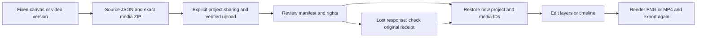

- [Format, APIs & usage / 格式、接口及使用](https://github.com/copypasteltd/workmate/blob/docs/docs/development/140-creative-project-packages.md)
- [Actual qualification / 实际验证](https://github.com/copypasteltd/workmate/blob/docs/docs/quality/creative-packages-checkpoint-140.json)
- [Open acceptance scopes / 未完成验收](https://github.com/copypasteltd/workmate/blob/docs/docs/quality/remaining-work-stage140.md)


- [Actual web interaction .MP4](https://github.com/copypasteltd/workmate/blob/web/assets/screenshots/workmate-creative-packages-140-07-project-restore.mp4)


- [Actual web interaction .GIF](https://github.com/copypasteltd/workmate/blob/web/assets/screenshots/workmate-creative-packages-140-07-project-restore.gif)
- [Actual desktop interaction .MP4](https://github.com/copypasteltd/workmate/blob/desktop/assets/screenshots/workmate-creative-packages-140-07-project-restore.mp4)
- [Actual desktop interaction .GIF](https://github.com/copypasteltd/workmate/blob/desktop/assets/screenshots/workmate-creative-packages-140-07-project-restore.gif)
- [Actual extension interaction .MP4](https://github.com/copypasteltd/workmate/blob/extension/assets/screenshots/workmate-creative-packages-140-07-project-restore.mp4)
- [Actual extension interaction .GIF](https://github.com/copypasteltd/workmate/blob/extension/assets/screenshots/workmate-creative-packages-140-07-project-restore.gif)

<!-- native-teams-stage139 -->

Exact-byte delivery: the original runtime checkpoint and failed attempts are retained. Git preserves the executed sources and verifiers without newline conversion; the release checkpoint separately binds this version-control metadata change.


## Native specialist teams · Stage139

Authoritative requirements and implementation documents live here; code remains under dev in independent repositories within the required D-drive workspace. This increment closes the native team workflow; the numbered ledger preserves original full-acceptance scopes.

Up to 16 steps, seven members plus one assistant coordinator and three concurrent members share one explicitly approved folder. Keep concurrent edits in separate files. Review is free; exact budgets are immutable, holds and actual charges remain separate, and unknown accepted operations are never rerun. Revocation stops native tools first and leaves unsynchronized receipts visible. Only submitted outputs enter the team ZIP; local-only files remain local.

60 backend, 36 extension and 81 native controller/download checks, plus six actual Windows journey checks passed. Four screenshots, one GIF/MP4 pair, three layouts and an independently extracted complete team archive bind 1756 exact source files.

Business/model responses and native folder/consent/save decisions are controlled fixtures. Actual OTP/PKCE, native Codex processes, Windows file operations, company metering, revocation and ZIP extraction execute for real. The package is unsigned. Full professional-role quality, signed installation coverage, real company models/ad accounts and portable project recovery remain separately open.

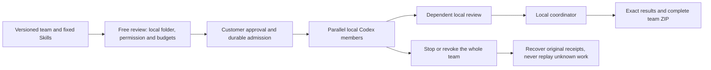

[Requirements](https://github.com/copypasteltd/workmate/blob/main/docs/requirements/16-desktop-native-teams.md) · [API, permissions, recovery and delivery](https://github.com/copypasteltd/workmate/blob/main/docs/technical/139-desktop-native-teams.md) · [Source and evidence](https://github.com/copypasteltd/workmate/blob/main/docs/quality/native-teams-release-checkpoint-139.json) · [All original identities](https://github.com/copypasteltd/workmate/blob/main/docs/quality/remaining-work-stage139.md)

Actual Desktop workflow, synthetic business content:


- [workmate-native-teams-139-05-review-before-local-run-en.png](https://github.com/copypasteltd/workmate/blob/desktop/assets/screenshots/workmate-native-teams-139-05-review-before-local-run-en.png)
- [workmate-native-teams-139-05-completed-local-team-zh.png](https://github.com/copypasteltd/workmate/blob/desktop/assets/screenshots/workmate-native-teams-139-05-completed-local-team-zh.png)
- [workmate-native-teams-139-05-whole-team-access-revoked-zh.png](https://github.com/copypasteltd/workmate/blob/desktop/assets/screenshots/workmate-native-teams-139-05-whole-team-access-revoked-zh.png)
- [workmate-native-teams-139-05-local-team.mp4](https://github.com/copypasteltd/workmate/blob/desktop/assets/screenshots/workmate-native-teams-139-05-local-team.mp4)

<!-- delivery-revision-stage138 -->
## Source-bound revisions and new delivery · Stage138

Development stays in the single D-drive workspace, with product code under dev and independent client repositories. This directory retains authoritative requirements, design, development, numbered acceptance and release guidance. The current numbered ledger preserves every original acceptance scope; targeted workflow checks do not replace full acceptance.

Choose a complete delivery, answer, file, Unicode text quote, image region or verified video interval. Previewing does not call AI or reserve money. Confirming a revision creates a separate budgeted task with the fixed original role and source; original files and charges remain. Changed or withdrawn sources fence later reads and completion. Shared project editors may revise authorized shared work; private conversations retain their original owner. Unknown-outcome retries retain their original immutable request.

Text previews are limited to 1 MiB and inline image/MP4 previews to 4 MiB. Larger or unsupported previews can still be downloaded and revised as complete files. Complete-delivery references allow at most 20 files; video intervals require retained valid duration. Image/video anchors identify requested locations and do not approve an editing operation or prove professional output quality. Specialist workflows retain their own approvals.

34 current backend checks including 13 new revision cases, 36 extension checks, 73 native controller/download checks and nine actual client journey checks passed. Eleven actual screenshots, three GIF/MP4 pairs, seven layouts and three independently extracted revised archives bind 1732 exact source files.

Business/model responses and native dialog selections are explicitly controlled fixtures. Login, database permissions, exact files, actual packaged local Codex, native Windows surfaces, Chrome SIDE_PANEL and revised ZIP downloads run for real. The Windows package is unsigned. Real company models/accounts, full professional-role output quality, installation matrices and complete project recovery remain separately open.

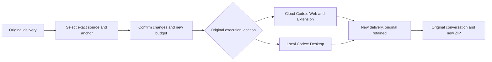

[Requirements](https://github.com/copypasteltd/workmate/blob/main/docs/requirements/15-delivery-revisions.md) · [Architecture and usage](https://github.com/copypasteltd/workmate/blob/main/docs/technical/138-source-bound-delivery-revisions.md) · [Exact source and evidence](https://github.com/copypasteltd/workmate/blob/main/docs/quality/delivery-revision-checkpoint-138.json) · [All original identities](https://github.com/copypasteltd/workmate/blob/main/docs/quality/remaining-work-stage138.md)

Actual product interaction, with synthetic business content:


Additional actual screenshots and MP4 recording:

- [workmate-delivery-revision-138-06-lost-response-retained.png](https://github.com/copypasteltd/workmate/blob/web/assets/screenshots/workmate-delivery-revision-138-06-lost-response-retained.png)
- [workmate-delivery-revision-138-06-image-anchor-en.png](https://github.com/copypasteltd/workmate/blob/web/assets/screenshots/workmate-delivery-revision-138-06-image-anchor-en.png)
- [workmate-delivery-revision-138-06-video-anchor-en.png](https://github.com/copypasteltd/workmate/blob/web/assets/screenshots/workmate-delivery-revision-138-06-video-anchor-en.png)
- [workmate-delivery-revision-138-06-revised-delivery-zh.png](https://github.com/copypasteltd/workmate/blob/web/assets/screenshots/workmate-delivery-revision-138-06-revised-delivery-zh.png)
- [workmate-delivery-revision-138-06-delivery-revision.mp4](https://github.com/copypasteltd/workmate/blob/web/assets/screenshots/workmate-delivery-revision-138-06-delivery-revision.mp4)

<!-- delivery-package-stage137 -->
## Complete delivery and original-chat download · Stage137

The main journey is goal → missing inputs → execution → review → download → revision in the original conversation. Web and the genuine native Chrome right SIDE_PANEL now download a complete current task delivery directly from chat. Delivery review also exposes it. Desktop uses the company API and its native save dialog; cancellation sends no export request and shows no success. Panel receipts survive live refresh and language changes.

The ZIP contains actual output files, task text when present, exact task/artifact versions, SHA-256 checksums and bilingual editing instructions. Identical filenames remain separate; stopped/failed task outputs remain explicitly partial. Instructions distinguish source ZIPs, SVG/PPTX, project JSON and flattened outputs. They never invent a missing editable project. Local files not submitted remain local, and Desktop continues running its own local Codex with customer-granted permissions.

The requested task version and delivery digest must match. The backend verifies real file size and digest while streaming sequentially into a disk-backed ZIP, then repeats current authority, source, retention and version checks before sending any download headers. Corruption, revocation or a changed delivery fails the whole package. Project readers may download authorized shared results; approval remains separate. Admin identity alone does not grant private conversation access. Exporting creates no AI call, new task or AI charge. Capacity is 16 GiB / 10,000 output/text entries; excess is rejected without silent omissions.

No new SQL migration is needed beyond existing SQL135. Rebuild Backend and all three clients. Extension adds Chrome `downloads` permission and uses the browser download location with conflict renaming; authorization stays in company request headers. Backend `contracts/delivery-package-v1.json` specifies the endpoint. From Delivery run `npm run qa:delivery-package-backend -- <new two-digit attempt>` or `npm run qa:delivery-package -- <new two-digit attempt>`; the latter performs full builds, creates an unsigned Windows package and drives actual native client downloads.

21 current backend checks including eleven new export cases, 37 extension checks, 1 native download regression, twelve boundary checks and ten actual client journey checks passed. Nine actual screenshots, three GIF/MP4 pairs, seven layouts and three independently extracted archives bind 1,713 exact source files. Business content and the Codex adapter are controlled; OTP/PKCE, stored files, authorization, native windows and Chrome downloads run for real. Desktop save-dialog selection is directed to an owned fixture destination. This increment does not requalify every local Codex tool, real company model, professional output quality or full project restoration across environments. A separate stage-local 52-case backend/source regression retains its exact original scope rather than being presented as a full current-platform rerun.

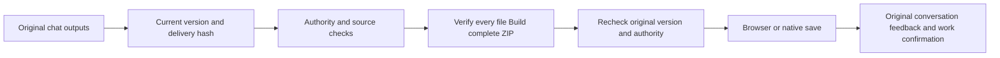

[Requirements](https://github.com/copypasteltd/workmate/blob/main/docs/requirements/14-complete-delivery-package.md) · [Architecture and usage](https://github.com/copypasteltd/workmate/blob/main/docs/technical/137-complete-delivery-package.md) · [Exact source and evidence](https://github.com/copypasteltd/workmate/blob/main/docs/quality/delivery-package-checkpoint-137.json) · [All original identities](https://github.com/copypasteltd/workmate/blob/main/docs/quality/remaining-work-stage137.md)

Actual customer workflow captures (synthetic content):


<!-- business-inputs-stage136 -->
## Business questions and original-task continuation · Stage136

When an essential canvas size, audience or business definition is missing, the Agent can ask in the original conversation. Customers may choose and edit a suggestion or write a different answer, then explicitly confirm it. Nothing is preselected or automatically submitted. Partial answers remain saved; completing all inputs continues the same task, conversation and original budget hold. Measured usage is settled cumulatively. Each confirmed question becomes one original-conversation note; identical retry adds no duplicate.

Web and the actual native Chrome right Side Panel show these questions inside the existing chat; Desktop supports answers in its existing cloud-task detail view. English/Traditional Chinese switching preserves drafts and a failed submission retains its text. Extension clears drafts on identity/conversation changes and removes protected questions when sources become unreadable. An answer grants no files, advertising accounts, tools, local access or additional spending permission.

The server strictly distinguishes `question`, `file` and `connection`: up to eight suggestions and 4,000 answer characters, with version, current authority, source and complete-batch validation before any update. Confirmed answers are immutable. Paid questions wait at a completed, measured Codex boundary and resume the original thread; cancellation settles known usage only. Private-conversation erasure removes questions, answers, checkpoints and text while retaining necessary accounting facts.

Apply SQL135 before API/Worker startup with Backend `npm run db:migrate`. Original SQL001–134, twenty baseline task definitions and the primary OpenAPI remain byte-identical. `contracts/business-inputs-v1.schema.json` adds strict versioned definitions to the existing create/input endpoints. File/connection requests retain their shape; questions use `answer` rather than `resource_ids`.

122 backend integration checks (including eleven new question cases), 61 extension state checks, twelve delivery binding tests and fourteen actual three-client checks passed. Nine actual screenshots, three GIF/MP4 pairs and seven layout checks bind to exact sources. Native integration uses the actual pinned Codex executable with synthetic Responses; UI journeys use scripted tools and synthetic business replies. Initial full client builds passed. Corrected journeys explicitly reuse byte-identical product source and the same unsigned Windows package; original failures remain. From Delivery, run `npm run qa:business-inputs-backend -- <new two-digit attempt>` or `npm run qa:business-inputs -- <new two-digit attempt>`; the latter performs full builds and creates an isolated native test database.

Desktop retains its separate local Codex and explicitly granted full-local-permission flow; this increment extends its cloud-task view. Actual native windows remain frameless with no Electron menu, visible vertical rails or horizontal overflow. Extension retains the genuine native right SIDE_PANEL. Data are synthetic and the Windows package is unsigned. Production models and complete specialist delivery remain open. Full acceptance retains 88 required records, twelve unconfirmed suggestions and one optional record; original REQ-095 remains accepted.

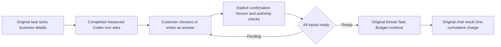

[Requirements](https://github.com/copypasteltd/workmate/blob/main/docs/requirements/13-business-brief-inputs.md) · [Implementation and usage](https://github.com/copypasteltd/workmate/blob/main/docs/technical/136-business-brief-clarification.md) · [All 102 identities](https://github.com/copypasteltd/workmate/blob/main/docs/quality/remaining-work-stage136.md) · [Exact source and evidence](https://github.com/copypasteltd/workmate/blob/main/docs/quality/business-inputs-checkpoint-136.json)


<!-- client-errors-stage135 -->
## Connection and session recovery across four clients · Stage135

Web, Admin, Desktop and Extension show connection guidance in the current language while retaining valid sign-in. A write with a lost or unreadable reply is explicitly unconfirmed: check its result before retrying. The application does not retry the write automatically. Browser transport retransmissions retain the same message identity and are deduplicated by the server. Support grants retain their fixed request key and deadline; extension delegations retain their original message identity, so explicit retry creates no second task. Background polling preserves an unconfirmed-write notice. Switching English/Traditional Chinese updates the same notice without exposing Electron internals, URLs or response bodies.

A current protected HTTP401 clears the current identity even when the body is HTML or empty. An obsolete request cannot sign out a newer identity or replace its CSRF token. Admin immediately removes its independent shell. Support-list connection errors are separate from form and revoked-access notices; successful list recovery clears only its own connection notice.

15 transport/identity tests (including actual HTTP faults), 12 delivery-file binding tests, one native bridge test and 30 actual four-client journey checks passed. Twenty screenshots and seven actual GIF/MP4 pairs bind to exact sources, including a real right-docked Chrome SIDE_PANEL, customer OTP/PKCE, independent administrator TOTP and an actual committed extension write with a lost reply and identical-message retry. Attempt09 rebuilds current Extension and Delivery. Backend/Web/Admin/Desktop source and Windows package bytes exactly match full build02, whose ten corresponding build steps and unchanged-source unit results are explicitly reused. Original failed attempts remain. Delivery `npm test` includes strict compilation, binding and transport checks; `npm run qa:client-errors -- <new two-digit attempt>` performs a full build by default.

Desktop continues to run Codex locally with separate explicit local permission, a frameless window, no Electron menus or visible rails. Extension keeps the native Chrome toolbar/Side Panel, approved-file uploads and cloud execution. Business fixtures are synthetic, no models ran and the Windows package is unsigned. Full acceptance still has 88 required records, 12 unconfirmed suggestions and one optional record open; original REQ-095 remains accepted.

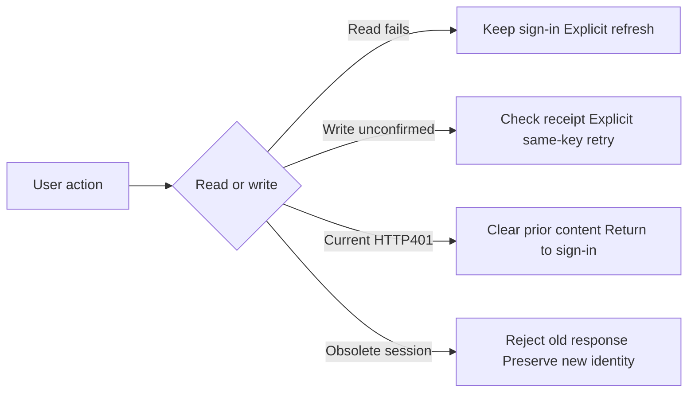

[Behavior and implementation](https://github.com/copypasteltd/workmate/blob/main/docs/technical/135-client-connection-and-session-recovery.md) · [All 102 requirement identities](https://github.com/copypasteltd/workmate/blob/main/docs/quality/remaining-work-stage135.md) · [Source-bound verification](https://github.com/copypasteltd/workmate/blob/main/docs/quality/client-errors-checkpoint-135.json)


<!-- support-recovery-stage134 -->
## Safe support-grant recovery and accepted support scope · Stage134

In **Web or Desktop → Account settings → Time-limited support**, choose explicit projects, the reason and duration. An empty project selection means metadata only. The first submission now fixes its request key and deadline. If its response is lost, use **Check previous request** or retry the same details; refreshing retrieves the existing result without automatically submitting again. Different details cannot replace an unresolved request. A recovered grant shows its current active, revoked or expired state and never gains extra time. You can revoke it from the list at any time.

Recovery stores only an opaque key, an intent digest and the fixed deadline in the current browser session. It does not persist the reason, project IDs, content or credentials. With storage disabled, recovery is limited to the running renderer; committed grants remain visible in the server list. Switching accounts or workspaces prevents late results from filling the new form. The native Desktop bridge permits only the customer receipt GET, alongside existing customer grant operations; it exposes no administrator impersonation route.

**Original REQ-095 / TC-095 is now accepted** against twelve individually mapped conditions and current source-bound evidence: real administrator identity and a read-only banner, explicit scope, independent body permission, write/payment/VIP/credential refusal, no hidden customer login, real-clock expiry, revocation and audit failure rollback. This closes one original requirement. REQ-055 whole-platform accessibility and REQ-094 whole-platform permission/concurrency matrices remain separate open work.

65 related backend checks, one native bridge boundary check and 18 actual Admin/Web/packaged Desktop journey checks passed. Ten build commands passed. The evidence includes real HTTP response loss before/after commit, reload, an actual workspace switch, identical retries, current-receipt recovery, real expiry and native customer revocation; user/native sessions, refresh-token and native-code row counts remain unchanged during support activity. Nine screenshots and five actual GIF/MP4 pairs are bound to the exact sources. Support controls work with keyboard input and enlarged text; Web/Admin use CSS zoom=2 and Desktop uses actual native webContents zoom=2. This does not constitute full browser/screen-reader accessibility acceptance.

Desktop continues to run Codex on the customer's computer, with separate explicit full local permission and a frameless window without Electron menus or visible scroll rails. Extension retains the native Chrome Side Panel for approved file uploads and cloud execution. Models did not run; business fixtures and retained output are synthetic. The Windows package is unsigned. All owned test browsers, native clients and databases closed.

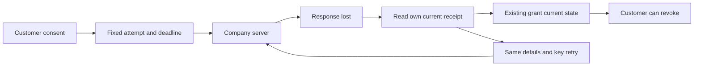

[方案 / Behavior](https://github.com/copypasteltd/workmate/blob/main/docs/technical/134-support-grant-recovery-and-acceptance.md) · [TC-095 acceptance](https://github.com/copypasteltd/workmate/blob/main/docs/quality/tc095-acceptance-134.json) · [Checkpoint](https://github.com/copypasteltd/workmate/blob/main/docs/quality/support-recovery-checkpoint-134.json) · [完整编号清单 / Remaining work](https://github.com/copypasteltd/workmate/blob/main/docs/quality/remaining-work-stage134.md)


[Recovery recording](https://github.com/copypasteltd/workmate/blob/web/assets/screenshots/workmate-support-recovery-134-04-grant-result-recovery.mp4) · [Retry recording](https://github.com/copypasteltd/workmate/blob/web/assets/screenshots/workmate-support-recovery-134-04-fixed-intent-retry.mp4) · [Native grant](https://github.com/copypasteltd/workmate/blob/desktop/assets/screenshots/workmate-support-recovery-134-04-customer-grant.mp4) · [Native revocation](https://github.com/copypasteltd/workmate/blob/desktop/assets/screenshots/workmate-support-recovery-134-04-customer-revocation.gif) · [200% Admin](https://github.com/copypasteltd/workmate/blob/admin/assets/screenshots/workmate-support-recovery-134-04-support-en-200.png) · [Chinese dark Admin](https://github.com/copypasteltd/workmate/blob/admin/assets/screenshots/workmate-support-recovery-134-04-support-zh-dark.png)

One requirement is accepted; 88 required records, 12 unconfirmed suggestions and one optional record remain open. These are acceptance records, not 101 uncoded modules. Complete source-delivery reproduction, signed installation, production integration and the remaining business acceptance continue in the numbered ledger. Earlier sections retain their original historical scope.

---

<!-- support-access-stage133 -->
## Controlled support and native customer authorization · Stage133

In **Web or Desktop → Account settings → Time-limited support**, choose the actual projects, a reason and a 15/30/60-minute deadline. An empty selection grants workspace/customer metadata only. Share the grant ID with support and revoke it from the same customer form at any time.

In **Admin → Support**, the administrator signs in with their own email and TOTP, chooses the customer, workspace, explicit projects, deadline and optional customer grant. The read-only banner keeps the real identities and deadline visible. Shared task bodies also require independent current body permission; private conversations stay private. The view provides no editing, billing, VIP or customer-login authority.

Support now checks original task sources before returning retained text. A quarantined/expired source or erased version blocks the body and masks its diagnostic title. Selected bodies use a current revision condition; changes during the audit are rejected. The page cancels old requests, rejects late task/session replies and clears bodies on changed revisions, source withdrawal, hidden views, failure, revocation or expiry. The server decides access on every read; visible Admin polling is approximately two seconds.

59 related backend tests and 13 actual Admin/Web/packaged native Desktop journey checks passed. The current source bytes bind 6 screenshots and 3 real-time GIF/MP4 pairs. Actual OTP/PKCE, email/TOTP, customer grants/revocation, delayed authorized responses, source withdrawal, real expiry, Chinese dark theme, four Admin widths and three frameless native widths were exercised. All owned browsers, the native client and test databases closed. Models did not run; business data, retained results and fixture file reads are explicitly synthetic. The Windows package remains unsigned.

Desktop continues to run Codex locally with the customer's separate explicit local-permission flow. Its support form uses customer-only routes; the administrator view stays in Admin. Extension continues to use the native Chrome Side Panel for approved file uploads and cloud execution. This increment changes no Extension execution code.

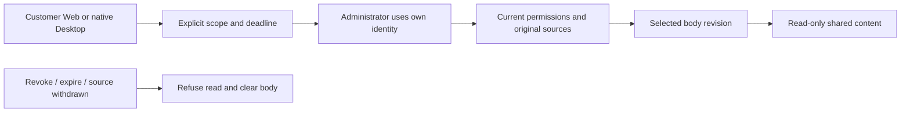

[Behavior](https://github.com/copypasteltd/workmate/blob/main/docs/technical/133-controlled-support-source-and-native-access.md) · [Checkpoint](https://github.com/copypasteltd/workmate/blob/main/docs/quality/support-access-checkpoint-133.json) · [Numbered remaining work](https://github.com/copypasteltd/workmate/blob/main/docs/quality/remaining-work-stage133.md)


[Native grant recording](https://github.com/copypasteltd/workmate/blob/desktop/assets/screenshots/workmate-support-access-133-02-customer-grant.mp4) · [Selection recording](https://github.com/copypasteltd/workmate/blob/admin/assets/screenshots/workmate-support-access-133-02-task-selection.mp4) · [Revocation recording](https://github.com/copypasteltd/workmate/blob/desktop/assets/screenshots/workmate-support-access-133-02-customer-revocation.mp4) · [Web metadata-only grant](https://github.com/copypasteltd/workmate/blob/web/assets/screenshots/workmate-support-access-133-02-metadata-grant-en.png) · [Chinese dark Admin](https://github.com/copypasteltd/workmate/blob/admin/assets/screenshots/workmate-support-access-133-02-support-zh-dark.png) · [Source withdrawn](https://github.com/copypasteltd/workmate/blob/admin/assets/screenshots/workmate-support-access-133-02-source-withdrawn-en.png)

89 required full-acceptance records, 12 unconfirmed suggestions and 1 optional record remain open. They are not 102 uncoded modules. Full permission/concurrency matrices, all-page accessibility, signed installation and production integration remain in the numbered ledger. Earlier sections retain their original historical scope.

---

<!-- content-history-stage132 -->
## Complete administrator content history · Stage132

Open **User content → Read content** on a conversation, specialist or memory. Read up to 50 original records per page, move in either direction or jump to the first/last page. Specialist and memory versions start with the newest and distinguish **Customer version** from **Administrator revision**. Expand a version to inspect its complete record.

The server rechecks the current MFA session, both content-reading permissions, tenant/project scope and explicit denials on every request. Signed cursors reject stale content. The visible reader rechecks every 15 seconds and on focus; failed authorization or changed readable sources clears its private state. Closing or changing resources aborts old requests and rejects late bodies. Bodies and cursors are not saved to browser storage. Unavailable assistant sources are masked.

The new GET `/v1/admin/content/:kind/:id/history` accepts `edge=first|last` or a returned `cursor`, with a fixed page size of 50. SQL134 maintains the message-history revision. Legacy body responses retain their limit and add `truncated` plus `history_url`. Ordinary customer conversations still have their existing 80-input limit.

54 related backend tests and 9 actual browser journey checks passed. Real API fixtures contain 205 specialist versions, 205 memory versions and 66 customer messages. Native PostgreSQL, email/MFA, actual administrator revision, source withdrawal, permission denial, late responses and 375/768/1440 layouts were exercised. Business data and retained assistant output are explicitly synthetic; no model ran. Original failed attempts and their exact sources remain available. Current captures contain 5 screenshots and 2 real-time GIF/MP4 pairs. All owned test resources closed.

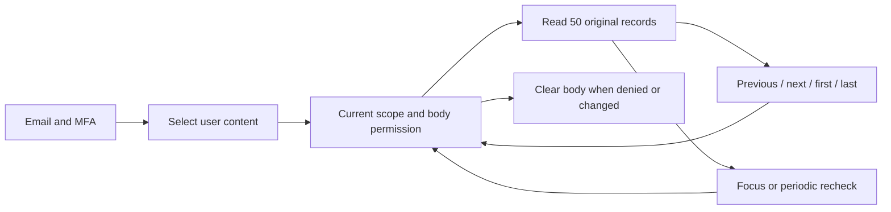

[Behavior](https://github.com/copypasteltd/workmate/blob/main/docs/technical/132-admin-content-history.md) · [Checkpoint](https://github.com/copypasteltd/workmate/blob/main/docs/quality/content-history-checkpoint-132.json) · [Numbered open work](https://github.com/copypasteltd/workmate/blob/main/docs/quality/remaining-work-stage132.md) · [API supplement](https://github.com/copypasteltd/workmate/blob/backend/contracts/admin-content-history-route-additions.json)


[Oldest memory version](https://github.com/copypasteltd/workmate/blob/admin/assets/screenshots/workmate-content-history-132-02-oldest-memory-en.png) · [Administrator provenance](https://github.com/copypasteltd/workmate/blob/admin/assets/screenshots/workmate-content-history-132-02-administrator-provenance-en.png) · [中文页面](https://github.com/copypasteltd/workmate/blob/admin/assets/screenshots/workmate-content-history-132-02-memory-history-zh.png) · [Permission denied](https://github.com/copypasteltd/workmate/blob/admin/assets/screenshots/workmate-content-history-132-02-permission-withdrawn-en.png) · [Navigation MP4](https://github.com/copypasteltd/workmate/blob/admin/assets/screenshots/workmate-content-history-132-02-complete-version-navigation.mp4) · [Withdrawal MP4](https://github.com/copypasteltd/workmate/blob/admin/assets/screenshots/workmate-content-history-132-02-permission-withdrawal.mp4)

89 required, 12 unconfirmed suggested and 1 optional full-acceptance records remain open. This is bounded history-reader qualification; full operations, all roles, production models/connectors and signed desktop installation remain in the numbered ledger. Historical sections below keep their original scope.

---

<!-- durable-receipt-stage131 -->
## Durable native result and billing receipt synchronization · Stage131

A completed local child keeps its original result when the company finish request is not delivered or its acknowledgement is lost after settlement. The parent cannot clear the operation until the child receipt is acknowledged. Choose **Sync saved receipts** after reconnecting. This also works after withdrawing local access and fully quitting and reopening the app, without replaying commands, starting QA or making another model request.

The known child settles once using company-observed usage. An unknown parent retains its original budget hold for reconciliation. Receipt synchronization does not establish overall workflow success or clear uncertain local side effects. Account and server authorization remain enforced; another login family or tenant permission cannot be bypassed.

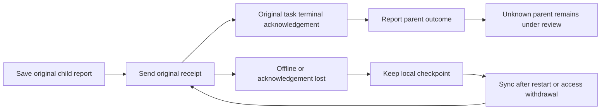

Bounded validation passed: 124 controller checks including 15 new receipt boundaries, 43 actual pinned-Codex checks, three actual native/SQL receipt-loss journeys, two compiler checks and eight actual unsigned packaged-Desktop checks. An old/current comparison reproduces the lost child finish request on the old code and verifies child-before-parent delivery on the new code. Processes, commands, files, SQL, dropped HTTP responses and a full application restart are actual; model responses and native dialog choices are synthetic. All owned test resources were closed. Original failures, executed QA and source snapshots remain preserved.

[Implementation](technical/131-desktop-durable-receipt-sync.md) · [Current checkpoint](quality/receipt-sync-checkpoint-131.json) · [Complete numbered open work](quality/remaining-work-stage131.md)


[Fee confirmation](https://github.com/copypasteltd/workmate/blob/desktop/assets/screenshots/workmate-receipt-sync-131-01-child-fee-confirmation-en.png) · [撤权后中文提示](https://github.com/copypasteltd/workmate/blob/desktop/assets/screenshots/workmate-receipt-sync-131-01-revoked-receipts-pending-zh.png) · [Original receipts synchronized](https://github.com/copypasteltd/workmate/blob/desktop/assets/screenshots/workmate-receipt-sync-131-01-original-receipts-synchronized-en.png) · [Loss/withdrawal MP4](https://github.com/copypasteltd/workmate/blob/desktop/assets/screenshots/workmate-receipt-sync-131-01-receipt-loss-and-permission-withdrawal.mp4) · [Restart/sync MP4](https://github.com/copypasteltd/workmate/blob/desktop/assets/screenshots/workmate-receipt-sync-131-01-receipt-sync-after-application-restart.mp4)

The full-acceptance ledger retains 89 required, 12 unconfirmed suggestion and one optional records; these are not 102 uncoded modules. Arbitrary crash/process reclamation, login-family changes, complete parent accounting reconciliation, professional roles, live model/media services and signed installation remain open. This increment uses the independent Stage131 manifest/publisher; Stage128 and130 evidence retains its original historical scope.

```powershell
python -X utf8 docs/tools/record_receipt_sync_131_v1.py --verify
python -X utf8 docs/tools/prepare_receipt_publication_131_v1.py --verify
python -X utf8 docs/tools/publish_receipt_sync_131_v1.py --push
```

The publisher checks the real Stage130 remote receipt, full history security/README links, current Git bytes and all eight remote refs, then uses an ordinary atomic push. General build/start instructions follow below.

---

<!-- workflow-recovery-stage130 -->
## Customer-local workflow recovery and cancellation · Stage130

Task shutdown and normal completion now retire each parent/child background authority watcher independently. An uncooperative heartbeat transport cannot keep cleanup waiting or resume execution through a late response. Retiring a watcher does not cancel a normally completing parent; fresh current-authority checks still precede native turn admission.

Customer flow: browser sign-in and company workspace → choose a local folder and explicitly grant access → confirm separate child limits → local developer work → human review of actual files → local QA → private SOP, frozen JSON and recovery-note downloads. Actual developer initialization and QA thread-start faults each recover once, only after durable company proof of zero admissions. Original tasks, holds, deadlines and worker attempts remain.

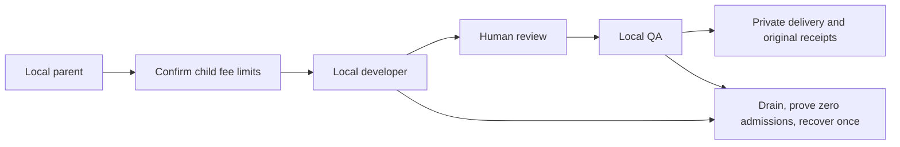

Bounded checks passed: 109 controller checks, 43 actual pinned-Codex checks, three complete native parent/child journeys, two current compiler checks and eight actual unsigned packaged-UI checks. Electron, native PostgreSQL, shell work and files are real. Model output, dialog choices and injected transport faults are fixtures. Three native widths retain no default frame/menu, visible scroll rails or horizontal overflow. Owned resources close; original failed probes and source snapshots remain immutable.

[Implementation](technical/130-desktop-workflow-recovery.md) · [Current checkpoint](quality/workflow-recovery-checkpoint-130.json) · [Numbered remaining work](quality/remaining-work-stage130.md)


[Fee confirmation](https://github.com/copypasteltd/workmate/blob/desktop/assets/screenshots/workmate-workflow-recovery-130-01-child-fee-confirmation-en.png) · [Completed English UI](https://github.com/copypasteltd/workmate/blob/desktop/assets/screenshots/workmate-workflow-recovery-130-01-two-recovered-children-completed-en.png) · [Completed Chinese UI](https://github.com/copypasteltd/workmate/blob/desktop/assets/screenshots/workmate-workflow-recovery-130-01-two-recovered-children-completed-zh.png) · [Actual wall-clock MP4](https://github.com/copypasteltd/workmate/blob/desktop/assets/screenshots/workmate-workflow-recovery-130-01-parent-child-startup-recovery.mp4)

89 required, 12 unconfirmed suggested and one optional full-acceptance records remain open; these are not 102 uncoded modules. Arbitrary crash/multi-node behavior, all local tools, complete roles, durable resubmission of lost child finish receipts, live providers and signed installation remain. Stage130 uses its own manifest and publisher. The old V11 entry and Stage128 manifest retain their historical source scope and do not publish this increment.

[简体中文](README.md) · [English](README.en.md)

<!-- startup-recovery-stage128 -->
## Safe customer-local startup recovery · Stage128

Desktop runs pinned Codex on the customer's computer. After explicit folder selection and consent, a classified initialization/thread transport failure first drains the old process, lock and owned tools. Company services permit one recovery only when no turn, provider, input-count or company-tool request has been admitted and the original identity, permissions and deadline remain valid. At most two launches retain one task, hold and worker attempt; the absolute deadline never extends.

The UI shows Reconnecting. Retry connection retrieves an unconfirmed original result; possibly executed work requires local-file and billing review. Withdrawal, rejection, incomplete cleanup, admitted turns and unknown outcomes cannot replay automatically. Scoped inference credentials go only to the trusted local runtime and are excluded from the recovery journal and renderer.

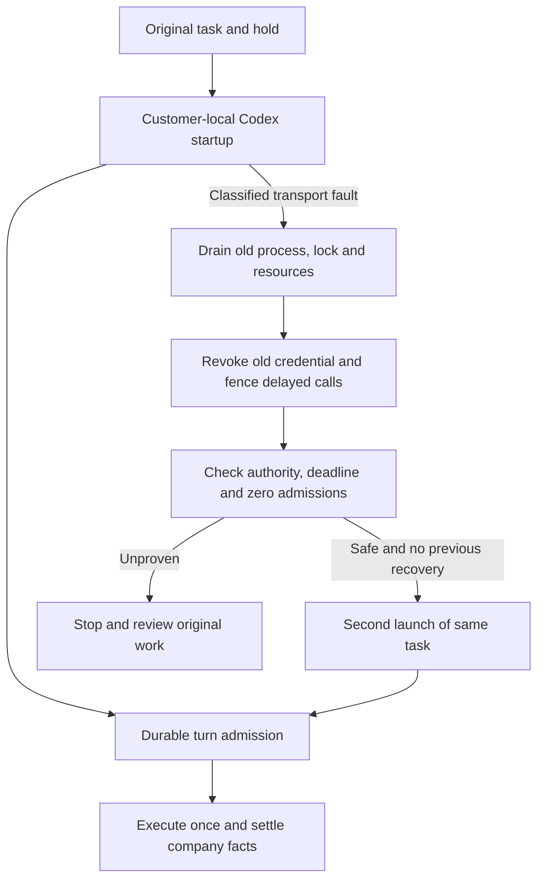

Upgrade the server through SQL133 with the database owner before starting the matching API. New clients opt into `desktop-startup-recovery-v1`. `/startup-recovery` binds the original session, contract digest and durable recovery key; `/turn-admission` precedes native `turn/start`. Legacy clients retain their existing flow without recovery authority.

The checkpoint records bounded controller, actual pinned Codex, native SQL and actual unsigned packaged Desktop qualification. Model responses and dialog decisions are synthetic as requested. This does not qualify a live provider, signed installation, every crash combination or complete professional roles. Earlier packages and captures retain their original source scope.

Bounded checks passed: 91 related controller, 43 actual pinned-Codex, 30 native database/API, three current compilation and six actual unsigned packaged-UI checks. The journey verifies sign-in, consent, one startup recovery, one original-task charge, one displayed answer, pending-startup withdrawal and native widths of 1000/1240/1440. Current PNG/GIF/MP4 captures come from successful attempt04; failed attempts01–03 and their raw records remain intact. V11 publishes the branches; the final receipt and remote SHA readback determine publication status.

[Design and APIs](https://github.com/copypasteltd/workmate/blob/docs/docs/technical/128-desktop-startup-recovery.md) · [Sources and qualification](https://github.com/copypasteltd/workmate/blob/docs/docs/quality/startup-recovery-checkpoint-128.json) · [Numbered open work](https://github.com/copypasteltd/workmate/blob/docs/docs/quality/remaining-work-stage128.md)


[Original receipt](https://github.com/copypasteltd/workmate/blob/desktop/assets/screenshots/workmate-startup-recovery-128-04-original-local-receipt.png) · [Withdrawal screenshot](https://github.com/copypasteltd/workmate/blob/desktop/assets/screenshots/workmate-startup-recovery-128-04-permission-revoked-before-turn.png) · [Withdrawal GIF](https://github.com/copypasteltd/workmate/blob/desktop/assets/screenshots/workmate-startup-recovery-128-04-revoke-pending-startup.gif) · [Recovery MP4](https://github.com/copypasteltd/workmate/blob/desktop/assets/screenshots/workmate-startup-recovery-128-04-startup-and-original-receipt.mp4) · [Withdrawal MP4](https://github.com/copypasteltd/workmate/blob/desktop/assets/screenshots/workmate-startup-recovery-128-04-revoke-pending-startup.mp4)

<!-- local-startup-stage127 -->
## Historical Stage127

Stage127 fixes customer-local Desktop startup renewal for main/workflow-child tasks and cancellation during asynchronous preparation/native requests. Codex stays on the customer's computer, using the original task and billing hold. Closing drains preparation and owned processes; bilingual feedback avoids internal error codes.

Bounded qualification covers 73 related controller, 38 real pinned-native and five actual unsigned packaged-window checks; final results are recorded in the checkpoint. Actual journeys cover browser sign-in, onboarding, default decline/explicit consent, startup beyond 45 seconds, original company SQL billing, withdrawal and three native window widths. Actual PNG/GIF/MP4 captures are added. Model responses/dialog choices are synthetic. V10 retains an ordinary atomic eight-ref update and SHA readback. Earlier results/media keep their original source scope.

Automatic Desktop startup recovery still needs atomic zero-admission proof and revocation/draining of old authority. Complete roles, signed installation and all 89 required full-acceptance records remain open.

[Current behavior](technical/127-desktop-startup-lifecycle.md) · [Numbered changes](changes/127-desktop-startup-lifecycle.md) · [Checkpoint](quality/local-startup-checkpoint-127.json) · [All numbered open work](quality/remaining-work-stage127.md)

<!-- native-publishing-stage126 -->
This increment fixes social-role creation and exact publication-source identity, and completes accounts → preview → prepare → status through real cloud Codex with simulated model/accounts. Current native09 passes5/5, startup fault03 passes9/9 and complete sixteen-file related10 passes155/155 with unchanged source and reclaimed owned native database/fixtures. Interrupted06, run08 (132 passed, one failed) and earlier failures retain their original outcomes.

Bounded pre-turn recovery requires zero model requests and retains the RPC deadlines, two-process limit and original billing identity. V9 is the publication entry; only its terminal receipt and remote SHA readback establish publication. No new UI/media or full-role acceptance is claimed. Desktop-local recovery/four-tool qualification, underlying intermittent latency causality, complete roles and all 89 required full-acceptance records remain open.

Stage125 and earlier acceptance claims, screenshots and recordings below are historical and retain their original source versions. The Stage126 checkpoint defines this increment's current scope.

[Behavior](technical/126-native-publication-tools.md) · [Numbered changes](changes/126-native-publication-tools.md) · [Evidence](quality/native-publication-checkpoint-126.json) · [All numbered open work](quality/remaining-work-stage126.md)

<!-- controlled-publications-stage125 -->
This increment adds explicit customer-confirmed marketing publication, actual outgoing media, unknown-outcome reconciliation, scoped Admin controls and client integration. Passing scopes cover 117 related backend, five Admin-upgrade CLI, 12 native-analysis, 21 Desktop-media, 70 Extension, 14 actual Web/Admin and ten actual packaged Desktop/native Chrome Side Panel checks. Original failures, sources and media remain preserved. Native publishing media qualification covers an image; new video playback/seek, actual Codex calls to four publication tools, signed installation and twelve professional-role qualifications remain open.

V8 is the historical Stage125 publisher; only its final receipt and remote SHA readback establish publication. All 89 required, 12 unconfirmed-suggestion and one optional full-acceptance records remain open. Bounded passing evidence is not full product delivery.

[方案 / Behavior](technical/125-controlled-publishing-and-native-media.md) · [证据 / Evidence](quality/publications-checkpoint-125.json) · [本轮实现与待办 / Changes and open work](changes/125-controlled-publications.md) · [全部编号清单 / All numbered records](quality/remaining-work-stage125.md) · [保留v7 / Preserved v7](quality/remaining-work-current-review-125-v7.md)

<!-- admin-profile-revisions-stage124 -->
Stage 124 adds scoped administrator revisions for customer specialists, brands and memories. All 68 checks across five complete related backend files, 11 Admin unit checks, eight actual UI flows and 14 layout observations passed; eight PNG captures and three GIF/MP4 pairs retain original evidence and earlier failures. The Stage124 publication entry point is V7; actual remote success follows its final receipt and SHA readback.

[Behavior](technical/124-admin-profile-revisions.md) · [Evidence](quality/admin-profile-checkpoint-124.json) · [Changes](changes/124-admin-profile-revisions.md) · [Current numbered open records](quality/remaining-work-stage124.md)

[中文](README.md) · [English](README.en.md) · [CopyPaste](https://copypaste.hk/)

<!-- admin-content-revisions-123 -->

This increment adds scoped administrator body revisions for teams, shared project briefs and methods: authorized reference search, structured forms, before/after review, explicit confirmation, immutable versions, separate administrator provenance, history and original-request recovery after disconnects. All **75 checks across five complete related backend files**, **seven actual Admin UI flows** and seven dialog/field-bound observations at four widths passed. Six PNG and two GIF/MP4 pairs retain their original captures; previous failures remain preserved. The 102 full acceptance records are tracked separately.

[Behavior](technical/123-admin-content-revisions.md) · [Evidence](quality/admin-content-checkpoint-123.json) · [Changes](changes/123-admin-content-revisions.md) · [Numbered open requirements](quality/remaining-work-stage123.md)

<!-- runtime-startup-122 -->
## Historical Stage 122 scope

This delivery adds bounded Codex initialization recovery, exact thread/turn isolation, sanitized diagnostics and fresh-checkout Desktop test preparation. Recorded passes cover 12 cloud native, 180 Desktop unit, 25 Desktop native, 20 Web unit and eight actual packaged UI checks, with six screenshots and one GIF/MP4 pair. Five complete related backend files passed 79 checks, including native database shutdown and fixture reclamation; this is not a new full backend run. Bounded passing scopes do not close the 102 full acceptance records.

[Behavior](technical/122-codex-startup-and-turn-isolation.md) · [Evidence](quality/runtime-startup-checkpoint-122.json) · [Changes](changes/122-runtime-startup-and-turn-isolation.md) · [Numbered open requirements](quality/remaining-work-stage122.md)

Workmate gives businesses in Hong Kong a company-hosted Codex agent through a Web workspace, a native Chrome right Side Panel and a customer-local Desktop application. AI requests use the company OpenAI-compatible gateway. Brand styling follows CopyPaste’s existing website.

| Component / 组件 | Execution and use / 执行与使用 | Source and bilingual guide / 源码与双语说明 |
|---|---|---|
| Backend / 后端 | Identity, company gateway, cloud Codex, private files, tasks, billing and authority / 身份、云端执行、文件、费用和权限 | [backend](https://github.com/copypasteltd/workmate/blob/backend/README.md) · [English](https://github.com/copypasteltd/workmate/blob/backend/README.en.md) |
| Web | Hosted workspace; roles, projects, conversations, deliverables and optional resources / 云端工作台、角色、项目、对话与成果 | [web](https://github.com/copypasteltd/workmate/blob/web/README.md) · [English](https://github.com/copypasteltd/workmate/blob/web/README.en.md) |
| Admin | Separate MFA identity; scoped customer, content, credit, VIP and infrastructure administration / 独立 MFA 与用户、内容、费用、VIP、资源管理 | [admin](https://github.com/copypasteltd/workmate/blob/admin/README.md) · [English](https://github.com/copypasteltd/workmate/blob/admin/README.en.md) |
| Desktop | Local Codex and revocable local authority; frameless native window / 本机 Codex、可撤销本机权限与无边框窗口 | [desktop](https://github.com/copypasteltd/workmate/blob/desktop/README.md) · [English](https://github.com/copypasteltd/workmate/blob/desktop/README.en.md) |
| Extension | Native right Side Panel; review and confirm private uploads before cloud execution / 原生右侧栏、文件审核确认后交云端执行 | [extension](https://github.com/copypasteltd/workmate/blob/extension/README.md) · [English](https://github.com/copypasteltd/workmate/blob/extension/README.en.md) |
| Delivery / 交付 | Native qualification, recovery, release tooling and physical-node source / 原生验收、恢复、发布工具与物理节点源码 | [delivery](https://github.com/copypasteltd/workmate/blob/delivery/README.md) · [English](https://github.com/copypasteltd/workmate/blob/delivery/README.en.md) |

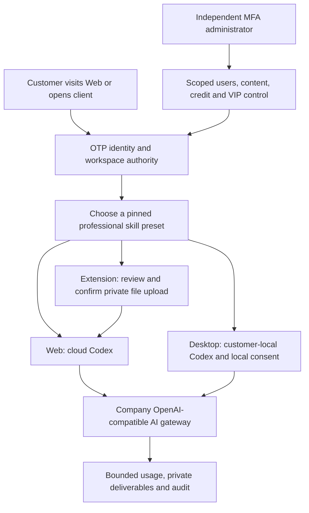

The priority workflows are marketing images, video, effects and typography; Google Ads, GA4, SEO/GEO and Meta analysis; and repeatable internal workflows. The catalog contains 18 professional definitions from software development to design, with pinned skill versions, model/tool permissions, budgets and output contracts. A definition is not a completed professional qualification.

A customer signs in, creates or joins a company and project, chooses a role and supplies an instruction and approved sources. The server checks identity, current access, limits and funds before creating work. Progress, approvals, private deliverables and consumption remain attached to the same task. Exact request identities protect response-loss retries. Cancellation, revocation and erasure are enforced again at execution and result-access boundaries.

Desktop executes Codex on the customer’s machine. The customer can grant and revoke full local authority; the frameless renderer has custom window controls and no native Electron menu. The extension uses Chrome’s native right Side Panel, separately confirms selected uploads and separately submits the message. Optional dedicated cloud computers require an expiring, fixed-duration resource quote and explicit scope/cost confirmation; Codex control and its AI budget require separate consent.

Administrators use separate MFA authentication and scoped, deny-aware permissions. Users, usage, credits, VIP grants, roles, content, plans and resources have independent controls. Sensitive changes require reasons, current versions, idempotency and audit. Admin resource metadata does not expose private customer pixels or file contents. Uncertain usage or physical cleanup retains the original funding reservation until supported reconciliation.

Historical Stage 121 bounded qualification: 1388 backend tests in 112 complete files, 338 integrated client checks, 24 actual UI checks, 29 PNGs and 5 GIF/MP4 pairs; 2209 final source bindings were recorded. Provider decisions and physical-node protocol responses are explicit fixtures. No actual Linux host or live provider quality is claimed. All 102 original requirement records still need full acceptance; the earlier numbered audit is retained as a dated snapshot.

An earlier native Codex initialization exceeded the unchanged 60-second RPC deadline. Three fresh initialization/thread-start diagnostics passed, but the original cause remains unproven. The failed run and cleanup evidence remain available; a successful later run does not establish production startup reliability.


[MP4 · desktop](https://github.com/copypasteltd/workmate/blob/desktop/assets/screenshots/workmate-dedicated-desktop-07-local-cloud-boundary.mp4?raw=true)


[MP4 · web](https://github.com/copypasteltd/workmate/blob/web/assets/screenshots/workmate-13-dedicated-cloud-consent.mp4?raw=true)


[MP4 · extension](https://github.com/copypasteltd/workmate/blob/extension/assets/screenshots/workmate-dedicated-extension-05-folder-retry.mp4?raw=true)

[Current technical design / 当前技术方案](technical/121-dedicated-cloud-and-client-execution.md) · [Current qualification / 当前限定验收](quality/dedicated-cloud-checkpoint.json) · [Raw evidence index / 原始证据](quality/dedicated-cloud-evidence-121/index.json)

[All numbered open requirements / 全部编号待办快照](quality/remaining-work-2026-10-29.md) · [Structured requirements / 结构化清单](quality/remaining-work-2026-10-29.json) · [This change / 本轮更新](changes/121-dedicated-cloud-delivery.md)

[Client execution contract / 客户端执行约束](requirements/03-client-execution-amendment.md) · [Workspace rules / 工作区规则](governance/03-workspace-and-path-policy.md) · [Git publication rules / 分支发布规则](governance/04-git-branches-and-publication.md)

[Resource OpenAPI / 资源接口](contracts/dedicated-cloud.openapi.json) · [Route additions / 路由增量](contracts/dedicated-cloud-route-additions.json) · [Previous published checkpoint / 上一版验收](quality/integrated-recovery-checkpoint.json)

All development uses `D:\dev\copypasted\自有agent\dev\`; central documents use `D:\dev\copypasted\自有agent\docs\`. Each component is an independent Git repository. Docker, WSL and virtualization are prohibited. Native verification closes only browsers, pages, services and database processes it owns. Local `.env` values, credentials, dependency folders and generated installers are excluded from Git.

实际开发位于上述唯一 D 盘路径；各端独立仓库，中央文档统一位于 `docs/`。禁止 Docker、WSL 与虚拟化。原生验证只关闭自身创建的浏览器、页面、服务和数据库进程。密钥、`.env`、依赖目录与生成的安装程序不提交到 Git。

Run each component using its own bilingual guide. Use the backend demo configuration for local fake-data development, then connect Web/Admin and pair the native clients through their documented OTP/PKCE flow. Native node installation is operator-managed and requires an actual qualified physical Linux host; the supplied source and protocol tests do not establish that host’s readiness.

请按各端 README 的安装／启动说明运行：后端使用 demo 配置与假数据，Web／Admin 连接该服务；原生客户端通过各自文档中的 OTP／PKCE 接入。物理节点安装由运营人员管理，需要另行验证真实 Linux 主机，源码和协议测试本身不代表该主机已可交付。


Stage146: [actual document pages and source selection](development/146-document-pages-and-source-selection.md) · [all original numbered scopes](quality/remaining-work-stage146.md).


Stage147: [functional customer journeys](development/147-functional-closure.md) · [all numbered scopes](quality/remaining-work-stage147.md) · [detailed contracts](technical/147-workflow-contract-and-local-handoff.md).
