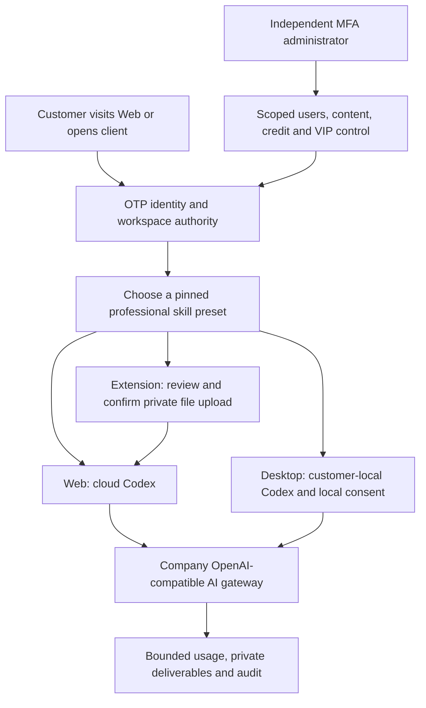

# Workmate · CopyPaste Enterprise Agent

<!-- open-work-review-stage125 -->
The v7 review retains 89 open required acceptance records (77 partial and 12 completion-not-proven), plus 12 unconfirmed suggestions and one optional item. The current complete related backend run09 passes 117/117, the explicit Admin upgrade CLI 5/5 and the analysis diagnostic 12/12. Extension logic passes 70/70; Desktop logic passes 21/21 and an updated unsigned development directory package was built. Three actual synthetic OAuth browser checks pass and the scope-refresh race is corrected. Web/Admin run10 remains failed after five recorded checks: its success locator expects the wrong label and actual viewport observations cover only 375/768px, invalidating its four-width claim. Later Admin publishing checks were not completed. Complete client journeys, at least twelve professional-role qualifications, integration, independent reproduction and Stage125 product-source publication remain open. Remote product component refs retain Stage124 scope.

[All 102 numbered records](quality/remaining-work-current-review-125-v7.md) · [Structured ledger](quality/remaining-work-current-review-125-v7.json) · [This round's changes and open work](changes/remaining-work-review-stage125-v7.md) · [Current publishing design](technical/125-controlled-publishing-and-native-media.md) · [Preserved v6 review](quality/remaining-work-current-review-125-v6.md)

<!-- admin-profile-revisions-stage124 -->
Stage 124 adds scoped administrator revisions for customer specialists, brands and memories. All 68 checks across five complete related backend files, 11 Admin unit checks, eight actual UI flows and 14 layout observations passed; eight PNG captures and three GIF/MP4 pairs retain original evidence and earlier failures. The current publication entry point is V7; actual remote success follows its final receipt and SHA readback.

[Behavior](technical/124-admin-profile-revisions.md) · [Evidence](quality/admin-profile-checkpoint-124.json) · [Changes](changes/124-admin-profile-revisions.md) · [Current numbered open records](quality/remaining-work-stage124.md)

[中文](README.md) · [English](README.en.md) · [CopyPaste](https://copypaste.hk/)

<!-- admin-content-revisions-123 -->

This increment adds scoped administrator body revisions for teams, shared project briefs and methods: authorized reference search, structured forms, before/after review, explicit confirmation, immutable versions, separate administrator provenance, history and original-request recovery after disconnects. All **75 checks across five complete related backend files**, **seven actual Admin UI flows** and seven dialog/field-bound observations at four widths passed. Six PNG and two GIF/MP4 pairs retain their original captures; previous failures remain preserved. The 102 full acceptance records are tracked separately.

[Behavior](technical/123-admin-content-revisions.md) · [Evidence](quality/admin-content-checkpoint-123.json) · [Changes](changes/123-admin-content-revisions.md) · [Numbered open requirements](quality/remaining-work-stage123.md)

<!-- runtime-startup-122 -->
## Historical Stage 122 scope

This delivery adds bounded Codex initialization recovery, exact thread/turn isolation, sanitized diagnostics and fresh-checkout Desktop test preparation. Recorded passes cover 12 cloud native, 180 Desktop unit, 25 Desktop native, 20 Web unit and eight actual packaged UI checks, with six screenshots and one GIF/MP4 pair. Five complete related backend files passed 79 checks, including native database shutdown and fixture reclamation; this is not a new full backend run. Bounded passing scopes do not close the 102 full acceptance records.

[Behavior](technical/122-codex-startup-and-turn-isolation.md) · [Evidence](quality/runtime-startup-checkpoint-122.json) · [Changes](changes/122-runtime-startup-and-turn-isolation.md) · [Numbered open requirements](quality/remaining-work-stage122.md)

Workmate gives businesses in Hong Kong a company-hosted Codex agent through a Web workspace, a native Chrome right Side Panel and a customer-local Desktop application. AI requests use the company OpenAI-compatible gateway. Brand styling follows CopyPaste’s existing website.

| Component / 组件 | Execution and use / 执行与使用 | Source and bilingual guide / 源码与双语说明 |
|---|---|---|
| Backend / 后端 | Identity, company gateway, cloud Codex, private files, tasks, billing and authority / 身份、云端执行、文件、费用和权限 | [backend](https://github.com/copypasteltd/workmate/blob/backend/README.md) · [English](https://github.com/copypasteltd/workmate/blob/backend/README.en.md) |
| Web | Hosted workspace; roles, projects, conversations, deliverables and optional resources / 云端工作台、角色、项目、对话与成果 | [web](https://github.com/copypasteltd/workmate/blob/web/README.md) · [English](https://github.com/copypasteltd/workmate/blob/web/README.en.md) |
| Admin | Separate MFA identity; scoped customer, content, credit, VIP and infrastructure administration / 独立 MFA 与用户、内容、费用、VIP、资源管理 | [admin](https://github.com/copypasteltd/workmate/blob/admin/README.md) · [English](https://github.com/copypasteltd/workmate/blob/admin/README.en.md) |
| Desktop | Local Codex and revocable local authority; frameless native window / 本机 Codex、可撤销本机权限与无边框窗口 | [desktop](https://github.com/copypasteltd/workmate/blob/desktop/README.md) · [English](https://github.com/copypasteltd/workmate/blob/desktop/README.en.md) |
| Extension | Native right Side Panel; review and confirm private uploads before cloud execution / 原生右侧栏、文件审核确认后交云端执行 | [extension](https://github.com/copypasteltd/workmate/blob/extension/README.md) · [English](https://github.com/copypasteltd/workmate/blob/extension/README.en.md) |
| Delivery / 交付 | Native qualification, recovery, release tooling and physical-node source / 原生验收、恢复、发布工具与物理节点源码 | [delivery](https://github.com/copypasteltd/workmate/blob/delivery/README.md) · [English](https://github.com/copypasteltd/workmate/blob/delivery/README.en.md) |

The priority workflows are marketing images, video, effects and typography; Google Ads, GA4, SEO/GEO and Meta analysis; and repeatable internal workflows. The catalog contains 18 professional definitions from software development to design, with pinned skill versions, model/tool permissions, budgets and output contracts. A definition is not a completed professional qualification.

A customer signs in, creates or joins a company and project, chooses a role and supplies an instruction and approved sources. The server checks identity, current access, limits and funds before creating work. Progress, approvals, private deliverables and consumption remain attached to the same task. Exact request identities protect response-loss retries. Cancellation, revocation and erasure are enforced again at execution and result-access boundaries.

Desktop executes Codex on the customer’s machine. The customer can grant and revoke full local authority; the frameless renderer has custom window controls and no native Electron menu. The extension uses Chrome’s native right Side Panel, separately confirms selected uploads and separately submits the message. Optional dedicated cloud computers require an expiring, fixed-duration resource quote and explicit scope/cost confirmation; Codex control and its AI budget require separate consent.

Administrators use separate MFA authentication and scoped, deny-aware permissions. Users, usage, credits, VIP grants, roles, content, plans and resources have independent controls. Sensitive changes require reasons, current versions, idempotency and audit. Admin resource metadata does not expose private customer pixels or file contents. Uncertain usage or physical cleanup retains the original funding reservation until supported reconciliation.

Historical Stage 121 bounded qualification: 1388 backend tests in 112 complete files, 338 integrated client checks, 24 actual UI checks, 29 PNGs and 5 GIF/MP4 pairs; 2209 final source bindings were recorded. Provider decisions and physical-node protocol responses are explicit fixtures. No actual Linux host or live provider quality is claimed. All 102 original requirement records still need full acceptance; the earlier numbered audit is retained as a dated snapshot.

An earlier native Codex initialization exceeded the unchanged 60-second RPC deadline. Three fresh initialization/thread-start diagnostics passed, but the original cause remains unproven. The failed run and cleanup evidence remain available; a successful later run does not establish production startup reliability.

[MP4 · desktop](https://github.com/copypasteltd/workmate/blob/desktop/assets/screenshots/workmate-dedicated-desktop-07-local-cloud-boundary.mp4?raw=true)

[MP4 · web](https://github.com/copypasteltd/workmate/blob/web/assets/screenshots/workmate-13-dedicated-cloud-consent.mp4?raw=true)

[MP4 · extension](https://github.com/copypasteltd/workmate/blob/extension/assets/screenshots/workmate-dedicated-extension-05-folder-retry.mp4?raw=true)

[Current technical design / 当前技术方案](technical/121-dedicated-cloud-and-client-execution.md) · [Current qualification / 当前限定验收](quality/dedicated-cloud-checkpoint.json) · [Raw evidence index / 原始证据](quality/dedicated-cloud-evidence-121/index.json)

[All numbered open requirements / 全部编号待办快照](quality/remaining-work-2026-10-29.md) · [Structured requirements / 结构化清单](quality/remaining-work-2026-10-29.json) · [This change / 本轮更新](changes/121-dedicated-cloud-delivery.md)

[Client execution contract / 客户端执行约束](requirements/03-client-execution-amendment.md) · [Workspace rules / 工作区规则](governance/03-workspace-and-path-policy.md) · [Git publication rules / 分支发布规则](governance/04-git-branches-and-publication.md)

[Resource OpenAPI / 资源接口](contracts/dedicated-cloud.openapi.json) · [Route additions / 路由增量](contracts/dedicated-cloud-route-additions.json) · [Previous published checkpoint / 上一版验收](quality/integrated-recovery-checkpoint.json)

All development uses `D:\dev\copypasted\自有agent\dev\`; central documents use `D:\dev\copypasted\自有agent\docs\`. Each component is an independent Git repository. Docker, WSL and virtualization are prohibited. Native verification closes only browsers, pages, services and database processes it owns. Local `.env` values, credentials, dependency folders and generated installers are excluded from Git.

实际开发位于上述唯一 D 盘路径；各端独立仓库，中央文档统一位于 `docs/`。禁止 Docker、WSL 与虚拟化。原生验证只关闭自身创建的浏览器、页面、服务和数据库进程。密钥、`.env`、依赖目录与生成的安装程序不提交到 Git。

Run each component using its own bilingual guide. Use the backend demo configuration for local fake-data development, then connect Web/Admin and pair the native clients through their documented OTP/PKCE flow. Native node installation is operator-managed and requires an actual qualified physical Linux host; the supplied source and protocol tests do not establish that host’s readiness.

请按各端 README 的安装／启动说明运行：后端使用 demo 配置与假数据，Web／Admin 连接该服务；原生客户端通过各自文档中的 OTP／PKCE 接入。物理节点安装由运营人员管理，需要另行验证真实 Linux 主机，源码和协议测试本身不代表该主机已可交付。
