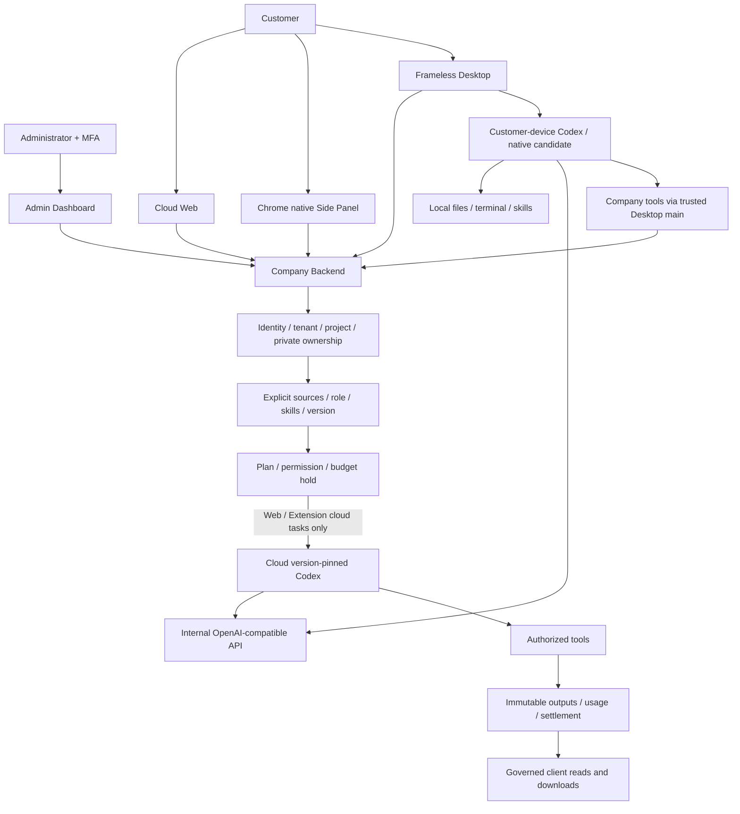
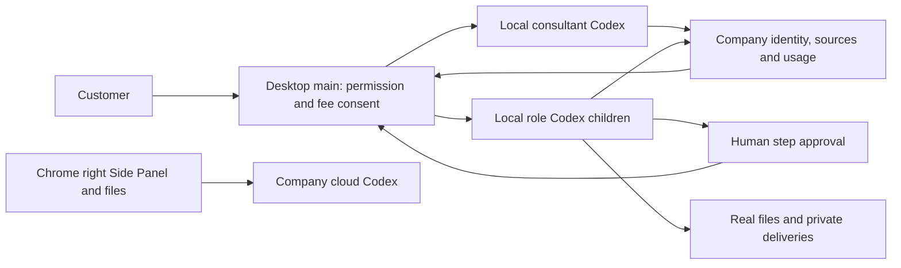

# Workmate · CopyPaste Enterprise Agent

[中文](README.md) · [GitHub](https://github.com/copypasteltd/workmate)

A Codex-based enterprise Agent platform for Hong Kong businesses, beginning with existing marketing teams. Cloud Web, a Chrome native Side Panel and a full frameless Desktop share company identity, business controls and an internal OpenAI-compatible AI gateway. Admin manages users, scoped content, usage, fees and VIP access.

<!-- client01-direction -->
## Current client direction and qualified scope

CLIENT01 (2026-10-22) requires **Desktop to run Codex on the customer's computer**, with a real user-opt-in **full local access** mode and Codex Desktop as the operation benchmark. The **Extension uses a ChatGPT-style conversation and attachment layout in Chrome's native right Side Panel**, reads user-selected files and uploads them for cloud Codex execution. All product AI calls still use the company gateway.

**Current implementation:** Desktop runs Codex on the customer device with explicit full access, local files/terminal, persistent threads, native questions and governed image/design/video tools. The workflow consultant now uses immutable private workflows, separate child-step fee consent, human step approvals and actual native specialist children, with real SOP/JSON/recovery downloads, Stop/revoke and source governance. Qualification covers 848 platform tests, 75 overlapping focused checks, 3 real parent/child workflow checks, 17 native-supervisor regressions, 56 client tests and 19 actual packaged-journey checks; scopes are separate and not additive. All 18 roles have native protocol admission. Full professional delivery across 18 roles/29 Skills, complete browser/third-party application operations and Codex Desktop parity, live models and production acceptance remain pending. Model responses and native-dialog choices are explicit fixtures. Extension retains ChatGPT-style right Side Panel cloud chat and selected-file reading/upload without Desktop; its UI was not rerun this stage. See [design](https://github.com/copypasteltd/workmate/blob/docs/docs/technical/76-desktop-native-workflows.md) and [source/media checkpoint](https://github.com/copypasteltd/workmate/blob/docs/docs/quality/desktop-workflow-checkpoint.json).

Native supervisor scope, actual permission checks and remaining integration: [implementation details](https://github.com/copypasteltd/workmate/blob/docs/docs/technical/70-desktop-native-codex-supervisor.md).

<!-- /client01-direction -->

## Repositories and branches

Each component retains its independent Git history and root layout. Clone different branches into separate directories when running them together. The same documentation commit is published to `main` and `docs`.

| Branch | Directory under `dev/` | Responsibility | README |
| --- | --- | --- | --- |
| [backend](https://github.com/copypasteltd/workmate/tree/backend) | `copypaste-platform` | Backend / API, Codex, data and metering | [中文](https://github.com/copypasteltd/workmate/blob/backend/README.md) / [English](https://github.com/copypasteltd/workmate/blob/backend/README.en.md) |
| [web](https://github.com/copypasteltd/workmate/tree/web) | `copypaste-web` | Cloud customer workspace | [中文](https://github.com/copypasteltd/workmate/blob/web/README.md) / [English](https://github.com/copypasteltd/workmate/blob/web/README.en.md) |
| [admin](https://github.com/copypasteltd/workmate/tree/admin) | `copypaste-admin` | Administration and operations | [中文](https://github.com/copypasteltd/workmate/blob/admin/README.md) / [English](https://github.com/copypasteltd/workmate/blob/admin/README.en.md) |
| [desktop](https://github.com/copypasteltd/workmate/tree/desktop) | `copypaste-desktop` | Frameless native desktop | [中文](https://github.com/copypasteltd/workmate/blob/desktop/README.md) / [English](https://github.com/copypasteltd/workmate/blob/desktop/README.en.md) |
| [extension](https://github.com/copypasteltd/workmate/tree/extension) | `copypaste-extension` | Chrome native Side Panel | [中文](https://github.com/copypasteltd/workmate/blob/extension/README.md) / [English](https://github.com/copypasteltd/workmate/blob/extension/README.en.md) |
| [delivery](https://github.com/copypasteltd/workmate/tree/delivery) | `copypaste-delivery` | Startup, verification, recording and publishing | [中文](https://github.com/copypasteltd/workmate/blob/delivery/README.md) / [English](https://github.com/copypasteltd/workmate/blob/delivery/README.en.md) |
| [docs / main](https://github.com/copypasteltd/workmate/tree/docs) | Project root · `docs/` | Requirements, architecture, delivery and release notes | [中文](README.md) / [English](README.en.md) |

## Architecture and usage

Current execution split. The new Desktop candidate integrates local Codex and full local access within the linked qualification scope; earlier packages retain their original scope.



The following describes the shared company workflow. Desktop local permission, persistent threads and company tools follow the stage 73 design and source-bound checkpoint.

1. Sign in with an email code, choose a workspace/project and confirm the current funding and permission context. Desktop and extension authorize through the company webpage using PKCE; Admin uses a separate email OTP/TOTP identity.
2. Web/Extension offer the default assistant, eighteen role presets and personal specialists. Desktop currently admits seventeen presets with the native protocol connected. Tasks freeze role, Skills, model and price versions. Select files, brand resources and authorized connections explicitly.
3. Confirm a bounded budget before execution. Codex calls company-provided APIs and controlled tools. Recorded usage, budget holds and settled charges remain separate.
4. In Web/Extension, when a measured completed turn requests inputs, select authorized current versions and continue the original task/thread/hold, within eight-round and thirty-two-dependency bounds. Desktop supports same-thread follow-up and answering native questions in the original task and turn. Unknown effects in either execution path require reconciliation.
5. Read evidence and deliverables, download through authenticated company routes or explicitly publish an independent copy. Current source governance still applies. Workspace switches or failed reads clear prior client content.
6. Operators filter users/usage, manage scoped content, review fees and grant VIP/credit under independent permissions. Sensitive writes preview impact and use idempotency and required independent approvals.

## Business scope

Marketing creation includes images, brand layouts, typography, ad/ecommerce/social assets, presentations, editable deliverables and template videos. Analytics includes CSV/XLSX imports, advertising metrics, Google/Meta connection workflows and scoped website audit, evidence, change drafts and rechecks. Enterprise workflows cover assistants, conversations, memory, schedules, files and notifications. The role catalog contains eighteen presets; planned Skills and full professional qualification are tracked separately.

## First checkout and local run

The authoritative existing workspace is `D:\dev\copypasted\自有agent`. Do not clone over existing repositories. For a new machine, clone `docs` at a fresh root and clone component branches under `dev/` as shown above. Native Windows tools only; no Docker, WSL or virtualization.

```powershell
git clone --single-branch --branch docs git@github.com:copypasteltd/workmate.git workmate
cd workmate
New-Item -ItemType Directory -Path dev
git clone --single-branch --branch backend git@github.com:copypasteltd/workmate.git dev/copypaste-platform
git clone --single-branch --branch web git@github.com:copypasteltd/workmate.git dev/copypaste-web
git clone --single-branch --branch admin git@github.com:copypasteltd/workmate.git dev/copypaste-admin
git clone --single-branch --branch desktop git@github.com:copypasteltd/workmate.git dev/copypaste-desktop
git clone --single-branch --branch extension git@github.com:copypasteltd/workmate.git dev/copypaste-extension
git clone --single-branch --branch delivery git@github.com:copypasteltd/workmate.git dev/copypaste-delivery
cd dev/copypaste-delivery
npm ci
npm run bootstrap
npm run demo
```

Open Web `http://localhost:4317` and Admin `http://localhost:4318`; Backend uses `4310`, the owned controller `4319` and native PostgreSQL `55432`. Stop owned demo services with `npm run stop`. See each component README for standalone startup, administrator enrollment, Desktop packaging and extension loading. Node.js ≥22.14 and locked dependencies are required; native verification also needs pinned Codex and FFmpeg/FFprobe.

## Evidence and limits

The historical-source Platform regression passed **802/802** tests (the backend has since changed; this is not a full regression of the new source), retaining all prior 782 named cases; the **52/52** canonical-task checks overlap with the full suite. There are **13** successful type/build/existing-client-suite checks and **32** actual packaged Desktop/native Side Panel checks. Stage 72 retained ten real-native supervisor and seven Electron checks for its historical source. Stage 73 retains its original source scope for 818 Platform regressions, fourteen real-native tests, thirty-seven client tests and nine packaged journeys; backend source remained unchanged through stage 74. Stage 74 separately verifies its original Desktop source with 47 client tests, 17 real-native tests and 12 packaged journeys. Full qualification remains open. Earlier four-client media retains its original cloud/file-bridge source scope; new local company-tool media has its own timing, hashes and owned-client cleanup.

[Canonical task evidence](quality/canonical-task-checkpoint.json) · [Native supervisor evidence](quality/desktop-video-checkpoint.json) · [Current local candidate bytes](quality/desktop-video-checkpoint.json) · [Media](quality/workmate-media-10.json) · [Requirement progress](quality/requirements-alignment-progress.json)

AI turns and provider/business facts in UI demos are explicitly synthetic, as authorized. Separate integration tests run actual Codex processes against a synthetic internal gateway. Admin media shows permission-gated VIP/credit forms and does not claim a financial posting. Applied SQL001–092 remain immutable. All 102 requirements, TC/NFR/G01–G10 and the 81 partial /21 unproven /0 fully accepted baseline remain intact. Dedicated canonical task inputs and historical identity migration, arbitrary in-flight pause, unknown-effect recovery, complete local Desktop and Extension conversation/attachments, full role workflows, GEO, real suppliers, production, signing and store qualification remain outstanding.

## Actual client gallery

Screenshots and GIFs show actual running clients; synthetic data is scoped above. The extension capture is the confirmed native Side Panel document viewport and excludes the browser toolbar. Actual recordings preserve observed capture timing.

### Web


[MP4](design/implementation/workmate/web-workmate-10-interaction.mp4)

### Desktop

Stage 75: actual native video, revisions, playback/native saves, stop and revocation, plus native questions, files and company image tools; model/image responses and native-dialog choices are explicit fixtures. Other client media below retain their historical source scopes.


[MP4](design/implementation/workmate-local-19-local-agent.mp4)

### Extension


[MP4](design/implementation/workmate/extension-workmate-10-interaction.mp4)

### Admin


[MP4](design/implementation/workmate/admin-workmate-10-interaction.mp4)

## Documentation map

[Reading order](00-document-map.md) · [PRD](product/01-prd.md) · [Roles/Skills](product/06-role-templates-and-skill-presets.md) · [Brand](product/07-brand-design-system.md) · [Admin](product/08-admin-dashboard.md) · [API contracts](contracts/README.md) · [Delivery](DELIVERY.md)

### Product

- [01 prd](product/01-prd.md)
- [02 user journeys](product/02-user-journeys.md)
- [03 information architecture and interactions](product/03-information-architecture-and-interactions.md)
- [04 release and commercial model](product/04-release-and-commercial-model.md)
- [05 web agent workbench](product/05-web-agent-workbench.md)
- [06 role templates and skill presets](product/06-role-templates-and-skill-presets.md)
- [07 brand design system](product/07-brand-design-system.md)
- [08 admin dashboard](product/08-admin-dashboard.md)

### Modules

- [00 catalog](modules/00-catalog.md)
- [01 identity workspaces permissions](modules/01-identity-workspaces-permissions.md)
- [02 agents tasks memory](modules/02-agents-tasks-memory.md)
- [03 brand assets and deliverables](modules/03-brand-assets-and-deliverables.md)
- [04 marketing production](modules/04-marketing-production.md)
- [05 analytics seo geo](modules/05-analytics-seo-geo.md)
- [06 connectors workflows](modules/06-connectors-workflows.md)
- [07 web extension desktop](modules/07-web-extension-desktop.md)
- [08 usage billing admin](modules/08-usage-billing-admin.md)

### Technical

- [01 architecture and stack](technical/01-architecture-and-stack.md)
- [02 runtime and ai gateway](technical/02-runtime-and-ai-gateway.md)
- [03 data model and lifecycle](technical/03-data-model-and-lifecycle.md)
- [04 api and event contracts](technical/04-api-and-event-contracts.md)
- [05 local executor and browser](technical/05-local-executor-and-browser.md)
- [06 media and data pipelines](technical/06-media-and-data-pipelines.md)
- [07 security and permissions](technical/07-security-and-permissions.md)
- [08 development and delivery](technical/08-development-and-delivery.md)
- [09 operations runbooks](technical/09-operations-runbooks.md)
- [10 frontend design system](technical/10-frontend-design-system.md)
- [11 admin control plane](technical/11-admin-control-plane.md)
- [12 implementation and repositories](technical/12-implementation-and-repositories.md)
- [13 persistent agents conversations memory](technical/13-persistent-agents-conversations-memory.md)
- [14 admin identity lifecycle](technical/14-admin-identity-lifecycle.md)
- [15 cloud workflow schedules](technical/15-cloud-workflow-schedules.md)
- [16 enterprise federation and native auth](technical/16-enterprise-federation-and-native-auth.md)
- [17 erasure transfer retention events](technical/17-erasure-transfer-retention-events.md)
- [18 persistent cloud files](technical/18-persistent-cloud-files.md)
- [19 project skill lifecycle](technical/19-project-skill-lifecycle.md)
- [20 in app notifications](technical/20-in-app-notifications.md)
- [21 default assistant and first delegation](technical/21-default-assistant-and-first-delegation.md)
- [22 pre execution input checkpoint](technical/22-pre-execution-input-checkpoint.md)
- [23 execution capacity and fair dispatch](technical/23-execution-capacity-and-fair-dispatch.md)
- [24 admin record pages and test isolation](technical/24-admin-record-pages-and-test-isolation.md)
- [25 role template registry and runtime binding](technical/25-role-template-registry-and-runtime-binding.md)
- [26 design pdf review delivery](technical/26-design-pdf-review-delivery.md)
- [27 marketing import metrics and evidence](technical/27-marketing-import-metrics-and-evidence.md)
- [28 analysis report tasks and evidence](technical/28-analysis-report-tasks-and-evidence.md)
- [29 file imports and correction lineage](technical/29-file-imports-and-correction-lineage.md)
- [30 native window and browser sidepanel](technical/30-native-window-and-browser-sidepanel.md)
- [31 task controls and native continuation](technical/31-task-controls-and-native-continuation.md)
- [32 cross client sessions and revocation](technical/32-cross-client-sessions-and-revocation.md)
- [33 canonical authentication and retry recovery](technical/33-canonical-authentication-and-retry-recovery.md)
- [34 user profile context and orphan scan races](technical/34-user-profile-context-and-orphan-scan-races.md)
- [35 invitations and membership authority](technical/35-invitations-and-membership-authority.md)
- [36 admin membership control and policy snapshots](technical/36-admin-membership-control-and-policy-snapshots.md)
- [37 admin account lifecycle and inflight control](technical/37-admin-account-lifecycle-and-inflight-control.md)
- [38 admin canonical directories and scoped usage](technical/38-admin-canonical-directories-and-scoped-usage.md)
- [39 billing credit and settlement provenance](technical/39-billing-credit-and-settlement-provenance.md)
- [40 billing subjects and financial event provenance](technical/40-billing-subjects-and-financial-event-provenance.md)
- [41 canonical fee commands and independent approvals](technical/41-canonical-fee-commands-and-independent-approvals.md)
- [42 current membership ui and native auth recovery](technical/42-current-membership-ui-and-native-auth-recovery.md)
- [43 shared admin approval requests](technical/43-shared-admin-approval-requests.md)
- [44 manual payment evidence and exact posting](technical/44-manual-payment-evidence-and-exact-posting.md)
- [45 source bound refunds and cash reconciliation](technical/45-source-bound-refunds-and-cash-reconciliation.md)
- [46 immutable plans and legacy grant bindings](technical/46-immutable-plans-and-legacy-grant-bindings.md)
- [47 canonical vip lifecycle and effective entitlements](technical/47-canonical-vip-lifecycle-and-effective-entitlements.md)
- [48 enterprise seat and storage enforcement](technical/48-enterprise-seat-and-storage-enforcement.md)
- [49 atomic vip and explicit credit](technical/49-atomic-vip-and-explicit-credit.md)
- [50 durable financial notifications](technical/50-durable-financial-notifications.md)
- [51 controlled read only support](technical/51-controlled-read-only-support.md)
- [52 capability versions and frozen task pricing](technical/52-capability-versions-and-frozen-task-pricing.md)
- [53 controlled capability releases](technical/53-controlled-capability-releases.md)
- [54 explicit agent version adoption](technical/54-explicit-agent-version-adoption.md)
- [55 scoped internal inference requests](technical/55-scoped-internal-inference-requests.md)
- [56 durable provider request control](technical/56-durable-provider-request-control.md)
- [57 per request budget enforcement](technical/57-per-request-budget-enforcement.md)
- [58 provider admin control and reconciliation](technical/58-provider-admin-control-and-reconciliation.md)
- [59 creative production matrices](technical/59-creative-production-matrices.md)
- [60 template video production](technical/60-template-video-production.md)
- [61 marketing connector synchronization](technical/61-marketing-connector-synchronization.md)
- [62 scoped seo audits](technical/62-scoped-seo-audits.md)
- [63 source governed website change tasks](technical/63-source-governed-website-change-tasks.md)
- [64 task source visibility](technical/64-task-source-visibility.md)
- [65 conversation content source lineage](technical/65-conversation-content-source-lineage.md)
- [66 paid native input checkpoints](technical/66-paid-native-input-checkpoints.md)
- [67 repository delivery and media](technical/67-repository-delivery-and-media.md)
- [68 canonical task APIs and original-task input transactions](technical/68-canonical-task-contracts-and-input-transactions.md)
- [69 Desktop local Codex and Extension direction audit](technical/69-desktop-local-codex-and-extension-direction.md)
- [70 native Codex supervisor: actual checks and remaining integration](technical/70-desktop-native-codex-supervisor.md)

### Requirements

- [01 srs](requirements/01-srs.md)
- [02 nonfunctional and service levels](requirements/02-nonfunctional-and-service-levels.md)
- [CLIENT01: local Desktop execution and Extension conversation attachments](requirements/03-client-execution-amendment.md)

### Governance

- [01 decisions assumptions and questions](governance/01-decisions-assumptions-and-questions.md)
- [02 glossary and sources](governance/02-glossary-and-sources.md)
- [03 workspace and path policy](governance/03-workspace-and-path-policy.md)
- [04 git branches and publication](governance/04-git-branches-and-publication.md)

## Updates and publication

Current updates: [canonical task repair](changes/2026-10-22-canonical-task-repair.en.md) · [CLIENT01 direction](changes/2026-10-22-client-execution-direction.en.md) · [native Codex supervisor](changes/2026-10-22-native-codex-supervisor.en.md).

[2026-10-22 release notes](changes/2026-10-22-workmate-publication.en.md) · [Branch and synchronization policy](governance/04-git-branches-and-publication.md) · [Exact prior README archive](quality/history/stage66-before-workmate-readmes/manifest.json)

Every later change must synchronize both READMEs, affected captures, bilingual release notes and the mapped remote branch. Publishing uses explicit refs, remote SHA checks and no force-push. Credentials, sessions, databases, dependencies and installers stay out of Git. Browser runs close owned pages/contexts/instances after use.

New: [Extension cloud conversations](https://github.com/copypasteltd/workmate/blob/docs/docs/technical/71-extension-cloud-conversations.md) · [Release notes](changes/2026-10-22-extension-conversations.en.md).

Stage 73 Desktop local execution: [design](https://github.com/copypasteltd/workmate/blob/docs/docs/technical/73-desktop-native-company-tools.md) · [source-bound proof](https://github.com/copypasteltd/workmate/blob/docs/docs/quality/desktop-company-tools-checkpoint.json). Prior recordings below retain their original source scopes.

Stage 73 company-tool update: [release notes](https://github.com/copypasteltd/workmate/blob/docs/docs/changes/2026-10-23-desktop-company-tools.en.md) · [source-bound checkpoint](https://github.com/copypasteltd/workmate/blob/docs/docs/quality/desktop-company-tools-checkpoint.json). Earlier reports and media retain their historical source scopes.

Stage 74 native-input update: [release notes](https://github.com/copypasteltd/workmate/blob/docs/docs/changes/2026-10-23-desktop-native-input.en.md) · [current checkpoint](https://github.com/copypasteltd/workmate/blob/docs/docs/quality/desktop-native-input-checkpoint.json). Earlier reports/media retain their original source scopes.

During stage 74, the unbundled renderer hash index was refreshed after qualification; all other covered sources and the actual package are unchanged. See the [separate metadata check](https://github.com/copypasteltd/workmate/blob/docs/docs/quality/desktop-native-input-renderer-manifest-01.json). This adds no native/UI test count.

Stage 75 private-video update: [release notes](https://github.com/copypasteltd/workmate/blob/docs/docs/changes/2026-10-23-desktop-private-video.en.md) · [current checkpoint](https://github.com/copypasteltd/workmate/blob/docs/docs/quality/desktop-video-checkpoint.json). Earlier reports retain their actual source scopes; platform/main-process qualification and later UI qualification are explicitly separated.

<!-- desktop-native-workflow-stage76 -->

## Native workflows and verification

Choose Workflow consultant, select a folder and explicitly grant the desired local permission. Describe the work and agree its frozen steps. Review the separate per-child budgets and approve the exact version before a child can reserve money or run. Approve any concrete human step before the next specialist starts. Review real files, private SOP/workflow JSON/recovery downloads and company usage; this conversation and incomplete steps have separate charges. Stop or revoke to terminate local parent and child processes; unknown accepted actions retain reconciliation state and never replay automatically.

The first workflow subset permits up to eight sequential native Codex, human approval or analytics-summary steps. Every child uses its own approved role Skills, company tools and scoped credentials while retaining the current explicit local grant. Local full access does not grant another customer's data, project rights or unlimited budget. Company cloud Workers and schedules cannot take over native workflows. Each immutable version freezes actual external input provenance across new sessions and derived SOPs, without depending on the creator task lifetime. Source withdrawal also governs first reads, cached calls, child admission and private or explicitly published derivatives; administrators use existing permission/MFA/reason/audit controls. Closing the app fences requests still waiting for their local journal write.

Current platform inventory: 65 actual test files / 17 complete batches / 848 passing tests; all 830 stage-75 cases remain covered. SQL001–093 remain unchanged; SQL094 adds native workflow provenance and immutable versions. The actual 428-route inventory retains all prior 415 routes. Original 102 REQ/102 TC, NFR and G01–G10 remain open at 81 partial / 21 unproven / 0 fully accepted. Earlier evidence and media retain their original source scope.




[MP4](design/implementation/workmate-local-21-local-agent.mp4) · [800×600](design/implementation/workmate-local-21-workflow-compact-en.png)

[Design and lifecycle](https://github.com/copypasteltd/workmate/blob/docs/docs/technical/76-desktop-native-workflows.md) · [Bound evidence](https://github.com/copypasteltd/workmate/blob/docs/docs/quality/desktop-workflow-checkpoint.json) · [Change notes](https://github.com/copypasteltd/workmate/blob/docs/docs/changes/2026-10-23-desktop-native-workflows.md)
