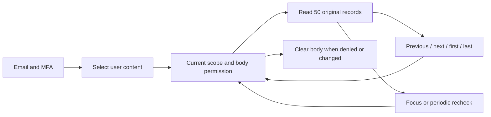
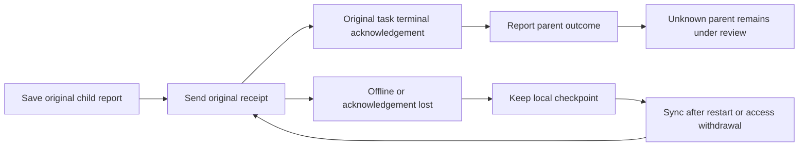
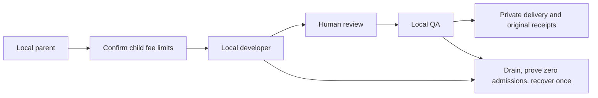
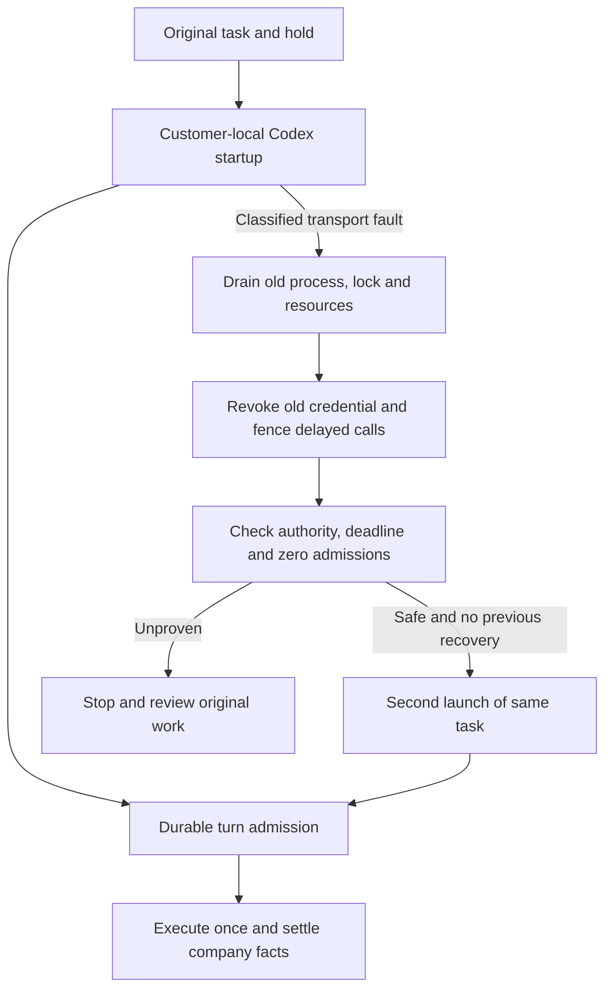
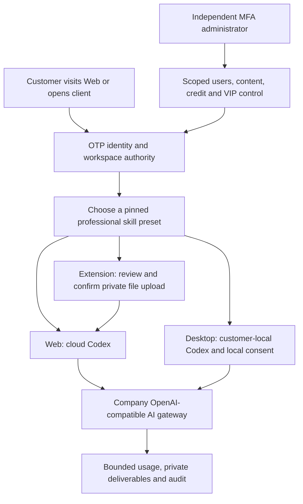

# Workmate · CopyPaste Enterprise Agent

<!-- content-history-stage132 -->
## Complete administrator content history · Stage132

Open **User content → Read content** on a conversation, specialist or memory. Read up to 50 original records per page, move in either direction or jump to the first/last page. Specialist and memory versions start with the newest and distinguish **Customer version** from **Administrator revision**. Expand a version to inspect its complete record.

The server rechecks the current MFA session, both content-reading permissions, tenant/project scope and explicit denials on every request. Signed cursors reject stale content. The visible reader rechecks every 15 seconds and on focus; failed authorization or changed readable sources clears its private state. Closing or changing resources aborts old requests and rejects late bodies. Bodies and cursors are not saved to browser storage. Unavailable assistant sources are masked.

The new GET `/v1/admin/content/:kind/:id/history` accepts `edge=first|last` or a returned `cursor`, with a fixed page size of 50. SQL134 maintains the message-history revision. Legacy body responses retain their limit and add `truncated` plus `history_url`. Ordinary customer conversations still have their existing 80-input limit.

54 related backend tests and 9 actual browser journey checks passed. Real API fixtures contain 205 specialist versions, 205 memory versions and 66 customer messages. Native PostgreSQL, email/MFA, actual administrator revision, source withdrawal, permission denial, late responses and 375/768/1440 layouts were exercised. Business data and retained assistant output are explicitly synthetic; no model ran. Original failed attempts and their exact sources remain available. Current captures contain 5 screenshots and 2 real-time GIF/MP4 pairs. All owned test resources closed.



[Behavior](https://github.com/copypasteltd/workmate/blob/main/docs/technical/132-admin-content-history.md) · [Checkpoint](https://github.com/copypasteltd/workmate/blob/main/docs/quality/content-history-checkpoint-132.json) · [Numbered open work](https://github.com/copypasteltd/workmate/blob/main/docs/quality/remaining-work-stage132.md) · [API supplement](https://github.com/copypasteltd/workmate/blob/backend/contracts/admin-content-history-route-additions.json)


[Oldest memory version](https://github.com/copypasteltd/workmate/blob/admin/assets/screenshots/workmate-content-history-132-02-oldest-memory-en.png) · [Administrator provenance](https://github.com/copypasteltd/workmate/blob/admin/assets/screenshots/workmate-content-history-132-02-administrator-provenance-en.png) · [中文页面](https://github.com/copypasteltd/workmate/blob/admin/assets/screenshots/workmate-content-history-132-02-memory-history-zh.png) · [Permission denied](https://github.com/copypasteltd/workmate/blob/admin/assets/screenshots/workmate-content-history-132-02-permission-withdrawn-en.png) · [Navigation MP4](https://github.com/copypasteltd/workmate/blob/admin/assets/screenshots/workmate-content-history-132-02-complete-version-navigation.mp4) · [Withdrawal MP4](https://github.com/copypasteltd/workmate/blob/admin/assets/screenshots/workmate-content-history-132-02-permission-withdrawal.mp4)

89 required, 12 unconfirmed suggested and 1 optional full-acceptance records remain open. This is bounded history-reader qualification; full operations, all roles, production models/connectors and signed desktop installation remain in the numbered ledger. Historical sections below keep their original scope.

---

<!-- durable-receipt-stage131 -->
## Durable native result and billing receipt synchronization · Stage131

A completed local child keeps its original result when the company finish request is not delivered or its acknowledgement is lost after settlement. The parent cannot clear the operation until the child receipt is acknowledged. Choose **Sync saved receipts** after reconnecting. This also works after withdrawing local access and fully quitting and reopening the app, without replaying commands, starting QA or making another model request.

The known child settles once using company-observed usage. An unknown parent retains its original budget hold for reconciliation. Receipt synchronization does not establish overall workflow success or clear uncertain local side effects. Account and server authorization remain enforced; another login family or tenant permission cannot be bypassed.



Bounded validation passed: 124 controller checks including 15 new receipt boundaries, 43 actual pinned-Codex checks, three actual native/SQL receipt-loss journeys, two compiler checks and eight actual unsigned packaged-Desktop checks. An old/current comparison reproduces the lost child finish request on the old code and verifies child-before-parent delivery on the new code. Processes, commands, files, SQL, dropped HTTP responses and a full application restart are actual; model responses and native dialog choices are synthetic. All owned test resources were closed. Original failures, executed QA and source snapshots remain preserved.

[Implementation](technical/131-desktop-durable-receipt-sync.md) · [Current checkpoint](quality/receipt-sync-checkpoint-131.json) · [Complete numbered open work](quality/remaining-work-stage131.md)


[Fee confirmation](https://github.com/copypasteltd/workmate/blob/desktop/assets/screenshots/workmate-receipt-sync-131-01-child-fee-confirmation-en.png) · [撤权后中文提示](https://github.com/copypasteltd/workmate/blob/desktop/assets/screenshots/workmate-receipt-sync-131-01-revoked-receipts-pending-zh.png) · [Original receipts synchronized](https://github.com/copypasteltd/workmate/blob/desktop/assets/screenshots/workmate-receipt-sync-131-01-original-receipts-synchronized-en.png) · [Loss/withdrawal MP4](https://github.com/copypasteltd/workmate/blob/desktop/assets/screenshots/workmate-receipt-sync-131-01-receipt-loss-and-permission-withdrawal.mp4) · [Restart/sync MP4](https://github.com/copypasteltd/workmate/blob/desktop/assets/screenshots/workmate-receipt-sync-131-01-receipt-sync-after-application-restart.mp4)

The full-acceptance ledger retains 89 required, 12 unconfirmed suggestion and one optional records; these are not 102 uncoded modules. Arbitrary crash/process reclamation, login-family changes, complete parent accounting reconciliation, professional roles, live model/media services and signed installation remain open. This increment uses the independent Stage131 manifest/publisher; Stage128 and130 evidence retains its original historical scope.

```powershell
python -X utf8 docs/tools/record_receipt_sync_131_v1.py --verify
python -X utf8 docs/tools/prepare_receipt_publication_131_v1.py --verify
python -X utf8 docs/tools/publish_receipt_sync_131_v1.py --push
```

The publisher checks the real Stage130 remote receipt, full history security/README links, current Git bytes and all eight remote refs, then uses an ordinary atomic push. General build/start instructions follow below.

---

<!-- workflow-recovery-stage130 -->
## Customer-local workflow recovery and cancellation · Stage130

Task shutdown and normal completion now retire each parent/child background authority watcher independently. An uncooperative heartbeat transport cannot keep cleanup waiting or resume execution through a late response. Retiring a watcher does not cancel a normally completing parent; fresh current-authority checks still precede native turn admission.

Customer flow: browser sign-in and company workspace → choose a local folder and explicitly grant access → confirm separate child limits → local developer work → human review of actual files → local QA → private SOP, frozen JSON and recovery-note downloads. Actual developer initialization and QA thread-start faults each recover once, only after durable company proof of zero admissions. Original tasks, holds, deadlines and worker attempts remain.



Bounded checks passed: 109 controller checks, 43 actual pinned-Codex checks, three complete native parent/child journeys, two current compiler checks and eight actual unsigned packaged-UI checks. Electron, native PostgreSQL, shell work and files are real. Model output, dialog choices and injected transport faults are fixtures. Three native widths retain no default frame/menu, visible scroll rails or horizontal overflow. Owned resources close; original failed probes and source snapshots remain immutable.

[Implementation](technical/130-desktop-workflow-recovery.md) · [Current checkpoint](quality/workflow-recovery-checkpoint-130.json) · [Numbered remaining work](quality/remaining-work-stage130.md)


[Fee confirmation](https://github.com/copypasteltd/workmate/blob/desktop/assets/screenshots/workmate-workflow-recovery-130-01-child-fee-confirmation-en.png) · [Completed English UI](https://github.com/copypasteltd/workmate/blob/desktop/assets/screenshots/workmate-workflow-recovery-130-01-two-recovered-children-completed-en.png) · [Completed Chinese UI](https://github.com/copypasteltd/workmate/blob/desktop/assets/screenshots/workmate-workflow-recovery-130-01-two-recovered-children-completed-zh.png) · [Actual wall-clock MP4](https://github.com/copypasteltd/workmate/blob/desktop/assets/screenshots/workmate-workflow-recovery-130-01-parent-child-startup-recovery.mp4)

89 required, 12 unconfirmed suggested and one optional full-acceptance records remain open; these are not 102 uncoded modules. Arbitrary crash/multi-node behavior, all local tools, complete roles, durable resubmission of lost child finish receipts, live providers and signed installation remain. Stage130 uses its own manifest and publisher. The old V11 entry and Stage128 manifest retain their historical source scope and do not publish this increment.

[简体中文](README.md) · [English](README.en.md)

<!-- startup-recovery-stage128 -->
## Safe customer-local startup recovery · Stage128

Desktop runs pinned Codex on the customer's computer. After explicit folder selection and consent, a classified initialization/thread transport failure first drains the old process, lock and owned tools. Company services permit one recovery only when no turn, provider, input-count or company-tool request has been admitted and the original identity, permissions and deadline remain valid. At most two launches retain one task, hold and worker attempt; the absolute deadline never extends.

The UI shows Reconnecting. Retry connection retrieves an unconfirmed original result; possibly executed work requires local-file and billing review. Withdrawal, rejection, incomplete cleanup, admitted turns and unknown outcomes cannot replay automatically. Scoped inference credentials go only to the trusted local runtime and are excluded from the recovery journal and renderer.



Upgrade the server through SQL133 with the database owner before starting the matching API. New clients opt into `desktop-startup-recovery-v1`. `/startup-recovery` binds the original session, contract digest and durable recovery key; `/turn-admission` precedes native `turn/start`. Legacy clients retain their existing flow without recovery authority.

The checkpoint records bounded controller, actual pinned Codex, native SQL and actual unsigned packaged Desktop qualification. Model responses and dialog decisions are synthetic as requested. This does not qualify a live provider, signed installation, every crash combination or complete professional roles. Earlier packages and captures retain their original source scope.

Bounded checks passed: 91 related controller, 43 actual pinned-Codex, 30 native database/API, three current compilation and six actual unsigned packaged-UI checks. The journey verifies sign-in, consent, one startup recovery, one original-task charge, one displayed answer, pending-startup withdrawal and native widths of 1000/1240/1440. Current PNG/GIF/MP4 captures come from successful attempt04; failed attempts01–03 and their raw records remain intact. V11 publishes the branches; the final receipt and remote SHA readback determine publication status.

[Design and APIs](https://github.com/copypasteltd/workmate/blob/docs/docs/technical/128-desktop-startup-recovery.md) · [Sources and qualification](https://github.com/copypasteltd/workmate/blob/docs/docs/quality/startup-recovery-checkpoint-128.json) · [Numbered open work](https://github.com/copypasteltd/workmate/blob/docs/docs/quality/remaining-work-stage128.md)


[Original receipt](https://github.com/copypasteltd/workmate/blob/desktop/assets/screenshots/workmate-startup-recovery-128-04-original-local-receipt.png) · [Withdrawal screenshot](https://github.com/copypasteltd/workmate/blob/desktop/assets/screenshots/workmate-startup-recovery-128-04-permission-revoked-before-turn.png) · [Withdrawal GIF](https://github.com/copypasteltd/workmate/blob/desktop/assets/screenshots/workmate-startup-recovery-128-04-revoke-pending-startup.gif) · [Recovery MP4](https://github.com/copypasteltd/workmate/blob/desktop/assets/screenshots/workmate-startup-recovery-128-04-startup-and-original-receipt.mp4) · [Withdrawal MP4](https://github.com/copypasteltd/workmate/blob/desktop/assets/screenshots/workmate-startup-recovery-128-04-revoke-pending-startup.mp4)

<!-- local-startup-stage127 -->
## Historical Stage127

Stage127 fixes customer-local Desktop startup renewal for main/workflow-child tasks and cancellation during asynchronous preparation/native requests. Codex stays on the customer's computer, using the original task and billing hold. Closing drains preparation and owned processes; bilingual feedback avoids internal error codes.

Bounded qualification covers 73 related controller, 38 real pinned-native and five actual unsigned packaged-window checks; final results are recorded in the checkpoint. Actual journeys cover browser sign-in, onboarding, default decline/explicit consent, startup beyond 45 seconds, original company SQL billing, withdrawal and three native window widths. Actual PNG/GIF/MP4 captures are added. Model responses/dialog choices are synthetic. V10 retains an ordinary atomic eight-ref update and SHA readback. Earlier results/media keep their original source scope.

Automatic Desktop startup recovery still needs atomic zero-admission proof and revocation/draining of old authority. Complete roles, signed installation and all 89 required full-acceptance records remain open.

[Current behavior](technical/127-desktop-startup-lifecycle.md) · [Numbered changes](changes/127-desktop-startup-lifecycle.md) · [Checkpoint](quality/local-startup-checkpoint-127.json) · [All numbered open work](quality/remaining-work-stage127.md)

<!-- native-publishing-stage126 -->
This increment fixes social-role creation and exact publication-source identity, and completes accounts → preview → prepare → status through real cloud Codex with simulated model/accounts. Current native09 passes5/5, startup fault03 passes9/9 and complete sixteen-file related10 passes155/155 with unchanged source and reclaimed owned native database/fixtures. Interrupted06, run08 (132 passed, one failed) and earlier failures retain their original outcomes.

Bounded pre-turn recovery requires zero model requests and retains the RPC deadlines, two-process limit and original billing identity. V9 is the publication entry; only its terminal receipt and remote SHA readback establish publication. No new UI/media or full-role acceptance is claimed. Desktop-local recovery/four-tool qualification, underlying intermittent latency causality, complete roles and all 89 required full-acceptance records remain open.

Stage125 and earlier acceptance claims, screenshots and recordings below are historical and retain their original source versions. The Stage126 checkpoint defines this increment's current scope.

[Behavior](technical/126-native-publication-tools.md) · [Numbered changes](changes/126-native-publication-tools.md) · [Evidence](quality/native-publication-checkpoint-126.json) · [All numbered open work](quality/remaining-work-stage126.md)

<!-- controlled-publications-stage125 -->
This increment adds explicit customer-confirmed marketing publication, actual outgoing media, unknown-outcome reconciliation, scoped Admin controls and client integration. Passing scopes cover 117 related backend, five Admin-upgrade CLI, 12 native-analysis, 21 Desktop-media, 70 Extension, 14 actual Web/Admin and ten actual packaged Desktop/native Chrome Side Panel checks. Original failures, sources and media remain preserved. Native publishing media qualification covers an image; new video playback/seek, actual Codex calls to four publication tools, signed installation and twelve professional-role qualifications remain open.

V8 is the historical Stage125 publisher; only its final receipt and remote SHA readback establish publication. All 89 required, 12 unconfirmed-suggestion and one optional full-acceptance records remain open. Bounded passing evidence is not full product delivery.

[方案 / Behavior](technical/125-controlled-publishing-and-native-media.md) · [证据 / Evidence](quality/publications-checkpoint-125.json) · [本轮实现与待办 / Changes and open work](changes/125-controlled-publications.md) · [全部编号清单 / All numbered records](quality/remaining-work-stage125.md) · [保留v7 / Preserved v7](quality/remaining-work-current-review-125-v7.md)

<!-- admin-profile-revisions-stage124 -->
Stage 124 adds scoped administrator revisions for customer specialists, brands and memories. All 68 checks across five complete related backend files, 11 Admin unit checks, eight actual UI flows and 14 layout observations passed; eight PNG captures and three GIF/MP4 pairs retain original evidence and earlier failures. The Stage124 publication entry point is V7; actual remote success follows its final receipt and SHA readback.

[Behavior](technical/124-admin-profile-revisions.md) · [Evidence](quality/admin-profile-checkpoint-124.json) · [Changes](changes/124-admin-profile-revisions.md) · [Current numbered open records](quality/remaining-work-stage124.md)

[中文](README.md) · [English](README.en.md) · [CopyPaste](https://copypaste.hk/)

<!-- admin-content-revisions-123 -->

This increment adds scoped administrator body revisions for teams, shared project briefs and methods: authorized reference search, structured forms, before/after review, explicit confirmation, immutable versions, separate administrator provenance, history and original-request recovery after disconnects. All **75 checks across five complete related backend files**, **seven actual Admin UI flows** and seven dialog/field-bound observations at four widths passed. Six PNG and two GIF/MP4 pairs retain their original captures; previous failures remain preserved. The 102 full acceptance records are tracked separately.

[Behavior](technical/123-admin-content-revisions.md) · [Evidence](quality/admin-content-checkpoint-123.json) · [Changes](changes/123-admin-content-revisions.md) · [Numbered open requirements](quality/remaining-work-stage123.md)

<!-- runtime-startup-122 -->
## Historical Stage 122 scope

This delivery adds bounded Codex initialization recovery, exact thread/turn isolation, sanitized diagnostics and fresh-checkout Desktop test preparation. Recorded passes cover 12 cloud native, 180 Desktop unit, 25 Desktop native, 20 Web unit and eight actual packaged UI checks, with six screenshots and one GIF/MP4 pair. Five complete related backend files passed 79 checks, including native database shutdown and fixture reclamation; this is not a new full backend run. Bounded passing scopes do not close the 102 full acceptance records.

[Behavior](technical/122-codex-startup-and-turn-isolation.md) · [Evidence](quality/runtime-startup-checkpoint-122.json) · [Changes](changes/122-runtime-startup-and-turn-isolation.md) · [Numbered open requirements](quality/remaining-work-stage122.md)

Workmate gives businesses in Hong Kong a company-hosted Codex agent through a Web workspace, a native Chrome right Side Panel and a customer-local Desktop application. AI requests use the company OpenAI-compatible gateway. Brand styling follows CopyPaste’s existing website.

| Component / 组件 | Execution and use / 执行与使用 | Source and bilingual guide / 源码与双语说明 |
|---|---|---|
| Backend / 后端 | Identity, company gateway, cloud Codex, private files, tasks, billing and authority / 身份、云端执行、文件、费用和权限 | [backend](https://github.com/copypasteltd/workmate/blob/backend/README.md) · [English](https://github.com/copypasteltd/workmate/blob/backend/README.en.md) |
| Web | Hosted workspace; roles, projects, conversations, deliverables and optional resources / 云端工作台、角色、项目、对话与成果 | [web](https://github.com/copypasteltd/workmate/blob/web/README.md) · [English](https://github.com/copypasteltd/workmate/blob/web/README.en.md) |
| Admin | Separate MFA identity; scoped customer, content, credit, VIP and infrastructure administration / 独立 MFA 与用户、内容、费用、VIP、资源管理 | [admin](https://github.com/copypasteltd/workmate/blob/admin/README.md) · [English](https://github.com/copypasteltd/workmate/blob/admin/README.en.md) |
| Desktop | Local Codex and revocable local authority; frameless native window / 本机 Codex、可撤销本机权限与无边框窗口 | [desktop](https://github.com/copypasteltd/workmate/blob/desktop/README.md) · [English](https://github.com/copypasteltd/workmate/blob/desktop/README.en.md) |
| Extension | Native right Side Panel; review and confirm private uploads before cloud execution / 原生右侧栏、文件审核确认后交云端执行 | [extension](https://github.com/copypasteltd/workmate/blob/extension/README.md) · [English](https://github.com/copypasteltd/workmate/blob/extension/README.en.md) |
| Delivery / 交付 | Native qualification, recovery, release tooling and physical-node source / 原生验收、恢复、发布工具与物理节点源码 | [delivery](https://github.com/copypasteltd/workmate/blob/delivery/README.md) · [English](https://github.com/copypasteltd/workmate/blob/delivery/README.en.md) |



The priority workflows are marketing images, video, effects and typography; Google Ads, GA4, SEO/GEO and Meta analysis; and repeatable internal workflows. The catalog contains 18 professional definitions from software development to design, with pinned skill versions, model/tool permissions, budgets and output contracts. A definition is not a completed professional qualification.

A customer signs in, creates or joins a company and project, chooses a role and supplies an instruction and approved sources. The server checks identity, current access, limits and funds before creating work. Progress, approvals, private deliverables and consumption remain attached to the same task. Exact request identities protect response-loss retries. Cancellation, revocation and erasure are enforced again at execution and result-access boundaries.

Desktop executes Codex on the customer’s machine. The customer can grant and revoke full local authority; the frameless renderer has custom window controls and no native Electron menu. The extension uses Chrome’s native right Side Panel, separately confirms selected uploads and separately submits the message. Optional dedicated cloud computers require an expiring, fixed-duration resource quote and explicit scope/cost confirmation; Codex control and its AI budget require separate consent.

Administrators use separate MFA authentication and scoped, deny-aware permissions. Users, usage, credits, VIP grants, roles, content, plans and resources have independent controls. Sensitive changes require reasons, current versions, idempotency and audit. Admin resource metadata does not expose private customer pixels or file contents. Uncertain usage or physical cleanup retains the original funding reservation until supported reconciliation.

Historical Stage 121 bounded qualification: 1388 backend tests in 112 complete files, 338 integrated client checks, 24 actual UI checks, 29 PNGs and 5 GIF/MP4 pairs; 2209 final source bindings were recorded. Provider decisions and physical-node protocol responses are explicit fixtures. No actual Linux host or live provider quality is claimed. All 102 original requirement records still need full acceptance; the earlier numbered audit is retained as a dated snapshot.

An earlier native Codex initialization exceeded the unchanged 60-second RPC deadline. Three fresh initialization/thread-start diagnostics passed, but the original cause remains unproven. The failed run and cleanup evidence remain available; a successful later run does not establish production startup reliability.


[MP4 · desktop](https://github.com/copypasteltd/workmate/blob/desktop/assets/screenshots/workmate-dedicated-desktop-07-local-cloud-boundary.mp4?raw=true)


[MP4 · web](https://github.com/copypasteltd/workmate/blob/web/assets/screenshots/workmate-13-dedicated-cloud-consent.mp4?raw=true)


[MP4 · extension](https://github.com/copypasteltd/workmate/blob/extension/assets/screenshots/workmate-dedicated-extension-05-folder-retry.mp4?raw=true)

[Current technical design / 当前技术方案](technical/121-dedicated-cloud-and-client-execution.md) · [Current qualification / 当前限定验收](quality/dedicated-cloud-checkpoint.json) · [Raw evidence index / 原始证据](quality/dedicated-cloud-evidence-121/index.json)

[All numbered open requirements / 全部编号待办快照](quality/remaining-work-2026-10-29.md) · [Structured requirements / 结构化清单](quality/remaining-work-2026-10-29.json) · [This change / 本轮更新](changes/121-dedicated-cloud-delivery.md)

[Client execution contract / 客户端执行约束](requirements/03-client-execution-amendment.md) · [Workspace rules / 工作区规则](governance/03-workspace-and-path-policy.md) · [Git publication rules / 分支发布规则](governance/04-git-branches-and-publication.md)

[Resource OpenAPI / 资源接口](contracts/dedicated-cloud.openapi.json) · [Route additions / 路由增量](contracts/dedicated-cloud-route-additions.json) · [Previous published checkpoint / 上一版验收](quality/integrated-recovery-checkpoint.json)

All development uses `D:\dev\copypasted\自有agent\dev\`; central documents use `D:\dev\copypasted\自有agent\docs\`. Each component is an independent Git repository. Docker, WSL and virtualization are prohibited. Native verification closes only browsers, pages, services and database processes it owns. Local `.env` values, credentials, dependency folders and generated installers are excluded from Git.

实际开发位于上述唯一 D 盘路径；各端独立仓库，中央文档统一位于 `docs/`。禁止 Docker、WSL 与虚拟化。原生验证只关闭自身创建的浏览器、页面、服务和数据库进程。密钥、`.env`、依赖目录与生成的安装程序不提交到 Git。

Run each component using its own bilingual guide. Use the backend demo configuration for local fake-data development, then connect Web/Admin and pair the native clients through their documented OTP/PKCE flow. Native node installation is operator-managed and requires an actual qualified physical Linux host; the supplied source and protocol tests do not establish that host’s readiness.

请按各端 README 的安装／启动说明运行：后端使用 demo 配置与假数据，Web／Admin 连接该服务；原生客户端通过各自文档中的 OTP／PKCE 接入。物理节点安装由运营人员管理，需要另行验证真实 Linux 主机，源码和协议测试本身不代表该主机已可交付。
