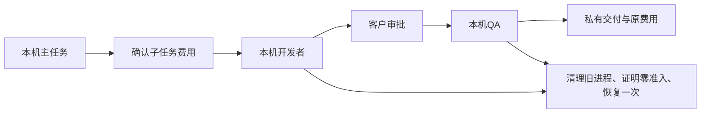
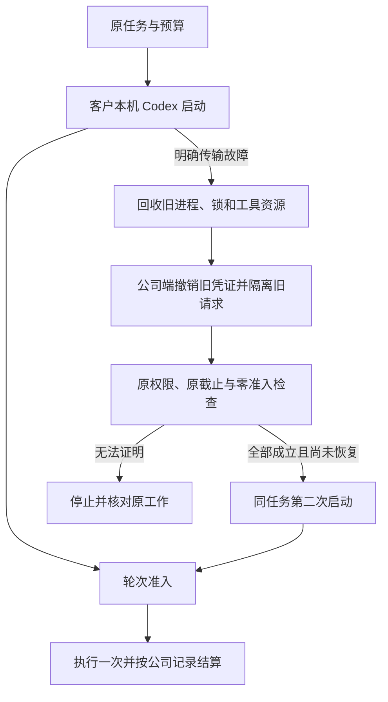
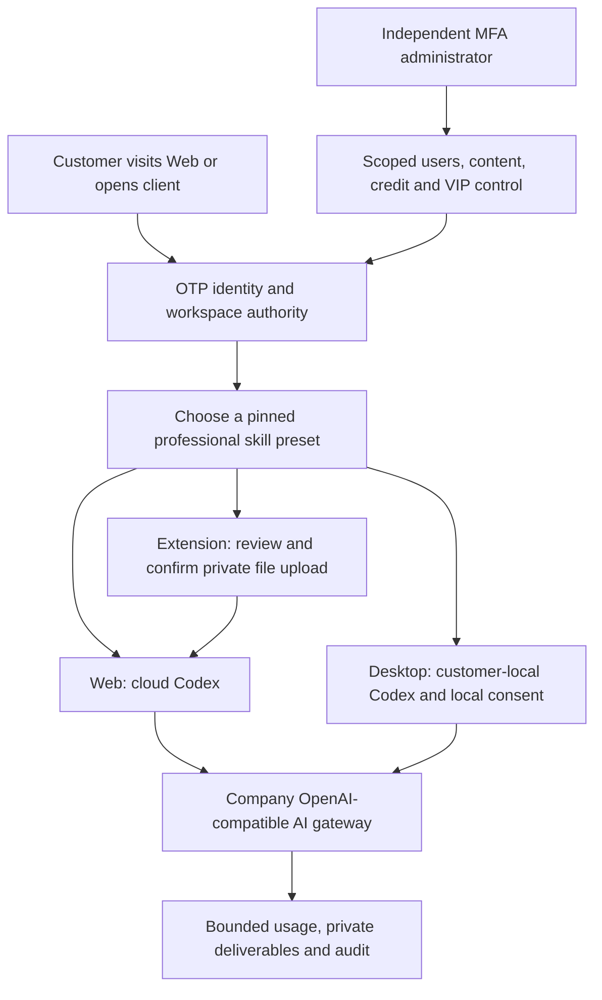

# Workmate · CopyPaste Enterprise Agent

<!-- workflow-recovery-stage130 -->
## 本机父子流程恢复与取消 · 阶段130

本轮修复停止或正常完成任务时，后台授权保活响应卡住导致收尾等待的问题。主任务和每个子任务分别取消并等待自己的保活观察器；即使底层请求忽略取消，其迟到响应也不能继续启动任务。正常完成不会因此取消父任务；提交本机轮次前仍必须重新检查当前权限。

客户流程为：浏览器登录与企业工作区 → 选择本机目录并主动授权 → 确认额外子任务费用 → 本机开发者执行 → 客户审核实际文件 → 本机QA执行 → 下载SOP、固定版本JSON和恢复说明。两个子任务分别发生真实初始化/建会话故障后，在公司持久证明零准入的前提下各恢复一次；原任务、原预算、截止与worker attempt保持一致。

限定验证通过：109项控制层、43项真实固定Codex、3个完整原生父子流程、2项当前编译和8项实际未签名打包界面检查。打包旅程使用真实Electron、原生PostgreSQL、本机命令与文件；模型回答、对话框选择及注入的传输故障为测试输入。三个原生窗口宽度保持无边框、无默认菜单、无可见滚动条及无横向溢出，全部所属资源已关闭。原始失败及其源码快照保持不变。

[实现方案](technical/130-desktop-workflow-recovery.md) · [当前检查点](quality/workflow-recovery-checkpoint-130.json) · [完整编号待办](quality/remaining-work-stage130.md)

[费用确认](https://github.com/copypasteltd/workmate/blob/desktop/assets/screenshots/workmate-workflow-recovery-130-01-child-fee-confirmation-en.png) · [英文完成画面](https://github.com/copypasteltd/workmate/blob/desktop/assets/screenshots/workmate-workflow-recovery-130-01-two-recovered-children-completed-en.png) · [中文完成画面](https://github.com/copypasteltd/workmate/blob/desktop/assets/screenshots/workmate-workflow-recovery-130-01-two-recovered-children-completed-zh.png) · [完整实时MP4](https://github.com/copypasteltd/workmate/blob/desktop/assets/screenshots/workmate-workflow-recovery-130-01-parent-child-startup-recovery.mp4)

完整验收仍有89条必需、12条未确认建议和1条可选记录开放；它们是完整验收记录，不等于102个功能尚未编码。任意崩溃/多节点、所有本机工具、全部专业角色、丢失子任务完成回执的持久补交、正式模型及签名安装等继续推进。当前发布由阶段130独立清单和发布器约束；旧V11入口及阶段128清单保留历史源码范围，不用于发布本轮变更。

[简体中文](README.md) · [English](README.en.md)

<!-- startup-recovery-stage128 -->
## 本机启动安全恢复 · 阶段128

Desktop 在客户电脑运行固定版本 Codex。客户选择目录并主动授权后，初始化或打开会话若发生明确的传输故障，主进程先回收旧进程和锁，再请求公司服务检查原任务。只有轮次尚未准入、没有任何模型/输入计数/公司工具准入，且身份、权限与原截止仍有效，才允许恢复一次。最多两次启动，沿用原任务、原预算预留和 worker attempt，不延长原截止。

界面显示「正在重连」。连接结果未确认时，「重试连线」仅取回原请求结果；可能已执行的工作需先核对本机文件及费用。撤权、协议拒绝、清理失败、已提交轮次和结果未知均禁止自动重做。推理凭证仅传给可信本机运行器，不写入本机恢复日志或渲染页面。

服务端通过 SQL133 升级；应先使用所有者执行完整迁移，再启动相应 API。新客户端声明 `desktop-startup-recovery-v1`；`/startup-recovery` 使用原绑定、固定契约摘要和原恢复请求键，`/turn-admission` 在 `turn/start` 前登记。旧客户端保持原执行流程，不能取得新的恢复许可。

本轮检查点记录控制层、实际固定 Codex、原生 SQL 与实际未签名打包客户端的限定验证。模型回答和对话框选择按用户要求使用假数据；尚不代表正式模型、签名安装、全部崩溃组合或专业角色整体验收。各旧阶段的包和画面仍对应其原源码。

本轮限定检查通过：91项相关控制层、43项真实固定版本Codex、30项原生数据库/API、3项当前编译和6项实际未签名打包界面检查。实际旅程验证了登录、授权、一次启动恢复、原任务的一次收费、单次回答、待响应时撤权，以及1000/1240/1440三个原生窗口宽度。当前截图、GIF和MP4来自成功的04次运行；失败的01—03次运行及原始记录均完整保留。发布入口为V11，远端状态以最终推送回执和SHA回读为准。

[方案与接口](https://github.com/copypasteltd/workmate/blob/docs/docs/technical/128-desktop-startup-recovery.md) · [匹配源码与验证](https://github.com/copypasteltd/workmate/blob/docs/docs/quality/startup-recovery-checkpoint-128.json) · [编号待办](https://github.com/copypasteltd/workmate/blob/docs/docs/quality/remaining-work-stage128.md)

[Original receipt](https://github.com/copypasteltd/workmate/blob/desktop/assets/screenshots/workmate-startup-recovery-128-04-original-local-receipt.png) · [Withdrawal screenshot](https://github.com/copypasteltd/workmate/blob/desktop/assets/screenshots/workmate-startup-recovery-128-04-permission-revoked-before-turn.png) · [Withdrawal GIF](https://github.com/copypasteltd/workmate/blob/desktop/assets/screenshots/workmate-startup-recovery-128-04-revoke-pending-startup.gif) · [Recovery MP4](https://github.com/copypasteltd/workmate/blob/desktop/assets/screenshots/workmate-startup-recovery-128-04-startup-and-original-receipt.mp4) · [Withdrawal MP4](https://github.com/copypasteltd/workmate/blob/desktop/assets/screenshots/workmate-startup-recovery-128-04-revoke-pending-startup.mp4)

<!-- local-startup-stage127 -->
## 历史阶段127

当前阶段127修复Desktop主任务与工作流子任务启动期间授权保活，以及准备/原生请求等待中的关闭与撤权。客户本机Codex、原任务和原预留保持同一执行谱系；关闭等待准备退出并回收所属进程，双语提示不向用户暴露内部错误码。

限定验收为73项相关控制层、38项真实固定Codex及5项实际未签名打包窗口检查，最终结果见本轮检查点。实际旅程涵盖浏览器登录、工作区创建、默认取消/明确授权、超过45秒启动、一次公司账务、撤权及三个原生窗口宽度。新增实拍截图/GIF/MP4；模型和原生对话框选择为已授权测试数据。V10沿用普通八分支原子推送和最终SHA回读。此前结果和媒体保留原源码范围。

Desktop自动启动恢复仍需公司端原子零准入与旧权限撤销/等待证明；完整角色、签名安装及89条必需整体验收继续开放。

[当前方案](technical/127-desktop-startup-lifecycle.md) · [编号变更与待办](changes/127-desktop-startup-lifecycle.md) · [检查点](quality/local-startup-checkpoint-127.json) · [全部编号待办](quality/remaining-work-stage127.md)

<!-- native-publishing-stage126 -->
本轮修复新版社交角色无法创建、发布预览来源身份错误，并补齐模拟模型经真实云端Codex执行账户→预览→准备→状态的流程。当前源码发布专项09通过5/5，启动故障03通过9/9；完整16文件相关回归10通过155/155，源码未变，所属原生数据库和夹具清理通过。06中断、08的132通过／1失败及更早失败均保留原结论，不补造缺失的最终回执。

新增零模型请求、未提交轮次时的受限启动恢复，原RPC截止、两次上限与一次费用身份保持执行。发布入口为V9；实际发布以最终回执与远端SHA为准。本轮不新增界面媒体。Desktop本机同类恢复和四工具组合、底层偶发延迟根因、完整角色及原始89条必需整体验收继续开放。

下文阶段125及更早的验收结论、截图和录制均按各自原源码保留为历史；阶段126当前范围以本轮检查点为准。

[方案](technical/126-native-publication-tools.md) · [本轮编号更新](changes/126-native-publication-tools.md) · [证据](quality/native-publication-checkpoint-126.json) · [全部编号待办](quality/remaining-work-stage126.md)

<!-- controlled-publications-stage125 -->
本阶段补齐受控营销发布、客户逐次明确确认、实际输出媒体、未知结果核对、项目范围Admin及三端接入。当前相关后端117/117、Admin授权CLI 5/5、分析专项12/12、Desktop媒体21/21、Extension 70/70、实际Web/Admin 14/14、打包Desktop与原生Chrome右侧栏10/10通过。原始失败、源码和媒体保留。新增发布原生媒体实际验收覆盖图片，视频播放/拖动、四个发布工具实际Codex调用、签名安装及十二个角色专业资格仍待完成。

阶段125历史发布入口V8；仅最终执行回执及远端SHA证明发布。89条必需需求、12条未确认扩展和1条可选仍未关闭整体验收，不能把局部通过当作完整产品交付。

[方案 / Behavior](technical/125-controlled-publishing-and-native-media.md) · [证据 / Evidence](quality/publications-checkpoint-125.json) · [本轮实现与待办 / Changes and open work](changes/125-controlled-publications.md) · [全部编号清单 / All numbered records](quality/remaining-work-stage125.md) · [保留v7 / Preserved v7](quality/remaining-work-current-review-125-v7.md)

<!-- admin-profile-revisions-stage124 -->
当前阶段124补齐专家、品牌及记忆管理员修订：68/68相关后端、11/11后台单元、8/8实际页面和14次四档布局观察通过，保留8PNG和3组GIF/MP4。原失败、原源码及旧阶段证据不覆盖。阶段124发布入口V7，原发布状态以执行回执及SHA读取为准。

[本轮方案](technical/124-admin-profile-revisions.md) · [本轮证据](quality/admin-profile-checkpoint-124.json) · [更新说明](changes/124-admin-profile-revisions.md) · [最新编号待办](quality/remaining-work-stage124.md)

[中文](README.md) · [English](README.en.md) · [CopyPaste](https://copypaste.hk/)

<!-- admin-content-revisions-123 -->

本轮补齐管理员对团队、共享项目说明及业务方法的正文修订：获准参照搜索、结构化表单、前后差异、明确确认、不可变版本与独立管理员来源、历史及断线后原请求恢复。五个完整相关后端文件 **75/75**、实际 Admin 页面 **7/7**、四档宽度的 7 次弹窗/输入边界观察通过；新增 6 PNG、2 GIF、2 MP4，保留所有旧失败。原 102 条整体验收继续单独跟踪。

[本轮方案](technical/123-admin-content-revisions.md) · [本轮证据](quality/admin-content-checkpoint-123.json) · [更新说明](changes/123-admin-content-revisions.md) · [最新编号待办](quality/remaining-work-stage123.md)

<!-- runtime-startup-122 -->
## 阶段 122 历史范围

本轮补齐 Codex 初始化恢复、线程／轮次隔离、脱敏诊断及 Desktop 新检出目录的测试准备。已通过云端原生 12 项、Desktop 单元 180 项／原生 25 项、Web 单元 20 项和实际打包 UI 8 项；新增 6 张截图及 1 组 GIF／MP4。五个完整相关后端文件共 79 项通过，原生数据库与夹具回收核对通过；这项范围不代表新的全量后端回归。限定通过不关闭原始 102 项完整验收。

[本轮方案](technical/122-codex-startup-and-turn-isolation.md) · [本轮证据](quality/runtime-startup-checkpoint-122.json) · [更新说明](changes/122-runtime-startup-and-turn-isolation.md) · [最新编号待办](quality/remaining-work-stage122.md)

Workmate 面向在港企业，提供 Web 云端工作台、Chrome 原生右侧栏和客户本机 Desktop 三种入口。Agent 内核统一为 Codex，所有 AI 请求经公司 OpenAI 兼容网关；视觉规范沿用 CopyPaste 现有网站的风格与色系。

| Component / 组件 | Execution and use / 执行与使用 | Source and bilingual guide / 源码与双语说明 |
|---|---|---|
| Backend / 后端 | Identity, company gateway, cloud Codex, private files, tasks, billing and authority / 身份、云端执行、文件、费用和权限 | [backend](https://github.com/copypasteltd/workmate/blob/backend/README.md) · [English](https://github.com/copypasteltd/workmate/blob/backend/README.en.md) |
| Web | Hosted workspace; roles, projects, conversations, deliverables and optional resources / 云端工作台、角色、项目、对话与成果 | [web](https://github.com/copypasteltd/workmate/blob/web/README.md) · [English](https://github.com/copypasteltd/workmate/blob/web/README.en.md) |
| Admin | Separate MFA identity; scoped customer, content, credit, VIP and infrastructure administration / 独立 MFA 与用户、内容、费用、VIP、资源管理 | [admin](https://github.com/copypasteltd/workmate/blob/admin/README.md) · [English](https://github.com/copypasteltd/workmate/blob/admin/README.en.md) |
| Desktop | Local Codex and revocable local authority; frameless native window / 本机 Codex、可撤销本机权限与无边框窗口 | [desktop](https://github.com/copypasteltd/workmate/blob/desktop/README.md) · [English](https://github.com/copypasteltd/workmate/blob/desktop/README.en.md) |
| Extension | Native right Side Panel; review and confirm private uploads before cloud execution / 原生右侧栏、文件审核确认后交云端执行 | [extension](https://github.com/copypasteltd/workmate/blob/extension/README.md) · [English](https://github.com/copypasteltd/workmate/blob/extension/README.en.md) |
| Delivery / 交付 | Native qualification, recovery, release tooling and physical-node source / 原生验收、恢复、发布工具与物理节点源码 | [delivery](https://github.com/copypasteltd/workmate/blob/delivery/README.md) · [English](https://github.com/copypasteltd/workmate/blob/delivery/README.en.md) |

优先业务是 marketing 生图、视频、特效与字体，Google Ads／GA4／SEO／GEO／Meta 数据分析，以及企业内部重复流程优化。目录提供 18 个专业角色定义，覆盖软件开发至完整设计流程；各角色约束精确 Skill 版本、模型／工具、费用和成果格式。角色定义数量不代表已完成专业效果验收。

客户从登录开始，创建或加入企业和专案，选择角色、填写指令并提供获准资料。服务端检查身份、当前权限、额度和资金后创建任务。进度、审批、私有成果和消耗关联同一任务；响应丢失后沿用原请求身份。撤销权限、取消任务及删除资料均在实际执行、工具读取和成果访问时再次检查。

Desktop 的 Codex 在客户本机执行，客户可主动授予并撤销完整本机权限；无边框窗口采用自定义窗口控制，不显示 Electron 自带菜单。Extension 使用 Chrome 原生右侧栏，上传文件与发送对话分别确认。可选专属云端电脑采用有期限的固定时长报价，资源范围／费用须明确确认；允许 Codex 操作及 AI 费用上限另行确认。

管理员采用独立 MFA 登录、范围权限与显式拒绝。用户、消耗、费用赠送、VIP 授权、角色、内容、方案和资源分别控制。敏感变更要求操作理由、当前版本、幂等身份和审计；资源管理列表不泄露客户私有画面与文件内容。运行消耗或物理清理尚未确认时，保留原付款来源的资金预留，不伪造零消耗或清理完成。

阶段 121 历史限定验证：112 个完整后端文件共 1388 项测试通过，整合后客户端 338 项、实际 UI 24 项通过；29 张 PNG、5 组 GIF／MP4，以及 2209 个最终源码绑定。模型决策和物理节点协议响应使用明确假数据，未声称真实 Linux 节点或正式供应商质量已验收。原始 102 项需求仍保留完整验收待办；此前编号检查表作为带日期的快照保留。

此前一次原生 Codex 初始化超过既定 60 秒 RPC 上限；三个独立新目录的初始化／线程建立诊断通过，但原超时根因尚未确定。失败执行及清理证据原样保留，后续通过不能代替生产启动稳定性验收。

[MP4 · desktop](https://github.com/copypasteltd/workmate/blob/desktop/assets/screenshots/workmate-dedicated-desktop-07-local-cloud-boundary.mp4?raw=true)

[MP4 · web](https://github.com/copypasteltd/workmate/blob/web/assets/screenshots/workmate-13-dedicated-cloud-consent.mp4?raw=true)

[MP4 · extension](https://github.com/copypasteltd/workmate/blob/extension/assets/screenshots/workmate-dedicated-extension-05-folder-retry.mp4?raw=true)

[Current technical design / 当前技术方案](technical/121-dedicated-cloud-and-client-execution.md) · [Current qualification / 当前限定验收](quality/dedicated-cloud-checkpoint.json) · [Raw evidence index / 原始证据](quality/dedicated-cloud-evidence-121/index.json)

[All numbered open requirements / 全部编号待办快照](quality/remaining-work-2026-10-29.md) · [Structured requirements / 结构化清单](quality/remaining-work-2026-10-29.json) · [This change / 本轮更新](changes/121-dedicated-cloud-delivery.md)

[Client execution contract / 客户端执行约束](requirements/03-client-execution-amendment.md) · [Workspace rules / 工作区规则](governance/03-workspace-and-path-policy.md) · [Git publication rules / 分支发布规则](governance/04-git-branches-and-publication.md)

[Resource OpenAPI / 资源接口](contracts/dedicated-cloud.openapi.json) · [Route additions / 路由增量](contracts/dedicated-cloud-route-additions.json) · [Previous published checkpoint / 上一版验收](quality/integrated-recovery-checkpoint.json)

All development uses `D:\dev\copypasted\自有agent\dev\`; central documents use `D:\dev\copypasted\自有agent\docs\`. Each component is an independent Git repository. Docker, WSL and virtualization are prohibited. Native verification closes only browsers, pages, services and database processes it owns. Local `.env` values, credentials, dependency folders and generated installers are excluded from Git.

实际开发位于上述唯一 D 盘路径；各端独立仓库，中央文档统一位于 `docs/`。禁止 Docker、WSL 与虚拟化。原生验证只关闭自身创建的浏览器、页面、服务和数据库进程。密钥、`.env`、依赖目录与生成的安装程序不提交到 Git。

Run each component using its own bilingual guide. Use the backend demo configuration for local fake-data development, then connect Web/Admin and pair the native clients through their documented OTP/PKCE flow. Native node installation is operator-managed and requires an actual qualified physical Linux host; the supplied source and protocol tests do not establish that host’s readiness.

请按各端 README 的安装／启动说明运行：后端使用 demo 配置与假数据，Web／Admin 连接该服务；原生客户端通过各自文档中的 OTP／PKCE 接入。物理节点安装由运营人员管理，需要另行验证真实 Linux 主机，源码和协议测试本身不代表该主机已可交付。
