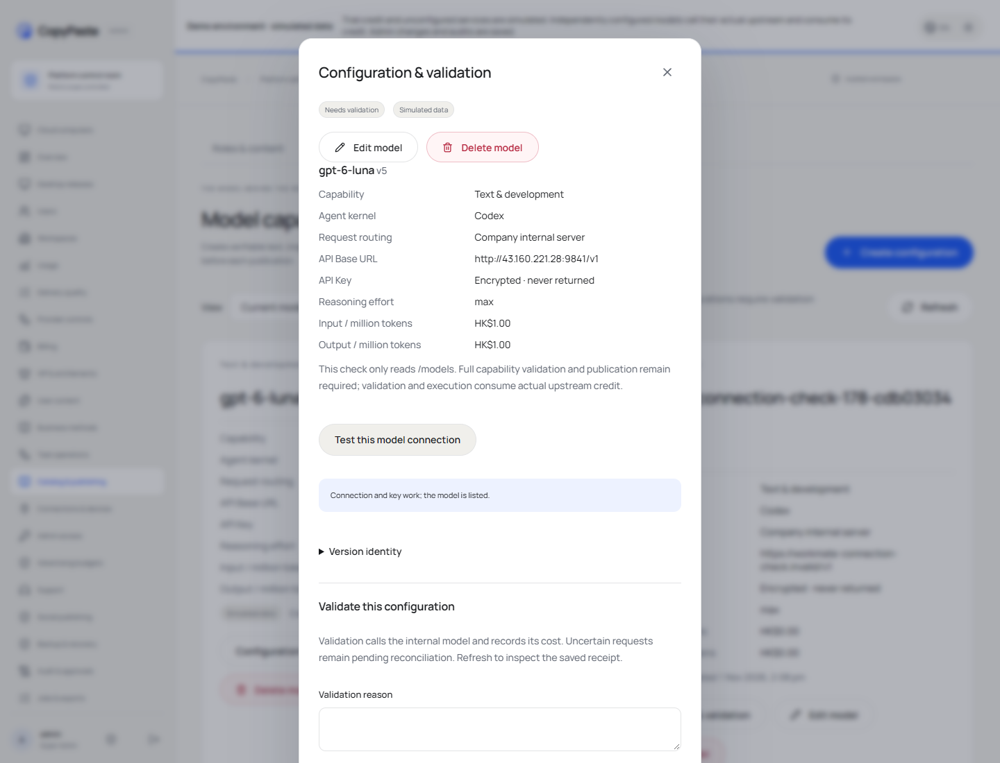
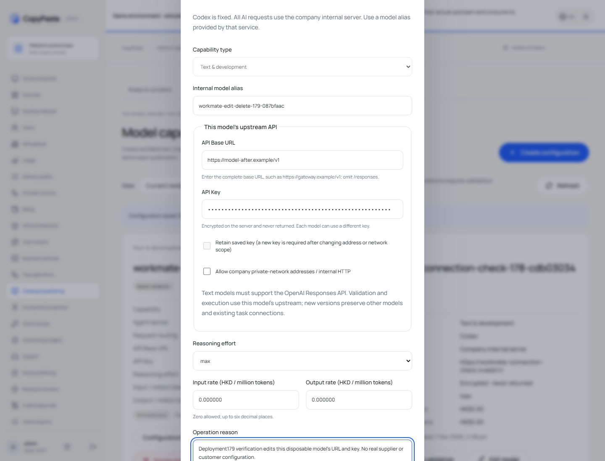
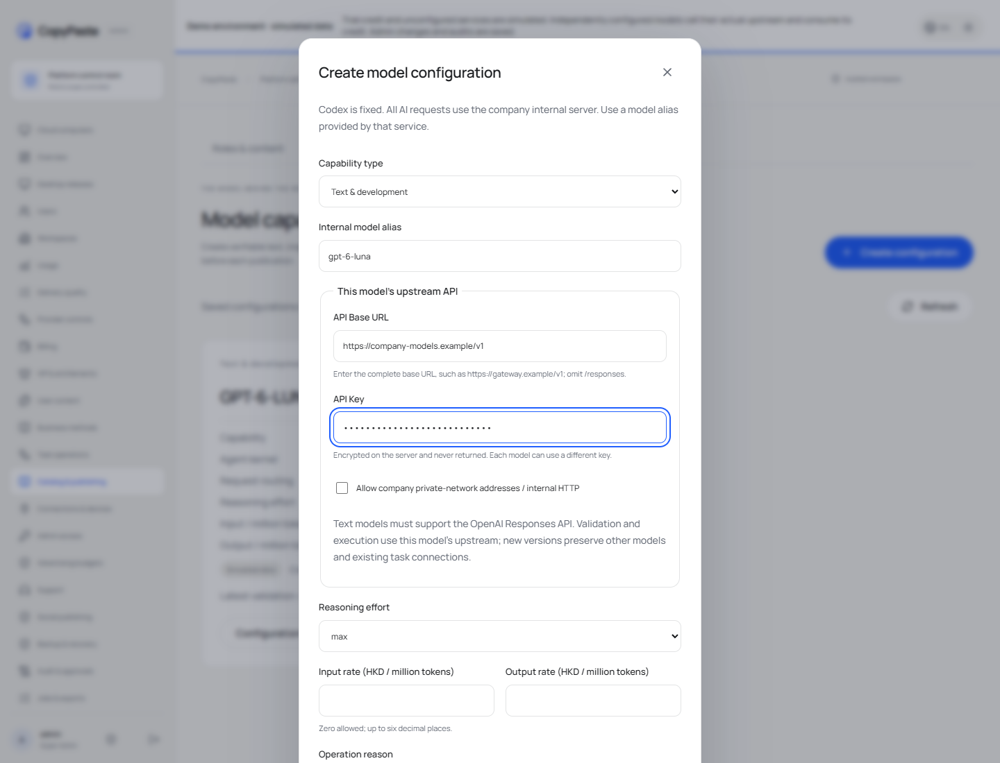

<!-- admin-directory-lifecycle-184 -->

用户与企业管理已补齐新建、逐行删除、当页多选与批量状态／删除，统一预览、权限、原子执行和完整审计。

[需求 / Requirements](requirements/184-admin-directory-lifecycle.md) · [开发与使用 / Implementation](development/184-admin-directory-lifecycle.md) · [变更 / Changes](changes/184-admin-directory-lifecycle.md) · [实际证据 / Evidence](quality/admin-directory-lifecycle-184.json)

<!-- highest-admin-direct-182 -->

最高管理员直接执行，其他角色按策略审批，完整保留审计。已验证线上 gpt-6-luna 直接发布、18项相关检查和6项实际页面检查。

[需求 / Requirements](requirements/182-highest-admin-direct.md) · [开发及逻辑图 / Implementation](development/182-highest-admin-direct.md) · [变更 / Changes](changes/182-highest-admin-direct.md) · [实际证据 / Evidence](quality/highest-admin-direct-182.json)

<!-- model-tool-contract-181 -->
## Codex 完整模型验证 / Complete Codex model validation

修复原生工具协议兼容、错误归因、原生上下文预算和后台文字重试；保留旧待对账记录，恢复初始策略中的可用验证名额。当前 gpt-6-luna 已在正式后台通过完整 Codex 验证，附实际截图和交互录制。本轮70项针对性检查通过。

The current gpt-6-luna passed real production Codex validation after repairing the native tool contract, specific errors, text retry, bounded bootstrap headroom and native input budgeting. Historical uncertain records remain intact. Actual captures and70 passing focused checks are recorded.

[需求 / Requirements](requirements/181-model-tool-contract.md) · [开发及逻辑图 / Implementation](development/181-model-tool-contract.md) · [变更 / Changes](changes/181-model-tool-contract.md) · [实际证据 / Evidence](quality/model-tool-contract-181.json)

<!-- model-http-180 -->
## 模型 HTTP/HTTPS 上游 / Model HTTP/HTTPS upstreams

公网模型 HTTP 不再被拦截，也不需要勾选内网选项。当前 gpt-6-luna 已在真实后台完成连接测试，认证成功且模型列表包含此模型。该结果不代替 Codex 完整验证或发布。

Public model HTTP is accepted without a private-network override. The real Admin connection test authenticates and lists the current gpt-6-luna model. Full Codex validation and publication remain separate.

[需求 / Requirements](requirements/180-model-http.md) · [开发 / Implementation](development/180-model-http.md) · [变更 / Changes](changes/180-model-http.md) · [实际证据 / Evidence](quality/model-http-180.json)

---

<!-- model-management-179 -->
## 已有模型可编辑和删除 / Edit and delete existing models

[正式后台 / Admin](https://agent-dashboard.copypaste.hk/catalog?view=capabilities) · [需求 / Requirements](requirements/179-model-management.md) · [操作和开发 / Usage and implementation](development/179-model-management.md) · [变更 / Changes](changes/179-model-management.md) · [核查 / Evidence](quality/model-management-179.json)

列表及详情提供直接编辑、保存更改、确认删除。当前模型显示更新后的配置；已删除模型移出可用目录，新工作不能选择，原任务和账务保留。API Key 可直接输入替换，原 Key 不回显。

Existing models now have explicit Edit/Delete actions. Saving updates the current entry; deletion blocks future selection and bootstrap fallback while preserving old task/accounting facts. Keys remain encrypted and are never returned.

Earlier records follow. 以下为历史记录。

---

<!-- per-model-connections-178 -->
## 每个模型独立配置上游 / Per-model upstream configuration

[正式后台 / Admin](https://agent-dashboard.copypaste.hk/catalog?view=capabilities) · [使用 / Usage](releases/model-connections-178.md) · [需求 / Requirements](requirements/178-per-model-connections.md) · [开发 / Implementation](development/178-per-model-connections.md) · [变更 / Changes](changes/178-per-model-connections.md) · [核查 / Evidence](quality/model-connections-178.json)

新增模型时填写该模型的 API 地址和 API Key；保存、连接测试、能力验证及独立审批发布后使用。每个模型版本保留独立连接；明确配置的上游会实际请求。

Each model owns its URL and encrypted key. Connection checks and full validation precede independent publication. Existing task versions keep their original upstream. No real supplier key was supplied for this deployment.

Earlier deployment records follow. 以下为历史记录。

---

<!-- public-domains-177 -->
## 正式域名已上线 / Public HTTPS deployment

[Web](https://agent.copypaste.hk) · [Admin](https://agent-dashboard.copypaste.hk) · [API](https://ai-api.copypaste.hk/health/ready)

[使用与运维 / Usage and operations](releases/domains-177.md) · [需求 / Requirements](requirements/33-public-domains.md) · [开发 / Implementation](development/177-public-domains.md) · [变更 / Changes](changes/177-public-domains.md) · [核查 / Evidence](quality/public-domains-177.json)

Desktop 0.7.2 / Extension 0.5.3 固定正式端点；现有凭据保留，外部服务继续使用假数据。Native clients use public endpoints; existing credentials and synthetic-provider mode are retained. 以下为历史部署与发行记录 / Earlier deployments and releases follow.

---

<!-- lan-deployment-176 -->
## 内网 HTTP 已部署 / LAN HTTP deployed

[访问、登录及运维 / Access and operations](releases/lan-176.md) · [核查 / Evidence](quality/lan-deployment-176.json) · [变更 / Changes](changes/176-lan-http-deployment.md)

Web `63070` · Admin `63071` · API `63072`；独立服务、数据库及明文服务器配置已交付。Native isolated services/database and server-side plaintext configuration delivered. Synthetic services; current native-client endpoint limitations are explicit in the guide.

---

本轮交付已收口 / Current delivery complete · [交付结果 / Handoff](releases/v0.1.3-closeout.md)

## v0.1.3 · 已发布 / Published

[完整下载 / Complete bundle](https://github.com/copypasteltd/workmate/releases/download/v0.1.3/workmate-v0.1.3-complete.zip) · [使用 / Guide](releases/v0.1.3.md) · [回执 / Receipt](quality/release-publication-175.json)

全部端、源码和团队/入账期间费用报表已纳入下载包。All clients, sources and team/posting-period reports are included. 外部假数据；Windows未签名。Synthetic services; unsigned Windows.

---

## v0.1.3 · 本轮完整冻结 / Current complete freeze

[安装使用 / Usage](releases/v0.1.3.md) · [本轮范围 / Scope](releases/v0.1.3-delivery-scope.md) · [变更 / Changes](changes/175-release-v013-freeze.md)

全端源码、团队费用调整、双语说明和实际媒体统一交付；服务器信息后续提供。Complete source, team billing, bilingual guides and actual media; server information follows later.

---

## 團隊費用更新 / Team usage · stage174

團隊及執行ID交叉篩選，成員與協調員實際帳目只加總一次；固定快照明細／CSV保留原身份，舊來源不推斷。Team/run filters and groups sum original work entries once, with immutable detail/CSV and explicit unknown legacy attribution. 21 native report cases and seven current actual Admin journeys; original failed capture retained. Final freeze rebuilds Admin for current CSS.

[需求 / Requirement](requirements/31-admin-team-usage.md) · [更新 / Changes](changes/174-admin-team-usage.md) · [記錄 / Evidence](quality/admin-team-usage-174.json)

---

## v0.1.2 · 已发布 / Published

[完整下载 / Complete bundle](https://github.com/copypasteltd/workmate/releases/download/v0.1.2/workmate-v0.1.2-complete.zip) · [使用 / Guide](releases/v0.1.2.md) · [回执 / Receipt](quality/release-publication-173.json)

全部端、源码和入账期间报表已纳入下载包。All clients, sources and posting-period reports are included. 外部假数据；Windows未签名。Synthetic services; unsigned Windows.

---

## 当前完整冻结交付 / Current complete freeze · v0.1.2

最新完整包纳入全部端及费用入账期间报表。All clients and posting-period reports are included.

[下载 / Release](https://github.com/copypasteltd/workmate/releases/tag/v0.1.2) · [使用 / Guide](releases/v0.1.2.md) · [冻结 / Freeze](quality/release-freeze-checkpoint-173.json)

假数据模式；Windows未签名；数据库156。Synthetic services; unsigned Windows; schema156. Earlier sections below retain their historical scope.

---

# 当前源码增量 / Current source increment · 172

已补齐按费用实际入账期间报表、香港日期投影及同选择明细／CSV。Posting-period reports, daily entry projection and same-selection detail/CSV are implemented.

[Git发布回执 / Publication](quality/admin-posting-period-publication-172.json) · [更新 / Changes](changes/172-admin-posting-period.md) · [方案 / Behavior](development/172-admin-posting-period.md) · [证据 / Evidence](quality/admin-posting-period-172.json) · [原编号台账 / Original ledger](quality/remaining-work-stage172.md)

此为v0.1.1之后的源码增量，不在下方冻结ZIP中；原包与标签保持不变。This increment is outside the frozen v0.1.1 bundle below; published archives and tags remain unchanged.

---

## v0.1.1 · 已发布 / Published

[完整ZIP / Complete ZIP](https://github.com/copypasteltd/workmate/releases/download/v0.1.1/workmate-v0.1.1-complete.zip) · [SHA256](https://github.com/copypasteltd/workmate/releases/download/v0.1.1/workmate-v0.1.1-complete.zip.sha256) · [交付入口 / Handoff](releases/v0.1.1-handoff.md) · [使用 / Guide](releases/v0.1.1.md) · [发布回执 / Receipt](quality/release-publication-170.json)

全部端与源码统一冻结，六个线上资产摘要吻合。All clients and source are frozen; all six uploaded asset digests match. 外部假数据；Windows未签名。Synthetic dependencies; unsigned Windows.

---

# 当前冻结交付 / Current frozen delivery · v0.1.1

最新完整包纳入用户运营筛选和消耗报表。Latest complete bundle includes operational filters and consumption reports.

[发行下载 / Download](https://github.com/copypasteltd/workmate/releases/tag/v0.1.1) · [安装 / Setup](releases/v0.1.1.md)

假数据模式；Windows未签名；数据库156。Authorized synthetic services; unsigned Windows; schema156.

---

# 已纳入 v0.1.1 的源码增量 / Included source increment · 169

用戶消耗固定報表已完成；Scoped consumption reports implemented.

[Git发布回执 / Publication](quality/admin-usage-report-publication-169.json) · [本轮更新 / Changes](changes/169-admin-usage-reports.md) · [方案 / Behavior](development/169-admin-usage-reports.md) · [证据 / Evidence](quality/admin-usage-report-169.json) · [完整台账 / Ledger](quality/remaining-work-stage169.md)

阶段169已纳入当前v0.1.1完整冻结包；旧v0.1.0包保持不变。Stage169 is included in the published v0.1.1 complete bundle; existing v0.1.0 is preserved.

---

# 已纳入 v0.1.1 的源码增量 / Included source increment · 168

用户运营组合筛选与真实账户访问记录已收口；精确费用、独立账户和当前权限约束不变。Scoped operational filters and truthful access metadata are implemented. Backend/Admin builds,8 native SQL/API cases and6 actual Admin UI checks passed.

[Git发布回执 / Publication](quality/admin-directory-filters-publication-168.json) · [本轮更新 / Changes](changes/168-admin-directory-operational-filters.md) · [方案 / Behavior](development/168-admin-directory-operational-filters.md) · [检查与媒体 / Evidence](quality/admin-directory-filters-168.json) · [完整待办 / Ledger](quality/remaining-work-stage168.md)

阶段168已纳入当前v0.1.1完整冻结包，未写入旧v0.1.0包；数据库156需使用本版配套服务。Stage168 is included in v0.1.1, while the old v0.1.0 bundle remains unchanged; schema156 requires matching services.

---

## v0.1.0 · 已发布 / Published

[完整ZIP / Complete ZIP](https://github.com/copypasteltd/workmate/releases/download/v0.1.0/workmate-v0.1.0-complete.zip) · [SHA256](https://github.com/copypasteltd/workmate/releases/download/v0.1.0/workmate-v0.1.0-complete.zip.sha256) · [使用 / Guide](releases/v0.1.0.md) · [发布回执 / Receipt](quality/release-publication-167.json)

全部端与源码统一冻结，六个线上资产摘要吻合。All clients and source are frozen; all six uploaded asset digests match. 外部假数据；Windows未签名。Synthetic dependencies; unsigned Windows.

---

# Workmate · v0.1.0 · 冻结交付 / Frozen delivery

[中文使用 / Bilingual guide](releases/v0.1.0.md) · [完整Release / Release](https://github.com/copypasteltd/workmate/releases/tag/v0.1.0) · [完整ZIP / Complete ZIP](https://github.com/copypasteltd/workmate/releases/download/v0.1.0/workmate-v0.1.0-complete.zip) · [SHA256](https://github.com/copypasteltd/workmate/releases/download/v0.1.0/workmate-v0.1.0-complete.zip.sha256)

统一冻结所有端、后端及六仓可构建源码，纳入最新后台用户任务/内容入口。Web/Chrome右侧栏使用云端Codex；无边框Desktop在客户本机运行Codex，客户主动授予完整本机权限。Admin独立MFA管理用户、费用、VIP和内容。AI/媒体/广告/支付使用已授权假数据，Windows未签名。

All clients, backend and six buildable source trees are frozen together, including creator-filtered Admin tasks/content. Web/Side Panel execute cloud Codex; frameless Desktop executes locally with explicitly granted full permission. Admin has independent MFA. Authorized synthetic services; unsigned Windows.

## 使用与资料 / Usage and references

1. 下载完整ZIP及校验文件，按指南合并源码和runtime。
2. 第一次写配置前选空闲数据库端口；Delivery依次执行`demo:preflight`、`bootstrap:demo`、`demo:check`和`demo`，结束运行`npm run stop`。不用Docker/WSL。
3. Web邮箱登录→企业/项目→角色/输入/预算→执行→审阅下载。Admin单独开户和TOTP；普通用户不获得后台权限。

|文档 / Document|入口 / Link|
|---|---|
|产品 / Product|[PRD](product/01-prd.md) · [用户流程](product/02-user-journeys.md)|
|角色与Skill / Presets|[角色模板](product/06-role-templates-and-skill-presets.md)|
|品牌 / Brand|[设计系统](product/07-brand-design-system.md)|
|管理后台 / Admin|[管理设计](product/08-admin-dashboard.md) · [用户任务/内容](requirements/27-admin-user-resource-context.md)|
|技术 / Architecture|[架构](technical/01-architecture-and-stack.md) · [内核/API](technical/02-runtime-and-ai-gateway.md) · [本机/云端职责](requirements/03-client-execution-amendment.md)|
|当前冻结 / Freeze|[实现说明](development/167-final-release-freeze.md) · [本轮编号更新](changes/167-final-release-freeze.md)|
|必要检查 / Focused evidence|[冻结检查点](quality/release-freeze-checkpoint-167.json) · [166原始功能检查](quality/admin-user-resources-166.json)|
|原编号待办 / Acceptance ledger|[102项完整台账](quality/remaining-work-stage167.md)|
|路径与Git / Workspace|[路径规范](governance/03-workspace-and-path-policy.md) · [分支发布](governance/04-git-branches-and-publication.md)|

## 独立仓库 / Independent repositories

|Branch|Directory|Frozen tag|
|---|---|---|
|[backend](https://github.com/copypasteltd/workmate/tree/backend)|`dev/copypaste-platform`|`v0.1.0-backend`|
|[web](https://github.com/copypasteltd/workmate/tree/web)|`dev/copypaste-web`|`v0.1.0-web`|
|[admin](https://github.com/copypasteltd/workmate/tree/admin)|`dev/copypaste-admin`|`v0.1.0-admin`|
|[desktop](https://github.com/copypasteltd/workmate/tree/desktop)|`dev/copypaste-desktop`|`v0.1.0-desktop`|
|[extension](https://github.com/copypasteltd/workmate/tree/extension)|`dev/copypaste-extension`|`v0.1.0-extension`|
|[delivery](https://github.com/copypasteltd/workmate/tree/delivery)|`dev/copypaste-delivery`|`v0.1.0-delivery`|

全部开发根目录为`D:/dev/copypasted/自有agent/`，代码/配套开发脚本在`dev/`，主文档在`docs/`；各仓自带中英README、逻辑图和真实截图/GIF/MP4。源码包不含依赖、秘密、数据库或Git元数据；完整历史在上述分支。

Six fresh builds; byte-identical qualified Windows binaries are verified and reused. Recent source-identical focused checks are inherited, not rerun. Full historical regression is omitted. Frozen tags/bytes remain immutable; later work uses new commits/releases.

## 后续与历史 / Open work and history

正式外部服务、签名安装更新、其他OS、专业质量及用户目录扩展组合筛选仍在原编号台账。保留102原编号与88项必选完整验收范围；88不是未实现模块数。本版交付齐全不表示全部专业/生产验收通过。

Production providers, signing/update, other OSes, advanced directory filters and full professional acceptance remain tracked without changing original requirement scope.

[保留rc.5 / Preserved rc.5](releases/v0.1.0-rc.5.md) · [rc.5发布回执](quality/release-publication-165.json) · [166源码发布回执](quality/admin-user-resources-publication-166.json)
