<!-- business-history-stage144 -->
## 后台业务版本闭环

阶段144补齐品牌、团队、简报、计划及全部设计工程的后台已保存历史，普通画布记录不可变版本，新品牌版本记录真实客户操作者。当前52项相关后端及9项实际Admin浏览器旅程通过。下图和录屏为本轮实际后台界面。

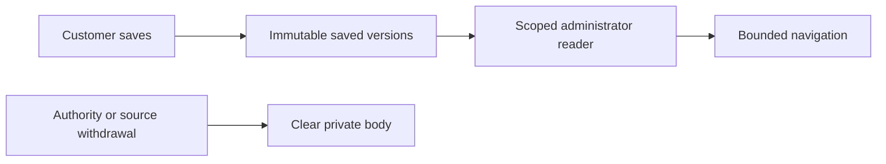


[MP4](assets/business-history-144/workmate-business-history-144-01-business-version-navigation.mp4) · [详细方案 / Usage and implementation](development/144-admin-business-content-history.md)

使用「用户端内容 → 阅读内容 → 最新／最早／前后翻页」，展开记录可查看确切定义。阅读要求当前正文权限及项目范围，依赖撤回会隐藏正文；未保存过的旧内容不补造。Desktop继续在客户本机执行Codex，Extension保留原生浏览器右侧栏。原完整产品验收继续开放。

<!-- editable-projects-stage143 -->

[矢量与演示工程 / Vector and presentation workspaces](development/143-editable-project-workspaces.md) · [更新 / Changes](changes/143-editable-project-workspaces.md) · [完整待验收 / Remaining scope](quality/remaining-work-stage143.md)

<!-- brand-reuse-stage142 -->

[品牌工程跨项目复用 / Reviewed destination-brand reuse](development/142-brand-project-reuse.md) · [更新 / Changes](changes/142-brand-project-reuse.md) · [当前完整待项 / Remaining scope](quality/remaining-work-stage142.md)

# Workmate · CopyPaste Enterprise Agent

<!-- current-test-entry-141 -->
默认检查已自动选用各组的最新数字版本，并保留原失败尝试。六项端到端检查、实际 npm 入口检查及编译通过；产品运行时代码与阶段140三端实操证据保持不变。见[当前源码补充检查点](quality/test-discovery-checkpoint-141.json)、[入口说明](development/141-current-test-discovery.md)及[完整待验收范围](quality/remaining-work-stage140.md)。

<!-- creative-packages-stage140 -->
## 工程打包与恢复 · 阶段140

阶段140新增普通分层画布及campaign-cuts影片的ZIP打包、固定素材和影片字型／授权、上传校验、明确共用确认、新编号恢复、原请求结果核对及继续编辑。真实Web、无边框Windows包和Chrome原生右侧栏验证；画布编辑再出PNG，影片编辑再出MP4。全部格式、品牌重绑、完整专业工程和跨机器渲染一致性仍按原范围验收。

导出和恢复不请求AI。上传前先明确确认项目共用，恢复前再确认素材权利；原工程不覆写，中断后核对原请求。当前支持普通分层画布和campaign-cuts影片；画布系统字型差异、品牌重绑、全部格式及跨机器恢复仍待完整验收。

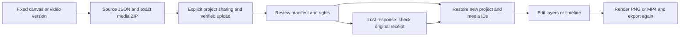

- [Format, APIs & usage / 格式、接口及使用](https://github.com/copypasteltd/workmate/blob/docs/docs/development/140-creative-project-packages.md)
- [Actual qualification / 实际验证](https://github.com/copypasteltd/workmate/blob/docs/docs/quality/creative-packages-checkpoint-140.json)
- [Open acceptance scopes / 未完成验收](https://github.com/copypasteltd/workmate/blob/docs/docs/quality/remaining-work-stage140.md)


- [Actual web interaction .MP4](https://github.com/copypasteltd/workmate/blob/web/assets/screenshots/workmate-creative-packages-140-07-project-restore.mp4)


- [Actual web interaction .GIF](https://github.com/copypasteltd/workmate/blob/web/assets/screenshots/workmate-creative-packages-140-07-project-restore.gif)
- [Actual desktop interaction .MP4](https://github.com/copypasteltd/workmate/blob/desktop/assets/screenshots/workmate-creative-packages-140-07-project-restore.mp4)
- [Actual desktop interaction .GIF](https://github.com/copypasteltd/workmate/blob/desktop/assets/screenshots/workmate-creative-packages-140-07-project-restore.gif)
- [Actual extension interaction .MP4](https://github.com/copypasteltd/workmate/blob/extension/assets/screenshots/workmate-creative-packages-140-07-project-restore.mp4)
- [Actual extension interaction .GIF](https://github.com/copypasteltd/workmate/blob/extension/assets/screenshots/workmate-creative-packages-140-07-project-restore.gif)

<!-- native-teams-stage139 -->

源码交付：保留原始运行检查点与失败记录；Git按执行时的原始字节保存代码及核查脚本，避免换行转换。交付检查点单独记录本次版本管理元数据调整。


## 本机专家团队 · 阶段139

权威需求及方案在本目录；实际代码统一位于dev，各端独立Git仓库，唯一开发根目录仍为D盘指定路径。本轮收口本机团队子流程，原始完整验收状态详见编号清单。

最多16步、7位成员加1位通用协调员、3步并行，共用一个明确授权目录；并行编辑应分配到不同文件。审阅免费，批准预算固定，预留与实际费用分开；已接受但未知的操作不重跑。撤权先停止本机工具，未同步回执继续可见。团队ZIP仅包含主动提交的成果，本机未提交文件留在本机。

60项后端、36项扩展、81项本机控制／下载回归及6项实际Windows旅程通过；4张截图、1组GIF／MP4、3档布局及1个独立解压的完整团队包绑定1756份确切源码。

业务／模型答复及本机目录／授权／保存窗口的选择决定为受控假数据；实际OTP／PKCE、本机Codex、Windows文件操作、公司计量、撤权和ZIP解压确实执行。Windows包未签名；全部专业角色质量、签名安装、真实公司模型／广告账户及跨机器工程恢复继续独立验收。

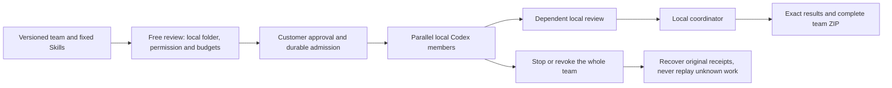

[需求](https://github.com/copypasteltd/workmate/blob/main/docs/requirements/16-desktop-native-teams.md) · [接口／权限／恢复／交付方案](https://github.com/copypasteltd/workmate/blob/main/docs/technical/139-desktop-native-teams.md) · [源码与证据](https://github.com/copypasteltd/workmate/blob/main/docs/quality/native-teams-release-checkpoint-139.json) · [全部编号](https://github.com/copypasteltd/workmate/blob/main/docs/quality/remaining-work-stage139.md)

真实Desktop操作，业务内容为假数据：


- [workmate-native-teams-139-05-review-before-local-run-en.png](https://github.com/copypasteltd/workmate/blob/desktop/assets/screenshots/workmate-native-teams-139-05-review-before-local-run-en.png)
- [workmate-native-teams-139-05-completed-local-team-en.png](https://github.com/copypasteltd/workmate/blob/desktop/assets/screenshots/workmate-native-teams-139-05-completed-local-team-en.png)
- [workmate-native-teams-139-05-whole-team-access-revoked-zh.png](https://github.com/copypasteltd/workmate/blob/desktop/assets/screenshots/workmate-native-teams-139-05-whole-team-access-revoked-zh.png)
- [workmate-native-teams-139-05-local-team.mp4](https://github.com/copypasteltd/workmate/blob/desktop/assets/screenshots/workmate-native-teams-139-05-local-team.mp4)

<!-- delivery-revision-stage138 -->
## 原成果修改与新版本交付 · 阶段138

所有开发位于D盘的唯一工作区，实际代码位于dev，各端独立Git仓库；本目录为权威需求、设计、开发、编号验收和发布说明。完整功能状态以本阶段编号清单为准，不用定向流程测试替代全部原始验收。

可选择整份交付、答复、单文件、Unicode文字选段、图片区域或有效视频时段。预览不调用AI或预留费用；确认后建立单独预算的新任务，沿用原角色与来源，保留原成果及费用。源文件换版或撤回将阻断后续读取与完成交付。获准项目编辑可修改共享工作，私有会话保留原归属。结果未知时继续核对原请求。

文字预览上限1 MiB，图片／MP4内嵌预览4 MiB；更大或不支持预览的文件可下载后按完整文件提出修改。整份修改最多引用20个文件，视频时段须有保留的有效时长。图片／视频位置是修改意见，不能视为编辑操作审批或专业质量通过；专门工作流保留原确认步骤。

34项当前后端检查（含13项新增修改测试）、36项扩展状态检查、73项桌面控制／下载回归及9项三端实际旅程通过。11张实际截图、3组GIF／MP4、7档布局和3个独立解压的下载包绑定1732份确切源码。

业务／模型答复及原生文件／授权窗口选择为明确受控的假数据；登录、数据库权限、确切文件、实际打包本机Codex、Windows原生窗口、Chrome右侧栏和新成果下载实际运行。Windows包未签名。真实公司模型／账户、完整专业角色输出、安装矩阵和工程恢复继续独立验收。

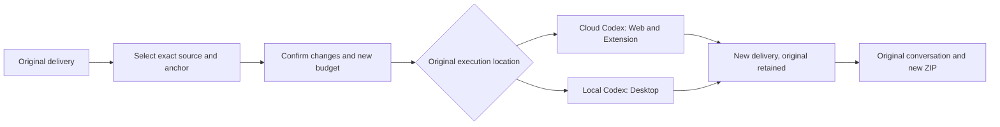

[需求](https://github.com/copypasteltd/workmate/blob/main/docs/requirements/15-delivery-revisions.md) · [方案与使用逻辑](https://github.com/copypasteltd/workmate/blob/main/docs/technical/138-source-bound-delivery-revisions.md) · [源码与原始证据](https://github.com/copypasteltd/workmate/blob/main/docs/quality/delivery-revision-checkpoint-138.json) · [全部编号](https://github.com/copypasteltd/workmate/blob/main/docs/quality/remaining-work-stage138.md)

实际产品操作，业务内容为假数据：


其他实际页面截图及MP4录屏：

- [workmate-delivery-revision-138-06-lost-response-retained.png](https://github.com/copypasteltd/workmate/blob/web/assets/screenshots/workmate-delivery-revision-138-06-lost-response-retained.png)
- [workmate-delivery-revision-138-06-image-anchor-en.png](https://github.com/copypasteltd/workmate/blob/web/assets/screenshots/workmate-delivery-revision-138-06-image-anchor-en.png)
- [workmate-delivery-revision-138-06-video-anchor-en.png](https://github.com/copypasteltd/workmate/blob/web/assets/screenshots/workmate-delivery-revision-138-06-video-anchor-en.png)
- [workmate-delivery-revision-138-06-revised-delivery-zh.png](https://github.com/copypasteltd/workmate/blob/web/assets/screenshots/workmate-delivery-revision-138-06-revised-delivery-zh.png)
- [workmate-delivery-revision-138-06-delivery-revision.mp4](https://github.com/copypasteltd/workmate/blob/web/assets/screenshots/workmate-delivery-revision-138-06-delivery-revision.mp4)

<!-- delivery-package-stage137 -->
## 完整交付与原对话下载 · 阶段137

主要业务按“提交目标 → 补充资料 → 执行 → 审阅 → 下载成果 → 原对话修改”继续收口。现在 Web 和 Chrome 原生右侧栏可直接在原聊天下载完整当前交付包，任务审阅区也提供入口；Desktop 使用公司授权接口和原生保存窗口。取消保存不发请求、不显示成功，侧栏提示跨刷新及繁英切换保留。

ZIP 包含实际成果、文字答复（如有）、任务及素材固定版本、SHA-256清单及中英编辑说明。同名文件分别保留，失败／停止工作的现有成果明确标示为部分交付。源代码ZIP、SVG／PPTX、工程JSON及只读成片分别按实际编辑能力说明，不虚构源工程。没有提交为交付物的本机文件仍留在本机；Desktop Agent仍是本机Codex，云端包不会扫描本机工作区。

用户看到的任务版本和交付摘要必须一致。后端顺序读取真实文件、流式校验大小与摘要，在受控磁盘生成ZIP，完成后再次检查当前权限、来源、保留期限及精确版本；文件损坏、素材撤回或版本变化会拒绝整个包。只读项目成员可下载获准共享成果，审阅仍需批准权限；管理员身份不自动获取私有会话。导出不调用AI、不创建新任务、不增加AI费用。容量为16 GiB／10,000个成果／文字条目，超限明确拒绝，不悄悄遗漏文件。

本轮不新增数据库迁移：Backend沿用SQL135并重新构建，Web／Desktop／Extension重新构建。扩展新增Chrome `downloads` 权限，使用浏览器默认下载位置及冲突改名；授权只在公司请求头中传递。新增契约为Backend `contracts/delivery-package-v1.json`。从Delivery执行 `npm run qa:delivery-package-backend -- <新两位编号>` 或 `npm run qa:delivery-package -- <新两位编号>`；后者默认完整构建、创建未签名Windows包并操作实际右侧栏与原生下载。

21项当前后端检查（含11项新打包测试）、37项扩展状态检查、1项桌面下载回归、12项边界绑定及10项三端实际旅程通过。9张实际截图、3组GIF／MP4、7档布局和3个独立解压的下载包绑定1713份确切源码。 使用受控Codex适配器和假业务内容；真实OTP／PKCE、文件读取、权限、原生窗口和Chrome下载管理器实际运行。Desktop保存窗口的选择结果由夹具指定到本轮自有目录。本轮未重新证明全部本机Codex工具、真实公司模型、专业素材质量或完整跨环境工程恢复。既有52项后端／来源回归另有阶段内原始记录，按其自身源码范围保留，不混称本轮全平台回归。


[需求](https://github.com/copypasteltd/workmate/blob/main/docs/requirements/14-complete-delivery-package.md) · [方案与使用逻辑](https://github.com/copypasteltd/workmate/blob/main/docs/technical/137-complete-delivery-package.md) · [确切源码与证据](https://github.com/copypasteltd/workmate/blob/main/docs/quality/delivery-package-checkpoint-137.json) · [全部编号](https://github.com/copypasteltd/workmate/blob/main/docs/quality/remaining-work-stage137.md)

实际客户流程截图与交互（业务内容为假数据）：


<!-- business-inputs-stage136 -->
## 业务问题与原任务续跑 · 阶段136

Agent遇到确实缺少的尺寸、目标受众或业务口径，可在原对话提出问题。客户可点击建议再修改，也可直接自由回答，最后明确确认；没有预选或自动提交。多项问题逐项保存，全部补齐后继续同一任务、同一会话和原预算预留，已计量用量统一结算。确认的问题和答案保留为原对话备注，相同请求重试不重复写入。

Web和Chrome原生右侧栏直接在原聊天展示问题，Desktop既有云任务详情也支持补答。繁中／英文切换保留未提交的回答，失败保留文字；扩展切换身份或会话清除草稿，来源不可读时清除受保护问题。建议仅供选择，答案不授予文件、广告账户、工具、本机或额外费用权限。

服务端严格区分`question`／`file`／`connection`，最多8项建议、4,000字符回答，校验版本、当前权限、来源及整批合法性后才写入。已确认答案不可改写。付费提问必须处于已完成且计量明确的Codex回合边界，继续原线程；取消只结算已知用量。删除私有会话清除问题、答案、检查点及正文，保留必要费用事实。

SQL135须在启动API／Worker前迁移：Backend执行`npm run db:migrate`。原SQL001–134、原二十项任务定义及主OpenAPI保持原字节；新增结构在`contracts/business-inputs-v1.schema.json`，扩展原创建／补交接口。原依赖文件与连接结构继续有效，问题使用`answer`而非`resource_ids`。

122项后端集成检查（含11项新增问题测试）、61项扩展状态检查、12项交付绑定及14项实际三端流程通过；9张实际截图、3组GIF／MP4及7个尺寸检查绑定确切来源。 原生Codex检查使用实际固定二进制和合成Responses服务，页面旅程使用受控工具和假业务回复。客户端初次完整构建成功；修正页面夹具后复用逐字节一致的源码和Windows包，原失败记录保留。可在Delivery执行`npm run qa:business-inputs-backend -- <新两位编号>`或`npm run qa:business-inputs -- <新两位编号>`；后者默认完整构建并创建独立原生测试数据库。

Desktop本机Codex及客户主动授予的本机完整权限沿用独立流程，本轮新增的是其云端任务视图问答。实际Windows窗口保持无边框、无Electron菜单、无可见纵向滚动轨和横向溢出；扩展保持实际Chrome原生右侧SIDE_PANEL。使用假数据，Windows包未签名；真实生产模型及全部角色专业交付仍待验收。完整编号仍开放88条必需、12条未确认建议、1条可选，REQ-095原始验收维持。

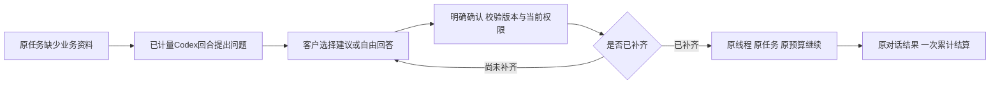

[需求](https://github.com/copypasteltd/workmate/blob/main/docs/requirements/13-business-brief-inputs.md) · [实现与使用逻辑](https://github.com/copypasteltd/workmate/blob/main/docs/technical/136-business-brief-clarification.md) · [全部102条编号](https://github.com/copypasteltd/workmate/blob/main/docs/quality/remaining-work-stage136.md) · [源码与原始验收](https://github.com/copypasteltd/workmate/blob/main/docs/quality/business-inputs-checkpoint-136.json)


<!-- client-errors-stage135 -->
## 四端连接与登录恢复 · 阶段135

Web、Admin、Desktop及Extension对读取失败显示当前语言的连接说明，保留有效登录。提交后响应丢失或无法解析时，提示先查收结果；应用层不会自动重发；浏览器可能在底层重传，服务端按原消息编号去重。客服授权继续使用原编号和期限，扩展委派继续使用原消息编号，显式重试不生成第二个任务。后台轮询不清除提交结果未确认的提醒，切换繁中／英文会更新同一错误提示，已知连接异常不显示Electron内部文字、地址或响应正文。

受保护请求收到401时，先核对所属登录并清除当前身份；HTML或空正文不能绕过清除。旧请求不能注销新登录或覆盖新防伪标记。Admin即时隐藏独立管理外壳，支持会话列表的连接错误与表单／撤销提醒分开，列表恢复后只清除本次连接提示。

15项连接／身份检查（含实际HTTP故障）、12项交付文件绑定、1项原生桥检查及30项实际四端流程通过。20张截图、7组实际GIF／MP4绑定源码；包含真实右侧SIDE_PANEL、客户OTP／PKCE及独立管理员TOTP、真实提交后响应丢失与同消息重试。09重新编译／构建Extension及Delivery，复用与02逐字节相同的后台、Web、Admin、Desktop源码及Windows包；没有伪称再次完整打包。旧失败与执行原件保留。Delivery当前`npm test`包含严格编译、文件绑定及连接检查；`npm run qa:client-errors -- <新的两位编号>`默认完整构建。

Desktop仍在客户本机运行Codex，完整本机权限单独授予，保持无边框、无Electron菜单及可见滚动条。Extension通过Chrome工具栏打开原生右侧栏，负责获准文件上传和云端执行。业务使用假数据，模型未运行，Windows包未签名。完整验收仍有88条必需、12条未确认建议、1条可选开放；REQ-095原始验收维持。

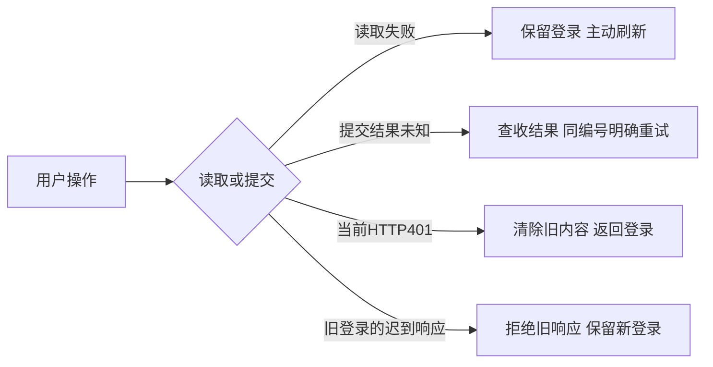

[使用与实现](https://github.com/copypasteltd/workmate/blob/main/docs/technical/135-client-connection-and-session-recovery.md) · [全部102条编号](https://github.com/copypasteltd/workmate/blob/main/docs/quality/remaining-work-stage135.md) · [源码与验收绑定](https://github.com/copypasteltd/workmate/blob/main/docs/quality/client-errors-checkpoint-135.json)


<!-- support-recovery-stage134 -->
## 客户授权恢复与客服原始验收 · 阶段134

客户从 **Web／Desktop → 账户设置 → 客服限时协助** 选择项目、原因及期限，空项目选择只表示元资料。首次提交固定申请编号和截止时间。响应丢失后可点击**查收先前申请**，或使用相同资料重试；刷新先查询既有结果，不自动再次提交。不同资料不能替换尚未确认的申请。查收展示目前有效／撤销／到期状态，不会续期；客户随时可在列表撤销。

恢复记录只在当前浏览器会话保存随机编号、申请摘要和固定截止时间，不保存原因、项目ID、正文或凭证。禁用存储时仅当前renderer内可恢复；服务器已经提交的授权仍显示在列表中。切换账户或企业后，迟到的结果不能回填新表单。原生Desktop桥仅新增客户查收GET，不开放管理员支持接口。

**原始REQ-095／TC-095已通过验收**，十二条条件逐项对应当前源码与真实执行证据：真实管理员和只读提示、明确范围、独立正文权限、写入／付款／VIP／凭证拒绝、无隐身登录、真实到期、撤销及审计失败回滚。本轮关闭这一条原始需求；全平台无障碍REQ-055、完整权限与竞争矩阵REQ-094继续各自跟踪。

65项相关后端检查、1项原生桥边界检查、18项实际Admin／Web／打包Desktop旅程及10条构建命令通过。覆盖提交前／后真实HTTP响应丢失、刷新、实际切换企业、同内容重试、当前回执查收、真实到期和原生客户撤销；客服操作期间user／native会话、刷新令牌和本机授权码行数不增加。确切源码绑定9截图和5组实时GIF／MP4。支持页面验证键盘及文字放大，Web／Admin采用CSS 200%，Desktop采用实际原生webContents 200%缩放；不据此关闭全平台浏览器／读屏验收。

Desktop继续在客户本机运行Codex，客户独立主动授予完整本机权限；保持无边框、无Electron默认菜单和无可见滚动条。Extension继续使用Chrome原生Side Panel承载获准文件上传与云端执行。本轮模型没有运行，业务及保留结果为合成夹具，Windows包未签名。自建浏览器、原生客户端与数据库均已关闭。

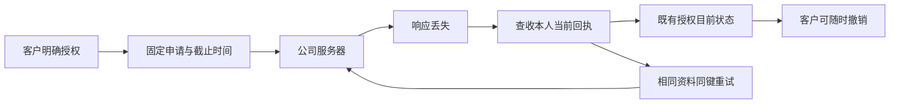

[方案 / Behavior](https://github.com/copypasteltd/workmate/blob/main/docs/technical/134-support-grant-recovery-and-acceptance.md) · [TC-095 acceptance](https://github.com/copypasteltd/workmate/blob/main/docs/quality/tc095-acceptance-134.json) · [Checkpoint](https://github.com/copypasteltd/workmate/blob/main/docs/quality/support-recovery-checkpoint-134.json) · [完整编号清单 / Remaining work](https://github.com/copypasteltd/workmate/blob/main/docs/quality/remaining-work-stage134.md)


[Recovery recording](https://github.com/copypasteltd/workmate/blob/web/assets/screenshots/workmate-support-recovery-134-04-grant-result-recovery.mp4) · [Retry recording](https://github.com/copypasteltd/workmate/blob/web/assets/screenshots/workmate-support-recovery-134-04-fixed-intent-retry.mp4) · [Native grant](https://github.com/copypasteltd/workmate/blob/desktop/assets/screenshots/workmate-support-recovery-134-04-customer-grant.mp4) · [Native revocation](https://github.com/copypasteltd/workmate/blob/desktop/assets/screenshots/workmate-support-recovery-134-04-customer-revocation.gif) · [200% Admin](https://github.com/copypasteltd/workmate/blob/admin/assets/screenshots/workmate-support-recovery-134-04-support-en-200.png) · [Chinese dark Admin](https://github.com/copypasteltd/workmate/blob/admin/assets/screenshots/workmate-support-recovery-134-04-support-zh-dark.png)

本轮1条需求验收完成；仍有88条必需、12条未确认建议和1条可选记录开放。这是完整验收记录数量，不代表101个未编码模块。完整源码交付复现、签名安装、生产接入及其余业务验收继续按编号推进；下方历史章节保留原运行范围。

---

<!-- support-access-stage133 -->
## 受控客服与原生客户授权 · 阶段133

客户从 **Web／Desktop → 账户设置 → 客服限时协助** 选择实际项目、原因及15／30／60分钟期限；空选择只包含企业／用户元资料。把授权ID提供给客服，并可随时在同一客户表单撤销。

管理员以自己的邮箱与TOTP登录 **Admin → 支援工作台**，明确选择客户、企业、项目、期限及可选客户授权。只读横幅持续显示真实身份和截止时间。共享正文还需要当前独立正文权限，私人会话保持私有；该视图不提供写入、费用、VIP或客户登录权限。

客服接口现会核对任务原始来源。来源隔离／到期或版本擦除后，保留正文不可继续返回，诊断标题也会隐藏。所选正文绑定当前版本，审计期间变化会被拒绝。页面取消旧请求，拒绝迟到任务／会话响应；版本变化、来源撤回、隐藏、失败、撤销或到期后清空正文。服务端逐次判断权限；可见Admin约每两秒复查。

59项后台相关测试及13项实际Admin／Web／打包原生Desktop旅程通过，确切源码绑定6截图和3组实时GIF／MP4。实际验证OTP／PKCE、邮箱／TOTP、客户授权／撤销、迟到响应、来源撤回、真实到期、繁中深色、四档Admin宽度和三档原生无边框窗口。所属浏览器、客户端与测试数据库均已关闭。模型没有运行，业务数据、保留结果和夹具文件读取明确为合成数据；Windows包仍未签名。

Desktop继续在本机运行Codex，本机权限由客户独立主动授权；客服表单只调用客户接口，管理员视图留在Admin。Extension继续使用Chrome原生Side Panel，承载获准文件上传及云端执行；本轮没有修改Extension执行代码。

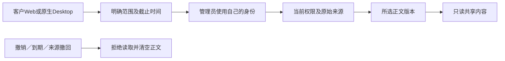

[实现方案](https://github.com/copypasteltd/workmate/blob/main/docs/technical/133-controlled-support-source-and-native-access.md) · [Checkpoint](https://github.com/copypasteltd/workmate/blob/main/docs/quality/support-access-checkpoint-133.json) · [完整编号待办](https://github.com/copypasteltd/workmate/blob/main/docs/quality/remaining-work-stage133.md)


[Native grant recording](https://github.com/copypasteltd/workmate/blob/desktop/assets/screenshots/workmate-support-access-133-02-customer-grant.mp4) · [Selection recording](https://github.com/copypasteltd/workmate/blob/admin/assets/screenshots/workmate-support-access-133-02-task-selection.mp4) · [Revocation recording](https://github.com/copypasteltd/workmate/blob/desktop/assets/screenshots/workmate-support-access-133-02-customer-revocation.mp4) · [Web metadata-only grant](https://github.com/copypasteltd/workmate/blob/web/assets/screenshots/workmate-support-access-133-02-metadata-grant-en.png) · [Chinese dark Admin](https://github.com/copypasteltd/workmate/blob/admin/assets/screenshots/workmate-support-access-133-02-support-zh-dark.png) · [Source withdrawn](https://github.com/copypasteltd/workmate/blob/admin/assets/screenshots/workmate-support-access-133-02-source-withdrawn-en.png)

仍有89条必需完整验收、12条未确认建议及1条可选记录开放，不代表102个未编码模块。完整权限竞争矩阵、各页面无障碍、签名安装和生产接入继续按编号推进；下方历史章节保留原范围。

---

<!-- content-history-stage132 -->
## 后台完整内容历史 · 阶段132

从「用户端内容 → 阅读正文」进入会话、专家或记忆，每页最多50条，可前后翻页或直达首尾。专家和记忆从最新版本开始，区分「客户版本」与「管理员修订」，展开后可查看完整版本记录。

每次请求复核当前MFA会话、两项正文读取权限、企业／项目范围及显式拒绝。签名游标拒绝旧版本继续翻页。阅读器在可见时每15秒及重新聚焦时复查；权限失效或可读来源变化后清空正文。关闭或切换内容会取消旧请求，迟到响应不能覆盖新内容。正文和游标不写入浏览器存储；助手来源不可用时隐藏正文。

新增GET `/v1/admin/content/:kind/:id/history`，使用`edge=first|last`或服务器返回的`cursor`，固定每页50条。SQL134维护消息历史修订号。旧正文接口保留原限制并增加`truncated`与`history_url`。普通客户会话仍保留既有80条输入限制。

54项后端相关测试及9项实际后台旅程通过。真实API创建205版专家、205版记忆及66条客户消息，实际运行原生PostgreSQL、邮箱/MFA、管理员修订、来源撤回、权限拒绝、迟到响应及375/768/1440布局。业务数据和保留的助手结果明确为合成数据，模型没有运行。原始失败及对应源码保留；本轮通过旅程留有5张截图和2组实时GIF/MP4。所有所属测试资源已关闭。

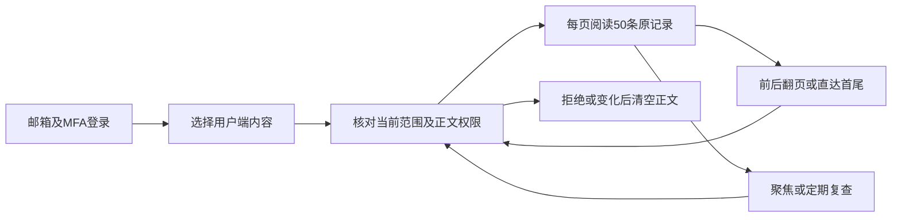

[实现方案](https://github.com/copypasteltd/workmate/blob/main/docs/technical/132-admin-content-history.md) · [Checkpoint](https://github.com/copypasteltd/workmate/blob/main/docs/quality/content-history-checkpoint-132.json) · [完整编号待办](https://github.com/copypasteltd/workmate/blob/main/docs/quality/remaining-work-stage132.md) · [API supplement](https://github.com/copypasteltd/workmate/blob/backend/contracts/admin-content-history-route-additions.json)


[Oldest memory version](https://github.com/copypasteltd/workmate/blob/admin/assets/screenshots/workmate-content-history-132-02-oldest-memory-en.png) · [Administrator provenance](https://github.com/copypasteltd/workmate/blob/admin/assets/screenshots/workmate-content-history-132-02-administrator-provenance-en.png) · [中文页面](https://github.com/copypasteltd/workmate/blob/admin/assets/screenshots/workmate-content-history-132-02-memory-history-zh.png) · [Permission denied](https://github.com/copypasteltd/workmate/blob/admin/assets/screenshots/workmate-content-history-132-02-permission-withdrawn-en.png) · [Navigation MP4](https://github.com/copypasteltd/workmate/blob/admin/assets/screenshots/workmate-content-history-132-02-complete-version-navigation.mp4) · [Withdrawal MP4](https://github.com/copypasteltd/workmate/blob/admin/assets/screenshots/workmate-content-history-132-02-permission-withdrawal.mp4)

仍有89条必需、12条未确认建议及1条可选完整验收记录开放；它们不是102个未编码模块。本轮仅验收限定历史阅读范围，完整后台运营、全部角色、生产模型/连接器及签名安装继续按编号推进。下方历史章节保留其原始范围。

---

<!-- durable-receipt-stage131 -->
## 本机结果与费用回执持久同步 · 阶段131

本机子任务完成后，即使公司接口未收到完成请求，或已结算但响应丢失，原始结果仍保存在本机。父任务只有确认子任务回执后才能清理操作记录。恢复连线后选择“同步已储存的回执”；撤销本机权限后或完整退出并重新打开应用后，仍可同步原回执。同步不会重新运行命令、启动QA或新增模型请求。

已知成功的子任务按公司实际观测结算一次。未知父任务继续保留原预算、等待费用核对；同步成功不代表整个流程成功，也不解除未知本机副作用限制。账号切换和服务端权限继续校验，不能绕过原登录族或企业权限。

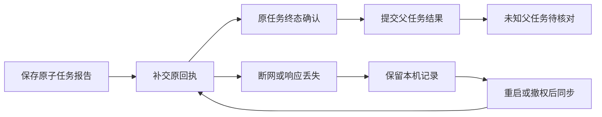

限定验证通过：124项控制层检查（含15项新增回执边界）、43项真实固定Codex检查、3条真实本机/SQL回执丢失流程、2项编译检查和8项实际未签名Desktop界面检查。旧版与新版对照确认原缺陷：旧版遗漏子任务完成请求，新版先子后父。真实进程、命令、文件、数据库、HTTP响应丢失和完整应用重启已运行；模型回答及系统对话框选择为测试输入。全部所属测试资源已关闭，原始失败、执行脚本和源码快照保留。

[实现方案](technical/131-desktop-durable-receipt-sync.md) · [当前检查点](quality/receipt-sync-checkpoint-131.json) · [完整编号待办](quality/remaining-work-stage131.md)


[Fee confirmation](https://github.com/copypasteltd/workmate/blob/desktop/assets/screenshots/workmate-receipt-sync-131-01-child-fee-confirmation-en.png) · [撤权后中文提示](https://github.com/copypasteltd/workmate/blob/desktop/assets/screenshots/workmate-receipt-sync-131-01-revoked-receipts-pending-zh.png) · [Original receipts synchronized](https://github.com/copypasteltd/workmate/blob/desktop/assets/screenshots/workmate-receipt-sync-131-01-original-receipts-synchronized-en.png) · [Loss/withdrawal MP4](https://github.com/copypasteltd/workmate/blob/desktop/assets/screenshots/workmate-receipt-sync-131-01-receipt-loss-and-permission-withdrawal.mp4) · [Restart/sync MP4](https://github.com/copypasteltd/workmate/blob/desktop/assets/screenshots/workmate-receipt-sync-131-01-receipt-sync-after-application-restart.mp4)

当前仍有89条必需、12条未确认建议、1条可选完整验收记录开放，不能理解为102个模块尚未编码。任意崩溃/旧进程回收、换登录族后的处理、全部父任务账务核对、专业角色、正式模型/媒体及签名安装继续推进。当前增量使用阶段131独立清单与发布器；阶段128和130证据保持各自历史范围。

```powershell
python -X utf8 docs/tools/record_receipt_sync_131_v1.py --verify
python -X utf8 docs/tools/prepare_receipt_publication_131_v1.py --verify
python -X utf8 docs/tools/publish_receipt_sync_131_v1.py --push
```

发布器核对阶段130真实远端回执、完整历史安全与README链接、当前Git字节和八个远端分支；只进行普通原子推送，不强推。常规开发者构建/启动方式见后续仓库说明。

---

<!-- workflow-recovery-stage130 -->
## 本机父子流程恢复与取消 · 阶段130

本轮修复停止或正常完成任务时，后台授权保活响应卡住导致收尾等待的问题。主任务和每个子任务分别取消并等待自己的保活观察器；即使底层请求忽略取消，其迟到响应也不能继续启动任务。正常完成不会因此取消父任务；提交本机轮次前仍必须重新检查当前权限。

客户流程为：浏览器登录与企业工作区 → 选择本机目录并主动授权 → 确认额外子任务费用 → 本机开发者执行 → 客户审核实际文件 → 本机QA执行 → 下载SOP、固定版本JSON和恢复说明。两个子任务分别发生真实初始化/建会话故障后，在公司持久证明零准入的前提下各恢复一次；原任务、原预算、截止与worker attempt保持一致。

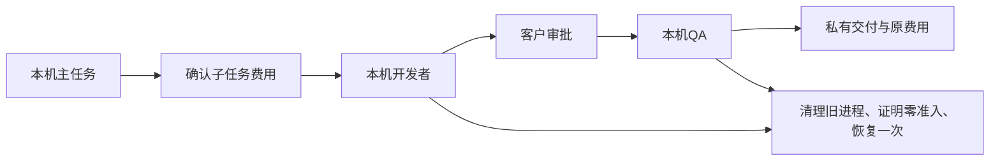

限定验证通过：109项控制层、43项真实固定Codex、3个完整原生父子流程、2项当前编译和8项实际未签名打包界面检查。打包旅程使用真实Electron、原生PostgreSQL、本机命令与文件；模型回答、对话框选择及注入的传输故障为测试输入。三个原生窗口宽度保持无边框、无默认菜单、无可见滚动条及无横向溢出，全部所属资源已关闭。原始失败及其源码快照保持不变。

[实现方案](technical/130-desktop-workflow-recovery.md) · [当前检查点](quality/workflow-recovery-checkpoint-130.json) · [完整编号待办](quality/remaining-work-stage130.md)


[费用确认](https://github.com/copypasteltd/workmate/blob/desktop/assets/screenshots/workmate-workflow-recovery-130-01-child-fee-confirmation-en.png) · [英文完成画面](https://github.com/copypasteltd/workmate/blob/desktop/assets/screenshots/workmate-workflow-recovery-130-01-two-recovered-children-completed-en.png) · [中文完成画面](https://github.com/copypasteltd/workmate/blob/desktop/assets/screenshots/workmate-workflow-recovery-130-01-two-recovered-children-completed-zh.png) · [完整实时MP4](https://github.com/copypasteltd/workmate/blob/desktop/assets/screenshots/workmate-workflow-recovery-130-01-parent-child-startup-recovery.mp4)

完整验收仍有89条必需、12条未确认建议和1条可选记录开放；它们是完整验收记录，不等于102个功能尚未编码。任意崩溃/多节点、所有本机工具、全部专业角色、丢失子任务完成回执的持久补交、正式模型及签名安装等继续推进。当前发布由阶段130独立清单和发布器约束；旧V11入口及阶段128清单保留历史源码范围，不用于发布本轮变更。

[简体中文](README.md) · [English](README.en.md)

<!-- startup-recovery-stage128 -->
## 本机启动安全恢复 · 阶段128

Desktop 在客户电脑运行固定版本 Codex。客户选择目录并主动授权后，初始化或打开会话若发生明确的传输故障，主进程先回收旧进程和锁，再请求公司服务检查原任务。只有轮次尚未准入、没有任何模型/输入计数/公司工具准入，且身份、权限与原截止仍有效，才允许恢复一次。最多两次启动，沿用原任务、原预算预留和 worker attempt，不延长原截止。

界面显示「正在重连」。连接结果未确认时，「重试连线」仅取回原请求结果；可能已执行的工作需先核对本机文件及费用。撤权、协议拒绝、清理失败、已提交轮次和结果未知均禁止自动重做。推理凭证仅传给可信本机运行器，不写入本机恢复日志或渲染页面。

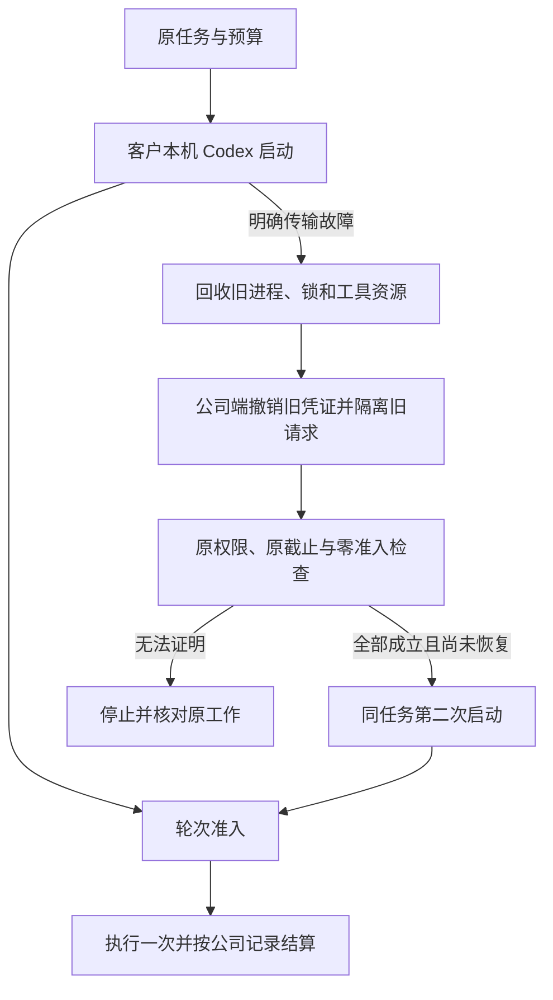

服务端通过 SQL133 升级；应先使用所有者执行完整迁移，再启动相应 API。新客户端声明 `desktop-startup-recovery-v1`；`/startup-recovery` 使用原绑定、固定契约摘要和原恢复请求键，`/turn-admission` 在 `turn/start` 前登记。旧客户端保持原执行流程，不能取得新的恢复许可。

本轮检查点记录控制层、实际固定 Codex、原生 SQL 与实际未签名打包客户端的限定验证。模型回答和对话框选择按用户要求使用假数据；尚不代表正式模型、签名安装、全部崩溃组合或专业角色整体验收。各旧阶段的包和画面仍对应其原源码。

本轮限定检查通过：91项相关控制层、43项真实固定版本Codex、30项原生数据库/API、3项当前编译和6项实际未签名打包界面检查。实际旅程验证了登录、授权、一次启动恢复、原任务的一次收费、单次回答、待响应时撤权，以及1000/1240/1440三个原生窗口宽度。当前截图、GIF和MP4来自成功的04次运行；失败的01—03次运行及原始记录均完整保留。发布入口为V11，远端状态以最终推送回执和SHA回读为准。

[方案与接口](https://github.com/copypasteltd/workmate/blob/docs/docs/technical/128-desktop-startup-recovery.md) · [匹配源码与验证](https://github.com/copypasteltd/workmate/blob/docs/docs/quality/startup-recovery-checkpoint-128.json) · [编号待办](https://github.com/copypasteltd/workmate/blob/docs/docs/quality/remaining-work-stage128.md)


[Original receipt](https://github.com/copypasteltd/workmate/blob/desktop/assets/screenshots/workmate-startup-recovery-128-04-original-local-receipt.png) · [Withdrawal screenshot](https://github.com/copypasteltd/workmate/blob/desktop/assets/screenshots/workmate-startup-recovery-128-04-permission-revoked-before-turn.png) · [Withdrawal GIF](https://github.com/copypasteltd/workmate/blob/desktop/assets/screenshots/workmate-startup-recovery-128-04-revoke-pending-startup.gif) · [Recovery MP4](https://github.com/copypasteltd/workmate/blob/desktop/assets/screenshots/workmate-startup-recovery-128-04-startup-and-original-receipt.mp4) · [Withdrawal MP4](https://github.com/copypasteltd/workmate/blob/desktop/assets/screenshots/workmate-startup-recovery-128-04-revoke-pending-startup.mp4)

<!-- local-startup-stage127 -->
## 历史阶段127

当前阶段127修复Desktop主任务与工作流子任务启动期间授权保活，以及准备/原生请求等待中的关闭与撤权。客户本机Codex、原任务和原预留保持同一执行谱系；关闭等待准备退出并回收所属进程，双语提示不向用户暴露内部错误码。

限定验收为73项相关控制层、38项真实固定Codex及5项实际未签名打包窗口检查，最终结果见本轮检查点。实际旅程涵盖浏览器登录、工作区创建、默认取消/明确授权、超过45秒启动、一次公司账务、撤权及三个原生窗口宽度。新增实拍截图/GIF/MP4；模型和原生对话框选择为已授权测试数据。V10沿用普通八分支原子推送和最终SHA回读。此前结果和媒体保留原源码范围。

Desktop自动启动恢复仍需公司端原子零准入与旧权限撤销/等待证明；完整角色、签名安装及89条必需整体验收继续开放。

[当前方案](technical/127-desktop-startup-lifecycle.md) · [编号变更与待办](changes/127-desktop-startup-lifecycle.md) · [检查点](quality/local-startup-checkpoint-127.json) · [全部编号待办](quality/remaining-work-stage127.md)

<!-- native-publishing-stage126 -->
本轮修复新版社交角色无法创建、发布预览来源身份错误，并补齐模拟模型经真实云端Codex执行账户→预览→准备→状态的流程。当前源码发布专项09通过5/5，启动故障03通过9/9；完整16文件相关回归10通过155/155，源码未变，所属原生数据库和夹具清理通过。06中断、08的132通过／1失败及更早失败均保留原结论，不补造缺失的最终回执。

新增零模型请求、未提交轮次时的受限启动恢复，原RPC截止、两次上限与一次费用身份保持执行。发布入口为V9；实际发布以最终回执与远端SHA为准。本轮不新增界面媒体。Desktop本机同类恢复和四工具组合、底层偶发延迟根因、完整角色及原始89条必需整体验收继续开放。

下文阶段125及更早的验收结论、截图和录制均按各自原源码保留为历史；阶段126当前范围以本轮检查点为准。

[方案](technical/126-native-publication-tools.md) · [本轮编号更新](changes/126-native-publication-tools.md) · [证据](quality/native-publication-checkpoint-126.json) · [全部编号待办](quality/remaining-work-stage126.md)

<!-- controlled-publications-stage125 -->
本阶段补齐受控营销发布、客户逐次明确确认、实际输出媒体、未知结果核对、项目范围Admin及三端接入。当前相关后端117/117、Admin授权CLI 5/5、分析专项12/12、Desktop媒体21/21、Extension 70/70、实际Web/Admin 14/14、打包Desktop与原生Chrome右侧栏10/10通过。原始失败、源码和媒体保留。新增发布原生媒体实际验收覆盖图片，视频播放/拖动、四个发布工具实际Codex调用、签名安装及十二个角色专业资格仍待完成。

阶段125历史发布入口V8；仅最终执行回执及远端SHA证明发布。89条必需需求、12条未确认扩展和1条可选仍未关闭整体验收，不能把局部通过当作完整产品交付。

[方案 / Behavior](technical/125-controlled-publishing-and-native-media.md) · [证据 / Evidence](quality/publications-checkpoint-125.json) · [本轮实现与待办 / Changes and open work](changes/125-controlled-publications.md) · [全部编号清单 / All numbered records](quality/remaining-work-stage125.md) · [保留v7 / Preserved v7](quality/remaining-work-current-review-125-v7.md)

<!-- admin-profile-revisions-stage124 -->
当前阶段124补齐专家、品牌及记忆管理员修订：68/68相关后端、11/11后台单元、8/8实际页面和14次四档布局观察通过，保留8PNG和3组GIF/MP4。原失败、原源码及旧阶段证据不覆盖。阶段124发布入口V7，原发布状态以执行回执及SHA读取为准。

[本轮方案](technical/124-admin-profile-revisions.md) · [本轮证据](quality/admin-profile-checkpoint-124.json) · [更新说明](changes/124-admin-profile-revisions.md) · [最新编号待办](quality/remaining-work-stage124.md)

[中文](README.md) · [English](README.en.md) · [CopyPaste](https://copypaste.hk/)

<!-- admin-content-revisions-123 -->

本轮补齐管理员对团队、共享项目说明及业务方法的正文修订：获准参照搜索、结构化表单、前后差异、明确确认、不可变版本与独立管理员来源、历史及断线后原请求恢复。五个完整相关后端文件 **75/75**、实际 Admin 页面 **7/7**、四档宽度的 7 次弹窗/输入边界观察通过；新增 6 PNG、2 GIF、2 MP4，保留所有旧失败。原 102 条整体验收继续单独跟踪。

[本轮方案](technical/123-admin-content-revisions.md) · [本轮证据](quality/admin-content-checkpoint-123.json) · [更新说明](changes/123-admin-content-revisions.md) · [最新编号待办](quality/remaining-work-stage123.md)

<!-- runtime-startup-122 -->
## 阶段 122 历史范围

本轮补齐 Codex 初始化恢复、线程／轮次隔离、脱敏诊断及 Desktop 新检出目录的测试准备。已通过云端原生 12 项、Desktop 单元 180 项／原生 25 项、Web 单元 20 项和实际打包 UI 8 项；新增 6 张截图及 1 组 GIF／MP4。五个完整相关后端文件共 79 项通过，原生数据库与夹具回收核对通过；这项范围不代表新的全量后端回归。限定通过不关闭原始 102 项完整验收。

[本轮方案](technical/122-codex-startup-and-turn-isolation.md) · [本轮证据](quality/runtime-startup-checkpoint-122.json) · [更新说明](changes/122-runtime-startup-and-turn-isolation.md) · [最新编号待办](quality/remaining-work-stage122.md)

Workmate 面向在港企业，提供 Web 云端工作台、Chrome 原生右侧栏和客户本机 Desktop 三种入口。Agent 内核统一为 Codex，所有 AI 请求经公司 OpenAI 兼容网关；视觉规范沿用 CopyPaste 现有网站的风格与色系。

| Component / 组件 | Execution and use / 执行与使用 | Source and bilingual guide / 源码与双语说明 |
|---|---|---|
| Backend / 后端 | Identity, company gateway, cloud Codex, private files, tasks, billing and authority / 身份、云端执行、文件、费用和权限 | [backend](https://github.com/copypasteltd/workmate/blob/backend/README.md) · [English](https://github.com/copypasteltd/workmate/blob/backend/README.en.md) |
| Web | Hosted workspace; roles, projects, conversations, deliverables and optional resources / 云端工作台、角色、项目、对话与成果 | [web](https://github.com/copypasteltd/workmate/blob/web/README.md) · [English](https://github.com/copypasteltd/workmate/blob/web/README.en.md) |
| Admin | Separate MFA identity; scoped customer, content, credit, VIP and infrastructure administration / 独立 MFA 与用户、内容、费用、VIP、资源管理 | [admin](https://github.com/copypasteltd/workmate/blob/admin/README.md) · [English](https://github.com/copypasteltd/workmate/blob/admin/README.en.md) |
| Desktop | Local Codex and revocable local authority; frameless native window / 本机 Codex、可撤销本机权限与无边框窗口 | [desktop](https://github.com/copypasteltd/workmate/blob/desktop/README.md) · [English](https://github.com/copypasteltd/workmate/blob/desktop/README.en.md) |
| Extension | Native right Side Panel; review and confirm private uploads before cloud execution / 原生右侧栏、文件审核确认后交云端执行 | [extension](https://github.com/copypasteltd/workmate/blob/extension/README.md) · [English](https://github.com/copypasteltd/workmate/blob/extension/README.en.md) |
| Delivery / 交付 | Native qualification, recovery, release tooling and physical-node source / 原生验收、恢复、发布工具与物理节点源码 | [delivery](https://github.com/copypasteltd/workmate/blob/delivery/README.md) · [English](https://github.com/copypasteltd/workmate/blob/delivery/README.en.md) |

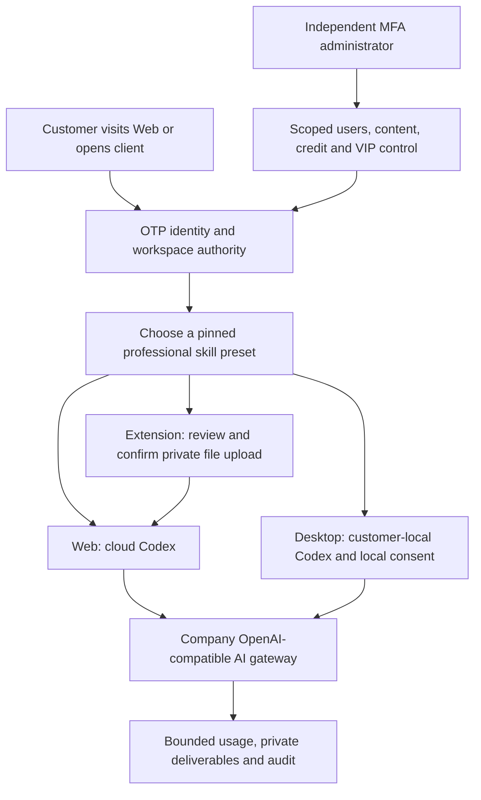

优先业务是 marketing 生图、视频、特效与字体，Google Ads／GA4／SEO／GEO／Meta 数据分析，以及企业内部重复流程优化。目录提供 18 个专业角色定义，覆盖软件开发至完整设计流程；各角色约束精确 Skill 版本、模型／工具、费用和成果格式。角色定义数量不代表已完成专业效果验收。

客户从登录开始，创建或加入企业和专案，选择角色、填写指令并提供获准资料。服务端检查身份、当前权限、额度和资金后创建任务。进度、审批、私有成果和消耗关联同一任务；响应丢失后沿用原请求身份。撤销权限、取消任务及删除资料均在实际执行、工具读取和成果访问时再次检查。

Desktop 的 Codex 在客户本机执行，客户可主动授予并撤销完整本机权限；无边框窗口采用自定义窗口控制，不显示 Electron 自带菜单。Extension 使用 Chrome 原生右侧栏，上传文件与发送对话分别确认。可选专属云端电脑采用有期限的固定时长报价，资源范围／费用须明确确认；允许 Codex 操作及 AI 费用上限另行确认。

管理员采用独立 MFA 登录、范围权限与显式拒绝。用户、消耗、费用赠送、VIP 授权、角色、内容、方案和资源分别控制。敏感变更要求操作理由、当前版本、幂等身份和审计；资源管理列表不泄露客户私有画面与文件内容。运行消耗或物理清理尚未确认时，保留原付款来源的资金预留，不伪造零消耗或清理完成。

阶段 121 历史限定验证：112 个完整后端文件共 1388 项测试通过，整合后客户端 338 项、实际 UI 24 项通过；29 张 PNG、5 组 GIF／MP4，以及 2209 个最终源码绑定。模型决策和物理节点协议响应使用明确假数据，未声称真实 Linux 节点或正式供应商质量已验收。原始 102 项需求仍保留完整验收待办；此前编号检查表作为带日期的快照保留。

此前一次原生 Codex 初始化超过既定 60 秒 RPC 上限；三个独立新目录的初始化／线程建立诊断通过，但原超时根因尚未确定。失败执行及清理证据原样保留，后续通过不能代替生产启动稳定性验收。


[MP4 · desktop](https://github.com/copypasteltd/workmate/blob/desktop/assets/screenshots/workmate-dedicated-desktop-07-local-cloud-boundary.mp4?raw=true)


[MP4 · web](https://github.com/copypasteltd/workmate/blob/web/assets/screenshots/workmate-13-dedicated-cloud-consent.mp4?raw=true)


[MP4 · extension](https://github.com/copypasteltd/workmate/blob/extension/assets/screenshots/workmate-dedicated-extension-05-folder-retry.mp4?raw=true)

[Current technical design / 当前技术方案](technical/121-dedicated-cloud-and-client-execution.md) · [Current qualification / 当前限定验收](quality/dedicated-cloud-checkpoint.json) · [Raw evidence index / 原始证据](quality/dedicated-cloud-evidence-121/index.json)

[All numbered open requirements / 全部编号待办快照](quality/remaining-work-2026-10-29.md) · [Structured requirements / 结构化清单](quality/remaining-work-2026-10-29.json) · [This change / 本轮更新](changes/121-dedicated-cloud-delivery.md)

[Client execution contract / 客户端执行约束](requirements/03-client-execution-amendment.md) · [Workspace rules / 工作区规则](governance/03-workspace-and-path-policy.md) · [Git publication rules / 分支发布规则](governance/04-git-branches-and-publication.md)

[Resource OpenAPI / 资源接口](contracts/dedicated-cloud.openapi.json) · [Route additions / 路由增量](contracts/dedicated-cloud-route-additions.json) · [Previous published checkpoint / 上一版验收](quality/integrated-recovery-checkpoint.json)

All development uses `D:\dev\copypasted\自有agent\dev\`; central documents use `D:\dev\copypasted\自有agent\docs\`. Each component is an independent Git repository. Docker, WSL and virtualization are prohibited. Native verification closes only browsers, pages, services and database processes it owns. Local `.env` values, credentials, dependency folders and generated installers are excluded from Git.

实际开发位于上述唯一 D 盘路径；各端独立仓库，中央文档统一位于 `docs/`。禁止 Docker、WSL 与虚拟化。原生验证只关闭自身创建的浏览器、页面、服务和数据库进程。密钥、`.env`、依赖目录与生成的安装程序不提交到 Git。

Run each component using its own bilingual guide. Use the backend demo configuration for local fake-data development, then connect Web/Admin and pair the native clients through their documented OTP/PKCE flow. Native node installation is operator-managed and requires an actual qualified physical Linux host; the supplied source and protocol tests do not establish that host’s readiness.

请按各端 README 的安装／启动说明运行：后端使用 demo 配置与假数据，Web／Admin 连接该服务；原生客户端通过各自文档中的 OTP／PKCE 接入。物理节点安装由运营人员管理，需要另行验证真实 Linux 主机，源码和协议测试本身不代表该主机已可交付。
