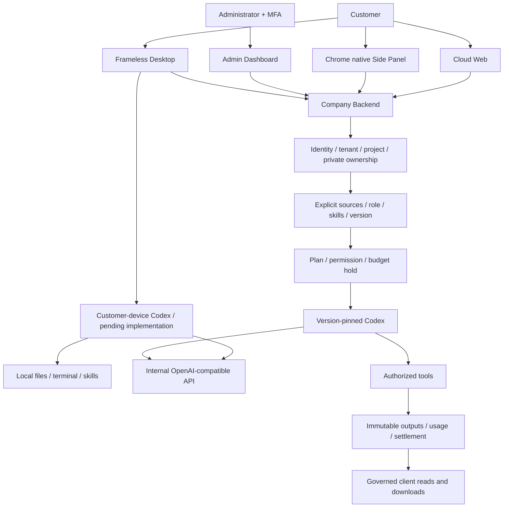
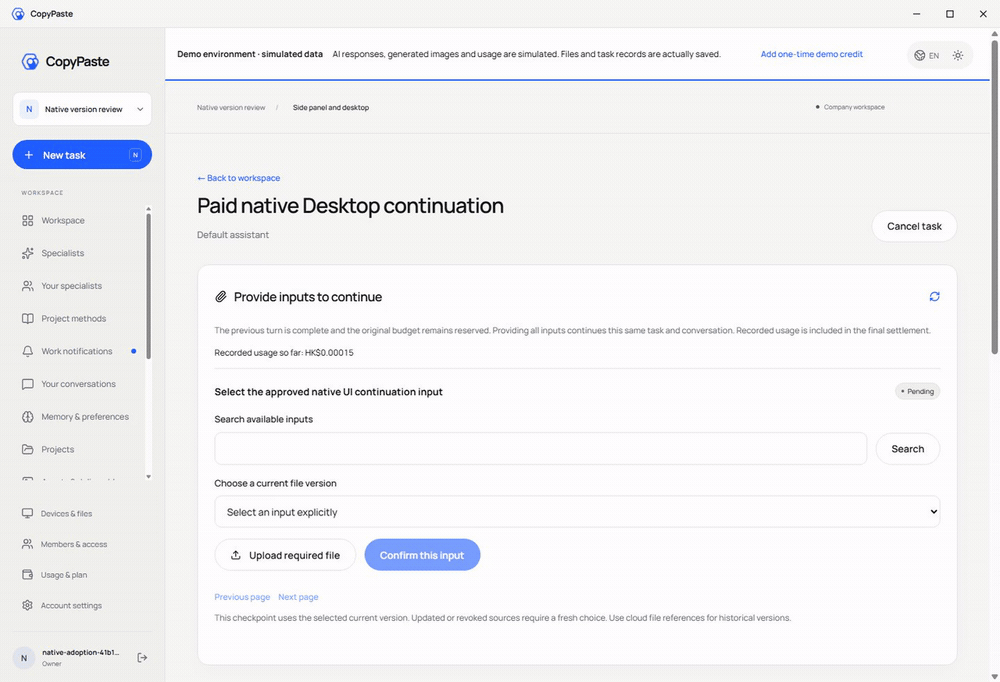

# Workmate · CopyPaste Enterprise Agent

[English](README.en.md) · [GitHub](https://github.com/copypasteltd/workmate)

面向香港企业的 Codex Agent 平台，首批面向现有客户的 marketing 团队。云端 Web、Chrome 原生侧栏、完整无边框 Desktop 共用公司身份、业务控制及内部 OpenAI 兼容网关；Admin 管理用户、内容、消耗、费用与 VIP。

<!-- client01-direction -->
## 当前客户端方向与实现差异

CLIENT01（2026-10-22）要求 **Desktop 在客户本机运行 Codex Agent**，提供客户可主动授予的 **完整本机权限**，操作能力对标 Codex Desktop。**Extension 在 Chrome 原生右侧栏采用 ChatGPT 式对话/附件结构**，获取、读取用户获选文件并上传，由云端 Codex 执行。全部产品 AI 请求仍走公司内部网关。

**当前实现：** Desktop 独立本机 Codex supervisor 已通过 9 项原生测试，产品的本机授权、费用和随包交付仍待接入。Extension 已接入原生右侧栏对话、历史、底部输入和明确文件版本附件；32 项扩展测试及 7 项真实侧栏旅程检查通过，模型回合按授权模拟。原 102 项及完整客户端验收继续跟踪。[本次扩展实现](https://github.com/copypasteltd/workmate/blob/docs/docs/technical/71-extension-cloud-conversations.md)。

本机 supervisor 的实现、实际权限测试与剩余产品接入见 [技术说明](https://github.com/copypasteltd/workmate/blob/docs/docs/technical/70-desktop-native-codex-supervisor.md)。

<!-- /client01-direction -->

## 仓库和分支

每个端保留独立 Git 历史和仓库根目录。多端同时运行时分别检出到不同目录。主文档相同提交发布到 `main` 与 `docs`。

| Branch | Directory under `dev/` | Responsibility | README |
| --- | --- | --- | --- |
| [backend](https://github.com/copypasteltd/workmate/tree/backend) | `copypaste-platform` | Backend / API · Codex · 数据与计量 | [中文](https://github.com/copypasteltd/workmate/blob/backend/README.md) / [English](https://github.com/copypasteltd/workmate/blob/backend/README.en.md) |
| [web](https://github.com/copypasteltd/workmate/tree/web) | `copypaste-web` | Web · 云端用户工作台 | [中文](https://github.com/copypasteltd/workmate/blob/web/README.md) / [English](https://github.com/copypasteltd/workmate/blob/web/README.en.md) |
| [admin](https://github.com/copypasteltd/workmate/tree/admin) | `copypaste-admin` | Admin Dashboard · 管理与运营 | [中文](https://github.com/copypasteltd/workmate/blob/admin/README.md) / [English](https://github.com/copypasteltd/workmate/blob/admin/README.en.md) |
| [desktop](https://github.com/copypasteltd/workmate/tree/desktop) | `copypaste-desktop` | Desktop · 无边框原生客户端 | [中文](https://github.com/copypasteltd/workmate/blob/desktop/README.md) / [English](https://github.com/copypasteltd/workmate/blob/desktop/README.en.md) |
| [extension](https://github.com/copypasteltd/workmate/tree/extension) | `copypaste-extension` | Extension · Chrome 原生侧栏 | [中文](https://github.com/copypasteltd/workmate/blob/extension/README.md) / [English](https://github.com/copypasteltd/workmate/blob/extension/README.en.md) |
| [delivery](https://github.com/copypasteltd/workmate/tree/delivery) | `copypaste-delivery` | Delivery · 启动、验证、录制与发布 | [中文](https://github.com/copypasteltd/workmate/blob/delivery/README.md) / [English](https://github.com/copypasteltd/workmate/blob/delivery/README.en.md) |
| [docs / main](https://github.com/copypasteltd/workmate/tree/docs) | Project root · `docs/` | Requirements, architecture, delivery and release notes | [中文](README.md) / [English](README.en.md) |

## 架构与使用逻辑

下图为当前目标的执行分工；现有 Desktop 包尚未实现本机 Codex 和完整本机权限。



以下操作描述当前云端/文件桥接基线；Desktop 的本机 Codex 与完整权限按 CLIENT01 改造后另行验收。

1. 邮箱验证码登录后选择企业和项目，确认当前权限与费用来源。Desktop/Extension 经公司网页和 PKCE 授权；Admin 使用独立邮箱 OTP/TOTP 身份。
2. 选择默认助手、18 个角色预设或私人专员；任务固定角色、Skill、模型和费率版本，明确选择文件、品牌资源和授权连接。
3. 确认有界预算后执行；Codex 调用公司接口及受控工具。已记录用量、预算预留、最终扣费分别展示。
4. 明确计量且已完成的回合需要资料时，选择当前获准版本，沿用原任务、线程与预留继续；限制八轮、三十二项依赖，未知结果进入核对。
5. 查看证据和产物，经认证下载或明确发布独立副本；当前来源治理继续生效。切换范围或读取失败会清空旧内容。
6. 管理员按范围筛选用户和消耗，管理内容、费用与 VIP/额度；敏感操作预览影响，采用幂等命令及必要的独立审批。

## 业务范围

营销创作覆盖生图、品牌版式、字体、广告/电商/社交素材、演示、可编辑交付及模板视频。分析覆盖 CSV/XLSX 导入、广告指标、Google/Meta 连接流程，以及有范围的网站诊断、证据、修改草稿和复查。企业流程涵盖助手、会话、记忆、计划、文件和通知。角色目录有 18 个预设；计划 Skill 与完整专业交付资格另行跟踪。

## 初次检出和本地运行

已有唯一工作区为 `D:\dev\copypasted\自有agent`，不要覆盖现有仓库。新设备在全新根目录检出 `docs`，再按上表在 `dev/` 检出各端分支。使用原生 Windows 工具，禁止 Docker、WSL 和虚拟化。

```powershell
git clone --single-branch --branch docs git@github.com:copypasteltd/workmate.git workmate
cd workmate
New-Item -ItemType Directory -Path dev
git clone --single-branch --branch backend git@github.com:copypasteltd/workmate.git dev/copypaste-platform
git clone --single-branch --branch web git@github.com:copypasteltd/workmate.git dev/copypaste-web
git clone --single-branch --branch admin git@github.com:copypasteltd/workmate.git dev/copypaste-admin
git clone --single-branch --branch desktop git@github.com:copypasteltd/workmate.git dev/copypaste-desktop
git clone --single-branch --branch extension git@github.com:copypasteltd/workmate.git dev/copypaste-extension
git clone --single-branch --branch delivery git@github.com:copypasteltd/workmate.git dev/copypaste-delivery
cd dev/copypaste-delivery
npm ci
npm run bootstrap
npm run demo
```

访问 Web `http://localhost:4317`、Admin `http://localhost:4318`；API `4310`、自有控制器 `4319`、原生 PostgreSQL `55432`。使用 `npm run stop` 关闭自有演示服务。独立启动、管理员登记、Desktop 打包和扩展加载见各端 README。需要 Node.js ≥22.14 与锁定依赖；原生验证另需固定 Codex 及 FFmpeg/FFprobe。

## 验证与边界

当前平台完整回归 **802/802**、统一任务专项 **52/52**，保留原 782 项命名测试；二者重叠，不相加。六仓库类型/构建/既有客户端测试 **13 项**、实际打包 Desktop/原生 Side Panel 旅程 **32 项**通过。另有独立本机 Codex supervisor **9 项**原生测试通过，尚未接入完整客户端授权/费用流程。四端媒体记录既有云端/文件桥接界面，绑定真实捕获时间、摘要及清理结果。

[统一任务证据](quality/canonical-task-checkpoint.json) · [本机内核证据](quality/local-codex-supervisor-checkpoint.json) · [候选包字节](quality/client-direction-package.json) · [媒体](quality/workmate-media-10.json) · [原需求进度](quality/requirements-alignment-progress.json)

UI 演示中的 AI 回合、供应商与业务事实按授权明确模拟；独立集成测试通过模拟内部网关运行真实 Codex 子进程。Admin 媒体展示受权限约束的 VIP/费用表单，不代表财务提交。SQL001–091 保持不可改写。全部 102 项需求、TC/NFR/G01–G10 及 81 局部验证/21 未证明完成/0 完整验收基线保留；统一任务的专用输入及历史身份迁移、任意执行中暂停、未知结果恢复、完整本机 Desktop 与扩展对话附件、全角色工作流、GEO、真实供应商、生产、签名与商店资格继续跟踪。

## 实际客户端展示

以下为实际运行页面及 GIF，模拟范围如上。扩展捕获的是已确认原生 Side Panel 的文档视口，不含浏览器工具栏。录制保留实际捕获时间。

### Web


[MP4](design/implementation/workmate/web-workmate-10-interaction.mp4)

### Desktop




[MP4](design/implementation/workmate/desktop-workmate-10-interaction.mp4)

### Extension


[MP4](design/implementation/workmate/extension-workmate-10-interaction.mp4)

### Admin


[MP4](design/implementation/workmate/admin-workmate-10-interaction.mp4)

## 文档导航

[Reading order](00-document-map.md) · [PRD](product/01-prd.md) · [Roles/Skills](product/06-role-templates-and-skill-presets.md) · [Brand](product/07-brand-design-system.md) · [Admin](product/08-admin-dashboard.md) · [API contracts](contracts/README.md) · [Delivery](DELIVERY.md)

### Product

- [产品需求文档 PRD](product/01-prd.md)
- [用户旅程与业务流程](product/02-user-journeys.md)
- [信息架构、页面与交互规格](product/03-information-architecture-and-interactions.md)
- [发布路线与商业模型](product/04-release-and-commercial-model.md)
- [Web Agent 工作台需求](product/05-web-agent-workbench.md)
- [预设角色与 Skill 模板需求](product/06-role-templates-and-skill-presets.md)
- [CopyPaste 品牌与产品设计规范](product/07-brand-design-system.md)
- [Admin Dashboard 产品与交互规格](product/08-admin-dashboard.md)

### Modules

- [模块总览与职责边界](modules/00-catalog.md)
- [M01 企业、工作空间、身份与权限](modules/01-identity-workspaces-permissions.md)
- [M02/M03 持续 Agent、任务与记忆](modules/02-agents-tasks-memory.md)
- [M04 品牌、文件与交付资产](modules/03-brand-assets-and-deliverables.md)
- [M05 营销图片、视频、字体与特效](modules/04-marketing-production.md)
- [M06 广告、网站、SEO 与 GEO 分析](modules/05-analytics-seo-geo.md)
- [M07/M08 外部连接与企业流程](modules/06-connectors-workflows.md)
- [M09/M10 三端客户端、设备与执行](modules/07-web-extension-desktop.md)
- [M11/M12 内部 AI、费用、权益与运营](modules/08-usage-billing-admin.md)

### Technical

- [技术架构与技术栈](technical/01-architecture-and-stack.md)
- [Codex 内核与内部 AI 网关集成](technical/02-runtime-and-ai-gateway.md)
- [数据模型、约束与生命周期](technical/03-data-model-and-lifecycle.md)
- [产品 API、事件与错误契约](technical/04-api-and-event-contracts.md)
- [原生执行器、设备协议与浏览器生命周期](technical/05-local-executor-and-browser.md)
- [媒体、数据与分析管线开发设计](technical/06-media-and-data-pipelines.md)
- [权限、执行与数据边界设计](technical/07-security-and-permissions.md)
- [开发实施与交付指南](technical/08-development-and-delivery.md)
- [部署、发布与运维手册](technical/09-operations-runbooks.md)
- [前端品牌规范与设计系统集成](technical/10-frontend-design-system.md)
- [Admin 控制面、权限与账务实施设计](technical/11-admin-control-plane.md)
- [实际开发、独立仓库与交付](technical/12-implementation-and-repositories.md)
- [持续 Agent、会话与记忆的实现约束](technical/13-persistent-agents-conversations-memory.md)
- [管理员邀请、MFA 与账号生命周期](technical/14-admin-identity-lifecycle.md)
- [云端工作流程定时执行](technical/15-cloud-workflow-schedules.md)
- [企业身份联邦与原生端授权](technical/16-enterprise-federation-and-native-auth.md)
- [删除、文件传输、保留与实时事件的当前实现](technical/17-erasure-transfer-retention-events.md)
- [持久云文件、版本引用与 Codex 工作源码](technical/18-persistent-cloud-files.md)
- [项目技能安装、版本绑定与安全撤销](technical/19-project-skill-lifecycle.md)
- [站内通知、任务定位与当前权限](technical/20-in-app-notifications.md)
- [默认助手与首次委派](technical/21-default-assistant-and-first-delegation.md)
- [运行前资料补齐检查点](technical/22-pre-execution-input-checkpoint.md)
- [执行容量、企业公平调度与排队](technical/23-execution-capacity-and-fair-dispatch.md)
- [Admin 记录分页、撤权显示与原生测试隔离](technical/24-admin-record-pages-and-test-isolation.md)
- [持久角色模板、依赖预检与 Codex 版本绑定](technical/25-role-template-registry-and-runtime-binding.md)
- [设计 PDF 审阅稿与可编辑源文件](technical/26-design-pdf-review-delivery.md)
- [营销 CSV、冻结指标与证据交付](technical/27-marketing-import-metrics-and-evidence.md)
- [AnalysisSpec 报告任务与冻结证据](technical/28-analysis-report-tasks-and-evidence.md)
- [CSV／XLSX 文件版本导入与更正链](technical/29-file-imports-and-correction-lineage.md)
- [Desktop 无边框窗口与 Chrome 原生侧栏](technical/30-native-window-and-browser-sidepanel.md)
- [排队暂停、同任务恢复与 Codex 原生续聊](technical/31-task-controls-and-native-continuation.md)
- [跨端会话、设备撤销与退出竞争修复](technical/32-cross-client-sessions-and-revocation.md)
- [规范认证接口与未知响应恢复](technical/33-canonical-authentication-and-retry-recovery.md)
- [用户资料契约、工作区初始化与并发清理](technical/34-user-profile-context-and-orphan-scan-races.md)
- [邀请与成员权限闭环](technical/35-invitations-and-membership-authority.md)
- [Admin 成员控制与不可变策略快照](technical/36-admin-membership-control-and-policy-snapshots.md)
- [Admin 账户生命周期与在途任务控制](technical/37-admin-account-lifecycle-and-inflight-control.md)
- [后台规范目录、字段范围与确认扣费](technical/38-admin-canonical-directories-and-scoped-usage.md)
- [授信、资金批次与实际结算来源](technical/39-billing-credit-and-settlement-provenance.md)
- [个人、企业付款账户与真实账务事件](technical/40-billing-subjects-and-financial-event-provenance.md)
- [规范费用命令与独立审批](technical/41-canonical-fee-commands-and-independent-approvals.md)
- [当前成员页面与原生认证恢复复核](technical/42-current-membership-ui-and-native-auth-recovery.md)
- [后台统一审批请求与原始契约](technical/43-shared-admin-approval-requests.md)
- [付款凭据、独立核实与准确入账](technical/44-manual-payment-evidence-and-exact-posting.md)
- [原交易退款、资金来源补偿与独立付款核实](technical/45-source-bound-refunds-and-cash-reconciliation.md)
- [不可变方案版本、发佈审批与历史授权绑定](technical/46-immutable-plans-and-legacy-grant-bindings.md)
- [规范 VIP 授权与实时有效权益](technical/47-canonical-vip-lifecycle-and-effective-entitlements.md)
- [企业席位与存储的实际约束](technical/48-enterprise-seat-and-storage-enforcement.md)
- [VIP 与显式赠额的原子组合开通](technical/49-atomic-vip-and-explicit-credit.md)
- [费用变更的事务通知与三端账户视图](technical/50-durable-financial-notifications.md)
- [限时只读支持与用户授权](technical/51-controlled-read-only-support.md)
- [能力版本、模型选择与任务费率冻结](technical/52-capability-versions-and-frozen-task-pricing.md)
- [受控模型能力配置、验证与版本发布](technical/53-controlled-capability-releases.md)
- [用户明确采用专家、模型与费率版本](technical/54-explicit-agent-version-adoption.md)
- [内部 AI 请求的短期凭证与逐次鉴权](technical/55-scoped-internal-inference-requests.md)
- [持久供应商请求、容量与逐次预算](technical/56-durable-provider-request-control.md)
- [每次调用的预算与平台费用](technical/57-per-request-budget-enforcement.md)
- [调用策略、逐次请求与人工核对后台](technical/58-provider-admin-control-and-reconciliation.md)
- [营销设计批次与单元独立交付](technical/59-creative-production-matrices.md)
- [基础视频工程与原生成片](technical/60-template-video-production.md)
- [营销账户授权与持久同步](technical/61-marketing-connector-synchronization.md)
- [有范围约束的 SEO 诊断与复查](technical/62-scoped-seo-audits.md)
- [网站修改任务与来源治理](technical/63-source-governed-website-change-tasks.md)
- [任务详情、历史消息与来源访问边界](technical/64-task-source-visibility.md)
- [会话历史、实际读取与产物来源链](technical/65-conversation-content-source-lineage.md)
- [付费用量、补充资料与原任务续接](technical/66-paid-native-input-checkpoints.md)
- [仓库整理、实际交互媒体与分支交付](technical/67-repository-delivery-and-media.md)
- [统一任务接口与原任务输入事务](technical/68-canonical-task-contracts-and-input-transactions.md)
- [Desktop 本机 Codex 与 Extension 方向检查](technical/69-desktop-local-codex-and-extension-direction.md)
- [本机 Codex supervisor：原生实测与剩余接入](technical/70-desktop-native-codex-supervisor.md)

### Requirements

- [软件需求规格说明 SRS](requirements/01-srs.md)
- [非功能要求与服务指标](requirements/02-nonfunctional-and-service-levels.md)
- [CLIENT01：Desktop 本机执行及 Extension 对话附件](requirements/03-client-execution-amendment.md)

### Governance

- [决策、默认值与验证门槛](governance/01-decisions-assumptions-and-questions.md)
- [术语、权威定义与来源](governance/02-glossary-and-sources.md)
- [开发工作区与文档路径规范](governance/03-workspace-and-path-policy.md)
- [Workmate 仓库、分支与同步规则 / Repository and publication policy](governance/04-git-branches-and-publication.md)

## 更新与发布

本次更新：[统一任务修复](changes/2026-10-22-canonical-task-repair.md) · [CLIENT01 方向](changes/2026-10-22-client-execution-direction.md) · [本机 Codex 内核](changes/2026-10-22-native-codex-supervisor.md)。

[2026-10-22 release notes](changes/2026-10-22-workmate-publication.md) · [Branch and synchronization policy](governance/04-git-branches-and-publication.md) · [Exact prior README archive](quality/history/stage66-before-workmate-readmes/manifest.json)

后续改动同步中英 README、相关实际截图/交互、双语更新说明和对应远端分支。发布只推送明确引用，核对远程 SHA，不强推。凭据、会话、数据库、依赖及安装包不进入 Git；浏览器调用后关闭自建且不用的页面、上下文及实例。

本次扩展更新：[云端对话及消息附件](technical/71-extension-cloud-conversations.md) · [更新说明](changes/2026-10-22-extension-conversations.md)。
