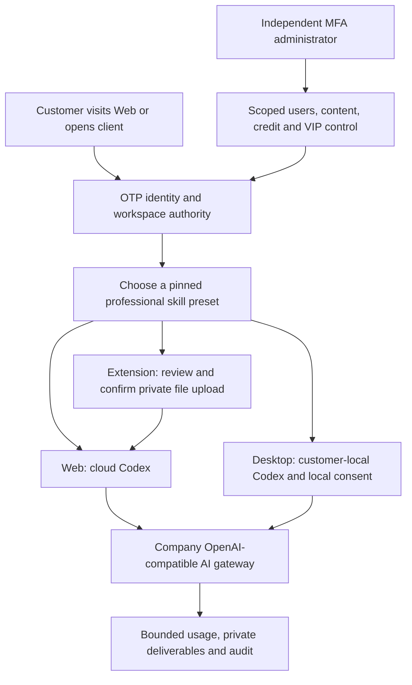

# Workmate · CopyPaste Enterprise Agent

[中文](README.md) · [English](README.en.md) · [CopyPaste](https://copypaste.hk/)

Workmate 面向在港企业，提供 Web 云端工作台、Chrome 原生右侧栏和客户本机 Desktop 三种入口。Agent 内核统一为 Codex，所有 AI 请求经公司 OpenAI 兼容网关；视觉规范沿用 CopyPaste 现有网站的风格与色系。

| Component / 组件 | Execution and use / 执行与使用 | Source and bilingual guide / 源码与双语说明 |
|---|---|---|
| Backend / 后端 | Identity, company gateway, cloud Codex, private files, tasks, billing and authority / 身份、云端执行、文件、费用和权限 | [backend](https://github.com/copypasteltd/workmate/blob/backend/README.md) · [English](https://github.com/copypasteltd/workmate/blob/backend/README.en.md) |
| Web | Hosted workspace; roles, projects, conversations, deliverables and optional resources / 云端工作台、角色、项目、对话与成果 | [web](https://github.com/copypasteltd/workmate/blob/web/README.md) · [English](https://github.com/copypasteltd/workmate/blob/web/README.en.md) |
| Admin | Separate MFA identity; scoped customer, content, credit, VIP and infrastructure administration / 独立 MFA 与用户、内容、费用、VIP、资源管理 | [admin](https://github.com/copypasteltd/workmate/blob/admin/README.md) · [English](https://github.com/copypasteltd/workmate/blob/admin/README.en.md) |
| Desktop | Local Codex and revocable local authority; frameless native window / 本机 Codex、可撤销本机权限与无边框窗口 | [desktop](https://github.com/copypasteltd/workmate/blob/desktop/README.md) · [English](https://github.com/copypasteltd/workmate/blob/desktop/README.en.md) |
| Extension | Native right Side Panel; review and confirm private uploads before cloud execution / 原生右侧栏、文件审核确认后交云端执行 | [extension](https://github.com/copypasteltd/workmate/blob/extension/README.md) · [English](https://github.com/copypasteltd/workmate/blob/extension/README.en.md) |
| Delivery / 交付 | Native qualification, recovery, release tooling and physical-node source / 原生验收、恢复、发布工具与物理节点源码 | [delivery](https://github.com/copypasteltd/workmate/blob/delivery/README.md) · [English](https://github.com/copypasteltd/workmate/blob/delivery/README.en.md) |

优先业务是 marketing 生图、视频、特效与字体，Google Ads／GA4／SEO／GEO／Meta 数据分析，以及企业内部重复流程优化。目录提供 18 个专业角色定义，覆盖软件开发至完整设计流程；各角色约束精确 Skill 版本、模型／工具、费用和成果格式。角色定义数量不代表已完成专业效果验收。

客户从登录开始，创建或加入企业和专案，选择角色、填写指令并提供获准资料。服务端检查身份、当前权限、额度和资金后创建任务。进度、审批、私有成果和消耗关联同一任务；响应丢失后沿用原请求身份。撤销权限、取消任务及删除资料均在实际执行、工具读取和成果访问时再次检查。

Desktop 的 Codex 在客户本机执行，客户可主动授予并撤销完整本机权限；无边框窗口采用自定义窗口控制，不显示 Electron 自带菜单。Extension 使用 Chrome 原生右侧栏，上传文件与发送对话分别确认。可选专属云端电脑采用有期限的固定时长报价，资源范围／费用须明确确认；允许 Codex 操作及 AI 费用上限另行确认。

管理员采用独立 MFA 登录、范围权限与显式拒绝。用户、消耗、费用赠送、VIP 授权、角色、内容、方案和资源分别控制。敏感变更要求操作理由、当前版本、幂等身份和审计；资源管理列表不泄露客户私有画面与文件内容。运行消耗或物理清理尚未确认时，保留原付款来源的资金预留，不伪造零消耗或清理完成。

当前限定验证：112 个完整后端文件共 1388 项测试通过，整合后客户端 338 项、实际 UI 24 项通过；29 张 PNG、5 组 GIF／MP4，以及 2189 个重新核对的源码绑定。模型决策和物理节点协议响应使用明确假数据，未声称真实 Linux 节点或正式供应商质量已验收。原始 102 项需求仍保留完整验收待办；此前编号检查表作为带日期的快照保留。

此前一次原生 Codex 初始化超过既定 60 秒 RPC 上限；三个独立新目录的初始化／线程建立诊断通过，但原超时根因尚未确定。失败执行及清理证据原样保留，后续通过不能代替生产启动稳定性验收。

[MP4 · desktop](https://github.com/copypasteltd/workmate/blob/desktop/assets/screenshots/workmate-dedicated-desktop-07-local-cloud-boundary.mp4?raw=true)

[MP4 · web](https://github.com/copypasteltd/workmate/blob/web/assets/screenshots/workmate-13-dedicated-cloud-consent.mp4?raw=true)

[MP4 · extension](https://github.com/copypasteltd/workmate/blob/extension/assets/screenshots/workmate-dedicated-extension-05-folder-retry.mp4?raw=true)

[Current technical design / 当前技术方案](technical/121-dedicated-cloud-and-client-execution.md) · [Current qualification / 当前限定验收](quality/dedicated-cloud-checkpoint.json) · [Raw evidence index / 原始证据](quality/dedicated-cloud-evidence-121/index.json)

[All numbered open requirements / 全部编号待办快照](quality/remaining-work-2026-10-29.md) · [Structured requirements / 结构化清单](quality/remaining-work-2026-10-29.json) · [This change / 本轮更新](changes/121-dedicated-cloud-delivery.md)

[Client execution contract / 客户端执行约束](requirements/03-client-execution-amendment.md) · [Workspace rules / 工作区规则](governance/03-workspace-and-path-policy.md) · [Git publication rules / 分支发布规则](governance/04-git-branches-and-publication.md)

[Resource OpenAPI / 资源接口](contracts/dedicated-cloud.openapi.json) · [Route additions / 路由增量](contracts/dedicated-cloud-route-additions.json) · [Previous published checkpoint / 上一版验收](quality/integrated-recovery-checkpoint.json)

All development uses `D:\dev\copypasted\自有agent\dev\`; central documents use `D:\dev\copypasted\自有agent\docs\`. Each component is an independent Git repository. Docker, WSL and virtualization are prohibited. Native verification closes only browsers, pages, services and database processes it owns. Local `.env` values, credentials, dependency folders and generated installers are excluded from Git.

实际开发位于上述唯一 D 盘路径；各端独立仓库，中央文档统一位于 `docs/`。禁止 Docker、WSL 与虚拟化。原生验证只关闭自身创建的浏览器、页面、服务和数据库进程。密钥、`.env`、依赖目录与生成的安装程序不提交到 Git。

Run each component using its own bilingual guide. Use the backend demo configuration for local fake-data development, then connect Web/Admin and pair the native clients through their documented OTP/PKCE flow. Native node installation is operator-managed and requires an actual qualified physical Linux host; the supplied source and protocol tests do not establish that host’s readiness.

请按各端 README 的安装／启动说明运行：后端使用 demo 配置与假数据，Web／Admin 连接该服务；原生客户端通过各自文档中的 OTP／PKCE 接入。物理节点安装由运营人员管理，需要另行验证真实 Linux 主机，源码和协议测试本身不代表该主机已可交付。
