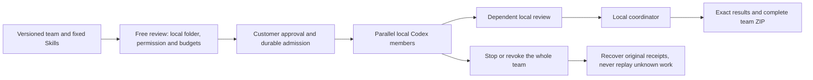

# 阶段139：本机专家团队闭环

60项后端、36项扩展、81项本机控制／下载回归及6项实际Windows旅程通过；4张截图、1组GIF／MP4、3档布局及1个独立解压的完整团队包绑定1756份确切源码。

新增本机团队定义管理、固定角色／Skill图、免费审阅、明确目录及完整权限、预算审批、独立Codex并行、依赖审阅和协调汇总。整组停止／撤权、未知回执核对和完整团队ZIP保持费用与来源约束。

迁移137只给已审批协调员开放暂停登记；成员按自己的角色核验能力，媒体状态通过当前发起人及项目校验。修复以协调员角色解释不同成员、原生媒体状态查询权限两处实际兼容问题。原生和云端运行历史分开，原生任务不进入云端队列。

原始失败保留：首版测试类型、创建201断言、暂停协调员登记、不同角色能力、输入计数响应格式、音频状态读取权限、UUID顺序假设、UI脚本类型及包含选项的精确标签选择器。旧原生用例复制为新夹具，仅补实际客户端的续期心跳及隔离夹具容量，修复服务器已受理的长工具调用阻塞及时心跳时的续期，使用实际完成时钟并保留45秒租约；丢失、迟到、撤权或换登录族不能取得该续期，未知费用占用规则保留。另修正本机团队审批文案和批准后自动显示执行区，历史分页使用数据库微秒时序避免游标失准。最后只改一个Renderer文件，因此177项结果以完全相同的后端／控制器／扩展／测试来源重用，Renderer重新编译并重建实际Windows包及旅程。各次实际结论见证据索引。

模型内容及窗口决定为受控假数据，真实本机操作不以模拟运行时替代。未签名安装、全部专业质量、真实外部账户及完整工程恢复保持原验收范围；本轮没有宣称102项需求整体完成。

60 backend, 36 extension and 81 native controller/download checks, plus six actual Windows journey checks passed. Four screenshots, one GIF/MP4 pair, three layouts and an independently extracted complete team archive bind 1756 exact source files.

[需求](https://github.com/copypasteltd/workmate/blob/main/docs/requirements/16-desktop-native-teams.md) · [接口／权限／恢复／交付方案](https://github.com/copypasteltd/workmate/blob/main/docs/technical/139-desktop-native-teams.md) · [源码与证据](https://github.com/copypasteltd/workmate/blob/main/docs/quality/native-teams-checkpoint-139.json) · [全部编号](https://github.com/copypasteltd/workmate/blob/main/docs/quality/remaining-work-stage139.md)
