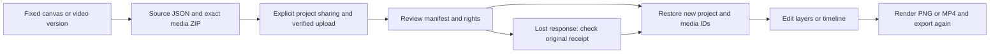

# 阶段140：设计与视频工程恢复闭环

阶段140新增普通分层画布及campaign-cuts影片的ZIP打包、固定素材和影片字型／授权、上传校验、明确共用确认、新编号恢复、原请求结果核对及继续编辑。真实Web、无边框Windows包和Chrome原生右侧栏验证；画布编辑再出PNG，影片编辑再出MP4。全部格式、品牌重绑、完整专业工程和跨机器渲染一致性仍按原范围验收。

新增6项业务集成、23项现有视频回归、3项扩展下载边界检查。实际三端验证和截图／录制见阶段140检查点。失败尝试保持原始记录，未用修改后的结果覆盖。

同时修复画布素材读取时的过期、撤回与校验检查，以及已过期画布的列表、更新和渲染入口。恢复按已认证用户限流；不可更新的版本表不取得更新型锁，归属素材记录在导入事务内锁定并复核。

详细格式、API、用户路径和限制见[开发说明](../development/140-creative-project-packages.md)，完整编号见[当前清单](../quality/remaining-work-stage140.md)。

发布入口使用 V2：推送前检查发现 V1 审计仍约束到上一阶段的输出目录。V2 仅修正发布协调；V1 工具、清单、证明分片和本地准备提交保持原样，未用它向远端发布。产品源码、三端检查点及六组件提交不变，最终清单为 `workmate-publication-140-v2.json`。
